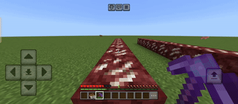
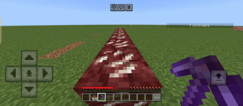

# 2-in-1 Loot & XP Booster — Renamed Book Menu for Loot and XP Multipliers

**By ALNStudios**

**Rename a Book to Booster, then set Loot up to 32x and XP up to 64x with two sliders and an on/off switch.**

> Adds a Booster menu with a Loot slider up to 32x, an XP slider up to 64x and an on/off switch.

## Overview

You rename a Book to Booster on an anvil and right-click with it. A menu opens with three buttons: XP & Loot Booster, About and Exit.

## Showcase / Previews

### Booster Toggled On

### Booster Toggled Off

## Key Features

### Renamed Book Control Panel
- **What Happens**: Rename a Book to "Booster" on an anvil, then right-click with it to open the Booster menu.
- **Good To Know**: Each player keeps their own settings, which are saved between sessions. You can also open the menu with the /aln:booster command.

### Loot Drop Booster
- **What Happens**: Drag the Loot slider across six levels, 1x, 2x, 4x, 8x, 16x and 32x, for ores, crops and other Fortune-style blocks you break and for mobs you kill.
- **Good To Know**: Each drop rolls a random bonus up to the level you pick. It works like a Fortune and Looting bonus, but with its own random roll. Ores, gilded blackstone, amethyst clusters, nether wart, sweet berries, wheat, carrots, potatoes, beetroot and mob loot are multiplied, so normal blocks such as dirt, stone and wood drop as usual, and unstackable items such as tools are left alone. Mining with Silk Touch drops the block once and is never multiplied. Blocks are boosted by rolling their loot again, so only items that block can really drop are multiplied, and mobs are boosted the same way, using the weapon you killed with, so rare drops stay rare but get more chances to appear. The Ores, Crops and Mobs switches let you choose which kinds of loot are boosted. Crops, nether wart and sweet berries are multiplied only when fully grown, and crops sped up with bone meal are not multiplied. Blocks that drop themselves or can be crafted back from their drops, such as ancient debris, melons, glowstone and sea lanterns, are never multiplied, so they cannot be farmed by placing and breaking. Fortune still works, and the booster multiplies on top of it. Only real mobs count, so armor stands, boats, minecarts and mobs that carry items, such as donkeys, mules, llamas, allays, foxes and villagers, are not multiplied, and each drop goes to the nearest player who caused it. Only drops that appear the instant you break a block or kill a mob are multiplied, so items thrown or dropped nearby are left alone.

### XP Gain Booster
- **What Happens**: Drag the XP slider across seven levels, 1x, 2x, 4x, 8x, 16x, 32x and 64x, and each XP orb near you is turned into that many orbs.
- **Good To Know**: The orbs are collected instantly, so Mending repairs your gear from the extra XP. Only the orbs closest to you are multiplied, so other players' orbs are never affected.

### About Screen
- **What Happens**: The About button shows the creator, the add-on version, a short note on both packs, the CurseForge and MCPEDL profiles and an unofficial-product notice.

### Redesigned UI
- **What Happens**: A small Resource Pack named Redesigned UI gives the Booster menus the ALNStudios look, with a dark panel, a blue border, a gold title and icon buttons.
- **Good To Know**: Enable the Resource Pack together with the Behavior Pack.

## How to Use

1. Rename a Book to Booster on an anvil.
2. Hold it and right-click, then choose XP & Loot Booster.
3. Drag the Loot and XP sliders, switch Boosters on or off, choose whether Ores, Crops and Mobs are boosted and press Apply. A higher sound means the boosters are on and a lower sound means they are off.

## Common Questions

- **Does the multiplier apply to other players?**: No. Each player chooses their own Loot and XP multipliers.
- **Can I turn it off?**: Yes. Open XP & Loot Booster, switch Boosters Off and press Apply. Your levels are kept.

## Compatibility

- Minecraft Bedrock Edition: 1.26.60 minimum, taken from the release notes that introduced the required modules.
- Experimental features: No experiment requirement detected in the inspected files.
- Achievements: Likely achievement-friendly.
- Verification: Source created, not tested in game.

## Creator and Permissions

- Creator: ALNStudios
- Profiles: [CurseForge Profile](https://www.curseforge.com/members/allenscreations/projects) · [MCPEDL Profile](https://mcpedl.com/user/alnstudios/)

 

## Guidelines and Attribution

- Creator: ALNStudios
- Rights & Reservation: All rights reserved for ALNStudios.
- Content Creators: Content creators are permitted to feature this creation in videos and streams with credit to ALNStudios.
- Redistribution: Do not re-upload this pack or provide direct monetized download bypasses. Link directly to the official repository page.
- Disclaimer: This is an unofficial community creation. It is not an official Minecraft product and is not approved by or associated with Mojang or Microsoft.

---

© All rights reserved for ALNStudios.

---

## Search & Discovery Keywords

Minecraft Bedrock add-on, 2-in-1 Loot & XP Booster Bedrock mod, loot multiplier, XP multiplier, renamed book menu, Minecraft PE survival, MCPEDL add-on, CurseForge Bedrock, ALNStudios.

