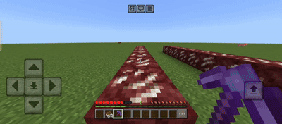
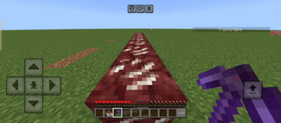

# 2-in-1 Loot & XP Booster — Renamed Book Menu for Loot and XP Multipliers

**By ALNStudios**

**Rename a Book to Booster, then pick Loot tiers up to 32x and XP tiers up to 64x from a styled menu.**

> Adds a Booster menu with six Loot tiers up to 32x and seven XP tiers up to 64x.

## Overview

You rename a Book to Booster on an anvil and right-click with it. A menu opens with three buttons: XP & Loot Booster, About and Exit.

## Showcase / Previews

### Booster Toggled On

### Booster Toggled Off

## Key Features

### Renamed Book Control Panel
- **What Happens**: Rename a Book or a Book and Quill to "Booster" on an anvil, then right-click with it to open the Booster menu.
- **Good To Know**: Each player keeps their own settings, which are saved between sessions.

### Loot Drop Booster
- **What Happens**: Drag the Loot slider across six tiers, from Normal to The Leprechaun, for blocks you break and mobs you kill.
- **Good To Know**: Chests, trapped chests, barrels, ender chests and shulker boxes are never multiplied, and unstackable items such as tools are left alone.

### XP Gain Booster
- **What Happens**: Drag the XP slider across seven tiers, from Normal up to The Sage at 64x, and nearby XP orbs are multiplied by that exact amount.
- **Good To Know**: XP orbs within 8 blocks of you are collected instantly instead of drifting toward you.

### About Screen
- **What Happens**: The About button introduces ALNStudios and the two packs in this add-on, and explains how to open the menu.

### Redesigned UI
- **What Happens**: A small Resource Pack named Redesigned UI gives the Booster menus the Cheatstick look, with a dark panel, a blue border and colored tier names.
- **Good To Know**: Enable the Resource Pack together with the Behavior Pack.

## How to Use

1. Rename a Book or a Book and Quill to Booster on an anvil.
2. Hold it and right-click, then choose XP & Loot Booster.
3. Drag the Loot and XP sliders, press Apply and check the Action Bar for your values.

## Common Questions

- **Does the multiplier apply to other players?**: No. Each player chooses their own Loot and XP multipliers.
- **Can I turn it off?**: Yes. Set both boosters back to Normal.

## Compatibility

- Minecraft Bedrock Edition: 1.26.60 minimum, taken from the release notes that introduced the required modules.
- Experimental features: No experiment requirement detected in the inspected files.
- Achievements: Likely achievement-friendly.
- Verification: Source created, not tested in game.

## Creator and Permissions

- Creator: ALNStudios
- Profiles: [CurseForge Profile](https://www.curseforge.com/members/allenscreations/projects) · [MCPEDL Profile](https://mcpedl.com/user/alnstudios/)

 

## Guidelines and Attribution

- Creator: ALNStudios
- Rights & Reservation: All rights reserved for ALNStudios.
- Content Creators: Content creators are permitted to feature this creation in videos and streams with credit to ALNStudios.
- Redistribution: Do not re-upload this pack or provide direct monetized download bypasses. Link directly to the official repository page.
- Disclaimer: This is an unofficial community creation. It is not an official Minecraft product and is not approved by or associated with Mojang or Microsoft.

---

© All rights reserved for ALNStudios.

---

## Search & Discovery Keywords

Minecraft Bedrock add-on, 2-in-1 Loot & XP Booster Bedrock mod, loot multiplier, XP multiplier, renamed book menu, Minecraft PE survival, MCPEDL add-on, CurseForge Bedrock, ALNStudios.

