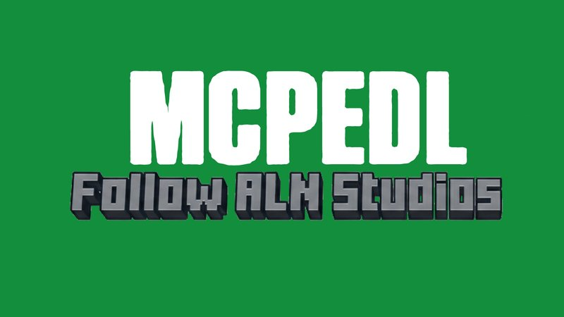

# ALN MoreDiscs — Thirty Craftable Music Discs With Original Tracks

**By ALNStudios**

**Craft thirty original music discs, each with its own 55 to 92 second track, and play them in a Jukebox in Survival.**

> ALN MoreDiscs adds thirty music discs, Track 1 to Track 30, each crafted from Paper, Coal, Flint, a Note Block and one or two accent items. They give a Jukebox new music without any other add-on.

## Overview

Craft a disc at a Crafting Table, put it in a Jukebox and the matching track plays. Every track is an original piece made for this pack, so the thirty discs add music to your world without using any existing songs. The discs also announce which track is playing and for how long, so ALN Wireless Headphones can show it.

## Key Features

### Thirty Original Tracks
- **What Happens**: The pack adds thirty discs with one track each. The track list is below.
- Track 1: Neon Horizon (1:16)
- Track 2: Ember Lantern (1:22)
- Track 3: Quiet Tides (1:25)
- Track 4: Crystal Caverns (0:58)
- Track 5: Starlight Express (1:10)
- Track 6: Midnight Drive (1:15)
- Track 7: Sunlit Meadow (0:55)
- Track 8: Deepslate Echoes (1:25)
- Track 9: Pixel Parade (1:11)
- Track 10: Golden Hour (1:24)
- Track 11: First Night (1:20)
- Track 12: Cobblestone Dawn (1:10)
- Track 13: Crafting Table Memories (1:00)
- Track 14: Alpha Sunrise (1:16)
- Track 15: Beta Lullaby (1:03)
- Track 16: Village Dusk (1:12)
- Track 17: Wooden Pickaxe (1:13)
- Track 18: Torchlight (1:26)
- Track 19: Dirt House Blues (1:05)
- Track 20: Bedtime Beacon (1:32)
- Track 21: Rainy Window (1:18)
- Track 22: Old World Seed (0:58)
- Track 23: Minecart Lullaby (1:03)
- Track 24: Lava Lamp Nights (1:29)
- Track 25: Sheep Counting (1:06)
- Track 26: Snowy Taiga Walk (1:14)
- Track 27: Floppy Disk Summer (1:08)
- Track 28: Creeper Waltz (1:10)
- Track 29: Pixel Postcards (1:16)
- Track 30: Sunset Hotbar (1:10)
- **Good To Know**: Each disc stacks to 1, like a vanilla music disc.

### Survival Crafting
- **What Happens**: Craft each of Tracks 1 to 10 at a Crafting Table. Top row: Paper, Coal, Paper. Middle row: Flint, Note Block, Flint. Bottom row: Paper, the accent item, Paper.
- **How It Works**: The accent item picks the track: Redstone Dust for Track 1, Lapis Lazuli for Track 2, Amethyst Shard for Track 3, Glowstone Dust for Track 4, Copper Ingot for Track 5, Iron Ingot for Track 6, Gold Ingot for Track 7, Emerald for Track 8, Nether Quartz for Track 9, Blaze Powder for Track 10.
- **Newer Discs**: Tracks 11 to 30 use the same top and middle rows. For Tracks 11 to 20 the bottom row is the accent item, Paper, the same accent item again: Redstone Dust for Track 11, Lapis Lazuli for Track 12, Amethyst Shard for Track 13, Glowstone Dust for Track 14, Copper Ingot for Track 15, Iron Ingot for Track 16, Gold Ingot for Track 17, Emerald for Track 18, Nether Quartz for Track 19, Blaze Powder for Track 20. For Tracks 21 to 30 the bottom row is one accent item, Paper, a second accent item: Redstone Dust and Lapis Lazuli for Track 21, Lapis Lazuli and Amethyst Shard for Track 22, Amethyst Shard and Glowstone Dust for Track 23, Glowstone Dust and Copper Ingot for Track 24, Copper Ingot and Iron Ingot for Track 25, Iron Ingot and Gold Ingot for Track 26, Gold Ingot and Emerald for Track 27, Emerald and Nether Quartz for Track 28, Nether Quartz and Blaze Powder for Track 29, Blaze Powder and Redstone Dust for Track 30.
- **Good To Know**: All thirty recipes are unlocked from the start, so no cheats and no recipe discovery are needed.

### Jukebox Playback
- **What Happens**: Use a disc on a Jukebox to play it, and use the Jukebox again to take the disc back out. Note particles rise from the Jukebox while a track plays.
- **Good To Know**: Breaking the Jukebox or taking the disc out ends the track.

### ALN Wireless Headphones Support
- **What Happens**: When a disc starts or stops, the pack announces the track number, the track name and its length so ALN Wireless Headphones can show them.
- **Good To Know**: This has not been tested together with ALN Wireless Headphones in game.

### Make Your Own Discs
- **What Happens**: The free web tool at https://alnstudios-more-discs.vercel.app is meant to turn your own audio files into a personal pack on your own device.
- **Good To Know**: ALNStudios only distributes the thirty original tracks. Audio you convert yourself must be for private, personal play, and you are responsible for having the right to use it.

## How to Use

1. Open the Crafting Table and craft a disc with the recipe above.
2. Right-click a Jukebox while holding the disc.
3. Listen for the track and watch the note particles rise from the Jukebox.
4. Right-click the Jukebox again to take the disc out and stop the track.

## Common Questions

- **Do I need cheats to get the discs?**: No. All thirty discs are craftable in Survival and their recipes are unlocked from the start.
- **Can I use my own music?**: ALNStudios ships only the thirty original tracks. The linked web tool is the route for personal packs, for private use only.

## Compatibility

- Minecraft Bedrock Edition: 1.26.60
- Experimental features: No experiment requirement detected in the inspected files.
- Achievements: Yes, achievement-friendly.
- Verification: Source created, package built, not tested in game.

## Creator and Permissions

- Creator: ALNStudios
- Profiles: [CurseForge Profile](https://www.curseforge.com/members/allenscreations/projects) · [MCPEDL Profile](https://mcpedl.com/user/alnstudios/)

 

## Guidelines and Attribution

- Creator: ALNStudios
- Rights & Reservation: All rights reserved for ALNStudios.
- Content Creators: Content creators are permitted to feature this creation in videos and streams with credit to ALNStudios.
- Redistribution: Do not re-upload this pack or provide direct monetized download bypasses. Link directly to the official repository page.
- Disclaimer: This is an unofficial community creation. It is not an official Minecraft product and is not approved by or associated with Mojang or Microsoft.

---

© All rights reserved for ALNStudios.

---

## Search & Discovery Keywords

Minecraft Bedrock add-on, ALN MoreDiscs Bedrock mod, custom music discs, Jukebox music, Note Block recipe, Minecraft PE survival, MCPEDL add-on, CurseForge Bedrock, ALNStudios.

