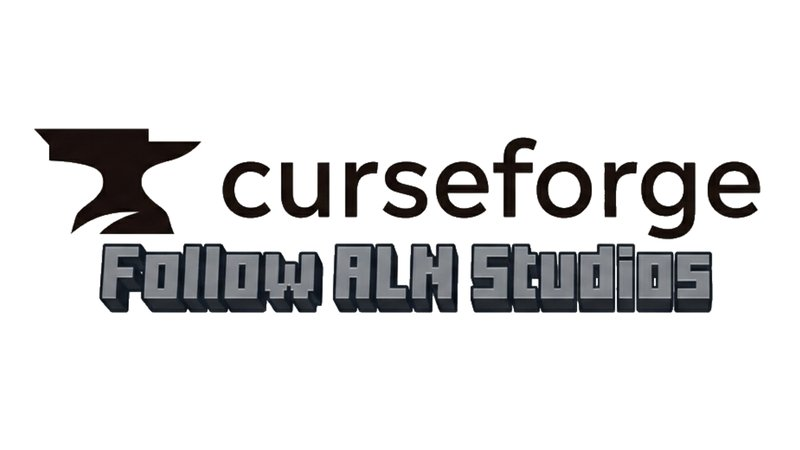

# ALN:PirateTokens — A clear factual subtitle

**By ALNStudios**

**Earn 3 pirate coins at sea, bank them in a vault and spend them on gear and 2 mystery crates.**

> Hunt Drowned and Guardians, fish up treasure and open shipwreck chests to collect physical pirate coins. Store them safely, finish daily bounties and trade at the Black Market.

## Overview

ALN:PirateTokens adds a three-coin pirate economy built around the Captain's Ledger item. Coins you carry can be lost in a fight with other players, while coins in your Pirate Vault stay safe. Everything is spent through the ledger menus.

## Key Features

### Pirate Token Currency
- **What Happens**: Silver Pirate Tokens, Gold Pirate Doubloons and Cursed Captain's Coins are real stackable items. 10 Silver convert to 1 Gold Doubloon and 10 Gold Doubloons convert to 1 Cursed Captain's Coin.

### Captain's Ledger
- **What Happens**: Craft the ledger from a Book, a Gold Nugget and a Compass, then use it to open a four-option menu: Pirate Vault, Pirate Bounties, Black Market and Mystery Crates.

### Pirate Vault
- **What Happens**: Deposit every carried coin into your personal vault, withdraw 1 or 10 Silver, 1 or 10 Gold, 1 Cursed Coin or everything as the best coins, and compress carried coins upward.

### Ocean and Raider Loot
- **What Happens**: Drowned, Guardians, Elder Guardians, Pillagers, Ravagers and Withers drop tokens. Fishing treasure catches and the first opening of a shipwreck or buried treasure chest also pay out.

### Loose Coin Death Drop
- **What Happens**: If you die carrying coins, half of each coin type (rounded up) drops at your death spot with a coin-scatter sound. Vault savings are never touched.

### Pirate Bounties
- **What Happens**: Three daily bounties such as Drowned Hunter, Deep Sea Angler and Treasure Seeker show live progress. Press Claim Doubloons when one is finished to bank the reward.

### Black Market
- **What Happens**: Spend vault savings on the Treasure Hunter's Compass, the Sea-Dog's Cutlass, Bottled Sea Breeze or three bundles of prismarine, dark oak and treasure materials.

### Mystery Crate Block
- **What Happens**: Craft a dark-wood crate with gold corners from 4 Gold Nuggets, 4 Dark Oak Planks and 1 Gold Pirate Doubloon. Place it anywhere and tap it to open the crate menu. Sneak to build against it.

### Mystery Buccaneer Crates
- **What Happens**: Pay 3 Gold Doubloons or 1 Cursed Captain's Coin from the vault. The prize ticks across the screen with note sounds, then bursts with gold particles and a jackpot title. The menu closes after a win, and 54 prizes come in 5 tiers from Common to Legendary, with a chance list for each crate.

## How to Use

1. Craft a Captain's Ledger with a Book, a Gold Nugget and a Compass.
2. Hunt ocean and raider mobs, fish, or open shipwreck and buried treasure chests to collect coins.
3. Use the ledger and choose Pirate Vault, then Deposit All Coins to bank them.
4. Open Pirate Bounties each day and press Claim Doubloons on finished bounties.
5. Spend vault savings in the Black Market or on a Mystery Crate. Place a Mystery Crate block to open the crate menu without the ledger.
6. Use the Treasure Hunter's Compass to find buried treasure, or sneak and use it to find a shipwreck. Coordinates appear in chat when command feedback is enabled.

## Compatibility

- Minecraft Bedrock Edition: 1.26.60 or newer.
- Experimental features: Not verified.
- Achievements: Yes, achievement-friendly.
- Verification: Source created, not tested in game.

## Creator and Permissions

- Creator: ALNStudios
- Profiles: [CurseForge Profile](https://www.curseforge.com/members/allenscreations/projects) · [MCPEDL Profile](https://mcpedl.com/user/alnstudios/)

 

## Guidelines and Attribution

- Creator: ALNStudios
- Rights & Reservation: All rights reserved for ALNStudios.
- Content Creators: Content creators are permitted to feature this creation in videos and streams with credit to ALNStudios.
- Redistribution: Do not re-upload this pack or provide direct monetized download bypasses. Link directly to the official repository page.
- Disclaimer: This is an unofficial community creation. It is not an official Minecraft product and is not approved by or associated with Mojang or Microsoft.

---

© All rights reserved for ALNStudios.

---

## Search & Discovery Keywords

Minecraft Bedrock add-on, ALN:PirateTokens Bedrock mod, MCPEDL add-on, CurseForge Bedrock, ALNStudios.

