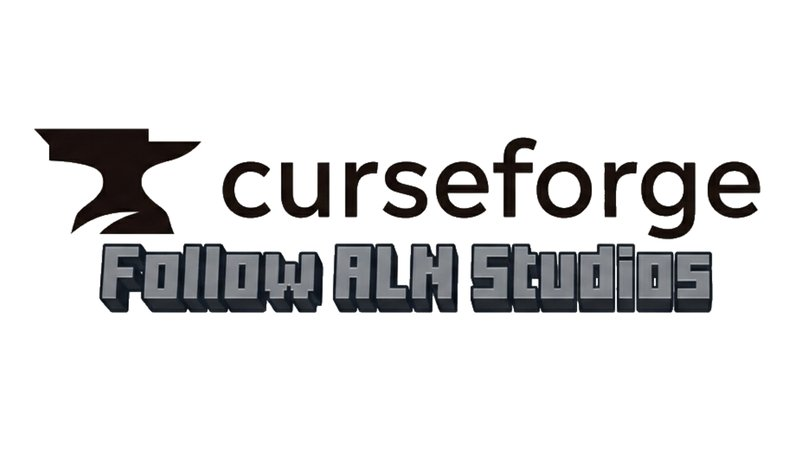
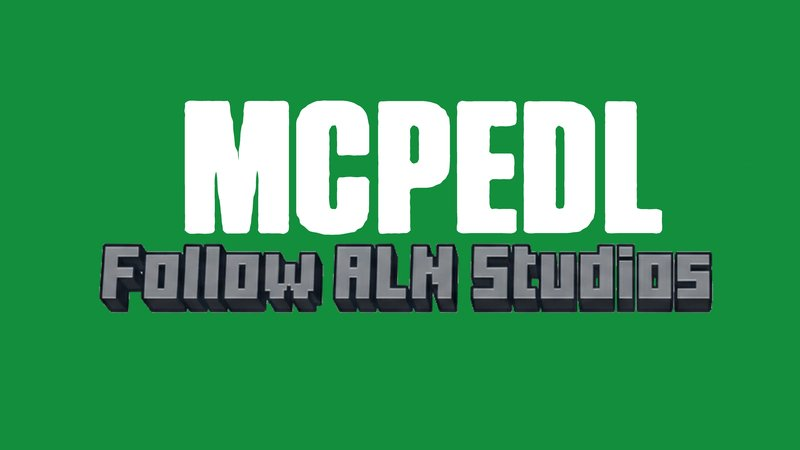

# OneBlock Natural Market — A OneBlock economy and supply shop

**By ALNStudios**

**Use the Natural Market Ledger to buy supplies for a regenerating OneBlock survival challenge.**

## Overview

Start on a small void platform with the central block at (0, 0, 0). Breaking it earns Coins and advances shared progression. Use the Natural Market Ledger to buy supplies and expand the central block's eligible regeneration pool.

## Key Features

### Regenerating OneBlock
- The central block returns after a successful break.
- The available natural block pool expands as shared mining milestones are reached.
- The starting core is Dirt and is managed by the map script after one-time void setup.

### Natural Market Ledger
- Opens a **3-row by 9-column chest-inspired inventory grid** with Minecraft item icons.
- Tap a supply slot to purchase its displayed bundle directly; no separate purchase-confirmation screen.
- Large categories use pages that fit the 27-slot layout.
- The catalogue contains more than 180 configured supplies across ten categories. Entries unavailable in the current game version are hidden.
- This is a custom layout for the standard server Action Form. It is **not a real vanilla chest container screen**.

### Coins and Selling
- Successful central-block breaks award Coins.
- Eligible catalogue items can be sold through the Ledger.
- The balance appears in menu text and action-bar messages, not a sidebar scoreboard.

### Progression and Supply Pool
- Personal mining milestones unlock additional market supplies.
- Purchased eligible blocks can be added to the central block's regeneration pool.
- Liquids are excluded from the purchased regeneration pool.

## How to Use

1. Import the Creative world first for initial checks.
2. Use the Natural Market Ledger from your inventory.
3. Tap a category, then tap a supply slot to buy its listed bundle.
4. Break the central block to earn Coins and progress.
5. Use the selling option in the market to exchange eligible catalogue items for Coins.

## Compatibility and Limitations

- Minecraft Bedrock Edition: minimum engine version 1.26.50.
- Stable Script API dependencies: `@minecraft/server` 2.10.0 and `@minecraft/server-ui` 2.2.0.
- Experimental features: No experiment requirement detected in the inspected files.
- UI compatibility: The inventory-grid appearance uses legacy resource-pack JSON UI customization of the standard Action Form. Minecraft is deprecating JSON UI in favor of Ore UI, so a future game update may require UI maintenance or a fallback to ordinary forms.
- Achievements: Unknown / needs confirmation because the foundation world's settings have not been verified.
- Verification: Source updated; no package build or in-game test has been run for this UI revision.

## Creator and Permissions

- Creator: ALNStudios
- Profiles: [CurseForge Profile](https://www.curseforge.com/members/allenscreations/projects) · [MCPEDL Profile](https://mcpedl.com/user/allenscreations/)

 

## Guidelines and Attribution

- Creator: ALNStudios
- Rights & Reservation: All rights reserved for ALNStudios.
- Content Creators: Content creators are permitted to feature this creation in videos and streams with credit to ALNStudios.
- Redistribution: Do not re-upload this pack or provide direct monetized download bypasses. Link directly to the official repository page.
- Disclaimer: This is an unofficial community creation. It is not an official Minecraft product and is not approved by or associated with Mojang or Microsoft.

---

© All rights reserved for ALNStudios.
