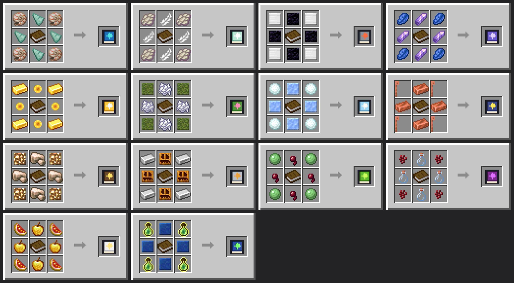

# Grimoire Relics V2 — Magical Offhand Grimoires for Minecraft Bedrock

[](https://github.com/AllensCreations/MCPE-Curseforges)
[](https://github.com/AllensCreations/MCPE-Curseforges)
[](https://github.com/AllensCreations/MCPE-Curseforges)
[](../README.md#available-source-add-ons)
[](../README.md#available-source-add-ons)

**By AllensCreations**

**MAGICAL OFFHAND RELICS SYSTEM & PASSIVE AURA ENGINE**

20 craftable ancient grimoires granting unique passive blessings, dynamic defensive reactive triggers, and orbiting particle auras—active strictly and only while equipped in your offhand slot.

---

## Overview

**Grimoire Relics V2** brings an RPG-style relic progression system to Minecraft Bedrock Edition without requiring experimental toggles or breaking achievement eligibility. Built on Bedrock Script API (`@minecraft/server` v1.13.0+), it monitors your offhand equipment in real-time.

Holding a Grimoire in your offhand dynamically attunes your character:
1. Displays an attunement actionbar title and lists relic perks.
2. Applies continuous passive buffs and status effects.
3. Generates a distinct 4-point rotating particle aura ring around the player.
4. Activates reactive combat triggers on hurt (defensive) or hit (offensive).
5. Automatically strips away active buffs and removes temporary constructs immediately upon un-equipping or switching offhand items.

---

## The 20 Grimoire Relics

| Relic Name | Identifier | Passive Abilities & Mechanics | Particle Aura | Acquisition / Crafting |
| :--- | :--- | :--- | :--- | :--- |
| **Infernal Phoenix** | `custom:tome_phoenix` | Permanent Fire Resistance. Attackers that melee hit you are set on fire for 5s; targets you melee hit burn for 5s. | Flame (`basic_flame_particle`) | **Ancient Relic (Loot Only)**: Bastion Treasure |
| **Abyssal Tide** | `custom:tome_abyss` | Permanent Water Breathing. Night Vision while underwater. Dolphin's Grace while swimming. | Water Splash (`water_splash_particle`) | Craftable: Prismarine Shards + Nautilus Shell + Book |
| **Zephyr Wind** | `custom:tome_zephyr` | Speed II + Jump Boost I. Auto Slow Falling when plunging (downward velocity < -0.5). Full fall damage immunity. | White Smoke (`white_smoke_particle`) | Craftable: Feathers + Phantom Membrane + Book |
| **Necrotic Lich** | `custom:tome_lich` | Melee strikes inflict Wither II for 3s on victims. | Soul (`soul_particle`) | **Ancient Relic (Loot Only)**: Bastion Treasure |
| **Mountain Titan** | `custom:tome_titan` | Permanent Resistance II and Slowness I. Complete knockback immunity (cancels knockback velocity on damage). | Smoke (`basic_smoke_particle`) | Craftable: Obsidian + Iron Block + Book |
| **Blood Vampire** | `custom:tome_vampire` | Life Leech: Every successful melee strike restores 1 full heart (2 HP). | Heart (`heart_particle`) | **Ancient Relic (Loot Only)**: Dungeon Monster Rooms |
| **Lunar Eclipse** | `custom:tome_lunar` | Nocturnal Blessing: Invisibility and Strength I during nighttime (13000–23000 ticks) in the Overworld. | End Rod (`endrod`) | Craftable: Amethyst Shards + Lapis Lazuli + Book |
| **Solar Dawn** | `custom:tome_solar` | Solar Nourishment: Saturation and Regeneration I under open daylight skies. | Totem (`totem_particle`) | Craftable: Sunflowers + Gold Ingot + Book |
| **Verdant Druid** | `custom:tome_druid` | Poison immunity. Naturally fertilizes crops and advances saplings within a 3-block radius. | Happy Villager (`villager_happy`) | Craftable: Bone Meal + Moss Block + Book |
| **Frost Weaver** | `custom:tome_frost` | Frost Walker II (freezes water underfoot into frosted ice, unless sneaking). Complete immunity to powder snow freezing. | Snowflake (`snowflake_particle`) | Craftable: Packed Ice + Snowballs + Book |
| **Stormcaller** | `custom:tome_storm` | Speed III outdoors during rain or thunderstorms. 15% chance to strike melee attackers with real lightning. | Electric Spark (`electric_spark_particle`) | Craftable: Copper Ingots + Lightning Rod + Book |
| **Deep Delver** | `custom:tome_delver` | Permanent Haste II. Automatically manifests an invisible light block at feet when below Y=55 in the dark. | Lava (`lava_particle`) | Craftable: Raw Iron + Glowstone + Book |
| **Void Phantom** | `custom:tome_void` | Emergency Void Rescue: Falling into the void in the Overworld (below Y=-60) teleports you to the surface; falling into the End void teleports you safely to the End spawn platform (100, 49, 0) with Slow Falling (5 min cooldown). | Nether Portal (`basic_portal_particle`) | **Ancient Relic (Loot Only)**: Ancient Cities |
| **Iron Golem** | `custom:tome_golem` | Fortified Armor: Grants 4 Absorption hearts every 30s. Melee strikes launch enemies upward into the air. | Crit (`critical_hit_emitter`) | Craftable: Carved Pumpkin + Iron Ingot + Book |
| **Venom Hydra** | `custom:tome_hydra` | Full immunity to Poison and Wither. Melee attacks inflict Poison II (5s). | Mob Spell (`mobspell_emitter`) | Craftable: Spider Eye + Slimeball + Book |
| **Cursed Alchemist** | `custom:tome_alchemist` | Potion Mastery: Permanently preserves and refreshes the duration of active beneficial potion effects. | Witch Spell (`witchspell_emitter`) | Craftable: Glass Bottles + Nether Wart + Book |
| **Radiant Seraph** | `custom:tome_seraph` | Permanent Regeneration II. Complete immunity to Blindness and Nausea. | High End Rod (`endrod`) | Craftable: Golden Apple + Glistering Melon + Book |
| **Arcane Scholar** | `custom:tome_scholar` | Arcane Intellect: Triples all experience gained from mob drops, mining, and orbs. | Enchanting Table (`enchanting_table_particle`) | Craftable: Lapis Block + Bottle o' Enchanting + Book |
| **Mirror Trickster** | `custom:tome_mirror` | Elusive Phase: 25% chance upon taking damage to negate all incoming damage and blink 3 blocks backward through smoke. | End Rod (`endrod`) | **Ancient Relic (Loot Only)**: Ancient Cities |
| **Cataclysm Dragon** | `custom:tome_dragon` | Strength II and Resistance I. Complete immunity to dragon breath and explosions (recovers damage as health). | Dragon Breath (`dragon_breath_trail`) | **Ancient Relic (Loot Only)**: End Cities |

---

## Crafting & Recipe Pattern

There are **14 craftable tomes** crafted at a standard Crafting Table using a shaped 3x3 pattern surrounding a central Book. The **6 Ancient tomes** (Void Phantom, Cataclysm Dragon, Necrotic Lich, Mirror Trickster, Blood Vampire, and Infernal Phoenix) cannot be crafted and must be uncovered by exploring rare world structures:

<p align="center">
  
</p>

```
[ C ] [ E ] [ C ]
[ E ] [ B ] [ E ]
[ C ] [ E ] [ C ]
```

- **B**: Vanilla Book (`minecraft:book`)
- **C**: Primary Elemental Catalyst (Corners)
- **E**: Secondary Arcane Essence (Edges)

---

## Durability & World Generation Loot Tables

### Relic Durability & Breaking Mechanics
- Each crafted or discovered Grimoire possesses **100 Max Durability** (`minecraft:durability`).
- **Event-Only Wear**: Passive stat buffs (such as Water Breathing, Speed, or Haste) do **not** drain durability. Durability is consumed strictly upon active mechanical execution:
  - *Combat triggers* (e.g. Phoenix burn on hit/hurt, Vampire life-steal, Iron Golem absorption & launch, Hydra poison, Lich wither): 1 durability per event.
  - *Environmental abilities* (e.g. Druid crop boost, Frost Weaver water freeze, Stormcaller lightning strike, Mirror Trickster blink): 1 to 2 durability per event.
  - *Emergency Lifesavers* (e.g. Void Phantom surface/End platform rescue): 10 durability.
- **Shatter**: Once durability depletes completely to 0, the tome shatters (`random.break` audio with item break particles) and is removed from the offhand slot. Tomes are non-repairable, consumable ancient relics.

### World Chest Distribution
Select ancient tomes generate naturally inside exploration chests across the world, occasionally replacing rare loot like Enchanted Golden Apples:
- **Ancient Cities**: High chance for **Void Phantom** (`tome_void`) and **Mirror Trickster** (`tome_mirror`).
- **Bastion Remnants (Treasure)**: **Infernal Phoenix** (`tome_phoenix`) and **Necrotic Lich** (`tome_lich`).
- **End Cities**: **Cataclysm Dragon** (`tome_dragon`).
- **Stronghold Libraries**: **Arcane Scholar** (`tome_scholar`) and **Cursed Alchemist** (`tome_alchemist`).
- **Shipwreck Treasuries**: **Abyssal Tide** (`tome_abyss`).
- **Monster Rooms / Simple Dungeons**: **Blood Vampire** (`tome_vampire`) and **Deep Delver** (`tome_delver`).

---

## Technical Specifications & Performance

- **Zero Experimental Flags**: Works in standard vanilla worlds, dedicated servers, and Realms without enabling Beta APIs or experimental toggles.
- **Strict Offhand Gating**: Un-equipping or hot-swapping a tome instantly clears persistent potion effects, removes temporary light blocks, and stops particle emission.
- **Optimized Tick Execution**: Passive loop runs on a staggered 10-tick interval, particle auras on 8 ticks, and void protection on a lightweight 2-tick check.
- **Dynamic Lore Injection**: Holding or storing tomes automatically populates full colored perk tooltips in item lore.

---

## Guidelines and Attribution

- **Creator**: AllensCreations
- **Rights & Reservation**: All rights reserved for AllensCreations.
- **Content Creators**: Content creators are permitted to feature this creation in videos and streams with credit to AllensCreations.
- **Redistribution**: Do not re-upload this pack or provide direct monetized download bypasses. Link directly to the official repository page.

---

© All rights reserved for AllensCreations.
