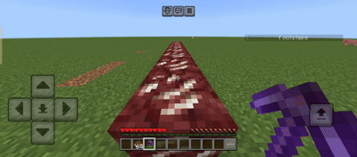
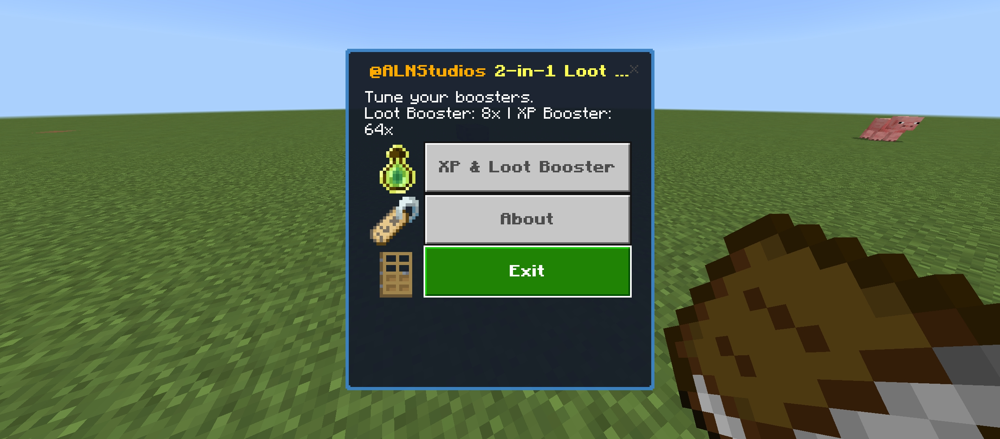
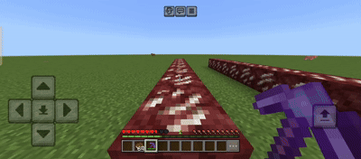
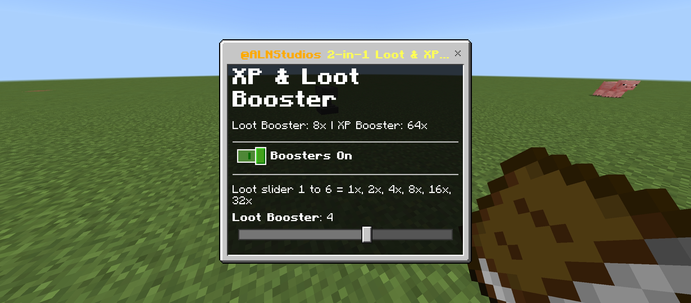

# Listing Kit: 2-in-1 Loot & XP Booster

Tap the Copy button on a block, then paste it into the CurseForge listing. Generated from DESCRIPTION.md: edit that, not this file.

## Package Name

```text
2-in-1 Loot & XP Booster
```

## Summary (105/256)

```text
Rename a Book to Booster, then set Loot up to 32x and XP up to 64x with two sliders and an on/off switch.
```

## Description (HTML)

Choose any of the 5 themes below. Tap the Copy button on your preferred theme and paste into the CurseForge description editor in source (HTML) mode.

### Theme 1: Vanilla Adaptive (Default)

Theme-neutral layout following the viewer's CurseForge light or dark mode.

```html
<div><div style="border:2px solid #15803d;border-radius:18px;line-height:1.5"><br><p style="text-align:center"></p><p style="color:#8a94a3;font-size:14px;text-align:center">by ALNStudios</p><p style="text-align:center"><span style="background-color:#15803d;color:#ffffff;border-radius:20px;font-size:16px">&nbsp;&nbsp;<strong>Rename a Book to Booster, then set Loot up to 32x and XP up to 64x with two sliders and an on/off switch.</strong>&nbsp;&nbsp;</span></p><p style="text-align:center;margin-left:16px;margin-right:16px">Adds a Booster menu with a Loot slider up to 32x, an XP slider up to 64x and an on/off switch.</p><div style="display:flex;flex-wrap:wrap;gap:8px;margin-left:14px;margin-right:14px"><div style="background-color:#dcfce7;color:#14532d;border-radius:20px;font-size:14px;line-height:2"><strong>&nbsp;&nbsp;Bedrock</strong>: 1.26+&nbsp;&nbsp;</div><div style="background-color:#dcfce7;color:#14532d;border-radius:20px;font-size:14px;line-height:2"><strong>&nbsp;&nbsp;Experimental</strong>: No&nbsp;&nbsp;</div><div style="background-color:#dcfce7;color:#14532d;border-radius:20px;font-size:14px;line-height:2"><strong>&nbsp;&nbsp;Achievements</strong>: Yes, achievement-friendly&nbsp;&nbsp;</div></div><br></div>
<p></p>
<p>You rename a Book to Booster on an anvil and right-click with it. A menu opens with three buttons: XP &amp; Loot Booster, About and Exit.</p>
<p></p>
<div style="display:flex;flex-wrap:wrap;gap:10px"><div style="flex:1 1 300px;border:1px solid #8a94a3;border-radius:16px;text-align:center"><p><strong>Booster Toggled On</strong></p><p></p></div><div style="flex:1 1 300px;border:1px solid #8a94a3;border-radius:16px;text-align:center"><p><strong>Booster Toggled Off</strong></p><p></p></div></div>
<p></p>
<div style="display:flex;flex-wrap:wrap;gap:10px"><div style="flex:1 1 300px;border:1px solid #8a94a3;border-radius:16px;text-align:center"><p></p></div><div style="flex:1 1 300px;border:1px solid #8a94a3;border-radius:16px;text-align:center"><p></p></div><div style="flex:1 1 300px;border:1px solid #8a94a3;border-radius:16px;text-align:center"><p></p></div><div style="flex:1 1 300px;border:1px solid #8a94a3;border-radius:16px;text-align:center"><p></p></div></div>
<p></p>
<div style="display:flex;flex-wrap:wrap;gap:10px"><div style="flex:1;min-width:200px;border:1px solid #8a94a3;border-radius:16px"><div style="background-color:#15803d;color:#ffffff;border-radius:16px;font-size:16px;line-height:2.2"><strong>&nbsp;&nbsp;Renamed Book Control Panel</strong></div><div style="margin-left:12px;margin-right:12px"><p><span>Rename a Book to "Booster" on an anvil, then right-click with it to open the Booster menu.</span><br><span style="font-size:13px;color:#8a94a3"><strong>Good To Know:</strong> Each player keeps their own settings, which are saved between sessions. You can also open the menu with the /aln:booster command.</span></p></div></div><div style="flex:1;min-width:200px;border:1px solid #8a94a3;border-radius:16px"><div style="background-color:#15803d;color:#ffffff;border-radius:16px;font-size:16px;line-height:2.2"><strong>&nbsp;&nbsp;Loot Drop Booster</strong></div><div style="margin-left:12px;margin-right:12px"><p><span>Drag the Loot slider across six levels, each giving a random bonus of up to 1x, 2x, 4x, 8x, 16x or 32x, for ores, crops and other Fortune-style blocks you break and for mobs you kill.</span><br><span style="font-size:13px;color:#8a94a3"><strong>Good To Know:</strong> Each drop rolls a random bonus up to the level you pick. It works like a Fortune and Looting bonus, but with its own random roll. Ores, gilded blackstone, amethyst clusters, nether wart, sweet berries, wheat, carrots, potatoes, beetroot and mob loot are multiplied, so normal blocks such as dirt, stone and wood drop as usual, and unstackable items such as tools are left alone. Mining with Silk Touch drops the block once and is never multiplied, and blocks broken in Creative mode are not multiplied because they drop nothing. Blocks are boosted by rolling their loot again, so only items that block can really drop are multiplied, and mobs are boosted the same way, using the weapon you killed with, so rare drops stay rare but get more chances to appear. The Ores, Crops and Mobs switches let you choose which kinds of loot are boosted. Crops, nether wart and sweet berries are multiplied only when fully grown, and crops sped up with bone meal are not multiplied. Blocks that drop themselves or can be crafted back from their drops, such as ancient debris, melons, glowstone and sea lanterns, are never multiplied, so they cannot be farmed by placing and breaking. Fortune still works, and the booster multiplies on top of it. Extra drops are combined into full stacks, so large boosts create fewer items on the ground. Only real mobs count, so armor stands, boats, minecarts and mobs that carry items, such as donkeys, mules, llamas, allays, foxes and villagers, are not multiplied, and only mobs you kill yourself are boosted. Only drops that appear the instant you break a block or kill a mob are multiplied, so items thrown or dropped nearby are left alone.</span></p></div></div><div style="flex:1;min-width:200px;border:1px solid #8a94a3;border-radius:16px"><div style="background-color:#15803d;color:#ffffff;border-radius:16px;font-size:16px;line-height:2.2"><strong>&nbsp;&nbsp;XP Gain Booster</strong></div><div style="margin-left:12px;margin-right:12px"><p><span>Drag the XP slider across seven levels, 1x, 2x, 4x, 8x, 16x, 32x and 64x, and each XP orb near you is turned into that many orbs.</span><br><span style="font-size:13px;color:#8a94a3"><strong>Good To Know:</strong> The orbs are collected instantly, so Mending repairs your gear from the extra XP. Only the orbs closest to you are multiplied, so other players' orbs are never affected.</span></p></div></div><div style="flex:1;min-width:200px;border:1px solid #8a94a3;border-radius:16px"><div style="background-color:#15803d;color:#ffffff;border-radius:16px;font-size:16px;line-height:2.2"><strong>&nbsp;&nbsp;About Screen</strong></div><div style="margin-left:12px;margin-right:12px"><p><span>The About button shows the creator, the add-on version, a short note on both packs, the CurseForge and MCPEDL profiles and an unofficial-product notice.</span></p></div></div><div style="flex:1;min-width:200px;border:1px solid #8a94a3;border-radius:16px"><div style="background-color:#15803d;color:#ffffff;border-radius:16px;font-size:16px;line-height:2.2"><strong>&nbsp;&nbsp;Redesigned UI</strong></div><div style="margin-left:12px;margin-right:12px"><p><span>A small Resource Pack named Redesigned UI gives the Booster menus the ALNStudios look, with a dark panel, a blue border, a gold title and icon buttons.</span><br><span style="font-size:13px;color:#8a94a3"><strong>Good To Know:</strong> Enable the Resource Pack together with the Behavior Pack.</span></p></div></div></div>
<p></p>
<table style="width:100%;border:1px solid #8a94a3;border-radius:16px"><tbody><tr><td style="width:44px;text-align:center"><div style="background-color:#15803d;color:#ffffff;font-weight:bold;font-size:15px;text-align:center;border-radius:10px;width:30px;aspect-ratio:1/1;line-height:30px">1</div></td><td style="text-align:left;">Rename a Book to Booster on an anvil.</td></tr><tr><td style="width:44px;text-align:center"><div style="background-color:#15803d;color:#ffffff;font-weight:bold;font-size:15px;text-align:center;border-radius:10px;width:30px;aspect-ratio:1/1;line-height:30px">2</div></td><td style="text-align:left;">Hold it and right-click, then choose XP &amp; Loot Booster.</td></tr><tr><td style="width:44px;text-align:center"><div style="background-color:#15803d;color:#ffffff;font-weight:bold;font-size:15px;text-align:center;border-radius:10px;width:30px;aspect-ratio:1/1;line-height:30px">3</div></td><td style="text-align:left;">Drag the Loot and XP sliders, switch Boosters on or off, choose whether Ores, Crops and Mobs are boosted and press Apply. A higher sound means the boosters are on and a lower sound means they are off.</td></tr></tbody></table>
<p></p>
<div class="spoiler" title="Does the multiplier apply to other players?" data-title="Does the multiplier apply to other players?"><p><strong>Does the multiplier apply to other players?</strong><br>No. Each player chooses their own Loot and XP multipliers.</p></div><div class="spoiler" title="Can I turn it off?" data-title="Can I turn it off?"><p><strong>Can I turn it off?</strong><br>Yes. Open XP &amp; Loot Booster, switch Boosters Off and press Apply. Your levels are kept.</p></div>
<p></p>
<table style="width:100%;border:1px solid #8a94a3;border-radius:16px"><tbody><tr><td style="width:44px;text-align:center"><div style="background-color:#15803d;color:#ffffff;font-weight:bold;font-size:15px;text-align:center;border-radius:10px;width:30px;aspect-ratio:1/1;line-height:30px">1</div></td><td style="text-align:left;">Download the file from this page and open it with Minecraft.</td></tr><tr><td style="width:44px;text-align:center"><div style="background-color:#15803d;color:#ffffff;font-weight:bold;font-size:15px;text-align:center;border-radius:10px;width:30px;aspect-ratio:1/1;line-height:30px">2</div></td><td style="text-align:left;">Create or edit a world and turn on the new pack(s) in its settings.</td></tr><tr><td style="width:44px;text-align:center"><div style="background-color:#15803d;color:#ffffff;font-weight:bold;font-size:15px;text-align:center;border-radius:10px;width:30px;aspect-ratio:1/1;line-height:30px">3</div></td><td style="text-align:left;">Play. No Experimental toggles needed.</td></tr></tbody></table>
<div style="border:1px solid #8a94a3;border-radius:16px;text-align:center"><br><div style="background-color:#15803d;color:#ffffff;border-radius:20px;font-size:15px;line-height:2;display:inline-block">&nbsp;&nbsp;<strong>Found a Bug or Have a Suggestion?</strong>&nbsp;&nbsp;</div><p style="font-size:14px;">Please leave a comment on this project page! All bug reports, gameplay feedback, and pack suggestions are welcome and appreciated.</p></div>
<p></p><div style="border:1px solid #8a94a3;border-radius:16px;text-align:center"><br><a href="https://ko-fi.com/alnstudios"></a><br><br></div><p style="text-align:center"><a href="https://www.curseforge.com/members/allenscreations/projects"><strong>CurseForge</strong></a> &nbsp;|&nbsp; <a href="https://mcpedl.com/user/alnstudios/"><strong>MCPEDL</strong></a> &nbsp;|&nbsp; <a href="https://ko-fi.com/alnstudios"><strong>Ko-fi</strong></a></p>
<hr>
<p style="text-align:center;color:#8a94a3;font-size:13px"><strong>By ALNStudios</strong></p>
<div class="spoiler"><p style="font-size:13px"><strong>Permissions and credits</strong></p><ul style="font-size:13px"><li>Rights: All rights reserved for ALNStudios.</li><li>Content creators: You may feature this creation in videos and streams with credit to ALNStudios.</li><li>Redistribution: Do not re-upload this pack or provide direct monetized download bypasses. Link to this page.</li><li>Visual: Promotional/cover imagery used on this page is AI-generated to illustrate the concept and purpose of the pack.</li><li>Unofficial community creation. Not an official Minecraft product and not approved by or associated with Mojang or Microsoft.</li></ul></div>
<p style="text-align:center;color:#8a94a3;font-size:12px">Minecraft Bedrock add-on, 2-in-1 Loot &amp; XP Booster Bedrock mod, loot multiplier, XP multiplier, renamed book menu, Minecraft PE survival, MCPEDL add-on, CurseForge Bedrock, ALNStudios.</p></div>
```

### Theme 2: Netherite Stealth (Modern Dark)

High-tech dark obsidian & emerald storefront.

```html
<div style="background-color:#0d1117;color:#c9d1d9;border-radius:12px;padding-left:12px"><div style="margin-right:12px"><br><div style="background-color:#161b22;border:2px solid #10b981;border-radius:18px;line-height:1.5"><br><p style="text-align:center"></p><p style="color:#8b949e;font-size:14px;text-align:center">by ALNStudios</p><p style="text-align:center"><span style="background-color:#10b981;color:#ffffff;border-radius:20px;font-size:16px">&nbsp;&nbsp;<strong>Rename a Book to Booster, then set Loot up to 32x and XP up to 64x with two sliders and an on/off switch.</strong>&nbsp;&nbsp;</span></p><p style="color:#8b949e;text-align:center;margin-left:16px;margin-right:16px">Adds a Booster menu with a Loot slider up to 32x, an XP slider up to 64x and an on/off switch.</p><div style="display:flex;flex-wrap:wrap;gap:8px;margin-left:14px;margin-right:14px"><div style="background-color:#161b22;color:#10b981;border-radius:20px;font-size:14px;line-height:2"><strong>&nbsp;&nbsp;Bedrock</strong>: 1.26+&nbsp;&nbsp;</div><div style="background-color:#161b22;color:#10b981;border-radius:20px;font-size:14px;line-height:2"><strong>&nbsp;&nbsp;Experimental</strong>: No&nbsp;&nbsp;</div><div style="background-color:#161b22;color:#10b981;border-radius:20px;font-size:14px;line-height:2"><strong>&nbsp;&nbsp;Achievements</strong>: Yes, achievement-friendly&nbsp;&nbsp;</div></div><br></div>
<p></p>
<p style="color:#c9d1d9">You rename a Book to Booster on an anvil and right-click with it. A menu opens with three buttons: XP &amp; Loot Booster, About and Exit.</p>
<p></p>
<div style="display:flex;flex-wrap:wrap;gap:10px"><div style="flex:1 1 300px;background-color:#161b22;border:1px solid #30363d;border-radius:16px;text-align:center"><p><strong>Booster Toggled On</strong></p><p></p></div><div style="flex:1 1 300px;background-color:#161b22;border:1px solid #30363d;border-radius:16px;text-align:center"><p><strong>Booster Toggled Off</strong></p><p></p></div></div>
<p></p>
<div style="display:flex;flex-wrap:wrap;gap:10px"><div style="flex:1 1 300px;background-color:#161b22;border:1px solid #30363d;border-radius:16px;text-align:center"><p></p></div><div style="flex:1 1 300px;background-color:#161b22;border:1px solid #30363d;border-radius:16px;text-align:center"><p></p></div><div style="flex:1 1 300px;background-color:#161b22;border:1px solid #30363d;border-radius:16px;text-align:center"><p></p></div><div style="flex:1 1 300px;background-color:#161b22;border:1px solid #30363d;border-radius:16px;text-align:center"><p></p></div></div>
<p></p>
<div style="display:flex;flex-wrap:wrap;gap:10px"><div style="flex:1;min-width:200px;background-color:#161b22;border:1px solid #30363d;border-radius:16px"><div style="background-color:#10b981;color:#ffffff;border-radius:16px;font-size:16px;line-height:2.2"><strong>&nbsp;&nbsp;Renamed Book Control Panel</strong></div><div style="margin-left:12px;margin-right:12px"><p><span style="color:#c9d1d9">Rename a Book to "Booster" on an anvil, then right-click with it to open the Booster menu.</span><br><span style="font-size:13px;color:#8b949e"><strong>Good To Know:</strong> Each player keeps their own settings, which are saved between sessions. You can also open the menu with the /aln:booster command.</span></p></div></div><div style="flex:1;min-width:200px;background-color:#161b22;border:1px solid #30363d;border-radius:16px"><div style="background-color:#10b981;color:#ffffff;border-radius:16px;font-size:16px;line-height:2.2"><strong>&nbsp;&nbsp;Loot Drop Booster</strong></div><div style="margin-left:12px;margin-right:12px"><p><span style="color:#c9d1d9">Drag the Loot slider across six levels, each giving a random bonus of up to 1x, 2x, 4x, 8x, 16x or 32x, for ores, crops and other Fortune-style blocks you break and for mobs you kill.</span><br><span style="font-size:13px;color:#8b949e"><strong>Good To Know:</strong> Each drop rolls a random bonus up to the level you pick. It works like a Fortune and Looting bonus, but with its own random roll. Ores, gilded blackstone, amethyst clusters, nether wart, sweet berries, wheat, carrots, potatoes, beetroot and mob loot are multiplied, so normal blocks such as dirt, stone and wood drop as usual, and unstackable items such as tools are left alone. Mining with Silk Touch drops the block once and is never multiplied, and blocks broken in Creative mode are not multiplied because they drop nothing. Blocks are boosted by rolling their loot again, so only items that block can really drop are multiplied, and mobs are boosted the same way, using the weapon you killed with, so rare drops stay rare but get more chances to appear. The Ores, Crops and Mobs switches let you choose which kinds of loot are boosted. Crops, nether wart and sweet berries are multiplied only when fully grown, and crops sped up with bone meal are not multiplied. Blocks that drop themselves or can be crafted back from their drops, such as ancient debris, melons, glowstone and sea lanterns, are never multiplied, so they cannot be farmed by placing and breaking. Fortune still works, and the booster multiplies on top of it. Extra drops are combined into full stacks, so large boosts create fewer items on the ground. Only real mobs count, so armor stands, boats, minecarts and mobs that carry items, such as donkeys, mules, llamas, allays, foxes and villagers, are not multiplied, and only mobs you kill yourself are boosted. Only drops that appear the instant you break a block or kill a mob are multiplied, so items thrown or dropped nearby are left alone.</span></p></div></div><div style="flex:1;min-width:200px;background-color:#161b22;border:1px solid #30363d;border-radius:16px"><div style="background-color:#10b981;color:#ffffff;border-radius:16px;font-size:16px;line-height:2.2"><strong>&nbsp;&nbsp;XP Gain Booster</strong></div><div style="margin-left:12px;margin-right:12px"><p><span style="color:#c9d1d9">Drag the XP slider across seven levels, 1x, 2x, 4x, 8x, 16x, 32x and 64x, and each XP orb near you is turned into that many orbs.</span><br><span style="font-size:13px;color:#8b949e"><strong>Good To Know:</strong> The orbs are collected instantly, so Mending repairs your gear from the extra XP. Only the orbs closest to you are multiplied, so other players' orbs are never affected.</span></p></div></div><div style="flex:1;min-width:200px;background-color:#161b22;border:1px solid #30363d;border-radius:16px"><div style="background-color:#10b981;color:#ffffff;border-radius:16px;font-size:16px;line-height:2.2"><strong>&nbsp;&nbsp;About Screen</strong></div><div style="margin-left:12px;margin-right:12px"><p><span style="color:#c9d1d9">The About button shows the creator, the add-on version, a short note on both packs, the CurseForge and MCPEDL profiles and an unofficial-product notice.</span></p></div></div><div style="flex:1;min-width:200px;background-color:#161b22;border:1px solid #30363d;border-radius:16px"><div style="background-color:#10b981;color:#ffffff;border-radius:16px;font-size:16px;line-height:2.2"><strong>&nbsp;&nbsp;Redesigned UI</strong></div><div style="margin-left:12px;margin-right:12px"><p><span style="color:#c9d1d9">A small Resource Pack named Redesigned UI gives the Booster menus the ALNStudios look, with a dark panel, a blue border, a gold title and icon buttons.</span><br><span style="font-size:13px;color:#8b949e"><strong>Good To Know:</strong> Enable the Resource Pack together with the Behavior Pack.</span></p></div></div></div>
<p></p>
<table style="width:100%;border:1px solid #30363d;border-radius:16px"><tbody><tr><td style="width:44px;text-align:center"><div style="background-color:#10b981;color:#ffffff;font-weight:bold;font-size:15px;text-align:center;border-radius:10px;width:30px;aspect-ratio:1/1;line-height:30px">1</div></td><td style="text-align:left;color:#c9d1d9">Rename a Book to Booster on an anvil.</td></tr><tr><td style="width:44px;text-align:center"><div style="background-color:#10b981;color:#ffffff;font-weight:bold;font-size:15px;text-align:center;border-radius:10px;width:30px;aspect-ratio:1/1;line-height:30px">2</div></td><td style="text-align:left;color:#c9d1d9">Hold it and right-click, then choose XP &amp; Loot Booster.</td></tr><tr><td style="width:44px;text-align:center"><div style="background-color:#10b981;color:#ffffff;font-weight:bold;font-size:15px;text-align:center;border-radius:10px;width:30px;aspect-ratio:1/1;line-height:30px">3</div></td><td style="text-align:left;color:#c9d1d9">Drag the Loot and XP sliders, switch Boosters on or off, choose whether Ores, Crops and Mobs are boosted and press Apply. A higher sound means the boosters are on and a lower sound means they are off.</td></tr></tbody></table>
<p></p>
<div class="spoiler" title="Does the multiplier apply to other players?" data-title="Does the multiplier apply to other players?"><p style="color:#c9d1d9"><strong>Does the multiplier apply to other players?</strong><br>No. Each player chooses their own Loot and XP multipliers.</p></div><div class="spoiler" title="Can I turn it off?" data-title="Can I turn it off?"><p style="color:#c9d1d9"><strong>Can I turn it off?</strong><br>Yes. Open XP &amp; Loot Booster, switch Boosters Off and press Apply. Your levels are kept.</p></div>
<p></p>
<table style="width:100%;border:1px solid #30363d;border-radius:16px"><tbody><tr><td style="width:44px;text-align:center"><div style="background-color:#10b981;color:#ffffff;font-weight:bold;font-size:15px;text-align:center;border-radius:10px;width:30px;aspect-ratio:1/1;line-height:30px">1</div></td><td style="text-align:left;color:#c9d1d9">Download the file from this page and open it with Minecraft.</td></tr><tr><td style="width:44px;text-align:center"><div style="background-color:#10b981;color:#ffffff;font-weight:bold;font-size:15px;text-align:center;border-radius:10px;width:30px;aspect-ratio:1/1;line-height:30px">2</div></td><td style="text-align:left;color:#c9d1d9">Create or edit a world and turn on the new pack(s) in its settings.</td></tr><tr><td style="width:44px;text-align:center"><div style="background-color:#10b981;color:#ffffff;font-weight:bold;font-size:15px;text-align:center;border-radius:10px;width:30px;aspect-ratio:1/1;line-height:30px">3</div></td><td style="text-align:left;color:#c9d1d9">Play. No Experimental toggles needed.</td></tr></tbody></table>
<div style="background-color:#161b22;border:1px solid #30363d;border-radius:16px;text-align:center"><br><div style="background-color:#10b981;color:#ffffff;border-radius:20px;font-size:15px;line-height:2;display:inline-block">&nbsp;&nbsp;<strong>Found a Bug or Have a Suggestion?</strong>&nbsp;&nbsp;</div><p style="font-size:14px;color:#c9d1d9">Please leave a comment on this project page! All bug reports, gameplay feedback, and pack suggestions are welcome and appreciated.</p></div>
<p></p><div style="background-color:#161b22;border:1px solid #30363d;border-radius:16px;text-align:center"><br><a href="https://ko-fi.com/alnstudios"></a><br><br></div><p style="text-align:center"><a style="color:#58a6ff" href="https://www.curseforge.com/members/allenscreations/projects"><strong>CurseForge</strong></a> &nbsp;|&nbsp; <a style="color:#58a6ff" href="https://mcpedl.com/user/alnstudios/"><strong>MCPEDL</strong></a> &nbsp;|&nbsp; <a style="color:#58a6ff" href="https://ko-fi.com/alnstudios"><strong>Ko-fi</strong></a></p>
<hr>
<p style="text-align:center;color:#8b949e;font-size:13px"><strong>By ALNStudios</strong></p>
<div class="spoiler"><p style="font-size:13px"><strong>Permissions and credits</strong></p><ul style="font-size:13px"><li>Rights: All rights reserved for ALNStudios.</li><li>Content creators: You may feature this creation in videos and streams with credit to ALNStudios.</li><li>Redistribution: Do not re-upload this pack or provide direct monetized download bypasses. Link to this page.</li><li>Visual: Promotional/cover imagery used on this page is AI-generated to illustrate the concept and purpose of the pack.</li><li>Unofficial community creation. Not an official Minecraft product and not approved by or associated with Mojang or Microsoft.</li></ul></div>
<p style="text-align:center;color:#8b949e;font-size:12px">Minecraft Bedrock add-on, 2-in-1 Loot &amp; XP Booster Bedrock mod, loot multiplier, XP multiplier, renamed book menu, Minecraft PE survival, MCPEDL add-on, CurseForge Bedrock, ALNStudios.</p><br></div></div>
```

### Theme 3: Bedrock GUI (In-Game Menu)

Authentic Minecraft stone dialog with 3D beveled borders and item slot insets.

```html
<div style="background-color:#313233;color:#e0e0e0;border-radius:12px;padding-left:12px"><div style="margin-right:12px"><br><div style="background-color:#202021;border:2px solid #4a4b4d;border-radius:18px;line-height:1.5"><br><p style="text-align:center"></p><p style="color:#a0a0a0;font-size:14px;text-align:center">by ALNStudios</p><p style="text-align:center"><span style="background-color:#4a4b4d;color:#ffffff;border-radius:20px;font-size:16px">&nbsp;&nbsp;<strong>Rename a Book to Booster, then set Loot up to 32x and XP up to 64x with two sliders and an on/off switch.</strong>&nbsp;&nbsp;</span></p><p style="color:#d0d0d0;text-align:center;margin-left:16px;margin-right:16px">Adds a Booster menu with a Loot slider up to 32x, an XP slider up to 64x and an on/off switch.</p><div style="display:flex;flex-wrap:wrap;gap:8px;margin-left:14px;margin-right:14px"><div style="background-color:#202021;color:#ffffff;border-radius:20px;font-size:14px;line-height:2"><strong>&nbsp;&nbsp;Bedrock</strong>: 1.26+&nbsp;&nbsp;</div><div style="background-color:#202021;color:#ffffff;border-radius:20px;font-size:14px;line-height:2"><strong>&nbsp;&nbsp;Experimental</strong>: No&nbsp;&nbsp;</div><div style="background-color:#202021;color:#ffffff;border-radius:20px;font-size:14px;line-height:2"><strong>&nbsp;&nbsp;Achievements</strong>: Yes, achievement-friendly&nbsp;&nbsp;</div></div><br></div>
<p></p>
<p style="color:#e0e0e0">You rename a Book to Booster on an anvil and right-click with it. A menu opens with three buttons: XP &amp; Loot Booster, About and Exit.</p>
<p></p>
<div style="display:flex;flex-wrap:wrap;gap:10px"><div style="flex:1 1 300px;background-color:#202021;border:1px solid #4a4b4d;border-radius:16px;text-align:center"><p><strong>Booster Toggled On</strong></p><p></p></div><div style="flex:1 1 300px;background-color:#202021;border:1px solid #4a4b4d;border-radius:16px;text-align:center"><p><strong>Booster Toggled Off</strong></p><p></p></div></div>
<p></p>
<div style="display:flex;flex-wrap:wrap;gap:10px"><div style="flex:1 1 300px;background-color:#202021;border:1px solid #4a4b4d;border-radius:16px;text-align:center"><p></p></div><div style="flex:1 1 300px;background-color:#202021;border:1px solid #4a4b4d;border-radius:16px;text-align:center"><p></p></div><div style="flex:1 1 300px;background-color:#202021;border:1px solid #4a4b4d;border-radius:16px;text-align:center"><p></p></div><div style="flex:1 1 300px;background-color:#202021;border:1px solid #4a4b4d;border-radius:16px;text-align:center"><p></p></div></div>
<p></p>
<div style="display:flex;flex-wrap:wrap;gap:10px"><div style="flex:1;min-width:200px;background-color:#202021;border:1px solid #4a4b4d;border-radius:16px"><div style="background-color:#4a4b4d;color:#ffffff;border-radius:16px;font-size:16px;line-height:2.2"><strong>&nbsp;&nbsp;Renamed Book Control Panel</strong></div><div style="margin-left:12px;margin-right:12px"><p><span style="color:#e0e0e0">Rename a Book to "Booster" on an anvil, then right-click with it to open the Booster menu.</span><br><span style="font-size:13px;color:#a0a0a0"><strong>Good To Know:</strong> Each player keeps their own settings, which are saved between sessions. You can also open the menu with the /aln:booster command.</span></p></div></div><div style="flex:1;min-width:200px;background-color:#202021;border:1px solid #4a4b4d;border-radius:16px"><div style="background-color:#4a4b4d;color:#ffffff;border-radius:16px;font-size:16px;line-height:2.2"><strong>&nbsp;&nbsp;Loot Drop Booster</strong></div><div style="margin-left:12px;margin-right:12px"><p><span style="color:#e0e0e0">Drag the Loot slider across six levels, each giving a random bonus of up to 1x, 2x, 4x, 8x, 16x or 32x, for ores, crops and other Fortune-style blocks you break and for mobs you kill.</span><br><span style="font-size:13px;color:#a0a0a0"><strong>Good To Know:</strong> Each drop rolls a random bonus up to the level you pick. It works like a Fortune and Looting bonus, but with its own random roll. Ores, gilded blackstone, amethyst clusters, nether wart, sweet berries, wheat, carrots, potatoes, beetroot and mob loot are multiplied, so normal blocks such as dirt, stone and wood drop as usual, and unstackable items such as tools are left alone. Mining with Silk Touch drops the block once and is never multiplied, and blocks broken in Creative mode are not multiplied because they drop nothing. Blocks are boosted by rolling their loot again, so only items that block can really drop are multiplied, and mobs are boosted the same way, using the weapon you killed with, so rare drops stay rare but get more chances to appear. The Ores, Crops and Mobs switches let you choose which kinds of loot are boosted. Crops, nether wart and sweet berries are multiplied only when fully grown, and crops sped up with bone meal are not multiplied. Blocks that drop themselves or can be crafted back from their drops, such as ancient debris, melons, glowstone and sea lanterns, are never multiplied, so they cannot be farmed by placing and breaking. Fortune still works, and the booster multiplies on top of it. Extra drops are combined into full stacks, so large boosts create fewer items on the ground. Only real mobs count, so armor stands, boats, minecarts and mobs that carry items, such as donkeys, mules, llamas, allays, foxes and villagers, are not multiplied, and only mobs you kill yourself are boosted. Only drops that appear the instant you break a block or kill a mob are multiplied, so items thrown or dropped nearby are left alone.</span></p></div></div><div style="flex:1;min-width:200px;background-color:#202021;border:1px solid #4a4b4d;border-radius:16px"><div style="background-color:#4a4b4d;color:#ffffff;border-radius:16px;font-size:16px;line-height:2.2"><strong>&nbsp;&nbsp;XP Gain Booster</strong></div><div style="margin-left:12px;margin-right:12px"><p><span style="color:#e0e0e0">Drag the XP slider across seven levels, 1x, 2x, 4x, 8x, 16x, 32x and 64x, and each XP orb near you is turned into that many orbs.</span><br><span style="font-size:13px;color:#a0a0a0"><strong>Good To Know:</strong> The orbs are collected instantly, so Mending repairs your gear from the extra XP. Only the orbs closest to you are multiplied, so other players' orbs are never affected.</span></p></div></div><div style="flex:1;min-width:200px;background-color:#202021;border:1px solid #4a4b4d;border-radius:16px"><div style="background-color:#4a4b4d;color:#ffffff;border-radius:16px;font-size:16px;line-height:2.2"><strong>&nbsp;&nbsp;About Screen</strong></div><div style="margin-left:12px;margin-right:12px"><p><span style="color:#e0e0e0">The About button shows the creator, the add-on version, a short note on both packs, the CurseForge and MCPEDL profiles and an unofficial-product notice.</span></p></div></div><div style="flex:1;min-width:200px;background-color:#202021;border:1px solid #4a4b4d;border-radius:16px"><div style="background-color:#4a4b4d;color:#ffffff;border-radius:16px;font-size:16px;line-height:2.2"><strong>&nbsp;&nbsp;Redesigned UI</strong></div><div style="margin-left:12px;margin-right:12px"><p><span style="color:#e0e0e0">A small Resource Pack named Redesigned UI gives the Booster menus the ALNStudios look, with a dark panel, a blue border, a gold title and icon buttons.</span><br><span style="font-size:13px;color:#a0a0a0"><strong>Good To Know:</strong> Enable the Resource Pack together with the Behavior Pack.</span></p></div></div></div>
<p></p>
<table style="width:100%;border:1px solid #4a4b4d;border-radius:16px"><tbody><tr><td style="width:44px;text-align:center"><div style="background-color:#4a4b4d;color:#ffffff;font-weight:bold;font-size:15px;text-align:center;border-radius:10px;width:30px;aspect-ratio:1/1;line-height:30px">1</div></td><td style="text-align:left;color:#e0e0e0">Rename a Book to Booster on an anvil.</td></tr><tr><td style="width:44px;text-align:center"><div style="background-color:#4a4b4d;color:#ffffff;font-weight:bold;font-size:15px;text-align:center;border-radius:10px;width:30px;aspect-ratio:1/1;line-height:30px">2</div></td><td style="text-align:left;color:#e0e0e0">Hold it and right-click, then choose XP &amp; Loot Booster.</td></tr><tr><td style="width:44px;text-align:center"><div style="background-color:#4a4b4d;color:#ffffff;font-weight:bold;font-size:15px;text-align:center;border-radius:10px;width:30px;aspect-ratio:1/1;line-height:30px">3</div></td><td style="text-align:left;color:#e0e0e0">Drag the Loot and XP sliders, switch Boosters on or off, choose whether Ores, Crops and Mobs are boosted and press Apply. A higher sound means the boosters are on and a lower sound means they are off.</td></tr></tbody></table>
<p></p>
<div class="spoiler" title="Does the multiplier apply to other players?" data-title="Does the multiplier apply to other players?"><p style="color:#e0e0e0"><strong>Does the multiplier apply to other players?</strong><br>No. Each player chooses their own Loot and XP multipliers.</p></div><div class="spoiler" title="Can I turn it off?" data-title="Can I turn it off?"><p style="color:#e0e0e0"><strong>Can I turn it off?</strong><br>Yes. Open XP &amp; Loot Booster, switch Boosters Off and press Apply. Your levels are kept.</p></div>
<p></p>
<table style="width:100%;border:1px solid #4a4b4d;border-radius:16px"><tbody><tr><td style="width:44px;text-align:center"><div style="background-color:#4a4b4d;color:#ffffff;font-weight:bold;font-size:15px;text-align:center;border-radius:10px;width:30px;aspect-ratio:1/1;line-height:30px">1</div></td><td style="text-align:left;color:#e0e0e0">Download the file from this page and open it with Minecraft.</td></tr><tr><td style="width:44px;text-align:center"><div style="background-color:#4a4b4d;color:#ffffff;font-weight:bold;font-size:15px;text-align:center;border-radius:10px;width:30px;aspect-ratio:1/1;line-height:30px">2</div></td><td style="text-align:left;color:#e0e0e0">Create or edit a world and turn on the new pack(s) in its settings.</td></tr><tr><td style="width:44px;text-align:center"><div style="background-color:#4a4b4d;color:#ffffff;font-weight:bold;font-size:15px;text-align:center;border-radius:10px;width:30px;aspect-ratio:1/1;line-height:30px">3</div></td><td style="text-align:left;color:#e0e0e0">Play. No Experimental toggles needed.</td></tr></tbody></table>
<div style="background-color:#202021;border:1px solid #4a4b4d;border-radius:16px;text-align:center"><br><div style="background-color:#4a4b4d;color:#ffffff;border-radius:20px;font-size:15px;line-height:2;display:inline-block">&nbsp;&nbsp;<strong>Found a Bug or Have a Suggestion?</strong>&nbsp;&nbsp;</div><p style="font-size:14px;color:#e0e0e0">Please leave a comment on this project page! All bug reports, gameplay feedback, and pack suggestions are welcome and appreciated.</p></div>
<p></p><div style="background-color:#202021;border:1px solid #4a4b4d;border-radius:16px;text-align:center"><br><a href="https://ko-fi.com/alnstudios"></a><br><br></div><p style="text-align:center"><a style="color:#55ff55" href="https://www.curseforge.com/members/allenscreations/projects"><strong>CurseForge</strong></a> &nbsp;|&nbsp; <a style="color:#55ff55" href="https://mcpedl.com/user/alnstudios/"><strong>MCPEDL</strong></a> &nbsp;|&nbsp; <a style="color:#55ff55" href="https://ko-fi.com/alnstudios"><strong>Ko-fi</strong></a></p>
<hr>
<p style="text-align:center;color:#a0a0a0;font-size:13px"><strong>By ALNStudios</strong></p>
<div class="spoiler"><p style="font-size:13px"><strong>Permissions and credits</strong></p><ul style="font-size:13px"><li>Rights: All rights reserved for ALNStudios.</li><li>Content creators: You may feature this creation in videos and streams with credit to ALNStudios.</li><li>Redistribution: Do not re-upload this pack or provide direct monetized download bypasses. Link to this page.</li><li>Visual: Promotional/cover imagery used on this page is AI-generated to illustrate the concept and purpose of the pack.</li><li>Unofficial community creation. Not an official Minecraft product and not approved by or associated with Mojang or Microsoft.</li></ul></div>
<p style="text-align:center;color:#a0a0a0;font-size:12px">Minecraft Bedrock add-on, 2-in-1 Loot &amp; XP Booster Bedrock mod, loot multiplier, XP multiplier, renamed book menu, Minecraft PE survival, MCPEDL add-on, CurseForge Bedrock, ALNStudios.</p><br></div></div>
```

### Theme 4: Emerald Marketplace

Official Minecraft Marketplace DLC showcase look with gold and emerald badges.

```html
<div style="background-color:#022c22;color:#ecfdf5;border-radius:12px;padding-left:12px"><div style="margin-right:12px"><br><div style="background-color:#064e3b;border:2px solid #059669;border-radius:18px;line-height:1.5"><br><p style="text-align:center"></p><p style="color:#6ee7b7;font-size:14px;text-align:center">by ALNStudios</p><p style="text-align:center"><span style="background-color:#059669;color:#ffffff;border-radius:20px;font-size:16px">&nbsp;&nbsp;<strong>Rename a Book to Booster, then set Loot up to 32x and XP up to 64x with two sliders and an on/off switch.</strong>&nbsp;&nbsp;</span></p><p style="color:#a7f3d0;text-align:center;margin-left:16px;margin-right:16px">Adds a Booster menu with a Loot slider up to 32x, an XP slider up to 64x and an on/off switch.</p><div style="display:flex;flex-wrap:wrap;gap:8px;margin-left:14px;margin-right:14px"><div style="background-color:#047857;color:#ffffff;border-radius:20px;font-size:14px;line-height:2"><strong>&nbsp;&nbsp;Bedrock</strong>: 1.26+&nbsp;&nbsp;</div><div style="background-color:#047857;color:#ffffff;border-radius:20px;font-size:14px;line-height:2"><strong>&nbsp;&nbsp;Experimental</strong>: No&nbsp;&nbsp;</div><div style="background-color:#047857;color:#ffffff;border-radius:20px;font-size:14px;line-height:2"><strong>&nbsp;&nbsp;Achievements</strong>: Yes, achievement-friendly&nbsp;&nbsp;</div></div><br></div>
<p></p>
<p style="color:#ecfdf5">You rename a Book to Booster on an anvil and right-click with it. A menu opens with three buttons: XP &amp; Loot Booster, About and Exit.</p>
<p></p>
<div style="display:flex;flex-wrap:wrap;gap:10px"><div style="flex:1 1 300px;background-color:#064e3b;border:1px solid #059669;border-radius:16px;text-align:center"><p><strong>Booster Toggled On</strong></p><p></p></div><div style="flex:1 1 300px;background-color:#064e3b;border:1px solid #059669;border-radius:16px;text-align:center"><p><strong>Booster Toggled Off</strong></p><p></p></div></div>
<p></p>
<div style="display:flex;flex-wrap:wrap;gap:10px"><div style="flex:1 1 300px;background-color:#064e3b;border:1px solid #059669;border-radius:16px;text-align:center"><p></p></div><div style="flex:1 1 300px;background-color:#064e3b;border:1px solid #059669;border-radius:16px;text-align:center"><p></p></div><div style="flex:1 1 300px;background-color:#064e3b;border:1px solid #059669;border-radius:16px;text-align:center"><p></p></div><div style="flex:1 1 300px;background-color:#064e3b;border:1px solid #059669;border-radius:16px;text-align:center"><p></p></div></div>
<p></p>
<div style="display:flex;flex-wrap:wrap;gap:10px"><div style="flex:1;min-width:200px;background-color:#064e3b;border:1px solid #059669;border-radius:16px"><div style="background-color:#059669;color:#ffffff;border-radius:16px;font-size:16px;line-height:2.2"><strong>&nbsp;&nbsp;Renamed Book Control Panel</strong></div><div style="margin-left:12px;margin-right:12px"><p><span style="color:#ecfdf5">Rename a Book to "Booster" on an anvil, then right-click with it to open the Booster menu.</span><br><span style="font-size:13px;color:#6ee7b7"><strong>Good To Know:</strong> Each player keeps their own settings, which are saved between sessions. You can also open the menu with the /aln:booster command.</span></p></div></div><div style="flex:1;min-width:200px;background-color:#064e3b;border:1px solid #059669;border-radius:16px"><div style="background-color:#059669;color:#ffffff;border-radius:16px;font-size:16px;line-height:2.2"><strong>&nbsp;&nbsp;Loot Drop Booster</strong></div><div style="margin-left:12px;margin-right:12px"><p><span style="color:#ecfdf5">Drag the Loot slider across six levels, each giving a random bonus of up to 1x, 2x, 4x, 8x, 16x or 32x, for ores, crops and other Fortune-style blocks you break and for mobs you kill.</span><br><span style="font-size:13px;color:#6ee7b7"><strong>Good To Know:</strong> Each drop rolls a random bonus up to the level you pick. It works like a Fortune and Looting bonus, but with its own random roll. Ores, gilded blackstone, amethyst clusters, nether wart, sweet berries, wheat, carrots, potatoes, beetroot and mob loot are multiplied, so normal blocks such as dirt, stone and wood drop as usual, and unstackable items such as tools are left alone. Mining with Silk Touch drops the block once and is never multiplied, and blocks broken in Creative mode are not multiplied because they drop nothing. Blocks are boosted by rolling their loot again, so only items that block can really drop are multiplied, and mobs are boosted the same way, using the weapon you killed with, so rare drops stay rare but get more chances to appear. The Ores, Crops and Mobs switches let you choose which kinds of loot are boosted. Crops, nether wart and sweet berries are multiplied only when fully grown, and crops sped up with bone meal are not multiplied. Blocks that drop themselves or can be crafted back from their drops, such as ancient debris, melons, glowstone and sea lanterns, are never multiplied, so they cannot be farmed by placing and breaking. Fortune still works, and the booster multiplies on top of it. Extra drops are combined into full stacks, so large boosts create fewer items on the ground. Only real mobs count, so armor stands, boats, minecarts and mobs that carry items, such as donkeys, mules, llamas, allays, foxes and villagers, are not multiplied, and only mobs you kill yourself are boosted. Only drops that appear the instant you break a block or kill a mob are multiplied, so items thrown or dropped nearby are left alone.</span></p></div></div><div style="flex:1;min-width:200px;background-color:#064e3b;border:1px solid #059669;border-radius:16px"><div style="background-color:#059669;color:#ffffff;border-radius:16px;font-size:16px;line-height:2.2"><strong>&nbsp;&nbsp;XP Gain Booster</strong></div><div style="margin-left:12px;margin-right:12px"><p><span style="color:#ecfdf5">Drag the XP slider across seven levels, 1x, 2x, 4x, 8x, 16x, 32x and 64x, and each XP orb near you is turned into that many orbs.</span><br><span style="font-size:13px;color:#6ee7b7"><strong>Good To Know:</strong> The orbs are collected instantly, so Mending repairs your gear from the extra XP. Only the orbs closest to you are multiplied, so other players' orbs are never affected.</span></p></div></div><div style="flex:1;min-width:200px;background-color:#064e3b;border:1px solid #059669;border-radius:16px"><div style="background-color:#059669;color:#ffffff;border-radius:16px;font-size:16px;line-height:2.2"><strong>&nbsp;&nbsp;About Screen</strong></div><div style="margin-left:12px;margin-right:12px"><p><span style="color:#ecfdf5">The About button shows the creator, the add-on version, a short note on both packs, the CurseForge and MCPEDL profiles and an unofficial-product notice.</span></p></div></div><div style="flex:1;min-width:200px;background-color:#064e3b;border:1px solid #059669;border-radius:16px"><div style="background-color:#059669;color:#ffffff;border-radius:16px;font-size:16px;line-height:2.2"><strong>&nbsp;&nbsp;Redesigned UI</strong></div><div style="margin-left:12px;margin-right:12px"><p><span style="color:#ecfdf5">A small Resource Pack named Redesigned UI gives the Booster menus the ALNStudios look, with a dark panel, a blue border, a gold title and icon buttons.</span><br><span style="font-size:13px;color:#6ee7b7"><strong>Good To Know:</strong> Enable the Resource Pack together with the Behavior Pack.</span></p></div></div></div>
<p></p>
<table style="width:100%;border:1px solid #059669;border-radius:16px"><tbody><tr><td style="width:44px;text-align:center"><div style="background-color:#059669;color:#ffffff;font-weight:bold;font-size:15px;text-align:center;border-radius:10px;width:30px;aspect-ratio:1/1;line-height:30px">1</div></td><td style="text-align:left;color:#ecfdf5">Rename a Book to Booster on an anvil.</td></tr><tr><td style="width:44px;text-align:center"><div style="background-color:#059669;color:#ffffff;font-weight:bold;font-size:15px;text-align:center;border-radius:10px;width:30px;aspect-ratio:1/1;line-height:30px">2</div></td><td style="text-align:left;color:#ecfdf5">Hold it and right-click, then choose XP &amp; Loot Booster.</td></tr><tr><td style="width:44px;text-align:center"><div style="background-color:#059669;color:#ffffff;font-weight:bold;font-size:15px;text-align:center;border-radius:10px;width:30px;aspect-ratio:1/1;line-height:30px">3</div></td><td style="text-align:left;color:#ecfdf5">Drag the Loot and XP sliders, switch Boosters on or off, choose whether Ores, Crops and Mobs are boosted and press Apply. A higher sound means the boosters are on and a lower sound means they are off.</td></tr></tbody></table>
<p></p>
<div class="spoiler" title="Does the multiplier apply to other players?" data-title="Does the multiplier apply to other players?"><p style="color:#ecfdf5"><strong>Does the multiplier apply to other players?</strong><br>No. Each player chooses their own Loot and XP multipliers.</p></div><div class="spoiler" title="Can I turn it off?" data-title="Can I turn it off?"><p style="color:#ecfdf5"><strong>Can I turn it off?</strong><br>Yes. Open XP &amp; Loot Booster, switch Boosters Off and press Apply. Your levels are kept.</p></div>
<p></p>
<table style="width:100%;border:1px solid #059669;border-radius:16px"><tbody><tr><td style="width:44px;text-align:center"><div style="background-color:#059669;color:#ffffff;font-weight:bold;font-size:15px;text-align:center;border-radius:10px;width:30px;aspect-ratio:1/1;line-height:30px">1</div></td><td style="text-align:left;color:#ecfdf5">Download the file from this page and open it with Minecraft.</td></tr><tr><td style="width:44px;text-align:center"><div style="background-color:#059669;color:#ffffff;font-weight:bold;font-size:15px;text-align:center;border-radius:10px;width:30px;aspect-ratio:1/1;line-height:30px">2</div></td><td style="text-align:left;color:#ecfdf5">Create or edit a world and turn on the new pack(s) in its settings.</td></tr><tr><td style="width:44px;text-align:center"><div style="background-color:#059669;color:#ffffff;font-weight:bold;font-size:15px;text-align:center;border-radius:10px;width:30px;aspect-ratio:1/1;line-height:30px">3</div></td><td style="text-align:left;color:#ecfdf5">Play. No Experimental toggles needed.</td></tr></tbody></table>
<div style="background-color:#064e3b;border:1px solid #059669;border-radius:16px;text-align:center"><br><div style="background-color:#059669;color:#ffffff;border-radius:20px;font-size:15px;line-height:2;display:inline-block">&nbsp;&nbsp;<strong>Found a Bug or Have a Suggestion?</strong>&nbsp;&nbsp;</div><p style="font-size:14px;color:#ecfdf5">Please leave a comment on this project page! All bug reports, gameplay feedback, and pack suggestions are welcome and appreciated.</p></div>
<p></p><div style="background-color:#064e3b;border:1px solid #059669;border-radius:16px;text-align:center"><br><a href="https://ko-fi.com/alnstudios"></a><br><br></div><p style="text-align:center"><a style="color:#34d399" href="https://www.curseforge.com/members/allenscreations/projects"><strong>CurseForge</strong></a> &nbsp;|&nbsp; <a style="color:#34d399" href="https://mcpedl.com/user/alnstudios/"><strong>MCPEDL</strong></a> &nbsp;|&nbsp; <a style="color:#34d399" href="https://ko-fi.com/alnstudios"><strong>Ko-fi</strong></a></p>
<hr>
<p style="text-align:center;color:#6ee7b7;font-size:13px"><strong>By ALNStudios</strong></p>
<div class="spoiler"><p style="font-size:13px"><strong>Permissions and credits</strong></p><ul style="font-size:13px"><li>Rights: All rights reserved for ALNStudios.</li><li>Content creators: You may feature this creation in videos and streams with credit to ALNStudios.</li><li>Redistribution: Do not re-upload this pack or provide direct monetized download bypasses. Link to this page.</li><li>Visual: Promotional/cover imagery used on this page is AI-generated to illustrate the concept and purpose of the pack.</li><li>Unofficial community creation. Not an official Minecraft product and not approved by or associated with Mojang or Microsoft.</li></ul></div>
<p style="text-align:center;color:#6ee7b7;font-size:12px">Minecraft Bedrock add-on, 2-in-1 Loot &amp; XP Booster Bedrock mod, loot multiplier, XP multiplier, renamed book menu, Minecraft PE survival, MCPEDL add-on, CurseForge Bedrock, ALNStudios.</p><br></div></div>
```

### Theme 5: Arcane Grimoire (Fantasy RPG)

Midnight obsidian purple theme with mystic amethyst and enchantment accents.

```html
<div style="background-color:#120c1f;color:#f3e8ff;border-radius:12px;padding-left:12px"><div style="margin-right:12px"><br><div style="background-color:#1c1033;border:2px solid #7e22ce;border-radius:18px;line-height:1.5"><br><p style="text-align:center"></p><p style="color:#c084fc;font-size:14px;text-align:center">by ALNStudios</p><p style="text-align:center"><span style="background-color:#7e22ce;color:#ffffff;border-radius:20px;font-size:16px">&nbsp;&nbsp;<strong>Rename a Book to Booster, then set Loot up to 32x and XP up to 64x with two sliders and an on/off switch.</strong>&nbsp;&nbsp;</span></p><p style="color:#d8b4fe;text-align:center;margin-left:16px;margin-right:16px">Adds a Booster menu with a Loot slider up to 32x, an XP slider up to 64x and an on/off switch.</p><div style="display:flex;flex-wrap:wrap;gap:8px;margin-left:14px;margin-right:14px"><div style="background-color:#3b0764;color:#f3e8ff;border-radius:20px;font-size:14px;line-height:2"><strong>&nbsp;&nbsp;Bedrock</strong>: 1.26+&nbsp;&nbsp;</div><div style="background-color:#3b0764;color:#f3e8ff;border-radius:20px;font-size:14px;line-height:2"><strong>&nbsp;&nbsp;Experimental</strong>: No&nbsp;&nbsp;</div><div style="background-color:#3b0764;color:#f3e8ff;border-radius:20px;font-size:14px;line-height:2"><strong>&nbsp;&nbsp;Achievements</strong>: Yes, achievement-friendly&nbsp;&nbsp;</div></div><br></div>
<p></p>
<p style="color:#f3e8ff">You rename a Book to Booster on an anvil and right-click with it. A menu opens with three buttons: XP &amp; Loot Booster, About and Exit.</p>
<p></p>
<div style="display:flex;flex-wrap:wrap;gap:10px"><div style="flex:1 1 300px;background-color:#1c1033;border:1px solid #581c87;border-radius:16px;text-align:center"><p><strong>Booster Toggled On</strong></p><p></p></div><div style="flex:1 1 300px;background-color:#1c1033;border:1px solid #581c87;border-radius:16px;text-align:center"><p><strong>Booster Toggled Off</strong></p><p></p></div></div>
<p></p>
<div style="display:flex;flex-wrap:wrap;gap:10px"><div style="flex:1 1 300px;background-color:#1c1033;border:1px solid #581c87;border-radius:16px;text-align:center"><p></p></div><div style="flex:1 1 300px;background-color:#1c1033;border:1px solid #581c87;border-radius:16px;text-align:center"><p></p></div><div style="flex:1 1 300px;background-color:#1c1033;border:1px solid #581c87;border-radius:16px;text-align:center"><p></p></div><div style="flex:1 1 300px;background-color:#1c1033;border:1px solid #581c87;border-radius:16px;text-align:center"><p></p></div></div>
<p></p>
<div style="display:flex;flex-wrap:wrap;gap:10px"><div style="flex:1;min-width:200px;background-color:#1c1033;border:1px solid #581c87;border-radius:16px"><div style="background-color:#7e22ce;color:#ffffff;border-radius:16px;font-size:16px;line-height:2.2"><strong>&nbsp;&nbsp;Renamed Book Control Panel</strong></div><div style="margin-left:12px;margin-right:12px"><p><span style="color:#f3e8ff">Rename a Book to "Booster" on an anvil, then right-click with it to open the Booster menu.</span><br><span style="font-size:13px;color:#c084fc"><strong>Good To Know:</strong> Each player keeps their own settings, which are saved between sessions. You can also open the menu with the /aln:booster command.</span></p></div></div><div style="flex:1;min-width:200px;background-color:#1c1033;border:1px solid #581c87;border-radius:16px"><div style="background-color:#7e22ce;color:#ffffff;border-radius:16px;font-size:16px;line-height:2.2"><strong>&nbsp;&nbsp;Loot Drop Booster</strong></div><div style="margin-left:12px;margin-right:12px"><p><span style="color:#f3e8ff">Drag the Loot slider across six levels, each giving a random bonus of up to 1x, 2x, 4x, 8x, 16x or 32x, for ores, crops and other Fortune-style blocks you break and for mobs you kill.</span><br><span style="font-size:13px;color:#c084fc"><strong>Good To Know:</strong> Each drop rolls a random bonus up to the level you pick. It works like a Fortune and Looting bonus, but with its own random roll. Ores, gilded blackstone, amethyst clusters, nether wart, sweet berries, wheat, carrots, potatoes, beetroot and mob loot are multiplied, so normal blocks such as dirt, stone and wood drop as usual, and unstackable items such as tools are left alone. Mining with Silk Touch drops the block once and is never multiplied, and blocks broken in Creative mode are not multiplied because they drop nothing. Blocks are boosted by rolling their loot again, so only items that block can really drop are multiplied, and mobs are boosted the same way, using the weapon you killed with, so rare drops stay rare but get more chances to appear. The Ores, Crops and Mobs switches let you choose which kinds of loot are boosted. Crops, nether wart and sweet berries are multiplied only when fully grown, and crops sped up with bone meal are not multiplied. Blocks that drop themselves or can be crafted back from their drops, such as ancient debris, melons, glowstone and sea lanterns, are never multiplied, so they cannot be farmed by placing and breaking. Fortune still works, and the booster multiplies on top of it. Extra drops are combined into full stacks, so large boosts create fewer items on the ground. Only real mobs count, so armor stands, boats, minecarts and mobs that carry items, such as donkeys, mules, llamas, allays, foxes and villagers, are not multiplied, and only mobs you kill yourself are boosted. Only drops that appear the instant you break a block or kill a mob are multiplied, so items thrown or dropped nearby are left alone.</span></p></div></div><div style="flex:1;min-width:200px;background-color:#1c1033;border:1px solid #581c87;border-radius:16px"><div style="background-color:#7e22ce;color:#ffffff;border-radius:16px;font-size:16px;line-height:2.2"><strong>&nbsp;&nbsp;XP Gain Booster</strong></div><div style="margin-left:12px;margin-right:12px"><p><span style="color:#f3e8ff">Drag the XP slider across seven levels, 1x, 2x, 4x, 8x, 16x, 32x and 64x, and each XP orb near you is turned into that many orbs.</span><br><span style="font-size:13px;color:#c084fc"><strong>Good To Know:</strong> The orbs are collected instantly, so Mending repairs your gear from the extra XP. Only the orbs closest to you are multiplied, so other players' orbs are never affected.</span></p></div></div><div style="flex:1;min-width:200px;background-color:#1c1033;border:1px solid #581c87;border-radius:16px"><div style="background-color:#7e22ce;color:#ffffff;border-radius:16px;font-size:16px;line-height:2.2"><strong>&nbsp;&nbsp;About Screen</strong></div><div style="margin-left:12px;margin-right:12px"><p><span style="color:#f3e8ff">The About button shows the creator, the add-on version, a short note on both packs, the CurseForge and MCPEDL profiles and an unofficial-product notice.</span></p></div></div><div style="flex:1;min-width:200px;background-color:#1c1033;border:1px solid #581c87;border-radius:16px"><div style="background-color:#7e22ce;color:#ffffff;border-radius:16px;font-size:16px;line-height:2.2"><strong>&nbsp;&nbsp;Redesigned UI</strong></div><div style="margin-left:12px;margin-right:12px"><p><span style="color:#f3e8ff">A small Resource Pack named Redesigned UI gives the Booster menus the ALNStudios look, with a dark panel, a blue border, a gold title and icon buttons.</span><br><span style="font-size:13px;color:#c084fc"><strong>Good To Know:</strong> Enable the Resource Pack together with the Behavior Pack.</span></p></div></div></div>
<p></p>
<table style="width:100%;border:1px solid #581c87;border-radius:16px"><tbody><tr><td style="width:44px;text-align:center"><div style="background-color:#7e22ce;color:#ffffff;font-weight:bold;font-size:15px;text-align:center;border-radius:10px;width:30px;aspect-ratio:1/1;line-height:30px">1</div></td><td style="text-align:left;color:#f3e8ff">Rename a Book to Booster on an anvil.</td></tr><tr><td style="width:44px;text-align:center"><div style="background-color:#7e22ce;color:#ffffff;font-weight:bold;font-size:15px;text-align:center;border-radius:10px;width:30px;aspect-ratio:1/1;line-height:30px">2</div></td><td style="text-align:left;color:#f3e8ff">Hold it and right-click, then choose XP &amp; Loot Booster.</td></tr><tr><td style="width:44px;text-align:center"><div style="background-color:#7e22ce;color:#ffffff;font-weight:bold;font-size:15px;text-align:center;border-radius:10px;width:30px;aspect-ratio:1/1;line-height:30px">3</div></td><td style="text-align:left;color:#f3e8ff">Drag the Loot and XP sliders, switch Boosters on or off, choose whether Ores, Crops and Mobs are boosted and press Apply. A higher sound means the boosters are on and a lower sound means they are off.</td></tr></tbody></table>
<p></p>
<div class="spoiler" title="Does the multiplier apply to other players?" data-title="Does the multiplier apply to other players?"><p style="color:#f3e8ff"><strong>Does the multiplier apply to other players?</strong><br>No. Each player chooses their own Loot and XP multipliers.</p></div><div class="spoiler" title="Can I turn it off?" data-title="Can I turn it off?"><p style="color:#f3e8ff"><strong>Can I turn it off?</strong><br>Yes. Open XP &amp; Loot Booster, switch Boosters Off and press Apply. Your levels are kept.</p></div>
<p></p>
<table style="width:100%;border:1px solid #581c87;border-radius:16px"><tbody><tr><td style="width:44px;text-align:center"><div style="background-color:#7e22ce;color:#ffffff;font-weight:bold;font-size:15px;text-align:center;border-radius:10px;width:30px;aspect-ratio:1/1;line-height:30px">1</div></td><td style="text-align:left;color:#f3e8ff">Download the file from this page and open it with Minecraft.</td></tr><tr><td style="width:44px;text-align:center"><div style="background-color:#7e22ce;color:#ffffff;font-weight:bold;font-size:15px;text-align:center;border-radius:10px;width:30px;aspect-ratio:1/1;line-height:30px">2</div></td><td style="text-align:left;color:#f3e8ff">Create or edit a world and turn on the new pack(s) in its settings.</td></tr><tr><td style="width:44px;text-align:center"><div style="background-color:#7e22ce;color:#ffffff;font-weight:bold;font-size:15px;text-align:center;border-radius:10px;width:30px;aspect-ratio:1/1;line-height:30px">3</div></td><td style="text-align:left;color:#f3e8ff">Play. No Experimental toggles needed.</td></tr></tbody></table>
<div style="background-color:#1c1033;border:1px solid #581c87;border-radius:16px;text-align:center"><br><div style="background-color:#7e22ce;color:#ffffff;border-radius:20px;font-size:15px;line-height:2;display:inline-block">&nbsp;&nbsp;<strong>Found a Bug or Have a Suggestion?</strong>&nbsp;&nbsp;</div><p style="font-size:14px;color:#f3e8ff">Please leave a comment on this project page! All bug reports, gameplay feedback, and pack suggestions are welcome and appreciated.</p></div>
<p></p><div style="background-color:#1c1033;border:1px solid #581c87;border-radius:16px;text-align:center"><br><a href="https://ko-fi.com/alnstudios"></a><br><br></div><p style="text-align:center"><a style="color:#c084fc" href="https://www.curseforge.com/members/allenscreations/projects"><strong>CurseForge</strong></a> &nbsp;|&nbsp; <a style="color:#c084fc" href="https://mcpedl.com/user/alnstudios/"><strong>MCPEDL</strong></a> &nbsp;|&nbsp; <a style="color:#c084fc" href="https://ko-fi.com/alnstudios"><strong>Ko-fi</strong></a></p>
<hr>
<p style="text-align:center;color:#c084fc;font-size:13px"><strong>By ALNStudios</strong></p>
<div class="spoiler"><p style="font-size:13px"><strong>Permissions and credits</strong></p><ul style="font-size:13px"><li>Rights: All rights reserved for ALNStudios.</li><li>Content creators: You may feature this creation in videos and streams with credit to ALNStudios.</li><li>Redistribution: Do not re-upload this pack or provide direct monetized download bypasses. Link to this page.</li><li>Visual: Promotional/cover imagery used on this page is AI-generated to illustrate the concept and purpose of the pack.</li><li>Unofficial community creation. Not an official Minecraft product and not approved by or associated with Mojang or Microsoft.</li></ul></div>
<p style="text-align:center;color:#c084fc;font-size:12px">Minecraft Bedrock add-on, 2-in-1 Loot &amp; XP Booster Bedrock mod, loot multiplier, XP multiplier, renamed book menu, Minecraft PE survival, MCPEDL add-on, CurseForge Bedrock, ALNStudios.</p><br></div></div>
```

## AI Image Prompts

### Reference Images

- **Logo reference**: attach your own logo. The generator uses it only for brand colors and mood. The result must be a new design, not a copy.
- **Snapshot references**: attach 1 to 4 of your in-game snapshots of this pack. The generator copies their look, not their screen layout.

### Logo Prompt

```text
Use the attached logo only as a brand reference for its color palette and overall mood. Do not copy it. Create a new, original logo with a different composition and a different main symbol. Do not just recolor, resize, crop, mirror or tweak the attached logo.
Create a clean, square (1:1) logo image for the Minecraft Bedrock add-on "2-in-1 Loot & XP Booster". Rename a Book to Booster, then set Loot up to 32x and XP up to 64x with two sliders and an on/off switch.
Base the main symbol on the pack idea above. Match the blocky look of the attached in-game snapshots. Center the logo, use a simple background, and keep it readable at small sizes.
Text: "2-in-1 Loot & XP Booster" and, in small letters, "ALNStudios". ALNStudios is the brand name, so always keep it and never remove or change it. Spell both exactly.
Do not add Minecraft, Mojang or Microsoft logos, watermarks, or characters from other games.
```

### Banner Prompt

```text
Create a wide (16:9) banner image for the Minecraft Bedrock add-on "2-in-1 Loot & XP Booster". Rename a Book to Booster, then set Loot up to 32x and XP up to 64x with two sliders and an on/off switch.
Use the attached in-game snapshots as scene and style references: copy their blocky look, lighting, colors and the kind of scenery they show. Make a new composition inspired by them. Do not copy the on-screen HUD, chat or hotbar.
Use the attached logo only as a brand reference for its colors and mood. Do not copy it. Put a new, original logo design in the banner, large enough to read, on the left or center.
Hint at these pack features visually: Renamed Book Control Panel, Loot Drop Booster, XP Gain Booster, About Screen, Redesigned UI.
Text: "2-in-1 Loot & XP Booster" and, in small letters, "by ALNStudios". ALNStudios is the brand name, so always keep it and never remove or change it. Spell both exactly.
Leave clear space around the logo. No Minecraft, Mojang or Microsoft logos, no watermarks.
```
