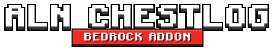
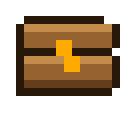
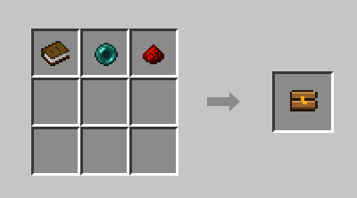

# Listing Kit: ALN ChestLog

Tap the Copy button on a block, then paste it into the CurseForge listing. Generated from DESCRIPTION.md: edit that, not this file.

## Package Name

```text
ALN ChestLog
```

## Summary (114/256)

```text
Craft one ChestLog from a Book, an Ender Pearl and Redstone, then deposit into any registered chest from anywhere.
```

## Description (HTML)

Paste into the CurseForge description editor in source (HTML) mode.

```html
<div><div style="border:2px solid #15803d;border-radius:18px;line-height:1.5"><br><p style="text-align:center"></p><p style="color:#8a94a3;font-size:14px;text-align:center">by ALNStudios</p><p style="text-align:center"><span style="background-color:#15803d;color:#ffffff;border-radius:20px;font-size:16px">&nbsp;&nbsp;<strong>Craft one ChestLog from a Book, an Ender Pearl and Redstone, then deposit into any registered chest from anywhere.</strong>&nbsp;&nbsp;</span></p><p style="text-align:center;margin-left:16px;margin-right:16px">ALN ChestLog adds a craftable ChestLog item that links your chests into one wireless network, so you can deposit and sort items without walking back to base.</p><div style="display:flex;flex-wrap:wrap;gap:8px;margin-left:14px;margin-right:14px"><div style="background-color:#dcfce7;color:#14532d;border-radius:20px;font-size:14px;line-height:2"><strong>&nbsp;&nbsp;Bedrock</strong>: 1.26+&nbsp;&nbsp;</div><div style="background-color:#dcfce7;color:#14532d;border-radius:20px;font-size:14px;line-height:2"><strong>&nbsp;&nbsp;Experimental</strong>: No&nbsp;&nbsp;</div><div style="background-color:#dcfce7;color:#14532d;border-radius:20px;font-size:14px;line-height:2"><strong>&nbsp;&nbsp;Achievements</strong>: Yes, achievement-friendly&nbsp;&nbsp;</div></div><br></div>
<h2 style="font-size:17px;text-align:left"><span style="background-color:#15803d;color:#ffffff;border-radius:20px">&nbsp;&nbsp;About&nbsp;&nbsp;</span></h2>
<p>Register any chest, trapped chest or barrel by sneaking and using the ChestLog on it. Later, open the remote menu from anywhere to deposit everything that belongs in your chests, or pick one chest and choose exact amounts. Chests in unloaded chunks and other dimensions still accept items.</p>
<h2 style="font-size:17px;text-align:left"><span style="background-color:#15803d;color:#ffffff;border-radius:20px">&nbsp;&nbsp;What You Get&nbsp;&nbsp;</span></h2>
<div style="display:flex;flex-wrap:wrap;gap:10px"><div style="flex:1;min-width:200px;border:1px solid #8a94a3;border-radius:16px"><div style="background-color:#15803d;color:#ffffff;border-radius:16px;font-size:16px;line-height:2.2"><strong>&nbsp;&nbsp;Registration</strong></div><div style="margin-left:12px;margin-right:12px"><p><span>Sneak and use the ChestLog on a chest, trapped chest or barrel, then type a name. The chest joins your wireless network and its name appears in your menu.</span></p></div></div><div style="flex:1;min-width:200px;border:1px solid #8a94a3;border-radius:16px"><div style="background-color:#15803d;color:#ffffff;border-radius:16px;font-size:16px;line-height:2.2"><strong>&nbsp;&nbsp;Double Chest Support</strong></div><div style="margin-left:12px;margin-right:12px"><p><span>Both halves of a double chest share one entry, so registering either half registers the whole chest. Only the player who registered a chest can rename or unregister it.</span></p></div></div><div style="flex:1;min-width:200px;border:1px solid #8a94a3;border-radius:16px"><div style="background-color:#15803d;color:#ffffff;border-radius:16px;font-size:16px;line-height:2.2"><strong>&nbsp;&nbsp;Remote Menu</strong></div><div style="margin-left:12px;margin-right:12px"><p><span>Use the ChestLog in the air to open a menu with Chest, About and Exit. The Chest screen lists your chests colored by dimension and never shows coordinates.</span></p></div></div><div style="flex:1;min-width:200px;border:1px solid #8a94a3;border-radius:16px"><div style="background-color:#15803d;color:#ffffff;border-radius:16px;font-size:16px;line-height:2.2"><strong>&nbsp;&nbsp;Deposit All (Sort)</strong></div><div style="margin-left:12px;margin-right:12px"><p><span>Sends matching items from your inventory to your registered chests, sorts those chests, and reports the totals on the action bar.</span></p></div></div><div style="flex:1;min-width:200px;border:1px solid #8a94a3;border-radius:16px"><div style="background-color:#15803d;color:#ffffff;border-radius:16px;font-size:16px;line-height:2.2"><strong>&nbsp;&nbsp;Per-Item Deposit</strong></div><div style="margin-left:12px;margin-right:12px"><p><span>Pick one chest and use a slider for each item stack in your inventory to choose exactly how many to deposit.</span></p></div></div><div style="flex:1;min-width:200px;border:1px solid #8a94a3;border-radius:16px"><div style="background-color:#15803d;color:#ffffff;border-radius:16px;font-size:16px;line-height:2.2"><strong>&nbsp;&nbsp;Unloaded Chunk Buffer</strong></div><div style="margin-left:12px;margin-right:12px"><p><span>Items sent to a chest in an unloaded chunk are held safely, with their names, enchantments and durability, and moved in as soon as the chunk loads, even while you are offline. If the chest is full, the overflow waits and you get an alert.</span></p></div></div><div style="flex:1;min-width:200px;border:1px solid #8a94a3;border-radius:16px"><div style="background-color:#15803d;color:#ffffff;border-radius:16px;font-size:16px;line-height:2.2"><strong>&nbsp;&nbsp;Smart Sorting</strong></div><div style="margin-left:12px;margin-right:12px"><p><span>Identical items merge up to full stacks after every deposit. Chests are ordered as tools, armor, food, then everything else, alphabetically within each group.</span></p></div></div><div style="flex:1;min-width:200px;border:1px solid #8a94a3;border-radius:16px"><div style="background-color:#15803d;color:#ffffff;border-radius:16px;font-size:16px;line-height:2.2"><strong>&nbsp;&nbsp;Unregister and Cleanup</strong></div><div style="margin-left:12px;margin-right:12px"><p><span>Switch on Unregister when you sneak and use the ChestLog on a registered chest, and any waiting items are delivered or dropped. If a registered chest is broken, it is unregistered automatically and its waiting items drop where it stood.</span></p></div></div><div style="flex:1;min-width:200px;border:1px solid #8a94a3;border-radius:16px"><div style="background-color:#15803d;color:#ffffff;border-radius:16px;font-size:16px;line-height:2.2"><strong>&nbsp;&nbsp;Survival Recipe</strong></div><div style="margin-left:12px;margin-right:12px"><p><span>Craft the ChestLog from a Book, an Ender Pearl and Redstone.</span></p></div></div></div>
<h2 style="font-size:17px;text-align:left"><span style="background-color:#15803d;color:#ffffff;border-radius:20px">&nbsp;&nbsp;Custom Items&nbsp;&nbsp;</span></h2>
<div style="display:flex;flex-wrap:wrap;gap:10px"><div style="flex:0 1 120px;border:1px solid #8a94a3;border-radius:16px;text-align:center"><p><a href="https://raw.githubusercontent.com/AllensCreations/MCPE-Curseforges/main/MCPEDL/Addons/ALN-ChestLog/assets/items/aln_chest_log.png"></a></p><p style="color:#8a94a3;font-size:13px">aln chest log</p></div></div>
<h2 style="font-size:17px;text-align:left"><span style="background-color:#15803d;color:#ffffff;border-radius:20px">&nbsp;&nbsp;Crafting Recipes&nbsp;&nbsp;</span></h2>
<div style="display:flex;flex-wrap:wrap;gap:10px"><div style="flex:0 1 400px;border:1px solid #8a94a3;border-radius:16px;text-align:center"><p><a href="https://raw.githubusercontent.com/AllensCreations/MCPE-Curseforges/main/MCPEDL/Addons/ALN-ChestLog/assets/recipes/chest_log_recipe.png"></a></p><p><span style="display:inline-block;background-color:#14101e;border:2px solid #3c2068;border-radius:6px;color:#ffffff;font-family:'Minecraft', 'Minecraftia', 'Mojangles', 'Press Start 2P', monospace;font-size:13px;line-height:24px">&nbsp;&nbsp;chest log recipe&nbsp;&nbsp;</span></p></div></div>
<h2 style="font-size:17px;text-align:left"><span style="background-color:#15803d;color:#ffffff;border-radius:20px">&nbsp;&nbsp;Get Started&nbsp;&nbsp;</span></h2>
<table style="width:100%;border:1px solid #8a94a3;border-radius:16px"><tbody><tr><td style="width:44px;text-align:center"><div style="background-color:#15803d;color:#ffffff;font-weight:bold;font-size:15px;text-align:center;border-radius:10px;width:30px;aspect-ratio:1/1;line-height:30px">1</div></td><td style="text-align:left;">Craft the ChestLog from a Book, an Ender Pearl and Redstone.</td></tr><tr><td style="width:44px;text-align:center"><div style="background-color:#15803d;color:#ffffff;font-weight:bold;font-size:15px;text-align:center;border-radius:10px;width:30px;aspect-ratio:1/1;line-height:30px">2</div></td><td style="text-align:left;">Sneak and use the ChestLog on a chest, trapped chest or barrel, then type a name.</td></tr><tr><td style="width:44px;text-align:center"><div style="background-color:#15803d;color:#ffffff;font-weight:bold;font-size:15px;text-align:center;border-radius:10px;width:30px;aspect-ratio:1/1;line-height:30px">3</div></td><td style="text-align:left;">Use the ChestLog in the air to open the menu and choose Chest.</td></tr><tr><td style="width:44px;text-align:center"><div style="background-color:#15803d;color:#ffffff;font-weight:bold;font-size:15px;text-align:center;border-radius:10px;width:30px;aspect-ratio:1/1;line-height:30px">4</div></td><td style="text-align:left;">Pick Deposit All (Sort) for a quick sweep, or select one chest and set quantities with the sliders.</td></tr><tr><td style="width:44px;text-align:center"><div style="background-color:#15803d;color:#ffffff;font-weight:bold;font-size:15px;text-align:center;border-radius:10px;width:30px;aspect-ratio:1/1;line-height:30px">5</div></td><td style="text-align:left;">To remove a chest from your network, sneak and use the ChestLog on it again and switch on Unregister.</td></tr><tr><td style="width:44px;text-align:center"><div style="background-color:#15803d;color:#ffffff;font-weight:bold;font-size:15px;text-align:center;border-radius:10px;width:30px;aspect-ratio:1/1;line-height:30px">6</div></td><td style="text-align:left;">Chest names are colored green in the Overworld, red in the Nether and purple in The End.</td></tr></tbody></table>
<h2 style="font-size:17px;text-align:left"><span style="background-color:#15803d;color:#ffffff;border-radius:20px">&nbsp;&nbsp;Install&nbsp;&nbsp;</span></h2>
<table style="width:100%;border:1px solid #8a94a3;border-radius:16px"><tbody><tr><td style="width:44px;text-align:center"><div style="background-color:#15803d;color:#ffffff;font-weight:bold;font-size:15px;text-align:center;border-radius:10px;width:30px;aspect-ratio:1/1;line-height:30px">1</div></td><td style="text-align:left;">Download the file from this page and open it with Minecraft.</td></tr><tr><td style="width:44px;text-align:center"><div style="background-color:#15803d;color:#ffffff;font-weight:bold;font-size:15px;text-align:center;border-radius:10px;width:30px;aspect-ratio:1/1;line-height:30px">2</div></td><td style="text-align:left;">Create or edit a world and turn on the new pack(s) in its settings.</td></tr><tr><td style="width:44px;text-align:center"><div style="background-color:#15803d;color:#ffffff;font-weight:bold;font-size:15px;text-align:center;border-radius:10px;width:30px;aspect-ratio:1/1;line-height:30px">3</div></td><td style="text-align:left;">Play. No Experimental toggles needed.</td></tr></tbody></table>
<div style="border:1px solid #8a94a3;border-radius:16px;text-align:center"><br><div style="background-color:#15803d;color:#ffffff;border-radius:20px;font-size:15px;line-height:2;display:inline-block">&nbsp;&nbsp;<strong>Found a Bug or Have a Suggestion?</strong>&nbsp;&nbsp;</div><p style="font-size:14px;">Please leave a comment on this project page! All bug reports, gameplay feedback, and pack suggestions are welcome and appreciated.</p></div>
<h2 style="font-size:17px;text-align:left"><span style="background-color:#15803d;color:#ffffff;border-radius:20px">&nbsp;&nbsp;Support&nbsp;&nbsp;</span></h2><div style="border:1px solid #8a94a3;border-radius:16px;text-align:center"><br><a href="https://ko-fi.com/alnstudios"></a><br><br></div><p style="text-align:center"><a href="https://www.curseforge.com/members/allenscreations/projects"><strong>CurseForge</strong></a> &nbsp;|&nbsp; <a href="https://mcpedl.com/user/alnstudios/"><strong>MCPEDL</strong></a> &nbsp;|&nbsp; <a href="https://ko-fi.com/alnstudios"><strong>Ko-fi</strong></a></p>
<hr>
<p style="text-align:center;color:#8a94a3;font-size:13px"><strong>By ALNStudios</strong></p>
<div class="spoiler"><p style="font-size:13px"><strong>Permissions and credits</strong></p><ul style="font-size:13px"><li>Rights: All rights reserved for ALNStudios.</li><li>Content creators: You may feature this creation in videos and streams with credit to ALNStudios.</li><li>Redistribution: Do not re-upload this pack or provide direct monetized download bypasses. Link to this page.</li><li>Visual: Promotional/cover imagery used on this page is AI-generated to illustrate the concept and purpose of the pack.</li><li>Unofficial community creation. Not an official Minecraft product and not approved by or associated with Mojang or Microsoft.</li></ul></div>
<p style="text-align:center;color:#8a94a3;font-size:12px">Minecraft Bedrock add-on, ALN ChestLog Bedrock mod, wireless chest storage, remote chest deposit, auto sort chests, MCPEDL add-on, CurseForge Bedrock, ALNStudios.</p></div>
```

## AI Image Prompts

### Reference Images

- **Logo reference**: attach your own logo. The generator uses it only for brand colors and mood. The result must be a new design, not a copy.
- **Snapshot references**: attach 1 to 4 of your in-game snapshots of this pack. The generator copies their look, not their screen layout.

### Logo Prompt

```text
Use the attached logo only as a brand reference for its color palette and overall mood. Do not copy it. Create a new, original logo with a different composition and a different main symbol. Do not just recolor, resize, crop, mirror or tweak the attached logo.
Create a clean, square (1:1) logo image for the Minecraft Bedrock add-on "ALN ChestLog". Craft one ChestLog from a Book, an Ender Pearl and Redstone, then deposit into any registered chest from anywhere.
Base the main symbol on the pack idea above. Match the blocky look of the attached in-game snapshots. Center the logo, use a simple background, and keep it readable at small sizes.
Text: "ALN ChestLog" and, in small letters, "ALNStudios". ALNStudios is the brand name, so always keep it and never remove or change it. Spell both exactly.
Do not add Minecraft, Mojang or Microsoft logos, watermarks, or characters from other games.
```

### Banner Prompt

```text
Create a wide (16:9) banner image for the Minecraft Bedrock add-on "ALN ChestLog". Craft one ChestLog from a Book, an Ender Pearl and Redstone, then deposit into any registered chest from anywhere.
Use the attached in-game snapshots as scene and style references: copy their blocky look, lighting, colors and the kind of scenery they show. Make a new composition inspired by them. Do not copy the on-screen HUD, chat or hotbar.
Use the attached logo only as a brand reference for its colors and mood. Do not copy it. Put a new, original logo design in the banner, large enough to read, on the left or center.
Hint at these pack features visually: Registration, Double Chest Support, Remote Menu, Deposit All (Sort), Per-Item Deposit.
Text: "ALN ChestLog" and, in small letters, "by ALNStudios". ALNStudios is the brand name, so always keep it and never remove or change it. Spell both exactly.
Leave clear space around the logo. No Minecraft, Mojang or Microsoft logos, no watermarks.
```
