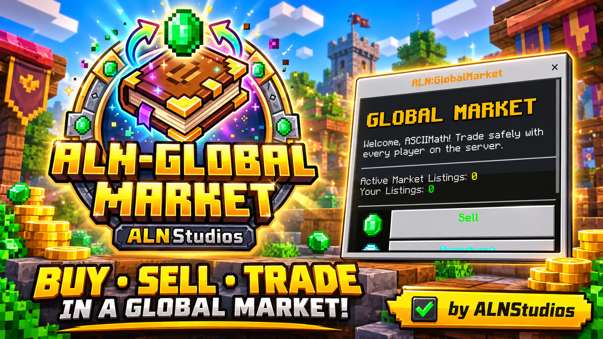
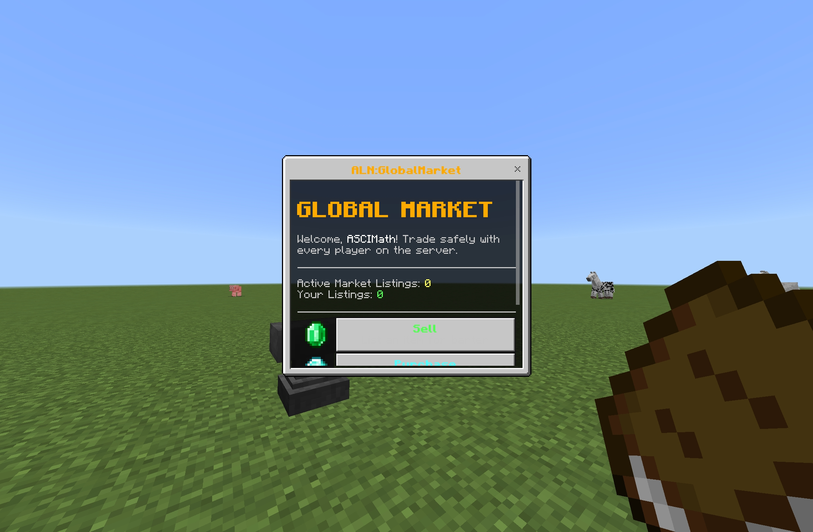

# Listing Kit: ALN-GlobalMarket

Tap the Copy button on a block, then paste it into the CurseForge listing. Generated from DESCRIPTION.md: edit that, not this file.

## Package Name

```text
ALN-GlobalMarket
```

## Summary (106/256)

```text
Open a Global Market with a Book renamed Player Trade and barter items with any player, even offline ones.
```

## Description (HTML)

Paste into the CurseForge description editor in source (HTML) mode.

```html
<div><div style="border:2px solid #15803d;border-radius:18px;line-height:1.5"><br><h1 style="font-size:34px;text-align:center">ALN-GlobalMarket</h1><p style="color:#8a94a3;font-size:14px;text-align:center">by ALNStudios</p><p style="text-align:center"><span style="background-color:#15803d;color:#ffffff;border-radius:20px;font-size:16px">&nbsp;&nbsp;<strong>Open a Global Market with a Book renamed Player Trade and barter items with any player, even offline ones.</strong>&nbsp;&nbsp;</span></p><p style="text-align:center;margin-left:16px;margin-right:16px">Adds a player-to-player market opened with a renamed Book, with escrow-held listings and offline payouts. It suits worlds and servers where players want to trade items safely.</p><div style="display:flex;flex-wrap:wrap;gap:8px;margin-left:14px;margin-right:14px"><div style="background-color:#dcfce7;color:#14532d;border-radius:20px;font-size:14px;line-height:2"><strong>&nbsp;&nbsp;Bedrock</strong>: 1.26+&nbsp;&nbsp;</div><div style="background-color:#dcfce7;color:#14532d;border-radius:20px;font-size:14px;line-height:2"><strong>&nbsp;&nbsp;Experimental</strong>: No&nbsp;&nbsp;</div><div style="background-color:#dcfce7;color:#14532d;border-radius:20px;font-size:14px;line-height:2"><strong>&nbsp;&nbsp;Achievements</strong>: Yes, achievement-friendly&nbsp;&nbsp;</div></div><br></div>
<h2 style="font-size:17px;text-align:left"><span style="background-color:#15803d;color:#ffffff;border-radius:20px">&nbsp;&nbsp;About&nbsp;&nbsp;</span></h2>
<p>ALN-GlobalMarket lets players list items for trade, name the item and amount they want in return, and let other players buy those listings. Listed items are held safely in escrow, and payments reach the seller even when they are offline.</p>
<h2 style="font-size:17px;text-align:left"><span style="background-color:#15803d;color:#ffffff;border-radius:20px">&nbsp;&nbsp;Screenshots&nbsp;&nbsp;</span></h2>
<div style="display:flex;flex-wrap:wrap;gap:10px"><div style="flex:1 1 300px;border:1px solid #8a94a3;border-radius:16px;text-align:center"><p><a href="https://raw.githubusercontent.com/AllensCreations/MCPE-Curseforges/main/MCPEDL/Addons/ALN-GlobalMarket/assets/snapshots/file_00000000a57c81fb848c0141679172fc.png"></a></p></div><div style="flex:1 1 300px;border:1px solid #8a94a3;border-radius:16px;text-align:center"><p><a href="https://raw.githubusercontent.com/AllensCreations/MCPE-Curseforges/main/MCPEDL/Addons/ALN-GlobalMarket/assets/snapshots/Screenshot_20261123_225134_com.mojang.v126661xxxx.jpg"></a></p></div></div>
<h2 style="font-size:17px;text-align:left"><span style="background-color:#15803d;color:#ffffff;border-radius:20px">&nbsp;&nbsp;What You Get&nbsp;&nbsp;</span></h2>
<div style="display:flex;flex-wrap:wrap;gap:10px"><div style="flex:1;min-width:200px;border:1px solid #8a94a3;border-radius:16px"><div style="background-color:#15803d;color:#ffffff;border-radius:16px;font-size:16px;line-height:2.2"><strong>&nbsp;&nbsp;Safe Escrow</strong></div><div style="margin-left:12px;margin-right:12px"><p><span>Items you list leave your inventory and are held until they sell or you cancel the listing.</span><br><span style="font-size:13px;color:#8a94a3"><strong>Good To Know:</strong> Enchanted, renamed, damaged and container items cannot be listed.</span></p></div></div><div style="flex:1;min-width:200px;border:1px solid #8a94a3;border-radius:16px"><div style="background-color:#15803d;color:#ffffff;border-radius:16px;font-size:16px;line-height:2.2"><strong>&nbsp;&nbsp;Marketplace Browser</strong></div><div style="margin-left:12px;margin-right:12px"><p><span>Browse listings with item icons, category filters, sorting and search, with prices shown green when you can afford them and red when you cannot.</span><br><span style="font-size:13px;color:#8a94a3"><strong>How It Works:</strong> Choose Purchase, then use Filters &amp; Search or the My Listings button.</span></p></div></div><div style="flex:1;min-width:200px;border:1px solid #8a94a3;border-radius:16px"><div style="background-color:#15803d;color:#ffffff;border-radius:16px;font-size:16px;line-height:2.2"><strong>&nbsp;&nbsp;Listing Details</strong></div><div style="margin-left:12px;margin-right:12px"><p><span>A details screen shows the seller, how long ago the item was listed and how much of the payment item you hold before you buy.</span></p></div></div><div style="flex:1;min-width:200px;border:1px solid #8a94a3;border-radius:16px"><div style="background-color:#15803d;color:#ffffff;border-radius:16px;font-size:16px;line-height:2.2"><strong>&nbsp;&nbsp;Offline Payouts</strong></div><div style="margin-left:12px;margin-right:12px"><p><span>If the seller is offline when you buy, the payment is vaulted and delivered the next time they join.</span></p></div></div><div style="flex:1;min-width:200px;border:1px solid #8a94a3;border-radius:16px"><div style="background-color:#15803d;color:#ffffff;border-radius:16px;font-size:16px;line-height:2.2"><strong>&nbsp;&nbsp;Easy Cancellation</strong></div><div style="margin-left:12px;margin-right:12px"><p><span>Cancel your own listing at any time and get the held items back.</span><br><span style="font-size:13px;color:#8a94a3"><strong>How It Works:</strong> Choose Purchase, open your own listing, then choose Cancel Listing.</span></p></div></div></div>
<h2 style="font-size:17px;text-align:left"><span style="background-color:#15803d;color:#ffffff;border-radius:20px">&nbsp;&nbsp;Get Started&nbsp;&nbsp;</span></h2>
<table style="width:100%;border:1px solid #8a94a3;border-radius:16px"><tbody><tr><td style="width:44px;text-align:center"><div style="background-color:#15803d;color:#ffffff;font-weight:bold;font-size:15px;text-align:center;border-radius:10px;width:30px;aspect-ratio:1/1;line-height:30px">1</div></td><td style="text-align:left;">Rename a Book to "Player Trade" on an Anvil.</td></tr><tr><td style="width:44px;text-align:center"><div style="background-color:#15803d;color:#ffffff;font-weight:bold;font-size:15px;text-align:center;border-radius:10px;width:30px;aspect-ratio:1/1;line-height:30px">2</div></td><td style="text-align:left;">Use the Book to open the Global Market.</td></tr><tr><td style="width:44px;text-align:center"><div style="background-color:#15803d;color:#ffffff;font-weight:bold;font-size:15px;text-align:center;border-radius:10px;width:30px;aspect-ratio:1/1;line-height:30px">3</div></td><td style="text-align:left;">Choose Sell to list an item, or Purchase to browse listings.</td></tr><tr><td style="width:44px;text-align:center"><div style="background-color:#15803d;color:#ffffff;font-weight:bold;font-size:15px;text-align:center;border-radius:10px;width:30px;aspect-ratio:1/1;line-height:30px">4</div></td><td style="text-align:left;">Choose About for a short in-game guide.</td></tr></tbody></table>
<h2 style="font-size:17px;text-align:left"><span style="background-color:#15803d;color:#ffffff;border-radius:20px">&nbsp;&nbsp;Install&nbsp;&nbsp;</span></h2>
<table style="width:100%;border:1px solid #8a94a3;border-radius:16px"><tbody><tr><td style="width:44px;text-align:center"><div style="background-color:#15803d;color:#ffffff;font-weight:bold;font-size:15px;text-align:center;border-radius:10px;width:30px;aspect-ratio:1/1;line-height:30px">1</div></td><td style="text-align:left;">Download the file from this page and open it with Minecraft.</td></tr><tr><td style="width:44px;text-align:center"><div style="background-color:#15803d;color:#ffffff;font-weight:bold;font-size:15px;text-align:center;border-radius:10px;width:30px;aspect-ratio:1/1;line-height:30px">2</div></td><td style="text-align:left;">Create or edit a world and turn on the new pack(s) in its settings.</td></tr><tr><td style="width:44px;text-align:center"><div style="background-color:#15803d;color:#ffffff;font-weight:bold;font-size:15px;text-align:center;border-radius:10px;width:30px;aspect-ratio:1/1;line-height:30px">3</div></td><td style="text-align:left;">Play. No Experimental toggles needed.</td></tr></tbody></table>
<div style="border:1px solid #8a94a3;border-radius:16px;text-align:center"><br><div style="background-color:#15803d;color:#ffffff;border-radius:20px;font-size:15px;line-height:2;display:inline-block">&nbsp;&nbsp;<strong>Found a Bug or Have a Suggestion?</strong>&nbsp;&nbsp;</div><p style="font-size:14px;">Please leave a comment on this project page! All bug reports, gameplay feedback, and pack suggestions are welcome and appreciated.</p></div>
<h2 style="font-size:17px;text-align:left"><span style="background-color:#15803d;color:#ffffff;border-radius:20px">&nbsp;&nbsp;Support&nbsp;&nbsp;</span></h2><div style="border:1px solid #8a94a3;border-radius:16px;text-align:center"><br><a href="https://ko-fi.com/alnstudios"></a><br><br></div><p style="text-align:center"><a href="https://www.curseforge.com/members/allenscreations/projects"><strong>CurseForge</strong></a> &nbsp;|&nbsp; <a href="https://mcpedl.com/user/alnstudios/"><strong>MCPEDL</strong></a> &nbsp;|&nbsp; <a href="https://ko-fi.com/alnstudios"><strong>Ko-fi</strong></a></p>
<hr>
<p style="text-align:center;color:#8a94a3;font-size:13px"><strong>By ALNStudios</strong></p>
<div class="spoiler"><p style="font-size:13px"><strong>Permissions and credits</strong></p><ul style="font-size:13px"><li>Rights: All rights reserved for ALNStudios.</li><li>Content creators: You may feature this creation in videos and streams with credit to ALNStudios.</li><li>Redistribution: Do not re-upload this pack or provide direct monetized download bypasses. Link to this page.</li><li>Visual: Promotional/cover imagery used on this page is AI-generated to illustrate the concept and purpose of the pack.</li><li>Unofficial community creation. Not an official Minecraft product and not approved by or associated with Mojang or Microsoft.</li></ul></div>
<p style="text-align:center;color:#8a94a3;font-size:12px">Minecraft Bedrock add-on, MCPEDL add-on, CurseForge Bedrock, ALNStudios, player market, barter, trading, escrow, shop</p></div>
```

## AI Image Prompts

### Reference Images

- **Logo reference**: attach your own logo. The generator uses it only for brand colors and mood. The result must be a new design, not a copy.
- **Snapshot references**: attach 1 to 4 of your in-game snapshots of this pack. The generator copies their look, not their screen layout.

### Logo Prompt

```text
Use the attached logo only as a brand reference for its color palette and overall mood. Do not copy it. Create a new, original logo with a different composition and a different main symbol. Do not just recolor, resize, crop, mirror or tweak the attached logo.
Create a clean, square (1:1) logo image for the Minecraft Bedrock add-on "ALN-GlobalMarket". Open a Global Market with a Book renamed Player Trade and barter items with any player, even offline ones.
Base the main symbol on the pack idea above. Match the blocky look of the attached in-game snapshots. Center the logo, use a simple background, and keep it readable at small sizes.
Text: "ALN-GlobalMarket" and, in small letters, "ALNStudios". ALNStudios is the brand name, so always keep it and never remove or change it. Spell both exactly.
Do not add Minecraft, Mojang or Microsoft logos, watermarks, or characters from other games.
```

### Banner Prompt

```text
Create a wide (16:9) banner image for the Minecraft Bedrock add-on "ALN-GlobalMarket". Open a Global Market with a Book renamed Player Trade and barter items with any player, even offline ones.
Use the attached in-game snapshots as scene and style references: copy their blocky look, lighting, colors and the kind of scenery they show. Make a new composition inspired by them. Do not copy the on-screen HUD, chat or hotbar.
Use the attached logo only as a brand reference for its colors and mood. Do not copy it. Put a new, original logo design in the banner, large enough to read, on the left or center.
Hint at these pack features visually: Safe Escrow, Marketplace Browser, Listing Details, Offline Payouts, Easy Cancellation.
Text: "ALN-GlobalMarket" and, in small letters, "by ALNStudios". ALNStudios is the brand name, so always keep it and never remove or change it. Spell both exactly.
Leave clear space around the logo. No Minecraft, Mojang or Microsoft logos, no watermarks.
```
