# Listing Kit: ALN MoreDiscs

Tap the Copy button on a block, then paste it into the CurseForge listing. Generated from DESCRIPTION.md: edit that, not this file.

## Package Name

```text
ALN MoreDiscs
```

## Summary (115/256)

```text
Craft thirty original music discs, each with its own 55 to 92 second track, and play them in a Jukebox in Survival.
```

## Description (HTML)

Choose any of the 5 themes below. Tap the Copy button on your preferred theme and paste into the CurseForge description editor in source (HTML) mode.

### Theme 1: Vanilla Adaptive (Default)

Theme-neutral layout following the viewer's CurseForge light or dark mode.

```html
<div><div style="border:2px solid #15803d;border-radius:18px;line-height:1.5"><br><p style="text-align:center"></p><p style="color:#8a94a3;font-size:14px;text-align:center">by ALNStudios</p><p style="text-align:center"><span style="background-color:#15803d;color:#ffffff;border-radius:20px;font-size:16px">&nbsp;&nbsp;<strong>Craft thirty original music discs, each with its own 55 to 92 second track, and play them in a Jukebox in Survival.</strong>&nbsp;&nbsp;</span></p><p style="text-align:center;margin-left:16px;margin-right:16px">ALN MoreDiscs adds thirty music discs, Track 1 to Track 30, each crafted from Paper, Coal, Flint, a Note Block and one or two accent items. They give a Jukebox new music without any other add-on.</p><div style="display:flex;flex-wrap:wrap;gap:8px;margin-left:14px;margin-right:14px"><div style="background-color:#dcfce7;color:#14532d;border-radius:20px;font-size:14px;line-height:2"><strong>&nbsp;&nbsp;Bedrock</strong>: 1.26+&nbsp;&nbsp;</div><div style="background-color:#dcfce7;color:#14532d;border-radius:20px;font-size:14px;line-height:2"><strong>&nbsp;&nbsp;Experimental</strong>: No&nbsp;&nbsp;</div><div style="background-color:#dcfce7;color:#14532d;border-radius:20px;font-size:14px;line-height:2"><strong>&nbsp;&nbsp;Achievements</strong>: Yes, achievement-friendly&nbsp;&nbsp;</div></div><br></div>
<p></p>
<p>Craft a disc at a Crafting Table, put it in a Jukebox and the matching track plays. Every track is an original piece made for this pack, so the thirty discs add music to your world without using any existing songs. The discs also announce which track is playing and for how long, so ALN Wireless Headphones can show it.</p>
<p></p>
<div style="display:flex;flex-wrap:wrap;gap:10px"><div style="flex:1;min-width:200px;border:1px solid #8a94a3;border-radius:16px"><div style="background-color:#15803d;color:#ffffff;border-radius:16px;font-size:16px;line-height:2.2"><strong>&nbsp;&nbsp;Thirty Original Tracks</strong></div><div style="margin-left:12px;margin-right:12px"><p><span>The pack adds thirty discs with one track each. The track list is below.</span><br><span style="font-size:13px;color:#8a94a3"><strong>Good To Know:</strong> Each disc stacks to 1, like a vanilla music disc.</span></p></div></div><div style="flex:1;min-width:200px;border:1px solid #8a94a3;border-radius:16px"><div style="background-color:#15803d;color:#ffffff;border-radius:16px;font-size:16px;line-height:2.2"><strong>&nbsp;&nbsp;Survival Crafting</strong></div><div style="margin-left:12px;margin-right:12px"><p><span>Craft each of Tracks 1 to 10 at a Crafting Table. Top row: Paper, Coal, Paper. Middle row: Flint, Note Block, Flint. Bottom row: Paper, the accent item, Paper.</span><br><span style="font-size:13px;color:#8a94a3"><strong>How It Works:</strong> The accent item picks the track: Redstone Dust for Track 1, Lapis Lazuli for Track 2, Amethyst Shard for Track 3, Glowstone Dust for Track 4, Copper Ingot for Track 5, Iron Ingot for Track 6, Gold Ingot for Track 7, Emerald for Track 8, Nether Quartz for Track 9, Blaze Powder for Track 10.</span><br><span style="font-size:13px;color:#8a94a3"><strong>Newer Discs:</strong> Tracks 11 to 30 use the same top and middle rows. For Tracks 11 to 20 the bottom row is the accent item, Paper, the same accent item again: Redstone Dust for Track 11, Lapis Lazuli for Track 12, Amethyst Shard for Track 13, Glowstone Dust for Track 14, Copper Ingot for Track 15, Iron Ingot for Track 16, Gold Ingot for Track 17, Emerald for Track 18, Nether Quartz for Track 19, Blaze Powder for Track 20. For Tracks 21 to 30 the bottom row is one accent item, Paper, a second accent item: Redstone Dust and Lapis Lazuli for Track 21, Lapis Lazuli and Amethyst Shard for Track 22, Amethyst Shard and Glowstone Dust for Track 23, Glowstone Dust and Copper Ingot for Track 24, Copper Ingot and Iron Ingot for Track 25, Iron Ingot and Gold Ingot for Track 26, Gold Ingot and Emerald for Track 27, Emerald and Nether Quartz for Track 28, Nether Quartz and Blaze Powder for Track 29, Blaze Powder and Redstone Dust for Track 30.</span><br><span style="font-size:13px;color:#8a94a3"><strong>Good To Know:</strong> All thirty recipes are unlocked from the start, so no cheats and no recipe discovery are needed.</span></p></div></div><div style="flex:1;min-width:200px;border:1px solid #8a94a3;border-radius:16px"><div style="background-color:#15803d;color:#ffffff;border-radius:16px;font-size:16px;line-height:2.2"><strong>&nbsp;&nbsp;Jukebox Playback</strong></div><div style="margin-left:12px;margin-right:12px"><p><span>Use a disc on a Jukebox to play it, and use the Jukebox again to take the disc back out.</span><br><span style="font-size:13px;color:#8a94a3"><strong>Good To Know:</strong> Breaking the Jukebox or taking the disc out ends the track and gives the disc back. The pack handles these discs itself, so no experiments are needed, but the Jukebox shows no spinning disc, gives no Comparator signal, and has to be emptied of a vanilla disc first.</span></p></div></div><div style="flex:1;min-width:200px;border:1px solid #8a94a3;border-radius:16px"><div style="background-color:#15803d;color:#ffffff;border-radius:16px;font-size:16px;line-height:2.2"><strong>&nbsp;&nbsp;ALN Wireless Headphones Support</strong></div><div style="margin-left:12px;margin-right:12px"><p><span>When a disc starts or stops, the pack announces the track number, the track name and its length so ALN Wireless Headphones can show them.</span><br><span style="font-size:13px;color:#8a94a3"><strong>Good To Know:</strong> This has not been tested together with ALN Wireless Headphones in game.</span></p></div></div><div style="flex:1;min-width:200px;border:1px solid #8a94a3;border-radius:16px"><div style="background-color:#15803d;color:#ffffff;border-radius:16px;font-size:16px;line-height:2.2"><strong>&nbsp;&nbsp;Make Your Own Discs</strong></div><div style="margin-left:12px;margin-right:12px"><p><span>The free web tool at https://alnstudios-more-discs.vercel.app is meant to turn your own audio files into a personal pack on your own device.</span><br><span style="font-size:13px;color:#8a94a3"><strong>Good To Know:</strong> ALNStudios only distributes the thirty original tracks. Audio you convert yourself must be for private, personal play, and you are responsible for having the right to use it.</span></p></div></div></div>
<p></p>
<div style="display:flex;flex-wrap:wrap;gap:10px"><div style="flex:0 1 120px;border:1px solid #8a94a3;border-radius:16px;text-align:center"><p><a href="https://raw.githubusercontent.com/AllensCreations/MCPE-Curseforges/main/MCPEDL/Addons/ALN-MoreDiscs/assets/items/aln_disc_1.png">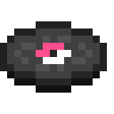</a></p><p></p></div><div style="flex:0 1 120px;border:1px solid #8a94a3;border-radius:16px;text-align:center"><p><a href="https://raw.githubusercontent.com/AllensCreations/MCPE-Curseforges/main/MCPEDL/Addons/ALN-MoreDiscs/assets/items/aln_disc_2.png">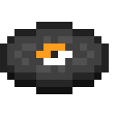</a></p><p></p></div><div style="flex:0 1 120px;border:1px solid #8a94a3;border-radius:16px;text-align:center"><p><a href="https://raw.githubusercontent.com/AllensCreations/MCPE-Curseforges/main/MCPEDL/Addons/ALN-MoreDiscs/assets/items/aln_disc_3.png"></a></p><p></p></div><div style="flex:0 1 120px;border:1px solid #8a94a3;border-radius:16px;text-align:center"><p><a href="https://raw.githubusercontent.com/AllensCreations/MCPE-Curseforges/main/MCPEDL/Addons/ALN-MoreDiscs/assets/items/aln_disc_4.png"></a></p><p></p></div><div style="flex:0 1 120px;border:1px solid #8a94a3;border-radius:16px;text-align:center"><p><a href="https://raw.githubusercontent.com/AllensCreations/MCPE-Curseforges/main/MCPEDL/Addons/ALN-MoreDiscs/assets/items/aln_disc_5.png">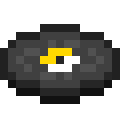</a></p><p></p></div><div style="flex:0 1 120px;border:1px solid #8a94a3;border-radius:16px;text-align:center"><p><a href="https://raw.githubusercontent.com/AllensCreations/MCPE-Curseforges/main/MCPEDL/Addons/ALN-MoreDiscs/assets/items/aln_disc_6.png"></a></p><p></p></div><div style="flex:0 1 120px;border:1px solid #8a94a3;border-radius:16px;text-align:center"><p><a href="https://raw.githubusercontent.com/AllensCreations/MCPE-Curseforges/main/MCPEDL/Addons/ALN-MoreDiscs/assets/items/aln_disc_7.png"></a></p><p></p></div><div style="flex:0 1 120px;border:1px solid #8a94a3;border-radius:16px;text-align:center"><p><a href="https://raw.githubusercontent.com/AllensCreations/MCPE-Curseforges/main/MCPEDL/Addons/ALN-MoreDiscs/assets/items/aln_disc_8.png"></a></p><p></p></div><div style="flex:0 1 120px;border:1px solid #8a94a3;border-radius:16px;text-align:center"><p><a href="https://raw.githubusercontent.com/AllensCreations/MCPE-Curseforges/main/MCPEDL/Addons/ALN-MoreDiscs/assets/items/aln_disc_9.png"></a></p><p></p></div><div style="flex:0 1 120px;border:1px solid #8a94a3;border-radius:16px;text-align:center"><p><a href="https://raw.githubusercontent.com/AllensCreations/MCPE-Curseforges/main/MCPEDL/Addons/ALN-MoreDiscs/assets/items/aln_disc_10.png"></a></p><p></p></div><div style="flex:0 1 120px;border:1px solid #8a94a3;border-radius:16px;text-align:center"><p><a href="https://raw.githubusercontent.com/AllensCreations/MCPE-Curseforges/main/MCPEDL/Addons/ALN-MoreDiscs/assets/items/aln_disc_11.png"></a></p><p></p></div><div style="flex:0 1 120px;border:1px solid #8a94a3;border-radius:16px;text-align:center"><p><a href="https://raw.githubusercontent.com/AllensCreations/MCPE-Curseforges/main/MCPEDL/Addons/ALN-MoreDiscs/assets/items/aln_disc_12.png"></a></p><p></p></div><div style="flex:0 1 120px;border:1px solid #8a94a3;border-radius:16px;text-align:center"><p><a href="https://raw.githubusercontent.com/AllensCreations/MCPE-Curseforges/main/MCPEDL/Addons/ALN-MoreDiscs/assets/items/aln_disc_13.png"></a></p><p></p></div><div style="flex:0 1 120px;border:1px solid #8a94a3;border-radius:16px;text-align:center"><p><a href="https://raw.githubusercontent.com/AllensCreations/MCPE-Curseforges/main/MCPEDL/Addons/ALN-MoreDiscs/assets/items/aln_disc_14.png"></a></p><p></p></div><div style="flex:0 1 120px;border:1px solid #8a94a3;border-radius:16px;text-align:center"><p><a href="https://raw.githubusercontent.com/AllensCreations/MCPE-Curseforges/main/MCPEDL/Addons/ALN-MoreDiscs/assets/items/aln_disc_15.png"></a></p><p></p></div><div style="flex:0 1 120px;border:1px solid #8a94a3;border-radius:16px;text-align:center"><p><a href="https://raw.githubusercontent.com/AllensCreations/MCPE-Curseforges/main/MCPEDL/Addons/ALN-MoreDiscs/assets/items/aln_disc_16.png"></a></p><p></p></div><div style="flex:0 1 120px;border:1px solid #8a94a3;border-radius:16px;text-align:center"><p><a href="https://raw.githubusercontent.com/AllensCreations/MCPE-Curseforges/main/MCPEDL/Addons/ALN-MoreDiscs/assets/items/aln_disc_17.png"></a></p><p></p></div><div style="flex:0 1 120px;border:1px solid #8a94a3;border-radius:16px;text-align:center"><p><a href="https://raw.githubusercontent.com/AllensCreations/MCPE-Curseforges/main/MCPEDL/Addons/ALN-MoreDiscs/assets/items/aln_disc_18.png"></a></p><p></p></div><div style="flex:0 1 120px;border:1px solid #8a94a3;border-radius:16px;text-align:center"><p><a href="https://raw.githubusercontent.com/AllensCreations/MCPE-Curseforges/main/MCPEDL/Addons/ALN-MoreDiscs/assets/items/aln_disc_19.png"></a></p><p></p></div><div style="flex:0 1 120px;border:1px solid #8a94a3;border-radius:16px;text-align:center"><p><a href="https://raw.githubusercontent.com/AllensCreations/MCPE-Curseforges/main/MCPEDL/Addons/ALN-MoreDiscs/assets/items/aln_disc_20.png"></a></p><p></p></div><div style="flex:0 1 120px;border:1px solid #8a94a3;border-radius:16px;text-align:center"><p><a href="https://raw.githubusercontent.com/AllensCreations/MCPE-Curseforges/main/MCPEDL/Addons/ALN-MoreDiscs/assets/items/aln_disc_21.png">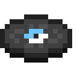</a></p><p></p></div><div style="flex:0 1 120px;border:1px solid #8a94a3;border-radius:16px;text-align:center"><p><a href="https://raw.githubusercontent.com/AllensCreations/MCPE-Curseforges/main/MCPEDL/Addons/ALN-MoreDiscs/assets/items/aln_disc_22.png"></a></p><p></p></div><div style="flex:0 1 120px;border:1px solid #8a94a3;border-radius:16px;text-align:center"><p><a href="https://raw.githubusercontent.com/AllensCreations/MCPE-Curseforges/main/MCPEDL/Addons/ALN-MoreDiscs/assets/items/aln_disc_23.png"></a></p><p></p></div><div style="flex:0 1 120px;border:1px solid #8a94a3;border-radius:16px;text-align:center"><p><a href="https://raw.githubusercontent.com/AllensCreations/MCPE-Curseforges/main/MCPEDL/Addons/ALN-MoreDiscs/assets/items/aln_disc_24.png"></a></p><p></p></div><div style="flex:0 1 120px;border:1px solid #8a94a3;border-radius:16px;text-align:center"><p><a href="https://raw.githubusercontent.com/AllensCreations/MCPE-Curseforges/main/MCPEDL/Addons/ALN-MoreDiscs/assets/items/aln_disc_25.png">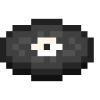</a></p><p></p></div><div style="flex:0 1 120px;border:1px solid #8a94a3;border-radius:16px;text-align:center"><p><a href="https://raw.githubusercontent.com/AllensCreations/MCPE-Curseforges/main/MCPEDL/Addons/ALN-MoreDiscs/assets/items/aln_disc_26.png">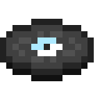</a></p><p></p></div><div style="flex:0 1 120px;border:1px solid #8a94a3;border-radius:16px;text-align:center"><p><a href="https://raw.githubusercontent.com/AllensCreations/MCPE-Curseforges/main/MCPEDL/Addons/ALN-MoreDiscs/assets/items/aln_disc_27.png"></a></p><p></p></div><div style="flex:0 1 120px;border:1px solid #8a94a3;border-radius:16px;text-align:center"><p><a href="https://raw.githubusercontent.com/AllensCreations/MCPE-Curseforges/main/MCPEDL/Addons/ALN-MoreDiscs/assets/items/aln_disc_28.png"></a></p><p></p></div><div style="flex:0 1 120px;border:1px solid #8a94a3;border-radius:16px;text-align:center"><p><a href="https://raw.githubusercontent.com/AllensCreations/MCPE-Curseforges/main/MCPEDL/Addons/ALN-MoreDiscs/assets/items/aln_disc_29.png">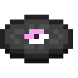</a></p><p></p></div><div style="flex:0 1 120px;border:1px solid #8a94a3;border-radius:16px;text-align:center"><p><a href="https://raw.githubusercontent.com/AllensCreations/MCPE-Curseforges/main/MCPEDL/Addons/ALN-MoreDiscs/assets/items/aln_disc_30.png"></a></p><p></p></div></div>
<p></p>
<div style="display:flex;flex-wrap:wrap;gap:10px"><div style="flex:0 1 400px;border:1px solid #8a94a3;border-radius:16px;text-align:center"><p><a href="https://raw.githubusercontent.com/AllensCreations/MCPE-Curseforges/main/MCPEDL/Addons/ALN-MoreDiscs/assets/recipes/music_disc_alpha_sunrise_recipe.png">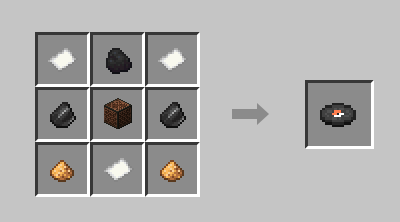</a></p><p></p></div><div style="flex:0 1 400px;border:1px solid #8a94a3;border-radius:16px;text-align:center"><p><a href="https://raw.githubusercontent.com/AllensCreations/MCPE-Curseforges/main/MCPEDL/Addons/ALN-MoreDiscs/assets/recipes/music_disc_bedtime_beacon_recipe.png">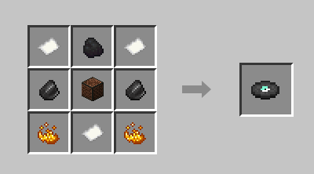</a></p><p></p></div><div style="flex:0 1 400px;border:1px solid #8a94a3;border-radius:16px;text-align:center"><p><a href="https://raw.githubusercontent.com/AllensCreations/MCPE-Curseforges/main/MCPEDL/Addons/ALN-MoreDiscs/assets/recipes/music_disc_beta_lullaby_recipe.png">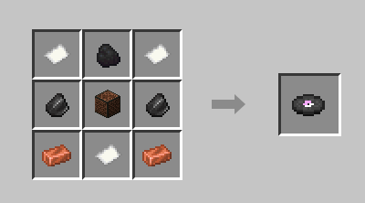</a></p><p></p></div><div style="flex:0 1 400px;border:1px solid #8a94a3;border-radius:16px;text-align:center"><p><a href="https://raw.githubusercontent.com/AllensCreations/MCPE-Curseforges/main/MCPEDL/Addons/ALN-MoreDiscs/assets/recipes/music_disc_cobblestone_dawn_recipe.png">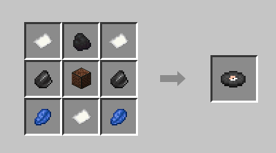</a></p><p></p></div><div style="flex:0 1 400px;border:1px solid #8a94a3;border-radius:16px;text-align:center"><p><a href="https://raw.githubusercontent.com/AllensCreations/MCPE-Curseforges/main/MCPEDL/Addons/ALN-MoreDiscs/assets/recipes/music_disc_crafting_table_memories_recipe.png">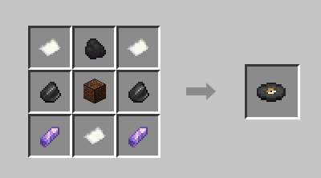</a></p><p></p></div><div style="flex:0 1 400px;border:1px solid #8a94a3;border-radius:16px;text-align:center"><p><a href="https://raw.githubusercontent.com/AllensCreations/MCPE-Curseforges/main/MCPEDL/Addons/ALN-MoreDiscs/assets/recipes/music_disc_creeper_waltz_recipe.png">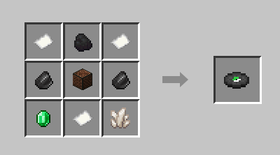</a></p><p></p></div><div style="flex:0 1 400px;border:1px solid #8a94a3;border-radius:16px;text-align:center"><p><a href="https://raw.githubusercontent.com/AllensCreations/MCPE-Curseforges/main/MCPEDL/Addons/ALN-MoreDiscs/assets/recipes/music_disc_crystal_caverns_recipe.png">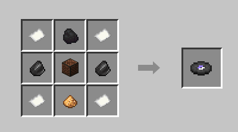</a></p><p></p></div><div style="flex:0 1 400px;border:1px solid #8a94a3;border-radius:16px;text-align:center"><p><a href="https://raw.githubusercontent.com/AllensCreations/MCPE-Curseforges/main/MCPEDL/Addons/ALN-MoreDiscs/assets/recipes/music_disc_deepslate_echoes_recipe.png">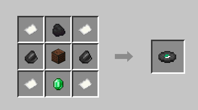</a></p><p></p></div><div style="flex:0 1 400px;border:1px solid #8a94a3;border-radius:16px;text-align:center"><p><a href="https://raw.githubusercontent.com/AllensCreations/MCPE-Curseforges/main/MCPEDL/Addons/ALN-MoreDiscs/assets/recipes/music_disc_dirt_house_blues_recipe.png">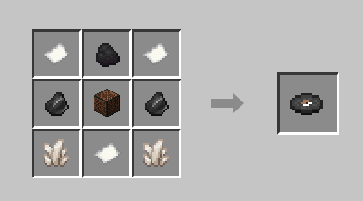</a></p><p></p></div><div style="flex:0 1 400px;border:1px solid #8a94a3;border-radius:16px;text-align:center"><p><a href="https://raw.githubusercontent.com/AllensCreations/MCPE-Curseforges/main/MCPEDL/Addons/ALN-MoreDiscs/assets/recipes/music_disc_ember_lantern_recipe.png">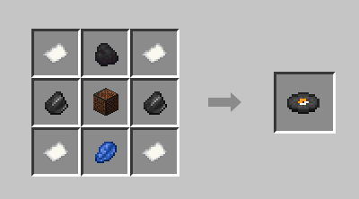</a></p><p></p></div><div style="flex:0 1 400px;border:1px solid #8a94a3;border-radius:16px;text-align:center"><p><a href="https://raw.githubusercontent.com/AllensCreations/MCPE-Curseforges/main/MCPEDL/Addons/ALN-MoreDiscs/assets/recipes/music_disc_first_night_recipe.png">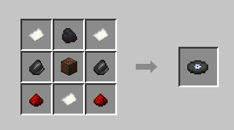</a></p><p></p></div><div style="flex:0 1 400px;border:1px solid #8a94a3;border-radius:16px;text-align:center"><p><a href="https://raw.githubusercontent.com/AllensCreations/MCPE-Curseforges/main/MCPEDL/Addons/ALN-MoreDiscs/assets/recipes/music_disc_floppy_disk_summer_recipe.png">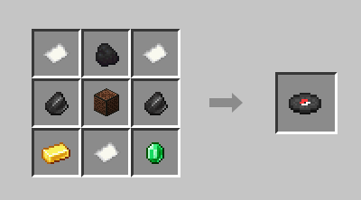</a></p><p></p></div><div style="flex:0 1 400px;border:1px solid #8a94a3;border-radius:16px;text-align:center"><p><a href="https://raw.githubusercontent.com/AllensCreations/MCPE-Curseforges/main/MCPEDL/Addons/ALN-MoreDiscs/assets/recipes/music_disc_golden_hour_recipe.png">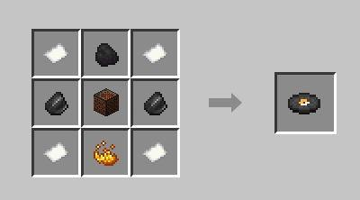</a></p><p></p></div><div style="flex:0 1 400px;border:1px solid #8a94a3;border-radius:16px;text-align:center"><p><a href="https://raw.githubusercontent.com/AllensCreations/MCPE-Curseforges/main/MCPEDL/Addons/ALN-MoreDiscs/assets/recipes/music_disc_lava_lamp_nights_recipe.png">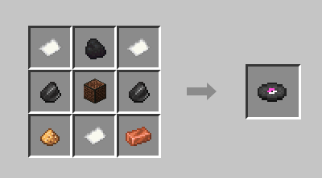</a></p><p></p></div><div style="flex:0 1 400px;border:1px solid #8a94a3;border-radius:16px;text-align:center"><p><a href="https://raw.githubusercontent.com/AllensCreations/MCPE-Curseforges/main/MCPEDL/Addons/ALN-MoreDiscs/assets/recipes/music_disc_midnight_drive_recipe.png">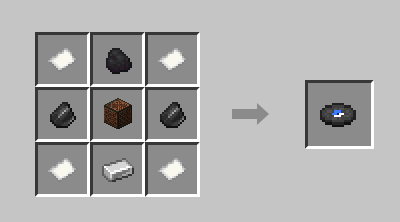</a></p><p></p></div><div style="flex:0 1 400px;border:1px solid #8a94a3;border-radius:16px;text-align:center"><p><a href="https://raw.githubusercontent.com/AllensCreations/MCPE-Curseforges/main/MCPEDL/Addons/ALN-MoreDiscs/assets/recipes/music_disc_minecart_lullaby_recipe.png">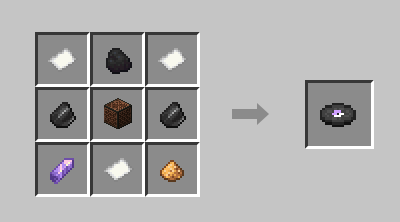</a></p><p></p></div><div style="flex:0 1 400px;border:1px solid #8a94a3;border-radius:16px;text-align:center"><p><a href="https://raw.githubusercontent.com/AllensCreations/MCPE-Curseforges/main/MCPEDL/Addons/ALN-MoreDiscs/assets/recipes/music_disc_neon_horizon_recipe.png">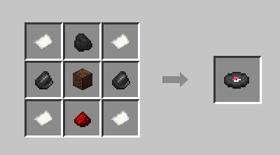</a></p><p></p></div><div style="flex:0 1 400px;border:1px solid #8a94a3;border-radius:16px;text-align:center"><p><a href="https://raw.githubusercontent.com/AllensCreations/MCPE-Curseforges/main/MCPEDL/Addons/ALN-MoreDiscs/assets/recipes/music_disc_old_world_seed_recipe.png">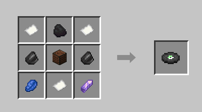</a></p><p></p></div><div style="flex:0 1 400px;border:1px solid #8a94a3;border-radius:16px;text-align:center"><p><a href="https://raw.githubusercontent.com/AllensCreations/MCPE-Curseforges/main/MCPEDL/Addons/ALN-MoreDiscs/assets/recipes/music_disc_pixel_parade_recipe.png">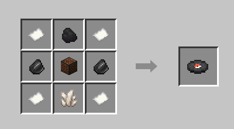</a></p><p></p></div><div style="flex:0 1 400px;border:1px solid #8a94a3;border-radius:16px;text-align:center"><p><a href="https://raw.githubusercontent.com/AllensCreations/MCPE-Curseforges/main/MCPEDL/Addons/ALN-MoreDiscs/assets/recipes/music_disc_pixel_postcards_recipe.png">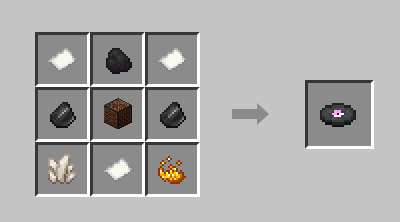</a></p><p></p></div><div style="flex:0 1 400px;border:1px solid #8a94a3;border-radius:16px;text-align:center"><p><a href="https://raw.githubusercontent.com/AllensCreations/MCPE-Curseforges/main/MCPEDL/Addons/ALN-MoreDiscs/assets/recipes/music_disc_quiet_tides_recipe.png">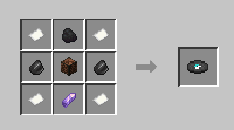</a></p><p></p></div><div style="flex:0 1 400px;border:1px solid #8a94a3;border-radius:16px;text-align:center"><p><a href="https://raw.githubusercontent.com/AllensCreations/MCPE-Curseforges/main/MCPEDL/Addons/ALN-MoreDiscs/assets/recipes/music_disc_rainy_window_recipe.png">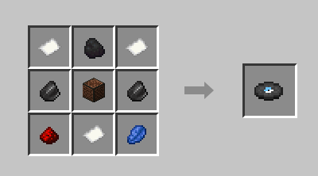</a></p><p></p></div><div style="flex:0 1 400px;border:1px solid #8a94a3;border-radius:16px;text-align:center"><p><a href="https://raw.githubusercontent.com/AllensCreations/MCPE-Curseforges/main/MCPEDL/Addons/ALN-MoreDiscs/assets/recipes/music_disc_sheep_counting_recipe.png">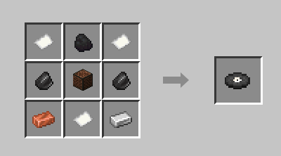</a></p><p></p></div><div style="flex:0 1 400px;border:1px solid #8a94a3;border-radius:16px;text-align:center"><p><a href="https://raw.githubusercontent.com/AllensCreations/MCPE-Curseforges/main/MCPEDL/Addons/ALN-MoreDiscs/assets/recipes/music_disc_snowy_taiga_walk_recipe.png">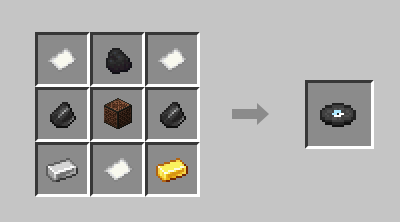</a></p><p></p></div><div style="flex:0 1 400px;border:1px solid #8a94a3;border-radius:16px;text-align:center"><p><a href="https://raw.githubusercontent.com/AllensCreations/MCPE-Curseforges/main/MCPEDL/Addons/ALN-MoreDiscs/assets/recipes/music_disc_starlight_express_recipe.png">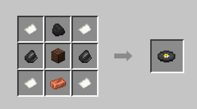</a></p><p></p></div><div style="flex:0 1 400px;border:1px solid #8a94a3;border-radius:16px;text-align:center"><p><a href="https://raw.githubusercontent.com/AllensCreations/MCPE-Curseforges/main/MCPEDL/Addons/ALN-MoreDiscs/assets/recipes/music_disc_sunlit_meadow_recipe.png">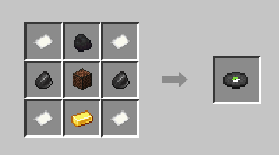</a></p><p></p></div><div style="flex:0 1 400px;border:1px solid #8a94a3;border-radius:16px;text-align:center"><p><a href="https://raw.githubusercontent.com/AllensCreations/MCPE-Curseforges/main/MCPEDL/Addons/ALN-MoreDiscs/assets/recipes/music_disc_sunset_hotbar_recipe.png">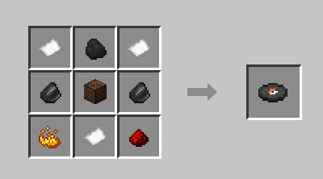</a></p><p></p></div><div style="flex:0 1 400px;border:1px solid #8a94a3;border-radius:16px;text-align:center"><p><a href="https://raw.githubusercontent.com/AllensCreations/MCPE-Curseforges/main/MCPEDL/Addons/ALN-MoreDiscs/assets/recipes/music_disc_torchlight_recipe.png">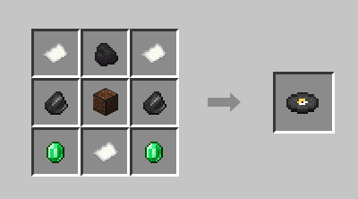</a></p><p></p></div><div style="flex:0 1 400px;border:1px solid #8a94a3;border-radius:16px;text-align:center"><p><a href="https://raw.githubusercontent.com/AllensCreations/MCPE-Curseforges/main/MCPEDL/Addons/ALN-MoreDiscs/assets/recipes/music_disc_village_dusk_recipe.png">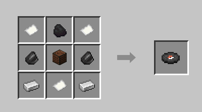</a></p><p></p></div><div style="flex:0 1 400px;border:1px solid #8a94a3;border-radius:16px;text-align:center"><p><a href="https://raw.githubusercontent.com/AllensCreations/MCPE-Curseforges/main/MCPEDL/Addons/ALN-MoreDiscs/assets/recipes/music_disc_wooden_pickaxe_recipe.png">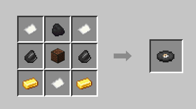</a></p><p></p></div></div>
<p></p>
<table style="width:100%;border:1px solid #8a94a3;border-radius:16px"><tbody><tr><td style="width:44px;text-align:center"><div style="background-color:#15803d;color:#ffffff;font-weight:bold;font-size:15px;text-align:center;border-radius:10px;width:30px;aspect-ratio:1/1;line-height:30px">1</div></td><td style="text-align:left;">Open the Crafting Table and craft a disc with the recipe above.</td></tr><tr><td style="width:44px;text-align:center"><div style="background-color:#15803d;color:#ffffff;font-weight:bold;font-size:15px;text-align:center;border-radius:10px;width:30px;aspect-ratio:1/1;line-height:30px">2</div></td><td style="text-align:left;">Right-click a Jukebox while holding the disc.</td></tr><tr><td style="width:44px;text-align:center"><div style="background-color:#15803d;color:#ffffff;font-weight:bold;font-size:15px;text-align:center;border-radius:10px;width:30px;aspect-ratio:1/1;line-height:30px">3</div></td><td style="text-align:left;">Listen for the track.</td></tr><tr><td style="width:44px;text-align:center"><div style="background-color:#15803d;color:#ffffff;font-weight:bold;font-size:15px;text-align:center;border-radius:10px;width:30px;aspect-ratio:1/1;line-height:30px">4</div></td><td style="text-align:left;">Right-click the Jukebox again to take the disc out and stop the track.</td></tr></tbody></table>
<p></p>
<div class="spoiler" title="Do I need cheats to get the discs?" data-title="Do I need cheats to get the discs?"><p><strong>Do I need cheats to get the discs?</strong><br>No. All thirty discs are craftable in Survival and their recipes are unlocked from the start.</p></div><div class="spoiler" title="Can I use my own music?" data-title="Can I use my own music?"><p><strong>Can I use my own music?</strong><br>ALNStudios ships only the thirty original tracks. The linked web tool is the route for personal packs, for private use only.</p></div>
<p></p>
<table style="width:100%;border:1px solid #8a94a3;border-radius:16px"><tbody><tr><td style="width:44px;text-align:center"><div style="background-color:#15803d;color:#ffffff;font-weight:bold;font-size:15px;text-align:center;border-radius:10px;width:30px;aspect-ratio:1/1;line-height:30px">1</div></td><td style="text-align:left;">Download the file from this page and open it with Minecraft.</td></tr><tr><td style="width:44px;text-align:center"><div style="background-color:#15803d;color:#ffffff;font-weight:bold;font-size:15px;text-align:center;border-radius:10px;width:30px;aspect-ratio:1/1;line-height:30px">2</div></td><td style="text-align:left;">Create or edit a world and turn on the new pack(s) in its settings.</td></tr><tr><td style="width:44px;text-align:center"><div style="background-color:#15803d;color:#ffffff;font-weight:bold;font-size:15px;text-align:center;border-radius:10px;width:30px;aspect-ratio:1/1;line-height:30px">3</div></td><td style="text-align:left;">Play. No Experimental toggles needed.</td></tr></tbody></table>
<div style="border:1px solid #8a94a3;border-radius:16px;text-align:center"><br><div style="background-color:#15803d;color:#ffffff;border-radius:20px;font-size:15px;line-height:2;display:inline-block">&nbsp;&nbsp;<strong>Found a Bug or Have a Suggestion?</strong>&nbsp;&nbsp;</div><p style="font-size:14px;">Please leave a comment on this project page! All bug reports, gameplay feedback, and pack suggestions are welcome and appreciated.</p></div>
<p></p><div style="border:1px solid #8a94a3;border-radius:16px;text-align:center"><br><a href="https://ko-fi.com/alnstudios"></a><br><br></div><p style="text-align:center"><a href="https://www.curseforge.com/members/allenscreations/projects"><strong>CurseForge</strong></a> &nbsp;|&nbsp; <a href="https://mcpedl.com/user/alnstudios/"><strong>MCPEDL</strong></a> &nbsp;|&nbsp; <a href="https://ko-fi.com/alnstudios"><strong>Ko-fi</strong></a></p>
<hr>
<p style="text-align:center;color:#8a94a3;font-size:13px"><strong>By ALNStudios</strong></p>
<div class="spoiler"><p style="font-size:13px"><strong>Permissions and credits</strong></p><ul style="font-size:13px"><li>Rights: All rights reserved for ALNStudios.</li><li>Content creators: You may feature this creation in videos and streams with credit to ALNStudios.</li><li>Redistribution: Do not re-upload this pack or provide direct monetized download bypasses. Link to this page.</li><li>Visual: Promotional/cover imagery used on this page is AI-generated to illustrate the concept and purpose of the pack.</li><li>Unofficial community creation. Not an official Minecraft product and not approved by or associated with Mojang or Microsoft.</li></ul></div>
<p style="text-align:center;color:#8a94a3;font-size:12px">Minecraft Bedrock add-on, ALN MoreDiscs Bedrock mod, custom music discs, Jukebox music, Note Block recipe, Minecraft PE survival, MCPEDL add-on, CurseForge Bedrock, ALNStudios.</p></div>
```

### Theme 2: Netherite Stealth (Modern Dark)

High-tech dark obsidian & emerald storefront.

```html
<div style="background-color:#0d1117;color:#c9d1d9;border-radius:12px;padding-left:12px"><div style="margin-right:12px"><br><div style="background-color:#161b22;border:2px solid #10b981;border-radius:18px;line-height:1.5"><br><p style="text-align:center"></p><p style="color:#8b949e;font-size:14px;text-align:center">by ALNStudios</p><p style="text-align:center"><span style="background-color:#10b981;color:#ffffff;border-radius:20px;font-size:16px">&nbsp;&nbsp;<strong>Craft thirty original music discs, each with its own 55 to 92 second track, and play them in a Jukebox in Survival.</strong>&nbsp;&nbsp;</span></p><p style="color:#8b949e;text-align:center;margin-left:16px;margin-right:16px">ALN MoreDiscs adds thirty music discs, Track 1 to Track 30, each crafted from Paper, Coal, Flint, a Note Block and one or two accent items. They give a Jukebox new music without any other add-on.</p><div style="display:flex;flex-wrap:wrap;gap:8px;margin-left:14px;margin-right:14px"><div style="background-color:#161b22;color:#10b981;border-radius:20px;font-size:14px;line-height:2"><strong>&nbsp;&nbsp;Bedrock</strong>: 1.26+&nbsp;&nbsp;</div><div style="background-color:#161b22;color:#10b981;border-radius:20px;font-size:14px;line-height:2"><strong>&nbsp;&nbsp;Experimental</strong>: No&nbsp;&nbsp;</div><div style="background-color:#161b22;color:#10b981;border-radius:20px;font-size:14px;line-height:2"><strong>&nbsp;&nbsp;Achievements</strong>: Yes, achievement-friendly&nbsp;&nbsp;</div></div><br></div>
<p></p>
<p style="color:#c9d1d9">Craft a disc at a Crafting Table, put it in a Jukebox and the matching track plays. Every track is an original piece made for this pack, so the thirty discs add music to your world without using any existing songs. The discs also announce which track is playing and for how long, so ALN Wireless Headphones can show it.</p>
<p></p>
<div style="display:flex;flex-wrap:wrap;gap:10px"><div style="flex:1;min-width:200px;background-color:#161b22;border:1px solid #30363d;border-radius:16px"><div style="background-color:#10b981;color:#ffffff;border-radius:16px;font-size:16px;line-height:2.2"><strong>&nbsp;&nbsp;Thirty Original Tracks</strong></div><div style="margin-left:12px;margin-right:12px"><p><span style="color:#c9d1d9">The pack adds thirty discs with one track each. The track list is below.</span><br><span style="font-size:13px;color:#8b949e"><strong>Good To Know:</strong> Each disc stacks to 1, like a vanilla music disc.</span></p></div></div><div style="flex:1;min-width:200px;background-color:#161b22;border:1px solid #30363d;border-radius:16px"><div style="background-color:#10b981;color:#ffffff;border-radius:16px;font-size:16px;line-height:2.2"><strong>&nbsp;&nbsp;Survival Crafting</strong></div><div style="margin-left:12px;margin-right:12px"><p><span style="color:#c9d1d9">Craft each of Tracks 1 to 10 at a Crafting Table. Top row: Paper, Coal, Paper. Middle row: Flint, Note Block, Flint. Bottom row: Paper, the accent item, Paper.</span><br><span style="font-size:13px;color:#8b949e"><strong>How It Works:</strong> The accent item picks the track: Redstone Dust for Track 1, Lapis Lazuli for Track 2, Amethyst Shard for Track 3, Glowstone Dust for Track 4, Copper Ingot for Track 5, Iron Ingot for Track 6, Gold Ingot for Track 7, Emerald for Track 8, Nether Quartz for Track 9, Blaze Powder for Track 10.</span><br><span style="font-size:13px;color:#8b949e"><strong>Newer Discs:</strong> Tracks 11 to 30 use the same top and middle rows. For Tracks 11 to 20 the bottom row is the accent item, Paper, the same accent item again: Redstone Dust for Track 11, Lapis Lazuli for Track 12, Amethyst Shard for Track 13, Glowstone Dust for Track 14, Copper Ingot for Track 15, Iron Ingot for Track 16, Gold Ingot for Track 17, Emerald for Track 18, Nether Quartz for Track 19, Blaze Powder for Track 20. For Tracks 21 to 30 the bottom row is one accent item, Paper, a second accent item: Redstone Dust and Lapis Lazuli for Track 21, Lapis Lazuli and Amethyst Shard for Track 22, Amethyst Shard and Glowstone Dust for Track 23, Glowstone Dust and Copper Ingot for Track 24, Copper Ingot and Iron Ingot for Track 25, Iron Ingot and Gold Ingot for Track 26, Gold Ingot and Emerald for Track 27, Emerald and Nether Quartz for Track 28, Nether Quartz and Blaze Powder for Track 29, Blaze Powder and Redstone Dust for Track 30.</span><br><span style="font-size:13px;color:#8b949e"><strong>Good To Know:</strong> All thirty recipes are unlocked from the start, so no cheats and no recipe discovery are needed.</span></p></div></div><div style="flex:1;min-width:200px;background-color:#161b22;border:1px solid #30363d;border-radius:16px"><div style="background-color:#10b981;color:#ffffff;border-radius:16px;font-size:16px;line-height:2.2"><strong>&nbsp;&nbsp;Jukebox Playback</strong></div><div style="margin-left:12px;margin-right:12px"><p><span style="color:#c9d1d9">Use a disc on a Jukebox to play it, and use the Jukebox again to take the disc back out.</span><br><span style="font-size:13px;color:#8b949e"><strong>Good To Know:</strong> Breaking the Jukebox or taking the disc out ends the track and gives the disc back. The pack handles these discs itself, so no experiments are needed, but the Jukebox shows no spinning disc, gives no Comparator signal, and has to be emptied of a vanilla disc first.</span></p></div></div><div style="flex:1;min-width:200px;background-color:#161b22;border:1px solid #30363d;border-radius:16px"><div style="background-color:#10b981;color:#ffffff;border-radius:16px;font-size:16px;line-height:2.2"><strong>&nbsp;&nbsp;ALN Wireless Headphones Support</strong></div><div style="margin-left:12px;margin-right:12px"><p><span style="color:#c9d1d9">When a disc starts or stops, the pack announces the track number, the track name and its length so ALN Wireless Headphones can show them.</span><br><span style="font-size:13px;color:#8b949e"><strong>Good To Know:</strong> This has not been tested together with ALN Wireless Headphones in game.</span></p></div></div><div style="flex:1;min-width:200px;background-color:#161b22;border:1px solid #30363d;border-radius:16px"><div style="background-color:#10b981;color:#ffffff;border-radius:16px;font-size:16px;line-height:2.2"><strong>&nbsp;&nbsp;Make Your Own Discs</strong></div><div style="margin-left:12px;margin-right:12px"><p><span style="color:#c9d1d9">The free web tool at https://alnstudios-more-discs.vercel.app is meant to turn your own audio files into a personal pack on your own device.</span><br><span style="font-size:13px;color:#8b949e"><strong>Good To Know:</strong> ALNStudios only distributes the thirty original tracks. Audio you convert yourself must be for private, personal play, and you are responsible for having the right to use it.</span></p></div></div></div>
<p></p>
<div style="display:flex;flex-wrap:wrap;gap:10px"><div style="flex:0 1 120px;background-color:#161b22;border:1px solid #30363d;border-radius:16px;text-align:center"><p><a href="https://raw.githubusercontent.com/AllensCreations/MCPE-Curseforges/main/MCPEDL/Addons/ALN-MoreDiscs/assets/items/aln_disc_1.png"></a></p><p></p></div><div style="flex:0 1 120px;background-color:#161b22;border:1px solid #30363d;border-radius:16px;text-align:center"><p><a href="https://raw.githubusercontent.com/AllensCreations/MCPE-Curseforges/main/MCPEDL/Addons/ALN-MoreDiscs/assets/items/aln_disc_2.png"></a></p><p></p></div><div style="flex:0 1 120px;background-color:#161b22;border:1px solid #30363d;border-radius:16px;text-align:center"><p><a href="https://raw.githubusercontent.com/AllensCreations/MCPE-Curseforges/main/MCPEDL/Addons/ALN-MoreDiscs/assets/items/aln_disc_3.png"></a></p><p></p></div><div style="flex:0 1 120px;background-color:#161b22;border:1px solid #30363d;border-radius:16px;text-align:center"><p><a href="https://raw.githubusercontent.com/AllensCreations/MCPE-Curseforges/main/MCPEDL/Addons/ALN-MoreDiscs/assets/items/aln_disc_4.png"></a></p><p></p></div><div style="flex:0 1 120px;background-color:#161b22;border:1px solid #30363d;border-radius:16px;text-align:center"><p><a href="https://raw.githubusercontent.com/AllensCreations/MCPE-Curseforges/main/MCPEDL/Addons/ALN-MoreDiscs/assets/items/aln_disc_5.png"></a></p><p></p></div><div style="flex:0 1 120px;background-color:#161b22;border:1px solid #30363d;border-radius:16px;text-align:center"><p><a href="https://raw.githubusercontent.com/AllensCreations/MCPE-Curseforges/main/MCPEDL/Addons/ALN-MoreDiscs/assets/items/aln_disc_6.png"></a></p><p></p></div><div style="flex:0 1 120px;background-color:#161b22;border:1px solid #30363d;border-radius:16px;text-align:center"><p><a href="https://raw.githubusercontent.com/AllensCreations/MCPE-Curseforges/main/MCPEDL/Addons/ALN-MoreDiscs/assets/items/aln_disc_7.png"></a></p><p></p></div><div style="flex:0 1 120px;background-color:#161b22;border:1px solid #30363d;border-radius:16px;text-align:center"><p><a href="https://raw.githubusercontent.com/AllensCreations/MCPE-Curseforges/main/MCPEDL/Addons/ALN-MoreDiscs/assets/items/aln_disc_8.png"></a></p><p></p></div><div style="flex:0 1 120px;background-color:#161b22;border:1px solid #30363d;border-radius:16px;text-align:center"><p><a href="https://raw.githubusercontent.com/AllensCreations/MCPE-Curseforges/main/MCPEDL/Addons/ALN-MoreDiscs/assets/items/aln_disc_9.png"></a></p><p></p></div><div style="flex:0 1 120px;background-color:#161b22;border:1px solid #30363d;border-radius:16px;text-align:center"><p><a href="https://raw.githubusercontent.com/AllensCreations/MCPE-Curseforges/main/MCPEDL/Addons/ALN-MoreDiscs/assets/items/aln_disc_10.png"></a></p><p></p></div><div style="flex:0 1 120px;background-color:#161b22;border:1px solid #30363d;border-radius:16px;text-align:center"><p><a href="https://raw.githubusercontent.com/AllensCreations/MCPE-Curseforges/main/MCPEDL/Addons/ALN-MoreDiscs/assets/items/aln_disc_11.png"></a></p><p></p></div><div style="flex:0 1 120px;background-color:#161b22;border:1px solid #30363d;border-radius:16px;text-align:center"><p><a href="https://raw.githubusercontent.com/AllensCreations/MCPE-Curseforges/main/MCPEDL/Addons/ALN-MoreDiscs/assets/items/aln_disc_12.png"></a></p><p></p></div><div style="flex:0 1 120px;background-color:#161b22;border:1px solid #30363d;border-radius:16px;text-align:center"><p><a href="https://raw.githubusercontent.com/AllensCreations/MCPE-Curseforges/main/MCPEDL/Addons/ALN-MoreDiscs/assets/items/aln_disc_13.png"></a></p><p></p></div><div style="flex:0 1 120px;background-color:#161b22;border:1px solid #30363d;border-radius:16px;text-align:center"><p><a href="https://raw.githubusercontent.com/AllensCreations/MCPE-Curseforges/main/MCPEDL/Addons/ALN-MoreDiscs/assets/items/aln_disc_14.png"></a></p><p></p></div><div style="flex:0 1 120px;background-color:#161b22;border:1px solid #30363d;border-radius:16px;text-align:center"><p><a href="https://raw.githubusercontent.com/AllensCreations/MCPE-Curseforges/main/MCPEDL/Addons/ALN-MoreDiscs/assets/items/aln_disc_15.png"></a></p><p></p></div><div style="flex:0 1 120px;background-color:#161b22;border:1px solid #30363d;border-radius:16px;text-align:center"><p><a href="https://raw.githubusercontent.com/AllensCreations/MCPE-Curseforges/main/MCPEDL/Addons/ALN-MoreDiscs/assets/items/aln_disc_16.png"></a></p><p></p></div><div style="flex:0 1 120px;background-color:#161b22;border:1px solid #30363d;border-radius:16px;text-align:center"><p><a href="https://raw.githubusercontent.com/AllensCreations/MCPE-Curseforges/main/MCPEDL/Addons/ALN-MoreDiscs/assets/items/aln_disc_17.png"></a></p><p></p></div><div style="flex:0 1 120px;background-color:#161b22;border:1px solid #30363d;border-radius:16px;text-align:center"><p><a href="https://raw.githubusercontent.com/AllensCreations/MCPE-Curseforges/main/MCPEDL/Addons/ALN-MoreDiscs/assets/items/aln_disc_18.png"></a></p><p></p></div><div style="flex:0 1 120px;background-color:#161b22;border:1px solid #30363d;border-radius:16px;text-align:center"><p><a href="https://raw.githubusercontent.com/AllensCreations/MCPE-Curseforges/main/MCPEDL/Addons/ALN-MoreDiscs/assets/items/aln_disc_19.png"></a></p><p></p></div><div style="flex:0 1 120px;background-color:#161b22;border:1px solid #30363d;border-radius:16px;text-align:center"><p><a href="https://raw.githubusercontent.com/AllensCreations/MCPE-Curseforges/main/MCPEDL/Addons/ALN-MoreDiscs/assets/items/aln_disc_20.png"></a></p><p></p></div><div style="flex:0 1 120px;background-color:#161b22;border:1px solid #30363d;border-radius:16px;text-align:center"><p><a href="https://raw.githubusercontent.com/AllensCreations/MCPE-Curseforges/main/MCPEDL/Addons/ALN-MoreDiscs/assets/items/aln_disc_21.png"></a></p><p></p></div><div style="flex:0 1 120px;background-color:#161b22;border:1px solid #30363d;border-radius:16px;text-align:center"><p><a href="https://raw.githubusercontent.com/AllensCreations/MCPE-Curseforges/main/MCPEDL/Addons/ALN-MoreDiscs/assets/items/aln_disc_22.png"></a></p><p></p></div><div style="flex:0 1 120px;background-color:#161b22;border:1px solid #30363d;border-radius:16px;text-align:center"><p><a href="https://raw.githubusercontent.com/AllensCreations/MCPE-Curseforges/main/MCPEDL/Addons/ALN-MoreDiscs/assets/items/aln_disc_23.png"></a></p><p></p></div><div style="flex:0 1 120px;background-color:#161b22;border:1px solid #30363d;border-radius:16px;text-align:center"><p><a href="https://raw.githubusercontent.com/AllensCreations/MCPE-Curseforges/main/MCPEDL/Addons/ALN-MoreDiscs/assets/items/aln_disc_24.png"></a></p><p></p></div><div style="flex:0 1 120px;background-color:#161b22;border:1px solid #30363d;border-radius:16px;text-align:center"><p><a href="https://raw.githubusercontent.com/AllensCreations/MCPE-Curseforges/main/MCPEDL/Addons/ALN-MoreDiscs/assets/items/aln_disc_25.png"></a></p><p></p></div><div style="flex:0 1 120px;background-color:#161b22;border:1px solid #30363d;border-radius:16px;text-align:center"><p><a href="https://raw.githubusercontent.com/AllensCreations/MCPE-Curseforges/main/MCPEDL/Addons/ALN-MoreDiscs/assets/items/aln_disc_26.png"></a></p><p></p></div><div style="flex:0 1 120px;background-color:#161b22;border:1px solid #30363d;border-radius:16px;text-align:center"><p><a href="https://raw.githubusercontent.com/AllensCreations/MCPE-Curseforges/main/MCPEDL/Addons/ALN-MoreDiscs/assets/items/aln_disc_27.png"></a></p><p></p></div><div style="flex:0 1 120px;background-color:#161b22;border:1px solid #30363d;border-radius:16px;text-align:center"><p><a href="https://raw.githubusercontent.com/AllensCreations/MCPE-Curseforges/main/MCPEDL/Addons/ALN-MoreDiscs/assets/items/aln_disc_28.png"></a></p><p></p></div><div style="flex:0 1 120px;background-color:#161b22;border:1px solid #30363d;border-radius:16px;text-align:center"><p><a href="https://raw.githubusercontent.com/AllensCreations/MCPE-Curseforges/main/MCPEDL/Addons/ALN-MoreDiscs/assets/items/aln_disc_29.png"></a></p><p></p></div><div style="flex:0 1 120px;background-color:#161b22;border:1px solid #30363d;border-radius:16px;text-align:center"><p><a href="https://raw.githubusercontent.com/AllensCreations/MCPE-Curseforges/main/MCPEDL/Addons/ALN-MoreDiscs/assets/items/aln_disc_30.png"></a></p><p></p></div></div>
<p></p>
<div style="display:flex;flex-wrap:wrap;gap:10px"><div style="flex:0 1 400px;background-color:#161b22;border:1px solid #30363d;border-radius:16px;text-align:center"><p><a href="https://raw.githubusercontent.com/AllensCreations/MCPE-Curseforges/main/MCPEDL/Addons/ALN-MoreDiscs/assets/recipes/music_disc_alpha_sunrise_recipe.png"></a></p><p></p></div><div style="flex:0 1 400px;background-color:#161b22;border:1px solid #30363d;border-radius:16px;text-align:center"><p><a href="https://raw.githubusercontent.com/AllensCreations/MCPE-Curseforges/main/MCPEDL/Addons/ALN-MoreDiscs/assets/recipes/music_disc_bedtime_beacon_recipe.png"></a></p><p></p></div><div style="flex:0 1 400px;background-color:#161b22;border:1px solid #30363d;border-radius:16px;text-align:center"><p><a href="https://raw.githubusercontent.com/AllensCreations/MCPE-Curseforges/main/MCPEDL/Addons/ALN-MoreDiscs/assets/recipes/music_disc_beta_lullaby_recipe.png"></a></p><p></p></div><div style="flex:0 1 400px;background-color:#161b22;border:1px solid #30363d;border-radius:16px;text-align:center"><p><a href="https://raw.githubusercontent.com/AllensCreations/MCPE-Curseforges/main/MCPEDL/Addons/ALN-MoreDiscs/assets/recipes/music_disc_cobblestone_dawn_recipe.png"></a></p><p></p></div><div style="flex:0 1 400px;background-color:#161b22;border:1px solid #30363d;border-radius:16px;text-align:center"><p><a href="https://raw.githubusercontent.com/AllensCreations/MCPE-Curseforges/main/MCPEDL/Addons/ALN-MoreDiscs/assets/recipes/music_disc_crafting_table_memories_recipe.png"></a></p><p></p></div><div style="flex:0 1 400px;background-color:#161b22;border:1px solid #30363d;border-radius:16px;text-align:center"><p><a href="https://raw.githubusercontent.com/AllensCreations/MCPE-Curseforges/main/MCPEDL/Addons/ALN-MoreDiscs/assets/recipes/music_disc_creeper_waltz_recipe.png"></a></p><p></p></div><div style="flex:0 1 400px;background-color:#161b22;border:1px solid #30363d;border-radius:16px;text-align:center"><p><a href="https://raw.githubusercontent.com/AllensCreations/MCPE-Curseforges/main/MCPEDL/Addons/ALN-MoreDiscs/assets/recipes/music_disc_crystal_caverns_recipe.png"></a></p><p></p></div><div style="flex:0 1 400px;background-color:#161b22;border:1px solid #30363d;border-radius:16px;text-align:center"><p><a href="https://raw.githubusercontent.com/AllensCreations/MCPE-Curseforges/main/MCPEDL/Addons/ALN-MoreDiscs/assets/recipes/music_disc_deepslate_echoes_recipe.png"></a></p><p></p></div><div style="flex:0 1 400px;background-color:#161b22;border:1px solid #30363d;border-radius:16px;text-align:center"><p><a href="https://raw.githubusercontent.com/AllensCreations/MCPE-Curseforges/main/MCPEDL/Addons/ALN-MoreDiscs/assets/recipes/music_disc_dirt_house_blues_recipe.png"></a></p><p></p></div><div style="flex:0 1 400px;background-color:#161b22;border:1px solid #30363d;border-radius:16px;text-align:center"><p><a href="https://raw.githubusercontent.com/AllensCreations/MCPE-Curseforges/main/MCPEDL/Addons/ALN-MoreDiscs/assets/recipes/music_disc_ember_lantern_recipe.png"></a></p><p></p></div><div style="flex:0 1 400px;background-color:#161b22;border:1px solid #30363d;border-radius:16px;text-align:center"><p><a href="https://raw.githubusercontent.com/AllensCreations/MCPE-Curseforges/main/MCPEDL/Addons/ALN-MoreDiscs/assets/recipes/music_disc_first_night_recipe.png"></a></p><p></p></div><div style="flex:0 1 400px;background-color:#161b22;border:1px solid #30363d;border-radius:16px;text-align:center"><p><a href="https://raw.githubusercontent.com/AllensCreations/MCPE-Curseforges/main/MCPEDL/Addons/ALN-MoreDiscs/assets/recipes/music_disc_floppy_disk_summer_recipe.png"></a></p><p></p></div><div style="flex:0 1 400px;background-color:#161b22;border:1px solid #30363d;border-radius:16px;text-align:center"><p><a href="https://raw.githubusercontent.com/AllensCreations/MCPE-Curseforges/main/MCPEDL/Addons/ALN-MoreDiscs/assets/recipes/music_disc_golden_hour_recipe.png"></a></p><p></p></div><div style="flex:0 1 400px;background-color:#161b22;border:1px solid #30363d;border-radius:16px;text-align:center"><p><a href="https://raw.githubusercontent.com/AllensCreations/MCPE-Curseforges/main/MCPEDL/Addons/ALN-MoreDiscs/assets/recipes/music_disc_lava_lamp_nights_recipe.png"></a></p><p></p></div><div style="flex:0 1 400px;background-color:#161b22;border:1px solid #30363d;border-radius:16px;text-align:center"><p><a href="https://raw.githubusercontent.com/AllensCreations/MCPE-Curseforges/main/MCPEDL/Addons/ALN-MoreDiscs/assets/recipes/music_disc_midnight_drive_recipe.png"></a></p><p></p></div><div style="flex:0 1 400px;background-color:#161b22;border:1px solid #30363d;border-radius:16px;text-align:center"><p><a href="https://raw.githubusercontent.com/AllensCreations/MCPE-Curseforges/main/MCPEDL/Addons/ALN-MoreDiscs/assets/recipes/music_disc_minecart_lullaby_recipe.png"></a></p><p></p></div><div style="flex:0 1 400px;background-color:#161b22;border:1px solid #30363d;border-radius:16px;text-align:center"><p><a href="https://raw.githubusercontent.com/AllensCreations/MCPE-Curseforges/main/MCPEDL/Addons/ALN-MoreDiscs/assets/recipes/music_disc_neon_horizon_recipe.png"></a></p><p></p></div><div style="flex:0 1 400px;background-color:#161b22;border:1px solid #30363d;border-radius:16px;text-align:center"><p><a href="https://raw.githubusercontent.com/AllensCreations/MCPE-Curseforges/main/MCPEDL/Addons/ALN-MoreDiscs/assets/recipes/music_disc_old_world_seed_recipe.png"></a></p><p></p></div><div style="flex:0 1 400px;background-color:#161b22;border:1px solid #30363d;border-radius:16px;text-align:center"><p><a href="https://raw.githubusercontent.com/AllensCreations/MCPE-Curseforges/main/MCPEDL/Addons/ALN-MoreDiscs/assets/recipes/music_disc_pixel_parade_recipe.png"></a></p><p></p></div><div style="flex:0 1 400px;background-color:#161b22;border:1px solid #30363d;border-radius:16px;text-align:center"><p><a href="https://raw.githubusercontent.com/AllensCreations/MCPE-Curseforges/main/MCPEDL/Addons/ALN-MoreDiscs/assets/recipes/music_disc_pixel_postcards_recipe.png"></a></p><p></p></div><div style="flex:0 1 400px;background-color:#161b22;border:1px solid #30363d;border-radius:16px;text-align:center"><p><a href="https://raw.githubusercontent.com/AllensCreations/MCPE-Curseforges/main/MCPEDL/Addons/ALN-MoreDiscs/assets/recipes/music_disc_quiet_tides_recipe.png"></a></p><p></p></div><div style="flex:0 1 400px;background-color:#161b22;border:1px solid #30363d;border-radius:16px;text-align:center"><p><a href="https://raw.githubusercontent.com/AllensCreations/MCPE-Curseforges/main/MCPEDL/Addons/ALN-MoreDiscs/assets/recipes/music_disc_rainy_window_recipe.png"></a></p><p></p></div><div style="flex:0 1 400px;background-color:#161b22;border:1px solid #30363d;border-radius:16px;text-align:center"><p><a href="https://raw.githubusercontent.com/AllensCreations/MCPE-Curseforges/main/MCPEDL/Addons/ALN-MoreDiscs/assets/recipes/music_disc_sheep_counting_recipe.png"></a></p><p></p></div><div style="flex:0 1 400px;background-color:#161b22;border:1px solid #30363d;border-radius:16px;text-align:center"><p><a href="https://raw.githubusercontent.com/AllensCreations/MCPE-Curseforges/main/MCPEDL/Addons/ALN-MoreDiscs/assets/recipes/music_disc_snowy_taiga_walk_recipe.png"></a></p><p></p></div><div style="flex:0 1 400px;background-color:#161b22;border:1px solid #30363d;border-radius:16px;text-align:center"><p><a href="https://raw.githubusercontent.com/AllensCreations/MCPE-Curseforges/main/MCPEDL/Addons/ALN-MoreDiscs/assets/recipes/music_disc_starlight_express_recipe.png"></a></p><p></p></div><div style="flex:0 1 400px;background-color:#161b22;border:1px solid #30363d;border-radius:16px;text-align:center"><p><a href="https://raw.githubusercontent.com/AllensCreations/MCPE-Curseforges/main/MCPEDL/Addons/ALN-MoreDiscs/assets/recipes/music_disc_sunlit_meadow_recipe.png"></a></p><p></p></div><div style="flex:0 1 400px;background-color:#161b22;border:1px solid #30363d;border-radius:16px;text-align:center"><p><a href="https://raw.githubusercontent.com/AllensCreations/MCPE-Curseforges/main/MCPEDL/Addons/ALN-MoreDiscs/assets/recipes/music_disc_sunset_hotbar_recipe.png"></a></p><p></p></div><div style="flex:0 1 400px;background-color:#161b22;border:1px solid #30363d;border-radius:16px;text-align:center"><p><a href="https://raw.githubusercontent.com/AllensCreations/MCPE-Curseforges/main/MCPEDL/Addons/ALN-MoreDiscs/assets/recipes/music_disc_torchlight_recipe.png"></a></p><p></p></div><div style="flex:0 1 400px;background-color:#161b22;border:1px solid #30363d;border-radius:16px;text-align:center"><p><a href="https://raw.githubusercontent.com/AllensCreations/MCPE-Curseforges/main/MCPEDL/Addons/ALN-MoreDiscs/assets/recipes/music_disc_village_dusk_recipe.png"></a></p><p></p></div><div style="flex:0 1 400px;background-color:#161b22;border:1px solid #30363d;border-radius:16px;text-align:center"><p><a href="https://raw.githubusercontent.com/AllensCreations/MCPE-Curseforges/main/MCPEDL/Addons/ALN-MoreDiscs/assets/recipes/music_disc_wooden_pickaxe_recipe.png"></a></p><p></p></div></div>
<p></p>
<table style="width:100%;border:1px solid #30363d;border-radius:16px"><tbody><tr><td style="width:44px;text-align:center"><div style="background-color:#10b981;color:#ffffff;font-weight:bold;font-size:15px;text-align:center;border-radius:10px;width:30px;aspect-ratio:1/1;line-height:30px">1</div></td><td style="text-align:left;color:#c9d1d9">Open the Crafting Table and craft a disc with the recipe above.</td></tr><tr><td style="width:44px;text-align:center"><div style="background-color:#10b981;color:#ffffff;font-weight:bold;font-size:15px;text-align:center;border-radius:10px;width:30px;aspect-ratio:1/1;line-height:30px">2</div></td><td style="text-align:left;color:#c9d1d9">Right-click a Jukebox while holding the disc.</td></tr><tr><td style="width:44px;text-align:center"><div style="background-color:#10b981;color:#ffffff;font-weight:bold;font-size:15px;text-align:center;border-radius:10px;width:30px;aspect-ratio:1/1;line-height:30px">3</div></td><td style="text-align:left;color:#c9d1d9">Listen for the track.</td></tr><tr><td style="width:44px;text-align:center"><div style="background-color:#10b981;color:#ffffff;font-weight:bold;font-size:15px;text-align:center;border-radius:10px;width:30px;aspect-ratio:1/1;line-height:30px">4</div></td><td style="text-align:left;color:#c9d1d9">Right-click the Jukebox again to take the disc out and stop the track.</td></tr></tbody></table>
<p></p>
<div class="spoiler" title="Do I need cheats to get the discs?" data-title="Do I need cheats to get the discs?"><p style="color:#c9d1d9"><strong>Do I need cheats to get the discs?</strong><br>No. All thirty discs are craftable in Survival and their recipes are unlocked from the start.</p></div><div class="spoiler" title="Can I use my own music?" data-title="Can I use my own music?"><p style="color:#c9d1d9"><strong>Can I use my own music?</strong><br>ALNStudios ships only the thirty original tracks. The linked web tool is the route for personal packs, for private use only.</p></div>
<p></p>
<table style="width:100%;border:1px solid #30363d;border-radius:16px"><tbody><tr><td style="width:44px;text-align:center"><div style="background-color:#10b981;color:#ffffff;font-weight:bold;font-size:15px;text-align:center;border-radius:10px;width:30px;aspect-ratio:1/1;line-height:30px">1</div></td><td style="text-align:left;color:#c9d1d9">Download the file from this page and open it with Minecraft.</td></tr><tr><td style="width:44px;text-align:center"><div style="background-color:#10b981;color:#ffffff;font-weight:bold;font-size:15px;text-align:center;border-radius:10px;width:30px;aspect-ratio:1/1;line-height:30px">2</div></td><td style="text-align:left;color:#c9d1d9">Create or edit a world and turn on the new pack(s) in its settings.</td></tr><tr><td style="width:44px;text-align:center"><div style="background-color:#10b981;color:#ffffff;font-weight:bold;font-size:15px;text-align:center;border-radius:10px;width:30px;aspect-ratio:1/1;line-height:30px">3</div></td><td style="text-align:left;color:#c9d1d9">Play. No Experimental toggles needed.</td></tr></tbody></table>
<div style="background-color:#161b22;border:1px solid #30363d;border-radius:16px;text-align:center"><br><div style="background-color:#10b981;color:#ffffff;border-radius:20px;font-size:15px;line-height:2;display:inline-block">&nbsp;&nbsp;<strong>Found a Bug or Have a Suggestion?</strong>&nbsp;&nbsp;</div><p style="font-size:14px;color:#c9d1d9">Please leave a comment on this project page! All bug reports, gameplay feedback, and pack suggestions are welcome and appreciated.</p></div>
<p></p><div style="background-color:#161b22;border:1px solid #30363d;border-radius:16px;text-align:center"><br><a href="https://ko-fi.com/alnstudios"></a><br><br></div><p style="text-align:center"><a style="color:#58a6ff" href="https://www.curseforge.com/members/allenscreations/projects"><strong>CurseForge</strong></a> &nbsp;|&nbsp; <a style="color:#58a6ff" href="https://mcpedl.com/user/alnstudios/"><strong>MCPEDL</strong></a> &nbsp;|&nbsp; <a style="color:#58a6ff" href="https://ko-fi.com/alnstudios"><strong>Ko-fi</strong></a></p>
<hr>
<p style="text-align:center;color:#8b949e;font-size:13px"><strong>By ALNStudios</strong></p>
<div class="spoiler"><p style="font-size:13px"><strong>Permissions and credits</strong></p><ul style="font-size:13px"><li>Rights: All rights reserved for ALNStudios.</li><li>Content creators: You may feature this creation in videos and streams with credit to ALNStudios.</li><li>Redistribution: Do not re-upload this pack or provide direct monetized download bypasses. Link to this page.</li><li>Visual: Promotional/cover imagery used on this page is AI-generated to illustrate the concept and purpose of the pack.</li><li>Unofficial community creation. Not an official Minecraft product and not approved by or associated with Mojang or Microsoft.</li></ul></div>
<p style="text-align:center;color:#8b949e;font-size:12px">Minecraft Bedrock add-on, ALN MoreDiscs Bedrock mod, custom music discs, Jukebox music, Note Block recipe, Minecraft PE survival, MCPEDL add-on, CurseForge Bedrock, ALNStudios.</p><br></div></div>
```

### Theme 3: Bedrock GUI (In-Game Menu)

Authentic Minecraft stone dialog with 3D beveled borders and item slot insets.

```html
<div style="background-color:#313233;color:#e0e0e0;border-radius:12px;padding-left:12px"><div style="margin-right:12px"><br><div style="background-color:#202021;border:2px solid #4a4b4d;border-radius:18px;line-height:1.5"><br><p style="text-align:center"></p><p style="color:#a0a0a0;font-size:14px;text-align:center">by ALNStudios</p><p style="text-align:center"><span style="background-color:#4a4b4d;color:#ffffff;border-radius:20px;font-size:16px">&nbsp;&nbsp;<strong>Craft thirty original music discs, each with its own 55 to 92 second track, and play them in a Jukebox in Survival.</strong>&nbsp;&nbsp;</span></p><p style="color:#d0d0d0;text-align:center;margin-left:16px;margin-right:16px">ALN MoreDiscs adds thirty music discs, Track 1 to Track 30, each crafted from Paper, Coal, Flint, a Note Block and one or two accent items. They give a Jukebox new music without any other add-on.</p><div style="display:flex;flex-wrap:wrap;gap:8px;margin-left:14px;margin-right:14px"><div style="background-color:#202021;color:#ffffff;border-radius:20px;font-size:14px;line-height:2"><strong>&nbsp;&nbsp;Bedrock</strong>: 1.26+&nbsp;&nbsp;</div><div style="background-color:#202021;color:#ffffff;border-radius:20px;font-size:14px;line-height:2"><strong>&nbsp;&nbsp;Experimental</strong>: No&nbsp;&nbsp;</div><div style="background-color:#202021;color:#ffffff;border-radius:20px;font-size:14px;line-height:2"><strong>&nbsp;&nbsp;Achievements</strong>: Yes, achievement-friendly&nbsp;&nbsp;</div></div><br></div>
<p></p>
<p style="color:#e0e0e0">Craft a disc at a Crafting Table, put it in a Jukebox and the matching track plays. Every track is an original piece made for this pack, so the thirty discs add music to your world without using any existing songs. The discs also announce which track is playing and for how long, so ALN Wireless Headphones can show it.</p>
<p></p>
<div style="display:flex;flex-wrap:wrap;gap:10px"><div style="flex:1;min-width:200px;background-color:#202021;border:1px solid #4a4b4d;border-radius:16px"><div style="background-color:#4a4b4d;color:#ffffff;border-radius:16px;font-size:16px;line-height:2.2"><strong>&nbsp;&nbsp;Thirty Original Tracks</strong></div><div style="margin-left:12px;margin-right:12px"><p><span style="color:#e0e0e0">The pack adds thirty discs with one track each. The track list is below.</span><br><span style="font-size:13px;color:#a0a0a0"><strong>Good To Know:</strong> Each disc stacks to 1, like a vanilla music disc.</span></p></div></div><div style="flex:1;min-width:200px;background-color:#202021;border:1px solid #4a4b4d;border-radius:16px"><div style="background-color:#4a4b4d;color:#ffffff;border-radius:16px;font-size:16px;line-height:2.2"><strong>&nbsp;&nbsp;Survival Crafting</strong></div><div style="margin-left:12px;margin-right:12px"><p><span style="color:#e0e0e0">Craft each of Tracks 1 to 10 at a Crafting Table. Top row: Paper, Coal, Paper. Middle row: Flint, Note Block, Flint. Bottom row: Paper, the accent item, Paper.</span><br><span style="font-size:13px;color:#a0a0a0"><strong>How It Works:</strong> The accent item picks the track: Redstone Dust for Track 1, Lapis Lazuli for Track 2, Amethyst Shard for Track 3, Glowstone Dust for Track 4, Copper Ingot for Track 5, Iron Ingot for Track 6, Gold Ingot for Track 7, Emerald for Track 8, Nether Quartz for Track 9, Blaze Powder for Track 10.</span><br><span style="font-size:13px;color:#a0a0a0"><strong>Newer Discs:</strong> Tracks 11 to 30 use the same top and middle rows. For Tracks 11 to 20 the bottom row is the accent item, Paper, the same accent item again: Redstone Dust for Track 11, Lapis Lazuli for Track 12, Amethyst Shard for Track 13, Glowstone Dust for Track 14, Copper Ingot for Track 15, Iron Ingot for Track 16, Gold Ingot for Track 17, Emerald for Track 18, Nether Quartz for Track 19, Blaze Powder for Track 20. For Tracks 21 to 30 the bottom row is one accent item, Paper, a second accent item: Redstone Dust and Lapis Lazuli for Track 21, Lapis Lazuli and Amethyst Shard for Track 22, Amethyst Shard and Glowstone Dust for Track 23, Glowstone Dust and Copper Ingot for Track 24, Copper Ingot and Iron Ingot for Track 25, Iron Ingot and Gold Ingot for Track 26, Gold Ingot and Emerald for Track 27, Emerald and Nether Quartz for Track 28, Nether Quartz and Blaze Powder for Track 29, Blaze Powder and Redstone Dust for Track 30.</span><br><span style="font-size:13px;color:#a0a0a0"><strong>Good To Know:</strong> All thirty recipes are unlocked from the start, so no cheats and no recipe discovery are needed.</span></p></div></div><div style="flex:1;min-width:200px;background-color:#202021;border:1px solid #4a4b4d;border-radius:16px"><div style="background-color:#4a4b4d;color:#ffffff;border-radius:16px;font-size:16px;line-height:2.2"><strong>&nbsp;&nbsp;Jukebox Playback</strong></div><div style="margin-left:12px;margin-right:12px"><p><span style="color:#e0e0e0">Use a disc on a Jukebox to play it, and use the Jukebox again to take the disc back out.</span><br><span style="font-size:13px;color:#a0a0a0"><strong>Good To Know:</strong> Breaking the Jukebox or taking the disc out ends the track and gives the disc back. The pack handles these discs itself, so no experiments are needed, but the Jukebox shows no spinning disc, gives no Comparator signal, and has to be emptied of a vanilla disc first.</span></p></div></div><div style="flex:1;min-width:200px;background-color:#202021;border:1px solid #4a4b4d;border-radius:16px"><div style="background-color:#4a4b4d;color:#ffffff;border-radius:16px;font-size:16px;line-height:2.2"><strong>&nbsp;&nbsp;ALN Wireless Headphones Support</strong></div><div style="margin-left:12px;margin-right:12px"><p><span style="color:#e0e0e0">When a disc starts or stops, the pack announces the track number, the track name and its length so ALN Wireless Headphones can show them.</span><br><span style="font-size:13px;color:#a0a0a0"><strong>Good To Know:</strong> This has not been tested together with ALN Wireless Headphones in game.</span></p></div></div><div style="flex:1;min-width:200px;background-color:#202021;border:1px solid #4a4b4d;border-radius:16px"><div style="background-color:#4a4b4d;color:#ffffff;border-radius:16px;font-size:16px;line-height:2.2"><strong>&nbsp;&nbsp;Make Your Own Discs</strong></div><div style="margin-left:12px;margin-right:12px"><p><span style="color:#e0e0e0">The free web tool at https://alnstudios-more-discs.vercel.app is meant to turn your own audio files into a personal pack on your own device.</span><br><span style="font-size:13px;color:#a0a0a0"><strong>Good To Know:</strong> ALNStudios only distributes the thirty original tracks. Audio you convert yourself must be for private, personal play, and you are responsible for having the right to use it.</span></p></div></div></div>
<p></p>
<div style="display:flex;flex-wrap:wrap;gap:10px"><div style="flex:0 1 120px;background-color:#202021;border:1px solid #4a4b4d;border-radius:16px;text-align:center"><p><a href="https://raw.githubusercontent.com/AllensCreations/MCPE-Curseforges/main/MCPEDL/Addons/ALN-MoreDiscs/assets/items/aln_disc_1.png"></a></p><p></p></div><div style="flex:0 1 120px;background-color:#202021;border:1px solid #4a4b4d;border-radius:16px;text-align:center"><p><a href="https://raw.githubusercontent.com/AllensCreations/MCPE-Curseforges/main/MCPEDL/Addons/ALN-MoreDiscs/assets/items/aln_disc_2.png"></a></p><p></p></div><div style="flex:0 1 120px;background-color:#202021;border:1px solid #4a4b4d;border-radius:16px;text-align:center"><p><a href="https://raw.githubusercontent.com/AllensCreations/MCPE-Curseforges/main/MCPEDL/Addons/ALN-MoreDiscs/assets/items/aln_disc_3.png"></a></p><p></p></div><div style="flex:0 1 120px;background-color:#202021;border:1px solid #4a4b4d;border-radius:16px;text-align:center"><p><a href="https://raw.githubusercontent.com/AllensCreations/MCPE-Curseforges/main/MCPEDL/Addons/ALN-MoreDiscs/assets/items/aln_disc_4.png"></a></p><p></p></div><div style="flex:0 1 120px;background-color:#202021;border:1px solid #4a4b4d;border-radius:16px;text-align:center"><p><a href="https://raw.githubusercontent.com/AllensCreations/MCPE-Curseforges/main/MCPEDL/Addons/ALN-MoreDiscs/assets/items/aln_disc_5.png"></a></p><p></p></div><div style="flex:0 1 120px;background-color:#202021;border:1px solid #4a4b4d;border-radius:16px;text-align:center"><p><a href="https://raw.githubusercontent.com/AllensCreations/MCPE-Curseforges/main/MCPEDL/Addons/ALN-MoreDiscs/assets/items/aln_disc_6.png"></a></p><p></p></div><div style="flex:0 1 120px;background-color:#202021;border:1px solid #4a4b4d;border-radius:16px;text-align:center"><p><a href="https://raw.githubusercontent.com/AllensCreations/MCPE-Curseforges/main/MCPEDL/Addons/ALN-MoreDiscs/assets/items/aln_disc_7.png"></a></p><p></p></div><div style="flex:0 1 120px;background-color:#202021;border:1px solid #4a4b4d;border-radius:16px;text-align:center"><p><a href="https://raw.githubusercontent.com/AllensCreations/MCPE-Curseforges/main/MCPEDL/Addons/ALN-MoreDiscs/assets/items/aln_disc_8.png"></a></p><p></p></div><div style="flex:0 1 120px;background-color:#202021;border:1px solid #4a4b4d;border-radius:16px;text-align:center"><p><a href="https://raw.githubusercontent.com/AllensCreations/MCPE-Curseforges/main/MCPEDL/Addons/ALN-MoreDiscs/assets/items/aln_disc_9.png"></a></p><p></p></div><div style="flex:0 1 120px;background-color:#202021;border:1px solid #4a4b4d;border-radius:16px;text-align:center"><p><a href="https://raw.githubusercontent.com/AllensCreations/MCPE-Curseforges/main/MCPEDL/Addons/ALN-MoreDiscs/assets/items/aln_disc_10.png"></a></p><p></p></div><div style="flex:0 1 120px;background-color:#202021;border:1px solid #4a4b4d;border-radius:16px;text-align:center"><p><a href="https://raw.githubusercontent.com/AllensCreations/MCPE-Curseforges/main/MCPEDL/Addons/ALN-MoreDiscs/assets/items/aln_disc_11.png"></a></p><p></p></div><div style="flex:0 1 120px;background-color:#202021;border:1px solid #4a4b4d;border-radius:16px;text-align:center"><p><a href="https://raw.githubusercontent.com/AllensCreations/MCPE-Curseforges/main/MCPEDL/Addons/ALN-MoreDiscs/assets/items/aln_disc_12.png"></a></p><p></p></div><div style="flex:0 1 120px;background-color:#202021;border:1px solid #4a4b4d;border-radius:16px;text-align:center"><p><a href="https://raw.githubusercontent.com/AllensCreations/MCPE-Curseforges/main/MCPEDL/Addons/ALN-MoreDiscs/assets/items/aln_disc_13.png"></a></p><p></p></div><div style="flex:0 1 120px;background-color:#202021;border:1px solid #4a4b4d;border-radius:16px;text-align:center"><p><a href="https://raw.githubusercontent.com/AllensCreations/MCPE-Curseforges/main/MCPEDL/Addons/ALN-MoreDiscs/assets/items/aln_disc_14.png"></a></p><p></p></div><div style="flex:0 1 120px;background-color:#202021;border:1px solid #4a4b4d;border-radius:16px;text-align:center"><p><a href="https://raw.githubusercontent.com/AllensCreations/MCPE-Curseforges/main/MCPEDL/Addons/ALN-MoreDiscs/assets/items/aln_disc_15.png"></a></p><p></p></div><div style="flex:0 1 120px;background-color:#202021;border:1px solid #4a4b4d;border-radius:16px;text-align:center"><p><a href="https://raw.githubusercontent.com/AllensCreations/MCPE-Curseforges/main/MCPEDL/Addons/ALN-MoreDiscs/assets/items/aln_disc_16.png"></a></p><p></p></div><div style="flex:0 1 120px;background-color:#202021;border:1px solid #4a4b4d;border-radius:16px;text-align:center"><p><a href="https://raw.githubusercontent.com/AllensCreations/MCPE-Curseforges/main/MCPEDL/Addons/ALN-MoreDiscs/assets/items/aln_disc_17.png"></a></p><p></p></div><div style="flex:0 1 120px;background-color:#202021;border:1px solid #4a4b4d;border-radius:16px;text-align:center"><p><a href="https://raw.githubusercontent.com/AllensCreations/MCPE-Curseforges/main/MCPEDL/Addons/ALN-MoreDiscs/assets/items/aln_disc_18.png"></a></p><p></p></div><div style="flex:0 1 120px;background-color:#202021;border:1px solid #4a4b4d;border-radius:16px;text-align:center"><p><a href="https://raw.githubusercontent.com/AllensCreations/MCPE-Curseforges/main/MCPEDL/Addons/ALN-MoreDiscs/assets/items/aln_disc_19.png"></a></p><p></p></div><div style="flex:0 1 120px;background-color:#202021;border:1px solid #4a4b4d;border-radius:16px;text-align:center"><p><a href="https://raw.githubusercontent.com/AllensCreations/MCPE-Curseforges/main/MCPEDL/Addons/ALN-MoreDiscs/assets/items/aln_disc_20.png"></a></p><p></p></div><div style="flex:0 1 120px;background-color:#202021;border:1px solid #4a4b4d;border-radius:16px;text-align:center"><p><a href="https://raw.githubusercontent.com/AllensCreations/MCPE-Curseforges/main/MCPEDL/Addons/ALN-MoreDiscs/assets/items/aln_disc_21.png"></a></p><p></p></div><div style="flex:0 1 120px;background-color:#202021;border:1px solid #4a4b4d;border-radius:16px;text-align:center"><p><a href="https://raw.githubusercontent.com/AllensCreations/MCPE-Curseforges/main/MCPEDL/Addons/ALN-MoreDiscs/assets/items/aln_disc_22.png"></a></p><p></p></div><div style="flex:0 1 120px;background-color:#202021;border:1px solid #4a4b4d;border-radius:16px;text-align:center"><p><a href="https://raw.githubusercontent.com/AllensCreations/MCPE-Curseforges/main/MCPEDL/Addons/ALN-MoreDiscs/assets/items/aln_disc_23.png"></a></p><p></p></div><div style="flex:0 1 120px;background-color:#202021;border:1px solid #4a4b4d;border-radius:16px;text-align:center"><p><a href="https://raw.githubusercontent.com/AllensCreations/MCPE-Curseforges/main/MCPEDL/Addons/ALN-MoreDiscs/assets/items/aln_disc_24.png"></a></p><p></p></div><div style="flex:0 1 120px;background-color:#202021;border:1px solid #4a4b4d;border-radius:16px;text-align:center"><p><a href="https://raw.githubusercontent.com/AllensCreations/MCPE-Curseforges/main/MCPEDL/Addons/ALN-MoreDiscs/assets/items/aln_disc_25.png"></a></p><p></p></div><div style="flex:0 1 120px;background-color:#202021;border:1px solid #4a4b4d;border-radius:16px;text-align:center"><p><a href="https://raw.githubusercontent.com/AllensCreations/MCPE-Curseforges/main/MCPEDL/Addons/ALN-MoreDiscs/assets/items/aln_disc_26.png"></a></p><p></p></div><div style="flex:0 1 120px;background-color:#202021;border:1px solid #4a4b4d;border-radius:16px;text-align:center"><p><a href="https://raw.githubusercontent.com/AllensCreations/MCPE-Curseforges/main/MCPEDL/Addons/ALN-MoreDiscs/assets/items/aln_disc_27.png"></a></p><p></p></div><div style="flex:0 1 120px;background-color:#202021;border:1px solid #4a4b4d;border-radius:16px;text-align:center"><p><a href="https://raw.githubusercontent.com/AllensCreations/MCPE-Curseforges/main/MCPEDL/Addons/ALN-MoreDiscs/assets/items/aln_disc_28.png"></a></p><p></p></div><div style="flex:0 1 120px;background-color:#202021;border:1px solid #4a4b4d;border-radius:16px;text-align:center"><p><a href="https://raw.githubusercontent.com/AllensCreations/MCPE-Curseforges/main/MCPEDL/Addons/ALN-MoreDiscs/assets/items/aln_disc_29.png"></a></p><p></p></div><div style="flex:0 1 120px;background-color:#202021;border:1px solid #4a4b4d;border-radius:16px;text-align:center"><p><a href="https://raw.githubusercontent.com/AllensCreations/MCPE-Curseforges/main/MCPEDL/Addons/ALN-MoreDiscs/assets/items/aln_disc_30.png"></a></p><p></p></div></div>
<p></p>
<div style="display:flex;flex-wrap:wrap;gap:10px"><div style="flex:0 1 400px;background-color:#202021;border:1px solid #4a4b4d;border-radius:16px;text-align:center"><p><a href="https://raw.githubusercontent.com/AllensCreations/MCPE-Curseforges/main/MCPEDL/Addons/ALN-MoreDiscs/assets/recipes/music_disc_alpha_sunrise_recipe.png"></a></p><p></p></div><div style="flex:0 1 400px;background-color:#202021;border:1px solid #4a4b4d;border-radius:16px;text-align:center"><p><a href="https://raw.githubusercontent.com/AllensCreations/MCPE-Curseforges/main/MCPEDL/Addons/ALN-MoreDiscs/assets/recipes/music_disc_bedtime_beacon_recipe.png"></a></p><p></p></div><div style="flex:0 1 400px;background-color:#202021;border:1px solid #4a4b4d;border-radius:16px;text-align:center"><p><a href="https://raw.githubusercontent.com/AllensCreations/MCPE-Curseforges/main/MCPEDL/Addons/ALN-MoreDiscs/assets/recipes/music_disc_beta_lullaby_recipe.png"></a></p><p></p></div><div style="flex:0 1 400px;background-color:#202021;border:1px solid #4a4b4d;border-radius:16px;text-align:center"><p><a href="https://raw.githubusercontent.com/AllensCreations/MCPE-Curseforges/main/MCPEDL/Addons/ALN-MoreDiscs/assets/recipes/music_disc_cobblestone_dawn_recipe.png"></a></p><p></p></div><div style="flex:0 1 400px;background-color:#202021;border:1px solid #4a4b4d;border-radius:16px;text-align:center"><p><a href="https://raw.githubusercontent.com/AllensCreations/MCPE-Curseforges/main/MCPEDL/Addons/ALN-MoreDiscs/assets/recipes/music_disc_crafting_table_memories_recipe.png"></a></p><p></p></div><div style="flex:0 1 400px;background-color:#202021;border:1px solid #4a4b4d;border-radius:16px;text-align:center"><p><a href="https://raw.githubusercontent.com/AllensCreations/MCPE-Curseforges/main/MCPEDL/Addons/ALN-MoreDiscs/assets/recipes/music_disc_creeper_waltz_recipe.png"></a></p><p></p></div><div style="flex:0 1 400px;background-color:#202021;border:1px solid #4a4b4d;border-radius:16px;text-align:center"><p><a href="https://raw.githubusercontent.com/AllensCreations/MCPE-Curseforges/main/MCPEDL/Addons/ALN-MoreDiscs/assets/recipes/music_disc_crystal_caverns_recipe.png"></a></p><p></p></div><div style="flex:0 1 400px;background-color:#202021;border:1px solid #4a4b4d;border-radius:16px;text-align:center"><p><a href="https://raw.githubusercontent.com/AllensCreations/MCPE-Curseforges/main/MCPEDL/Addons/ALN-MoreDiscs/assets/recipes/music_disc_deepslate_echoes_recipe.png"></a></p><p></p></div><div style="flex:0 1 400px;background-color:#202021;border:1px solid #4a4b4d;border-radius:16px;text-align:center"><p><a href="https://raw.githubusercontent.com/AllensCreations/MCPE-Curseforges/main/MCPEDL/Addons/ALN-MoreDiscs/assets/recipes/music_disc_dirt_house_blues_recipe.png"></a></p><p></p></div><div style="flex:0 1 400px;background-color:#202021;border:1px solid #4a4b4d;border-radius:16px;text-align:center"><p><a href="https://raw.githubusercontent.com/AllensCreations/MCPE-Curseforges/main/MCPEDL/Addons/ALN-MoreDiscs/assets/recipes/music_disc_ember_lantern_recipe.png"></a></p><p></p></div><div style="flex:0 1 400px;background-color:#202021;border:1px solid #4a4b4d;border-radius:16px;text-align:center"><p><a href="https://raw.githubusercontent.com/AllensCreations/MCPE-Curseforges/main/MCPEDL/Addons/ALN-MoreDiscs/assets/recipes/music_disc_first_night_recipe.png"></a></p><p></p></div><div style="flex:0 1 400px;background-color:#202021;border:1px solid #4a4b4d;border-radius:16px;text-align:center"><p><a href="https://raw.githubusercontent.com/AllensCreations/MCPE-Curseforges/main/MCPEDL/Addons/ALN-MoreDiscs/assets/recipes/music_disc_floppy_disk_summer_recipe.png"></a></p><p></p></div><div style="flex:0 1 400px;background-color:#202021;border:1px solid #4a4b4d;border-radius:16px;text-align:center"><p><a href="https://raw.githubusercontent.com/AllensCreations/MCPE-Curseforges/main/MCPEDL/Addons/ALN-MoreDiscs/assets/recipes/music_disc_golden_hour_recipe.png"></a></p><p></p></div><div style="flex:0 1 400px;background-color:#202021;border:1px solid #4a4b4d;border-radius:16px;text-align:center"><p><a href="https://raw.githubusercontent.com/AllensCreations/MCPE-Curseforges/main/MCPEDL/Addons/ALN-MoreDiscs/assets/recipes/music_disc_lava_lamp_nights_recipe.png"></a></p><p></p></div><div style="flex:0 1 400px;background-color:#202021;border:1px solid #4a4b4d;border-radius:16px;text-align:center"><p><a href="https://raw.githubusercontent.com/AllensCreations/MCPE-Curseforges/main/MCPEDL/Addons/ALN-MoreDiscs/assets/recipes/music_disc_midnight_drive_recipe.png"></a></p><p></p></div><div style="flex:0 1 400px;background-color:#202021;border:1px solid #4a4b4d;border-radius:16px;text-align:center"><p><a href="https://raw.githubusercontent.com/AllensCreations/MCPE-Curseforges/main/MCPEDL/Addons/ALN-MoreDiscs/assets/recipes/music_disc_minecart_lullaby_recipe.png"></a></p><p></p></div><div style="flex:0 1 400px;background-color:#202021;border:1px solid #4a4b4d;border-radius:16px;text-align:center"><p><a href="https://raw.githubusercontent.com/AllensCreations/MCPE-Curseforges/main/MCPEDL/Addons/ALN-MoreDiscs/assets/recipes/music_disc_neon_horizon_recipe.png"></a></p><p></p></div><div style="flex:0 1 400px;background-color:#202021;border:1px solid #4a4b4d;border-radius:16px;text-align:center"><p><a href="https://raw.githubusercontent.com/AllensCreations/MCPE-Curseforges/main/MCPEDL/Addons/ALN-MoreDiscs/assets/recipes/music_disc_old_world_seed_recipe.png"></a></p><p></p></div><div style="flex:0 1 400px;background-color:#202021;border:1px solid #4a4b4d;border-radius:16px;text-align:center"><p><a href="https://raw.githubusercontent.com/AllensCreations/MCPE-Curseforges/main/MCPEDL/Addons/ALN-MoreDiscs/assets/recipes/music_disc_pixel_parade_recipe.png"></a></p><p></p></div><div style="flex:0 1 400px;background-color:#202021;border:1px solid #4a4b4d;border-radius:16px;text-align:center"><p><a href="https://raw.githubusercontent.com/AllensCreations/MCPE-Curseforges/main/MCPEDL/Addons/ALN-MoreDiscs/assets/recipes/music_disc_pixel_postcards_recipe.png"></a></p><p></p></div><div style="flex:0 1 400px;background-color:#202021;border:1px solid #4a4b4d;border-radius:16px;text-align:center"><p><a href="https://raw.githubusercontent.com/AllensCreations/MCPE-Curseforges/main/MCPEDL/Addons/ALN-MoreDiscs/assets/recipes/music_disc_quiet_tides_recipe.png"></a></p><p></p></div><div style="flex:0 1 400px;background-color:#202021;border:1px solid #4a4b4d;border-radius:16px;text-align:center"><p><a href="https://raw.githubusercontent.com/AllensCreations/MCPE-Curseforges/main/MCPEDL/Addons/ALN-MoreDiscs/assets/recipes/music_disc_rainy_window_recipe.png"></a></p><p></p></div><div style="flex:0 1 400px;background-color:#202021;border:1px solid #4a4b4d;border-radius:16px;text-align:center"><p><a href="https://raw.githubusercontent.com/AllensCreations/MCPE-Curseforges/main/MCPEDL/Addons/ALN-MoreDiscs/assets/recipes/music_disc_sheep_counting_recipe.png"></a></p><p></p></div><div style="flex:0 1 400px;background-color:#202021;border:1px solid #4a4b4d;border-radius:16px;text-align:center"><p><a href="https://raw.githubusercontent.com/AllensCreations/MCPE-Curseforges/main/MCPEDL/Addons/ALN-MoreDiscs/assets/recipes/music_disc_snowy_taiga_walk_recipe.png"></a></p><p></p></div><div style="flex:0 1 400px;background-color:#202021;border:1px solid #4a4b4d;border-radius:16px;text-align:center"><p><a href="https://raw.githubusercontent.com/AllensCreations/MCPE-Curseforges/main/MCPEDL/Addons/ALN-MoreDiscs/assets/recipes/music_disc_starlight_express_recipe.png"></a></p><p></p></div><div style="flex:0 1 400px;background-color:#202021;border:1px solid #4a4b4d;border-radius:16px;text-align:center"><p><a href="https://raw.githubusercontent.com/AllensCreations/MCPE-Curseforges/main/MCPEDL/Addons/ALN-MoreDiscs/assets/recipes/music_disc_sunlit_meadow_recipe.png"></a></p><p></p></div><div style="flex:0 1 400px;background-color:#202021;border:1px solid #4a4b4d;border-radius:16px;text-align:center"><p><a href="https://raw.githubusercontent.com/AllensCreations/MCPE-Curseforges/main/MCPEDL/Addons/ALN-MoreDiscs/assets/recipes/music_disc_sunset_hotbar_recipe.png"></a></p><p></p></div><div style="flex:0 1 400px;background-color:#202021;border:1px solid #4a4b4d;border-radius:16px;text-align:center"><p><a href="https://raw.githubusercontent.com/AllensCreations/MCPE-Curseforges/main/MCPEDL/Addons/ALN-MoreDiscs/assets/recipes/music_disc_torchlight_recipe.png"></a></p><p></p></div><div style="flex:0 1 400px;background-color:#202021;border:1px solid #4a4b4d;border-radius:16px;text-align:center"><p><a href="https://raw.githubusercontent.com/AllensCreations/MCPE-Curseforges/main/MCPEDL/Addons/ALN-MoreDiscs/assets/recipes/music_disc_village_dusk_recipe.png"></a></p><p></p></div><div style="flex:0 1 400px;background-color:#202021;border:1px solid #4a4b4d;border-radius:16px;text-align:center"><p><a href="https://raw.githubusercontent.com/AllensCreations/MCPE-Curseforges/main/MCPEDL/Addons/ALN-MoreDiscs/assets/recipes/music_disc_wooden_pickaxe_recipe.png"></a></p><p></p></div></div>
<p></p>
<table style="width:100%;border:1px solid #4a4b4d;border-radius:16px"><tbody><tr><td style="width:44px;text-align:center"><div style="background-color:#4a4b4d;color:#ffffff;font-weight:bold;font-size:15px;text-align:center;border-radius:10px;width:30px;aspect-ratio:1/1;line-height:30px">1</div></td><td style="text-align:left;color:#e0e0e0">Open the Crafting Table and craft a disc with the recipe above.</td></tr><tr><td style="width:44px;text-align:center"><div style="background-color:#4a4b4d;color:#ffffff;font-weight:bold;font-size:15px;text-align:center;border-radius:10px;width:30px;aspect-ratio:1/1;line-height:30px">2</div></td><td style="text-align:left;color:#e0e0e0">Right-click a Jukebox while holding the disc.</td></tr><tr><td style="width:44px;text-align:center"><div style="background-color:#4a4b4d;color:#ffffff;font-weight:bold;font-size:15px;text-align:center;border-radius:10px;width:30px;aspect-ratio:1/1;line-height:30px">3</div></td><td style="text-align:left;color:#e0e0e0">Listen for the track.</td></tr><tr><td style="width:44px;text-align:center"><div style="background-color:#4a4b4d;color:#ffffff;font-weight:bold;font-size:15px;text-align:center;border-radius:10px;width:30px;aspect-ratio:1/1;line-height:30px">4</div></td><td style="text-align:left;color:#e0e0e0">Right-click the Jukebox again to take the disc out and stop the track.</td></tr></tbody></table>
<p></p>
<div class="spoiler" title="Do I need cheats to get the discs?" data-title="Do I need cheats to get the discs?"><p style="color:#e0e0e0"><strong>Do I need cheats to get the discs?</strong><br>No. All thirty discs are craftable in Survival and their recipes are unlocked from the start.</p></div><div class="spoiler" title="Can I use my own music?" data-title="Can I use my own music?"><p style="color:#e0e0e0"><strong>Can I use my own music?</strong><br>ALNStudios ships only the thirty original tracks. The linked web tool is the route for personal packs, for private use only.</p></div>
<p></p>
<table style="width:100%;border:1px solid #4a4b4d;border-radius:16px"><tbody><tr><td style="width:44px;text-align:center"><div style="background-color:#4a4b4d;color:#ffffff;font-weight:bold;font-size:15px;text-align:center;border-radius:10px;width:30px;aspect-ratio:1/1;line-height:30px">1</div></td><td style="text-align:left;color:#e0e0e0">Download the file from this page and open it with Minecraft.</td></tr><tr><td style="width:44px;text-align:center"><div style="background-color:#4a4b4d;color:#ffffff;font-weight:bold;font-size:15px;text-align:center;border-radius:10px;width:30px;aspect-ratio:1/1;line-height:30px">2</div></td><td style="text-align:left;color:#e0e0e0">Create or edit a world and turn on the new pack(s) in its settings.</td></tr><tr><td style="width:44px;text-align:center"><div style="background-color:#4a4b4d;color:#ffffff;font-weight:bold;font-size:15px;text-align:center;border-radius:10px;width:30px;aspect-ratio:1/1;line-height:30px">3</div></td><td style="text-align:left;color:#e0e0e0">Play. No Experimental toggles needed.</td></tr></tbody></table>
<div style="background-color:#202021;border:1px solid #4a4b4d;border-radius:16px;text-align:center"><br><div style="background-color:#4a4b4d;color:#ffffff;border-radius:20px;font-size:15px;line-height:2;display:inline-block">&nbsp;&nbsp;<strong>Found a Bug or Have a Suggestion?</strong>&nbsp;&nbsp;</div><p style="font-size:14px;color:#e0e0e0">Please leave a comment on this project page! All bug reports, gameplay feedback, and pack suggestions are welcome and appreciated.</p></div>
<p></p><div style="background-color:#202021;border:1px solid #4a4b4d;border-radius:16px;text-align:center"><br><a href="https://ko-fi.com/alnstudios"></a><br><br></div><p style="text-align:center"><a style="color:#55ff55" href="https://www.curseforge.com/members/allenscreations/projects"><strong>CurseForge</strong></a> &nbsp;|&nbsp; <a style="color:#55ff55" href="https://mcpedl.com/user/alnstudios/"><strong>MCPEDL</strong></a> &nbsp;|&nbsp; <a style="color:#55ff55" href="https://ko-fi.com/alnstudios"><strong>Ko-fi</strong></a></p>
<hr>
<p style="text-align:center;color:#a0a0a0;font-size:13px"><strong>By ALNStudios</strong></p>
<div class="spoiler"><p style="font-size:13px"><strong>Permissions and credits</strong></p><ul style="font-size:13px"><li>Rights: All rights reserved for ALNStudios.</li><li>Content creators: You may feature this creation in videos and streams with credit to ALNStudios.</li><li>Redistribution: Do not re-upload this pack or provide direct monetized download bypasses. Link to this page.</li><li>Visual: Promotional/cover imagery used on this page is AI-generated to illustrate the concept and purpose of the pack.</li><li>Unofficial community creation. Not an official Minecraft product and not approved by or associated with Mojang or Microsoft.</li></ul></div>
<p style="text-align:center;color:#a0a0a0;font-size:12px">Minecraft Bedrock add-on, ALN MoreDiscs Bedrock mod, custom music discs, Jukebox music, Note Block recipe, Minecraft PE survival, MCPEDL add-on, CurseForge Bedrock, ALNStudios.</p><br></div></div>
```

### Theme 4: Emerald Marketplace

Official Minecraft Marketplace DLC showcase look with gold and emerald badges.

```html
<div style="background-color:#022c22;color:#ecfdf5;border-radius:12px;padding-left:12px"><div style="margin-right:12px"><br><div style="background-color:#064e3b;border:2px solid #059669;border-radius:18px;line-height:1.5"><br><p style="text-align:center"></p><p style="color:#6ee7b7;font-size:14px;text-align:center">by ALNStudios</p><p style="text-align:center"><span style="background-color:#059669;color:#ffffff;border-radius:20px;font-size:16px">&nbsp;&nbsp;<strong>Craft thirty original music discs, each with its own 55 to 92 second track, and play them in a Jukebox in Survival.</strong>&nbsp;&nbsp;</span></p><p style="color:#a7f3d0;text-align:center;margin-left:16px;margin-right:16px">ALN MoreDiscs adds thirty music discs, Track 1 to Track 30, each crafted from Paper, Coal, Flint, a Note Block and one or two accent items. They give a Jukebox new music without any other add-on.</p><div style="display:flex;flex-wrap:wrap;gap:8px;margin-left:14px;margin-right:14px"><div style="background-color:#047857;color:#ffffff;border-radius:20px;font-size:14px;line-height:2"><strong>&nbsp;&nbsp;Bedrock</strong>: 1.26+&nbsp;&nbsp;</div><div style="background-color:#047857;color:#ffffff;border-radius:20px;font-size:14px;line-height:2"><strong>&nbsp;&nbsp;Experimental</strong>: No&nbsp;&nbsp;</div><div style="background-color:#047857;color:#ffffff;border-radius:20px;font-size:14px;line-height:2"><strong>&nbsp;&nbsp;Achievements</strong>: Yes, achievement-friendly&nbsp;&nbsp;</div></div><br></div>
<p></p>
<p style="color:#ecfdf5">Craft a disc at a Crafting Table, put it in a Jukebox and the matching track plays. Every track is an original piece made for this pack, so the thirty discs add music to your world without using any existing songs. The discs also announce which track is playing and for how long, so ALN Wireless Headphones can show it.</p>
<p></p>
<div style="display:flex;flex-wrap:wrap;gap:10px"><div style="flex:1;min-width:200px;background-color:#064e3b;border:1px solid #059669;border-radius:16px"><div style="background-color:#059669;color:#ffffff;border-radius:16px;font-size:16px;line-height:2.2"><strong>&nbsp;&nbsp;Thirty Original Tracks</strong></div><div style="margin-left:12px;margin-right:12px"><p><span style="color:#ecfdf5">The pack adds thirty discs with one track each. The track list is below.</span><br><span style="font-size:13px;color:#6ee7b7"><strong>Good To Know:</strong> Each disc stacks to 1, like a vanilla music disc.</span></p></div></div><div style="flex:1;min-width:200px;background-color:#064e3b;border:1px solid #059669;border-radius:16px"><div style="background-color:#059669;color:#ffffff;border-radius:16px;font-size:16px;line-height:2.2"><strong>&nbsp;&nbsp;Survival Crafting</strong></div><div style="margin-left:12px;margin-right:12px"><p><span style="color:#ecfdf5">Craft each of Tracks 1 to 10 at a Crafting Table. Top row: Paper, Coal, Paper. Middle row: Flint, Note Block, Flint. Bottom row: Paper, the accent item, Paper.</span><br><span style="font-size:13px;color:#6ee7b7"><strong>How It Works:</strong> The accent item picks the track: Redstone Dust for Track 1, Lapis Lazuli for Track 2, Amethyst Shard for Track 3, Glowstone Dust for Track 4, Copper Ingot for Track 5, Iron Ingot for Track 6, Gold Ingot for Track 7, Emerald for Track 8, Nether Quartz for Track 9, Blaze Powder for Track 10.</span><br><span style="font-size:13px;color:#6ee7b7"><strong>Newer Discs:</strong> Tracks 11 to 30 use the same top and middle rows. For Tracks 11 to 20 the bottom row is the accent item, Paper, the same accent item again: Redstone Dust for Track 11, Lapis Lazuli for Track 12, Amethyst Shard for Track 13, Glowstone Dust for Track 14, Copper Ingot for Track 15, Iron Ingot for Track 16, Gold Ingot for Track 17, Emerald for Track 18, Nether Quartz for Track 19, Blaze Powder for Track 20. For Tracks 21 to 30 the bottom row is one accent item, Paper, a second accent item: Redstone Dust and Lapis Lazuli for Track 21, Lapis Lazuli and Amethyst Shard for Track 22, Amethyst Shard and Glowstone Dust for Track 23, Glowstone Dust and Copper Ingot for Track 24, Copper Ingot and Iron Ingot for Track 25, Iron Ingot and Gold Ingot for Track 26, Gold Ingot and Emerald for Track 27, Emerald and Nether Quartz for Track 28, Nether Quartz and Blaze Powder for Track 29, Blaze Powder and Redstone Dust for Track 30.</span><br><span style="font-size:13px;color:#6ee7b7"><strong>Good To Know:</strong> All thirty recipes are unlocked from the start, so no cheats and no recipe discovery are needed.</span></p></div></div><div style="flex:1;min-width:200px;background-color:#064e3b;border:1px solid #059669;border-radius:16px"><div style="background-color:#059669;color:#ffffff;border-radius:16px;font-size:16px;line-height:2.2"><strong>&nbsp;&nbsp;Jukebox Playback</strong></div><div style="margin-left:12px;margin-right:12px"><p><span style="color:#ecfdf5">Use a disc on a Jukebox to play it, and use the Jukebox again to take the disc back out.</span><br><span style="font-size:13px;color:#6ee7b7"><strong>Good To Know:</strong> Breaking the Jukebox or taking the disc out ends the track and gives the disc back. The pack handles these discs itself, so no experiments are needed, but the Jukebox shows no spinning disc, gives no Comparator signal, and has to be emptied of a vanilla disc first.</span></p></div></div><div style="flex:1;min-width:200px;background-color:#064e3b;border:1px solid #059669;border-radius:16px"><div style="background-color:#059669;color:#ffffff;border-radius:16px;font-size:16px;line-height:2.2"><strong>&nbsp;&nbsp;ALN Wireless Headphones Support</strong></div><div style="margin-left:12px;margin-right:12px"><p><span style="color:#ecfdf5">When a disc starts or stops, the pack announces the track number, the track name and its length so ALN Wireless Headphones can show them.</span><br><span style="font-size:13px;color:#6ee7b7"><strong>Good To Know:</strong> This has not been tested together with ALN Wireless Headphones in game.</span></p></div></div><div style="flex:1;min-width:200px;background-color:#064e3b;border:1px solid #059669;border-radius:16px"><div style="background-color:#059669;color:#ffffff;border-radius:16px;font-size:16px;line-height:2.2"><strong>&nbsp;&nbsp;Make Your Own Discs</strong></div><div style="margin-left:12px;margin-right:12px"><p><span style="color:#ecfdf5">The free web tool at https://alnstudios-more-discs.vercel.app is meant to turn your own audio files into a personal pack on your own device.</span><br><span style="font-size:13px;color:#6ee7b7"><strong>Good To Know:</strong> ALNStudios only distributes the thirty original tracks. Audio you convert yourself must be for private, personal play, and you are responsible for having the right to use it.</span></p></div></div></div>
<p></p>
<div style="display:flex;flex-wrap:wrap;gap:10px"><div style="flex:0 1 120px;background-color:#064e3b;border:1px solid #059669;border-radius:16px;text-align:center"><p><a href="https://raw.githubusercontent.com/AllensCreations/MCPE-Curseforges/main/MCPEDL/Addons/ALN-MoreDiscs/assets/items/aln_disc_1.png"></a></p><p></p></div><div style="flex:0 1 120px;background-color:#064e3b;border:1px solid #059669;border-radius:16px;text-align:center"><p><a href="https://raw.githubusercontent.com/AllensCreations/MCPE-Curseforges/main/MCPEDL/Addons/ALN-MoreDiscs/assets/items/aln_disc_2.png"></a></p><p></p></div><div style="flex:0 1 120px;background-color:#064e3b;border:1px solid #059669;border-radius:16px;text-align:center"><p><a href="https://raw.githubusercontent.com/AllensCreations/MCPE-Curseforges/main/MCPEDL/Addons/ALN-MoreDiscs/assets/items/aln_disc_3.png"></a></p><p></p></div><div style="flex:0 1 120px;background-color:#064e3b;border:1px solid #059669;border-radius:16px;text-align:center"><p><a href="https://raw.githubusercontent.com/AllensCreations/MCPE-Curseforges/main/MCPEDL/Addons/ALN-MoreDiscs/assets/items/aln_disc_4.png"></a></p><p></p></div><div style="flex:0 1 120px;background-color:#064e3b;border:1px solid #059669;border-radius:16px;text-align:center"><p><a href="https://raw.githubusercontent.com/AllensCreations/MCPE-Curseforges/main/MCPEDL/Addons/ALN-MoreDiscs/assets/items/aln_disc_5.png"></a></p><p></p></div><div style="flex:0 1 120px;background-color:#064e3b;border:1px solid #059669;border-radius:16px;text-align:center"><p><a href="https://raw.githubusercontent.com/AllensCreations/MCPE-Curseforges/main/MCPEDL/Addons/ALN-MoreDiscs/assets/items/aln_disc_6.png"></a></p><p></p></div><div style="flex:0 1 120px;background-color:#064e3b;border:1px solid #059669;border-radius:16px;text-align:center"><p><a href="https://raw.githubusercontent.com/AllensCreations/MCPE-Curseforges/main/MCPEDL/Addons/ALN-MoreDiscs/assets/items/aln_disc_7.png"></a></p><p></p></div><div style="flex:0 1 120px;background-color:#064e3b;border:1px solid #059669;border-radius:16px;text-align:center"><p><a href="https://raw.githubusercontent.com/AllensCreations/MCPE-Curseforges/main/MCPEDL/Addons/ALN-MoreDiscs/assets/items/aln_disc_8.png"></a></p><p></p></div><div style="flex:0 1 120px;background-color:#064e3b;border:1px solid #059669;border-radius:16px;text-align:center"><p><a href="https://raw.githubusercontent.com/AllensCreations/MCPE-Curseforges/main/MCPEDL/Addons/ALN-MoreDiscs/assets/items/aln_disc_9.png"></a></p><p></p></div><div style="flex:0 1 120px;background-color:#064e3b;border:1px solid #059669;border-radius:16px;text-align:center"><p><a href="https://raw.githubusercontent.com/AllensCreations/MCPE-Curseforges/main/MCPEDL/Addons/ALN-MoreDiscs/assets/items/aln_disc_10.png"></a></p><p></p></div><div style="flex:0 1 120px;background-color:#064e3b;border:1px solid #059669;border-radius:16px;text-align:center"><p><a href="https://raw.githubusercontent.com/AllensCreations/MCPE-Curseforges/main/MCPEDL/Addons/ALN-MoreDiscs/assets/items/aln_disc_11.png"></a></p><p></p></div><div style="flex:0 1 120px;background-color:#064e3b;border:1px solid #059669;border-radius:16px;text-align:center"><p><a href="https://raw.githubusercontent.com/AllensCreations/MCPE-Curseforges/main/MCPEDL/Addons/ALN-MoreDiscs/assets/items/aln_disc_12.png"></a></p><p></p></div><div style="flex:0 1 120px;background-color:#064e3b;border:1px solid #059669;border-radius:16px;text-align:center"><p><a href="https://raw.githubusercontent.com/AllensCreations/MCPE-Curseforges/main/MCPEDL/Addons/ALN-MoreDiscs/assets/items/aln_disc_13.png"></a></p><p></p></div><div style="flex:0 1 120px;background-color:#064e3b;border:1px solid #059669;border-radius:16px;text-align:center"><p><a href="https://raw.githubusercontent.com/AllensCreations/MCPE-Curseforges/main/MCPEDL/Addons/ALN-MoreDiscs/assets/items/aln_disc_14.png"></a></p><p></p></div><div style="flex:0 1 120px;background-color:#064e3b;border:1px solid #059669;border-radius:16px;text-align:center"><p><a href="https://raw.githubusercontent.com/AllensCreations/MCPE-Curseforges/main/MCPEDL/Addons/ALN-MoreDiscs/assets/items/aln_disc_15.png"></a></p><p></p></div><div style="flex:0 1 120px;background-color:#064e3b;border:1px solid #059669;border-radius:16px;text-align:center"><p><a href="https://raw.githubusercontent.com/AllensCreations/MCPE-Curseforges/main/MCPEDL/Addons/ALN-MoreDiscs/assets/items/aln_disc_16.png"></a></p><p></p></div><div style="flex:0 1 120px;background-color:#064e3b;border:1px solid #059669;border-radius:16px;text-align:center"><p><a href="https://raw.githubusercontent.com/AllensCreations/MCPE-Curseforges/main/MCPEDL/Addons/ALN-MoreDiscs/assets/items/aln_disc_17.png"></a></p><p></p></div><div style="flex:0 1 120px;background-color:#064e3b;border:1px solid #059669;border-radius:16px;text-align:center"><p><a href="https://raw.githubusercontent.com/AllensCreations/MCPE-Curseforges/main/MCPEDL/Addons/ALN-MoreDiscs/assets/items/aln_disc_18.png"></a></p><p></p></div><div style="flex:0 1 120px;background-color:#064e3b;border:1px solid #059669;border-radius:16px;text-align:center"><p><a href="https://raw.githubusercontent.com/AllensCreations/MCPE-Curseforges/main/MCPEDL/Addons/ALN-MoreDiscs/assets/items/aln_disc_19.png"></a></p><p></p></div><div style="flex:0 1 120px;background-color:#064e3b;border:1px solid #059669;border-radius:16px;text-align:center"><p><a href="https://raw.githubusercontent.com/AllensCreations/MCPE-Curseforges/main/MCPEDL/Addons/ALN-MoreDiscs/assets/items/aln_disc_20.png"></a></p><p></p></div><div style="flex:0 1 120px;background-color:#064e3b;border:1px solid #059669;border-radius:16px;text-align:center"><p><a href="https://raw.githubusercontent.com/AllensCreations/MCPE-Curseforges/main/MCPEDL/Addons/ALN-MoreDiscs/assets/items/aln_disc_21.png"></a></p><p></p></div><div style="flex:0 1 120px;background-color:#064e3b;border:1px solid #059669;border-radius:16px;text-align:center"><p><a href="https://raw.githubusercontent.com/AllensCreations/MCPE-Curseforges/main/MCPEDL/Addons/ALN-MoreDiscs/assets/items/aln_disc_22.png"></a></p><p></p></div><div style="flex:0 1 120px;background-color:#064e3b;border:1px solid #059669;border-radius:16px;text-align:center"><p><a href="https://raw.githubusercontent.com/AllensCreations/MCPE-Curseforges/main/MCPEDL/Addons/ALN-MoreDiscs/assets/items/aln_disc_23.png"></a></p><p></p></div><div style="flex:0 1 120px;background-color:#064e3b;border:1px solid #059669;border-radius:16px;text-align:center"><p><a href="https://raw.githubusercontent.com/AllensCreations/MCPE-Curseforges/main/MCPEDL/Addons/ALN-MoreDiscs/assets/items/aln_disc_24.png"></a></p><p></p></div><div style="flex:0 1 120px;background-color:#064e3b;border:1px solid #059669;border-radius:16px;text-align:center"><p><a href="https://raw.githubusercontent.com/AllensCreations/MCPE-Curseforges/main/MCPEDL/Addons/ALN-MoreDiscs/assets/items/aln_disc_25.png"></a></p><p></p></div><div style="flex:0 1 120px;background-color:#064e3b;border:1px solid #059669;border-radius:16px;text-align:center"><p><a href="https://raw.githubusercontent.com/AllensCreations/MCPE-Curseforges/main/MCPEDL/Addons/ALN-MoreDiscs/assets/items/aln_disc_26.png"></a></p><p></p></div><div style="flex:0 1 120px;background-color:#064e3b;border:1px solid #059669;border-radius:16px;text-align:center"><p><a href="https://raw.githubusercontent.com/AllensCreations/MCPE-Curseforges/main/MCPEDL/Addons/ALN-MoreDiscs/assets/items/aln_disc_27.png"></a></p><p></p></div><div style="flex:0 1 120px;background-color:#064e3b;border:1px solid #059669;border-radius:16px;text-align:center"><p><a href="https://raw.githubusercontent.com/AllensCreations/MCPE-Curseforges/main/MCPEDL/Addons/ALN-MoreDiscs/assets/items/aln_disc_28.png"></a></p><p></p></div><div style="flex:0 1 120px;background-color:#064e3b;border:1px solid #059669;border-radius:16px;text-align:center"><p><a href="https://raw.githubusercontent.com/AllensCreations/MCPE-Curseforges/main/MCPEDL/Addons/ALN-MoreDiscs/assets/items/aln_disc_29.png"></a></p><p></p></div><div style="flex:0 1 120px;background-color:#064e3b;border:1px solid #059669;border-radius:16px;text-align:center"><p><a href="https://raw.githubusercontent.com/AllensCreations/MCPE-Curseforges/main/MCPEDL/Addons/ALN-MoreDiscs/assets/items/aln_disc_30.png"></a></p><p></p></div></div>
<p></p>
<div style="display:flex;flex-wrap:wrap;gap:10px"><div style="flex:0 1 400px;background-color:#064e3b;border:1px solid #059669;border-radius:16px;text-align:center"><p><a href="https://raw.githubusercontent.com/AllensCreations/MCPE-Curseforges/main/MCPEDL/Addons/ALN-MoreDiscs/assets/recipes/music_disc_alpha_sunrise_recipe.png"></a></p><p></p></div><div style="flex:0 1 400px;background-color:#064e3b;border:1px solid #059669;border-radius:16px;text-align:center"><p><a href="https://raw.githubusercontent.com/AllensCreations/MCPE-Curseforges/main/MCPEDL/Addons/ALN-MoreDiscs/assets/recipes/music_disc_bedtime_beacon_recipe.png"></a></p><p></p></div><div style="flex:0 1 400px;background-color:#064e3b;border:1px solid #059669;border-radius:16px;text-align:center"><p><a href="https://raw.githubusercontent.com/AllensCreations/MCPE-Curseforges/main/MCPEDL/Addons/ALN-MoreDiscs/assets/recipes/music_disc_beta_lullaby_recipe.png"></a></p><p></p></div><div style="flex:0 1 400px;background-color:#064e3b;border:1px solid #059669;border-radius:16px;text-align:center"><p><a href="https://raw.githubusercontent.com/AllensCreations/MCPE-Curseforges/main/MCPEDL/Addons/ALN-MoreDiscs/assets/recipes/music_disc_cobblestone_dawn_recipe.png"></a></p><p></p></div><div style="flex:0 1 400px;background-color:#064e3b;border:1px solid #059669;border-radius:16px;text-align:center"><p><a href="https://raw.githubusercontent.com/AllensCreations/MCPE-Curseforges/main/MCPEDL/Addons/ALN-MoreDiscs/assets/recipes/music_disc_crafting_table_memories_recipe.png"></a></p><p></p></div><div style="flex:0 1 400px;background-color:#064e3b;border:1px solid #059669;border-radius:16px;text-align:center"><p><a href="https://raw.githubusercontent.com/AllensCreations/MCPE-Curseforges/main/MCPEDL/Addons/ALN-MoreDiscs/assets/recipes/music_disc_creeper_waltz_recipe.png"></a></p><p></p></div><div style="flex:0 1 400px;background-color:#064e3b;border:1px solid #059669;border-radius:16px;text-align:center"><p><a href="https://raw.githubusercontent.com/AllensCreations/MCPE-Curseforges/main/MCPEDL/Addons/ALN-MoreDiscs/assets/recipes/music_disc_crystal_caverns_recipe.png"></a></p><p></p></div><div style="flex:0 1 400px;background-color:#064e3b;border:1px solid #059669;border-radius:16px;text-align:center"><p><a href="https://raw.githubusercontent.com/AllensCreations/MCPE-Curseforges/main/MCPEDL/Addons/ALN-MoreDiscs/assets/recipes/music_disc_deepslate_echoes_recipe.png"></a></p><p></p></div><div style="flex:0 1 400px;background-color:#064e3b;border:1px solid #059669;border-radius:16px;text-align:center"><p><a href="https://raw.githubusercontent.com/AllensCreations/MCPE-Curseforges/main/MCPEDL/Addons/ALN-MoreDiscs/assets/recipes/music_disc_dirt_house_blues_recipe.png"></a></p><p></p></div><div style="flex:0 1 400px;background-color:#064e3b;border:1px solid #059669;border-radius:16px;text-align:center"><p><a href="https://raw.githubusercontent.com/AllensCreations/MCPE-Curseforges/main/MCPEDL/Addons/ALN-MoreDiscs/assets/recipes/music_disc_ember_lantern_recipe.png"></a></p><p></p></div><div style="flex:0 1 400px;background-color:#064e3b;border:1px solid #059669;border-radius:16px;text-align:center"><p><a href="https://raw.githubusercontent.com/AllensCreations/MCPE-Curseforges/main/MCPEDL/Addons/ALN-MoreDiscs/assets/recipes/music_disc_first_night_recipe.png"></a></p><p></p></div><div style="flex:0 1 400px;background-color:#064e3b;border:1px solid #059669;border-radius:16px;text-align:center"><p><a href="https://raw.githubusercontent.com/AllensCreations/MCPE-Curseforges/main/MCPEDL/Addons/ALN-MoreDiscs/assets/recipes/music_disc_floppy_disk_summer_recipe.png"></a></p><p></p></div><div style="flex:0 1 400px;background-color:#064e3b;border:1px solid #059669;border-radius:16px;text-align:center"><p><a href="https://raw.githubusercontent.com/AllensCreations/MCPE-Curseforges/main/MCPEDL/Addons/ALN-MoreDiscs/assets/recipes/music_disc_golden_hour_recipe.png"></a></p><p></p></div><div style="flex:0 1 400px;background-color:#064e3b;border:1px solid #059669;border-radius:16px;text-align:center"><p><a href="https://raw.githubusercontent.com/AllensCreations/MCPE-Curseforges/main/MCPEDL/Addons/ALN-MoreDiscs/assets/recipes/music_disc_lava_lamp_nights_recipe.png"></a></p><p></p></div><div style="flex:0 1 400px;background-color:#064e3b;border:1px solid #059669;border-radius:16px;text-align:center"><p><a href="https://raw.githubusercontent.com/AllensCreations/MCPE-Curseforges/main/MCPEDL/Addons/ALN-MoreDiscs/assets/recipes/music_disc_midnight_drive_recipe.png"></a></p><p></p></div><div style="flex:0 1 400px;background-color:#064e3b;border:1px solid #059669;border-radius:16px;text-align:center"><p><a href="https://raw.githubusercontent.com/AllensCreations/MCPE-Curseforges/main/MCPEDL/Addons/ALN-MoreDiscs/assets/recipes/music_disc_minecart_lullaby_recipe.png"></a></p><p></p></div><div style="flex:0 1 400px;background-color:#064e3b;border:1px solid #059669;border-radius:16px;text-align:center"><p><a href="https://raw.githubusercontent.com/AllensCreations/MCPE-Curseforges/main/MCPEDL/Addons/ALN-MoreDiscs/assets/recipes/music_disc_neon_horizon_recipe.png"></a></p><p></p></div><div style="flex:0 1 400px;background-color:#064e3b;border:1px solid #059669;border-radius:16px;text-align:center"><p><a href="https://raw.githubusercontent.com/AllensCreations/MCPE-Curseforges/main/MCPEDL/Addons/ALN-MoreDiscs/assets/recipes/music_disc_old_world_seed_recipe.png"></a></p><p></p></div><div style="flex:0 1 400px;background-color:#064e3b;border:1px solid #059669;border-radius:16px;text-align:center"><p><a href="https://raw.githubusercontent.com/AllensCreations/MCPE-Curseforges/main/MCPEDL/Addons/ALN-MoreDiscs/assets/recipes/music_disc_pixel_parade_recipe.png"></a></p><p></p></div><div style="flex:0 1 400px;background-color:#064e3b;border:1px solid #059669;border-radius:16px;text-align:center"><p><a href="https://raw.githubusercontent.com/AllensCreations/MCPE-Curseforges/main/MCPEDL/Addons/ALN-MoreDiscs/assets/recipes/music_disc_pixel_postcards_recipe.png"></a></p><p></p></div><div style="flex:0 1 400px;background-color:#064e3b;border:1px solid #059669;border-radius:16px;text-align:center"><p><a href="https://raw.githubusercontent.com/AllensCreations/MCPE-Curseforges/main/MCPEDL/Addons/ALN-MoreDiscs/assets/recipes/music_disc_quiet_tides_recipe.png"></a></p><p></p></div><div style="flex:0 1 400px;background-color:#064e3b;border:1px solid #059669;border-radius:16px;text-align:center"><p><a href="https://raw.githubusercontent.com/AllensCreations/MCPE-Curseforges/main/MCPEDL/Addons/ALN-MoreDiscs/assets/recipes/music_disc_rainy_window_recipe.png"></a></p><p></p></div><div style="flex:0 1 400px;background-color:#064e3b;border:1px solid #059669;border-radius:16px;text-align:center"><p><a href="https://raw.githubusercontent.com/AllensCreations/MCPE-Curseforges/main/MCPEDL/Addons/ALN-MoreDiscs/assets/recipes/music_disc_sheep_counting_recipe.png"></a></p><p></p></div><div style="flex:0 1 400px;background-color:#064e3b;border:1px solid #059669;border-radius:16px;text-align:center"><p><a href="https://raw.githubusercontent.com/AllensCreations/MCPE-Curseforges/main/MCPEDL/Addons/ALN-MoreDiscs/assets/recipes/music_disc_snowy_taiga_walk_recipe.png"></a></p><p></p></div><div style="flex:0 1 400px;background-color:#064e3b;border:1px solid #059669;border-radius:16px;text-align:center"><p><a href="https://raw.githubusercontent.com/AllensCreations/MCPE-Curseforges/main/MCPEDL/Addons/ALN-MoreDiscs/assets/recipes/music_disc_starlight_express_recipe.png"></a></p><p></p></div><div style="flex:0 1 400px;background-color:#064e3b;border:1px solid #059669;border-radius:16px;text-align:center"><p><a href="https://raw.githubusercontent.com/AllensCreations/MCPE-Curseforges/main/MCPEDL/Addons/ALN-MoreDiscs/assets/recipes/music_disc_sunlit_meadow_recipe.png"></a></p><p></p></div><div style="flex:0 1 400px;background-color:#064e3b;border:1px solid #059669;border-radius:16px;text-align:center"><p><a href="https://raw.githubusercontent.com/AllensCreations/MCPE-Curseforges/main/MCPEDL/Addons/ALN-MoreDiscs/assets/recipes/music_disc_sunset_hotbar_recipe.png"></a></p><p></p></div><div style="flex:0 1 400px;background-color:#064e3b;border:1px solid #059669;border-radius:16px;text-align:center"><p><a href="https://raw.githubusercontent.com/AllensCreations/MCPE-Curseforges/main/MCPEDL/Addons/ALN-MoreDiscs/assets/recipes/music_disc_torchlight_recipe.png"></a></p><p></p></div><div style="flex:0 1 400px;background-color:#064e3b;border:1px solid #059669;border-radius:16px;text-align:center"><p><a href="https://raw.githubusercontent.com/AllensCreations/MCPE-Curseforges/main/MCPEDL/Addons/ALN-MoreDiscs/assets/recipes/music_disc_village_dusk_recipe.png"></a></p><p></p></div><div style="flex:0 1 400px;background-color:#064e3b;border:1px solid #059669;border-radius:16px;text-align:center"><p><a href="https://raw.githubusercontent.com/AllensCreations/MCPE-Curseforges/main/MCPEDL/Addons/ALN-MoreDiscs/assets/recipes/music_disc_wooden_pickaxe_recipe.png"></a></p><p></p></div></div>
<p></p>
<table style="width:100%;border:1px solid #059669;border-radius:16px"><tbody><tr><td style="width:44px;text-align:center"><div style="background-color:#059669;color:#ffffff;font-weight:bold;font-size:15px;text-align:center;border-radius:10px;width:30px;aspect-ratio:1/1;line-height:30px">1</div></td><td style="text-align:left;color:#ecfdf5">Open the Crafting Table and craft a disc with the recipe above.</td></tr><tr><td style="width:44px;text-align:center"><div style="background-color:#059669;color:#ffffff;font-weight:bold;font-size:15px;text-align:center;border-radius:10px;width:30px;aspect-ratio:1/1;line-height:30px">2</div></td><td style="text-align:left;color:#ecfdf5">Right-click a Jukebox while holding the disc.</td></tr><tr><td style="width:44px;text-align:center"><div style="background-color:#059669;color:#ffffff;font-weight:bold;font-size:15px;text-align:center;border-radius:10px;width:30px;aspect-ratio:1/1;line-height:30px">3</div></td><td style="text-align:left;color:#ecfdf5">Listen for the track.</td></tr><tr><td style="width:44px;text-align:center"><div style="background-color:#059669;color:#ffffff;font-weight:bold;font-size:15px;text-align:center;border-radius:10px;width:30px;aspect-ratio:1/1;line-height:30px">4</div></td><td style="text-align:left;color:#ecfdf5">Right-click the Jukebox again to take the disc out and stop the track.</td></tr></tbody></table>
<p></p>
<div class="spoiler" title="Do I need cheats to get the discs?" data-title="Do I need cheats to get the discs?"><p style="color:#ecfdf5"><strong>Do I need cheats to get the discs?</strong><br>No. All thirty discs are craftable in Survival and their recipes are unlocked from the start.</p></div><div class="spoiler" title="Can I use my own music?" data-title="Can I use my own music?"><p style="color:#ecfdf5"><strong>Can I use my own music?</strong><br>ALNStudios ships only the thirty original tracks. The linked web tool is the route for personal packs, for private use only.</p></div>
<p></p>
<table style="width:100%;border:1px solid #059669;border-radius:16px"><tbody><tr><td style="width:44px;text-align:center"><div style="background-color:#059669;color:#ffffff;font-weight:bold;font-size:15px;text-align:center;border-radius:10px;width:30px;aspect-ratio:1/1;line-height:30px">1</div></td><td style="text-align:left;color:#ecfdf5">Download the file from this page and open it with Minecraft.</td></tr><tr><td style="width:44px;text-align:center"><div style="background-color:#059669;color:#ffffff;font-weight:bold;font-size:15px;text-align:center;border-radius:10px;width:30px;aspect-ratio:1/1;line-height:30px">2</div></td><td style="text-align:left;color:#ecfdf5">Create or edit a world and turn on the new pack(s) in its settings.</td></tr><tr><td style="width:44px;text-align:center"><div style="background-color:#059669;color:#ffffff;font-weight:bold;font-size:15px;text-align:center;border-radius:10px;width:30px;aspect-ratio:1/1;line-height:30px">3</div></td><td style="text-align:left;color:#ecfdf5">Play. No Experimental toggles needed.</td></tr></tbody></table>
<div style="background-color:#064e3b;border:1px solid #059669;border-radius:16px;text-align:center"><br><div style="background-color:#059669;color:#ffffff;border-radius:20px;font-size:15px;line-height:2;display:inline-block">&nbsp;&nbsp;<strong>Found a Bug or Have a Suggestion?</strong>&nbsp;&nbsp;</div><p style="font-size:14px;color:#ecfdf5">Please leave a comment on this project page! All bug reports, gameplay feedback, and pack suggestions are welcome and appreciated.</p></div>
<p></p><div style="background-color:#064e3b;border:1px solid #059669;border-radius:16px;text-align:center"><br><a href="https://ko-fi.com/alnstudios"></a><br><br></div><p style="text-align:center"><a style="color:#34d399" href="https://www.curseforge.com/members/allenscreations/projects"><strong>CurseForge</strong></a> &nbsp;|&nbsp; <a style="color:#34d399" href="https://mcpedl.com/user/alnstudios/"><strong>MCPEDL</strong></a> &nbsp;|&nbsp; <a style="color:#34d399" href="https://ko-fi.com/alnstudios"><strong>Ko-fi</strong></a></p>
<hr>
<p style="text-align:center;color:#6ee7b7;font-size:13px"><strong>By ALNStudios</strong></p>
<div class="spoiler"><p style="font-size:13px"><strong>Permissions and credits</strong></p><ul style="font-size:13px"><li>Rights: All rights reserved for ALNStudios.</li><li>Content creators: You may feature this creation in videos and streams with credit to ALNStudios.</li><li>Redistribution: Do not re-upload this pack or provide direct monetized download bypasses. Link to this page.</li><li>Visual: Promotional/cover imagery used on this page is AI-generated to illustrate the concept and purpose of the pack.</li><li>Unofficial community creation. Not an official Minecraft product and not approved by or associated with Mojang or Microsoft.</li></ul></div>
<p style="text-align:center;color:#6ee7b7;font-size:12px">Minecraft Bedrock add-on, ALN MoreDiscs Bedrock mod, custom music discs, Jukebox music, Note Block recipe, Minecraft PE survival, MCPEDL add-on, CurseForge Bedrock, ALNStudios.</p><br></div></div>
```

### Theme 5: Arcane Grimoire (Fantasy RPG)

Midnight obsidian purple theme with mystic amethyst and enchantment accents.

```html
<div style="background-color:#120c1f;color:#f3e8ff;border-radius:12px;padding-left:12px"><div style="margin-right:12px"><br><div style="background-color:#1c1033;border:2px solid #7e22ce;border-radius:18px;line-height:1.5"><br><p style="text-align:center"></p><p style="color:#c084fc;font-size:14px;text-align:center">by ALNStudios</p><p style="text-align:center"><span style="background-color:#7e22ce;color:#ffffff;border-radius:20px;font-size:16px">&nbsp;&nbsp;<strong>Craft thirty original music discs, each with its own 55 to 92 second track, and play them in a Jukebox in Survival.</strong>&nbsp;&nbsp;</span></p><p style="color:#d8b4fe;text-align:center;margin-left:16px;margin-right:16px">ALN MoreDiscs adds thirty music discs, Track 1 to Track 30, each crafted from Paper, Coal, Flint, a Note Block and one or two accent items. They give a Jukebox new music without any other add-on.</p><div style="display:flex;flex-wrap:wrap;gap:8px;margin-left:14px;margin-right:14px"><div style="background-color:#3b0764;color:#f3e8ff;border-radius:20px;font-size:14px;line-height:2"><strong>&nbsp;&nbsp;Bedrock</strong>: 1.26+&nbsp;&nbsp;</div><div style="background-color:#3b0764;color:#f3e8ff;border-radius:20px;font-size:14px;line-height:2"><strong>&nbsp;&nbsp;Experimental</strong>: No&nbsp;&nbsp;</div><div style="background-color:#3b0764;color:#f3e8ff;border-radius:20px;font-size:14px;line-height:2"><strong>&nbsp;&nbsp;Achievements</strong>: Yes, achievement-friendly&nbsp;&nbsp;</div></div><br></div>
<p></p>
<p style="color:#f3e8ff">Craft a disc at a Crafting Table, put it in a Jukebox and the matching track plays. Every track is an original piece made for this pack, so the thirty discs add music to your world without using any existing songs. The discs also announce which track is playing and for how long, so ALN Wireless Headphones can show it.</p>
<p></p>
<div style="display:flex;flex-wrap:wrap;gap:10px"><div style="flex:1;min-width:200px;background-color:#1c1033;border:1px solid #581c87;border-radius:16px"><div style="background-color:#7e22ce;color:#ffffff;border-radius:16px;font-size:16px;line-height:2.2"><strong>&nbsp;&nbsp;Thirty Original Tracks</strong></div><div style="margin-left:12px;margin-right:12px"><p><span style="color:#f3e8ff">The pack adds thirty discs with one track each. The track list is below.</span><br><span style="font-size:13px;color:#c084fc"><strong>Good To Know:</strong> Each disc stacks to 1, like a vanilla music disc.</span></p></div></div><div style="flex:1;min-width:200px;background-color:#1c1033;border:1px solid #581c87;border-radius:16px"><div style="background-color:#7e22ce;color:#ffffff;border-radius:16px;font-size:16px;line-height:2.2"><strong>&nbsp;&nbsp;Survival Crafting</strong></div><div style="margin-left:12px;margin-right:12px"><p><span style="color:#f3e8ff">Craft each of Tracks 1 to 10 at a Crafting Table. Top row: Paper, Coal, Paper. Middle row: Flint, Note Block, Flint. Bottom row: Paper, the accent item, Paper.</span><br><span style="font-size:13px;color:#c084fc"><strong>How It Works:</strong> The accent item picks the track: Redstone Dust for Track 1, Lapis Lazuli for Track 2, Amethyst Shard for Track 3, Glowstone Dust for Track 4, Copper Ingot for Track 5, Iron Ingot for Track 6, Gold Ingot for Track 7, Emerald for Track 8, Nether Quartz for Track 9, Blaze Powder for Track 10.</span><br><span style="font-size:13px;color:#c084fc"><strong>Newer Discs:</strong> Tracks 11 to 30 use the same top and middle rows. For Tracks 11 to 20 the bottom row is the accent item, Paper, the same accent item again: Redstone Dust for Track 11, Lapis Lazuli for Track 12, Amethyst Shard for Track 13, Glowstone Dust for Track 14, Copper Ingot for Track 15, Iron Ingot for Track 16, Gold Ingot for Track 17, Emerald for Track 18, Nether Quartz for Track 19, Blaze Powder for Track 20. For Tracks 21 to 30 the bottom row is one accent item, Paper, a second accent item: Redstone Dust and Lapis Lazuli for Track 21, Lapis Lazuli and Amethyst Shard for Track 22, Amethyst Shard and Glowstone Dust for Track 23, Glowstone Dust and Copper Ingot for Track 24, Copper Ingot and Iron Ingot for Track 25, Iron Ingot and Gold Ingot for Track 26, Gold Ingot and Emerald for Track 27, Emerald and Nether Quartz for Track 28, Nether Quartz and Blaze Powder for Track 29, Blaze Powder and Redstone Dust for Track 30.</span><br><span style="font-size:13px;color:#c084fc"><strong>Good To Know:</strong> All thirty recipes are unlocked from the start, so no cheats and no recipe discovery are needed.</span></p></div></div><div style="flex:1;min-width:200px;background-color:#1c1033;border:1px solid #581c87;border-radius:16px"><div style="background-color:#7e22ce;color:#ffffff;border-radius:16px;font-size:16px;line-height:2.2"><strong>&nbsp;&nbsp;Jukebox Playback</strong></div><div style="margin-left:12px;margin-right:12px"><p><span style="color:#f3e8ff">Use a disc on a Jukebox to play it, and use the Jukebox again to take the disc back out.</span><br><span style="font-size:13px;color:#c084fc"><strong>Good To Know:</strong> Breaking the Jukebox or taking the disc out ends the track and gives the disc back. The pack handles these discs itself, so no experiments are needed, but the Jukebox shows no spinning disc, gives no Comparator signal, and has to be emptied of a vanilla disc first.</span></p></div></div><div style="flex:1;min-width:200px;background-color:#1c1033;border:1px solid #581c87;border-radius:16px"><div style="background-color:#7e22ce;color:#ffffff;border-radius:16px;font-size:16px;line-height:2.2"><strong>&nbsp;&nbsp;ALN Wireless Headphones Support</strong></div><div style="margin-left:12px;margin-right:12px"><p><span style="color:#f3e8ff">When a disc starts or stops, the pack announces the track number, the track name and its length so ALN Wireless Headphones can show them.</span><br><span style="font-size:13px;color:#c084fc"><strong>Good To Know:</strong> This has not been tested together with ALN Wireless Headphones in game.</span></p></div></div><div style="flex:1;min-width:200px;background-color:#1c1033;border:1px solid #581c87;border-radius:16px"><div style="background-color:#7e22ce;color:#ffffff;border-radius:16px;font-size:16px;line-height:2.2"><strong>&nbsp;&nbsp;Make Your Own Discs</strong></div><div style="margin-left:12px;margin-right:12px"><p><span style="color:#f3e8ff">The free web tool at https://alnstudios-more-discs.vercel.app is meant to turn your own audio files into a personal pack on your own device.</span><br><span style="font-size:13px;color:#c084fc"><strong>Good To Know:</strong> ALNStudios only distributes the thirty original tracks. Audio you convert yourself must be for private, personal play, and you are responsible for having the right to use it.</span></p></div></div></div>
<p></p>
<div style="display:flex;flex-wrap:wrap;gap:10px"><div style="flex:0 1 120px;background-color:#1c1033;border:1px solid #581c87;border-radius:16px;text-align:center"><p><a href="https://raw.githubusercontent.com/AllensCreations/MCPE-Curseforges/main/MCPEDL/Addons/ALN-MoreDiscs/assets/items/aln_disc_1.png"></a></p><p></p></div><div style="flex:0 1 120px;background-color:#1c1033;border:1px solid #581c87;border-radius:16px;text-align:center"><p><a href="https://raw.githubusercontent.com/AllensCreations/MCPE-Curseforges/main/MCPEDL/Addons/ALN-MoreDiscs/assets/items/aln_disc_2.png"></a></p><p></p></div><div style="flex:0 1 120px;background-color:#1c1033;border:1px solid #581c87;border-radius:16px;text-align:center"><p><a href="https://raw.githubusercontent.com/AllensCreations/MCPE-Curseforges/main/MCPEDL/Addons/ALN-MoreDiscs/assets/items/aln_disc_3.png"></a></p><p></p></div><div style="flex:0 1 120px;background-color:#1c1033;border:1px solid #581c87;border-radius:16px;text-align:center"><p><a href="https://raw.githubusercontent.com/AllensCreations/MCPE-Curseforges/main/MCPEDL/Addons/ALN-MoreDiscs/assets/items/aln_disc_4.png"></a></p><p></p></div><div style="flex:0 1 120px;background-color:#1c1033;border:1px solid #581c87;border-radius:16px;text-align:center"><p><a href="https://raw.githubusercontent.com/AllensCreations/MCPE-Curseforges/main/MCPEDL/Addons/ALN-MoreDiscs/assets/items/aln_disc_5.png"></a></p><p></p></div><div style="flex:0 1 120px;background-color:#1c1033;border:1px solid #581c87;border-radius:16px;text-align:center"><p><a href="https://raw.githubusercontent.com/AllensCreations/MCPE-Curseforges/main/MCPEDL/Addons/ALN-MoreDiscs/assets/items/aln_disc_6.png"></a></p><p></p></div><div style="flex:0 1 120px;background-color:#1c1033;border:1px solid #581c87;border-radius:16px;text-align:center"><p><a href="https://raw.githubusercontent.com/AllensCreations/MCPE-Curseforges/main/MCPEDL/Addons/ALN-MoreDiscs/assets/items/aln_disc_7.png"></a></p><p></p></div><div style="flex:0 1 120px;background-color:#1c1033;border:1px solid #581c87;border-radius:16px;text-align:center"><p><a href="https://raw.githubusercontent.com/AllensCreations/MCPE-Curseforges/main/MCPEDL/Addons/ALN-MoreDiscs/assets/items/aln_disc_8.png"></a></p><p></p></div><div style="flex:0 1 120px;background-color:#1c1033;border:1px solid #581c87;border-radius:16px;text-align:center"><p><a href="https://raw.githubusercontent.com/AllensCreations/MCPE-Curseforges/main/MCPEDL/Addons/ALN-MoreDiscs/assets/items/aln_disc_9.png"></a></p><p></p></div><div style="flex:0 1 120px;background-color:#1c1033;border:1px solid #581c87;border-radius:16px;text-align:center"><p><a href="https://raw.githubusercontent.com/AllensCreations/MCPE-Curseforges/main/MCPEDL/Addons/ALN-MoreDiscs/assets/items/aln_disc_10.png"></a></p><p></p></div><div style="flex:0 1 120px;background-color:#1c1033;border:1px solid #581c87;border-radius:16px;text-align:center"><p><a href="https://raw.githubusercontent.com/AllensCreations/MCPE-Curseforges/main/MCPEDL/Addons/ALN-MoreDiscs/assets/items/aln_disc_11.png"></a></p><p></p></div><div style="flex:0 1 120px;background-color:#1c1033;border:1px solid #581c87;border-radius:16px;text-align:center"><p><a href="https://raw.githubusercontent.com/AllensCreations/MCPE-Curseforges/main/MCPEDL/Addons/ALN-MoreDiscs/assets/items/aln_disc_12.png"></a></p><p></p></div><div style="flex:0 1 120px;background-color:#1c1033;border:1px solid #581c87;border-radius:16px;text-align:center"><p><a href="https://raw.githubusercontent.com/AllensCreations/MCPE-Curseforges/main/MCPEDL/Addons/ALN-MoreDiscs/assets/items/aln_disc_13.png"></a></p><p></p></div><div style="flex:0 1 120px;background-color:#1c1033;border:1px solid #581c87;border-radius:16px;text-align:center"><p><a href="https://raw.githubusercontent.com/AllensCreations/MCPE-Curseforges/main/MCPEDL/Addons/ALN-MoreDiscs/assets/items/aln_disc_14.png"></a></p><p></p></div><div style="flex:0 1 120px;background-color:#1c1033;border:1px solid #581c87;border-radius:16px;text-align:center"><p><a href="https://raw.githubusercontent.com/AllensCreations/MCPE-Curseforges/main/MCPEDL/Addons/ALN-MoreDiscs/assets/items/aln_disc_15.png"></a></p><p></p></div><div style="flex:0 1 120px;background-color:#1c1033;border:1px solid #581c87;border-radius:16px;text-align:center"><p><a href="https://raw.githubusercontent.com/AllensCreations/MCPE-Curseforges/main/MCPEDL/Addons/ALN-MoreDiscs/assets/items/aln_disc_16.png"></a></p><p></p></div><div style="flex:0 1 120px;background-color:#1c1033;border:1px solid #581c87;border-radius:16px;text-align:center"><p><a href="https://raw.githubusercontent.com/AllensCreations/MCPE-Curseforges/main/MCPEDL/Addons/ALN-MoreDiscs/assets/items/aln_disc_17.png"></a></p><p></p></div><div style="flex:0 1 120px;background-color:#1c1033;border:1px solid #581c87;border-radius:16px;text-align:center"><p><a href="https://raw.githubusercontent.com/AllensCreations/MCPE-Curseforges/main/MCPEDL/Addons/ALN-MoreDiscs/assets/items/aln_disc_18.png"></a></p><p></p></div><div style="flex:0 1 120px;background-color:#1c1033;border:1px solid #581c87;border-radius:16px;text-align:center"><p><a href="https://raw.githubusercontent.com/AllensCreations/MCPE-Curseforges/main/MCPEDL/Addons/ALN-MoreDiscs/assets/items/aln_disc_19.png"></a></p><p></p></div><div style="flex:0 1 120px;background-color:#1c1033;border:1px solid #581c87;border-radius:16px;text-align:center"><p><a href="https://raw.githubusercontent.com/AllensCreations/MCPE-Curseforges/main/MCPEDL/Addons/ALN-MoreDiscs/assets/items/aln_disc_20.png"></a></p><p></p></div><div style="flex:0 1 120px;background-color:#1c1033;border:1px solid #581c87;border-radius:16px;text-align:center"><p><a href="https://raw.githubusercontent.com/AllensCreations/MCPE-Curseforges/main/MCPEDL/Addons/ALN-MoreDiscs/assets/items/aln_disc_21.png"></a></p><p></p></div><div style="flex:0 1 120px;background-color:#1c1033;border:1px solid #581c87;border-radius:16px;text-align:center"><p><a href="https://raw.githubusercontent.com/AllensCreations/MCPE-Curseforges/main/MCPEDL/Addons/ALN-MoreDiscs/assets/items/aln_disc_22.png"></a></p><p></p></div><div style="flex:0 1 120px;background-color:#1c1033;border:1px solid #581c87;border-radius:16px;text-align:center"><p><a href="https://raw.githubusercontent.com/AllensCreations/MCPE-Curseforges/main/MCPEDL/Addons/ALN-MoreDiscs/assets/items/aln_disc_23.png"></a></p><p></p></div><div style="flex:0 1 120px;background-color:#1c1033;border:1px solid #581c87;border-radius:16px;text-align:center"><p><a href="https://raw.githubusercontent.com/AllensCreations/MCPE-Curseforges/main/MCPEDL/Addons/ALN-MoreDiscs/assets/items/aln_disc_24.png"></a></p><p></p></div><div style="flex:0 1 120px;background-color:#1c1033;border:1px solid #581c87;border-radius:16px;text-align:center"><p><a href="https://raw.githubusercontent.com/AllensCreations/MCPE-Curseforges/main/MCPEDL/Addons/ALN-MoreDiscs/assets/items/aln_disc_25.png"></a></p><p></p></div><div style="flex:0 1 120px;background-color:#1c1033;border:1px solid #581c87;border-radius:16px;text-align:center"><p><a href="https://raw.githubusercontent.com/AllensCreations/MCPE-Curseforges/main/MCPEDL/Addons/ALN-MoreDiscs/assets/items/aln_disc_26.png"></a></p><p></p></div><div style="flex:0 1 120px;background-color:#1c1033;border:1px solid #581c87;border-radius:16px;text-align:center"><p><a href="https://raw.githubusercontent.com/AllensCreations/MCPE-Curseforges/main/MCPEDL/Addons/ALN-MoreDiscs/assets/items/aln_disc_27.png"></a></p><p></p></div><div style="flex:0 1 120px;background-color:#1c1033;border:1px solid #581c87;border-radius:16px;text-align:center"><p><a href="https://raw.githubusercontent.com/AllensCreations/MCPE-Curseforges/main/MCPEDL/Addons/ALN-MoreDiscs/assets/items/aln_disc_28.png"></a></p><p></p></div><div style="flex:0 1 120px;background-color:#1c1033;border:1px solid #581c87;border-radius:16px;text-align:center"><p><a href="https://raw.githubusercontent.com/AllensCreations/MCPE-Curseforges/main/MCPEDL/Addons/ALN-MoreDiscs/assets/items/aln_disc_29.png"></a></p><p></p></div><div style="flex:0 1 120px;background-color:#1c1033;border:1px solid #581c87;border-radius:16px;text-align:center"><p><a href="https://raw.githubusercontent.com/AllensCreations/MCPE-Curseforges/main/MCPEDL/Addons/ALN-MoreDiscs/assets/items/aln_disc_30.png"></a></p><p></p></div></div>
<p></p>
<div style="display:flex;flex-wrap:wrap;gap:10px"><div style="flex:0 1 400px;background-color:#1c1033;border:1px solid #581c87;border-radius:16px;text-align:center"><p><a href="https://raw.githubusercontent.com/AllensCreations/MCPE-Curseforges/main/MCPEDL/Addons/ALN-MoreDiscs/assets/recipes/music_disc_alpha_sunrise_recipe.png"></a></p><p></p></div><div style="flex:0 1 400px;background-color:#1c1033;border:1px solid #581c87;border-radius:16px;text-align:center"><p><a href="https://raw.githubusercontent.com/AllensCreations/MCPE-Curseforges/main/MCPEDL/Addons/ALN-MoreDiscs/assets/recipes/music_disc_bedtime_beacon_recipe.png"></a></p><p></p></div><div style="flex:0 1 400px;background-color:#1c1033;border:1px solid #581c87;border-radius:16px;text-align:center"><p><a href="https://raw.githubusercontent.com/AllensCreations/MCPE-Curseforges/main/MCPEDL/Addons/ALN-MoreDiscs/assets/recipes/music_disc_beta_lullaby_recipe.png"></a></p><p></p></div><div style="flex:0 1 400px;background-color:#1c1033;border:1px solid #581c87;border-radius:16px;text-align:center"><p><a href="https://raw.githubusercontent.com/AllensCreations/MCPE-Curseforges/main/MCPEDL/Addons/ALN-MoreDiscs/assets/recipes/music_disc_cobblestone_dawn_recipe.png"></a></p><p></p></div><div style="flex:0 1 400px;background-color:#1c1033;border:1px solid #581c87;border-radius:16px;text-align:center"><p><a href="https://raw.githubusercontent.com/AllensCreations/MCPE-Curseforges/main/MCPEDL/Addons/ALN-MoreDiscs/assets/recipes/music_disc_crafting_table_memories_recipe.png"></a></p><p></p></div><div style="flex:0 1 400px;background-color:#1c1033;border:1px solid #581c87;border-radius:16px;text-align:center"><p><a href="https://raw.githubusercontent.com/AllensCreations/MCPE-Curseforges/main/MCPEDL/Addons/ALN-MoreDiscs/assets/recipes/music_disc_creeper_waltz_recipe.png"></a></p><p></p></div><div style="flex:0 1 400px;background-color:#1c1033;border:1px solid #581c87;border-radius:16px;text-align:center"><p><a href="https://raw.githubusercontent.com/AllensCreations/MCPE-Curseforges/main/MCPEDL/Addons/ALN-MoreDiscs/assets/recipes/music_disc_crystal_caverns_recipe.png"></a></p><p></p></div><div style="flex:0 1 400px;background-color:#1c1033;border:1px solid #581c87;border-radius:16px;text-align:center"><p><a href="https://raw.githubusercontent.com/AllensCreations/MCPE-Curseforges/main/MCPEDL/Addons/ALN-MoreDiscs/assets/recipes/music_disc_deepslate_echoes_recipe.png"></a></p><p></p></div><div style="flex:0 1 400px;background-color:#1c1033;border:1px solid #581c87;border-radius:16px;text-align:center"><p><a href="https://raw.githubusercontent.com/AllensCreations/MCPE-Curseforges/main/MCPEDL/Addons/ALN-MoreDiscs/assets/recipes/music_disc_dirt_house_blues_recipe.png"></a></p><p></p></div><div style="flex:0 1 400px;background-color:#1c1033;border:1px solid #581c87;border-radius:16px;text-align:center"><p><a href="https://raw.githubusercontent.com/AllensCreations/MCPE-Curseforges/main/MCPEDL/Addons/ALN-MoreDiscs/assets/recipes/music_disc_ember_lantern_recipe.png"></a></p><p></p></div><div style="flex:0 1 400px;background-color:#1c1033;border:1px solid #581c87;border-radius:16px;text-align:center"><p><a href="https://raw.githubusercontent.com/AllensCreations/MCPE-Curseforges/main/MCPEDL/Addons/ALN-MoreDiscs/assets/recipes/music_disc_first_night_recipe.png"></a></p><p></p></div><div style="flex:0 1 400px;background-color:#1c1033;border:1px solid #581c87;border-radius:16px;text-align:center"><p><a href="https://raw.githubusercontent.com/AllensCreations/MCPE-Curseforges/main/MCPEDL/Addons/ALN-MoreDiscs/assets/recipes/music_disc_floppy_disk_summer_recipe.png"></a></p><p></p></div><div style="flex:0 1 400px;background-color:#1c1033;border:1px solid #581c87;border-radius:16px;text-align:center"><p><a href="https://raw.githubusercontent.com/AllensCreations/MCPE-Curseforges/main/MCPEDL/Addons/ALN-MoreDiscs/assets/recipes/music_disc_golden_hour_recipe.png"></a></p><p></p></div><div style="flex:0 1 400px;background-color:#1c1033;border:1px solid #581c87;border-radius:16px;text-align:center"><p><a href="https://raw.githubusercontent.com/AllensCreations/MCPE-Curseforges/main/MCPEDL/Addons/ALN-MoreDiscs/assets/recipes/music_disc_lava_lamp_nights_recipe.png"></a></p><p></p></div><div style="flex:0 1 400px;background-color:#1c1033;border:1px solid #581c87;border-radius:16px;text-align:center"><p><a href="https://raw.githubusercontent.com/AllensCreations/MCPE-Curseforges/main/MCPEDL/Addons/ALN-MoreDiscs/assets/recipes/music_disc_midnight_drive_recipe.png"></a></p><p></p></div><div style="flex:0 1 400px;background-color:#1c1033;border:1px solid #581c87;border-radius:16px;text-align:center"><p><a href="https://raw.githubusercontent.com/AllensCreations/MCPE-Curseforges/main/MCPEDL/Addons/ALN-MoreDiscs/assets/recipes/music_disc_minecart_lullaby_recipe.png"></a></p><p></p></div><div style="flex:0 1 400px;background-color:#1c1033;border:1px solid #581c87;border-radius:16px;text-align:center"><p><a href="https://raw.githubusercontent.com/AllensCreations/MCPE-Curseforges/main/MCPEDL/Addons/ALN-MoreDiscs/assets/recipes/music_disc_neon_horizon_recipe.png"></a></p><p></p></div><div style="flex:0 1 400px;background-color:#1c1033;border:1px solid #581c87;border-radius:16px;text-align:center"><p><a href="https://raw.githubusercontent.com/AllensCreations/MCPE-Curseforges/main/MCPEDL/Addons/ALN-MoreDiscs/assets/recipes/music_disc_old_world_seed_recipe.png"></a></p><p></p></div><div style="flex:0 1 400px;background-color:#1c1033;border:1px solid #581c87;border-radius:16px;text-align:center"><p><a href="https://raw.githubusercontent.com/AllensCreations/MCPE-Curseforges/main/MCPEDL/Addons/ALN-MoreDiscs/assets/recipes/music_disc_pixel_parade_recipe.png"></a></p><p></p></div><div style="flex:0 1 400px;background-color:#1c1033;border:1px solid #581c87;border-radius:16px;text-align:center"><p><a href="https://raw.githubusercontent.com/AllensCreations/MCPE-Curseforges/main/MCPEDL/Addons/ALN-MoreDiscs/assets/recipes/music_disc_pixel_postcards_recipe.png"></a></p><p></p></div><div style="flex:0 1 400px;background-color:#1c1033;border:1px solid #581c87;border-radius:16px;text-align:center"><p><a href="https://raw.githubusercontent.com/AllensCreations/MCPE-Curseforges/main/MCPEDL/Addons/ALN-MoreDiscs/assets/recipes/music_disc_quiet_tides_recipe.png"></a></p><p></p></div><div style="flex:0 1 400px;background-color:#1c1033;border:1px solid #581c87;border-radius:16px;text-align:center"><p><a href="https://raw.githubusercontent.com/AllensCreations/MCPE-Curseforges/main/MCPEDL/Addons/ALN-MoreDiscs/assets/recipes/music_disc_rainy_window_recipe.png"></a></p><p></p></div><div style="flex:0 1 400px;background-color:#1c1033;border:1px solid #581c87;border-radius:16px;text-align:center"><p><a href="https://raw.githubusercontent.com/AllensCreations/MCPE-Curseforges/main/MCPEDL/Addons/ALN-MoreDiscs/assets/recipes/music_disc_sheep_counting_recipe.png"></a></p><p></p></div><div style="flex:0 1 400px;background-color:#1c1033;border:1px solid #581c87;border-radius:16px;text-align:center"><p><a href="https://raw.githubusercontent.com/AllensCreations/MCPE-Curseforges/main/MCPEDL/Addons/ALN-MoreDiscs/assets/recipes/music_disc_snowy_taiga_walk_recipe.png"></a></p><p></p></div><div style="flex:0 1 400px;background-color:#1c1033;border:1px solid #581c87;border-radius:16px;text-align:center"><p><a href="https://raw.githubusercontent.com/AllensCreations/MCPE-Curseforges/main/MCPEDL/Addons/ALN-MoreDiscs/assets/recipes/music_disc_starlight_express_recipe.png"></a></p><p></p></div><div style="flex:0 1 400px;background-color:#1c1033;border:1px solid #581c87;border-radius:16px;text-align:center"><p><a href="https://raw.githubusercontent.com/AllensCreations/MCPE-Curseforges/main/MCPEDL/Addons/ALN-MoreDiscs/assets/recipes/music_disc_sunlit_meadow_recipe.png"></a></p><p></p></div><div style="flex:0 1 400px;background-color:#1c1033;border:1px solid #581c87;border-radius:16px;text-align:center"><p><a href="https://raw.githubusercontent.com/AllensCreations/MCPE-Curseforges/main/MCPEDL/Addons/ALN-MoreDiscs/assets/recipes/music_disc_sunset_hotbar_recipe.png"></a></p><p></p></div><div style="flex:0 1 400px;background-color:#1c1033;border:1px solid #581c87;border-radius:16px;text-align:center"><p><a href="https://raw.githubusercontent.com/AllensCreations/MCPE-Curseforges/main/MCPEDL/Addons/ALN-MoreDiscs/assets/recipes/music_disc_torchlight_recipe.png"></a></p><p></p></div><div style="flex:0 1 400px;background-color:#1c1033;border:1px solid #581c87;border-radius:16px;text-align:center"><p><a href="https://raw.githubusercontent.com/AllensCreations/MCPE-Curseforges/main/MCPEDL/Addons/ALN-MoreDiscs/assets/recipes/music_disc_village_dusk_recipe.png"></a></p><p></p></div><div style="flex:0 1 400px;background-color:#1c1033;border:1px solid #581c87;border-radius:16px;text-align:center"><p><a href="https://raw.githubusercontent.com/AllensCreations/MCPE-Curseforges/main/MCPEDL/Addons/ALN-MoreDiscs/assets/recipes/music_disc_wooden_pickaxe_recipe.png"></a></p><p></p></div></div>
<p></p>
<table style="width:100%;border:1px solid #581c87;border-radius:16px"><tbody><tr><td style="width:44px;text-align:center"><div style="background-color:#7e22ce;color:#ffffff;font-weight:bold;font-size:15px;text-align:center;border-radius:10px;width:30px;aspect-ratio:1/1;line-height:30px">1</div></td><td style="text-align:left;color:#f3e8ff">Open the Crafting Table and craft a disc with the recipe above.</td></tr><tr><td style="width:44px;text-align:center"><div style="background-color:#7e22ce;color:#ffffff;font-weight:bold;font-size:15px;text-align:center;border-radius:10px;width:30px;aspect-ratio:1/1;line-height:30px">2</div></td><td style="text-align:left;color:#f3e8ff">Right-click a Jukebox while holding the disc.</td></tr><tr><td style="width:44px;text-align:center"><div style="background-color:#7e22ce;color:#ffffff;font-weight:bold;font-size:15px;text-align:center;border-radius:10px;width:30px;aspect-ratio:1/1;line-height:30px">3</div></td><td style="text-align:left;color:#f3e8ff">Listen for the track.</td></tr><tr><td style="width:44px;text-align:center"><div style="background-color:#7e22ce;color:#ffffff;font-weight:bold;font-size:15px;text-align:center;border-radius:10px;width:30px;aspect-ratio:1/1;line-height:30px">4</div></td><td style="text-align:left;color:#f3e8ff">Right-click the Jukebox again to take the disc out and stop the track.</td></tr></tbody></table>
<p></p>
<div class="spoiler" title="Do I need cheats to get the discs?" data-title="Do I need cheats to get the discs?"><p style="color:#f3e8ff"><strong>Do I need cheats to get the discs?</strong><br>No. All thirty discs are craftable in Survival and their recipes are unlocked from the start.</p></div><div class="spoiler" title="Can I use my own music?" data-title="Can I use my own music?"><p style="color:#f3e8ff"><strong>Can I use my own music?</strong><br>ALNStudios ships only the thirty original tracks. The linked web tool is the route for personal packs, for private use only.</p></div>
<p></p>
<table style="width:100%;border:1px solid #581c87;border-radius:16px"><tbody><tr><td style="width:44px;text-align:center"><div style="background-color:#7e22ce;color:#ffffff;font-weight:bold;font-size:15px;text-align:center;border-radius:10px;width:30px;aspect-ratio:1/1;line-height:30px">1</div></td><td style="text-align:left;color:#f3e8ff">Download the file from this page and open it with Minecraft.</td></tr><tr><td style="width:44px;text-align:center"><div style="background-color:#7e22ce;color:#ffffff;font-weight:bold;font-size:15px;text-align:center;border-radius:10px;width:30px;aspect-ratio:1/1;line-height:30px">2</div></td><td style="text-align:left;color:#f3e8ff">Create or edit a world and turn on the new pack(s) in its settings.</td></tr><tr><td style="width:44px;text-align:center"><div style="background-color:#7e22ce;color:#ffffff;font-weight:bold;font-size:15px;text-align:center;border-radius:10px;width:30px;aspect-ratio:1/1;line-height:30px">3</div></td><td style="text-align:left;color:#f3e8ff">Play. No Experimental toggles needed.</td></tr></tbody></table>
<div style="background-color:#1c1033;border:1px solid #581c87;border-radius:16px;text-align:center"><br><div style="background-color:#7e22ce;color:#ffffff;border-radius:20px;font-size:15px;line-height:2;display:inline-block">&nbsp;&nbsp;<strong>Found a Bug or Have a Suggestion?</strong>&nbsp;&nbsp;</div><p style="font-size:14px;color:#f3e8ff">Please leave a comment on this project page! All bug reports, gameplay feedback, and pack suggestions are welcome and appreciated.</p></div>
<p></p><div style="background-color:#1c1033;border:1px solid #581c87;border-radius:16px;text-align:center"><br><a href="https://ko-fi.com/alnstudios"></a><br><br></div><p style="text-align:center"><a style="color:#c084fc" href="https://www.curseforge.com/members/allenscreations/projects"><strong>CurseForge</strong></a> &nbsp;|&nbsp; <a style="color:#c084fc" href="https://mcpedl.com/user/alnstudios/"><strong>MCPEDL</strong></a> &nbsp;|&nbsp; <a style="color:#c084fc" href="https://ko-fi.com/alnstudios"><strong>Ko-fi</strong></a></p>
<hr>
<p style="text-align:center;color:#c084fc;font-size:13px"><strong>By ALNStudios</strong></p>
<div class="spoiler"><p style="font-size:13px"><strong>Permissions and credits</strong></p><ul style="font-size:13px"><li>Rights: All rights reserved for ALNStudios.</li><li>Content creators: You may feature this creation in videos and streams with credit to ALNStudios.</li><li>Redistribution: Do not re-upload this pack or provide direct monetized download bypasses. Link to this page.</li><li>Visual: Promotional/cover imagery used on this page is AI-generated to illustrate the concept and purpose of the pack.</li><li>Unofficial community creation. Not an official Minecraft product and not approved by or associated with Mojang or Microsoft.</li></ul></div>
<p style="text-align:center;color:#c084fc;font-size:12px">Minecraft Bedrock add-on, ALN MoreDiscs Bedrock mod, custom music discs, Jukebox music, Note Block recipe, Minecraft PE survival, MCPEDL add-on, CurseForge Bedrock, ALNStudios.</p><br></div></div>
```

## AI Image Prompts

### Reference Images

- **Logo reference**: attach your own logo. The generator uses it only for brand colors and mood. The result must be a new design, not a copy.
- **Snapshot references**: attach 1 to 4 of your in-game snapshots of this pack. The generator copies their look, not their screen layout.

### Logo Prompt

```text
Use the attached logo only as a brand reference for its color palette and overall mood. Do not copy it. Create a new, original logo with a different composition and a different main symbol. Do not just recolor, resize, crop, mirror or tweak the attached logo.
Create a clean, square (1:1) logo image for the Minecraft Bedrock add-on "ALN MoreDiscs". Craft thirty original music discs, each with its own 55 to 92 second track, and play them in a Jukebox in Survival.
Base the main symbol on the pack idea above. Match the blocky look of the attached in-game snapshots. Center the logo, use a simple background, and keep it readable at small sizes.
Text: "ALN MoreDiscs" and, in small letters, "ALNStudios". ALNStudios is the brand name, so always keep it and never remove or change it. Spell both exactly.
Do not add Minecraft, Mojang or Microsoft logos, watermarks, or characters from other games.
```

### Banner Prompt

```text
Create a wide (16:9) banner image for the Minecraft Bedrock add-on "ALN MoreDiscs". Craft thirty original music discs, each with its own 55 to 92 second track, and play them in a Jukebox in Survival.
Use the attached in-game snapshots as scene and style references: copy their blocky look, lighting, colors and the kind of scenery they show. Make a new composition inspired by them. Do not copy the on-screen HUD, chat or hotbar.
Use the attached logo only as a brand reference for its colors and mood. Do not copy it. Put a new, original logo design in the banner, large enough to read, on the left or center.
Hint at these pack features visually: Thirty Original Tracks, Survival Crafting, Jukebox Playback, ALN Wireless Headphones Support, Make Your Own Discs.
Text: "ALN MoreDiscs" and, in small letters, "by ALNStudios". ALNStudios is the brand name, so always keep it and never remove or change it. Spell both exactly.
Leave clear space around the logo. No Minecraft, Mojang or Microsoft logos, no watermarks.
```
