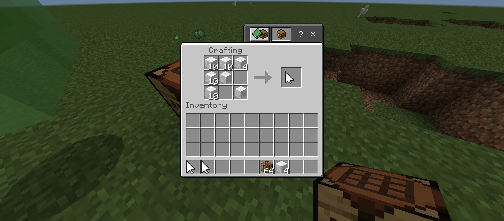
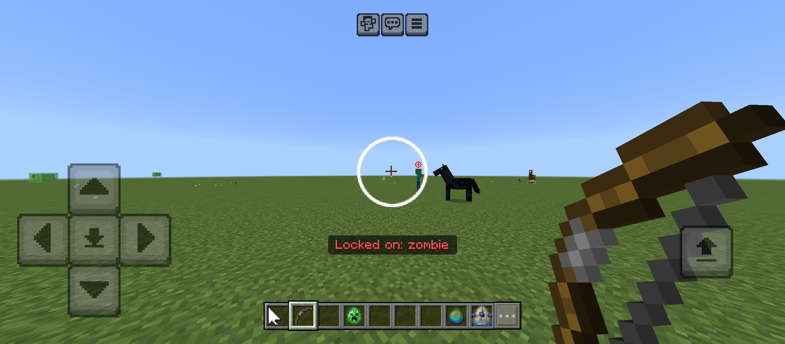
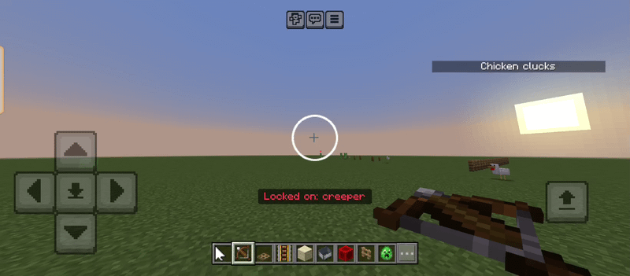
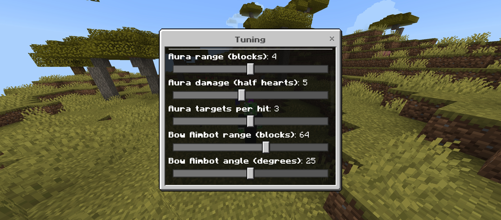
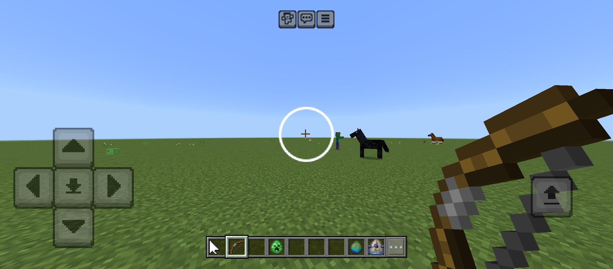
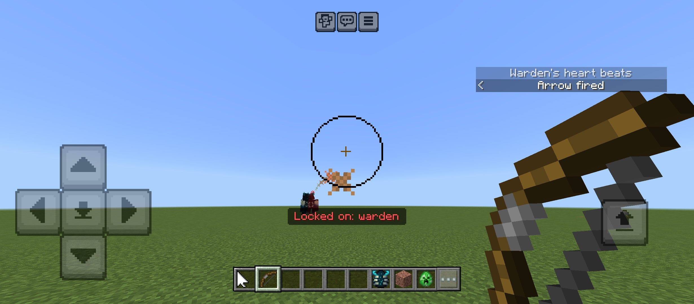
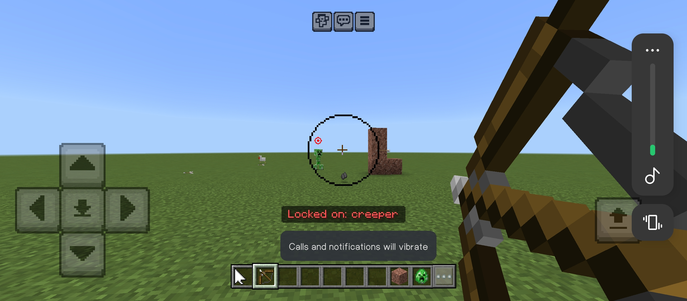
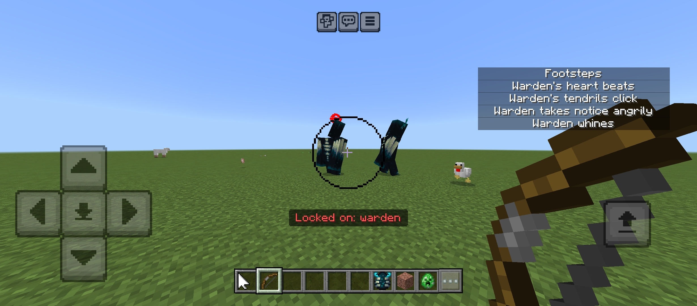
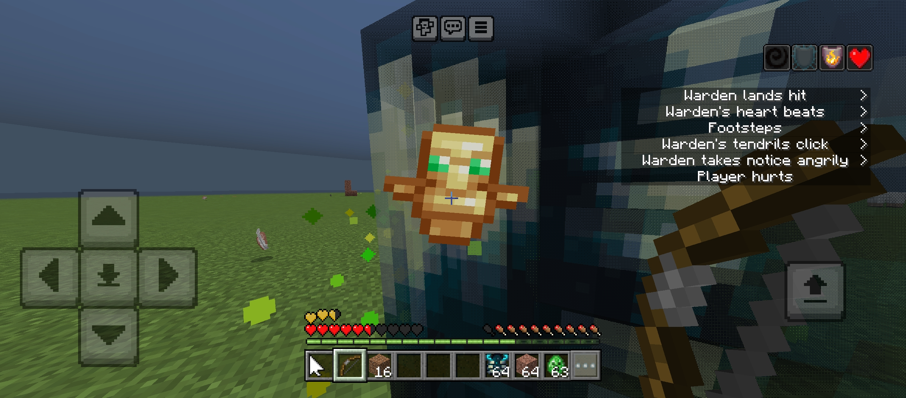
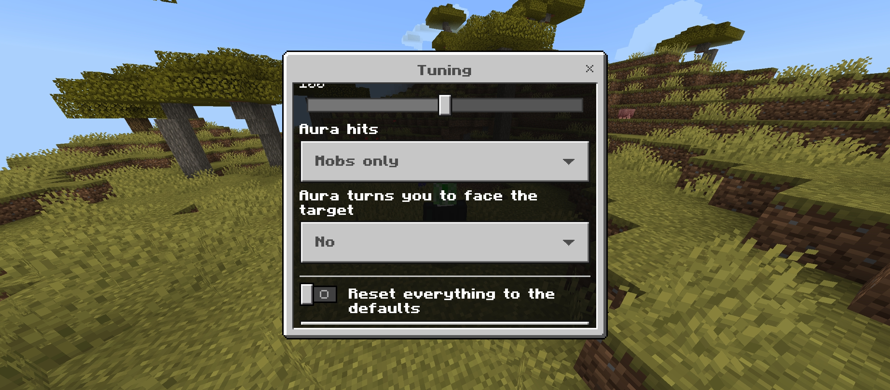

# Listing Kit: Combat Helper

Tap the Copy button on a block, then paste it into the CurseForge listing. Generated from DESCRIPTION.md: edit that, not this file.

## Package Name

```text
Combat Helper
```

## Summary (145/256)

```text
Use the Combat Helper item to switch 13 PVP toggles on or off per player, including Auto Totem and Bow Aimbot, and set friends and slider values.
```

## Description (HTML)

Paste into the CurseForge description editor in source (HTML) mode.

```html
<div><div style="border:2px solid #15803d;border-radius:18px;line-height:1.5"><br><p style="text-align:center"></p><p style="color:#8a94a3;font-size:14px;text-align:center">by ALNStudios</p><p style="text-align:center"><span style="background-color:#15803d;color:#ffffff;border-radius:20px;font-size:16px">&nbsp;&nbsp;<strong>Use the Combat Helper item to switch 13 PVP toggles on or off per player, including Auto Totem and Bow Aimbot, and set friends and slider values.</strong>&nbsp;&nbsp;</span></p><p style="text-align:center;margin-left:16px;margin-right:16px">The Combat Helper is a cursor-shaped item that opens a menu with 13 toggles, a friends list and tuning sliders, each saved separately for every player. It suits friends who practice PVP in a world they own and want to pick their own settings.</p><div style="display:flex;flex-wrap:wrap;gap:8px;margin-left:14px;margin-right:14px"><div style="background-color:#dcfce7;color:#14532d;border-radius:20px;font-size:14px;line-height:2"><strong>&nbsp;&nbsp;Bedrock</strong>: 1.26+&nbsp;&nbsp;</div><div style="background-color:#dcfce7;color:#14532d;border-radius:20px;font-size:14px;line-height:2"><strong>&nbsp;&nbsp;Experimental</strong>: No&nbsp;&nbsp;</div><div style="background-color:#dcfce7;color:#14532d;border-radius:20px;font-size:14px;line-height:2"><strong>&nbsp;&nbsp;Achievements</strong>: Yes, achievement-friendly&nbsp;&nbsp;</div></div><br></div>
<h2 style="font-size:17px;text-align:left"><span style="background-color:#15803d;color:#ffffff;border-radius:20px">&nbsp;&nbsp;About&nbsp;&nbsp;</span></h2>
<p>You get a Combat Helper, use it, and pick the toggles you want in the ALNStudios menu. The toggles then run by themselves whenever you fight, shoot or fall, and vanilla Minecraft has no equivalent switches. The features are cheat-style helpers, so use them only on worlds where everyone agrees.</p>
<h2 style="font-size:17px;text-align:left"><span style="background-color:#15803d;color:#ffffff;border-radius:20px">&nbsp;&nbsp;Screenshots&nbsp;&nbsp;</span></h2>
<div style="display:flex;flex-wrap:wrap;gap:10px"><div style="flex:1 1 300px;border:1px solid #8a94a3;border-radius:16px;text-align:center"><p><a href="https://raw.githubusercontent.com/AllensCreations/MCPE-Curseforges/main/MCPEDL/Addons/ALN-Pointer/assets/snapshots/HOW%20TO%20CRAFT.jpg"></a></p></div><div style="flex:1 1 300px;border:1px solid #8a94a3;border-radius:16px;text-align:center"><p><a href="https://raw.githubusercontent.com/AllensCreations/MCPE-Curseforges/main/MCPEDL/Addons/ALN-Pointer/assets/snapshots/INSIDE%20THE%20AIMBOT.jpg"></a></p></div><div style="flex:1 1 300px;border:1px solid #8a94a3;border-radius:16px;text-align:center"><p><a href="https://raw.githubusercontent.com/AllensCreations/MCPE-Curseforges/main/MCPEDL/Addons/ALN-Pointer/assets/snapshots/LONG%20RANGE%20AIMBOT.gif"></a></p></div><div style="flex:1 1 300px;border:1px solid #8a94a3;border-radius:16px;text-align:center"><p><a href="https://raw.githubusercontent.com/AllensCreations/MCPE-Curseforges/main/MCPEDL/Addons/ALN-Pointer/assets/snapshots/MENU.jpg"></a></p></div><div style="flex:1 1 300px;border:1px solid #8a94a3;border-radius:16px;text-align:center"><p><a href="https://raw.githubusercontent.com/AllensCreations/MCPE-Curseforges/main/MCPEDL/Addons/ALN-Pointer/assets/snapshots/OUTSIDE%20THE%20AIMBOT.jpg"></a></p></div><div style="flex:1 1 300px;border:1px solid #8a94a3;border-radius:16px;text-align:center"><p><a href="https://raw.githubusercontent.com/AllensCreations/MCPE-Curseforges/main/MCPEDL/Addons/ALN-Pointer/assets/snapshots/SNAPSHOT.jpg"></a></p></div><div style="flex:1 1 300px;border:1px solid #8a94a3;border-radius:16px;text-align:center"><p><a href="https://raw.githubusercontent.com/AllensCreations/MCPE-Curseforges/main/MCPEDL/Addons/ALN-Pointer/assets/snapshots/TARGET%20LOCK%202.jpg"></a></p></div><div style="flex:1 1 300px;border:1px solid #8a94a3;border-radius:16px;text-align:center"><p><a href="https://raw.githubusercontent.com/AllensCreations/MCPE-Curseforges/main/MCPEDL/Addons/ALN-Pointer/assets/snapshots/TARGET%20LOCK.jpg"></a></p></div><div style="flex:1 1 300px;border:1px solid #8a94a3;border-radius:16px;text-align:center"><p><a href="https://raw.githubusercontent.com/AllensCreations/MCPE-Curseforges/main/MCPEDL/Addons/ALN-Pointer/assets/snapshots/TOTEM.jpg"></a></p></div><div style="flex:1 1 300px;border:1px solid #8a94a3;border-radius:16px;text-align:center"><p><a href="https://raw.githubusercontent.com/AllensCreations/MCPE-Curseforges/main/MCPEDL/Addons/ALN-Pointer/assets/snapshots/TUNING.jpg"></a></p></div></div>
<h2 style="font-size:17px;text-align:left"><span style="background-color:#15803d;color:#ffffff;border-radius:20px">&nbsp;&nbsp;What You Get&nbsp;&nbsp;</span></h2>
<div style="display:flex;flex-wrap:wrap;gap:10px"><div style="flex:1;min-width:200px;border:1px solid #8a94a3;border-radius:16px"><div style="background-color:#15803d;color:#ffffff;border-radius:16px;font-size:16px;line-height:2.2"><strong>&nbsp;&nbsp;Combat Helper Item</strong></div><div style="margin-left:12px;margin-right:12px"><p><span>A cursor-shaped item that opens the toggle menu when you use it. You craft one from wool, take one from the Equipment tab of the Creative inventory, or turn on the Give Starter Item pack setting to receive one the first time you join a world.</span><br><span style="font-size:13px;color:#8a94a3"><strong>How It Works:</strong> Hold the Combat Helper and use it, like right-clicking on PC or tapping on mobile. Sneak while you use it to switch all your toggles off or back on. To craft one, fill the top row of a crafting table with wool, then the left and middle squares of the middle row, then the left and right squares of the bottom row. This takes 7 wool of any color and the shape looks like a cursor.</span><br><span style="font-size:13px;color:#8a94a3"><strong>Good To Know:</strong> With Give Starter Item on, a full inventory on first join means the Combat Helper is offered again on your next join.</span></p></div></div><div style="flex:1;min-width:200px;border:1px solid #8a94a3;border-radius:16px"><div style="background-color:#15803d;color:#ffffff;border-radius:16px;font-size:16px;line-height:2.2"><strong>&nbsp;&nbsp;Combat Menu</strong></div><div style="margin-left:12px;margin-right:12px"><p><span>The main menu has three buttons: Combat Menu, About and Exit. Combat Menu opens a screen with Combat Settings, Quick Presets, Friends, Tuning and Practice Dummy. Combat Settings lists the 13 switches in groups (Aura, Bow Aimbot, Offense, Totems and Defense) with a one-line explanation under each, and the sliders and choices for each group sit under its switches. Apply saves them and closes the menu.</span><br><span style="font-size:13px;color:#8a94a3"><strong>How It Works:</strong> Flip the switches you want, then tap Apply. Closing the screen without Apply brings you back one screen.</span><br><span style="font-size:13px;color:#8a94a3"><strong>Good To Know:</strong> Toggles are saved per player, so each person in a world picks their own.</span></p></div></div><div style="flex:1;min-width:200px;border:1px solid #8a94a3;border-radius:16px"><div style="background-color:#15803d;color:#ffffff;border-radius:16px;font-size:16px;line-height:2.2"><strong>&nbsp;&nbsp;Quick Presets</strong></div><div style="margin-left:12px;margin-right:12px"><p><span>Three presets switch a whole set of toggles on at once: PVP (Bow Aimbot, Target Highlight, Always Critical, Damage Display, Auto Totem, Shield Always Active, No Knockback and Auto Golden Apple), Safe (Auto Totem, Immortal, Shield Always Active, Auto Golden Apple, Always Water Clutch and Keep Gear On Death) and All off.</span><br><span style="font-size:13px;color:#8a94a3"><strong>How It Works:</strong> Open the Combat Menu, tap Quick Presets and pick one.</span><br><span style="font-size:13px;color:#8a94a3"><strong>Good To Know:</strong> A preset replaces your toggles, and your slider values stay the same.</span></p></div></div><div style="flex:1;min-width:200px;border:1px solid #8a94a3;border-radius:16px"><div style="background-color:#15803d;color:#ffffff;border-radius:16px;font-size:16px;line-height:2.2"><strong>&nbsp;&nbsp;Auto Totem</strong></div><div style="margin-left:12px;margin-right:12px"><p><span>When a hit would kill you and you hold no Totem of Undying, one from your inventory moves into your off hand first, so the totem saves you.</span><br><span style="font-size:13px;color:#8a94a3"><strong>How It Works:</strong> Keep a Totem of Undying anywhere in your inventory and switch Auto Totem on.</span><br><span style="font-size:13px;color:#8a94a3"><strong>Good To Know:</strong> It does nothing without a totem in your inventory, and it cannot help against the void or the kill command.</span></p></div></div><div style="flex:1;min-width:200px;border:1px solid #8a94a3;border-radius:16px"><div style="background-color:#15803d;color:#ffffff;border-radius:16px;font-size:16px;line-height:2.2"><strong>&nbsp;&nbsp;Infinite Totem</strong></div><div style="margin-left:12px;margin-right:12px"><p><span>Works like Auto Totem, and when you have no totem at all it puts a new Totem of Undying in your off hand before a deadly hit.</span><br><span style="font-size:13px;color:#8a94a3"><strong>How It Works:</strong> Switch it on and keep fighting. Each totem that pops is replaced before the next deadly hit.</span><br><span style="font-size:13px;color:#8a94a3"><strong>Good To Know:</strong> An item that was in your off hand moves to your inventory, or drops at your feet if the inventory is full.</span></p></div></div><div style="flex:1;min-width:200px;border:1px solid #8a94a3;border-radius:16px"><div style="background-color:#15803d;color:#ffffff;border-radius:16px;font-size:16px;line-height:2.2"><strong>&nbsp;&nbsp;Aura Mode</strong></div><div style="margin-left:12px;margin-right:12px"><p><span>Every half second, you hit the nearest hostile mobs and other players around you without clicking. By default that is up to 3 targets within 4 blocks for 5 damage (2.5 hearts). The range (2 to 6 blocks), damage (1 to 10), number of targets (1 to 5), who it hits and whether it turns you to face the target can be changed under Aura in Combat Settings.</span><br><span style="font-size:13px;color:#8a94a3"><strong>How It Works:</strong> Stand near enemies with Aura Mode on and they take damage automatically.</span><br><span style="font-size:13px;color:#8a94a3"><strong>Good To Know:</strong> Players in Creative or Spectator mode are never hit, and passive mobs are left alone.</span></p></div></div><div style="flex:1;min-width:200px;border:1px solid #8a94a3;border-radius:16px"><div style="background-color:#15803d;color:#ffffff;border-radius:16px;font-size:16px;line-height:2.2"><strong>&nbsp;&nbsp;Always Critical</strong></div><div style="margin-left:12px;margin-right:12px"><p><span>Every melee hit you land deals extra damage, 1.5 times by default and adjustable from 110 to 300 percent in Combat Settings, and shows the critical hit sparks, the same bonus as a vanilla critical hit, without jumping first.</span><br><span style="font-size:13px;color:#8a94a3"><strong>How It Works:</strong> Hit a mob or player with a sword or axe while Always Critical is on.</span><br><span style="font-size:13px;color:#8a94a3"><strong>Good To Know:</strong> A hit made while you are already falling is left as vanilla, so the bonus never stacks.</span></p></div></div><div style="flex:1;min-width:200px;border:1px solid #8a94a3;border-radius:16px"><div style="background-color:#15803d;color:#ffffff;border-radius:16px;font-size:16px;line-height:2.2"><strong>&nbsp;&nbsp;Bow Aimbot</strong></div><div style="margin-left:12px;margin-right:12px"><p><span>Arrows you shoot from a bow or crossbow steer toward the hostile mob or player closest to your crosshair within 48 blocks and inside the aim circle on your screen.</span><br><span style="font-size:13px;color:#8a94a3"><strong>Mob Types:</strong> Four On or Off choices under Bow Aimbot pick what it hits: hostile mobs, neutral mobs, passive mobs and players. Hostile mobs and players are on by default, and tamed pets are never targeted.</span><br><span style="font-size:13px;color:#8a94a3"><strong>How It Works:</strong> Aim roughly at a target and release. The arrow leads a moving target and allows for arrow drop, and it keeps correcting its aim for up to 4 seconds in flight, so long shots and moving targets are hit more often.</span><br><span style="font-size:13px;color:#8a94a3"><strong>Good To Know:</strong> If nothing is near your crosshair, the arrow flies as normal. A mob or player hidden behind blocks is never chosen. Bow zoom while drawing, under Bow Aimbot in Combat Settings, makes the aim circle grow as you draw to match the game's zoom. It is 0 percent by default, and you can raise it until the circle matches what you see.</span></p></div></div><div style="flex:1;min-width:200px;border:1px solid #8a94a3;border-radius:16px"><div style="background-color:#15803d;color:#ffffff;border-radius:16px;font-size:16px;line-height:2.2"><strong>&nbsp;&nbsp;Always Water Clutch</strong></div><div style="margin-left:12px;margin-right:12px"><p><span>When you fall 3 blocks or more and the ground is close, a water block appears in the space you land in, so the fall does no damage, and it is removed as soon as you stop falling, together with any water that spread from it.</span><br><span style="font-size:13px;color:#8a94a3"><strong>How It Works:</strong> Switch it on and jump. No water bucket is needed.</span><br><span style="font-size:13px;color:#8a94a3"><strong>Good To Know:</strong> It does not trigger in Creative or Spectator mode, while gliding or flying, or over water.</span></p></div></div><div style="flex:1;min-width:200px;border:1px solid #8a94a3;border-radius:16px"><div style="background-color:#15803d;color:#ffffff;border-radius:16px;font-size:16px;line-height:2.2"><strong>&nbsp;&nbsp;Shield Always Active</strong></div><div style="margin-left:12px;margin-right:12px"><p><span>While you carry a shield in either hand, every melee hit and arrow from the front half of your view is fully blocked, even if you are not holding the block button.</span><br><span style="font-size:13px;color:#8a94a3"><strong>How It Works:</strong> Keep a shield in your hand or off hand and switch Shield Always Active on.</span><br><span style="font-size:13px;color:#8a94a3"><strong>Good To Know:</strong> Hits from behind and other damage, such as fire or explosions, are not blocked. Each block plays the shield sound, shows sparks in front of you, and pushes a melee attacker back.</span></p></div></div><div style="flex:1;min-width:200px;border:1px solid #8a94a3;border-radius:16px"><div style="background-color:#15803d;color:#ffffff;border-radius:16px;font-size:16px;line-height:2.2"><strong>&nbsp;&nbsp;Auto Golden Apple</strong></div><div style="margin-left:12px;margin-right:12px"><p><span>When your health drops to 4 hearts or less, one golden apple from your inventory is eaten for you, giving Regeneration II for 5 seconds and Absorption for 2 minutes.</span><br><span style="font-size:13px;color:#8a94a3"><strong>How It Works:</strong> Keep a golden apple anywhere in your inventory and switch Auto Golden Apple on.</span><br><span style="font-size:13px;color:#8a94a3"><strong>Good To Know:</strong> It waits 20 seconds between apples, it does not restore hunger, and it does nothing in Creative or Spectator mode.</span></p></div></div><div style="flex:1;min-width:200px;border:1px solid #8a94a3;border-radius:16px"><div style="background-color:#15803d;color:#ffffff;border-radius:16px;font-size:16px;line-height:2.2"><strong>&nbsp;&nbsp;Damage Display</strong></div><div style="margin-left:12px;margin-right:12px"><p><span>Each time you hurt a mob or player, the action bar shows how much damage the hit did, in points and in hearts.</span><br><span style="font-size:13px;color:#8a94a3"><strong>How It Works:</strong> Switch it on and hit something.</span><br><span style="font-size:13px;color:#8a94a3"><strong>Good To Know:</strong> It also counts the hits made by Aura Mode.</span></p></div></div><div style="flex:1;min-width:200px;border:1px solid #8a94a3;border-radius:16px"><div style="background-color:#15803d;color:#ffffff;border-radius:16px;font-size:16px;line-height:2.2"><strong>&nbsp;&nbsp;Immortal</strong></div><div style="margin-left:12px;margin-right:12px"><p><span>You never drop below 1 heart. Any hit that would take you lower is cut down or cancelled, even a one-hit explosion.</span><br><span style="font-size:13px;color:#8a94a3"><strong>How It Works:</strong> Switch Immortal on under Defense in Combat Settings. There is no totem sound or particle.</span><br><span style="font-size:13px;color:#8a94a3"><strong>Good To Know:</strong> It also tries to block the void and the kill command, and if you fall into the void it moves you back to the last ground you stood on. It is used before the totem toggles, so no totem is spent while Immortal is on.</span></p></div></div><div style="flex:1;min-width:200px;border:1px solid #8a94a3;border-radius:16px"><div style="background-color:#15803d;color:#ffffff;border-radius:16px;font-size:16px;line-height:2.2"><strong>&nbsp;&nbsp;Keep Gear On Death</strong></div><div style="margin-left:12px;margin-right:12px"><p><span>When you die, your items and armor are set aside and given back when you respawn, so nothing drops, and only you keep your gear.</span><br><span style="font-size:13px;color:#8a94a3"><strong>How It Works:</strong> Switch Keep Gear On Death on. After you respawn, your inventory, armor and off hand are back as they were.</span><br><span style="font-size:13px;color:#8a94a3"><strong>Good To Know:</strong> The items are held in memory, so they are lost if the world closes before you respawn. A totem that saves you does not trigger it.</span></p></div></div><div style="flex:1;min-width:200px;border:1px solid #8a94a3;border-radius:16px"><div style="background-color:#15803d;color:#ffffff;border-radius:16px;font-size:16px;line-height:2.2"><strong>&nbsp;&nbsp;No Knockback</strong></div><div style="margin-left:12px;margin-right:12px"><p><span>Melee hits no longer push you back, or push you much less.</span><br><span style="font-size:13px;color:#8a94a3"><strong>How It Works:</strong> Switch it on and take a hit. The script pushes you the other way by the amount a hit normally pushes you.</span><br><span style="font-size:13px;color:#8a94a3"><strong>Good To Know:</strong> It cancels the push by about the usual amount, so a strong knockback enchantment can still move you a little.</span></p></div></div><div style="flex:1;min-width:200px;border:1px solid #8a94a3;border-radius:16px"><div style="background-color:#15803d;color:#ffffff;border-radius:16px;font-size:16px;line-height:2.2"><strong>&nbsp;&nbsp;Target Highlight</strong></div><div style="margin-left:12px;margin-right:12px"><p><span>While you hold a bow or crossbow, a small target picture floats above the mob or player Bow Aimbot will pick, the action bar names it, and a circle picture sits on your crosshair on the screen to show the aim range, so it never lags behind when you turn. Only you see them.</span><br><span style="font-size:13px;color:#8a94a3"><strong>How It Works:</strong> Switch on both Bow Aimbot and Target Highlight, hold a bow and aim near an enemy.</span><br><span style="font-size:13px;color:#8a94a3"><strong>Good To Know:</strong> It does nothing when Bow Aimbot is off, and the target picture only shows when a target is inside the circle. The circle can be switched off under Bow Aimbot in Combat Settings, and its size follows the Aim circle zoom and your Your game FOV setting value.</span></p></div></div><div style="flex:1;min-width:200px;border:1px solid #8a94a3;border-radius:16px"><div style="background-color:#15803d;color:#ffffff;border-radius:16px;font-size:16px;line-height:2.2"><strong>&nbsp;&nbsp;Practice Dummy</strong></div><div style="margin-left:12px;margin-right:12px"><p><span>A zombie called Practice Dummy appears 3 blocks in front of you. It cannot move or hurt you and it heals fast, so you can test Aura Mode, Always Critical and Damage Display.</span><br><span style="font-size:13px;color:#8a94a3"><strong>How It Works:</strong> Open the Combat Menu and tap Practice Dummy.</span><br><span style="font-size:13px;color:#8a94a3"><strong>Good To Know:</strong> It disappears after 2 minutes, and spawning a new one removes your old one.</span></p></div></div><div style="flex:1;min-width:200px;border:1px solid #8a94a3;border-radius:16px"><div style="background-color:#15803d;color:#ffffff;border-radius:16px;font-size:16px;line-height:2.2"><strong>&nbsp;&nbsp;Friends</strong></div><div style="margin-left:12px;margin-right:12px"><p><span>You pick online players as friends, and Aura Mode and Bow Aimbot skip them.</span><br><span style="font-size:13px;color:#8a94a3"><strong>How It Works:</strong> Open the Combat Menu, tap Friends, tick the players you want and tap Apply.</span><br><span style="font-size:13px;color:#8a94a3"><strong>Good To Know:</strong> Friends stay on your list when they go offline. The list is yours alone, so a friend is only safe from your toggles, not the other way round.</span></p></div></div><div style="flex:1;min-width:200px;border:1px solid #8a94a3;border-radius:16px"><div style="background-color:#15803d;color:#ffffff;border-radius:16px;font-size:16px;line-height:2.2"><strong>&nbsp;&nbsp;Tuning</strong></div><div style="margin-left:12px;margin-right:12px"><p><span>Tuning holds your Your game FOV setting, an exact list of values from 30 to 110, so the aim circle matches the Field of View you set in the game's video settings.</span><br><span style="font-size:13px;color:#8a94a3"><strong>How It Works:</strong> Open the Combat Menu, tap Tuning, pick your FOV, turn on Confirm changes and tap Apply. Nothing saves unless Confirm changes is on. Turning on Reset all tuning to the defaults puts every slider and choice back to its starting value.</span><br><span style="font-size:13px;color:#8a94a3"><strong>Good To Know:</strong> The other sliders and choices are in Combat Settings, under the toggle they belong to.</span></p></div></div><div style="flex:1;min-width:200px;border:1px solid #8a94a3;border-radius:16px"><div style="background-color:#15803d;color:#ffffff;border-radius:16px;font-size:16px;line-height:2.2"><strong>&nbsp;&nbsp;Quick Toggle</strong></div><div style="margin-left:12px;margin-right:12px"><p><span>Sneaking while you use the Combat Helper switches every toggle off at once, and doing it again brings the same toggles back.</span><br><span style="font-size:13px;color:#8a94a3"><strong>How It Works:</strong> Crouch and use the item instead of opening the menu.</span><br><span style="font-size:13px;color:#8a94a3"><strong>Good To Know:</strong> Your friends and tuning stay as they are.</span></p></div></div><div style="flex:1;min-width:200px;border:1px solid #8a94a3;border-radius:16px"><div style="background-color:#15803d;color:#ffffff;border-radius:16px;font-size:16px;line-height:2.2"><strong>&nbsp;&nbsp;Starter Item Pack Setting</strong></div><div style="margin-left:12px;margin-right:12px"><p><span>The behavior pack has a choice between No Starter Item, which is the default, and Give Starter Item, which gives each player a Combat Helper the first time they join the world.</span><br><span style="font-size:13px;color:#8a94a3"><strong>How It Works:</strong> Open the world settings, go to Behavior Packs, tap Combat Helper and use the subpack slider to pick Give Starter Item.</span><br><span style="font-size:13px;color:#8a94a3"><strong>Good To Know:</strong> Each player gets one the first time they join with the setting on, and a player who already has one saved from before is not given another.</span></p></div></div></div>
<h2 style="font-size:17px;text-align:left"><span style="background-color:#15803d;color:#ffffff;border-radius:20px">&nbsp;&nbsp;Custom Items&nbsp;&nbsp;</span></h2>
<div style="display:flex;flex-wrap:wrap;gap:10px"><div style="flex:0 1 120px;border:1px solid #8a94a3;border-radius:16px;text-align:center"><p><a href="https://raw.githubusercontent.com/AllensCreations/MCPE-Curseforges/main/MCPEDL/Addons/ALN-Pointer/assets/items/aln_pointer.png"></a></p><p style="color:#8a94a3;font-size:13px">Combat Helper</p></div></div>
<h2 style="font-size:17px;text-align:left"><span style="background-color:#15803d;color:#ffffff;border-radius:20px">&nbsp;&nbsp;Get Started&nbsp;&nbsp;</span></h2>
<table style="width:100%;border:1px solid #8a94a3;border-radius:16px"><tbody><tr><td style="width:44px;text-align:center"><div style="background-color:#15803d;color:#ffffff;font-weight:bold;font-size:15px;text-align:center;border-radius:10px;width:30px;aspect-ratio:1/1;line-height:30px">1</div></td><td style="text-align:left;">Craft a Combat Helper from 7 wool in a cursor shape, take one from the Equipment tab of the Creative inventory, or turn on Give Starter Item to receive one when you first join.</td></tr><tr><td style="width:44px;text-align:center"><div style="background-color:#15803d;color:#ffffff;font-weight:bold;font-size:15px;text-align:center;border-radius:10px;width:30px;aspect-ratio:1/1;line-height:30px">2</div></td><td style="text-align:left;">Hold the Combat Helper and use it to open the ALNStudios menu, then tap Combat Menu and Combat Settings.</td></tr><tr><td style="width:44px;text-align:center"><div style="background-color:#15803d;color:#ffffff;font-weight:bold;font-size:15px;text-align:center;border-radius:10px;width:30px;aspect-ratio:1/1;line-height:30px">3</div></td><td style="text-align:left;">Switch on the toggles you want and tap Apply. The action bar shows how many toggles are on.</td></tr><tr><td style="width:44px;text-align:center"><div style="background-color:#15803d;color:#ffffff;font-weight:bold;font-size:15px;text-align:center;border-radius:10px;width:30px;aspect-ratio:1/1;line-height:30px">4</div></td><td style="text-align:left;">Use the Combat Helper again any time to change your toggles, or open Friends and Tuning from the Combat Menu.</td></tr></tbody></table>
<h2 style="font-size:17px;text-align:left"><span style="background-color:#15803d;color:#ffffff;border-radius:20px">&nbsp;&nbsp;Common Questions&nbsp;&nbsp;</span></h2>
<div class="spoiler" title="How do I get another Combat Helper?" data-title="How do I get another Combat Helper?"><p><strong>How do I get another Combat Helper?</strong><br>Craft one from 7 wool on a crafting table, laid out like a cursor with the top row full, the left and middle squares of the middle row, and the left and right squares of the bottom row. You can also take one from the Equipment tab of the Creative inventory, or use the command /give @s allenscreations:aln_pointer, which needs cheats.</p></div><div class="spoiler" title="Do my toggles affect other players?" data-title="Do my toggles affect other players?"><p><strong>Do my toggles affect other players?</strong><br>No. Each player has their own saved toggles, and a toggle only changes what that player does.</p></div><div class="spoiler" title="Can I use it on a server?" data-title="Can I use it on a server?"><p><strong>Can I use it on a server?</strong><br>These features act like cheats. Many servers ban them, so use them only where the owner and the other players agree.</p></div>
<h2 style="font-size:17px;text-align:left"><span style="background-color:#15803d;color:#ffffff;border-radius:20px">&nbsp;&nbsp;Install&nbsp;&nbsp;</span></h2>
<table style="width:100%;border:1px solid #8a94a3;border-radius:16px"><tbody><tr><td style="width:44px;text-align:center"><div style="background-color:#15803d;color:#ffffff;font-weight:bold;font-size:15px;text-align:center;border-radius:10px;width:30px;aspect-ratio:1/1;line-height:30px">1</div></td><td style="text-align:left;">Download the file from this page and open it with Minecraft.</td></tr><tr><td style="width:44px;text-align:center"><div style="background-color:#15803d;color:#ffffff;font-weight:bold;font-size:15px;text-align:center;border-radius:10px;width:30px;aspect-ratio:1/1;line-height:30px">2</div></td><td style="text-align:left;">Create or edit a world and turn on the new pack(s) in its settings.</td></tr><tr><td style="width:44px;text-align:center"><div style="background-color:#15803d;color:#ffffff;font-weight:bold;font-size:15px;text-align:center;border-radius:10px;width:30px;aspect-ratio:1/1;line-height:30px">3</div></td><td style="text-align:left;">Play. No Experimental toggles needed.</td></tr></tbody></table>
<div style="border:1px solid #8a94a3;border-radius:16px;text-align:center"><br><div style="background-color:#15803d;color:#ffffff;border-radius:20px;font-size:15px;line-height:2;display:inline-block">&nbsp;&nbsp;<strong>Found a Bug or Have a Suggestion?</strong>&nbsp;&nbsp;</div><p style="font-size:14px;">Please leave a comment on this project page! All bug reports, gameplay feedback, and pack suggestions are welcome and appreciated.</p></div>
<h2 style="font-size:17px;text-align:left"><span style="background-color:#15803d;color:#ffffff;border-radius:20px">&nbsp;&nbsp;Support&nbsp;&nbsp;</span></h2><div style="border:1px solid #8a94a3;border-radius:16px;text-align:center"><br><a href="https://ko-fi.com/alnstudios"></a><br><br></div><p style="text-align:center"><a href="https://www.curseforge.com/members/allenscreations/projects"><strong>CurseForge</strong></a> &nbsp;|&nbsp; <a href="https://mcpedl.com/user/alnstudios/"><strong>MCPEDL</strong></a> &nbsp;|&nbsp; <a href="https://ko-fi.com/alnstudios"><strong>Ko-fi</strong></a></p>
<hr>
<p style="text-align:center;color:#8a94a3;font-size:13px"><strong>By ALNStudios</strong></p>
<div class="spoiler"><p style="font-size:13px"><strong>Permissions and credits</strong></p><ul style="font-size:13px"><li>Rights: All rights reserved for ALNStudios.</li><li>Content creators: You may feature this creation in videos and streams with credit to ALNStudios.</li><li>Redistribution: Do not re-upload this pack or provide direct monetized download bypasses. Link to this page.</li><li>Visual: Promotional/cover imagery used on this page is AI-generated to illustrate the concept and purpose of the pack.</li><li>Unofficial community creation. Not an official Minecraft product and not approved by or associated with Mojang or Microsoft.</li></ul></div>
<p style="text-align:center;color:#8a94a3;font-size:12px">Minecraft Bedrock add-on, Combat Helper Bedrock mod, Minecraft PE PVP toggles, Auto Totem, Infinite Totem, Aura Mode, Always Critical, Bow Aimbot, Water Clutch, Immortal, Keep Gear, Practice Dummy, Auto Golden Apple, Damage Display, friends list, Minecraft PE mouse pointer item, MCPEDL add-on, CurseForge Bedrock, ALNStudios.</p></div>
```

## AI Image Prompts

### Reference Images

- **Logo reference**: attach your own logo. The generator uses it only for brand colors and mood. The result must be a new design, not a copy.
- **Snapshot references**: attach 1 to 4 of your in-game snapshots of this pack. The generator copies their look, not their screen layout.

### Logo Prompt

```text
Use the attached logo only as a brand reference for its color palette and overall mood. Do not copy it. Create a new, original logo with a different composition and a different main symbol. Do not just recolor, resize, crop, mirror or tweak the attached logo.
Create a clean, square (1:1) logo image for the Minecraft Bedrock add-on "Combat Helper". Use the Combat Helper item to switch 13 PVP toggles on or off per player, including Auto Totem and Bow Aimbot, and set friends and slider values.
Base the main symbol on the pack idea above. Match the blocky look of the attached in-game snapshots. Center the logo, use a simple background, and keep it readable at small sizes.
Text: "Combat Helper" and, in small letters, "ALNStudios". ALNStudios is the brand name, so always keep it and never remove or change it. Spell both exactly.
Do not add Minecraft, Mojang or Microsoft logos, watermarks, or characters from other games.
```

### Banner Prompt

```text
Create a wide (16:9) banner image for the Minecraft Bedrock add-on "Combat Helper". Use the Combat Helper item to switch 13 PVP toggles on or off per player, including Auto Totem and Bow Aimbot, and set friends and slider values.
Use the attached in-game snapshots as scene and style references: copy their blocky look, lighting, colors and the kind of scenery they show. Make a new composition inspired by them. Do not copy the on-screen HUD, chat or hotbar.
Use the attached logo only as a brand reference for its colors and mood. Do not copy it. Put a new, original logo design in the banner, large enough to read, on the left or center.
Hint at these pack features visually: Combat Helper Item, Combat Menu, Quick Presets, Auto Totem, Infinite Totem.
Text: "Combat Helper" and, in small letters, "by ALNStudios". ALNStudios is the brand name, so always keep it and never remove or change it. Spell both exactly.
Leave clear space around the logo. No Minecraft, Mojang or Microsoft logos, no watermarks.
```
