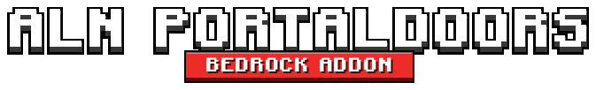
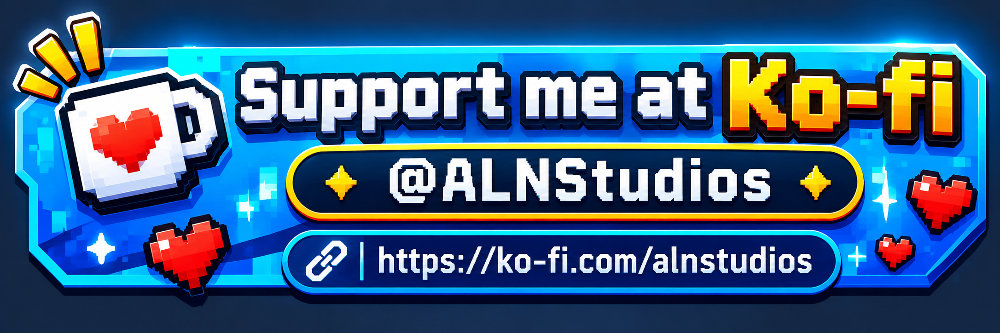

# Listing Kit: ALN PortalDoors

Tap the Copy button on a block, then paste it into the CurseForge listing. Generated from DESCRIPTION.md: edit that, not this file.

## Package Name

```text
ALN PortalDoors
```

## Summary (87/256)

```text
Craft a glowing 1x2 portal doorway, name it, and step between every door in your world.
```

## Description (HTML)

Paste into the CurseForge description editor in source (HTML) mode.

```html
<div><div style="border:2px solid #15803d;border-radius:18px;line-height:1.5"><br><p style="text-align:center"></p><p style="color:#8a94a3;font-size:14px;text-align:center">by ALNStudios</p><p style="text-align:center"><span style="background-color:#15803d;color:#ffffff;border-radius:20px;font-size:16px">&nbsp;&nbsp;<strong>Craft a glowing 1x2 portal doorway, name it, and step between every door in your world.</strong>&nbsp;&nbsp;</span></p><p style="text-align:center;margin-left:16px;margin-right:16px">Place doorways in the Overworld, the Nether or the End, give each a name such as Home Base or End Stronghold, and pick any destination from one menu.</p><div style="display:flex;flex-wrap:wrap;gap:8px;margin-left:14px;margin-right:14px"><div style="background-color:#dcfce7;color:#14532d;border-radius:20px;font-size:14px;line-height:2"><strong>&nbsp;&nbsp;Bedrock</strong>: 1.26+&nbsp;&nbsp;</div><div style="background-color:#dcfce7;color:#14532d;border-radius:20px;font-size:14px;line-height:2"><strong>&nbsp;&nbsp;Experimental</strong>: No&nbsp;&nbsp;</div><div style="background-color:#dcfce7;color:#14532d;border-radius:20px;font-size:14px;line-height:2"><strong>&nbsp;&nbsp;Achievements</strong>: Yes, achievement-friendly&nbsp;&nbsp;</div></div><br></div>
<h2 style="font-size:17px;text-align:left"><span style="background-color:#15803d;color:#ffffff;border-radius:20px">&nbsp;&nbsp;About&nbsp;&nbsp;</span></h2>
<p>ALN PortalDoors adds a craftable Portal Door that stands two blocks tall. When you place one, a naming prompt opens. Every door joins a shared network that is saved with your world, so the list is still there after you reload.</p>
<h2 style="font-size:17px;text-align:left"><span style="background-color:#15803d;color:#ffffff;border-radius:20px">&nbsp;&nbsp;What You Get&nbsp;&nbsp;</span></h2>
<div style="display:flex;flex-wrap:wrap;gap:10px"><div style="flex:1;min-width:200px;border:1px solid #8a94a3;border-radius:16px"><div style="background-color:#15803d;color:#ffffff;border-radius:16px;font-size:16px;line-height:2.2"><strong>&nbsp;&nbsp;Craftable Portal Door</strong></div><div style="margin-left:12px;margin-right:12px"><p><span>Combine six obsidian, two ender pearls and one amethyst shard or one enchanted book in a crafting table to get a Portal Door.</span></p></div></div><div style="flex:1;min-width:200px;border:1px solid #8a94a3;border-radius:16px"><div style="background-color:#15803d;color:#ffffff;border-radius:16px;font-size:16px;line-height:2.2"><strong>&nbsp;&nbsp;Naming Prompt</strong></div><div style="margin-left:12px;margin-right:12px"><p><span>A prompt titled Name This Portal Door opens the moment you place a door. If you close it, the door keeps a numbered default name and you can rename it later.</span></p></div></div><div style="flex:1;min-width:200px;border:1px solid #8a94a3;border-radius:16px"><div style="background-color:#15803d;color:#ffffff;border-radius:16px;font-size:16px;line-height:2.2"><strong>&nbsp;&nbsp;Color-Coded Destination Menu</strong></div><div style="margin-left:12px;margin-right:12px"><p><span>Interacting with any door lists every other door. Overworld doors are green, Nether doors are red and End doors are purple. No coordinates are ever shown.</span></p></div></div><div style="flex:1;min-width:200px;border:1px solid #8a94a3;border-radius:16px"><div style="background-color:#15803d;color:#ffffff;border-radius:16px;font-size:16px;line-height:2.2"><strong>&nbsp;&nbsp;Warp Transition</strong></div><div style="margin-left:12px;margin-right:12px"><p><span>Choosing a destination plays a departure sound and an enchanting particle burst, moves you in front of the target door facing away from it, applies 2.5 seconds of Nausea and plays an arrival chime.</span></p></div></div><div style="flex:1;min-width:200px;border:1px solid #8a94a3;border-radius:16px"><div style="background-color:#15803d;color:#ffffff;border-radius:16px;font-size:16px;line-height:2.2"><strong>&nbsp;&nbsp;Re-Trigger Cooldown</strong></div><div style="margin-left:12px;margin-right:12px"><p><span>After a warp you cannot open the menu again for 2 seconds, so you do not bounce back by accident.</span></p></div></div><div style="flex:1;min-width:200px;border:1px solid #8a94a3;border-radius:16px"><div style="background-color:#15803d;color:#ffffff;border-radius:16px;font-size:16px;line-height:2.2"><strong>&nbsp;&nbsp;Glyph Particle Pull</strong></div><div style="margin-left:12px;margin-right:12px"><p><span>Enchanting glyph particles and portal sparks appear about two blocks from each nearby door and drift inward toward its center, like books feeding an enchanting table.</span></p></div></div><div style="flex:1;min-width:200px;border:1px solid #8a94a3;border-radius:16px"><div style="background-color:#15803d;color:#ffffff;border-radius:16px;font-size:16px;line-height:2.2"><strong>&nbsp;&nbsp;Manage Door</strong></div><div style="margin-left:12px;margin-right:12px"><p><span>The last menu button lets the door owner rename the door or pick it up. Picking it up returns the Portal Door item and removes the door from the list.</span></p></div></div></div>
<h2 style="font-size:17px;text-align:left"><span style="background-color:#15803d;color:#ffffff;border-radius:20px">&nbsp;&nbsp;Get Started&nbsp;&nbsp;</span></h2>
<table style="width:100%;border:1px solid #8a94a3;border-radius:16px"><tbody><tr><td style="width:44px;text-align:center"><div style="background-color:#15803d;color:#ffffff;font-weight:bold;font-size:15px;text-align:center;border-radius:10px;width:30px;aspect-ratio:1/1;line-height:30px">1</div></td><td style="text-align:left;">Craft a Portal Door and place it on the ground. It builds a doorway two blocks tall and needs two free blocks of height.</td></tr><tr><td style="width:44px;text-align:center"><div style="background-color:#15803d;color:#ffffff;font-weight:bold;font-size:15px;text-align:center;border-radius:10px;width:30px;aspect-ratio:1/1;line-height:30px">2</div></td><td style="text-align:left;">Type a name in the prompt that opens.</td></tr><tr><td style="width:44px;text-align:center"><div style="background-color:#15803d;color:#ffffff;font-weight:bold;font-size:15px;text-align:center;border-radius:10px;width:30px;aspect-ratio:1/1;line-height:30px">3</div></td><td style="text-align:left;">Interact with any Portal Door to open the destination menu and choose where to go.</td></tr><tr><td style="width:44px;text-align:center"><div style="background-color:#15803d;color:#ffffff;font-weight:bold;font-size:15px;text-align:center;border-radius:10px;width:30px;aspect-ratio:1/1;line-height:30px">4</div></td><td style="text-align:left;">Choose Manage Door at the bottom of the menu to rename or pick up the door you are standing at. Only the owner can do this.</td></tr></tbody></table>
<h2 style="font-size:17px;text-align:left"><span style="background-color:#15803d;color:#ffffff;border-radius:20px">&nbsp;&nbsp;Install&nbsp;&nbsp;</span></h2>
<table style="width:100%;border:1px solid #8a94a3;border-radius:16px"><tbody><tr><td style="width:44px;text-align:center"><div style="background-color:#15803d;color:#ffffff;font-weight:bold;font-size:15px;text-align:center;border-radius:10px;width:30px;aspect-ratio:1/1;line-height:30px">1</div></td><td style="text-align:left;">Download the file from this page and open it with Minecraft.</td></tr><tr><td style="width:44px;text-align:center"><div style="background-color:#15803d;color:#ffffff;font-weight:bold;font-size:15px;text-align:center;border-radius:10px;width:30px;aspect-ratio:1/1;line-height:30px">2</div></td><td style="text-align:left;">Create or edit a world and turn on the new pack(s) in its settings.</td></tr><tr><td style="width:44px;text-align:center"><div style="background-color:#15803d;color:#ffffff;font-weight:bold;font-size:15px;text-align:center;border-radius:10px;width:30px;aspect-ratio:1/1;line-height:30px">3</div></td><td style="text-align:left;">Play. No Experimental toggles needed.</td></tr></tbody></table>
<div style="border:1px solid #8a94a3;border-radius:16px;text-align:center"><br><div style="background-color:#15803d;color:#ffffff;border-radius:20px;font-size:15px;line-height:2;display:inline-block">&nbsp;&nbsp;<strong>Found a Bug or Have a Suggestion?</strong>&nbsp;&nbsp;</div><p style="font-size:14px;">Please leave a comment on this project page! All bug reports, gameplay feedback, and pack suggestions are welcome and appreciated.</p></div>
<h2 style="font-size:17px;text-align:left"><span style="background-color:#15803d;color:#ffffff;border-radius:20px">&nbsp;&nbsp;Support&nbsp;&nbsp;</span></h2><div style="border:1px solid #8a94a3;border-radius:16px;text-align:center"><br><a href="https://ko-fi.com/alnstudios"></a><br><br></div><p style="text-align:center"><a href="https://www.curseforge.com/members/allenscreations/projects"><strong>CurseForge</strong></a> &nbsp;|&nbsp; <a href="https://mcpedl.com/user/alnstudios/"><strong>MCPEDL</strong></a> &nbsp;|&nbsp; <a href="https://ko-fi.com/alnstudios"><strong>Ko-fi</strong></a></p>
<hr>
<p style="text-align:center;color:#8a94a3;font-size:13px"><strong>By ALNStudios</strong></p>
<div class="spoiler"><p style="font-size:13px"><strong>Permissions and credits</strong></p><ul style="font-size:13px"><li>Rights: All rights reserved for ALNStudios.</li><li>Content creators: You may feature this creation in videos and streams with credit to ALNStudios.</li><li>Redistribution: Do not re-upload this pack or provide direct monetized download bypasses. Link to this page.</li><li>Visual: Promotional/cover imagery used on this page is AI-generated to illustrate the concept and purpose of the pack.</li><li>Unofficial community creation. Not an official Minecraft product and not approved by or associated with Mojang or Microsoft.</li></ul></div>
<p style="text-align:center;color:#8a94a3;font-size:12px">Minecraft Bedrock add-on, ALN PortalDoors Bedrock mod, MCPEDL add-on, CurseForge Bedrock, ALNStudios.</p></div>
```

## AI Image Prompts

### Reference Images

- **Logo reference**: attach your own logo. The generator uses it only for brand colors and mood. The result must be a new design, not a copy.
- **Snapshot references**: attach 1 to 4 of your in-game snapshots of this pack. The generator copies their look, not their screen layout.

### Logo Prompt

```text
Use the attached logo only as a brand reference for its color palette and overall mood. Do not copy it. Create a new, original logo with a different composition and a different main symbol. Do not just recolor, resize, crop, mirror or tweak the attached logo.
Create a clean, square (1:1) logo image for the Minecraft Bedrock add-on "ALN PortalDoors". Craft a glowing 1x2 portal doorway, name it, and step between every door in your world.
Base the main symbol on the pack idea above. Match the blocky look of the attached in-game snapshots. Center the logo, use a simple background, and keep it readable at small sizes.
Text: "ALN PortalDoors" and, in small letters, "ALNStudios". ALNStudios is the brand name, so always keep it and never remove or change it. Spell both exactly.
Do not add Minecraft, Mojang or Microsoft logos, watermarks, or characters from other games.
```

### Banner Prompt

```text
Create a wide (16:9) banner image for the Minecraft Bedrock add-on "ALN PortalDoors". Craft a glowing 1x2 portal doorway, name it, and step between every door in your world.
Use the attached in-game snapshots as scene and style references: copy their blocky look, lighting, colors and the kind of scenery they show. Make a new composition inspired by them. Do not copy the on-screen HUD, chat or hotbar.
Use the attached logo only as a brand reference for its colors and mood. Do not copy it. Put a new, original logo design in the banner, large enough to read, on the left or center.
Hint at these pack features visually: Craftable Portal Door, Naming Prompt, Color-Coded Destination Menu, Warp Transition, Re-Trigger Cooldown.
Text: "ALN PortalDoors" and, in small letters, "by ALNStudios". ALNStudios is the brand name, so always keep it and never remove or change it. Spell both exactly.
Leave clear space around the logo. No Minecraft, Mojang or Microsoft logos, no watermarks.
```
