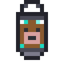
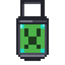
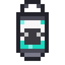
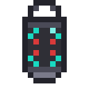
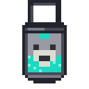
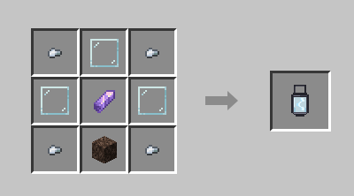
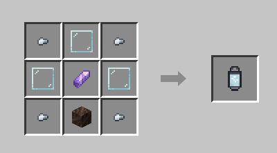

# Listing Kit: ALN SoulLantern

Tap the Copy button on a block, then paste it into the CurseForge listing. Generated from DESCRIPTION.md: edit that, not this file.

## Package Name

```text
ALN SoulLantern
```

## Summary (85/256)

```text
Seal any mob in a Soul Lantern, then release it or project a 20-second Spectral Ally.
```

## Description (HTML)

Choose any of the 5 themes below. Tap the Copy button on your preferred theme and paste into the CurseForge description editor in source (HTML) mode.

### Theme 1: Vanilla Adaptive (Default)

Theme-neutral layout following the viewer's CurseForge light or dark mode.

```html
<div><div style="border:2px solid #15803d;border-radius:18px;line-height:1.5"><br><p style="text-align:center"></p><p style="color:#8a94a3;font-size:14px;text-align:center">by ALNStudios</p><p style="text-align:center"><span style="background-color:#15803d;color:#ffffff;border-radius:20px;font-size:16px">&nbsp;&nbsp;<strong>Seal any mob in a Soul Lantern, then release it or project a 20-second Spectral Ally.</strong>&nbsp;&nbsp;</span></p><p style="text-align:center;margin-left:16px;margin-right:16px">Craft the lantern from glass panes, iron nuggets, soul soil or soul sand, and an amethyst shard, then carry a trapped creature with you.</p><div style="display:flex;flex-wrap:wrap;gap:8px;margin-left:14px;margin-right:14px"><div style="background-color:#dcfce7;color:#14532d;border-radius:20px;font-size:14px;line-height:2"><strong>&nbsp;&nbsp;Bedrock</strong>: 1.26+&nbsp;&nbsp;</div><div style="background-color:#dcfce7;color:#14532d;border-radius:20px;font-size:14px;line-height:2"><strong>&nbsp;&nbsp;Experimental</strong>: No&nbsp;&nbsp;</div><div style="background-color:#dcfce7;color:#14532d;border-radius:20px;font-size:14px;line-height:2"><strong>&nbsp;&nbsp;Achievements</strong>: Yes, achievement-friendly&nbsp;&nbsp;</div></div><br></div>
<p></p>
<p>ALN SoulLantern adds one relic with two looks. The Empty Soul Lantern holds a faint pale-blue mist, and the Soul-Bound Soul Lantern glows with turquoise soul fire and floating embers.</p><p>Sneak and interact with a mob to seal it inside. The lantern takes an icon for that mob and shows its name, health, and variant. Sneak and click to release it, or use the lantern to call a floating Spectral Ally.</p>
<p></p>
<div style="display:flex;flex-wrap:wrap;gap:10px"><div style="flex:1;min-width:200px;border:1px solid #8a94a3;border-radius:16px"><div style="background-color:#15803d;color:#ffffff;border-radius:16px;font-size:16px;line-height:2.2"><strong>&nbsp;&nbsp;Soul Lantern Crafting</strong></div><div style="margin-left:12px;margin-right:12px"><p><span>Craft the lantern with 2 glass panes, 4 iron nuggets, 1 amethyst shard, and 1 soul soil or soul sand.</span></p></div></div><div style="flex:1;min-width:200px;border:1px solid #8a94a3;border-radius:16px"><div style="background-color:#15803d;color:#ffffff;border-radius:16px;font-size:16px;line-height:2.2"><strong>&nbsp;&nbsp;Mob Capture</strong></div><div style="margin-left:12px;margin-right:12px"><p><span>Sneak and interact with a mob while holding an Empty lantern. The mob vanishes in a swirl of soul particles and the lantern turns turquoise, with a different icon for each kind of mob.</span></p></div></div><div style="flex:1;min-width:200px;border:1px solid #8a94a3;border-radius:16px"><div style="background-color:#15803d;color:#ffffff;border-radius:16px;font-size:16px;line-height:2.2"><strong>&nbsp;&nbsp;Boss Protection</strong></div><div style="margin-left:12px;margin-right:12px"><p><span>The Ender Dragon, Wither, Warden, and Elder Guardian cannot be sealed. The lantern trembles and a warning appears above the hotbar.</span></p></div></div><div style="flex:1;min-width:200px;border:1px solid #8a94a3;border-radius:16px"><div style="background-color:#15803d;color:#ffffff;border-radius:16px;font-size:16px;line-height:2.2"><strong>&nbsp;&nbsp;Saved Mob State</strong></div><div style="margin-left:12px;margin-right:12px"><p><span>The lantern keeps the mob's health, custom name, age, color, tamed state, equipment, and villager trades, and updates its own name and lore to match.</span></p></div></div><div style="flex:1;min-width:200px;border:1px solid #8a94a3;border-radius:16px"><div style="background-color:#15803d;color:#ffffff;border-radius:16px;font-size:16px;line-height:2.2"><strong>&nbsp;&nbsp;Block Release</strong></div><div style="margin-left:12px;margin-right:12px"><p><span>Sneak and click with a Soul-Bound lantern to place the saved mob on top of the block you aim at, or in front of you in open air. The lantern returns to the Empty state.</span></p></div></div><div style="flex:1;min-width:200px;border:1px solid #8a94a3;border-radius:16px"><div style="background-color:#15803d;color:#ffffff;border-radius:16px;font-size:16px;line-height:2.2"><strong>&nbsp;&nbsp;Spectral Ally</strong></div><div style="margin-left:12px;margin-right:12px"><p><span>Use a Soul-Bound lantern to call a floating, light-blue, slightly transparent spirit with a tiny figure of the trapped mob inside. It fights nearby hostile mobs like a pet for 20 seconds, never attacks you, then fades back into the lantern. Use it again to recall it early. Each lantern has one spirit and a 10-second recharge.</span></p></div></div><div style="flex:1;min-width:200px;border:1px solid #8a94a3;border-radius:16px"><div style="background-color:#15803d;color:#ffffff;border-radius:16px;font-size:16px;line-height:2.2"><strong>&nbsp;&nbsp;Mob-Specific Attacks</strong></div><div style="margin-left:12px;margin-right:12px"><p><span>A trapped Creeper becomes a kamikaze that explodes beside its target, then shrinks and slowly grows back. A Skeleton fires arrows, a Snow Golem throws snowballs, Spiders, wolves, and chickens attack fast, and Iron Golems and Endermen hit hard.</span></p></div></div></div>
<p></p>
<div style="display:flex;flex-wrap:wrap;gap:10px"><div style="flex:0 1 120px;border:1px solid #8a94a3;border-radius:16px;text-align:center"><p></p><p></p></div><div style="flex:0 1 120px;border:1px solid #8a94a3;border-radius:16px;text-align:center"><p></p><p></p></div><div style="flex:0 1 120px;border:1px solid #8a94a3;border-radius:16px;text-align:center"><p></p><p></p></div><div style="flex:0 1 120px;border:1px solid #8a94a3;border-radius:16px;text-align:center"><p></p><p></p></div><div style="flex:0 1 120px;border:1px solid #8a94a3;border-radius:16px;text-align:center"><p></p><p></p></div><div style="flex:0 1 120px;border:1px solid #8a94a3;border-radius:16px;text-align:center"><p></p><p></p></div><div style="flex:0 1 120px;border:1px solid #8a94a3;border-radius:16px;text-align:center"><p></p><p></p></div><div style="flex:0 1 120px;border:1px solid #8a94a3;border-radius:16px;text-align:center"><p></p><p></p></div><div style="flex:0 1 120px;border:1px solid #8a94a3;border-radius:16px;text-align:center"><p></p><p></p></div><div style="flex:0 1 120px;border:1px solid #8a94a3;border-radius:16px;text-align:center"><p></p><p></p></div><div style="flex:0 1 120px;border:1px solid #8a94a3;border-radius:16px;text-align:center"><p></p><p></p></div><div style="flex:0 1 120px;border:1px solid #8a94a3;border-radius:16px;text-align:center"><p></p><p></p></div><div style="flex:0 1 120px;border:1px solid #8a94a3;border-radius:16px;text-align:center"><p></p><p></p></div><div style="flex:0 1 120px;border:1px solid #8a94a3;border-radius:16px;text-align:center"><p></p><p></p></div><div style="flex:0 1 120px;border:1px solid #8a94a3;border-radius:16px;text-align:center"><p></p><p></p></div><div style="flex:0 1 120px;border:1px solid #8a94a3;border-radius:16px;text-align:center"><p></p><p></p></div></div>
<p></p>
<div style="display:flex;flex-wrap:wrap;gap:10px"><div style="flex:0 1 400px;border:1px solid #8a94a3;border-radius:16px;text-align:center"><p></p><p></p></div><div style="flex:0 1 400px;border:1px solid #8a94a3;border-radius:16px;text-align:center"><p></p><p></p></div><div style="flex:0 1 400px;border:1px solid #8a94a3;border-radius:16px;text-align:center"><p></p><p></p></div></div>
<p></p>
<table style="width:100%;border:1px solid #8a94a3;border-radius:16px"><tbody><tr><td style="width:44px;text-align:center"><div style="background-color:#15803d;color:#ffffff;font-weight:bold;font-size:15px;text-align:center;border-radius:10px;width:30px;aspect-ratio:1/1;line-height:30px">1</div></td><td style="text-align:left;">Craft a Soul Lantern at a crafting table.</td></tr><tr><td style="width:44px;text-align:center"><div style="background-color:#15803d;color:#ffffff;font-weight:bold;font-size:15px;text-align:center;border-radius:10px;width:30px;aspect-ratio:1/1;line-height:30px">2</div></td><td style="text-align:left;">Hold the Soul Lantern, sneak, and interact with a mob to seal it.</td></tr><tr><td style="width:44px;text-align:center"><div style="background-color:#15803d;color:#ffffff;font-weight:bold;font-size:15px;text-align:center;border-radius:10px;width:30px;aspect-ratio:1/1;line-height:30px">3</div></td><td style="text-align:left;">Sneak and click with the Soul-Bound lantern to release the mob where you aim.</td></tr><tr><td style="width:44px;text-align:center"><div style="background-color:#15803d;color:#ffffff;font-weight:bold;font-size:15px;text-align:center;border-radius:10px;width:30px;aspect-ratio:1/1;line-height:30px">4</div></td><td style="text-align:left;">Use the Soul-Bound lantern to call its floating Spectral Ally, and use it again to recall it.</td></tr><tr><td style="width:44px;text-align:center"><div style="background-color:#15803d;color:#ffffff;font-weight:bold;font-size:15px;text-align:center;border-radius:10px;width:30px;aspect-ratio:1/1;line-height:30px">5</div></td><td style="text-align:left;">Wait 10 seconds after the spirit leaves before calling it again.</td></tr></tbody></table>
<p></p>
<table style="width:100%;border:1px solid #8a94a3;border-radius:16px"><tbody><tr><td style="width:44px;text-align:center"><div style="background-color:#15803d;color:#ffffff;font-weight:bold;font-size:15px;text-align:center;border-radius:10px;width:30px;aspect-ratio:1/1;line-height:30px">1</div></td><td style="text-align:left;">Download the file from this page and open it with Minecraft.</td></tr><tr><td style="width:44px;text-align:center"><div style="background-color:#15803d;color:#ffffff;font-weight:bold;font-size:15px;text-align:center;border-radius:10px;width:30px;aspect-ratio:1/1;line-height:30px">2</div></td><td style="text-align:left;">Create or edit a world and turn on the new pack(s) in its settings.</td></tr><tr><td style="width:44px;text-align:center"><div style="background-color:#15803d;color:#ffffff;font-weight:bold;font-size:15px;text-align:center;border-radius:10px;width:30px;aspect-ratio:1/1;line-height:30px">3</div></td><td style="text-align:left;">Play. No Experimental toggles needed.</td></tr></tbody></table>
<div style="border:1px solid #8a94a3;border-radius:16px;text-align:center"><br><div style="background-color:#15803d;color:#ffffff;border-radius:20px;font-size:15px;line-height:2;display:inline-block">&nbsp;&nbsp;<strong>Found a Bug or Have a Suggestion?</strong>&nbsp;&nbsp;</div><p style="font-size:14px;">Please leave a comment on this project page! All bug reports, gameplay feedback, and pack suggestions are welcome and appreciated.</p></div>
<p></p><div style="border:1px solid #8a94a3;border-radius:16px;text-align:center"><br><a href="https://ko-fi.com/alnstudios"></a><br><br></div><p style="text-align:center"><a href="https://www.curseforge.com/members/allenscreations/projects"><strong>CurseForge</strong></a> &nbsp;|&nbsp; <a href="https://mcpedl.com/user/alnstudios/"><strong>MCPEDL</strong></a> &nbsp;|&nbsp; <a href="https://ko-fi.com/alnstudios"><strong>Ko-fi</strong></a></p>
<hr>
<p style="text-align:center;color:#8a94a3;font-size:13px"><strong>By ALNStudios</strong></p>
<div class="spoiler"><p style="font-size:13px"><strong>Permissions and credits</strong></p><ul style="font-size:13px"><li>Rights: All rights reserved for ALNStudios.</li><li>Content creators: You may feature this creation in videos and streams with credit to ALNStudios.</li><li>Redistribution: Do not re-upload this pack or provide direct monetized download bypasses. Link to this page.</li><li>Visual: Promotional/cover imagery used on this page is AI-generated to illustrate the concept and purpose of the pack.</li><li>Unofficial community creation. Not an official Minecraft product and not approved by or associated with Mojang or Microsoft.</li></ul></div>
<p style="text-align:center;color:#8a94a3;font-size:12px">Minecraft Bedrock add-on, ALN SoulLantern Bedrock mod, MCPEDL add-on, CurseForge Bedrock, ALNStudios.</p></div>
```

### Theme 2: Netherite Stealth (Modern Dark)

High-tech dark obsidian & emerald storefront.

```html
<div style="background-color:#0d1117;color:#c9d1d9;border-radius:12px;padding-left:12px"><div style="margin-right:12px"><br><div style="background-color:#161b22;border:2px solid #10b981;border-radius:18px;line-height:1.5"><br><p style="text-align:center"></p><p style="color:#8b949e;font-size:14px;text-align:center">by ALNStudios</p><p style="text-align:center"><span style="background-color:#10b981;color:#ffffff;border-radius:20px;font-size:16px">&nbsp;&nbsp;<strong>Seal any mob in a Soul Lantern, then release it or project a 20-second Spectral Ally.</strong>&nbsp;&nbsp;</span></p><p style="color:#8b949e;text-align:center;margin-left:16px;margin-right:16px">Craft the lantern from glass panes, iron nuggets, soul soil or soul sand, and an amethyst shard, then carry a trapped creature with you.</p><div style="display:flex;flex-wrap:wrap;gap:8px;margin-left:14px;margin-right:14px"><div style="background-color:#161b22;color:#10b981;border-radius:20px;font-size:14px;line-height:2"><strong>&nbsp;&nbsp;Bedrock</strong>: 1.26+&nbsp;&nbsp;</div><div style="background-color:#161b22;color:#10b981;border-radius:20px;font-size:14px;line-height:2"><strong>&nbsp;&nbsp;Experimental</strong>: No&nbsp;&nbsp;</div><div style="background-color:#161b22;color:#10b981;border-radius:20px;font-size:14px;line-height:2"><strong>&nbsp;&nbsp;Achievements</strong>: Yes, achievement-friendly&nbsp;&nbsp;</div></div><br></div>
<p></p>
<p style="color:#c9d1d9">ALN SoulLantern adds one relic with two looks. The Empty Soul Lantern holds a faint pale-blue mist, and the Soul-Bound Soul Lantern glows with turquoise soul fire and floating embers.</p><p style="color:#c9d1d9">Sneak and interact with a mob to seal it inside. The lantern takes an icon for that mob and shows its name, health, and variant. Sneak and click to release it, or use the lantern to call a floating Spectral Ally.</p>
<p></p>
<div style="display:flex;flex-wrap:wrap;gap:10px"><div style="flex:1;min-width:200px;background-color:#161b22;border:1px solid #30363d;border-radius:16px"><div style="background-color:#10b981;color:#ffffff;border-radius:16px;font-size:16px;line-height:2.2"><strong>&nbsp;&nbsp;Soul Lantern Crafting</strong></div><div style="margin-left:12px;margin-right:12px"><p><span style="color:#c9d1d9">Craft the lantern with 2 glass panes, 4 iron nuggets, 1 amethyst shard, and 1 soul soil or soul sand.</span></p></div></div><div style="flex:1;min-width:200px;background-color:#161b22;border:1px solid #30363d;border-radius:16px"><div style="background-color:#10b981;color:#ffffff;border-radius:16px;font-size:16px;line-height:2.2"><strong>&nbsp;&nbsp;Mob Capture</strong></div><div style="margin-left:12px;margin-right:12px"><p><span style="color:#c9d1d9">Sneak and interact with a mob while holding an Empty lantern. The mob vanishes in a swirl of soul particles and the lantern turns turquoise, with a different icon for each kind of mob.</span></p></div></div><div style="flex:1;min-width:200px;background-color:#161b22;border:1px solid #30363d;border-radius:16px"><div style="background-color:#10b981;color:#ffffff;border-radius:16px;font-size:16px;line-height:2.2"><strong>&nbsp;&nbsp;Boss Protection</strong></div><div style="margin-left:12px;margin-right:12px"><p><span style="color:#c9d1d9">The Ender Dragon, Wither, Warden, and Elder Guardian cannot be sealed. The lantern trembles and a warning appears above the hotbar.</span></p></div></div><div style="flex:1;min-width:200px;background-color:#161b22;border:1px solid #30363d;border-radius:16px"><div style="background-color:#10b981;color:#ffffff;border-radius:16px;font-size:16px;line-height:2.2"><strong>&nbsp;&nbsp;Saved Mob State</strong></div><div style="margin-left:12px;margin-right:12px"><p><span style="color:#c9d1d9">The lantern keeps the mob's health, custom name, age, color, tamed state, equipment, and villager trades, and updates its own name and lore to match.</span></p></div></div><div style="flex:1;min-width:200px;background-color:#161b22;border:1px solid #30363d;border-radius:16px"><div style="background-color:#10b981;color:#ffffff;border-radius:16px;font-size:16px;line-height:2.2"><strong>&nbsp;&nbsp;Block Release</strong></div><div style="margin-left:12px;margin-right:12px"><p><span style="color:#c9d1d9">Sneak and click with a Soul-Bound lantern to place the saved mob on top of the block you aim at, or in front of you in open air. The lantern returns to the Empty state.</span></p></div></div><div style="flex:1;min-width:200px;background-color:#161b22;border:1px solid #30363d;border-radius:16px"><div style="background-color:#10b981;color:#ffffff;border-radius:16px;font-size:16px;line-height:2.2"><strong>&nbsp;&nbsp;Spectral Ally</strong></div><div style="margin-left:12px;margin-right:12px"><p><span style="color:#c9d1d9">Use a Soul-Bound lantern to call a floating, light-blue, slightly transparent spirit with a tiny figure of the trapped mob inside. It fights nearby hostile mobs like a pet for 20 seconds, never attacks you, then fades back into the lantern. Use it again to recall it early. Each lantern has one spirit and a 10-second recharge.</span></p></div></div><div style="flex:1;min-width:200px;background-color:#161b22;border:1px solid #30363d;border-radius:16px"><div style="background-color:#10b981;color:#ffffff;border-radius:16px;font-size:16px;line-height:2.2"><strong>&nbsp;&nbsp;Mob-Specific Attacks</strong></div><div style="margin-left:12px;margin-right:12px"><p><span style="color:#c9d1d9">A trapped Creeper becomes a kamikaze that explodes beside its target, then shrinks and slowly grows back. A Skeleton fires arrows, a Snow Golem throws snowballs, Spiders, wolves, and chickens attack fast, and Iron Golems and Endermen hit hard.</span></p></div></div></div>
<p></p>
<div style="display:flex;flex-wrap:wrap;gap:10px"><div style="flex:0 1 120px;background-color:#161b22;border:1px solid #30363d;border-radius:16px;text-align:center"><p></p><p></p></div><div style="flex:0 1 120px;background-color:#161b22;border:1px solid #30363d;border-radius:16px;text-align:center"><p></p><p></p></div><div style="flex:0 1 120px;background-color:#161b22;border:1px solid #30363d;border-radius:16px;text-align:center"><p></p><p></p></div><div style="flex:0 1 120px;background-color:#161b22;border:1px solid #30363d;border-radius:16px;text-align:center"><p></p><p></p></div><div style="flex:0 1 120px;background-color:#161b22;border:1px solid #30363d;border-radius:16px;text-align:center"><p></p><p></p></div><div style="flex:0 1 120px;background-color:#161b22;border:1px solid #30363d;border-radius:16px;text-align:center"><p></p><p></p></div><div style="flex:0 1 120px;background-color:#161b22;border:1px solid #30363d;border-radius:16px;text-align:center"><p></p><p></p></div><div style="flex:0 1 120px;background-color:#161b22;border:1px solid #30363d;border-radius:16px;text-align:center"><p></p><p></p></div><div style="flex:0 1 120px;background-color:#161b22;border:1px solid #30363d;border-radius:16px;text-align:center"><p></p><p></p></div><div style="flex:0 1 120px;background-color:#161b22;border:1px solid #30363d;border-radius:16px;text-align:center"><p></p><p></p></div><div style="flex:0 1 120px;background-color:#161b22;border:1px solid #30363d;border-radius:16px;text-align:center"><p></p><p></p></div><div style="flex:0 1 120px;background-color:#161b22;border:1px solid #30363d;border-radius:16px;text-align:center"><p></p><p></p></div><div style="flex:0 1 120px;background-color:#161b22;border:1px solid #30363d;border-radius:16px;text-align:center"><p></p><p></p></div><div style="flex:0 1 120px;background-color:#161b22;border:1px solid #30363d;border-radius:16px;text-align:center"><p></p><p></p></div><div style="flex:0 1 120px;background-color:#161b22;border:1px solid #30363d;border-radius:16px;text-align:center"><p></p><p></p></div><div style="flex:0 1 120px;background-color:#161b22;border:1px solid #30363d;border-radius:16px;text-align:center"><p></p><p></p></div></div>
<p></p>
<div style="display:flex;flex-wrap:wrap;gap:10px"><div style="flex:0 1 400px;background-color:#161b22;border:1px solid #30363d;border-radius:16px;text-align:center"><p></p><p></p></div><div style="flex:0 1 400px;background-color:#161b22;border:1px solid #30363d;border-radius:16px;text-align:center"><p></p><p></p></div><div style="flex:0 1 400px;background-color:#161b22;border:1px solid #30363d;border-radius:16px;text-align:center"><p></p><p></p></div></div>
<p></p>
<table style="width:100%;border:1px solid #30363d;border-radius:16px"><tbody><tr><td style="width:44px;text-align:center"><div style="background-color:#10b981;color:#ffffff;font-weight:bold;font-size:15px;text-align:center;border-radius:10px;width:30px;aspect-ratio:1/1;line-height:30px">1</div></td><td style="text-align:left;color:#c9d1d9">Craft a Soul Lantern at a crafting table.</td></tr><tr><td style="width:44px;text-align:center"><div style="background-color:#10b981;color:#ffffff;font-weight:bold;font-size:15px;text-align:center;border-radius:10px;width:30px;aspect-ratio:1/1;line-height:30px">2</div></td><td style="text-align:left;color:#c9d1d9">Hold the Soul Lantern, sneak, and interact with a mob to seal it.</td></tr><tr><td style="width:44px;text-align:center"><div style="background-color:#10b981;color:#ffffff;font-weight:bold;font-size:15px;text-align:center;border-radius:10px;width:30px;aspect-ratio:1/1;line-height:30px">3</div></td><td style="text-align:left;color:#c9d1d9">Sneak and click with the Soul-Bound lantern to release the mob where you aim.</td></tr><tr><td style="width:44px;text-align:center"><div style="background-color:#10b981;color:#ffffff;font-weight:bold;font-size:15px;text-align:center;border-radius:10px;width:30px;aspect-ratio:1/1;line-height:30px">4</div></td><td style="text-align:left;color:#c9d1d9">Use the Soul-Bound lantern to call its floating Spectral Ally, and use it again to recall it.</td></tr><tr><td style="width:44px;text-align:center"><div style="background-color:#10b981;color:#ffffff;font-weight:bold;font-size:15px;text-align:center;border-radius:10px;width:30px;aspect-ratio:1/1;line-height:30px">5</div></td><td style="text-align:left;color:#c9d1d9">Wait 10 seconds after the spirit leaves before calling it again.</td></tr></tbody></table>
<p></p>
<table style="width:100%;border:1px solid #30363d;border-radius:16px"><tbody><tr><td style="width:44px;text-align:center"><div style="background-color:#10b981;color:#ffffff;font-weight:bold;font-size:15px;text-align:center;border-radius:10px;width:30px;aspect-ratio:1/1;line-height:30px">1</div></td><td style="text-align:left;color:#c9d1d9">Download the file from this page and open it with Minecraft.</td></tr><tr><td style="width:44px;text-align:center"><div style="background-color:#10b981;color:#ffffff;font-weight:bold;font-size:15px;text-align:center;border-radius:10px;width:30px;aspect-ratio:1/1;line-height:30px">2</div></td><td style="text-align:left;color:#c9d1d9">Create or edit a world and turn on the new pack(s) in its settings.</td></tr><tr><td style="width:44px;text-align:center"><div style="background-color:#10b981;color:#ffffff;font-weight:bold;font-size:15px;text-align:center;border-radius:10px;width:30px;aspect-ratio:1/1;line-height:30px">3</div></td><td style="text-align:left;color:#c9d1d9">Play. No Experimental toggles needed.</td></tr></tbody></table>
<div style="background-color:#161b22;border:1px solid #30363d;border-radius:16px;text-align:center"><br><div style="background-color:#10b981;color:#ffffff;border-radius:20px;font-size:15px;line-height:2;display:inline-block">&nbsp;&nbsp;<strong>Found a Bug or Have a Suggestion?</strong>&nbsp;&nbsp;</div><p style="font-size:14px;color:#c9d1d9">Please leave a comment on this project page! All bug reports, gameplay feedback, and pack suggestions are welcome and appreciated.</p></div>
<p></p><div style="background-color:#161b22;border:1px solid #30363d;border-radius:16px;text-align:center"><br><a href="https://ko-fi.com/alnstudios"></a><br><br></div><p style="text-align:center"><a style="color:#58a6ff" href="https://www.curseforge.com/members/allenscreations/projects"><strong>CurseForge</strong></a> &nbsp;|&nbsp; <a style="color:#58a6ff" href="https://mcpedl.com/user/alnstudios/"><strong>MCPEDL</strong></a> &nbsp;|&nbsp; <a style="color:#58a6ff" href="https://ko-fi.com/alnstudios"><strong>Ko-fi</strong></a></p>
<hr>
<p style="text-align:center;color:#8b949e;font-size:13px"><strong>By ALNStudios</strong></p>
<div class="spoiler"><p style="font-size:13px"><strong>Permissions and credits</strong></p><ul style="font-size:13px"><li>Rights: All rights reserved for ALNStudios.</li><li>Content creators: You may feature this creation in videos and streams with credit to ALNStudios.</li><li>Redistribution: Do not re-upload this pack or provide direct monetized download bypasses. Link to this page.</li><li>Visual: Promotional/cover imagery used on this page is AI-generated to illustrate the concept and purpose of the pack.</li><li>Unofficial community creation. Not an official Minecraft product and not approved by or associated with Mojang or Microsoft.</li></ul></div>
<p style="text-align:center;color:#8b949e;font-size:12px">Minecraft Bedrock add-on, ALN SoulLantern Bedrock mod, MCPEDL add-on, CurseForge Bedrock, ALNStudios.</p><br></div></div>
```

### Theme 3: Bedrock GUI (In-Game Menu)

Authentic Minecraft stone dialog with 3D beveled borders and item slot insets.

```html
<div style="background-color:#313233;color:#e0e0e0;border-radius:12px;padding-left:12px"><div style="margin-right:12px"><br><div style="background-color:#202021;border:2px solid #4a4b4d;border-radius:18px;line-height:1.5"><br><p style="text-align:center"></p><p style="color:#a0a0a0;font-size:14px;text-align:center">by ALNStudios</p><p style="text-align:center"><span style="background-color:#4a4b4d;color:#ffffff;border-radius:20px;font-size:16px">&nbsp;&nbsp;<strong>Seal any mob in a Soul Lantern, then release it or project a 20-second Spectral Ally.</strong>&nbsp;&nbsp;</span></p><p style="color:#d0d0d0;text-align:center;margin-left:16px;margin-right:16px">Craft the lantern from glass panes, iron nuggets, soul soil or soul sand, and an amethyst shard, then carry a trapped creature with you.</p><div style="display:flex;flex-wrap:wrap;gap:8px;margin-left:14px;margin-right:14px"><div style="background-color:#202021;color:#ffffff;border-radius:20px;font-size:14px;line-height:2"><strong>&nbsp;&nbsp;Bedrock</strong>: 1.26+&nbsp;&nbsp;</div><div style="background-color:#202021;color:#ffffff;border-radius:20px;font-size:14px;line-height:2"><strong>&nbsp;&nbsp;Experimental</strong>: No&nbsp;&nbsp;</div><div style="background-color:#202021;color:#ffffff;border-radius:20px;font-size:14px;line-height:2"><strong>&nbsp;&nbsp;Achievements</strong>: Yes, achievement-friendly&nbsp;&nbsp;</div></div><br></div>
<p></p>
<p style="color:#e0e0e0">ALN SoulLantern adds one relic with two looks. The Empty Soul Lantern holds a faint pale-blue mist, and the Soul-Bound Soul Lantern glows with turquoise soul fire and floating embers.</p><p style="color:#e0e0e0">Sneak and interact with a mob to seal it inside. The lantern takes an icon for that mob and shows its name, health, and variant. Sneak and click to release it, or use the lantern to call a floating Spectral Ally.</p>
<p></p>
<div style="display:flex;flex-wrap:wrap;gap:10px"><div style="flex:1;min-width:200px;background-color:#202021;border:1px solid #4a4b4d;border-radius:16px"><div style="background-color:#4a4b4d;color:#ffffff;border-radius:16px;font-size:16px;line-height:2.2"><strong>&nbsp;&nbsp;Soul Lantern Crafting</strong></div><div style="margin-left:12px;margin-right:12px"><p><span style="color:#e0e0e0">Craft the lantern with 2 glass panes, 4 iron nuggets, 1 amethyst shard, and 1 soul soil or soul sand.</span></p></div></div><div style="flex:1;min-width:200px;background-color:#202021;border:1px solid #4a4b4d;border-radius:16px"><div style="background-color:#4a4b4d;color:#ffffff;border-radius:16px;font-size:16px;line-height:2.2"><strong>&nbsp;&nbsp;Mob Capture</strong></div><div style="margin-left:12px;margin-right:12px"><p><span style="color:#e0e0e0">Sneak and interact with a mob while holding an Empty lantern. The mob vanishes in a swirl of soul particles and the lantern turns turquoise, with a different icon for each kind of mob.</span></p></div></div><div style="flex:1;min-width:200px;background-color:#202021;border:1px solid #4a4b4d;border-radius:16px"><div style="background-color:#4a4b4d;color:#ffffff;border-radius:16px;font-size:16px;line-height:2.2"><strong>&nbsp;&nbsp;Boss Protection</strong></div><div style="margin-left:12px;margin-right:12px"><p><span style="color:#e0e0e0">The Ender Dragon, Wither, Warden, and Elder Guardian cannot be sealed. The lantern trembles and a warning appears above the hotbar.</span></p></div></div><div style="flex:1;min-width:200px;background-color:#202021;border:1px solid #4a4b4d;border-radius:16px"><div style="background-color:#4a4b4d;color:#ffffff;border-radius:16px;font-size:16px;line-height:2.2"><strong>&nbsp;&nbsp;Saved Mob State</strong></div><div style="margin-left:12px;margin-right:12px"><p><span style="color:#e0e0e0">The lantern keeps the mob's health, custom name, age, color, tamed state, equipment, and villager trades, and updates its own name and lore to match.</span></p></div></div><div style="flex:1;min-width:200px;background-color:#202021;border:1px solid #4a4b4d;border-radius:16px"><div style="background-color:#4a4b4d;color:#ffffff;border-radius:16px;font-size:16px;line-height:2.2"><strong>&nbsp;&nbsp;Block Release</strong></div><div style="margin-left:12px;margin-right:12px"><p><span style="color:#e0e0e0">Sneak and click with a Soul-Bound lantern to place the saved mob on top of the block you aim at, or in front of you in open air. The lantern returns to the Empty state.</span></p></div></div><div style="flex:1;min-width:200px;background-color:#202021;border:1px solid #4a4b4d;border-radius:16px"><div style="background-color:#4a4b4d;color:#ffffff;border-radius:16px;font-size:16px;line-height:2.2"><strong>&nbsp;&nbsp;Spectral Ally</strong></div><div style="margin-left:12px;margin-right:12px"><p><span style="color:#e0e0e0">Use a Soul-Bound lantern to call a floating, light-blue, slightly transparent spirit with a tiny figure of the trapped mob inside. It fights nearby hostile mobs like a pet for 20 seconds, never attacks you, then fades back into the lantern. Use it again to recall it early. Each lantern has one spirit and a 10-second recharge.</span></p></div></div><div style="flex:1;min-width:200px;background-color:#202021;border:1px solid #4a4b4d;border-radius:16px"><div style="background-color:#4a4b4d;color:#ffffff;border-radius:16px;font-size:16px;line-height:2.2"><strong>&nbsp;&nbsp;Mob-Specific Attacks</strong></div><div style="margin-left:12px;margin-right:12px"><p><span style="color:#e0e0e0">A trapped Creeper becomes a kamikaze that explodes beside its target, then shrinks and slowly grows back. A Skeleton fires arrows, a Snow Golem throws snowballs, Spiders, wolves, and chickens attack fast, and Iron Golems and Endermen hit hard.</span></p></div></div></div>
<p></p>
<div style="display:flex;flex-wrap:wrap;gap:10px"><div style="flex:0 1 120px;background-color:#202021;border:1px solid #4a4b4d;border-radius:16px;text-align:center"><p></p><p></p></div><div style="flex:0 1 120px;background-color:#202021;border:1px solid #4a4b4d;border-radius:16px;text-align:center"><p></p><p></p></div><div style="flex:0 1 120px;background-color:#202021;border:1px solid #4a4b4d;border-radius:16px;text-align:center"><p></p><p></p></div><div style="flex:0 1 120px;background-color:#202021;border:1px solid #4a4b4d;border-radius:16px;text-align:center"><p></p><p></p></div><div style="flex:0 1 120px;background-color:#202021;border:1px solid #4a4b4d;border-radius:16px;text-align:center"><p></p><p></p></div><div style="flex:0 1 120px;background-color:#202021;border:1px solid #4a4b4d;border-radius:16px;text-align:center"><p></p><p></p></div><div style="flex:0 1 120px;background-color:#202021;border:1px solid #4a4b4d;border-radius:16px;text-align:center"><p></p><p></p></div><div style="flex:0 1 120px;background-color:#202021;border:1px solid #4a4b4d;border-radius:16px;text-align:center"><p></p><p></p></div><div style="flex:0 1 120px;background-color:#202021;border:1px solid #4a4b4d;border-radius:16px;text-align:center"><p></p><p></p></div><div style="flex:0 1 120px;background-color:#202021;border:1px solid #4a4b4d;border-radius:16px;text-align:center"><p></p><p></p></div><div style="flex:0 1 120px;background-color:#202021;border:1px solid #4a4b4d;border-radius:16px;text-align:center"><p></p><p></p></div><div style="flex:0 1 120px;background-color:#202021;border:1px solid #4a4b4d;border-radius:16px;text-align:center"><p></p><p></p></div><div style="flex:0 1 120px;background-color:#202021;border:1px solid #4a4b4d;border-radius:16px;text-align:center"><p></p><p></p></div><div style="flex:0 1 120px;background-color:#202021;border:1px solid #4a4b4d;border-radius:16px;text-align:center"><p></p><p></p></div><div style="flex:0 1 120px;background-color:#202021;border:1px solid #4a4b4d;border-radius:16px;text-align:center"><p></p><p></p></div><div style="flex:0 1 120px;background-color:#202021;border:1px solid #4a4b4d;border-radius:16px;text-align:center"><p></p><p></p></div></div>
<p></p>
<div style="display:flex;flex-wrap:wrap;gap:10px"><div style="flex:0 1 400px;background-color:#202021;border:1px solid #4a4b4d;border-radius:16px;text-align:center"><p></p><p></p></div><div style="flex:0 1 400px;background-color:#202021;border:1px solid #4a4b4d;border-radius:16px;text-align:center"><p></p><p></p></div><div style="flex:0 1 400px;background-color:#202021;border:1px solid #4a4b4d;border-radius:16px;text-align:center"><p></p><p></p></div></div>
<p></p>
<table style="width:100%;border:1px solid #4a4b4d;border-radius:16px"><tbody><tr><td style="width:44px;text-align:center"><div style="background-color:#4a4b4d;color:#ffffff;font-weight:bold;font-size:15px;text-align:center;border-radius:10px;width:30px;aspect-ratio:1/1;line-height:30px">1</div></td><td style="text-align:left;color:#e0e0e0">Craft a Soul Lantern at a crafting table.</td></tr><tr><td style="width:44px;text-align:center"><div style="background-color:#4a4b4d;color:#ffffff;font-weight:bold;font-size:15px;text-align:center;border-radius:10px;width:30px;aspect-ratio:1/1;line-height:30px">2</div></td><td style="text-align:left;color:#e0e0e0">Hold the Soul Lantern, sneak, and interact with a mob to seal it.</td></tr><tr><td style="width:44px;text-align:center"><div style="background-color:#4a4b4d;color:#ffffff;font-weight:bold;font-size:15px;text-align:center;border-radius:10px;width:30px;aspect-ratio:1/1;line-height:30px">3</div></td><td style="text-align:left;color:#e0e0e0">Sneak and click with the Soul-Bound lantern to release the mob where you aim.</td></tr><tr><td style="width:44px;text-align:center"><div style="background-color:#4a4b4d;color:#ffffff;font-weight:bold;font-size:15px;text-align:center;border-radius:10px;width:30px;aspect-ratio:1/1;line-height:30px">4</div></td><td style="text-align:left;color:#e0e0e0">Use the Soul-Bound lantern to call its floating Spectral Ally, and use it again to recall it.</td></tr><tr><td style="width:44px;text-align:center"><div style="background-color:#4a4b4d;color:#ffffff;font-weight:bold;font-size:15px;text-align:center;border-radius:10px;width:30px;aspect-ratio:1/1;line-height:30px">5</div></td><td style="text-align:left;color:#e0e0e0">Wait 10 seconds after the spirit leaves before calling it again.</td></tr></tbody></table>
<p></p>
<table style="width:100%;border:1px solid #4a4b4d;border-radius:16px"><tbody><tr><td style="width:44px;text-align:center"><div style="background-color:#4a4b4d;color:#ffffff;font-weight:bold;font-size:15px;text-align:center;border-radius:10px;width:30px;aspect-ratio:1/1;line-height:30px">1</div></td><td style="text-align:left;color:#e0e0e0">Download the file from this page and open it with Minecraft.</td></tr><tr><td style="width:44px;text-align:center"><div style="background-color:#4a4b4d;color:#ffffff;font-weight:bold;font-size:15px;text-align:center;border-radius:10px;width:30px;aspect-ratio:1/1;line-height:30px">2</div></td><td style="text-align:left;color:#e0e0e0">Create or edit a world and turn on the new pack(s) in its settings.</td></tr><tr><td style="width:44px;text-align:center"><div style="background-color:#4a4b4d;color:#ffffff;font-weight:bold;font-size:15px;text-align:center;border-radius:10px;width:30px;aspect-ratio:1/1;line-height:30px">3</div></td><td style="text-align:left;color:#e0e0e0">Play. No Experimental toggles needed.</td></tr></tbody></table>
<div style="background-color:#202021;border:1px solid #4a4b4d;border-radius:16px;text-align:center"><br><div style="background-color:#4a4b4d;color:#ffffff;border-radius:20px;font-size:15px;line-height:2;display:inline-block">&nbsp;&nbsp;<strong>Found a Bug or Have a Suggestion?</strong>&nbsp;&nbsp;</div><p style="font-size:14px;color:#e0e0e0">Please leave a comment on this project page! All bug reports, gameplay feedback, and pack suggestions are welcome and appreciated.</p></div>
<p></p><div style="background-color:#202021;border:1px solid #4a4b4d;border-radius:16px;text-align:center"><br><a href="https://ko-fi.com/alnstudios"></a><br><br></div><p style="text-align:center"><a style="color:#55ff55" href="https://www.curseforge.com/members/allenscreations/projects"><strong>CurseForge</strong></a> &nbsp;|&nbsp; <a style="color:#55ff55" href="https://mcpedl.com/user/alnstudios/"><strong>MCPEDL</strong></a> &nbsp;|&nbsp; <a style="color:#55ff55" href="https://ko-fi.com/alnstudios"><strong>Ko-fi</strong></a></p>
<hr>
<p style="text-align:center;color:#a0a0a0;font-size:13px"><strong>By ALNStudios</strong></p>
<div class="spoiler"><p style="font-size:13px"><strong>Permissions and credits</strong></p><ul style="font-size:13px"><li>Rights: All rights reserved for ALNStudios.</li><li>Content creators: You may feature this creation in videos and streams with credit to ALNStudios.</li><li>Redistribution: Do not re-upload this pack or provide direct monetized download bypasses. Link to this page.</li><li>Visual: Promotional/cover imagery used on this page is AI-generated to illustrate the concept and purpose of the pack.</li><li>Unofficial community creation. Not an official Minecraft product and not approved by or associated with Mojang or Microsoft.</li></ul></div>
<p style="text-align:center;color:#a0a0a0;font-size:12px">Minecraft Bedrock add-on, ALN SoulLantern Bedrock mod, MCPEDL add-on, CurseForge Bedrock, ALNStudios.</p><br></div></div>
```

### Theme 4: Emerald Marketplace

Official Minecraft Marketplace DLC showcase look with gold and emerald badges.

```html
<div style="background-color:#022c22;color:#ecfdf5;border-radius:12px;padding-left:12px"><div style="margin-right:12px"><br><div style="background-color:#064e3b;border:2px solid #059669;border-radius:18px;line-height:1.5"><br><p style="text-align:center"></p><p style="color:#6ee7b7;font-size:14px;text-align:center">by ALNStudios</p><p style="text-align:center"><span style="background-color:#059669;color:#ffffff;border-radius:20px;font-size:16px">&nbsp;&nbsp;<strong>Seal any mob in a Soul Lantern, then release it or project a 20-second Spectral Ally.</strong>&nbsp;&nbsp;</span></p><p style="color:#a7f3d0;text-align:center;margin-left:16px;margin-right:16px">Craft the lantern from glass panes, iron nuggets, soul soil or soul sand, and an amethyst shard, then carry a trapped creature with you.</p><div style="display:flex;flex-wrap:wrap;gap:8px;margin-left:14px;margin-right:14px"><div style="background-color:#047857;color:#ffffff;border-radius:20px;font-size:14px;line-height:2"><strong>&nbsp;&nbsp;Bedrock</strong>: 1.26+&nbsp;&nbsp;</div><div style="background-color:#047857;color:#ffffff;border-radius:20px;font-size:14px;line-height:2"><strong>&nbsp;&nbsp;Experimental</strong>: No&nbsp;&nbsp;</div><div style="background-color:#047857;color:#ffffff;border-radius:20px;font-size:14px;line-height:2"><strong>&nbsp;&nbsp;Achievements</strong>: Yes, achievement-friendly&nbsp;&nbsp;</div></div><br></div>
<p></p>
<p style="color:#ecfdf5">ALN SoulLantern adds one relic with two looks. The Empty Soul Lantern holds a faint pale-blue mist, and the Soul-Bound Soul Lantern glows with turquoise soul fire and floating embers.</p><p style="color:#ecfdf5">Sneak and interact with a mob to seal it inside. The lantern takes an icon for that mob and shows its name, health, and variant. Sneak and click to release it, or use the lantern to call a floating Spectral Ally.</p>
<p></p>
<div style="display:flex;flex-wrap:wrap;gap:10px"><div style="flex:1;min-width:200px;background-color:#064e3b;border:1px solid #059669;border-radius:16px"><div style="background-color:#059669;color:#ffffff;border-radius:16px;font-size:16px;line-height:2.2"><strong>&nbsp;&nbsp;Soul Lantern Crafting</strong></div><div style="margin-left:12px;margin-right:12px"><p><span style="color:#ecfdf5">Craft the lantern with 2 glass panes, 4 iron nuggets, 1 amethyst shard, and 1 soul soil or soul sand.</span></p></div></div><div style="flex:1;min-width:200px;background-color:#064e3b;border:1px solid #059669;border-radius:16px"><div style="background-color:#059669;color:#ffffff;border-radius:16px;font-size:16px;line-height:2.2"><strong>&nbsp;&nbsp;Mob Capture</strong></div><div style="margin-left:12px;margin-right:12px"><p><span style="color:#ecfdf5">Sneak and interact with a mob while holding an Empty lantern. The mob vanishes in a swirl of soul particles and the lantern turns turquoise, with a different icon for each kind of mob.</span></p></div></div><div style="flex:1;min-width:200px;background-color:#064e3b;border:1px solid #059669;border-radius:16px"><div style="background-color:#059669;color:#ffffff;border-radius:16px;font-size:16px;line-height:2.2"><strong>&nbsp;&nbsp;Boss Protection</strong></div><div style="margin-left:12px;margin-right:12px"><p><span style="color:#ecfdf5">The Ender Dragon, Wither, Warden, and Elder Guardian cannot be sealed. The lantern trembles and a warning appears above the hotbar.</span></p></div></div><div style="flex:1;min-width:200px;background-color:#064e3b;border:1px solid #059669;border-radius:16px"><div style="background-color:#059669;color:#ffffff;border-radius:16px;font-size:16px;line-height:2.2"><strong>&nbsp;&nbsp;Saved Mob State</strong></div><div style="margin-left:12px;margin-right:12px"><p><span style="color:#ecfdf5">The lantern keeps the mob's health, custom name, age, color, tamed state, equipment, and villager trades, and updates its own name and lore to match.</span></p></div></div><div style="flex:1;min-width:200px;background-color:#064e3b;border:1px solid #059669;border-radius:16px"><div style="background-color:#059669;color:#ffffff;border-radius:16px;font-size:16px;line-height:2.2"><strong>&nbsp;&nbsp;Block Release</strong></div><div style="margin-left:12px;margin-right:12px"><p><span style="color:#ecfdf5">Sneak and click with a Soul-Bound lantern to place the saved mob on top of the block you aim at, or in front of you in open air. The lantern returns to the Empty state.</span></p></div></div><div style="flex:1;min-width:200px;background-color:#064e3b;border:1px solid #059669;border-radius:16px"><div style="background-color:#059669;color:#ffffff;border-radius:16px;font-size:16px;line-height:2.2"><strong>&nbsp;&nbsp;Spectral Ally</strong></div><div style="margin-left:12px;margin-right:12px"><p><span style="color:#ecfdf5">Use a Soul-Bound lantern to call a floating, light-blue, slightly transparent spirit with a tiny figure of the trapped mob inside. It fights nearby hostile mobs like a pet for 20 seconds, never attacks you, then fades back into the lantern. Use it again to recall it early. Each lantern has one spirit and a 10-second recharge.</span></p></div></div><div style="flex:1;min-width:200px;background-color:#064e3b;border:1px solid #059669;border-radius:16px"><div style="background-color:#059669;color:#ffffff;border-radius:16px;font-size:16px;line-height:2.2"><strong>&nbsp;&nbsp;Mob-Specific Attacks</strong></div><div style="margin-left:12px;margin-right:12px"><p><span style="color:#ecfdf5">A trapped Creeper becomes a kamikaze that explodes beside its target, then shrinks and slowly grows back. A Skeleton fires arrows, a Snow Golem throws snowballs, Spiders, wolves, and chickens attack fast, and Iron Golems and Endermen hit hard.</span></p></div></div></div>
<p></p>
<div style="display:flex;flex-wrap:wrap;gap:10px"><div style="flex:0 1 120px;background-color:#064e3b;border:1px solid #059669;border-radius:16px;text-align:center"><p></p><p></p></div><div style="flex:0 1 120px;background-color:#064e3b;border:1px solid #059669;border-radius:16px;text-align:center"><p></p><p></p></div><div style="flex:0 1 120px;background-color:#064e3b;border:1px solid #059669;border-radius:16px;text-align:center"><p></p><p></p></div><div style="flex:0 1 120px;background-color:#064e3b;border:1px solid #059669;border-radius:16px;text-align:center"><p></p><p></p></div><div style="flex:0 1 120px;background-color:#064e3b;border:1px solid #059669;border-radius:16px;text-align:center"><p></p><p></p></div><div style="flex:0 1 120px;background-color:#064e3b;border:1px solid #059669;border-radius:16px;text-align:center"><p></p><p></p></div><div style="flex:0 1 120px;background-color:#064e3b;border:1px solid #059669;border-radius:16px;text-align:center"><p></p><p></p></div><div style="flex:0 1 120px;background-color:#064e3b;border:1px solid #059669;border-radius:16px;text-align:center"><p></p><p></p></div><div style="flex:0 1 120px;background-color:#064e3b;border:1px solid #059669;border-radius:16px;text-align:center"><p></p><p></p></div><div style="flex:0 1 120px;background-color:#064e3b;border:1px solid #059669;border-radius:16px;text-align:center"><p></p><p></p></div><div style="flex:0 1 120px;background-color:#064e3b;border:1px solid #059669;border-radius:16px;text-align:center"><p></p><p></p></div><div style="flex:0 1 120px;background-color:#064e3b;border:1px solid #059669;border-radius:16px;text-align:center"><p></p><p></p></div><div style="flex:0 1 120px;background-color:#064e3b;border:1px solid #059669;border-radius:16px;text-align:center"><p></p><p></p></div><div style="flex:0 1 120px;background-color:#064e3b;border:1px solid #059669;border-radius:16px;text-align:center"><p></p><p></p></div><div style="flex:0 1 120px;background-color:#064e3b;border:1px solid #059669;border-radius:16px;text-align:center"><p></p><p></p></div><div style="flex:0 1 120px;background-color:#064e3b;border:1px solid #059669;border-radius:16px;text-align:center"><p></p><p></p></div></div>
<p></p>
<div style="display:flex;flex-wrap:wrap;gap:10px"><div style="flex:0 1 400px;background-color:#064e3b;border:1px solid #059669;border-radius:16px;text-align:center"><p></p><p></p></div><div style="flex:0 1 400px;background-color:#064e3b;border:1px solid #059669;border-radius:16px;text-align:center"><p></p><p></p></div><div style="flex:0 1 400px;background-color:#064e3b;border:1px solid #059669;border-radius:16px;text-align:center"><p></p><p></p></div></div>
<p></p>
<table style="width:100%;border:1px solid #059669;border-radius:16px"><tbody><tr><td style="width:44px;text-align:center"><div style="background-color:#059669;color:#ffffff;font-weight:bold;font-size:15px;text-align:center;border-radius:10px;width:30px;aspect-ratio:1/1;line-height:30px">1</div></td><td style="text-align:left;color:#ecfdf5">Craft a Soul Lantern at a crafting table.</td></tr><tr><td style="width:44px;text-align:center"><div style="background-color:#059669;color:#ffffff;font-weight:bold;font-size:15px;text-align:center;border-radius:10px;width:30px;aspect-ratio:1/1;line-height:30px">2</div></td><td style="text-align:left;color:#ecfdf5">Hold the Soul Lantern, sneak, and interact with a mob to seal it.</td></tr><tr><td style="width:44px;text-align:center"><div style="background-color:#059669;color:#ffffff;font-weight:bold;font-size:15px;text-align:center;border-radius:10px;width:30px;aspect-ratio:1/1;line-height:30px">3</div></td><td style="text-align:left;color:#ecfdf5">Sneak and click with the Soul-Bound lantern to release the mob where you aim.</td></tr><tr><td style="width:44px;text-align:center"><div style="background-color:#059669;color:#ffffff;font-weight:bold;font-size:15px;text-align:center;border-radius:10px;width:30px;aspect-ratio:1/1;line-height:30px">4</div></td><td style="text-align:left;color:#ecfdf5">Use the Soul-Bound lantern to call its floating Spectral Ally, and use it again to recall it.</td></tr><tr><td style="width:44px;text-align:center"><div style="background-color:#059669;color:#ffffff;font-weight:bold;font-size:15px;text-align:center;border-radius:10px;width:30px;aspect-ratio:1/1;line-height:30px">5</div></td><td style="text-align:left;color:#ecfdf5">Wait 10 seconds after the spirit leaves before calling it again.</td></tr></tbody></table>
<p></p>
<table style="width:100%;border:1px solid #059669;border-radius:16px"><tbody><tr><td style="width:44px;text-align:center"><div style="background-color:#059669;color:#ffffff;font-weight:bold;font-size:15px;text-align:center;border-radius:10px;width:30px;aspect-ratio:1/1;line-height:30px">1</div></td><td style="text-align:left;color:#ecfdf5">Download the file from this page and open it with Minecraft.</td></tr><tr><td style="width:44px;text-align:center"><div style="background-color:#059669;color:#ffffff;font-weight:bold;font-size:15px;text-align:center;border-radius:10px;width:30px;aspect-ratio:1/1;line-height:30px">2</div></td><td style="text-align:left;color:#ecfdf5">Create or edit a world and turn on the new pack(s) in its settings.</td></tr><tr><td style="width:44px;text-align:center"><div style="background-color:#059669;color:#ffffff;font-weight:bold;font-size:15px;text-align:center;border-radius:10px;width:30px;aspect-ratio:1/1;line-height:30px">3</div></td><td style="text-align:left;color:#ecfdf5">Play. No Experimental toggles needed.</td></tr></tbody></table>
<div style="background-color:#064e3b;border:1px solid #059669;border-radius:16px;text-align:center"><br><div style="background-color:#059669;color:#ffffff;border-radius:20px;font-size:15px;line-height:2;display:inline-block">&nbsp;&nbsp;<strong>Found a Bug or Have a Suggestion?</strong>&nbsp;&nbsp;</div><p style="font-size:14px;color:#ecfdf5">Please leave a comment on this project page! All bug reports, gameplay feedback, and pack suggestions are welcome and appreciated.</p></div>
<p></p><div style="background-color:#064e3b;border:1px solid #059669;border-radius:16px;text-align:center"><br><a href="https://ko-fi.com/alnstudios"></a><br><br></div><p style="text-align:center"><a style="color:#34d399" href="https://www.curseforge.com/members/allenscreations/projects"><strong>CurseForge</strong></a> &nbsp;|&nbsp; <a style="color:#34d399" href="https://mcpedl.com/user/alnstudios/"><strong>MCPEDL</strong></a> &nbsp;|&nbsp; <a style="color:#34d399" href="https://ko-fi.com/alnstudios"><strong>Ko-fi</strong></a></p>
<hr>
<p style="text-align:center;color:#6ee7b7;font-size:13px"><strong>By ALNStudios</strong></p>
<div class="spoiler"><p style="font-size:13px"><strong>Permissions and credits</strong></p><ul style="font-size:13px"><li>Rights: All rights reserved for ALNStudios.</li><li>Content creators: You may feature this creation in videos and streams with credit to ALNStudios.</li><li>Redistribution: Do not re-upload this pack or provide direct monetized download bypasses. Link to this page.</li><li>Visual: Promotional/cover imagery used on this page is AI-generated to illustrate the concept and purpose of the pack.</li><li>Unofficial community creation. Not an official Minecraft product and not approved by or associated with Mojang or Microsoft.</li></ul></div>
<p style="text-align:center;color:#6ee7b7;font-size:12px">Minecraft Bedrock add-on, ALN SoulLantern Bedrock mod, MCPEDL add-on, CurseForge Bedrock, ALNStudios.</p><br></div></div>
```

### Theme 5: Arcane Grimoire (Fantasy RPG)

Midnight obsidian purple theme with mystic amethyst and enchantment accents.

```html
<div style="background-color:#120c1f;color:#f3e8ff;border-radius:12px;padding-left:12px"><div style="margin-right:12px"><br><div style="background-color:#1c1033;border:2px solid #7e22ce;border-radius:18px;line-height:1.5"><br><p style="text-align:center"></p><p style="color:#c084fc;font-size:14px;text-align:center">by ALNStudios</p><p style="text-align:center"><span style="background-color:#7e22ce;color:#ffffff;border-radius:20px;font-size:16px">&nbsp;&nbsp;<strong>Seal any mob in a Soul Lantern, then release it or project a 20-second Spectral Ally.</strong>&nbsp;&nbsp;</span></p><p style="color:#d8b4fe;text-align:center;margin-left:16px;margin-right:16px">Craft the lantern from glass panes, iron nuggets, soul soil or soul sand, and an amethyst shard, then carry a trapped creature with you.</p><div style="display:flex;flex-wrap:wrap;gap:8px;margin-left:14px;margin-right:14px"><div style="background-color:#3b0764;color:#f3e8ff;border-radius:20px;font-size:14px;line-height:2"><strong>&nbsp;&nbsp;Bedrock</strong>: 1.26+&nbsp;&nbsp;</div><div style="background-color:#3b0764;color:#f3e8ff;border-radius:20px;font-size:14px;line-height:2"><strong>&nbsp;&nbsp;Experimental</strong>: No&nbsp;&nbsp;</div><div style="background-color:#3b0764;color:#f3e8ff;border-radius:20px;font-size:14px;line-height:2"><strong>&nbsp;&nbsp;Achievements</strong>: Yes, achievement-friendly&nbsp;&nbsp;</div></div><br></div>
<p></p>
<p style="color:#f3e8ff">ALN SoulLantern adds one relic with two looks. The Empty Soul Lantern holds a faint pale-blue mist, and the Soul-Bound Soul Lantern glows with turquoise soul fire and floating embers.</p><p style="color:#f3e8ff">Sneak and interact with a mob to seal it inside. The lantern takes an icon for that mob and shows its name, health, and variant. Sneak and click to release it, or use the lantern to call a floating Spectral Ally.</p>
<p></p>
<div style="display:flex;flex-wrap:wrap;gap:10px"><div style="flex:1;min-width:200px;background-color:#1c1033;border:1px solid #581c87;border-radius:16px"><div style="background-color:#7e22ce;color:#ffffff;border-radius:16px;font-size:16px;line-height:2.2"><strong>&nbsp;&nbsp;Soul Lantern Crafting</strong></div><div style="margin-left:12px;margin-right:12px"><p><span style="color:#f3e8ff">Craft the lantern with 2 glass panes, 4 iron nuggets, 1 amethyst shard, and 1 soul soil or soul sand.</span></p></div></div><div style="flex:1;min-width:200px;background-color:#1c1033;border:1px solid #581c87;border-radius:16px"><div style="background-color:#7e22ce;color:#ffffff;border-radius:16px;font-size:16px;line-height:2.2"><strong>&nbsp;&nbsp;Mob Capture</strong></div><div style="margin-left:12px;margin-right:12px"><p><span style="color:#f3e8ff">Sneak and interact with a mob while holding an Empty lantern. The mob vanishes in a swirl of soul particles and the lantern turns turquoise, with a different icon for each kind of mob.</span></p></div></div><div style="flex:1;min-width:200px;background-color:#1c1033;border:1px solid #581c87;border-radius:16px"><div style="background-color:#7e22ce;color:#ffffff;border-radius:16px;font-size:16px;line-height:2.2"><strong>&nbsp;&nbsp;Boss Protection</strong></div><div style="margin-left:12px;margin-right:12px"><p><span style="color:#f3e8ff">The Ender Dragon, Wither, Warden, and Elder Guardian cannot be sealed. The lantern trembles and a warning appears above the hotbar.</span></p></div></div><div style="flex:1;min-width:200px;background-color:#1c1033;border:1px solid #581c87;border-radius:16px"><div style="background-color:#7e22ce;color:#ffffff;border-radius:16px;font-size:16px;line-height:2.2"><strong>&nbsp;&nbsp;Saved Mob State</strong></div><div style="margin-left:12px;margin-right:12px"><p><span style="color:#f3e8ff">The lantern keeps the mob's health, custom name, age, color, tamed state, equipment, and villager trades, and updates its own name and lore to match.</span></p></div></div><div style="flex:1;min-width:200px;background-color:#1c1033;border:1px solid #581c87;border-radius:16px"><div style="background-color:#7e22ce;color:#ffffff;border-radius:16px;font-size:16px;line-height:2.2"><strong>&nbsp;&nbsp;Block Release</strong></div><div style="margin-left:12px;margin-right:12px"><p><span style="color:#f3e8ff">Sneak and click with a Soul-Bound lantern to place the saved mob on top of the block you aim at, or in front of you in open air. The lantern returns to the Empty state.</span></p></div></div><div style="flex:1;min-width:200px;background-color:#1c1033;border:1px solid #581c87;border-radius:16px"><div style="background-color:#7e22ce;color:#ffffff;border-radius:16px;font-size:16px;line-height:2.2"><strong>&nbsp;&nbsp;Spectral Ally</strong></div><div style="margin-left:12px;margin-right:12px"><p><span style="color:#f3e8ff">Use a Soul-Bound lantern to call a floating, light-blue, slightly transparent spirit with a tiny figure of the trapped mob inside. It fights nearby hostile mobs like a pet for 20 seconds, never attacks you, then fades back into the lantern. Use it again to recall it early. Each lantern has one spirit and a 10-second recharge.</span></p></div></div><div style="flex:1;min-width:200px;background-color:#1c1033;border:1px solid #581c87;border-radius:16px"><div style="background-color:#7e22ce;color:#ffffff;border-radius:16px;font-size:16px;line-height:2.2"><strong>&nbsp;&nbsp;Mob-Specific Attacks</strong></div><div style="margin-left:12px;margin-right:12px"><p><span style="color:#f3e8ff">A trapped Creeper becomes a kamikaze that explodes beside its target, then shrinks and slowly grows back. A Skeleton fires arrows, a Snow Golem throws snowballs, Spiders, wolves, and chickens attack fast, and Iron Golems and Endermen hit hard.</span></p></div></div></div>
<p></p>
<div style="display:flex;flex-wrap:wrap;gap:10px"><div style="flex:0 1 120px;background-color:#1c1033;border:1px solid #581c87;border-radius:16px;text-align:center"><p></p><p></p></div><div style="flex:0 1 120px;background-color:#1c1033;border:1px solid #581c87;border-radius:16px;text-align:center"><p></p><p></p></div><div style="flex:0 1 120px;background-color:#1c1033;border:1px solid #581c87;border-radius:16px;text-align:center"><p></p><p></p></div><div style="flex:0 1 120px;background-color:#1c1033;border:1px solid #581c87;border-radius:16px;text-align:center"><p></p><p></p></div><div style="flex:0 1 120px;background-color:#1c1033;border:1px solid #581c87;border-radius:16px;text-align:center"><p></p><p></p></div><div style="flex:0 1 120px;background-color:#1c1033;border:1px solid #581c87;border-radius:16px;text-align:center"><p></p><p></p></div><div style="flex:0 1 120px;background-color:#1c1033;border:1px solid #581c87;border-radius:16px;text-align:center"><p></p><p></p></div><div style="flex:0 1 120px;background-color:#1c1033;border:1px solid #581c87;border-radius:16px;text-align:center"><p></p><p></p></div><div style="flex:0 1 120px;background-color:#1c1033;border:1px solid #581c87;border-radius:16px;text-align:center"><p></p><p></p></div><div style="flex:0 1 120px;background-color:#1c1033;border:1px solid #581c87;border-radius:16px;text-align:center"><p></p><p></p></div><div style="flex:0 1 120px;background-color:#1c1033;border:1px solid #581c87;border-radius:16px;text-align:center"><p></p><p></p></div><div style="flex:0 1 120px;background-color:#1c1033;border:1px solid #581c87;border-radius:16px;text-align:center"><p></p><p></p></div><div style="flex:0 1 120px;background-color:#1c1033;border:1px solid #581c87;border-radius:16px;text-align:center"><p></p><p></p></div><div style="flex:0 1 120px;background-color:#1c1033;border:1px solid #581c87;border-radius:16px;text-align:center"><p></p><p></p></div><div style="flex:0 1 120px;background-color:#1c1033;border:1px solid #581c87;border-radius:16px;text-align:center"><p></p><p></p></div><div style="flex:0 1 120px;background-color:#1c1033;border:1px solid #581c87;border-radius:16px;text-align:center"><p></p><p></p></div></div>
<p></p>
<div style="display:flex;flex-wrap:wrap;gap:10px"><div style="flex:0 1 400px;background-color:#1c1033;border:1px solid #581c87;border-radius:16px;text-align:center"><p></p><p></p></div><div style="flex:0 1 400px;background-color:#1c1033;border:1px solid #581c87;border-radius:16px;text-align:center"><p></p><p></p></div><div style="flex:0 1 400px;background-color:#1c1033;border:1px solid #581c87;border-radius:16px;text-align:center"><p></p><p></p></div></div>
<p></p>
<table style="width:100%;border:1px solid #581c87;border-radius:16px"><tbody><tr><td style="width:44px;text-align:center"><div style="background-color:#7e22ce;color:#ffffff;font-weight:bold;font-size:15px;text-align:center;border-radius:10px;width:30px;aspect-ratio:1/1;line-height:30px">1</div></td><td style="text-align:left;color:#f3e8ff">Craft a Soul Lantern at a crafting table.</td></tr><tr><td style="width:44px;text-align:center"><div style="background-color:#7e22ce;color:#ffffff;font-weight:bold;font-size:15px;text-align:center;border-radius:10px;width:30px;aspect-ratio:1/1;line-height:30px">2</div></td><td style="text-align:left;color:#f3e8ff">Hold the Soul Lantern, sneak, and interact with a mob to seal it.</td></tr><tr><td style="width:44px;text-align:center"><div style="background-color:#7e22ce;color:#ffffff;font-weight:bold;font-size:15px;text-align:center;border-radius:10px;width:30px;aspect-ratio:1/1;line-height:30px">3</div></td><td style="text-align:left;color:#f3e8ff">Sneak and click with the Soul-Bound lantern to release the mob where you aim.</td></tr><tr><td style="width:44px;text-align:center"><div style="background-color:#7e22ce;color:#ffffff;font-weight:bold;font-size:15px;text-align:center;border-radius:10px;width:30px;aspect-ratio:1/1;line-height:30px">4</div></td><td style="text-align:left;color:#f3e8ff">Use the Soul-Bound lantern to call its floating Spectral Ally, and use it again to recall it.</td></tr><tr><td style="width:44px;text-align:center"><div style="background-color:#7e22ce;color:#ffffff;font-weight:bold;font-size:15px;text-align:center;border-radius:10px;width:30px;aspect-ratio:1/1;line-height:30px">5</div></td><td style="text-align:left;color:#f3e8ff">Wait 10 seconds after the spirit leaves before calling it again.</td></tr></tbody></table>
<p></p>
<table style="width:100%;border:1px solid #581c87;border-radius:16px"><tbody><tr><td style="width:44px;text-align:center"><div style="background-color:#7e22ce;color:#ffffff;font-weight:bold;font-size:15px;text-align:center;border-radius:10px;width:30px;aspect-ratio:1/1;line-height:30px">1</div></td><td style="text-align:left;color:#f3e8ff">Download the file from this page and open it with Minecraft.</td></tr><tr><td style="width:44px;text-align:center"><div style="background-color:#7e22ce;color:#ffffff;font-weight:bold;font-size:15px;text-align:center;border-radius:10px;width:30px;aspect-ratio:1/1;line-height:30px">2</div></td><td style="text-align:left;color:#f3e8ff">Create or edit a world and turn on the new pack(s) in its settings.</td></tr><tr><td style="width:44px;text-align:center"><div style="background-color:#7e22ce;color:#ffffff;font-weight:bold;font-size:15px;text-align:center;border-radius:10px;width:30px;aspect-ratio:1/1;line-height:30px">3</div></td><td style="text-align:left;color:#f3e8ff">Play. No Experimental toggles needed.</td></tr></tbody></table>
<div style="background-color:#1c1033;border:1px solid #581c87;border-radius:16px;text-align:center"><br><div style="background-color:#7e22ce;color:#ffffff;border-radius:20px;font-size:15px;line-height:2;display:inline-block">&nbsp;&nbsp;<strong>Found a Bug or Have a Suggestion?</strong>&nbsp;&nbsp;</div><p style="font-size:14px;color:#f3e8ff">Please leave a comment on this project page! All bug reports, gameplay feedback, and pack suggestions are welcome and appreciated.</p></div>
<p></p><div style="background-color:#1c1033;border:1px solid #581c87;border-radius:16px;text-align:center"><br><a href="https://ko-fi.com/alnstudios"></a><br><br></div><p style="text-align:center"><a style="color:#c084fc" href="https://www.curseforge.com/members/allenscreations/projects"><strong>CurseForge</strong></a> &nbsp;|&nbsp; <a style="color:#c084fc" href="https://mcpedl.com/user/alnstudios/"><strong>MCPEDL</strong></a> &nbsp;|&nbsp; <a style="color:#c084fc" href="https://ko-fi.com/alnstudios"><strong>Ko-fi</strong></a></p>
<hr>
<p style="text-align:center;color:#c084fc;font-size:13px"><strong>By ALNStudios</strong></p>
<div class="spoiler"><p style="font-size:13px"><strong>Permissions and credits</strong></p><ul style="font-size:13px"><li>Rights: All rights reserved for ALNStudios.</li><li>Content creators: You may feature this creation in videos and streams with credit to ALNStudios.</li><li>Redistribution: Do not re-upload this pack or provide direct monetized download bypasses. Link to this page.</li><li>Visual: Promotional/cover imagery used on this page is AI-generated to illustrate the concept and purpose of the pack.</li><li>Unofficial community creation. Not an official Minecraft product and not approved by or associated with Mojang or Microsoft.</li></ul></div>
<p style="text-align:center;color:#c084fc;font-size:12px">Minecraft Bedrock add-on, ALN SoulLantern Bedrock mod, MCPEDL add-on, CurseForge Bedrock, ALNStudios.</p><br></div></div>
```

## AI Image Prompts

### Reference Images

- **Logo reference**: attach your own logo. The generator uses it only for brand colors and mood. The result must be a new design, not a copy.
- **Snapshot references**: attach 1 to 4 of your in-game snapshots of this pack. The generator copies their look, not their screen layout.

### Logo Prompt

```text
Use the attached logo only as a brand reference for its color palette and overall mood. Do not copy it. Create a new, original logo with a different composition and a different main symbol. Do not just recolor, resize, crop, mirror or tweak the attached logo.
Create a clean, square (1:1) logo image for the Minecraft Bedrock add-on "ALN SoulLantern". Seal any mob in a Soul Lantern, then release it or project a 20-second Spectral Ally.
Base the main symbol on the pack idea above. Match the blocky look of the attached in-game snapshots. Center the logo, use a simple background, and keep it readable at small sizes.
Text: "ALN SoulLantern" and, in small letters, "ALNStudios". ALNStudios is the brand name, so always keep it and never remove or change it. Spell both exactly.
Do not add Minecraft, Mojang or Microsoft logos, watermarks, or characters from other games.
```

### Banner Prompt

```text
Create a wide (16:9) banner image for the Minecraft Bedrock add-on "ALN SoulLantern". Seal any mob in a Soul Lantern, then release it or project a 20-second Spectral Ally.
Use the attached in-game snapshots as scene and style references: copy their blocky look, lighting, colors and the kind of scenery they show. Make a new composition inspired by them. Do not copy the on-screen HUD, chat or hotbar.
Use the attached logo only as a brand reference for its colors and mood. Do not copy it. Put a new, original logo design in the banner, large enough to read, on the left or center.
Hint at these pack features visually: Soul Lantern Crafting, Mob Capture, Boss Protection, Saved Mob State, Block Release.
Text: "ALN SoulLantern" and, in small letters, "by ALNStudios". ALNStudios is the brand name, so always keep it and never remove or change it. Spell both exactly.
Leave clear space around the logo. No Minecraft, Mojang or Microsoft logos, no watermarks.
```
