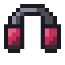
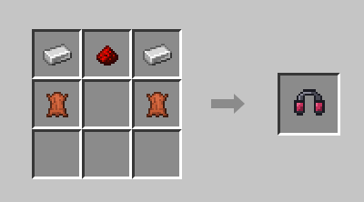

# Listing Kit: ALN Wireless Headphones

Tap the Copy button on a block, then paste it into the CurseForge listing. Generated from DESCRIPTION.md: edit that, not this file.

## Package Name

```text
ALN Wireless Headphones
```

## Summary (109/256)

```text
Pair Wireless Headphones to a Jukebox once, then wear them to see its track name and time on your Action Bar.
```

## Description (HTML)

Paste into the CurseForge description editor in source (HTML) mode.

```html
<div><div style="border:2px solid #15803d;border-radius:18px;line-height:1.5"><br><h1 style="font-size:34px;text-align:center">ALN Wireless Headphones</h1><p style="color:#8a94a3;font-size:14px;text-align:center">by ALNStudios</p><p style="text-align:center"><span style="background-color:#15803d;color:#ffffff;border-radius:20px;font-size:16px">&nbsp;&nbsp;<strong>Pair Wireless Headphones to a Jukebox once, then wear them to see its track name and time on your Action Bar.</strong>&nbsp;&nbsp;</span></p><p style="text-align:center;margin-left:16px;margin-right:16px">This pack adds one helmet, Wireless Headphones, that links to a Jukebox holding a music disc. Players who build far from their music room can still see what is playing and how far along it is.</p><div style="display:flex;flex-wrap:wrap;gap:8px;margin-left:14px;margin-right:14px"><div style="background-color:#dcfce7;color:#14532d;border-radius:20px;font-size:14px;line-height:2"><strong>&nbsp;&nbsp;Bedrock</strong>: 1.26+&nbsp;&nbsp;</div><div style="background-color:#dcfce7;color:#14532d;border-radius:20px;font-size:14px;line-height:2"><strong>&nbsp;&nbsp;Experimental</strong>: No&nbsp;&nbsp;</div><div style="background-color:#dcfce7;color:#14532d;border-radius:20px;font-size:14px;line-height:2"><strong>&nbsp;&nbsp;Achievements</strong>: Yes, achievement-friendly&nbsp;&nbsp;</div></div><br></div>
<h2 style="font-size:17px;text-align:left"><span style="background-color:#15803d;color:#ffffff;border-radius:20px">&nbsp;&nbsp;About&nbsp;&nbsp;</span></h2>
<p>Craft the Wireless Headphones, hold them, and sneak while using a Jukebox to pair them. The Jukebox goes quiet for everyone. Put the headphones on your head and the music plays only in your ears, with the track and timer on your Action Bar, for as long as you wear them. Take them off and the music stops.</p>
<h2 style="font-size:17px;text-align:left"><span style="background-color:#15803d;color:#ffffff;border-radius:20px">&nbsp;&nbsp;What You Get&nbsp;&nbsp;</span></h2>
<div style="display:flex;flex-wrap:wrap;gap:10px"><div style="flex:1;min-width:200px;border:1px solid #8a94a3;border-radius:16px"><div style="background-color:#15803d;color:#ffffff;border-radius:16px;font-size:16px;line-height:2.2"><strong>&nbsp;&nbsp;Wireless Headphones</strong></div><div style="margin-left:12px;margin-right:12px"><p><span>A helmet that stacks to 1 and goes in the head slot. It gives no armor protection.</span><br><span style="font-size:13px;color:#8a94a3"><strong>How It Works:</strong> Craft it with 2 Iron Ingots, 1 Redstone Dust and 2 Leather. Row 1 is Iron Ingot, Redstone Dust, Iron Ingot. Row 2 is Leather, empty, Leather.</span><br><span style="font-size:13px;color:#8a94a3"><strong>Good To Know:</strong> The recipe is unlocked from the start. The headphones show on your character's head while worn.</span></p></div></div><div style="flex:1;min-width:200px;border:1px solid #8a94a3;border-radius:16px"><div style="background-color:#15803d;color:#ffffff;border-radius:16px;font-size:16px;line-height:2.2"><strong>&nbsp;&nbsp;Jukebox Pairing</strong></div><div style="margin-left:12px;margin-right:12px"><p><span>Sneak and use the headphones on a Jukebox to pair them. A chime plays and the Action Bar confirms it. The Jukebox is muted for everyone.</span><br><span style="font-size:13px;color:#8a94a3"><strong>How It Works:</strong> Hold the headphones, crouch, then use them on the Jukebox. The paired position is saved on that item and shown in its lore.</span><br><span style="font-size:13px;color:#8a94a3"><strong>Good To Know:</strong> A Jukebox with no disc can be paired. Pairing again moves the link and unmutes the old Jukebox. Sneak and use the headphones on their paired Jukebox to unpair it.</span></p></div></div><div style="flex:1;min-width:200px;border:1px solid #8a94a3;border-radius:16px"><div style="background-color:#15803d;color:#ffffff;border-radius:16px;font-size:16px;line-height:2.2"><strong>&nbsp;&nbsp;Live Audio &amp; Action Bar Player</strong></div><div style="margin-left:12px;margin-right:12px"><p><span>While worn, the music disc audio streams straight to your headphones and the Action Bar shows the artist, title, elapsed time, and total duration.</span><br><span style="font-size:13px;color:#8a94a3"><strong>How It Works:</strong> A paired Jukebox playing cat streams the track audio directly to you while displaying the track name and progress like 0:42 out of 3:05.</span><br><span style="font-size:13px;color:#8a94a3"><strong>Good To Know:</strong> A paired Jukebox is kept loaded so the music can follow it from far away. The game limits how many areas can be kept loaded, so a Jukebox beyond that limit may show as not loaded when you are away. Total times are supported for all vanilla discs. Discs from other add-ons also play when the disc item is named &lt;namespace&gt;:music_disc_&lt;name&gt; and its sound is record.&lt;name&gt;. Their total time shows as --:--. The headphone audio keeps a steady volume wherever you go and follows your Music volume setting. If the Jukebox is not loaded while you are away, the music keeps playing until the track ends, and for up to 10 minutes with discs from other add-ons. A Jukebox that could not be kept loaded is retried every few seconds.</span></p></div></div></div>
<h2 style="font-size:17px;text-align:left"><span style="background-color:#15803d;color:#ffffff;border-radius:20px">&nbsp;&nbsp;Custom Items&nbsp;&nbsp;</span></h2>
<div style="display:flex;flex-wrap:wrap;gap:10px"><div style="flex:0 1 120px;border:1px solid #8a94a3;border-radius:16px;text-align:center"><p><a href="https://raw.githubusercontent.com/AllensCreations/MCPE-Curseforges/main/MCPEDL/Addons/ALN-Wireless-Headphones/assets/items/aln_headphones.png"></a></p><p style="color:#8a94a3;font-size:13px">aln headphones</p></div><div style="flex:0 1 120px;border:1px solid #8a94a3;border-radius:16px;text-align:center"><p><a href="https://raw.githubusercontent.com/AllensCreations/MCPE-Curseforges/main/MCPEDL/Addons/ALN-Wireless-Headphones/assets/items/headphones.png"></a></p><p style="color:#8a94a3;font-size:13px">headphones</p></div></div>
<h2 style="font-size:17px;text-align:left"><span style="background-color:#15803d;color:#ffffff;border-radius:20px">&nbsp;&nbsp;Crafting Recipes&nbsp;&nbsp;</span></h2>
<div style="display:flex;flex-wrap:wrap;gap:10px"><div style="flex:0 1 400px;border:1px solid #8a94a3;border-radius:16px;text-align:center"><p><a href="https://raw.githubusercontent.com/AllensCreations/MCPE-Curseforges/main/MCPEDL/Addons/ALN-Wireless-Headphones/assets/recipes/headphones_recipe.png"></a></p><p style="color:#8a94a3;font-size:13px">headphones recipe</p></div></div>
<h2 style="font-size:17px;text-align:left"><span style="background-color:#15803d;color:#ffffff;border-radius:20px">&nbsp;&nbsp;Get Started&nbsp;&nbsp;</span></h2>
<table style="width:100%;border:1px solid #8a94a3;border-radius:16px"><tbody><tr><td style="width:44px;text-align:center"><div style="background-color:#15803d;color:#ffffff;font-weight:bold;font-size:15px;text-align:center;border-radius:10px;width:30px;aspect-ratio:1/1;line-height:30px">1</div></td><td style="text-align:left;">Craft the Wireless Headphones at a Crafting Table.</td></tr><tr><td style="width:44px;text-align:center"><div style="background-color:#15803d;color:#ffffff;font-weight:bold;font-size:15px;text-align:center;border-radius:10px;width:30px;aspect-ratio:1/1;line-height:30px">2</div></td><td style="text-align:left;">Hold them, sneak, and use them on a Jukebox. It goes quiet.</td></tr><tr><td style="width:44px;text-align:center"><div style="background-color:#15803d;color:#ffffff;font-weight:bold;font-size:15px;text-align:center;border-radius:10px;width:30px;aspect-ratio:1/1;line-height:30px">3</div></td><td style="text-align:left;">Wear them in the helmet slot and watch the Action Bar for the track and timer.</td></tr></tbody></table>
<h2 style="font-size:17px;text-align:left"><span style="background-color:#15803d;color:#ffffff;border-radius:20px">&nbsp;&nbsp;Common Questions&nbsp;&nbsp;</span></h2>
<div class="spoiler" title="Does the timer start from the beginning of the song?" data-title="Does the timer start from the beginning of the song?"><p><strong>Does the timer start from the beginning of the song?</strong><br>The timer follows the audio in your ears. The audio starts when a track begins. If you put the headphones on mid-track, the Action Bar shows Waiting for the next track and the Jukebox stays audible until then.</p></div><div class="spoiler" title="What happens when I take the headphones off?" data-title="What happens when I take the headphones off?"><p><strong>What happens when I take the headphones off?</strong><br>The streamed music immediately stops and the Action Bar display clears. Put them back on to resume listening.</p></div>
<h2 style="font-size:17px;text-align:left"><span style="background-color:#15803d;color:#ffffff;border-radius:20px">&nbsp;&nbsp;Install&nbsp;&nbsp;</span></h2>
<table style="width:100%;border:1px solid #8a94a3;border-radius:16px"><tbody><tr><td style="width:44px;text-align:center"><div style="background-color:#15803d;color:#ffffff;font-weight:bold;font-size:15px;text-align:center;border-radius:10px;width:30px;aspect-ratio:1/1;line-height:30px">1</div></td><td style="text-align:left;">Download the file from this page and open it with Minecraft.</td></tr><tr><td style="width:44px;text-align:center"><div style="background-color:#15803d;color:#ffffff;font-weight:bold;font-size:15px;text-align:center;border-radius:10px;width:30px;aspect-ratio:1/1;line-height:30px">2</div></td><td style="text-align:left;">Create or edit a world and turn on the new pack(s) in its settings.</td></tr><tr><td style="width:44px;text-align:center"><div style="background-color:#15803d;color:#ffffff;font-weight:bold;font-size:15px;text-align:center;border-radius:10px;width:30px;aspect-ratio:1/1;line-height:30px">3</div></td><td style="text-align:left;">Play. No Experimental toggles needed.</td></tr></tbody></table>
<div style="border:1px solid #8a94a3;border-radius:16px;text-align:center"><br><div style="background-color:#15803d;color:#ffffff;border-radius:20px;font-size:15px;line-height:2;display:inline-block">&nbsp;&nbsp;<strong>Found a Bug or Have a Suggestion?</strong>&nbsp;&nbsp;</div><p style="font-size:14px;">Please leave a comment on this project page! All bug reports, gameplay feedback, and pack suggestions are welcome and appreciated.</p></div>
<h2 style="font-size:17px;text-align:left"><span style="background-color:#15803d;color:#ffffff;border-radius:20px">&nbsp;&nbsp;Support&nbsp;&nbsp;</span></h2><div style="border:1px solid #8a94a3;border-radius:16px;text-align:center"><br><a href="https://ko-fi.com/alnstudios"></a><br><br></div><p style="text-align:center"><a href="https://www.curseforge.com/members/allenscreations/projects"><strong>CurseForge</strong></a> &nbsp;|&nbsp; <a href="https://mcpedl.com/user/alnstudios/"><strong>MCPEDL</strong></a> &nbsp;|&nbsp; <a href="https://ko-fi.com/alnstudios"><strong>Ko-fi</strong></a></p>
<hr>
<p style="text-align:center;color:#8a94a3;font-size:13px"><strong>By ALNStudios</strong></p>
<div class="spoiler"><p style="font-size:13px"><strong>Permissions and credits</strong></p><ul style="font-size:13px"><li>Rights: All rights reserved for ALNStudios.</li><li>Content creators: You may feature this creation in videos and streams with credit to ALNStudios.</li><li>Redistribution: Do not re-upload this pack or provide direct monetized download bypasses. Link to this page.</li><li>Unofficial community creation. Not an official Minecraft product and not approved by or associated with Mojang or Microsoft.</li></ul></div>
<p style="text-align:center;color:#8a94a3;font-size:12px">Minecraft Bedrock add-on, ALN Wireless Headphones Bedrock mod, Jukebox headphones, music disc Action Bar, Wireless Headphones helmet, Minecraft PE survival, MCPEDL add-on, CurseForge Bedrock, ALNStudios.</p></div>
```

## AI Image Prompts

### Reference Images

- **Logo reference**: attach your own logo. The generator uses it only for brand colors and mood. The result must be a new design, not a copy.
- **Snapshot references**: attach 1 to 4 of your in-game snapshots of this pack. The generator copies their look, not their screen layout.

### Logo Prompt

```text
Use the attached logo only as a brand reference for its color palette and overall mood. Do not copy it. Create a new, original logo with a different composition and a different main symbol. Do not just recolor, resize, crop, mirror or tweak the attached logo.
Create a clean, square (1:1) logo image for the Minecraft Bedrock add-on "ALN Wireless Headphones". Pair Wireless Headphones to a Jukebox once, then wear them to see its track name and time on your Action Bar.
Base the main symbol on the pack idea above. Match the blocky look of the attached in-game snapshots. Center the logo, use a simple background, and keep it readable at small sizes.
Text: "ALN Wireless Headphones" and, in small letters, "ALNStudios". ALNStudios is the brand name, so always keep it and never remove or change it. Spell both exactly.
Do not add Minecraft, Mojang or Microsoft logos, watermarks, or characters from other games.
```

### Banner Prompt

```text
Create a wide (16:9) banner image for the Minecraft Bedrock add-on "ALN Wireless Headphones". Pair Wireless Headphones to a Jukebox once, then wear them to see its track name and time on your Action Bar.
Use the attached in-game snapshots as scene and style references: copy their blocky look, lighting, colors and the kind of scenery they show. Make a new composition inspired by them. Do not copy the on-screen HUD, chat or hotbar.
Use the attached logo only as a brand reference for its colors and mood. Do not copy it. Put a new, original logo design in the banner, large enough to read, on the left or center.
Hint at these pack features visually: Wireless Headphones, Jukebox Pairing, Live Audio & Action Bar Player.
Text: "ALN Wireless Headphones" and, in small letters, "by ALNStudios". ALNStudios is the brand name, so always keep it and never remove or change it. Spell both exactly.
Leave clear space around the logo. No Minecraft, Mojang or Microsoft logos, no watermarks.
```
