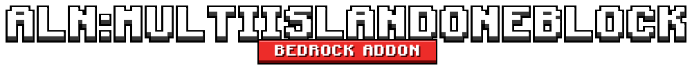
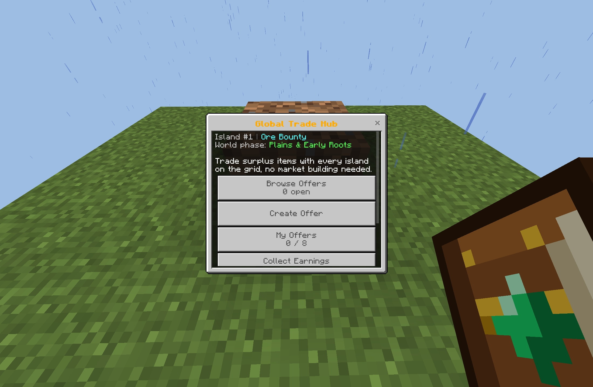
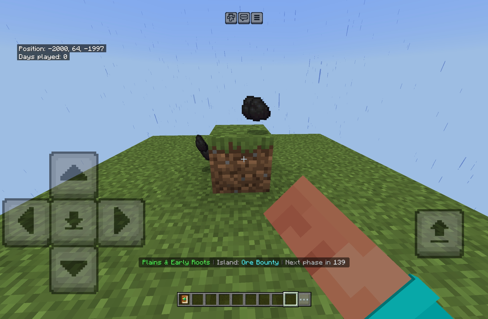
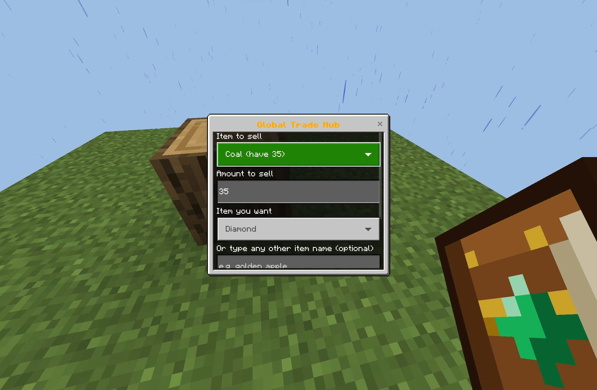
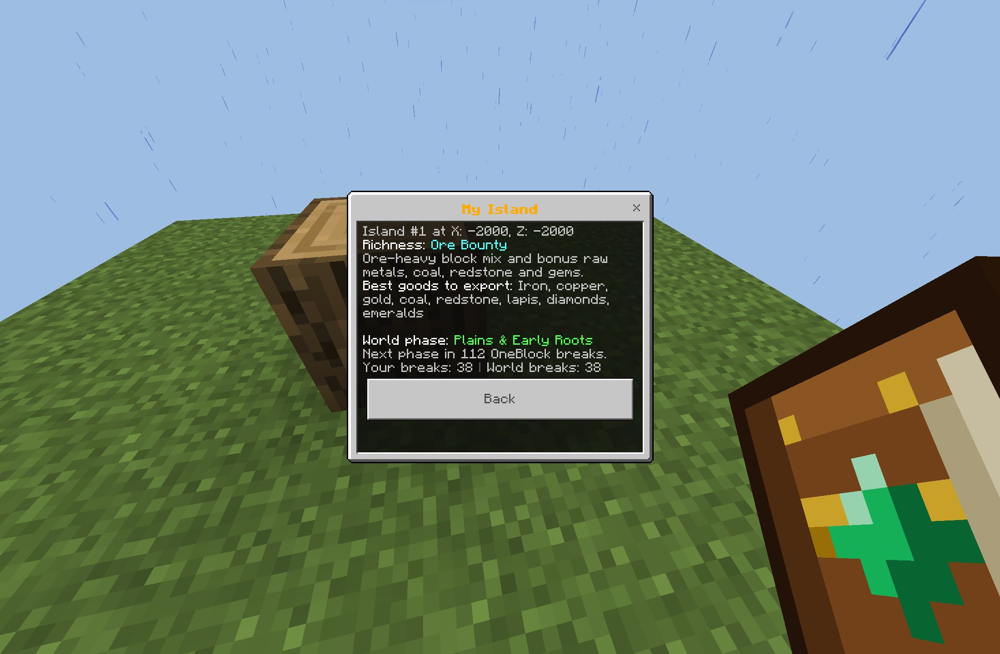
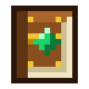

# Listing Kit: ALN:MultiIslandOneBlock

Tap the Copy button on a block, then paste it into the CurseForge listing. Generated from DESCRIPTION.md: edit that, not this file.

## Package Name

```text
ALN:MultiIslandOneBlock
```

## Summary (117/256)

```text
Claim a private OneBlock island on a 2,000-block grid and trade surplus goods for ALN Coins through the TRADERS Item.
```

## Description (HTML)

Choose any of the 5 themes below. Tap the Copy button on your preferred theme and paste into the CurseForge description editor in source (HTML) mode.

### Theme 1: Vanilla Adaptive (Default)

Theme-neutral layout following the viewer's CurseForge light or dark mode.

```html
<div><div style="border:2px solid #15803d;border-radius:18px;line-height:1.5"><br><p style="text-align:center"></p><p style="color:#8a94a3;font-size:14px;text-align:center">by ALNStudios</p><p style="text-align:center"><span style="background-color:#15803d;color:#ffffff;border-radius:20px;font-size:16px">&nbsp;&nbsp;<strong>Claim a private OneBlock island on a 2,000-block grid and trade surplus goods for ALN Coins through the TRADERS Item.</strong>&nbsp;&nbsp;</span></p><p style="text-align:center;margin-left:16px;margin-right:16px">Every player gets a floating island, every island climbs through its own OneBlock phases, and no island has everything. Trading is how the world grows.</p><div style="display:flex;flex-wrap:wrap;gap:8px;margin-left:14px;margin-right:14px"><div style="background-color:#dcfce7;color:#14532d;border-radius:20px;font-size:14px;line-height:2"><strong>&nbsp;&nbsp;Bedrock</strong>: 1.26+&nbsp;&nbsp;</div><div style="background-color:#dcfce7;color:#14532d;border-radius:20px;font-size:14px;line-height:2"><strong>&nbsp;&nbsp;Experimental</strong>: No&nbsp;&nbsp;</div><div style="background-color:#dcfce7;color:#14532d;border-radius:20px;font-size:14px;line-height:2"><strong>&nbsp;&nbsp;Achievements</strong>: Yes, achievement-friendly. The optional setup command needs cheats, and cheats disable achievements in that world&nbsp;&nbsp;</div></div><br></div>
<h2 style="font-size:17px;text-align:left"><span style="background-color:#15803d;color:#ffffff;border-radius:20px">&nbsp;&nbsp;About&nbsp;&nbsp;</span></h2>
<p>ALN:MultiIslandOneBlock is a OneBlock world map for ten or more players. New players arrive on a lone bedrock pillar at the world spawn, read a short startup window and claim a personal island. Islands sit 2,000 blocks apart in a square grid around the central lobby.</p><p>Each island has its own progression, and each island carries a Richness trait that shapes its blocks and bonus drops. Because the traits differ, players end up with surplus goods that other islands need. The TRADERS Item lets them swap those goods from anywhere in the world.</p><p>The map is a void world and includes Creative, Survival and Hardcore versions.</p>
<h2 style="font-size:17px;text-align:left"><span style="background-color:#15803d;color:#ffffff;border-radius:20px">&nbsp;&nbsp;Screenshots&nbsp;&nbsp;</span></h2>
<div style="display:flex;flex-wrap:wrap;gap:10px"><div style="flex:1 1 300px;border:1px solid #8a94a3;border-radius:16px;text-align:center"><p><a href="https://raw.githubusercontent.com/AllensCreations/MCPE-Curseforges/main/MCPEDL/Maps/ALNMultiIslandOneBlock/assets/snapshots/Screenshot_20261123_165614_com.mojang.v126661xxxx.jpg"></a></p></div><div style="flex:1 1 300px;border:1px solid #8a94a3;border-radius:16px;text-align:center"><p><a href="https://raw.githubusercontent.com/AllensCreations/MCPE-Curseforges/main/MCPEDL/Maps/ALNMultiIslandOneBlock/assets/snapshots/Screenshot_20261123_165622_com.mojang.v126661xxxx.jpg"></a></p></div><div style="flex:1 1 300px;border:1px solid #8a94a3;border-radius:16px;text-align:center"><p><a href="https://raw.githubusercontent.com/AllensCreations/MCPE-Curseforges/main/MCPEDL/Maps/ALNMultiIslandOneBlock/assets/snapshots/Screenshot_20261123_165708_com.mojang.v126661xxxx.jpg"></a></p></div><div style="flex:1 1 300px;border:1px solid #8a94a3;border-radius:16px;text-align:center"><p><a href="https://raw.githubusercontent.com/AllensCreations/MCPE-Curseforges/main/MCPEDL/Maps/ALNMultiIslandOneBlock/assets/snapshots/Screenshot_20261123_165715_com.mojang.v126661xxxx.jpg"></a></p></div></div>
<h2 style="font-size:17px;text-align:left"><span style="background-color:#15803d;color:#ffffff;border-radius:20px">&nbsp;&nbsp;What You Get&nbsp;&nbsp;</span></h2>
<div style="display:flex;flex-wrap:wrap;gap:10px"><div style="flex:1;min-width:200px;border:1px solid #8a94a3;border-radius:16px"><div style="background-color:#15803d;color:#ffffff;border-radius:16px;font-size:16px;line-height:2.2"><strong>&nbsp;&nbsp;Central Lobby</strong></div><div style="margin-left:12px;margin-right:12px"><p><span>New players arrive on a single bedrock pillar at the world spawn, standing at the center of the grid. The map builds the pillar and sets the world spawn on its own when the first player enters.</span></p></div></div><div style="flex:1;min-width:200px;border:1px solid #8a94a3;border-radius:16px"><div style="background-color:#15803d;color:#ffffff;border-radius:16px;font-size:16px;line-height:2.2"><strong>&nbsp;&nbsp;Startup Window</strong></div><div style="margin-left:12px;margin-right:12px"><p><span>A first-time player sees the ALN:MultiIslandOneBlock window with Start / Claim Island and About / Rules buttons. The window warns that the island spot cannot be undone, and it reopens if it is closed before a choice is made.</span></p></div></div><div style="flex:1;min-width:200px;border:1px solid #8a94a3;border-radius:16px"><div style="background-color:#15803d;color:#ffffff;border-radius:16px;font-size:16px;line-height:2.2"><strong>&nbsp;&nbsp;Permanent Island Claim</strong></div><div style="margin-left:12px;margin-right:12px"><p><span>Pressing Start assigns a random free island spot, builds a small grass island with the starting OneBlock, sets the personal respawn point on top of it, and teleports the player there. The spot belongs to that player for good.</span></p></div></div><div style="flex:1;min-width:200px;border:1px solid #8a94a3;border-radius:16px"><div style="background-color:#15803d;color:#ffffff;border-radius:16px;font-size:16px;line-height:2.2"><strong>&nbsp;&nbsp;2,000-Block Square Grid</strong></div><div style="margin-left:12px;margin-right:12px"><p><span>Islands are placed on a random free spot of the innermost ring that still has room. The first eight spots sit at the corners and edges of a square around the lobby, from X: -2000, Z: -2000 to X: 2000, Z: 2000. Spots nine and up fill outer perimeter rings, up to 120 islands in total.</span></p></div></div><div style="flex:1;min-width:200px;border:1px solid #8a94a3;border-radius:16px"><div style="background-color:#15803d;color:#ffffff;border-radius:16px;font-size:16px;line-height:2.2"><strong>&nbsp;&nbsp;Individual OneBlock Phases</strong></div><div style="margin-left:12px;margin-right:12px"><p><span>Every OneBlock broken on an island moves that island forward through eight phases: Forest, Underground, Desert, Frozen Tundra, Ocean Monument, Nether, Deepslate Depths and The End. Each island draws blocks from its own phase, so one player cannot rush everyone else.</span></p></div></div><div style="flex:1;min-width:200px;border:1px solid #8a94a3;border-radius:16px"><div style="background-color:#15803d;color:#ffffff;border-radius:16px;font-size:16px;line-height:2.2"><strong>&nbsp;&nbsp;Island Richness Traits</strong></div><div style="margin-left:12px;margin-right:12px"><p><span>Each island receives one trait: Ore Bounty, Crop Master, Treasure Angler, Timber Baron, Beast Herder or Ember Forager. Traits are picked at random, with lower odds for traits that many islands already have, and each one changes which blocks appear most often on that island.</span></p></div></div><div style="flex:1;min-width:200px;border:1px solid #8a94a3;border-radius:16px"><div style="background-color:#15803d;color:#ffffff;border-radius:16px;font-size:16px;line-height:2.2"><strong>&nbsp;&nbsp;Bonus Drops</strong></div><div style="margin-left:12px;margin-right:12px"><p><span>About one in twenty OneBlock breaks drops an extra item that matches the island's trait and the island's phase. Ore Bounty islands earn metals and gems, Crop Master islands earn harvests, and the other traits earn their own goods.</span></p></div></div><div style="flex:1;min-width:200px;border:1px solid #8a94a3;border-radius:16px"><div style="background-color:#15803d;color:#ffffff;border-radius:16px;font-size:16px;line-height:2.2"><strong>&nbsp;&nbsp;TRADERS Item</strong></div><div style="margin-left:12px;margin-right:12px"><p><span>A portable item every player receives when claiming an island. Right-clicking it opens the Global Trade Hub from anywhere. It is permanent: if you throw it away it returns to you, and if your inventory is full it returns as soon as a slot is free.</span></p></div></div><div style="flex:1;min-width:200px;border:1px solid #8a94a3;border-radius:16px"><div style="background-color:#15803d;color:#ffffff;border-radius:16px;font-size:16px;line-height:2.2"><strong>&nbsp;&nbsp;Global Trade Hub</strong></div><div style="margin-left:12px;margin-right:12px"><p><span>Players post offers priced in ALN Coins, such as 32 Iron Ingots for 160 ALN Coins, browse and search offers from every island, and buy with a single confirmation. Every item shows a recommended price and amount, and leaving the fields empty uses them. For items with a recommended price, an offer must stay between half and four times that price. The market also buys those items directly for half of the recommended price, or a quarter for very valuable items, and sellers pay a 5% fee when an offer sells. Players in Creative mode cannot sell. Offered items are held safely until the offer sells or is cancelled.</span></p></div></div><div style="flex:1;min-width:200px;border:1px solid #8a94a3;border-radius:16px"><div style="background-color:#15803d;color:#ffffff;border-radius:16px;font-size:16px;line-height:2.2"><strong>&nbsp;&nbsp;ALN Coins</strong></div><div style="margin-left:12px;margin-right:12px"><p><span>ALN Coins are the currency of the Global Trade Hub. Every player starts with 500 ALN Coins, and the balance is shown in the hub. A sold offer pays the seller right away, even when the seller is offline. Players also earn 1 ALN Coin for every 5 OneBlock breaks (not in Creative mode), and a sidebar scoreboard titled @ALNStudios ranks island owners by their ALN Coins.</span></p></div></div></div>
<h2 style="font-size:17px;text-align:left"><span style="background-color:#15803d;color:#ffffff;border-radius:20px">&nbsp;&nbsp;Custom Items&nbsp;&nbsp;</span></h2>
<div style="display:flex;flex-wrap:wrap;gap:10px"><div style="flex:0 1 120px;border:1px solid #8a94a3;border-radius:16px;text-align:center"><p><a href="https://raw.githubusercontent.com/AllensCreations/MCPE-Curseforges/main/MCPEDL/Maps/ALNMultiIslandOneBlock/assets/items/pirate_ledger.png"></a></p><p></p></div></div>
<h2 style="font-size:17px;text-align:left"><span style="background-color:#15803d;color:#ffffff;border-radius:20px">&nbsp;&nbsp;Get Started&nbsp;&nbsp;</span></h2>
<table style="width:100%;border:1px solid #8a94a3;border-radius:16px"><tbody><tr><td style="width:44px;text-align:center"><div style="background-color:#15803d;color:#ffffff;font-weight:bold;font-size:15px;text-align:center;border-radius:10px;width:30px;aspect-ratio:1/1;line-height:30px">1</div></td><td style="text-align:left;">Download the map and open the file with Minecraft to import it.</td></tr><tr><td style="width:44px;text-align:center"><div style="background-color:#15803d;color:#ffffff;font-weight:bold;font-size:15px;text-align:center;border-radius:10px;width:30px;aspect-ratio:1/1;line-height:30px">2</div></td><td style="text-align:left;">Open the imported world in the Creative, Survival or Hardcore version.</td></tr><tr><td style="width:44px;text-align:center"><div style="background-color:#15803d;color:#ffffff;font-weight:bold;font-size:15px;text-align:center;border-radius:10px;width:30px;aspect-ratio:1/1;line-height:30px">3</div></td><td style="text-align:left;">First-time players appear on the bedrock pillar and see the startup window.</td></tr><tr><td style="width:44px;text-align:center"><div style="background-color:#15803d;color:#ffffff;font-weight:bold;font-size:15px;text-align:center;border-radius:10px;width:30px;aspect-ratio:1/1;line-height:30px">4</div></td><td style="text-align:left;">Read About / Rules if you like, then choose Start / Claim Island. This choice cannot be undone.</td></tr><tr><td style="width:44px;text-align:center"><div style="background-color:#15803d;color:#ffffff;font-weight:bold;font-size:15px;text-align:center;border-radius:10px;width:30px;aspect-ratio:1/1;line-height:30px">5</div></td><td style="text-align:left;">Break the OneBlock under your feet. It regenerates every time, and your island advances through its phases as you keep breaking blocks.</td></tr><tr><td style="width:44px;text-align:center"><div style="background-color:#15803d;color:#ffffff;font-weight:bold;font-size:15px;text-align:center;border-radius:10px;width:30px;aspect-ratio:1/1;line-height:30px">6</div></td><td style="text-align:left;">Right-click the TRADERS Item to sell items for ALN Coins, browse other islands' offers and buy with your coins.</td></tr><tr><td style="width:44px;text-align:center"><div style="background-color:#15803d;color:#ffffff;font-weight:bold;font-size:15px;text-align:center;border-radius:10px;width:30px;aspect-ratio:1/1;line-height:30px">7</div></td><td style="text-align:left;">Optional: the map includes a setup command that rebuilds the spawn pillar and resets the world spawn. It needs cheats, and cheats disable achievements in that world.</td></tr></tbody></table>
<h2 style="font-size:17px;text-align:left"><span style="background-color:#15803d;color:#ffffff;border-radius:20px">&nbsp;&nbsp;Install&nbsp;&nbsp;</span></h2>
<table style="width:100%;border:1px solid #8a94a3;border-radius:16px"><tbody><tr><td style="width:44px;text-align:center"><div style="background-color:#15803d;color:#ffffff;font-weight:bold;font-size:15px;text-align:center;border-radius:10px;width:30px;aspect-ratio:1/1;line-height:30px">1</div></td><td style="text-align:left;">Download the file from this page and open it with Minecraft.</td></tr><tr><td style="width:44px;text-align:center"><div style="background-color:#15803d;color:#ffffff;font-weight:bold;font-size:15px;text-align:center;border-radius:10px;width:30px;aspect-ratio:1/1;line-height:30px">2</div></td><td style="text-align:left;">Create or edit a world and turn on the new pack(s) in its settings.</td></tr><tr><td style="width:44px;text-align:center"><div style="background-color:#15803d;color:#ffffff;font-weight:bold;font-size:15px;text-align:center;border-radius:10px;width:30px;aspect-ratio:1/1;line-height:30px">3</div></td><td style="text-align:left;">Play. No Experimental toggles needed.</td></tr></tbody></table>
<div style="border:1px solid #8a94a3;border-radius:16px;text-align:center"><br><div style="background-color:#15803d;color:#ffffff;border-radius:20px;font-size:15px;line-height:2;display:inline-block">&nbsp;&nbsp;<strong>Found a Bug or Have a Suggestion?</strong>&nbsp;&nbsp;</div><p style="font-size:14px;">Please leave a comment on this project page! All bug reports, gameplay feedback, and pack suggestions are welcome and appreciated.</p></div>
<h2 style="font-size:17px;text-align:left"><span style="background-color:#15803d;color:#ffffff;border-radius:20px">&nbsp;&nbsp;Support&nbsp;&nbsp;</span></h2><div style="border:1px solid #8a94a3;border-radius:16px;text-align:center"><br><a href="https://ko-fi.com/alnstudios"></a><br><br></div><p style="text-align:center"><a href="https://www.curseforge.com/members/allenscreations/projects"><strong>CurseForge</strong></a> &nbsp;|&nbsp; <a href="https://mcpedl.com/user/alnstudios/"><strong>MCPEDL</strong></a> &nbsp;|&nbsp; <a href="https://ko-fi.com/alnstudios"><strong>Ko-fi</strong></a></p>
<hr>
<p style="text-align:center;color:#8a94a3;font-size:13px"><strong>By ALNStudios</strong></p>
<div class="spoiler"><p style="font-size:13px"><strong>Permissions and credits</strong></p><ul style="font-size:13px"><li>Rights: All rights reserved for ALNStudios.</li><li>Content creators: You may feature this creation in videos and streams with credit to ALNStudios.</li><li>Redistribution: Do not re-upload this pack or provide direct monetized download bypasses. Link to this page.</li><li>Visual: Promotional/cover imagery used on this page is AI-generated to illustrate the concept and purpose of the pack.</li><li>Unofficial community creation. Not an official Minecraft product and not approved by or associated with Mojang or Microsoft.</li></ul></div>
<p style="text-align:center;color:#8a94a3;font-size:12px">Minecraft Bedrock add-on, ALN:MultiIslandOneBlock Bedrock map, MCPEDL add-on, CurseForge Bedrock, ALNStudios, Minecraft Bedrock OneBlock map, multiplayer OneBlock, void world, island grid, trading ledger, Bedrock economy map.</p></div>
```

### Theme 2: Netherite Stealth (Modern Dark)

High-tech dark obsidian & emerald storefront.

```html
<div style="background-color:#0d1117;color:#c9d1d9;border-radius:12px;padding-left:12px"><div style="margin-right:12px"><br><div style="background-color:#161b22;border:2px solid #10b981;border-radius:18px;line-height:1.5"><br><p style="text-align:center"></p><p style="color:#8b949e;font-size:14px;text-align:center">by ALNStudios</p><p style="text-align:center"><span style="background-color:#10b981;color:#ffffff;border-radius:20px;font-size:16px">&nbsp;&nbsp;<strong>Claim a private OneBlock island on a 2,000-block grid and trade surplus goods for ALN Coins through the TRADERS Item.</strong>&nbsp;&nbsp;</span></p><p style="color:#8b949e;text-align:center;margin-left:16px;margin-right:16px">Every player gets a floating island, every island climbs through its own OneBlock phases, and no island has everything. Trading is how the world grows.</p><div style="display:flex;flex-wrap:wrap;gap:8px;margin-left:14px;margin-right:14px"><div style="background-color:#161b22;color:#10b981;border-radius:20px;font-size:14px;line-height:2"><strong>&nbsp;&nbsp;Bedrock</strong>: 1.26+&nbsp;&nbsp;</div><div style="background-color:#161b22;color:#10b981;border-radius:20px;font-size:14px;line-height:2"><strong>&nbsp;&nbsp;Experimental</strong>: No&nbsp;&nbsp;</div><div style="background-color:#161b22;color:#10b981;border-radius:20px;font-size:14px;line-height:2"><strong>&nbsp;&nbsp;Achievements</strong>: Yes, achievement-friendly. The optional setup command needs cheats, and cheats disable achievements in that world&nbsp;&nbsp;</div></div><br></div>
<h2 style="font-size:17px;text-align:left"><span style="background-color:#10b981;color:#ffffff;border-radius:20px">&nbsp;&nbsp;About&nbsp;&nbsp;</span></h2>
<p style="color:#c9d1d9">ALN:MultiIslandOneBlock is a OneBlock world map for ten or more players. New players arrive on a lone bedrock pillar at the world spawn, read a short startup window and claim a personal island. Islands sit 2,000 blocks apart in a square grid around the central lobby.</p><p style="color:#c9d1d9">Each island has its own progression, and each island carries a Richness trait that shapes its blocks and bonus drops. Because the traits differ, players end up with surplus goods that other islands need. The TRADERS Item lets them swap those goods from anywhere in the world.</p><p style="color:#c9d1d9">The map is a void world and includes Creative, Survival and Hardcore versions.</p>
<h2 style="font-size:17px;text-align:left"><span style="background-color:#10b981;color:#ffffff;border-radius:20px">&nbsp;&nbsp;Screenshots&nbsp;&nbsp;</span></h2>
<div style="display:flex;flex-wrap:wrap;gap:10px"><div style="flex:1 1 300px;background-color:#161b22;border:1px solid #30363d;border-radius:16px;text-align:center"><p><a href="https://raw.githubusercontent.com/AllensCreations/MCPE-Curseforges/main/MCPEDL/Maps/ALNMultiIslandOneBlock/assets/snapshots/Screenshot_20261123_165614_com.mojang.v126661xxxx.jpg"></a></p></div><div style="flex:1 1 300px;background-color:#161b22;border:1px solid #30363d;border-radius:16px;text-align:center"><p><a href="https://raw.githubusercontent.com/AllensCreations/MCPE-Curseforges/main/MCPEDL/Maps/ALNMultiIslandOneBlock/assets/snapshots/Screenshot_20261123_165622_com.mojang.v126661xxxx.jpg"></a></p></div><div style="flex:1 1 300px;background-color:#161b22;border:1px solid #30363d;border-radius:16px;text-align:center"><p><a href="https://raw.githubusercontent.com/AllensCreations/MCPE-Curseforges/main/MCPEDL/Maps/ALNMultiIslandOneBlock/assets/snapshots/Screenshot_20261123_165708_com.mojang.v126661xxxx.jpg"></a></p></div><div style="flex:1 1 300px;background-color:#161b22;border:1px solid #30363d;border-radius:16px;text-align:center"><p><a href="https://raw.githubusercontent.com/AllensCreations/MCPE-Curseforges/main/MCPEDL/Maps/ALNMultiIslandOneBlock/assets/snapshots/Screenshot_20261123_165715_com.mojang.v126661xxxx.jpg"></a></p></div></div>
<h2 style="font-size:17px;text-align:left"><span style="background-color:#10b981;color:#ffffff;border-radius:20px">&nbsp;&nbsp;What You Get&nbsp;&nbsp;</span></h2>
<div style="display:flex;flex-wrap:wrap;gap:10px"><div style="flex:1;min-width:200px;background-color:#161b22;border:1px solid #30363d;border-radius:16px"><div style="background-color:#10b981;color:#ffffff;border-radius:16px;font-size:16px;line-height:2.2"><strong>&nbsp;&nbsp;Central Lobby</strong></div><div style="margin-left:12px;margin-right:12px"><p><span style="color:#c9d1d9">New players arrive on a single bedrock pillar at the world spawn, standing at the center of the grid. The map builds the pillar and sets the world spawn on its own when the first player enters.</span></p></div></div><div style="flex:1;min-width:200px;background-color:#161b22;border:1px solid #30363d;border-radius:16px"><div style="background-color:#10b981;color:#ffffff;border-radius:16px;font-size:16px;line-height:2.2"><strong>&nbsp;&nbsp;Startup Window</strong></div><div style="margin-left:12px;margin-right:12px"><p><span style="color:#c9d1d9">A first-time player sees the ALN:MultiIslandOneBlock window with Start / Claim Island and About / Rules buttons. The window warns that the island spot cannot be undone, and it reopens if it is closed before a choice is made.</span></p></div></div><div style="flex:1;min-width:200px;background-color:#161b22;border:1px solid #30363d;border-radius:16px"><div style="background-color:#10b981;color:#ffffff;border-radius:16px;font-size:16px;line-height:2.2"><strong>&nbsp;&nbsp;Permanent Island Claim</strong></div><div style="margin-left:12px;margin-right:12px"><p><span style="color:#c9d1d9">Pressing Start assigns a random free island spot, builds a small grass island with the starting OneBlock, sets the personal respawn point on top of it, and teleports the player there. The spot belongs to that player for good.</span></p></div></div><div style="flex:1;min-width:200px;background-color:#161b22;border:1px solid #30363d;border-radius:16px"><div style="background-color:#10b981;color:#ffffff;border-radius:16px;font-size:16px;line-height:2.2"><strong>&nbsp;&nbsp;2,000-Block Square Grid</strong></div><div style="margin-left:12px;margin-right:12px"><p><span style="color:#c9d1d9">Islands are placed on a random free spot of the innermost ring that still has room. The first eight spots sit at the corners and edges of a square around the lobby, from X: -2000, Z: -2000 to X: 2000, Z: 2000. Spots nine and up fill outer perimeter rings, up to 120 islands in total.</span></p></div></div><div style="flex:1;min-width:200px;background-color:#161b22;border:1px solid #30363d;border-radius:16px"><div style="background-color:#10b981;color:#ffffff;border-radius:16px;font-size:16px;line-height:2.2"><strong>&nbsp;&nbsp;Individual OneBlock Phases</strong></div><div style="margin-left:12px;margin-right:12px"><p><span style="color:#c9d1d9">Every OneBlock broken on an island moves that island forward through eight phases: Forest, Underground, Desert, Frozen Tundra, Ocean Monument, Nether, Deepslate Depths and The End. Each island draws blocks from its own phase, so one player cannot rush everyone else.</span></p></div></div><div style="flex:1;min-width:200px;background-color:#161b22;border:1px solid #30363d;border-radius:16px"><div style="background-color:#10b981;color:#ffffff;border-radius:16px;font-size:16px;line-height:2.2"><strong>&nbsp;&nbsp;Island Richness Traits</strong></div><div style="margin-left:12px;margin-right:12px"><p><span style="color:#c9d1d9">Each island receives one trait: Ore Bounty, Crop Master, Treasure Angler, Timber Baron, Beast Herder or Ember Forager. Traits are picked at random, with lower odds for traits that many islands already have, and each one changes which blocks appear most often on that island.</span></p></div></div><div style="flex:1;min-width:200px;background-color:#161b22;border:1px solid #30363d;border-radius:16px"><div style="background-color:#10b981;color:#ffffff;border-radius:16px;font-size:16px;line-height:2.2"><strong>&nbsp;&nbsp;Bonus Drops</strong></div><div style="margin-left:12px;margin-right:12px"><p><span style="color:#c9d1d9">About one in twenty OneBlock breaks drops an extra item that matches the island's trait and the island's phase. Ore Bounty islands earn metals and gems, Crop Master islands earn harvests, and the other traits earn their own goods.</span></p></div></div><div style="flex:1;min-width:200px;background-color:#161b22;border:1px solid #30363d;border-radius:16px"><div style="background-color:#10b981;color:#ffffff;border-radius:16px;font-size:16px;line-height:2.2"><strong>&nbsp;&nbsp;TRADERS Item</strong></div><div style="margin-left:12px;margin-right:12px"><p><span style="color:#c9d1d9">A portable item every player receives when claiming an island. Right-clicking it opens the Global Trade Hub from anywhere. It is permanent: if you throw it away it returns to you, and if your inventory is full it returns as soon as a slot is free.</span></p></div></div><div style="flex:1;min-width:200px;background-color:#161b22;border:1px solid #30363d;border-radius:16px"><div style="background-color:#10b981;color:#ffffff;border-radius:16px;font-size:16px;line-height:2.2"><strong>&nbsp;&nbsp;Global Trade Hub</strong></div><div style="margin-left:12px;margin-right:12px"><p><span style="color:#c9d1d9">Players post offers priced in ALN Coins, such as 32 Iron Ingots for 160 ALN Coins, browse and search offers from every island, and buy with a single confirmation. Every item shows a recommended price and amount, and leaving the fields empty uses them. For items with a recommended price, an offer must stay between half and four times that price. The market also buys those items directly for half of the recommended price, or a quarter for very valuable items, and sellers pay a 5% fee when an offer sells. Players in Creative mode cannot sell. Offered items are held safely until the offer sells or is cancelled.</span></p></div></div><div style="flex:1;min-width:200px;background-color:#161b22;border:1px solid #30363d;border-radius:16px"><div style="background-color:#10b981;color:#ffffff;border-radius:16px;font-size:16px;line-height:2.2"><strong>&nbsp;&nbsp;ALN Coins</strong></div><div style="margin-left:12px;margin-right:12px"><p><span style="color:#c9d1d9">ALN Coins are the currency of the Global Trade Hub. Every player starts with 500 ALN Coins, and the balance is shown in the hub. A sold offer pays the seller right away, even when the seller is offline. Players also earn 1 ALN Coin for every 5 OneBlock breaks (not in Creative mode), and a sidebar scoreboard titled @ALNStudios ranks island owners by their ALN Coins.</span></p></div></div></div>
<h2 style="font-size:17px;text-align:left"><span style="background-color:#10b981;color:#ffffff;border-radius:20px">&nbsp;&nbsp;Custom Items&nbsp;&nbsp;</span></h2>
<div style="display:flex;flex-wrap:wrap;gap:10px"><div style="flex:0 1 120px;background-color:#161b22;border:1px solid #30363d;border-radius:16px;text-align:center"><p><a href="https://raw.githubusercontent.com/AllensCreations/MCPE-Curseforges/main/MCPEDL/Maps/ALNMultiIslandOneBlock/assets/items/pirate_ledger.png"></a></p><p></p></div></div>
<h2 style="font-size:17px;text-align:left"><span style="background-color:#10b981;color:#ffffff;border-radius:20px">&nbsp;&nbsp;Get Started&nbsp;&nbsp;</span></h2>
<table style="width:100%;border:1px solid #30363d;border-radius:16px"><tbody><tr><td style="width:44px;text-align:center"><div style="background-color:#10b981;color:#ffffff;font-weight:bold;font-size:15px;text-align:center;border-radius:10px;width:30px;aspect-ratio:1/1;line-height:30px">1</div></td><td style="text-align:left;color:#c9d1d9">Download the map and open the file with Minecraft to import it.</td></tr><tr><td style="width:44px;text-align:center"><div style="background-color:#10b981;color:#ffffff;font-weight:bold;font-size:15px;text-align:center;border-radius:10px;width:30px;aspect-ratio:1/1;line-height:30px">2</div></td><td style="text-align:left;color:#c9d1d9">Open the imported world in the Creative, Survival or Hardcore version.</td></tr><tr><td style="width:44px;text-align:center"><div style="background-color:#10b981;color:#ffffff;font-weight:bold;font-size:15px;text-align:center;border-radius:10px;width:30px;aspect-ratio:1/1;line-height:30px">3</div></td><td style="text-align:left;color:#c9d1d9">First-time players appear on the bedrock pillar and see the startup window.</td></tr><tr><td style="width:44px;text-align:center"><div style="background-color:#10b981;color:#ffffff;font-weight:bold;font-size:15px;text-align:center;border-radius:10px;width:30px;aspect-ratio:1/1;line-height:30px">4</div></td><td style="text-align:left;color:#c9d1d9">Read About / Rules if you like, then choose Start / Claim Island. This choice cannot be undone.</td></tr><tr><td style="width:44px;text-align:center"><div style="background-color:#10b981;color:#ffffff;font-weight:bold;font-size:15px;text-align:center;border-radius:10px;width:30px;aspect-ratio:1/1;line-height:30px">5</div></td><td style="text-align:left;color:#c9d1d9">Break the OneBlock under your feet. It regenerates every time, and your island advances through its phases as you keep breaking blocks.</td></tr><tr><td style="width:44px;text-align:center"><div style="background-color:#10b981;color:#ffffff;font-weight:bold;font-size:15px;text-align:center;border-radius:10px;width:30px;aspect-ratio:1/1;line-height:30px">6</div></td><td style="text-align:left;color:#c9d1d9">Right-click the TRADERS Item to sell items for ALN Coins, browse other islands' offers and buy with your coins.</td></tr><tr><td style="width:44px;text-align:center"><div style="background-color:#10b981;color:#ffffff;font-weight:bold;font-size:15px;text-align:center;border-radius:10px;width:30px;aspect-ratio:1/1;line-height:30px">7</div></td><td style="text-align:left;color:#c9d1d9">Optional: the map includes a setup command that rebuilds the spawn pillar and resets the world spawn. It needs cheats, and cheats disable achievements in that world.</td></tr></tbody></table>
<h2 style="font-size:17px;text-align:left"><span style="background-color:#10b981;color:#ffffff;border-radius:20px">&nbsp;&nbsp;Install&nbsp;&nbsp;</span></h2>
<table style="width:100%;border:1px solid #30363d;border-radius:16px"><tbody><tr><td style="width:44px;text-align:center"><div style="background-color:#10b981;color:#ffffff;font-weight:bold;font-size:15px;text-align:center;border-radius:10px;width:30px;aspect-ratio:1/1;line-height:30px">1</div></td><td style="text-align:left;color:#c9d1d9">Download the file from this page and open it with Minecraft.</td></tr><tr><td style="width:44px;text-align:center"><div style="background-color:#10b981;color:#ffffff;font-weight:bold;font-size:15px;text-align:center;border-radius:10px;width:30px;aspect-ratio:1/1;line-height:30px">2</div></td><td style="text-align:left;color:#c9d1d9">Create or edit a world and turn on the new pack(s) in its settings.</td></tr><tr><td style="width:44px;text-align:center"><div style="background-color:#10b981;color:#ffffff;font-weight:bold;font-size:15px;text-align:center;border-radius:10px;width:30px;aspect-ratio:1/1;line-height:30px">3</div></td><td style="text-align:left;color:#c9d1d9">Play. No Experimental toggles needed.</td></tr></tbody></table>
<div style="background-color:#161b22;border:1px solid #30363d;border-radius:16px;text-align:center"><br><div style="background-color:#10b981;color:#ffffff;border-radius:20px;font-size:15px;line-height:2;display:inline-block">&nbsp;&nbsp;<strong>Found a Bug or Have a Suggestion?</strong>&nbsp;&nbsp;</div><p style="font-size:14px;color:#c9d1d9">Please leave a comment on this project page! All bug reports, gameplay feedback, and pack suggestions are welcome and appreciated.</p></div>
<h2 style="font-size:17px;text-align:left"><span style="background-color:#10b981;color:#ffffff;border-radius:20px">&nbsp;&nbsp;Support&nbsp;&nbsp;</span></h2><div style="background-color:#161b22;border:1px solid #30363d;border-radius:16px;text-align:center"><br><a href="https://ko-fi.com/alnstudios"></a><br><br></div><p style="text-align:center"><a style="color:#58a6ff" href="https://www.curseforge.com/members/allenscreations/projects"><strong>CurseForge</strong></a> &nbsp;|&nbsp; <a style="color:#58a6ff" href="https://mcpedl.com/user/alnstudios/"><strong>MCPEDL</strong></a> &nbsp;|&nbsp; <a style="color:#58a6ff" href="https://ko-fi.com/alnstudios"><strong>Ko-fi</strong></a></p>
<hr>
<p style="text-align:center;color:#8b949e;font-size:13px"><strong>By ALNStudios</strong></p>
<div class="spoiler"><p style="font-size:13px"><strong>Permissions and credits</strong></p><ul style="font-size:13px"><li>Rights: All rights reserved for ALNStudios.</li><li>Content creators: You may feature this creation in videos and streams with credit to ALNStudios.</li><li>Redistribution: Do not re-upload this pack or provide direct monetized download bypasses. Link to this page.</li><li>Visual: Promotional/cover imagery used on this page is AI-generated to illustrate the concept and purpose of the pack.</li><li>Unofficial community creation. Not an official Minecraft product and not approved by or associated with Mojang or Microsoft.</li></ul></div>
<p style="text-align:center;color:#8b949e;font-size:12px">Minecraft Bedrock add-on, ALN:MultiIslandOneBlock Bedrock map, MCPEDL add-on, CurseForge Bedrock, ALNStudios, Minecraft Bedrock OneBlock map, multiplayer OneBlock, void world, island grid, trading ledger, Bedrock economy map.</p><br></div></div>
```

### Theme 3: Bedrock GUI (In-Game Menu)

Authentic Minecraft stone dialog with 3D beveled borders and item slot insets.

```html
<div style="background-color:#313233;color:#e0e0e0;border-radius:12px;padding-left:12px"><div style="margin-right:12px"><br><div style="background-color:#202021;border:2px solid #4a4b4d;border-radius:18px;line-height:1.5"><br><p style="text-align:center"></p><p style="color:#a0a0a0;font-size:14px;text-align:center">by ALNStudios</p><p style="text-align:center"><span style="background-color:#4a4b4d;color:#ffffff;border-radius:20px;font-size:16px">&nbsp;&nbsp;<strong>Claim a private OneBlock island on a 2,000-block grid and trade surplus goods for ALN Coins through the TRADERS Item.</strong>&nbsp;&nbsp;</span></p><p style="color:#d0d0d0;text-align:center;margin-left:16px;margin-right:16px">Every player gets a floating island, every island climbs through its own OneBlock phases, and no island has everything. Trading is how the world grows.</p><div style="display:flex;flex-wrap:wrap;gap:8px;margin-left:14px;margin-right:14px"><div style="background-color:#202021;color:#ffffff;border-radius:20px;font-size:14px;line-height:2"><strong>&nbsp;&nbsp;Bedrock</strong>: 1.26+&nbsp;&nbsp;</div><div style="background-color:#202021;color:#ffffff;border-radius:20px;font-size:14px;line-height:2"><strong>&nbsp;&nbsp;Experimental</strong>: No&nbsp;&nbsp;</div><div style="background-color:#202021;color:#ffffff;border-radius:20px;font-size:14px;line-height:2"><strong>&nbsp;&nbsp;Achievements</strong>: Yes, achievement-friendly. The optional setup command needs cheats, and cheats disable achievements in that world&nbsp;&nbsp;</div></div><br></div>
<h2 style="font-size:17px;text-align:left"><span style="background-color:#4a4b4d;color:#ffffff;border-radius:20px">&nbsp;&nbsp;About&nbsp;&nbsp;</span></h2>
<p style="color:#e0e0e0">ALN:MultiIslandOneBlock is a OneBlock world map for ten or more players. New players arrive on a lone bedrock pillar at the world spawn, read a short startup window and claim a personal island. Islands sit 2,000 blocks apart in a square grid around the central lobby.</p><p style="color:#e0e0e0">Each island has its own progression, and each island carries a Richness trait that shapes its blocks and bonus drops. Because the traits differ, players end up with surplus goods that other islands need. The TRADERS Item lets them swap those goods from anywhere in the world.</p><p style="color:#e0e0e0">The map is a void world and includes Creative, Survival and Hardcore versions.</p>
<h2 style="font-size:17px;text-align:left"><span style="background-color:#4a4b4d;color:#ffffff;border-radius:20px">&nbsp;&nbsp;Screenshots&nbsp;&nbsp;</span></h2>
<div style="display:flex;flex-wrap:wrap;gap:10px"><div style="flex:1 1 300px;background-color:#202021;border:1px solid #4a4b4d;border-radius:16px;text-align:center"><p><a href="https://raw.githubusercontent.com/AllensCreations/MCPE-Curseforges/main/MCPEDL/Maps/ALNMultiIslandOneBlock/assets/snapshots/Screenshot_20261123_165614_com.mojang.v126661xxxx.jpg"></a></p></div><div style="flex:1 1 300px;background-color:#202021;border:1px solid #4a4b4d;border-radius:16px;text-align:center"><p><a href="https://raw.githubusercontent.com/AllensCreations/MCPE-Curseforges/main/MCPEDL/Maps/ALNMultiIslandOneBlock/assets/snapshots/Screenshot_20261123_165622_com.mojang.v126661xxxx.jpg"></a></p></div><div style="flex:1 1 300px;background-color:#202021;border:1px solid #4a4b4d;border-radius:16px;text-align:center"><p><a href="https://raw.githubusercontent.com/AllensCreations/MCPE-Curseforges/main/MCPEDL/Maps/ALNMultiIslandOneBlock/assets/snapshots/Screenshot_20261123_165708_com.mojang.v126661xxxx.jpg"></a></p></div><div style="flex:1 1 300px;background-color:#202021;border:1px solid #4a4b4d;border-radius:16px;text-align:center"><p><a href="https://raw.githubusercontent.com/AllensCreations/MCPE-Curseforges/main/MCPEDL/Maps/ALNMultiIslandOneBlock/assets/snapshots/Screenshot_20261123_165715_com.mojang.v126661xxxx.jpg"></a></p></div></div>
<h2 style="font-size:17px;text-align:left"><span style="background-color:#4a4b4d;color:#ffffff;border-radius:20px">&nbsp;&nbsp;What You Get&nbsp;&nbsp;</span></h2>
<div style="display:flex;flex-wrap:wrap;gap:10px"><div style="flex:1;min-width:200px;background-color:#202021;border:1px solid #4a4b4d;border-radius:16px"><div style="background-color:#4a4b4d;color:#ffffff;border-radius:16px;font-size:16px;line-height:2.2"><strong>&nbsp;&nbsp;Central Lobby</strong></div><div style="margin-left:12px;margin-right:12px"><p><span style="color:#e0e0e0">New players arrive on a single bedrock pillar at the world spawn, standing at the center of the grid. The map builds the pillar and sets the world spawn on its own when the first player enters.</span></p></div></div><div style="flex:1;min-width:200px;background-color:#202021;border:1px solid #4a4b4d;border-radius:16px"><div style="background-color:#4a4b4d;color:#ffffff;border-radius:16px;font-size:16px;line-height:2.2"><strong>&nbsp;&nbsp;Startup Window</strong></div><div style="margin-left:12px;margin-right:12px"><p><span style="color:#e0e0e0">A first-time player sees the ALN:MultiIslandOneBlock window with Start / Claim Island and About / Rules buttons. The window warns that the island spot cannot be undone, and it reopens if it is closed before a choice is made.</span></p></div></div><div style="flex:1;min-width:200px;background-color:#202021;border:1px solid #4a4b4d;border-radius:16px"><div style="background-color:#4a4b4d;color:#ffffff;border-radius:16px;font-size:16px;line-height:2.2"><strong>&nbsp;&nbsp;Permanent Island Claim</strong></div><div style="margin-left:12px;margin-right:12px"><p><span style="color:#e0e0e0">Pressing Start assigns a random free island spot, builds a small grass island with the starting OneBlock, sets the personal respawn point on top of it, and teleports the player there. The spot belongs to that player for good.</span></p></div></div><div style="flex:1;min-width:200px;background-color:#202021;border:1px solid #4a4b4d;border-radius:16px"><div style="background-color:#4a4b4d;color:#ffffff;border-radius:16px;font-size:16px;line-height:2.2"><strong>&nbsp;&nbsp;2,000-Block Square Grid</strong></div><div style="margin-left:12px;margin-right:12px"><p><span style="color:#e0e0e0">Islands are placed on a random free spot of the innermost ring that still has room. The first eight spots sit at the corners and edges of a square around the lobby, from X: -2000, Z: -2000 to X: 2000, Z: 2000. Spots nine and up fill outer perimeter rings, up to 120 islands in total.</span></p></div></div><div style="flex:1;min-width:200px;background-color:#202021;border:1px solid #4a4b4d;border-radius:16px"><div style="background-color:#4a4b4d;color:#ffffff;border-radius:16px;font-size:16px;line-height:2.2"><strong>&nbsp;&nbsp;Individual OneBlock Phases</strong></div><div style="margin-left:12px;margin-right:12px"><p><span style="color:#e0e0e0">Every OneBlock broken on an island moves that island forward through eight phases: Forest, Underground, Desert, Frozen Tundra, Ocean Monument, Nether, Deepslate Depths and The End. Each island draws blocks from its own phase, so one player cannot rush everyone else.</span></p></div></div><div style="flex:1;min-width:200px;background-color:#202021;border:1px solid #4a4b4d;border-radius:16px"><div style="background-color:#4a4b4d;color:#ffffff;border-radius:16px;font-size:16px;line-height:2.2"><strong>&nbsp;&nbsp;Island Richness Traits</strong></div><div style="margin-left:12px;margin-right:12px"><p><span style="color:#e0e0e0">Each island receives one trait: Ore Bounty, Crop Master, Treasure Angler, Timber Baron, Beast Herder or Ember Forager. Traits are picked at random, with lower odds for traits that many islands already have, and each one changes which blocks appear most often on that island.</span></p></div></div><div style="flex:1;min-width:200px;background-color:#202021;border:1px solid #4a4b4d;border-radius:16px"><div style="background-color:#4a4b4d;color:#ffffff;border-radius:16px;font-size:16px;line-height:2.2"><strong>&nbsp;&nbsp;Bonus Drops</strong></div><div style="margin-left:12px;margin-right:12px"><p><span style="color:#e0e0e0">About one in twenty OneBlock breaks drops an extra item that matches the island's trait and the island's phase. Ore Bounty islands earn metals and gems, Crop Master islands earn harvests, and the other traits earn their own goods.</span></p></div></div><div style="flex:1;min-width:200px;background-color:#202021;border:1px solid #4a4b4d;border-radius:16px"><div style="background-color:#4a4b4d;color:#ffffff;border-radius:16px;font-size:16px;line-height:2.2"><strong>&nbsp;&nbsp;TRADERS Item</strong></div><div style="margin-left:12px;margin-right:12px"><p><span style="color:#e0e0e0">A portable item every player receives when claiming an island. Right-clicking it opens the Global Trade Hub from anywhere. It is permanent: if you throw it away it returns to you, and if your inventory is full it returns as soon as a slot is free.</span></p></div></div><div style="flex:1;min-width:200px;background-color:#202021;border:1px solid #4a4b4d;border-radius:16px"><div style="background-color:#4a4b4d;color:#ffffff;border-radius:16px;font-size:16px;line-height:2.2"><strong>&nbsp;&nbsp;Global Trade Hub</strong></div><div style="margin-left:12px;margin-right:12px"><p><span style="color:#e0e0e0">Players post offers priced in ALN Coins, such as 32 Iron Ingots for 160 ALN Coins, browse and search offers from every island, and buy with a single confirmation. Every item shows a recommended price and amount, and leaving the fields empty uses them. For items with a recommended price, an offer must stay between half and four times that price. The market also buys those items directly for half of the recommended price, or a quarter for very valuable items, and sellers pay a 5% fee when an offer sells. Players in Creative mode cannot sell. Offered items are held safely until the offer sells or is cancelled.</span></p></div></div><div style="flex:1;min-width:200px;background-color:#202021;border:1px solid #4a4b4d;border-radius:16px"><div style="background-color:#4a4b4d;color:#ffffff;border-radius:16px;font-size:16px;line-height:2.2"><strong>&nbsp;&nbsp;ALN Coins</strong></div><div style="margin-left:12px;margin-right:12px"><p><span style="color:#e0e0e0">ALN Coins are the currency of the Global Trade Hub. Every player starts with 500 ALN Coins, and the balance is shown in the hub. A sold offer pays the seller right away, even when the seller is offline. Players also earn 1 ALN Coin for every 5 OneBlock breaks (not in Creative mode), and a sidebar scoreboard titled @ALNStudios ranks island owners by their ALN Coins.</span></p></div></div></div>
<h2 style="font-size:17px;text-align:left"><span style="background-color:#4a4b4d;color:#ffffff;border-radius:20px">&nbsp;&nbsp;Custom Items&nbsp;&nbsp;</span></h2>
<div style="display:flex;flex-wrap:wrap;gap:10px"><div style="flex:0 1 120px;background-color:#202021;border:1px solid #4a4b4d;border-radius:16px;text-align:center"><p><a href="https://raw.githubusercontent.com/AllensCreations/MCPE-Curseforges/main/MCPEDL/Maps/ALNMultiIslandOneBlock/assets/items/pirate_ledger.png"></a></p><p></p></div></div>
<h2 style="font-size:17px;text-align:left"><span style="background-color:#4a4b4d;color:#ffffff;border-radius:20px">&nbsp;&nbsp;Get Started&nbsp;&nbsp;</span></h2>
<table style="width:100%;border:1px solid #4a4b4d;border-radius:16px"><tbody><tr><td style="width:44px;text-align:center"><div style="background-color:#4a4b4d;color:#ffffff;font-weight:bold;font-size:15px;text-align:center;border-radius:10px;width:30px;aspect-ratio:1/1;line-height:30px">1</div></td><td style="text-align:left;color:#e0e0e0">Download the map and open the file with Minecraft to import it.</td></tr><tr><td style="width:44px;text-align:center"><div style="background-color:#4a4b4d;color:#ffffff;font-weight:bold;font-size:15px;text-align:center;border-radius:10px;width:30px;aspect-ratio:1/1;line-height:30px">2</div></td><td style="text-align:left;color:#e0e0e0">Open the imported world in the Creative, Survival or Hardcore version.</td></tr><tr><td style="width:44px;text-align:center"><div style="background-color:#4a4b4d;color:#ffffff;font-weight:bold;font-size:15px;text-align:center;border-radius:10px;width:30px;aspect-ratio:1/1;line-height:30px">3</div></td><td style="text-align:left;color:#e0e0e0">First-time players appear on the bedrock pillar and see the startup window.</td></tr><tr><td style="width:44px;text-align:center"><div style="background-color:#4a4b4d;color:#ffffff;font-weight:bold;font-size:15px;text-align:center;border-radius:10px;width:30px;aspect-ratio:1/1;line-height:30px">4</div></td><td style="text-align:left;color:#e0e0e0">Read About / Rules if you like, then choose Start / Claim Island. This choice cannot be undone.</td></tr><tr><td style="width:44px;text-align:center"><div style="background-color:#4a4b4d;color:#ffffff;font-weight:bold;font-size:15px;text-align:center;border-radius:10px;width:30px;aspect-ratio:1/1;line-height:30px">5</div></td><td style="text-align:left;color:#e0e0e0">Break the OneBlock under your feet. It regenerates every time, and your island advances through its phases as you keep breaking blocks.</td></tr><tr><td style="width:44px;text-align:center"><div style="background-color:#4a4b4d;color:#ffffff;font-weight:bold;font-size:15px;text-align:center;border-radius:10px;width:30px;aspect-ratio:1/1;line-height:30px">6</div></td><td style="text-align:left;color:#e0e0e0">Right-click the TRADERS Item to sell items for ALN Coins, browse other islands' offers and buy with your coins.</td></tr><tr><td style="width:44px;text-align:center"><div style="background-color:#4a4b4d;color:#ffffff;font-weight:bold;font-size:15px;text-align:center;border-radius:10px;width:30px;aspect-ratio:1/1;line-height:30px">7</div></td><td style="text-align:left;color:#e0e0e0">Optional: the map includes a setup command that rebuilds the spawn pillar and resets the world spawn. It needs cheats, and cheats disable achievements in that world.</td></tr></tbody></table>
<h2 style="font-size:17px;text-align:left"><span style="background-color:#4a4b4d;color:#ffffff;border-radius:20px">&nbsp;&nbsp;Install&nbsp;&nbsp;</span></h2>
<table style="width:100%;border:1px solid #4a4b4d;border-radius:16px"><tbody><tr><td style="width:44px;text-align:center"><div style="background-color:#4a4b4d;color:#ffffff;font-weight:bold;font-size:15px;text-align:center;border-radius:10px;width:30px;aspect-ratio:1/1;line-height:30px">1</div></td><td style="text-align:left;color:#e0e0e0">Download the file from this page and open it with Minecraft.</td></tr><tr><td style="width:44px;text-align:center"><div style="background-color:#4a4b4d;color:#ffffff;font-weight:bold;font-size:15px;text-align:center;border-radius:10px;width:30px;aspect-ratio:1/1;line-height:30px">2</div></td><td style="text-align:left;color:#e0e0e0">Create or edit a world and turn on the new pack(s) in its settings.</td></tr><tr><td style="width:44px;text-align:center"><div style="background-color:#4a4b4d;color:#ffffff;font-weight:bold;font-size:15px;text-align:center;border-radius:10px;width:30px;aspect-ratio:1/1;line-height:30px">3</div></td><td style="text-align:left;color:#e0e0e0">Play. No Experimental toggles needed.</td></tr></tbody></table>
<div style="background-color:#202021;border:1px solid #4a4b4d;border-radius:16px;text-align:center"><br><div style="background-color:#4a4b4d;color:#ffffff;border-radius:20px;font-size:15px;line-height:2;display:inline-block">&nbsp;&nbsp;<strong>Found a Bug or Have a Suggestion?</strong>&nbsp;&nbsp;</div><p style="font-size:14px;color:#e0e0e0">Please leave a comment on this project page! All bug reports, gameplay feedback, and pack suggestions are welcome and appreciated.</p></div>
<h2 style="font-size:17px;text-align:left"><span style="background-color:#4a4b4d;color:#ffffff;border-radius:20px">&nbsp;&nbsp;Support&nbsp;&nbsp;</span></h2><div style="background-color:#202021;border:1px solid #4a4b4d;border-radius:16px;text-align:center"><br><a href="https://ko-fi.com/alnstudios"></a><br><br></div><p style="text-align:center"><a style="color:#55ff55" href="https://www.curseforge.com/members/allenscreations/projects"><strong>CurseForge</strong></a> &nbsp;|&nbsp; <a style="color:#55ff55" href="https://mcpedl.com/user/alnstudios/"><strong>MCPEDL</strong></a> &nbsp;|&nbsp; <a style="color:#55ff55" href="https://ko-fi.com/alnstudios"><strong>Ko-fi</strong></a></p>
<hr>
<p style="text-align:center;color:#a0a0a0;font-size:13px"><strong>By ALNStudios</strong></p>
<div class="spoiler"><p style="font-size:13px"><strong>Permissions and credits</strong></p><ul style="font-size:13px"><li>Rights: All rights reserved for ALNStudios.</li><li>Content creators: You may feature this creation in videos and streams with credit to ALNStudios.</li><li>Redistribution: Do not re-upload this pack or provide direct monetized download bypasses. Link to this page.</li><li>Visual: Promotional/cover imagery used on this page is AI-generated to illustrate the concept and purpose of the pack.</li><li>Unofficial community creation. Not an official Minecraft product and not approved by or associated with Mojang or Microsoft.</li></ul></div>
<p style="text-align:center;color:#a0a0a0;font-size:12px">Minecraft Bedrock add-on, ALN:MultiIslandOneBlock Bedrock map, MCPEDL add-on, CurseForge Bedrock, ALNStudios, Minecraft Bedrock OneBlock map, multiplayer OneBlock, void world, island grid, trading ledger, Bedrock economy map.</p><br></div></div>
```

### Theme 4: Emerald Marketplace

Official Minecraft Marketplace DLC showcase look with gold and emerald badges.

```html
<div style="background-color:#022c22;color:#ecfdf5;border-radius:12px;padding-left:12px"><div style="margin-right:12px"><br><div style="background-color:#064e3b;border:2px solid #059669;border-radius:18px;line-height:1.5"><br><p style="text-align:center"></p><p style="color:#6ee7b7;font-size:14px;text-align:center">by ALNStudios</p><p style="text-align:center"><span style="background-color:#059669;color:#ffffff;border-radius:20px;font-size:16px">&nbsp;&nbsp;<strong>Claim a private OneBlock island on a 2,000-block grid and trade surplus goods for ALN Coins through the TRADERS Item.</strong>&nbsp;&nbsp;</span></p><p style="color:#a7f3d0;text-align:center;margin-left:16px;margin-right:16px">Every player gets a floating island, every island climbs through its own OneBlock phases, and no island has everything. Trading is how the world grows.</p><div style="display:flex;flex-wrap:wrap;gap:8px;margin-left:14px;margin-right:14px"><div style="background-color:#047857;color:#ffffff;border-radius:20px;font-size:14px;line-height:2"><strong>&nbsp;&nbsp;Bedrock</strong>: 1.26+&nbsp;&nbsp;</div><div style="background-color:#047857;color:#ffffff;border-radius:20px;font-size:14px;line-height:2"><strong>&nbsp;&nbsp;Experimental</strong>: No&nbsp;&nbsp;</div><div style="background-color:#047857;color:#ffffff;border-radius:20px;font-size:14px;line-height:2"><strong>&nbsp;&nbsp;Achievements</strong>: Yes, achievement-friendly. The optional setup command needs cheats, and cheats disable achievements in that world&nbsp;&nbsp;</div></div><br></div>
<h2 style="font-size:17px;text-align:left"><span style="background-color:#059669;color:#ffffff;border-radius:20px">&nbsp;&nbsp;About&nbsp;&nbsp;</span></h2>
<p style="color:#ecfdf5">ALN:MultiIslandOneBlock is a OneBlock world map for ten or more players. New players arrive on a lone bedrock pillar at the world spawn, read a short startup window and claim a personal island. Islands sit 2,000 blocks apart in a square grid around the central lobby.</p><p style="color:#ecfdf5">Each island has its own progression, and each island carries a Richness trait that shapes its blocks and bonus drops. Because the traits differ, players end up with surplus goods that other islands need. The TRADERS Item lets them swap those goods from anywhere in the world.</p><p style="color:#ecfdf5">The map is a void world and includes Creative, Survival and Hardcore versions.</p>
<h2 style="font-size:17px;text-align:left"><span style="background-color:#059669;color:#ffffff;border-radius:20px">&nbsp;&nbsp;Screenshots&nbsp;&nbsp;</span></h2>
<div style="display:flex;flex-wrap:wrap;gap:10px"><div style="flex:1 1 300px;background-color:#064e3b;border:1px solid #059669;border-radius:16px;text-align:center"><p><a href="https://raw.githubusercontent.com/AllensCreations/MCPE-Curseforges/main/MCPEDL/Maps/ALNMultiIslandOneBlock/assets/snapshots/Screenshot_20261123_165614_com.mojang.v126661xxxx.jpg"></a></p></div><div style="flex:1 1 300px;background-color:#064e3b;border:1px solid #059669;border-radius:16px;text-align:center"><p><a href="https://raw.githubusercontent.com/AllensCreations/MCPE-Curseforges/main/MCPEDL/Maps/ALNMultiIslandOneBlock/assets/snapshots/Screenshot_20261123_165622_com.mojang.v126661xxxx.jpg"></a></p></div><div style="flex:1 1 300px;background-color:#064e3b;border:1px solid #059669;border-radius:16px;text-align:center"><p><a href="https://raw.githubusercontent.com/AllensCreations/MCPE-Curseforges/main/MCPEDL/Maps/ALNMultiIslandOneBlock/assets/snapshots/Screenshot_20261123_165708_com.mojang.v126661xxxx.jpg"></a></p></div><div style="flex:1 1 300px;background-color:#064e3b;border:1px solid #059669;border-radius:16px;text-align:center"><p><a href="https://raw.githubusercontent.com/AllensCreations/MCPE-Curseforges/main/MCPEDL/Maps/ALNMultiIslandOneBlock/assets/snapshots/Screenshot_20261123_165715_com.mojang.v126661xxxx.jpg"></a></p></div></div>
<h2 style="font-size:17px;text-align:left"><span style="background-color:#059669;color:#ffffff;border-radius:20px">&nbsp;&nbsp;What You Get&nbsp;&nbsp;</span></h2>
<div style="display:flex;flex-wrap:wrap;gap:10px"><div style="flex:1;min-width:200px;background-color:#064e3b;border:1px solid #059669;border-radius:16px"><div style="background-color:#059669;color:#ffffff;border-radius:16px;font-size:16px;line-height:2.2"><strong>&nbsp;&nbsp;Central Lobby</strong></div><div style="margin-left:12px;margin-right:12px"><p><span style="color:#ecfdf5">New players arrive on a single bedrock pillar at the world spawn, standing at the center of the grid. The map builds the pillar and sets the world spawn on its own when the first player enters.</span></p></div></div><div style="flex:1;min-width:200px;background-color:#064e3b;border:1px solid #059669;border-radius:16px"><div style="background-color:#059669;color:#ffffff;border-radius:16px;font-size:16px;line-height:2.2"><strong>&nbsp;&nbsp;Startup Window</strong></div><div style="margin-left:12px;margin-right:12px"><p><span style="color:#ecfdf5">A first-time player sees the ALN:MultiIslandOneBlock window with Start / Claim Island and About / Rules buttons. The window warns that the island spot cannot be undone, and it reopens if it is closed before a choice is made.</span></p></div></div><div style="flex:1;min-width:200px;background-color:#064e3b;border:1px solid #059669;border-radius:16px"><div style="background-color:#059669;color:#ffffff;border-radius:16px;font-size:16px;line-height:2.2"><strong>&nbsp;&nbsp;Permanent Island Claim</strong></div><div style="margin-left:12px;margin-right:12px"><p><span style="color:#ecfdf5">Pressing Start assigns a random free island spot, builds a small grass island with the starting OneBlock, sets the personal respawn point on top of it, and teleports the player there. The spot belongs to that player for good.</span></p></div></div><div style="flex:1;min-width:200px;background-color:#064e3b;border:1px solid #059669;border-radius:16px"><div style="background-color:#059669;color:#ffffff;border-radius:16px;font-size:16px;line-height:2.2"><strong>&nbsp;&nbsp;2,000-Block Square Grid</strong></div><div style="margin-left:12px;margin-right:12px"><p><span style="color:#ecfdf5">Islands are placed on a random free spot of the innermost ring that still has room. The first eight spots sit at the corners and edges of a square around the lobby, from X: -2000, Z: -2000 to X: 2000, Z: 2000. Spots nine and up fill outer perimeter rings, up to 120 islands in total.</span></p></div></div><div style="flex:1;min-width:200px;background-color:#064e3b;border:1px solid #059669;border-radius:16px"><div style="background-color:#059669;color:#ffffff;border-radius:16px;font-size:16px;line-height:2.2"><strong>&nbsp;&nbsp;Individual OneBlock Phases</strong></div><div style="margin-left:12px;margin-right:12px"><p><span style="color:#ecfdf5">Every OneBlock broken on an island moves that island forward through eight phases: Forest, Underground, Desert, Frozen Tundra, Ocean Monument, Nether, Deepslate Depths and The End. Each island draws blocks from its own phase, so one player cannot rush everyone else.</span></p></div></div><div style="flex:1;min-width:200px;background-color:#064e3b;border:1px solid #059669;border-radius:16px"><div style="background-color:#059669;color:#ffffff;border-radius:16px;font-size:16px;line-height:2.2"><strong>&nbsp;&nbsp;Island Richness Traits</strong></div><div style="margin-left:12px;margin-right:12px"><p><span style="color:#ecfdf5">Each island receives one trait: Ore Bounty, Crop Master, Treasure Angler, Timber Baron, Beast Herder or Ember Forager. Traits are picked at random, with lower odds for traits that many islands already have, and each one changes which blocks appear most often on that island.</span></p></div></div><div style="flex:1;min-width:200px;background-color:#064e3b;border:1px solid #059669;border-radius:16px"><div style="background-color:#059669;color:#ffffff;border-radius:16px;font-size:16px;line-height:2.2"><strong>&nbsp;&nbsp;Bonus Drops</strong></div><div style="margin-left:12px;margin-right:12px"><p><span style="color:#ecfdf5">About one in twenty OneBlock breaks drops an extra item that matches the island's trait and the island's phase. Ore Bounty islands earn metals and gems, Crop Master islands earn harvests, and the other traits earn their own goods.</span></p></div></div><div style="flex:1;min-width:200px;background-color:#064e3b;border:1px solid #059669;border-radius:16px"><div style="background-color:#059669;color:#ffffff;border-radius:16px;font-size:16px;line-height:2.2"><strong>&nbsp;&nbsp;TRADERS Item</strong></div><div style="margin-left:12px;margin-right:12px"><p><span style="color:#ecfdf5">A portable item every player receives when claiming an island. Right-clicking it opens the Global Trade Hub from anywhere. It is permanent: if you throw it away it returns to you, and if your inventory is full it returns as soon as a slot is free.</span></p></div></div><div style="flex:1;min-width:200px;background-color:#064e3b;border:1px solid #059669;border-radius:16px"><div style="background-color:#059669;color:#ffffff;border-radius:16px;font-size:16px;line-height:2.2"><strong>&nbsp;&nbsp;Global Trade Hub</strong></div><div style="margin-left:12px;margin-right:12px"><p><span style="color:#ecfdf5">Players post offers priced in ALN Coins, such as 32 Iron Ingots for 160 ALN Coins, browse and search offers from every island, and buy with a single confirmation. Every item shows a recommended price and amount, and leaving the fields empty uses them. For items with a recommended price, an offer must stay between half and four times that price. The market also buys those items directly for half of the recommended price, or a quarter for very valuable items, and sellers pay a 5% fee when an offer sells. Players in Creative mode cannot sell. Offered items are held safely until the offer sells or is cancelled.</span></p></div></div><div style="flex:1;min-width:200px;background-color:#064e3b;border:1px solid #059669;border-radius:16px"><div style="background-color:#059669;color:#ffffff;border-radius:16px;font-size:16px;line-height:2.2"><strong>&nbsp;&nbsp;ALN Coins</strong></div><div style="margin-left:12px;margin-right:12px"><p><span style="color:#ecfdf5">ALN Coins are the currency of the Global Trade Hub. Every player starts with 500 ALN Coins, and the balance is shown in the hub. A sold offer pays the seller right away, even when the seller is offline. Players also earn 1 ALN Coin for every 5 OneBlock breaks (not in Creative mode), and a sidebar scoreboard titled @ALNStudios ranks island owners by their ALN Coins.</span></p></div></div></div>
<h2 style="font-size:17px;text-align:left"><span style="background-color:#059669;color:#ffffff;border-radius:20px">&nbsp;&nbsp;Custom Items&nbsp;&nbsp;</span></h2>
<div style="display:flex;flex-wrap:wrap;gap:10px"><div style="flex:0 1 120px;background-color:#064e3b;border:1px solid #059669;border-radius:16px;text-align:center"><p><a href="https://raw.githubusercontent.com/AllensCreations/MCPE-Curseforges/main/MCPEDL/Maps/ALNMultiIslandOneBlock/assets/items/pirate_ledger.png"></a></p><p></p></div></div>
<h2 style="font-size:17px;text-align:left"><span style="background-color:#059669;color:#ffffff;border-radius:20px">&nbsp;&nbsp;Get Started&nbsp;&nbsp;</span></h2>
<table style="width:100%;border:1px solid #059669;border-radius:16px"><tbody><tr><td style="width:44px;text-align:center"><div style="background-color:#059669;color:#ffffff;font-weight:bold;font-size:15px;text-align:center;border-radius:10px;width:30px;aspect-ratio:1/1;line-height:30px">1</div></td><td style="text-align:left;color:#ecfdf5">Download the map and open the file with Minecraft to import it.</td></tr><tr><td style="width:44px;text-align:center"><div style="background-color:#059669;color:#ffffff;font-weight:bold;font-size:15px;text-align:center;border-radius:10px;width:30px;aspect-ratio:1/1;line-height:30px">2</div></td><td style="text-align:left;color:#ecfdf5">Open the imported world in the Creative, Survival or Hardcore version.</td></tr><tr><td style="width:44px;text-align:center"><div style="background-color:#059669;color:#ffffff;font-weight:bold;font-size:15px;text-align:center;border-radius:10px;width:30px;aspect-ratio:1/1;line-height:30px">3</div></td><td style="text-align:left;color:#ecfdf5">First-time players appear on the bedrock pillar and see the startup window.</td></tr><tr><td style="width:44px;text-align:center"><div style="background-color:#059669;color:#ffffff;font-weight:bold;font-size:15px;text-align:center;border-radius:10px;width:30px;aspect-ratio:1/1;line-height:30px">4</div></td><td style="text-align:left;color:#ecfdf5">Read About / Rules if you like, then choose Start / Claim Island. This choice cannot be undone.</td></tr><tr><td style="width:44px;text-align:center"><div style="background-color:#059669;color:#ffffff;font-weight:bold;font-size:15px;text-align:center;border-radius:10px;width:30px;aspect-ratio:1/1;line-height:30px">5</div></td><td style="text-align:left;color:#ecfdf5">Break the OneBlock under your feet. It regenerates every time, and your island advances through its phases as you keep breaking blocks.</td></tr><tr><td style="width:44px;text-align:center"><div style="background-color:#059669;color:#ffffff;font-weight:bold;font-size:15px;text-align:center;border-radius:10px;width:30px;aspect-ratio:1/1;line-height:30px">6</div></td><td style="text-align:left;color:#ecfdf5">Right-click the TRADERS Item to sell items for ALN Coins, browse other islands' offers and buy with your coins.</td></tr><tr><td style="width:44px;text-align:center"><div style="background-color:#059669;color:#ffffff;font-weight:bold;font-size:15px;text-align:center;border-radius:10px;width:30px;aspect-ratio:1/1;line-height:30px">7</div></td><td style="text-align:left;color:#ecfdf5">Optional: the map includes a setup command that rebuilds the spawn pillar and resets the world spawn. It needs cheats, and cheats disable achievements in that world.</td></tr></tbody></table>
<h2 style="font-size:17px;text-align:left"><span style="background-color:#059669;color:#ffffff;border-radius:20px">&nbsp;&nbsp;Install&nbsp;&nbsp;</span></h2>
<table style="width:100%;border:1px solid #059669;border-radius:16px"><tbody><tr><td style="width:44px;text-align:center"><div style="background-color:#059669;color:#ffffff;font-weight:bold;font-size:15px;text-align:center;border-radius:10px;width:30px;aspect-ratio:1/1;line-height:30px">1</div></td><td style="text-align:left;color:#ecfdf5">Download the file from this page and open it with Minecraft.</td></tr><tr><td style="width:44px;text-align:center"><div style="background-color:#059669;color:#ffffff;font-weight:bold;font-size:15px;text-align:center;border-radius:10px;width:30px;aspect-ratio:1/1;line-height:30px">2</div></td><td style="text-align:left;color:#ecfdf5">Create or edit a world and turn on the new pack(s) in its settings.</td></tr><tr><td style="width:44px;text-align:center"><div style="background-color:#059669;color:#ffffff;font-weight:bold;font-size:15px;text-align:center;border-radius:10px;width:30px;aspect-ratio:1/1;line-height:30px">3</div></td><td style="text-align:left;color:#ecfdf5">Play. No Experimental toggles needed.</td></tr></tbody></table>
<div style="background-color:#064e3b;border:1px solid #059669;border-radius:16px;text-align:center"><br><div style="background-color:#059669;color:#ffffff;border-radius:20px;font-size:15px;line-height:2;display:inline-block">&nbsp;&nbsp;<strong>Found a Bug or Have a Suggestion?</strong>&nbsp;&nbsp;</div><p style="font-size:14px;color:#ecfdf5">Please leave a comment on this project page! All bug reports, gameplay feedback, and pack suggestions are welcome and appreciated.</p></div>
<h2 style="font-size:17px;text-align:left"><span style="background-color:#059669;color:#ffffff;border-radius:20px">&nbsp;&nbsp;Support&nbsp;&nbsp;</span></h2><div style="background-color:#064e3b;border:1px solid #059669;border-radius:16px;text-align:center"><br><a href="https://ko-fi.com/alnstudios"></a><br><br></div><p style="text-align:center"><a style="color:#34d399" href="https://www.curseforge.com/members/allenscreations/projects"><strong>CurseForge</strong></a> &nbsp;|&nbsp; <a style="color:#34d399" href="https://mcpedl.com/user/alnstudios/"><strong>MCPEDL</strong></a> &nbsp;|&nbsp; <a style="color:#34d399" href="https://ko-fi.com/alnstudios"><strong>Ko-fi</strong></a></p>
<hr>
<p style="text-align:center;color:#6ee7b7;font-size:13px"><strong>By ALNStudios</strong></p>
<div class="spoiler"><p style="font-size:13px"><strong>Permissions and credits</strong></p><ul style="font-size:13px"><li>Rights: All rights reserved for ALNStudios.</li><li>Content creators: You may feature this creation in videos and streams with credit to ALNStudios.</li><li>Redistribution: Do not re-upload this pack or provide direct monetized download bypasses. Link to this page.</li><li>Visual: Promotional/cover imagery used on this page is AI-generated to illustrate the concept and purpose of the pack.</li><li>Unofficial community creation. Not an official Minecraft product and not approved by or associated with Mojang or Microsoft.</li></ul></div>
<p style="text-align:center;color:#6ee7b7;font-size:12px">Minecraft Bedrock add-on, ALN:MultiIslandOneBlock Bedrock map, MCPEDL add-on, CurseForge Bedrock, ALNStudios, Minecraft Bedrock OneBlock map, multiplayer OneBlock, void world, island grid, trading ledger, Bedrock economy map.</p><br></div></div>
```

### Theme 5: Arcane Grimoire (Fantasy RPG)

Midnight obsidian purple theme with mystic amethyst and enchantment accents.

```html
<div style="background-color:#120c1f;color:#f3e8ff;border-radius:12px;padding-left:12px"><div style="margin-right:12px"><br><div style="background-color:#1c1033;border:2px solid #7e22ce;border-radius:18px;line-height:1.5"><br><p style="text-align:center"></p><p style="color:#c084fc;font-size:14px;text-align:center">by ALNStudios</p><p style="text-align:center"><span style="background-color:#7e22ce;color:#ffffff;border-radius:20px;font-size:16px">&nbsp;&nbsp;<strong>Claim a private OneBlock island on a 2,000-block grid and trade surplus goods for ALN Coins through the TRADERS Item.</strong>&nbsp;&nbsp;</span></p><p style="color:#d8b4fe;text-align:center;margin-left:16px;margin-right:16px">Every player gets a floating island, every island climbs through its own OneBlock phases, and no island has everything. Trading is how the world grows.</p><div style="display:flex;flex-wrap:wrap;gap:8px;margin-left:14px;margin-right:14px"><div style="background-color:#3b0764;color:#f3e8ff;border-radius:20px;font-size:14px;line-height:2"><strong>&nbsp;&nbsp;Bedrock</strong>: 1.26+&nbsp;&nbsp;</div><div style="background-color:#3b0764;color:#f3e8ff;border-radius:20px;font-size:14px;line-height:2"><strong>&nbsp;&nbsp;Experimental</strong>: No&nbsp;&nbsp;</div><div style="background-color:#3b0764;color:#f3e8ff;border-radius:20px;font-size:14px;line-height:2"><strong>&nbsp;&nbsp;Achievements</strong>: Yes, achievement-friendly. The optional setup command needs cheats, and cheats disable achievements in that world&nbsp;&nbsp;</div></div><br></div>
<h2 style="font-size:17px;text-align:left"><span style="background-color:#7e22ce;color:#ffffff;border-radius:20px">&nbsp;&nbsp;About&nbsp;&nbsp;</span></h2>
<p style="color:#f3e8ff">ALN:MultiIslandOneBlock is a OneBlock world map for ten or more players. New players arrive on a lone bedrock pillar at the world spawn, read a short startup window and claim a personal island. Islands sit 2,000 blocks apart in a square grid around the central lobby.</p><p style="color:#f3e8ff">Each island has its own progression, and each island carries a Richness trait that shapes its blocks and bonus drops. Because the traits differ, players end up with surplus goods that other islands need. The TRADERS Item lets them swap those goods from anywhere in the world.</p><p style="color:#f3e8ff">The map is a void world and includes Creative, Survival and Hardcore versions.</p>
<h2 style="font-size:17px;text-align:left"><span style="background-color:#7e22ce;color:#ffffff;border-radius:20px">&nbsp;&nbsp;Screenshots&nbsp;&nbsp;</span></h2>
<div style="display:flex;flex-wrap:wrap;gap:10px"><div style="flex:1 1 300px;background-color:#1c1033;border:1px solid #581c87;border-radius:16px;text-align:center"><p><a href="https://raw.githubusercontent.com/AllensCreations/MCPE-Curseforges/main/MCPEDL/Maps/ALNMultiIslandOneBlock/assets/snapshots/Screenshot_20261123_165614_com.mojang.v126661xxxx.jpg"></a></p></div><div style="flex:1 1 300px;background-color:#1c1033;border:1px solid #581c87;border-radius:16px;text-align:center"><p><a href="https://raw.githubusercontent.com/AllensCreations/MCPE-Curseforges/main/MCPEDL/Maps/ALNMultiIslandOneBlock/assets/snapshots/Screenshot_20261123_165622_com.mojang.v126661xxxx.jpg"></a></p></div><div style="flex:1 1 300px;background-color:#1c1033;border:1px solid #581c87;border-radius:16px;text-align:center"><p><a href="https://raw.githubusercontent.com/AllensCreations/MCPE-Curseforges/main/MCPEDL/Maps/ALNMultiIslandOneBlock/assets/snapshots/Screenshot_20261123_165708_com.mojang.v126661xxxx.jpg"></a></p></div><div style="flex:1 1 300px;background-color:#1c1033;border:1px solid #581c87;border-radius:16px;text-align:center"><p><a href="https://raw.githubusercontent.com/AllensCreations/MCPE-Curseforges/main/MCPEDL/Maps/ALNMultiIslandOneBlock/assets/snapshots/Screenshot_20261123_165715_com.mojang.v126661xxxx.jpg"></a></p></div></div>
<h2 style="font-size:17px;text-align:left"><span style="background-color:#7e22ce;color:#ffffff;border-radius:20px">&nbsp;&nbsp;What You Get&nbsp;&nbsp;</span></h2>
<div style="display:flex;flex-wrap:wrap;gap:10px"><div style="flex:1;min-width:200px;background-color:#1c1033;border:1px solid #581c87;border-radius:16px"><div style="background-color:#7e22ce;color:#ffffff;border-radius:16px;font-size:16px;line-height:2.2"><strong>&nbsp;&nbsp;Central Lobby</strong></div><div style="margin-left:12px;margin-right:12px"><p><span style="color:#f3e8ff">New players arrive on a single bedrock pillar at the world spawn, standing at the center of the grid. The map builds the pillar and sets the world spawn on its own when the first player enters.</span></p></div></div><div style="flex:1;min-width:200px;background-color:#1c1033;border:1px solid #581c87;border-radius:16px"><div style="background-color:#7e22ce;color:#ffffff;border-radius:16px;font-size:16px;line-height:2.2"><strong>&nbsp;&nbsp;Startup Window</strong></div><div style="margin-left:12px;margin-right:12px"><p><span style="color:#f3e8ff">A first-time player sees the ALN:MultiIslandOneBlock window with Start / Claim Island and About / Rules buttons. The window warns that the island spot cannot be undone, and it reopens if it is closed before a choice is made.</span></p></div></div><div style="flex:1;min-width:200px;background-color:#1c1033;border:1px solid #581c87;border-radius:16px"><div style="background-color:#7e22ce;color:#ffffff;border-radius:16px;font-size:16px;line-height:2.2"><strong>&nbsp;&nbsp;Permanent Island Claim</strong></div><div style="margin-left:12px;margin-right:12px"><p><span style="color:#f3e8ff">Pressing Start assigns a random free island spot, builds a small grass island with the starting OneBlock, sets the personal respawn point on top of it, and teleports the player there. The spot belongs to that player for good.</span></p></div></div><div style="flex:1;min-width:200px;background-color:#1c1033;border:1px solid #581c87;border-radius:16px"><div style="background-color:#7e22ce;color:#ffffff;border-radius:16px;font-size:16px;line-height:2.2"><strong>&nbsp;&nbsp;2,000-Block Square Grid</strong></div><div style="margin-left:12px;margin-right:12px"><p><span style="color:#f3e8ff">Islands are placed on a random free spot of the innermost ring that still has room. The first eight spots sit at the corners and edges of a square around the lobby, from X: -2000, Z: -2000 to X: 2000, Z: 2000. Spots nine and up fill outer perimeter rings, up to 120 islands in total.</span></p></div></div><div style="flex:1;min-width:200px;background-color:#1c1033;border:1px solid #581c87;border-radius:16px"><div style="background-color:#7e22ce;color:#ffffff;border-radius:16px;font-size:16px;line-height:2.2"><strong>&nbsp;&nbsp;Individual OneBlock Phases</strong></div><div style="margin-left:12px;margin-right:12px"><p><span style="color:#f3e8ff">Every OneBlock broken on an island moves that island forward through eight phases: Forest, Underground, Desert, Frozen Tundra, Ocean Monument, Nether, Deepslate Depths and The End. Each island draws blocks from its own phase, so one player cannot rush everyone else.</span></p></div></div><div style="flex:1;min-width:200px;background-color:#1c1033;border:1px solid #581c87;border-radius:16px"><div style="background-color:#7e22ce;color:#ffffff;border-radius:16px;font-size:16px;line-height:2.2"><strong>&nbsp;&nbsp;Island Richness Traits</strong></div><div style="margin-left:12px;margin-right:12px"><p><span style="color:#f3e8ff">Each island receives one trait: Ore Bounty, Crop Master, Treasure Angler, Timber Baron, Beast Herder or Ember Forager. Traits are picked at random, with lower odds for traits that many islands already have, and each one changes which blocks appear most often on that island.</span></p></div></div><div style="flex:1;min-width:200px;background-color:#1c1033;border:1px solid #581c87;border-radius:16px"><div style="background-color:#7e22ce;color:#ffffff;border-radius:16px;font-size:16px;line-height:2.2"><strong>&nbsp;&nbsp;Bonus Drops</strong></div><div style="margin-left:12px;margin-right:12px"><p><span style="color:#f3e8ff">About one in twenty OneBlock breaks drops an extra item that matches the island's trait and the island's phase. Ore Bounty islands earn metals and gems, Crop Master islands earn harvests, and the other traits earn their own goods.</span></p></div></div><div style="flex:1;min-width:200px;background-color:#1c1033;border:1px solid #581c87;border-radius:16px"><div style="background-color:#7e22ce;color:#ffffff;border-radius:16px;font-size:16px;line-height:2.2"><strong>&nbsp;&nbsp;TRADERS Item</strong></div><div style="margin-left:12px;margin-right:12px"><p><span style="color:#f3e8ff">A portable item every player receives when claiming an island. Right-clicking it opens the Global Trade Hub from anywhere. It is permanent: if you throw it away it returns to you, and if your inventory is full it returns as soon as a slot is free.</span></p></div></div><div style="flex:1;min-width:200px;background-color:#1c1033;border:1px solid #581c87;border-radius:16px"><div style="background-color:#7e22ce;color:#ffffff;border-radius:16px;font-size:16px;line-height:2.2"><strong>&nbsp;&nbsp;Global Trade Hub</strong></div><div style="margin-left:12px;margin-right:12px"><p><span style="color:#f3e8ff">Players post offers priced in ALN Coins, such as 32 Iron Ingots for 160 ALN Coins, browse and search offers from every island, and buy with a single confirmation. Every item shows a recommended price and amount, and leaving the fields empty uses them. For items with a recommended price, an offer must stay between half and four times that price. The market also buys those items directly for half of the recommended price, or a quarter for very valuable items, and sellers pay a 5% fee when an offer sells. Players in Creative mode cannot sell. Offered items are held safely until the offer sells or is cancelled.</span></p></div></div><div style="flex:1;min-width:200px;background-color:#1c1033;border:1px solid #581c87;border-radius:16px"><div style="background-color:#7e22ce;color:#ffffff;border-radius:16px;font-size:16px;line-height:2.2"><strong>&nbsp;&nbsp;ALN Coins</strong></div><div style="margin-left:12px;margin-right:12px"><p><span style="color:#f3e8ff">ALN Coins are the currency of the Global Trade Hub. Every player starts with 500 ALN Coins, and the balance is shown in the hub. A sold offer pays the seller right away, even when the seller is offline. Players also earn 1 ALN Coin for every 5 OneBlock breaks (not in Creative mode), and a sidebar scoreboard titled @ALNStudios ranks island owners by their ALN Coins.</span></p></div></div></div>
<h2 style="font-size:17px;text-align:left"><span style="background-color:#7e22ce;color:#ffffff;border-radius:20px">&nbsp;&nbsp;Custom Items&nbsp;&nbsp;</span></h2>
<div style="display:flex;flex-wrap:wrap;gap:10px"><div style="flex:0 1 120px;background-color:#1c1033;border:1px solid #581c87;border-radius:16px;text-align:center"><p><a href="https://raw.githubusercontent.com/AllensCreations/MCPE-Curseforges/main/MCPEDL/Maps/ALNMultiIslandOneBlock/assets/items/pirate_ledger.png"></a></p><p></p></div></div>
<h2 style="font-size:17px;text-align:left"><span style="background-color:#7e22ce;color:#ffffff;border-radius:20px">&nbsp;&nbsp;Get Started&nbsp;&nbsp;</span></h2>
<table style="width:100%;border:1px solid #581c87;border-radius:16px"><tbody><tr><td style="width:44px;text-align:center"><div style="background-color:#7e22ce;color:#ffffff;font-weight:bold;font-size:15px;text-align:center;border-radius:10px;width:30px;aspect-ratio:1/1;line-height:30px">1</div></td><td style="text-align:left;color:#f3e8ff">Download the map and open the file with Minecraft to import it.</td></tr><tr><td style="width:44px;text-align:center"><div style="background-color:#7e22ce;color:#ffffff;font-weight:bold;font-size:15px;text-align:center;border-radius:10px;width:30px;aspect-ratio:1/1;line-height:30px">2</div></td><td style="text-align:left;color:#f3e8ff">Open the imported world in the Creative, Survival or Hardcore version.</td></tr><tr><td style="width:44px;text-align:center"><div style="background-color:#7e22ce;color:#ffffff;font-weight:bold;font-size:15px;text-align:center;border-radius:10px;width:30px;aspect-ratio:1/1;line-height:30px">3</div></td><td style="text-align:left;color:#f3e8ff">First-time players appear on the bedrock pillar and see the startup window.</td></tr><tr><td style="width:44px;text-align:center"><div style="background-color:#7e22ce;color:#ffffff;font-weight:bold;font-size:15px;text-align:center;border-radius:10px;width:30px;aspect-ratio:1/1;line-height:30px">4</div></td><td style="text-align:left;color:#f3e8ff">Read About / Rules if you like, then choose Start / Claim Island. This choice cannot be undone.</td></tr><tr><td style="width:44px;text-align:center"><div style="background-color:#7e22ce;color:#ffffff;font-weight:bold;font-size:15px;text-align:center;border-radius:10px;width:30px;aspect-ratio:1/1;line-height:30px">5</div></td><td style="text-align:left;color:#f3e8ff">Break the OneBlock under your feet. It regenerates every time, and your island advances through its phases as you keep breaking blocks.</td></tr><tr><td style="width:44px;text-align:center"><div style="background-color:#7e22ce;color:#ffffff;font-weight:bold;font-size:15px;text-align:center;border-radius:10px;width:30px;aspect-ratio:1/1;line-height:30px">6</div></td><td style="text-align:left;color:#f3e8ff">Right-click the TRADERS Item to sell items for ALN Coins, browse other islands' offers and buy with your coins.</td></tr><tr><td style="width:44px;text-align:center"><div style="background-color:#7e22ce;color:#ffffff;font-weight:bold;font-size:15px;text-align:center;border-radius:10px;width:30px;aspect-ratio:1/1;line-height:30px">7</div></td><td style="text-align:left;color:#f3e8ff">Optional: the map includes a setup command that rebuilds the spawn pillar and resets the world spawn. It needs cheats, and cheats disable achievements in that world.</td></tr></tbody></table>
<h2 style="font-size:17px;text-align:left"><span style="background-color:#7e22ce;color:#ffffff;border-radius:20px">&nbsp;&nbsp;Install&nbsp;&nbsp;</span></h2>
<table style="width:100%;border:1px solid #581c87;border-radius:16px"><tbody><tr><td style="width:44px;text-align:center"><div style="background-color:#7e22ce;color:#ffffff;font-weight:bold;font-size:15px;text-align:center;border-radius:10px;width:30px;aspect-ratio:1/1;line-height:30px">1</div></td><td style="text-align:left;color:#f3e8ff">Download the file from this page and open it with Minecraft.</td></tr><tr><td style="width:44px;text-align:center"><div style="background-color:#7e22ce;color:#ffffff;font-weight:bold;font-size:15px;text-align:center;border-radius:10px;width:30px;aspect-ratio:1/1;line-height:30px">2</div></td><td style="text-align:left;color:#f3e8ff">Create or edit a world and turn on the new pack(s) in its settings.</td></tr><tr><td style="width:44px;text-align:center"><div style="background-color:#7e22ce;color:#ffffff;font-weight:bold;font-size:15px;text-align:center;border-radius:10px;width:30px;aspect-ratio:1/1;line-height:30px">3</div></td><td style="text-align:left;color:#f3e8ff">Play. No Experimental toggles needed.</td></tr></tbody></table>
<div style="background-color:#1c1033;border:1px solid #581c87;border-radius:16px;text-align:center"><br><div style="background-color:#7e22ce;color:#ffffff;border-radius:20px;font-size:15px;line-height:2;display:inline-block">&nbsp;&nbsp;<strong>Found a Bug or Have a Suggestion?</strong>&nbsp;&nbsp;</div><p style="font-size:14px;color:#f3e8ff">Please leave a comment on this project page! All bug reports, gameplay feedback, and pack suggestions are welcome and appreciated.</p></div>
<h2 style="font-size:17px;text-align:left"><span style="background-color:#7e22ce;color:#ffffff;border-radius:20px">&nbsp;&nbsp;Support&nbsp;&nbsp;</span></h2><div style="background-color:#1c1033;border:1px solid #581c87;border-radius:16px;text-align:center"><br><a href="https://ko-fi.com/alnstudios"></a><br><br></div><p style="text-align:center"><a style="color:#c084fc" href="https://www.curseforge.com/members/allenscreations/projects"><strong>CurseForge</strong></a> &nbsp;|&nbsp; <a style="color:#c084fc" href="https://mcpedl.com/user/alnstudios/"><strong>MCPEDL</strong></a> &nbsp;|&nbsp; <a style="color:#c084fc" href="https://ko-fi.com/alnstudios"><strong>Ko-fi</strong></a></p>
<hr>
<p style="text-align:center;color:#c084fc;font-size:13px"><strong>By ALNStudios</strong></p>
<div class="spoiler"><p style="font-size:13px"><strong>Permissions and credits</strong></p><ul style="font-size:13px"><li>Rights: All rights reserved for ALNStudios.</li><li>Content creators: You may feature this creation in videos and streams with credit to ALNStudios.</li><li>Redistribution: Do not re-upload this pack or provide direct monetized download bypasses. Link to this page.</li><li>Visual: Promotional/cover imagery used on this page is AI-generated to illustrate the concept and purpose of the pack.</li><li>Unofficial community creation. Not an official Minecraft product and not approved by or associated with Mojang or Microsoft.</li></ul></div>
<p style="text-align:center;color:#c084fc;font-size:12px">Minecraft Bedrock add-on, ALN:MultiIslandOneBlock Bedrock map, MCPEDL add-on, CurseForge Bedrock, ALNStudios, Minecraft Bedrock OneBlock map, multiplayer OneBlock, void world, island grid, trading ledger, Bedrock economy map.</p><br></div></div>
```

## AI Image Prompts

### Reference Images

- **Logo reference**: attach your own logo. The generator uses it only for brand colors and mood. The result must be a new design, not a copy.
- **Snapshot references**: attach 1 to 4 of your in-game snapshots of this pack. The generator copies their look, not their screen layout.

### Logo Prompt

```text
Use the attached logo only as a brand reference for its color palette and overall mood. Do not copy it. Create a new, original logo with a different composition and a different main symbol. Do not just recolor, resize, crop, mirror or tweak the attached logo.
Create a clean, square (1:1) logo image for the Minecraft Bedrock add-on "ALN:MultiIslandOneBlock". Claim a private OneBlock island on a 2,000-block grid and trade surplus goods for ALN Coins through the TRADERS Item.
Base the main symbol on the pack idea above. Match the blocky look of the attached in-game snapshots. Center the logo, use a simple background, and keep it readable at small sizes.
Text: "ALN:MultiIslandOneBlock" and, in small letters, "ALNStudios". ALNStudios is the brand name, so always keep it and never remove or change it. Spell both exactly.
Do not add Minecraft, Mojang or Microsoft logos, watermarks, or characters from other games.
```

### Banner Prompt

```text
Create a wide (16:9) banner image for the Minecraft Bedrock add-on "ALN:MultiIslandOneBlock". Claim a private OneBlock island on a 2,000-block grid and trade surplus goods for ALN Coins through the TRADERS Item.
Use the attached in-game snapshots as scene and style references: copy their blocky look, lighting, colors and the kind of scenery they show. Make a new composition inspired by them. Do not copy the on-screen HUD, chat or hotbar.
Use the attached logo only as a brand reference for its colors and mood. Do not copy it. Put a new, original logo design in the banner, large enough to read, on the left or center.
Hint at these pack features visually: Central Lobby, Startup Window, Permanent Island Claim, 2,000-Block Square Grid, Individual OneBlock Phases.
Text: "ALN:MultiIslandOneBlock" and, in small letters, "by ALNStudios". ALNStudios is the brand name, so always keep it and never remove or change it. Spell both exactly.
Leave clear space around the logo. No Minecraft, Mojang or Microsoft logos, no watermarks.
```
