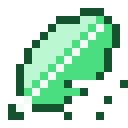
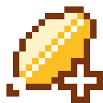
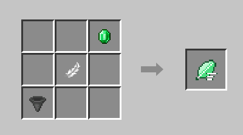
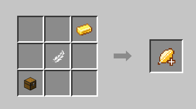
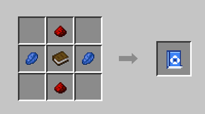

# Listing Kit: ALN:OneClickSort

Tap the Copy button on a block, then paste it into the CurseForge listing. Generated from DESCRIPTION.md: edit that, not this file.

## Package Name

```text
ALN:OneClickSort
```

## Summary (128/256)

```text
Sort your 27 backpack slots, sort any chest, barrel or shulker box, and stock chests from your backpack with three custom items.
```

## Description (HTML)

Paste into the CurseForge description editor in source (HTML) mode.

```html
<div><div style="border:2px solid #15803d;border-radius:18px;line-height:1.5"><br><h1 style="font-size:34px;text-align:center">ALN:OneClickSort</h1><p style="color:#8a94a3;font-size:14px;text-align:center">by ALNStudios</p><p style="text-align:center"><span style="background-color:#15803d;color:#ffffff;border-radius:20px;font-size:16px">&nbsp;&nbsp;<strong>Sort your 27 backpack slots, sort any chest, barrel or shulker box, and stock chests from your backpack with three custom items.</strong>&nbsp;&nbsp;</span></p><p style="text-align:center;margin-left:16px;margin-right:16px">Hold the Auto-Sort Feather and one click sorts your backpack, or sneak and click a chest to sort it. Hold the Restock Feather to refill your stacks, or sneak and click a chest to stock it. Good for survival, OneBlock and multiplayer worlds.</p><div style="display:flex;flex-wrap:wrap;gap:8px;margin-left:14px;margin-right:14px"><div style="background-color:#dcfce7;color:#14532d;border-radius:20px;font-size:14px;line-height:2"><strong>&nbsp;&nbsp;Bedrock</strong>: 1.26+&nbsp;&nbsp;</div><div style="background-color:#dcfce7;color:#14532d;border-radius:20px;font-size:14px;line-height:2"><strong>&nbsp;&nbsp;Experimental</strong>: No&nbsp;&nbsp;</div><div style="background-color:#dcfce7;color:#14532d;border-radius:20px;font-size:14px;line-height:2"><strong>&nbsp;&nbsp;Achievements</strong>: Yes, achievement-friendly&nbsp;&nbsp;</div></div><br></div>
<h2 style="font-size:17px;text-align:left"><span style="background-color:#15803d;color:#ffffff;border-radius:20px">&nbsp;&nbsp;About&nbsp;&nbsp;</span></h2>
<p>Hold the Auto-Sort Feather in your hand. Right-click to sort your backpack, or sneak and right-click a chest to sort it. Hold the Restock Feather to refill your stacks, or sneak and right-click a chest to stock it. The pack adds three items, no blocks or mobs, and never changes world generation, so it works in existing worlds.</p>
<h2 style="font-size:17px;text-align:left"><span style="background-color:#15803d;color:#ffffff;border-radius:20px">&nbsp;&nbsp;What You Get&nbsp;&nbsp;</span></h2>
<div style="display:flex;flex-wrap:wrap;gap:10px"><div style="flex:1;min-width:200px;border:1px solid #8a94a3;border-radius:16px"><div style="background-color:#15803d;color:#ffffff;border-radius:16px;font-size:16px;line-height:2.2"><strong>&nbsp;&nbsp;Backpack Sorting</strong></div><div style="margin-left:12px;margin-right:12px"><p><span>Right-clicking the Auto-Sort Feather in the air merges partial stacks and sorts the 27 backpack slots. The hotbar stays untouched unless you turn on hotbar sorting in the settings.</span><br><span style="font-size:13px;color:#8a94a3"><strong>How It Works:</strong> Hold the Feather, right-click, and a message appears above your hotbar.</span><br><span style="font-size:13px;color:#8a94a3"><strong>Good To Know:</strong> Names, lore, enchantments and durability are kept, and only identical items merge.</span></p></div></div><div style="flex:1;min-width:200px;border:1px solid #8a94a3;border-radius:16px"><div style="background-color:#15803d;color:#ffffff;border-radius:16px;font-size:16px;line-height:2.2"><strong>&nbsp;&nbsp;Chest Sorting</strong></div><div style="margin-left:12px;margin-right:12px"><p><span>Sneak and right-click any chest (including copper chests), trapped chest, barrel or shulker box to sort it instantly without opening it. Double chests are sorted as one container.</span><br><span style="font-size:13px;color:#8a94a3"><strong>How It Works:</strong> Sneak, then right-click the container with the Auto-Sort Feather in your hand.</span><br><span style="font-size:13px;color:#8a94a3"><strong>Good To Know:</strong> A sound confirms the sort, and the Normal variant also shows a small particle effect above the container.</span></p></div></div><div style="flex:1;min-width:200px;border:1px solid #8a94a3;border-radius:16px"><div style="background-color:#15803d;color:#ffffff;border-radius:16px;font-size:16px;line-height:2.2"><strong>&nbsp;&nbsp;Stock Chest</strong></div><div style="margin-left:12px;margin-right:12px"><p><span>Sneak and right-click any chest (including copper chests), trapped chest, barrel or shulker box with the Restock Feather to send backpack items into it that it already holds.</span><br><span style="font-size:13px;color:#8a94a3"><strong>How It Works:</strong> Hold the Restock Feather, sneak, right-click the container, and a message shows how many items went in.</span><br><span style="font-size:13px;color:#8a94a3"><strong>Good To Know:</strong> Only the 27 backpack slots are used, the feathers and hotbar are never moved, and the chest is sorted afterward. Sneaking and right-clicking in the air does nothing.</span></p></div></div><div style="flex:1;min-width:200px;border:1px solid #8a94a3;border-radius:16px"><div style="background-color:#15803d;color:#ffffff;border-radius:16px;font-size:16px;line-height:2.2"><strong>&nbsp;&nbsp;Restock</strong></div><div style="margin-left:12px;margin-right:12px"><p><span>Right-click the Restock Feather to refill the partial stacks you already carry, hotbar included, from every chest, copper chest, trapped chest, barrel and shulker box within 6 blocks.</span><br><span style="font-size:13px;color:#8a94a3"><strong>How It Works:</strong> Run low on blocks, step next to your storage, right-click the Restock Feather, and a message shows how many items came from how many chests.</span><br><span style="font-size:13px;color:#8a94a3"><strong>Good To Know:</strong> Restock only tops up stacks you already hold and never fills empty slots, unless you turn on Get Everything in Sort Settings, which pulls every matching item the chests hold until your inventory is full. Sneak and right-click a chest with the Restock Feather to stock it from your backpack. Turn on Leave 1 Item in Chest in Sort Settings to keep one item of each type in a chest when restocking, so stocking that chest still works.</span></p></div></div><div style="flex:1;min-width:200px;border:1px solid #8a94a3;border-radius:16px"><div style="background-color:#15803d;color:#ffffff;border-radius:16px;font-size:16px;line-height:2.2"><strong>&nbsp;&nbsp;Lock Chest</strong></div><div style="margin-left:12px;margin-right:12px"><p><span>Sneak and right-click a chest, barrel or shulker box with the Sort Settings Book to lock it, and do the same again to unlock it. A locked container is skipped by Restock, so nothing is taken from it.</span><br><span style="font-size:13px;color:#8a94a3"><strong>How It Works:</strong> Both halves of a double chest lock together, and a message tells you whether the container is now locked or unlocked.</span><br><span style="font-size:13px;color:#8a94a3"><strong>Good To Know:</strong> A lock only stops Restock from taking items. You can still open, sort and stock the container, and any player can unlock it.</span></p></div></div><div style="flex:1;min-width:200px;border:1px solid #8a94a3;border-radius:16px"><div style="background-color:#15803d;color:#ffffff;border-radius:16px;font-size:16px;line-height:2.2"><strong>&nbsp;&nbsp;Automatic Restock</strong></div><div style="margin-left:12px;margin-right:12px"><p><span>Turn on Automatic Restock in Sort Settings and your partial stacks are topped up from nearby containers every 5 seconds without a click.</span><br><span style="font-size:13px;color:#8a94a3"><strong>How It Works:</strong> Keep the Restock Feather anywhere in your inventory and stay within 6 blocks of your containers. A message appears only when items were moved.</span><br><span style="font-size:13px;color:#8a94a3"><strong>Good To Know:</strong> It only tops up stacks you already hold, ignores Get Everything, skips locked containers and is off by default.</span></p></div></div><div style="flex:1;min-width:200px;border:1px solid #8a94a3;border-radius:16px"><div style="background-color:#15803d;color:#ffffff;border-radius:16px;font-size:16px;line-height:2.2"><strong>&nbsp;&nbsp;Sort Settings</strong></div><div style="margin-left:12px;margin-right:12px"><p><span>Right-click the Sort Settings Book to open a menu with six options: Sort Order, Sort Hotbar Slots, Audio and Particle Feedback, Leave 1 Item in Chest, Get Everything and Automatic Restock.</span><br><span style="font-size:13px;color:#8a94a3"><strong>How It Works:</strong> Choose Smart Category, Alphabetical (A-Z) or Stack Quantity (Highest First), then confirm.</span><br><span style="font-size:13px;color:#8a94a3"><strong>Good To Know:</strong> Each player keeps their own settings, which stay saved between sessions.</span></p></div></div><div style="flex:1;min-width:200px;border:1px solid #8a94a3;border-radius:16px"><div style="background-color:#15803d;color:#ffffff;border-radius:16px;font-size:16px;line-height:2.2"><strong>&nbsp;&nbsp;Crafting Recipes</strong></div><div style="margin-left:12px;margin-right:12px"><p><span>All three items can be crafted at a Crafting Table, and every recipe is unlocked from the start.</span><br><span style="font-size:13px;color:#8a94a3"><strong>How It Works:</strong> Auto-Sort Feather: Emerald, Feather and Hopper placed diagonally. Restock Feather: Gold Ingot, Feather and Chest placed diagonally. Sort Settings Book: Book in the center with Lapis Lazuli left and right and Redstone Dust above and below.</span><br><span style="font-size:13px;color:#8a94a3"><strong>Good To Know:</strong> The diagonal layout matches the feather on the icons, and the same items sit together in one OneClickSort group in the Creative inventory under Items.</span></p></div></div><div style="flex:1;min-width:200px;border:1px solid #8a94a3;border-radius:16px"><div style="background-color:#15803d;color:#ffffff;border-radius:16px;font-size:16px;line-height:2.2"><strong>&nbsp;&nbsp;Pack Variants</strong></div><div style="margin-left:12px;margin-right:12px"><p></p></div></div><div style="flex:1;min-width:200px;border:1px solid #8a94a3;border-radius:16px"><div style="background-color:#15803d;color:#ffffff;border-radius:16px;font-size:16px;line-height:2.2"><strong>&nbsp;&nbsp;Pack Variants</strong></div><div style="margin-left:12px;margin-right:12px"><p><span>Two variants are included: Simple, the default, shows an action bar message and sound only, and Normal (with particles) also shows happy-villager particles above a sorted chest.</span><br><span style="font-size:13px;color:#8a94a3"><strong>How It Works:</strong> Open the pack's settings in your world and move the slider to switch variant.</span><br><span style="font-size:13px;color:#8a94a3"><strong>Good To Know:</strong> Both variants sort the same way, and the Audio and Particle Feedback option in Sort Settings still applies.</span></p></div></div></div>
<h2 style="font-size:17px;text-align:left"><span style="background-color:#15803d;color:#ffffff;border-radius:20px">&nbsp;&nbsp;Custom Items&nbsp;&nbsp;</span></h2>
<div style="display:flex;flex-wrap:wrap;gap:10px"><div style="flex:0 1 120px;border:1px solid #8a94a3;border-radius:16px;text-align:center"><p><a href="https://raw.githubusercontent.com/AllensCreations/MCPE-Curseforges/main/MCPEDL/Addons/ALNOneClickSort/assets/items/auto_sort_feather.png"></a></p><p style="color:#8a94a3;font-size:13px">auto sort feather</p></div><div style="flex:0 1 120px;border:1px solid #8a94a3;border-radius:16px;text-align:center"><p><a href="https://raw.githubusercontent.com/AllensCreations/MCPE-Curseforges/main/MCPEDL/Addons/ALNOneClickSort/assets/items/restock_feather.png"></a></p><p style="color:#8a94a3;font-size:13px">restock feather</p></div><div style="flex:0 1 120px;border:1px solid #8a94a3;border-radius:16px;text-align:center"><p><a href="https://raw.githubusercontent.com/AllensCreations/MCPE-Curseforges/main/MCPEDL/Addons/ALNOneClickSort/assets/items/sort_settings_book.png"></a></p><p style="color:#8a94a3;font-size:13px">sort settings book</p></div></div>
<h2 style="font-size:17px;text-align:left"><span style="background-color:#15803d;color:#ffffff;border-radius:20px">&nbsp;&nbsp;Crafting Recipes&nbsp;&nbsp;</span></h2>
<div style="display:flex;flex-wrap:wrap;gap:10px"><div style="flex:0 1 400px;border:1px solid #8a94a3;border-radius:16px;text-align:center"><p><a href="https://raw.githubusercontent.com/AllensCreations/MCPE-Curseforges/main/MCPEDL/Addons/ALNOneClickSort/assets/recipes/auto_sort_feather_recipe.png"></a></p><p style="color:#8a94a3;font-size:13px">auto sort feather recipe</p></div><div style="flex:0 1 400px;border:1px solid #8a94a3;border-radius:16px;text-align:center"><p><a href="https://raw.githubusercontent.com/AllensCreations/MCPE-Curseforges/main/MCPEDL/Addons/ALNOneClickSort/assets/recipes/restock_feather_recipe.png"></a></p><p style="color:#8a94a3;font-size:13px">restock feather recipe</p></div><div style="flex:0 1 400px;border:1px solid #8a94a3;border-radius:16px;text-align:center"><p><a href="https://raw.githubusercontent.com/AllensCreations/MCPE-Curseforges/main/MCPEDL/Addons/ALNOneClickSort/assets/recipes/sort_settings_book_recipe.png"></a></p><p style="color:#8a94a3;font-size:13px">sort settings book recipe</p></div></div>
<h2 style="font-size:17px;text-align:left"><span style="background-color:#15803d;color:#ffffff;border-radius:20px">&nbsp;&nbsp;Get Started&nbsp;&nbsp;</span></h2>
<table style="width:100%;border:1px solid #8a94a3;border-radius:16px"><tbody><tr><td style="width:44px;text-align:center"><div style="background-color:#15803d;color:#ffffff;font-weight:bold;font-size:15px;text-align:center;border-radius:10px;width:30px;aspect-ratio:1/1;line-height:30px">1</div></td><td style="text-align:left;">Craft the Auto-Sort Feather, Restock Feather and Sort Settings Book with the recipes below, or take them from the Creative inventory under Items.</td></tr><tr><td style="width:44px;text-align:center"><div style="background-color:#15803d;color:#ffffff;font-weight:bold;font-size:15px;text-align:center;border-radius:10px;width:30px;aspect-ratio:1/1;line-height:30px">2</div></td><td style="text-align:left;">Right-click in the air to sort your backpack, or sneak and right-click a chest to sort it.</td></tr><tr><td style="width:44px;text-align:center"><div style="background-color:#15803d;color:#ffffff;font-weight:bold;font-size:15px;text-align:center;border-radius:10px;width:30px;aspect-ratio:1/1;line-height:30px">3</div></td><td style="text-align:left;">Right-click the Restock Feather next to your chests to refill your stacks, or sneak and right-click a chest with it to stock that chest.</td></tr><tr><td style="width:44px;text-align:center"><div style="background-color:#15803d;color:#ffffff;font-weight:bold;font-size:15px;text-align:center;border-radius:10px;width:30px;aspect-ratio:1/1;line-height:30px">4</div></td><td style="text-align:left;">Right-click the Sort Settings Book to change your options, or sneak and right-click a container with it to lock it against Restock.</td></tr></tbody></table>
<h2 style="font-size:17px;text-align:left"><span style="background-color:#15803d;color:#ffffff;border-radius:20px">&nbsp;&nbsp;Common Questions&nbsp;&nbsp;</span></h2>
<div class="spoiler" title="Tired of sorting your inventory by hand?" data-title="Tired of sorting your inventory by hand?"><p><strong>Tired of sorting your inventory by hand?</strong><br>Right-click the Auto-Sort Feather and your 27 backpack slots are merged and sorted in one click.</p></div><div class="spoiler" title="Running out of blocks while building?" data-title="Running out of blocks while building?"><p><strong>Running out of blocks while building?</strong><br>Right-click the Restock Feather next to your chests and your held stacks are topped up from them.</p></div><div class="spoiler" title="Will it mess with my hotbar?" data-title="Will it mess with my hotbar?"><p><strong>Will it mess with my hotbar?</strong><br>No, the hotbar stays untouched unless you turn on hotbar sorting in Sort Settings.</p></div><div class="spoiler" title="Will my enchanted gear and named items survive?" data-title="Will my enchanted gear and named items survive?"><p><strong>Will my enchanted gear and named items survive?</strong><br>Yes, names, lore, enchantments and durability are kept, and only identical items merge.</p></div><div class="spoiler" title="Does it fit OneBlock and multiplayer worlds?" data-title="Does it fit OneBlock and multiplayer worlds?"><p><strong>Does it fit OneBlock and multiplayer worlds?</strong><br>It adds three items, no blocks or mobs, and never changes world generation, and every player keeps their own settings.</p></div>
<h2 style="font-size:17px;text-align:left"><span style="background-color:#15803d;color:#ffffff;border-radius:20px">&nbsp;&nbsp;Install&nbsp;&nbsp;</span></h2>
<table style="width:100%;border:1px solid #8a94a3;border-radius:16px"><tbody><tr><td style="width:44px;text-align:center"><div style="background-color:#15803d;color:#ffffff;font-weight:bold;font-size:15px;text-align:center;border-radius:10px;width:30px;aspect-ratio:1/1;line-height:30px">1</div></td><td style="text-align:left;">Download the file from this page and open it with Minecraft.</td></tr><tr><td style="width:44px;text-align:center"><div style="background-color:#15803d;color:#ffffff;font-weight:bold;font-size:15px;text-align:center;border-radius:10px;width:30px;aspect-ratio:1/1;line-height:30px">2</div></td><td style="text-align:left;">Create or edit a world and turn on the new pack(s) in its settings.</td></tr><tr><td style="width:44px;text-align:center"><div style="background-color:#15803d;color:#ffffff;font-weight:bold;font-size:15px;text-align:center;border-radius:10px;width:30px;aspect-ratio:1/1;line-height:30px">3</div></td><td style="text-align:left;">Play. No Experimental toggles needed.</td></tr></tbody></table>
<div style="border:1px solid #8a94a3;border-radius:16px;text-align:center"><br><div style="background-color:#15803d;color:#ffffff;border-radius:20px;font-size:15px;line-height:2;display:inline-block">&nbsp;&nbsp;<strong>Found a Bug or Have a Suggestion?</strong>&nbsp;&nbsp;</div><p style="font-size:14px;">Please leave a comment on this project page! All bug reports, gameplay feedback, and pack suggestions are welcome and appreciated.</p></div>
<h2 style="font-size:17px;text-align:left"><span style="background-color:#15803d;color:#ffffff;border-radius:20px">&nbsp;&nbsp;Support&nbsp;&nbsp;</span></h2><div style="border:1px solid #8a94a3;border-radius:16px;text-align:center"><br><a href="https://ko-fi.com/alnstudios"></a><br><br></div><p style="text-align:center"><a href="https://www.curseforge.com/members/allenscreations/projects"><strong>CurseForge</strong></a> &nbsp;|&nbsp; <a href="https://mcpedl.com/user/alnstudios/"><strong>MCPEDL</strong></a> &nbsp;|&nbsp; <a href="https://ko-fi.com/alnstudios"><strong>Ko-fi</strong></a></p>
<hr>
<p style="text-align:center;color:#8a94a3;font-size:13px"><strong>By ALNStudios</strong></p>
<div class="spoiler"><p style="font-size:13px"><strong>Permissions and credits</strong></p><ul style="font-size:13px"><li>Rights: All rights reserved for ALNStudios.</li><li>Content creators: You may feature this creation in videos and streams with credit to ALNStudios.</li><li>Redistribution: Do not re-upload this pack or provide direct monetized download bypasses. Link to this page.</li><li>Unofficial community creation. Not an official Minecraft product and not approved by or associated with Mojang or Microsoft.</li></ul></div>
<p style="text-align:center;color:#8a94a3;font-size:12px">Minecraft Bedrock add-on, ALN:OneClickSort Bedrock mod, inventory sorter, chest sorter, restock, Feather, Minecraft PE survival, MCPEDL add-on, CurseForge Bedrock, ALNStudios.</p></div>
```

## AI Image Prompts

### Reference Images

- **Logo reference**: attach your own logo. The generator uses it only for brand colors and mood. The result must be a new design, not a copy.
- **Snapshot references**: attach 1 to 4 of your in-game snapshots of this pack. The generator copies their look, not their screen layout.

### Logo Prompt

```text
Use the attached logo only as a brand reference for its color palette and overall mood. Do not copy it. Create a new, original logo with a different composition and a different main symbol. Do not just recolor, resize, crop, mirror or tweak the attached logo.
Create a clean, square (1:1) logo image for the Minecraft Bedrock add-on "ALN:OneClickSort". Sort your 27 backpack slots, sort any chest, barrel or shulker box, and stock chests from your backpack with three custom items.
Base the main symbol on the pack idea above. Match the blocky look of the attached in-game snapshots. Center the logo, use a simple background, and keep it readable at small sizes.
Text: "ALN:OneClickSort" and, in small letters, "ALNStudios". ALNStudios is the brand name, so always keep it and never remove or change it. Spell both exactly.
Do not add Minecraft, Mojang or Microsoft logos, watermarks, or characters from other games.
```

### Banner Prompt

```text
Create a wide (16:9) banner image for the Minecraft Bedrock add-on "ALN:OneClickSort". Sort your 27 backpack slots, sort any chest, barrel or shulker box, and stock chests from your backpack with three custom items.
Use the attached in-game snapshots as scene and style references: copy their blocky look, lighting, colors and the kind of scenery they show. Make a new composition inspired by them. Do not copy the on-screen HUD, chat or hotbar.
Use the attached logo only as a brand reference for its colors and mood. Do not copy it. Put a new, original logo design in the banner, large enough to read, on the left or center.
Hint at these pack features visually: Backpack Sorting, Chest Sorting, Stock Chest, Restock, Lock Chest.
Text: "ALN:OneClickSort" and, in small letters, "by ALNStudios". ALNStudios is the brand name, so always keep it and never remove or change it. Spell both exactly.
Leave clear space around the logo. No Minecraft, Mojang or Microsoft logos, no watermarks.
```
