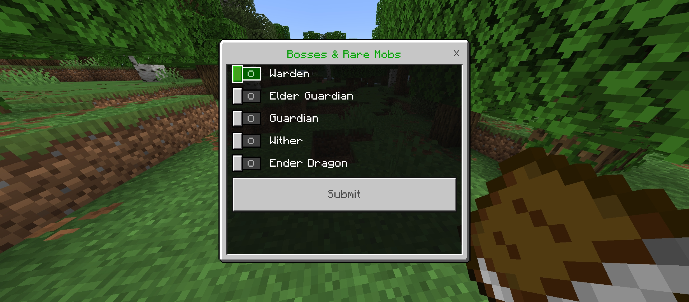
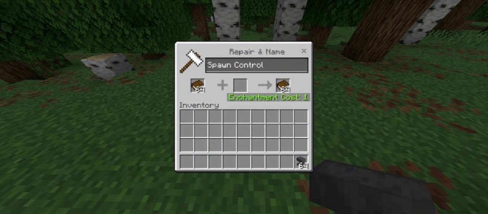
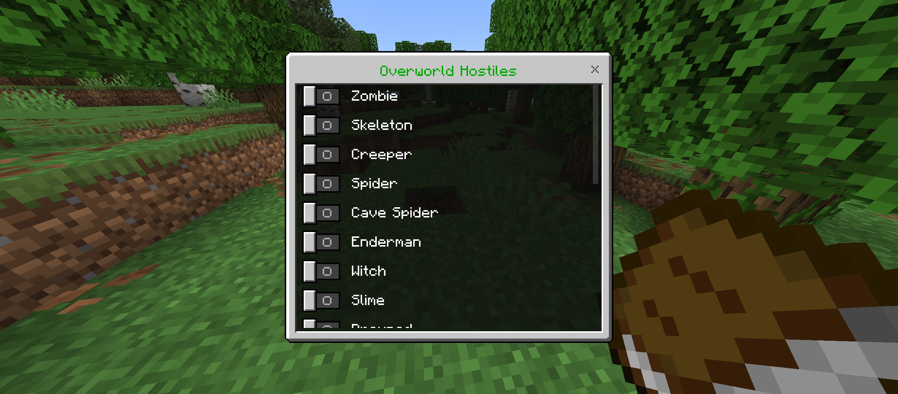
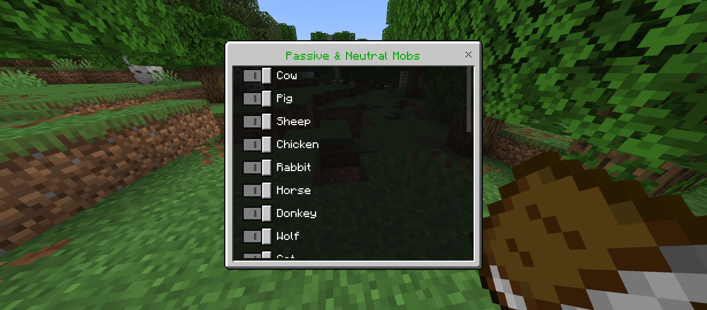

# Listing Kit: ALN:SpawnControl

Tap the Copy button on a block, then paste it into the CurseForge listing. Generated from DESCRIPTION.md: edit that, not this file.

## Package Name

```text
ALN:SpawnControl
```

## Summary (127/256)

```text
Control world mob spawns with individual switches for 58 creatures, presets, and filter rules opened from a Spawn Control book.
```

## Description (HTML)

Choose any of the 5 themes below. Tap the Copy button on your preferred theme and paste into the CurseForge description editor in source (HTML) mode.

### Theme 1: Vanilla Adaptive (Default)

Theme-neutral layout following the viewer's CurseForge light or dark mode.

```html
<div><div style="border:2px solid #15803d;border-radius:18px;line-height:1.5"><br><p style="text-align:center"></p><p style="color:#8a94a3;font-size:14px;text-align:center">by ALNStudios</p><p style="text-align:center"><span style="background-color:#15803d;color:#ffffff;border-radius:20px;font-size:16px">&nbsp;&nbsp;<strong>Control world mob spawns with individual switches for 58 creatures, presets, and filter rules opened from a Spawn Control book.</strong>&nbsp;&nbsp;</span></p><p style="text-align:center;margin-left:16px;margin-right:16px">ALN:SpawnControl adds an interactive in-game control panel to configure individual mob spawning rules across 4 categorized rosters. It suits world builders, realm administrators, and survival players wanting a fine-tuned environment without custom entities.</p><div style="display:flex;flex-wrap:wrap;gap:8px;margin-left:14px;margin-right:14px"><div style="background-color:#dcfce7;color:#14532d;border-radius:20px;font-size:14px;line-height:2"><strong>&nbsp;&nbsp;Bedrock</strong>: 1.26+&nbsp;&nbsp;</div><div style="background-color:#dcfce7;color:#14532d;border-radius:20px;font-size:14px;line-height:2"><strong>&nbsp;&nbsp;Experimental</strong>: No&nbsp;&nbsp;</div><div style="background-color:#dcfce7;color:#14532d;border-radius:20px;font-size:14px;line-height:2"><strong>&nbsp;&nbsp;Achievements</strong>: Yes, achievement-friendly&nbsp;&nbsp;</div></div><br></div>
<p></p>
<p>Rename a vanilla Book to "Spawn Control" on an Anvil and use it to open the control panel. From the dashboard, players can inspect active mob counts, configure 4 categorized mob rosters with individual toggles, apply one-tap presets, see how many disabled mobs are currently loaded, configure global filter modes, or open the separate purge menu to remove existing disabled mobs. All preferences are saved persistently to world storage.</p>
<p></p>
<div style="display:flex;flex-wrap:wrap;gap:10px"><div style="flex:1 1 300px;border:1px solid #8a94a3;border-radius:16px;text-align:center"><p></p></div><div style="flex:1 1 300px;border:1px solid #8a94a3;border-radius:16px;text-align:center"><p></p></div><div style="flex:1 1 300px;border:1px solid #8a94a3;border-radius:16px;text-align:center"><p></p></div><div style="flex:1 1 300px;border:1px solid #8a94a3;border-radius:16px;text-align:center"><p></p></div></div>
<p></p>
<div style="display:flex;flex-wrap:wrap;gap:10px"><div style="flex:1;min-width:200px;border:1px solid #8a94a3;border-radius:16px"><div style="background-color:#15803d;color:#ffffff;border-radius:16px;font-size:16px;line-height:2.2"><strong>&nbsp;&nbsp;Categorized Mob Rosters</strong></div><div style="margin-left:12px;margin-right:12px"><p><span>Individual toggle switches govern 58 standard mobs organized across 4 distinct groups: Overworld Hostiles, Passive &amp; Neutral Mobs, Nether &amp; End Mobs, and Bosses &amp; Rare Mobs.</span><br><span style="font-size:13px;color:#8a94a3"><strong>How It Works:</strong> Open any category to adjust individual toggles, such as turning off Creeper or Phantom while keeping Zombie and Skeleton active. Close a menu to leave it and use the book again to reopen the dashboard.</span><br><span style="font-size:13px;color:#8a94a3"><strong>Good To Know:</strong> All mobs are enabled by default. Mobs that are toggled off are removed immediately when spawning occurs. Each group menu also has a Group Action choice to enable or disable every mob in that group at once.</span></p></div></div><div style="flex:1;min-width:200px;border:1px solid #8a94a3;border-radius:16px"><div style="background-color:#15803d;color:#ffffff;border-radius:16px;font-size:16px;line-height:2.2"><strong>&nbsp;&nbsp;Custom Mob Spawner &amp; Farm Control</strong></div><div style="margin-left:12px;margin-right:12px"><p><span>Fine-tune mob farms and monster spawners by permitting only chosen mob types to spawn while blocking all unwanted background spawns.</span><br><span style="font-size:13px;color:#8a94a3"><strong>Good for Chosen Mob Spawner:</strong> Perfect for mob spawner chambers and specialized drop farms (such as Skeleton, Blaze, Witch, or Creeper farms). Disabling other competing mob spawns maximizes spawner efficiency, frees up mob caps, and prevents unwanted entities from crowding your spawn areas.</span><br><span style="font-size:13px;color:#8a94a3"><strong>How It Works:</strong> Disable unneeded hostiles to maximize spawn rates for chosen creatures, or block specific mob types around complex farms without breaking the target mob grinder.</span></p></div></div><div style="flex:1;min-width:200px;border:1px solid #8a94a3;border-radius:16px"><div style="background-color:#15803d;color:#ffffff;border-radius:16px;font-size:16px;line-height:2.2"><strong>&nbsp;&nbsp;Quick Presets</strong></div><div style="margin-left:12px;margin-right:12px"><p><span>One-tap buttons allow bulk configuration: Enable All Mobs, Disable All Hostiles, Disable All Passive Mobs, or Disable Everything for an empty mob world.</span><br><span style="font-size:13px;color:#8a94a3"><strong>How It Works:</strong> Selecting "Disable All Hostiles" immediately switches off all Overworld monsters, Nether threats, and bosses simultaneously.</span></p></div></div><div style="flex:1;min-width:200px;border:1px solid #8a94a3;border-radius:16px"><div style="background-color:#15803d;color:#ffffff;border-radius:16px;font-size:16px;line-height:2.2"><strong>&nbsp;&nbsp;Global Filter Rules</strong></div><div style="margin-left:12px;margin-right:12px"><p><span>Global settings let you choose whether spawn restrictions apply only to natural world-gen spawns or also block Spawn Eggs and summon commands.</span><br><span style="font-size:13px;color:#8a94a3"><strong>How It Works:</strong> Leaving natural spawn mode active allows administrators to test mobs using Spawn Eggs while preventing wild spawns.</span></p></div></div><div style="flex:1;min-width:200px;border:1px solid #8a94a3;border-radius:16px"><div style="background-color:#15803d;color:#ffffff;border-radius:16px;font-size:16px;line-height:2.2"><strong>&nbsp;&nbsp;Entity Purge</strong></div><div style="margin-left:12px;margin-right:12px"><p><span>A dedicated Purge Disabled Mobs menu scans loaded chunks and removes mobs whose toggles are currently disabled.</span><br><span style="font-size:13px;color:#8a94a3"><strong>How It Works:</strong> Pick a dimension and a mob group, then choose whether tamed mobs, name-tagged mobs, leashed mobs, mobs with riders, and mobs carrying chests are included. A second screen lists each disabled mob type that is loaded with its count so you can purge only the types you pick.</span><br><span style="font-size:13px;color:#8a94a3"><strong>Confirmation and Summary:</strong> Before anything is removed, a confirmation screen shows how many mobs will be removed and how many are kept safe. After the purge, a summary screen lists what was removed.</span><br><span style="font-size:13px;color:#8a94a3"><strong>Good To Know:</strong> Tamed, name-tagged, leashed, ridden and chested mobs are kept by default, and your last purge choices are remembered.</span></p></div></div><div style="flex:1;min-width:200px;border:1px solid #8a94a3;border-radius:16px"><div style="background-color:#15803d;color:#ffffff;border-radius:16px;font-size:16px;line-height:2.2"><strong>&nbsp;&nbsp;Admin Tag Lock</strong></div><div style="margin-left:12px;margin-right:12px"><p><span>An optional permission lock restricts opening the control panel to players carrying the administrator tag.</span><br><span style="font-size:13px;color:#8a94a3"><strong>How It Works:</strong> When Admin Tag Lock is turned on, a player must carry the tag to open the book; the first player to open the book automatically receives the tag if none exists.</span></p></div></div></div>
<p></p>
<table style="width:100%;border:1px solid #8a94a3;border-radius:16px"><tbody><tr><td style="width:44px;text-align:center"><div style="background-color:#15803d;color:#ffffff;font-weight:bold;font-size:15px;text-align:center;border-radius:10px;width:30px;aspect-ratio:1/1;line-height:30px">1</div></td><td style="text-align:left;">Import the .mcpack file and activate ALN:SpawnControl in your world's Behavior Packs.</td></tr><tr><td style="width:44px;text-align:center"><div style="background-color:#15803d;color:#ffffff;font-weight:bold;font-size:15px;text-align:center;border-radius:10px;width:30px;aspect-ratio:1/1;line-height:30px">2</div></td><td style="text-align:left;">Place a Book (not a Book and Quill) in an Anvil and rename it to "Spawn Control".</td></tr><tr><td style="width:44px;text-align:center"><div style="background-color:#15803d;color:#ffffff;font-weight:bold;font-size:15px;text-align:center;border-radius:10px;width:30px;aspect-ratio:1/1;line-height:30px">3</div></td><td style="text-align:left;">Hold the renamed book and use it to open the ALN:SpawnControl control panel.</td></tr></tbody></table>
<p></p>
<div class="spoiler" title="Do I need experimental toggles?" data-title="Do I need experimental toggles?"><p><strong>Do I need experimental toggles?</strong><br>No experimental toggles or cheats are required for normal menu usage.</p></div><div class="spoiler" title="Does it stop mob spawners?" data-title="Does it stop mob spawners?"><p><strong>Does it stop mob spawners?</strong><br>When set to block natural spawns or all sources, spawner-generated entities of disabled mob types are intercepted upon spawning.</p></div><div class="spoiler" title="Will turning off a mob remove existing ones?" data-title="Will turning off a mob remove existing ones?"><p><strong>Will turning off a mob remove existing ones?</strong><br>New spawns are blocked immediately; use the Purge Disabled Mobs menu to clear existing mobs. Tamed and name-tagged mobs are kept unless you include them.</p></div>
<p></p>
<table style="width:100%;border:1px solid #8a94a3;border-radius:16px"><tbody><tr><td style="width:44px;text-align:center"><div style="background-color:#15803d;color:#ffffff;font-weight:bold;font-size:15px;text-align:center;border-radius:10px;width:30px;aspect-ratio:1/1;line-height:30px">1</div></td><td style="text-align:left;">Download the file from this page and open it with Minecraft.</td></tr><tr><td style="width:44px;text-align:center"><div style="background-color:#15803d;color:#ffffff;font-weight:bold;font-size:15px;text-align:center;border-radius:10px;width:30px;aspect-ratio:1/1;line-height:30px">2</div></td><td style="text-align:left;">Create or edit a world and turn on the new pack(s) in its settings.</td></tr><tr><td style="width:44px;text-align:center"><div style="background-color:#15803d;color:#ffffff;font-weight:bold;font-size:15px;text-align:center;border-radius:10px;width:30px;aspect-ratio:1/1;line-height:30px">3</div></td><td style="text-align:left;">Play. No Experimental toggles needed.</td></tr></tbody></table>
<div style="border:1px solid #8a94a3;border-radius:16px;text-align:center"><br><div style="background-color:#15803d;color:#ffffff;border-radius:20px;font-size:15px;line-height:2;display:inline-block">&nbsp;&nbsp;<strong>Found a Bug or Have a Suggestion?</strong>&nbsp;&nbsp;</div><p style="font-size:14px;">Please leave a comment on this project page! All bug reports, gameplay feedback, and pack suggestions are welcome and appreciated.</p></div>
<p></p><div style="border:1px solid #8a94a3;border-radius:16px;text-align:center"><br><a href="https://ko-fi.com/alnstudios"></a><br><br></div><p style="text-align:center"><a href="https://www.curseforge.com/members/allenscreations/projects"><strong>CurseForge</strong></a> &nbsp;|&nbsp; <a href="https://mcpedl.com/user/alnstudios/"><strong>MCPEDL</strong></a> &nbsp;|&nbsp; <a href="https://ko-fi.com/alnstudios"><strong>Ko-fi</strong></a></p>
<hr>
<p style="text-align:center;color:#8a94a3;font-size:13px"><strong>By ALNStudios</strong></p>
<div class="spoiler"><p style="font-size:13px"><strong>Permissions and credits</strong></p><ul style="font-size:13px"><li>Rights: All rights reserved for ALNStudios.</li><li>Content creators: You may feature this creation in videos and streams with credit to ALNStudios.</li><li>Redistribution: Do not re-upload this pack or provide direct monetized download bypasses. Link to this page.</li><li>Visual: Promotional/cover imagery used on this page is AI-generated to illustrate the concept and purpose of the pack.</li><li>Unofficial community creation. Not an official Minecraft product and not approved by or associated with Mojang or Microsoft.</li></ul></div>
<p style="text-align:center;color:#8a94a3;font-size:12px">Minecraft Bedrock add-on, ALN:SpawnControl Bedrock mod, mob spawn whitelist, custom mob toggle, spawn control book, Minecraft PE survival, MCPEDL add-on, CurseForge Bedrock, ALNStudios.</p></div>
```

### Theme 2: Netherite Stealth (Modern Dark)

High-tech dark obsidian & emerald storefront.

```html
<div style="background-color:#0d1117;color:#c9d1d9;border-radius:12px;padding-left:12px"><div style="margin-right:12px"><br><div style="background-color:#161b22;border:2px solid #10b981;border-radius:18px;line-height:1.5"><br><p style="text-align:center"></p><p style="color:#8b949e;font-size:14px;text-align:center">by ALNStudios</p><p style="text-align:center"><span style="background-color:#10b981;color:#ffffff;border-radius:20px;font-size:16px">&nbsp;&nbsp;<strong>Control world mob spawns with individual switches for 58 creatures, presets, and filter rules opened from a Spawn Control book.</strong>&nbsp;&nbsp;</span></p><p style="color:#8b949e;text-align:center;margin-left:16px;margin-right:16px">ALN:SpawnControl adds an interactive in-game control panel to configure individual mob spawning rules across 4 categorized rosters. It suits world builders, realm administrators, and survival players wanting a fine-tuned environment without custom entities.</p><div style="display:flex;flex-wrap:wrap;gap:8px;margin-left:14px;margin-right:14px"><div style="background-color:#161b22;color:#10b981;border-radius:20px;font-size:14px;line-height:2"><strong>&nbsp;&nbsp;Bedrock</strong>: 1.26+&nbsp;&nbsp;</div><div style="background-color:#161b22;color:#10b981;border-radius:20px;font-size:14px;line-height:2"><strong>&nbsp;&nbsp;Experimental</strong>: No&nbsp;&nbsp;</div><div style="background-color:#161b22;color:#10b981;border-radius:20px;font-size:14px;line-height:2"><strong>&nbsp;&nbsp;Achievements</strong>: Yes, achievement-friendly&nbsp;&nbsp;</div></div><br></div>
<p></p>
<p style="color:#c9d1d9">Rename a vanilla Book to "Spawn Control" on an Anvil and use it to open the control panel. From the dashboard, players can inspect active mob counts, configure 4 categorized mob rosters with individual toggles, apply one-tap presets, see how many disabled mobs are currently loaded, configure global filter modes, or open the separate purge menu to remove existing disabled mobs. All preferences are saved persistently to world storage.</p>
<p></p>
<div style="display:flex;flex-wrap:wrap;gap:10px"><div style="flex:1 1 300px;background-color:#161b22;border:1px solid #30363d;border-radius:16px;text-align:center"><p></p></div><div style="flex:1 1 300px;background-color:#161b22;border:1px solid #30363d;border-radius:16px;text-align:center"><p></p></div><div style="flex:1 1 300px;background-color:#161b22;border:1px solid #30363d;border-radius:16px;text-align:center"><p></p></div><div style="flex:1 1 300px;background-color:#161b22;border:1px solid #30363d;border-radius:16px;text-align:center"><p></p></div></div>
<p></p>
<div style="display:flex;flex-wrap:wrap;gap:10px"><div style="flex:1;min-width:200px;background-color:#161b22;border:1px solid #30363d;border-radius:16px"><div style="background-color:#10b981;color:#ffffff;border-radius:16px;font-size:16px;line-height:2.2"><strong>&nbsp;&nbsp;Categorized Mob Rosters</strong></div><div style="margin-left:12px;margin-right:12px"><p><span style="color:#c9d1d9">Individual toggle switches govern 58 standard mobs organized across 4 distinct groups: Overworld Hostiles, Passive &amp; Neutral Mobs, Nether &amp; End Mobs, and Bosses &amp; Rare Mobs.</span><br><span style="font-size:13px;color:#8b949e"><strong>How It Works:</strong> Open any category to adjust individual toggles, such as turning off Creeper or Phantom while keeping Zombie and Skeleton active. Close a menu to leave it and use the book again to reopen the dashboard.</span><br><span style="font-size:13px;color:#8b949e"><strong>Good To Know:</strong> All mobs are enabled by default. Mobs that are toggled off are removed immediately when spawning occurs. Each group menu also has a Group Action choice to enable or disable every mob in that group at once.</span></p></div></div><div style="flex:1;min-width:200px;background-color:#161b22;border:1px solid #30363d;border-radius:16px"><div style="background-color:#10b981;color:#ffffff;border-radius:16px;font-size:16px;line-height:2.2"><strong>&nbsp;&nbsp;Custom Mob Spawner &amp; Farm Control</strong></div><div style="margin-left:12px;margin-right:12px"><p><span style="color:#c9d1d9">Fine-tune mob farms and monster spawners by permitting only chosen mob types to spawn while blocking all unwanted background spawns.</span><br><span style="font-size:13px;color:#8b949e"><strong>Good for Chosen Mob Spawner:</strong> Perfect for mob spawner chambers and specialized drop farms (such as Skeleton, Blaze, Witch, or Creeper farms). Disabling other competing mob spawns maximizes spawner efficiency, frees up mob caps, and prevents unwanted entities from crowding your spawn areas.</span><br><span style="font-size:13px;color:#8b949e"><strong>How It Works:</strong> Disable unneeded hostiles to maximize spawn rates for chosen creatures, or block specific mob types around complex farms without breaking the target mob grinder.</span></p></div></div><div style="flex:1;min-width:200px;background-color:#161b22;border:1px solid #30363d;border-radius:16px"><div style="background-color:#10b981;color:#ffffff;border-radius:16px;font-size:16px;line-height:2.2"><strong>&nbsp;&nbsp;Quick Presets</strong></div><div style="margin-left:12px;margin-right:12px"><p><span style="color:#c9d1d9">One-tap buttons allow bulk configuration: Enable All Mobs, Disable All Hostiles, Disable All Passive Mobs, or Disable Everything for an empty mob world.</span><br><span style="font-size:13px;color:#8b949e"><strong>How It Works:</strong> Selecting "Disable All Hostiles" immediately switches off all Overworld monsters, Nether threats, and bosses simultaneously.</span></p></div></div><div style="flex:1;min-width:200px;background-color:#161b22;border:1px solid #30363d;border-radius:16px"><div style="background-color:#10b981;color:#ffffff;border-radius:16px;font-size:16px;line-height:2.2"><strong>&nbsp;&nbsp;Global Filter Rules</strong></div><div style="margin-left:12px;margin-right:12px"><p><span style="color:#c9d1d9">Global settings let you choose whether spawn restrictions apply only to natural world-gen spawns or also block Spawn Eggs and summon commands.</span><br><span style="font-size:13px;color:#8b949e"><strong>How It Works:</strong> Leaving natural spawn mode active allows administrators to test mobs using Spawn Eggs while preventing wild spawns.</span></p></div></div><div style="flex:1;min-width:200px;background-color:#161b22;border:1px solid #30363d;border-radius:16px"><div style="background-color:#10b981;color:#ffffff;border-radius:16px;font-size:16px;line-height:2.2"><strong>&nbsp;&nbsp;Entity Purge</strong></div><div style="margin-left:12px;margin-right:12px"><p><span style="color:#c9d1d9">A dedicated Purge Disabled Mobs menu scans loaded chunks and removes mobs whose toggles are currently disabled.</span><br><span style="font-size:13px;color:#8b949e"><strong>How It Works:</strong> Pick a dimension and a mob group, then choose whether tamed mobs, name-tagged mobs, leashed mobs, mobs with riders, and mobs carrying chests are included. A second screen lists each disabled mob type that is loaded with its count so you can purge only the types you pick.</span><br><span style="font-size:13px;color:#8b949e"><strong>Confirmation and Summary:</strong> Before anything is removed, a confirmation screen shows how many mobs will be removed and how many are kept safe. After the purge, a summary screen lists what was removed.</span><br><span style="font-size:13px;color:#8b949e"><strong>Good To Know:</strong> Tamed, name-tagged, leashed, ridden and chested mobs are kept by default, and your last purge choices are remembered.</span></p></div></div><div style="flex:1;min-width:200px;background-color:#161b22;border:1px solid #30363d;border-radius:16px"><div style="background-color:#10b981;color:#ffffff;border-radius:16px;font-size:16px;line-height:2.2"><strong>&nbsp;&nbsp;Admin Tag Lock</strong></div><div style="margin-left:12px;margin-right:12px"><p><span style="color:#c9d1d9">An optional permission lock restricts opening the control panel to players carrying the administrator tag.</span><br><span style="font-size:13px;color:#8b949e"><strong>How It Works:</strong> When Admin Tag Lock is turned on, a player must carry the tag to open the book; the first player to open the book automatically receives the tag if none exists.</span></p></div></div></div>
<p></p>
<table style="width:100%;border:1px solid #30363d;border-radius:16px"><tbody><tr><td style="width:44px;text-align:center"><div style="background-color:#10b981;color:#ffffff;font-weight:bold;font-size:15px;text-align:center;border-radius:10px;width:30px;aspect-ratio:1/1;line-height:30px">1</div></td><td style="text-align:left;color:#c9d1d9">Import the .mcpack file and activate ALN:SpawnControl in your world's Behavior Packs.</td></tr><tr><td style="width:44px;text-align:center"><div style="background-color:#10b981;color:#ffffff;font-weight:bold;font-size:15px;text-align:center;border-radius:10px;width:30px;aspect-ratio:1/1;line-height:30px">2</div></td><td style="text-align:left;color:#c9d1d9">Place a Book (not a Book and Quill) in an Anvil and rename it to "Spawn Control".</td></tr><tr><td style="width:44px;text-align:center"><div style="background-color:#10b981;color:#ffffff;font-weight:bold;font-size:15px;text-align:center;border-radius:10px;width:30px;aspect-ratio:1/1;line-height:30px">3</div></td><td style="text-align:left;color:#c9d1d9">Hold the renamed book and use it to open the ALN:SpawnControl control panel.</td></tr></tbody></table>
<p></p>
<div class="spoiler" title="Do I need experimental toggles?" data-title="Do I need experimental toggles?"><p style="color:#c9d1d9"><strong>Do I need experimental toggles?</strong><br>No experimental toggles or cheats are required for normal menu usage.</p></div><div class="spoiler" title="Does it stop mob spawners?" data-title="Does it stop mob spawners?"><p style="color:#c9d1d9"><strong>Does it stop mob spawners?</strong><br>When set to block natural spawns or all sources, spawner-generated entities of disabled mob types are intercepted upon spawning.</p></div><div class="spoiler" title="Will turning off a mob remove existing ones?" data-title="Will turning off a mob remove existing ones?"><p style="color:#c9d1d9"><strong>Will turning off a mob remove existing ones?</strong><br>New spawns are blocked immediately; use the Purge Disabled Mobs menu to clear existing mobs. Tamed and name-tagged mobs are kept unless you include them.</p></div>
<p></p>
<table style="width:100%;border:1px solid #30363d;border-radius:16px"><tbody><tr><td style="width:44px;text-align:center"><div style="background-color:#10b981;color:#ffffff;font-weight:bold;font-size:15px;text-align:center;border-radius:10px;width:30px;aspect-ratio:1/1;line-height:30px">1</div></td><td style="text-align:left;color:#c9d1d9">Download the file from this page and open it with Minecraft.</td></tr><tr><td style="width:44px;text-align:center"><div style="background-color:#10b981;color:#ffffff;font-weight:bold;font-size:15px;text-align:center;border-radius:10px;width:30px;aspect-ratio:1/1;line-height:30px">2</div></td><td style="text-align:left;color:#c9d1d9">Create or edit a world and turn on the new pack(s) in its settings.</td></tr><tr><td style="width:44px;text-align:center"><div style="background-color:#10b981;color:#ffffff;font-weight:bold;font-size:15px;text-align:center;border-radius:10px;width:30px;aspect-ratio:1/1;line-height:30px">3</div></td><td style="text-align:left;color:#c9d1d9">Play. No Experimental toggles needed.</td></tr></tbody></table>
<div style="background-color:#161b22;border:1px solid #30363d;border-radius:16px;text-align:center"><br><div style="background-color:#10b981;color:#ffffff;border-radius:20px;font-size:15px;line-height:2;display:inline-block">&nbsp;&nbsp;<strong>Found a Bug or Have a Suggestion?</strong>&nbsp;&nbsp;</div><p style="font-size:14px;color:#c9d1d9">Please leave a comment on this project page! All bug reports, gameplay feedback, and pack suggestions are welcome and appreciated.</p></div>
<p></p><div style="background-color:#161b22;border:1px solid #30363d;border-radius:16px;text-align:center"><br><a href="https://ko-fi.com/alnstudios"></a><br><br></div><p style="text-align:center"><a style="color:#58a6ff" href="https://www.curseforge.com/members/allenscreations/projects"><strong>CurseForge</strong></a> &nbsp;|&nbsp; <a style="color:#58a6ff" href="https://mcpedl.com/user/alnstudios/"><strong>MCPEDL</strong></a> &nbsp;|&nbsp; <a style="color:#58a6ff" href="https://ko-fi.com/alnstudios"><strong>Ko-fi</strong></a></p>
<hr>
<p style="text-align:center;color:#8b949e;font-size:13px"><strong>By ALNStudios</strong></p>
<div class="spoiler"><p style="font-size:13px"><strong>Permissions and credits</strong></p><ul style="font-size:13px"><li>Rights: All rights reserved for ALNStudios.</li><li>Content creators: You may feature this creation in videos and streams with credit to ALNStudios.</li><li>Redistribution: Do not re-upload this pack or provide direct monetized download bypasses. Link to this page.</li><li>Visual: Promotional/cover imagery used on this page is AI-generated to illustrate the concept and purpose of the pack.</li><li>Unofficial community creation. Not an official Minecraft product and not approved by or associated with Mojang or Microsoft.</li></ul></div>
<p style="text-align:center;color:#8b949e;font-size:12px">Minecraft Bedrock add-on, ALN:SpawnControl Bedrock mod, mob spawn whitelist, custom mob toggle, spawn control book, Minecraft PE survival, MCPEDL add-on, CurseForge Bedrock, ALNStudios.</p><br></div></div>
```

### Theme 3: Bedrock GUI (In-Game Menu)

Authentic Minecraft stone dialog with 3D beveled borders and item slot insets.

```html
<div style="background-color:#313233;color:#e0e0e0;border-radius:12px;padding-left:12px"><div style="margin-right:12px"><br><div style="background-color:#202021;border:2px solid #4a4b4d;border-radius:18px;line-height:1.5"><br><p style="text-align:center"></p><p style="color:#a0a0a0;font-size:14px;text-align:center">by ALNStudios</p><p style="text-align:center"><span style="background-color:#4a4b4d;color:#ffffff;border-radius:20px;font-size:16px">&nbsp;&nbsp;<strong>Control world mob spawns with individual switches for 58 creatures, presets, and filter rules opened from a Spawn Control book.</strong>&nbsp;&nbsp;</span></p><p style="color:#d0d0d0;text-align:center;margin-left:16px;margin-right:16px">ALN:SpawnControl adds an interactive in-game control panel to configure individual mob spawning rules across 4 categorized rosters. It suits world builders, realm administrators, and survival players wanting a fine-tuned environment without custom entities.</p><div style="display:flex;flex-wrap:wrap;gap:8px;margin-left:14px;margin-right:14px"><div style="background-color:#202021;color:#ffffff;border-radius:20px;font-size:14px;line-height:2"><strong>&nbsp;&nbsp;Bedrock</strong>: 1.26+&nbsp;&nbsp;</div><div style="background-color:#202021;color:#ffffff;border-radius:20px;font-size:14px;line-height:2"><strong>&nbsp;&nbsp;Experimental</strong>: No&nbsp;&nbsp;</div><div style="background-color:#202021;color:#ffffff;border-radius:20px;font-size:14px;line-height:2"><strong>&nbsp;&nbsp;Achievements</strong>: Yes, achievement-friendly&nbsp;&nbsp;</div></div><br></div>
<p></p>
<p style="color:#e0e0e0">Rename a vanilla Book to "Spawn Control" on an Anvil and use it to open the control panel. From the dashboard, players can inspect active mob counts, configure 4 categorized mob rosters with individual toggles, apply one-tap presets, see how many disabled mobs are currently loaded, configure global filter modes, or open the separate purge menu to remove existing disabled mobs. All preferences are saved persistently to world storage.</p>
<p></p>
<div style="display:flex;flex-wrap:wrap;gap:10px"><div style="flex:1 1 300px;background-color:#202021;border:1px solid #4a4b4d;border-radius:16px;text-align:center"><p></p></div><div style="flex:1 1 300px;background-color:#202021;border:1px solid #4a4b4d;border-radius:16px;text-align:center"><p></p></div><div style="flex:1 1 300px;background-color:#202021;border:1px solid #4a4b4d;border-radius:16px;text-align:center"><p></p></div><div style="flex:1 1 300px;background-color:#202021;border:1px solid #4a4b4d;border-radius:16px;text-align:center"><p></p></div></div>
<p></p>
<div style="display:flex;flex-wrap:wrap;gap:10px"><div style="flex:1;min-width:200px;background-color:#202021;border:1px solid #4a4b4d;border-radius:16px"><div style="background-color:#4a4b4d;color:#ffffff;border-radius:16px;font-size:16px;line-height:2.2"><strong>&nbsp;&nbsp;Categorized Mob Rosters</strong></div><div style="margin-left:12px;margin-right:12px"><p><span style="color:#e0e0e0">Individual toggle switches govern 58 standard mobs organized across 4 distinct groups: Overworld Hostiles, Passive &amp; Neutral Mobs, Nether &amp; End Mobs, and Bosses &amp; Rare Mobs.</span><br><span style="font-size:13px;color:#a0a0a0"><strong>How It Works:</strong> Open any category to adjust individual toggles, such as turning off Creeper or Phantom while keeping Zombie and Skeleton active. Close a menu to leave it and use the book again to reopen the dashboard.</span><br><span style="font-size:13px;color:#a0a0a0"><strong>Good To Know:</strong> All mobs are enabled by default. Mobs that are toggled off are removed immediately when spawning occurs. Each group menu also has a Group Action choice to enable or disable every mob in that group at once.</span></p></div></div><div style="flex:1;min-width:200px;background-color:#202021;border:1px solid #4a4b4d;border-radius:16px"><div style="background-color:#4a4b4d;color:#ffffff;border-radius:16px;font-size:16px;line-height:2.2"><strong>&nbsp;&nbsp;Custom Mob Spawner &amp; Farm Control</strong></div><div style="margin-left:12px;margin-right:12px"><p><span style="color:#e0e0e0">Fine-tune mob farms and monster spawners by permitting only chosen mob types to spawn while blocking all unwanted background spawns.</span><br><span style="font-size:13px;color:#a0a0a0"><strong>Good for Chosen Mob Spawner:</strong> Perfect for mob spawner chambers and specialized drop farms (such as Skeleton, Blaze, Witch, or Creeper farms). Disabling other competing mob spawns maximizes spawner efficiency, frees up mob caps, and prevents unwanted entities from crowding your spawn areas.</span><br><span style="font-size:13px;color:#a0a0a0"><strong>How It Works:</strong> Disable unneeded hostiles to maximize spawn rates for chosen creatures, or block specific mob types around complex farms without breaking the target mob grinder.</span></p></div></div><div style="flex:1;min-width:200px;background-color:#202021;border:1px solid #4a4b4d;border-radius:16px"><div style="background-color:#4a4b4d;color:#ffffff;border-radius:16px;font-size:16px;line-height:2.2"><strong>&nbsp;&nbsp;Quick Presets</strong></div><div style="margin-left:12px;margin-right:12px"><p><span style="color:#e0e0e0">One-tap buttons allow bulk configuration: Enable All Mobs, Disable All Hostiles, Disable All Passive Mobs, or Disable Everything for an empty mob world.</span><br><span style="font-size:13px;color:#a0a0a0"><strong>How It Works:</strong> Selecting "Disable All Hostiles" immediately switches off all Overworld monsters, Nether threats, and bosses simultaneously.</span></p></div></div><div style="flex:1;min-width:200px;background-color:#202021;border:1px solid #4a4b4d;border-radius:16px"><div style="background-color:#4a4b4d;color:#ffffff;border-radius:16px;font-size:16px;line-height:2.2"><strong>&nbsp;&nbsp;Global Filter Rules</strong></div><div style="margin-left:12px;margin-right:12px"><p><span style="color:#e0e0e0">Global settings let you choose whether spawn restrictions apply only to natural world-gen spawns or also block Spawn Eggs and summon commands.</span><br><span style="font-size:13px;color:#a0a0a0"><strong>How It Works:</strong> Leaving natural spawn mode active allows administrators to test mobs using Spawn Eggs while preventing wild spawns.</span></p></div></div><div style="flex:1;min-width:200px;background-color:#202021;border:1px solid #4a4b4d;border-radius:16px"><div style="background-color:#4a4b4d;color:#ffffff;border-radius:16px;font-size:16px;line-height:2.2"><strong>&nbsp;&nbsp;Entity Purge</strong></div><div style="margin-left:12px;margin-right:12px"><p><span style="color:#e0e0e0">A dedicated Purge Disabled Mobs menu scans loaded chunks and removes mobs whose toggles are currently disabled.</span><br><span style="font-size:13px;color:#a0a0a0"><strong>How It Works:</strong> Pick a dimension and a mob group, then choose whether tamed mobs, name-tagged mobs, leashed mobs, mobs with riders, and mobs carrying chests are included. A second screen lists each disabled mob type that is loaded with its count so you can purge only the types you pick.</span><br><span style="font-size:13px;color:#a0a0a0"><strong>Confirmation and Summary:</strong> Before anything is removed, a confirmation screen shows how many mobs will be removed and how many are kept safe. After the purge, a summary screen lists what was removed.</span><br><span style="font-size:13px;color:#a0a0a0"><strong>Good To Know:</strong> Tamed, name-tagged, leashed, ridden and chested mobs are kept by default, and your last purge choices are remembered.</span></p></div></div><div style="flex:1;min-width:200px;background-color:#202021;border:1px solid #4a4b4d;border-radius:16px"><div style="background-color:#4a4b4d;color:#ffffff;border-radius:16px;font-size:16px;line-height:2.2"><strong>&nbsp;&nbsp;Admin Tag Lock</strong></div><div style="margin-left:12px;margin-right:12px"><p><span style="color:#e0e0e0">An optional permission lock restricts opening the control panel to players carrying the administrator tag.</span><br><span style="font-size:13px;color:#a0a0a0"><strong>How It Works:</strong> When Admin Tag Lock is turned on, a player must carry the tag to open the book; the first player to open the book automatically receives the tag if none exists.</span></p></div></div></div>
<p></p>
<table style="width:100%;border:1px solid #4a4b4d;border-radius:16px"><tbody><tr><td style="width:44px;text-align:center"><div style="background-color:#4a4b4d;color:#ffffff;font-weight:bold;font-size:15px;text-align:center;border-radius:10px;width:30px;aspect-ratio:1/1;line-height:30px">1</div></td><td style="text-align:left;color:#e0e0e0">Import the .mcpack file and activate ALN:SpawnControl in your world's Behavior Packs.</td></tr><tr><td style="width:44px;text-align:center"><div style="background-color:#4a4b4d;color:#ffffff;font-weight:bold;font-size:15px;text-align:center;border-radius:10px;width:30px;aspect-ratio:1/1;line-height:30px">2</div></td><td style="text-align:left;color:#e0e0e0">Place a Book (not a Book and Quill) in an Anvil and rename it to "Spawn Control".</td></tr><tr><td style="width:44px;text-align:center"><div style="background-color:#4a4b4d;color:#ffffff;font-weight:bold;font-size:15px;text-align:center;border-radius:10px;width:30px;aspect-ratio:1/1;line-height:30px">3</div></td><td style="text-align:left;color:#e0e0e0">Hold the renamed book and use it to open the ALN:SpawnControl control panel.</td></tr></tbody></table>
<p></p>
<div class="spoiler" title="Do I need experimental toggles?" data-title="Do I need experimental toggles?"><p style="color:#e0e0e0"><strong>Do I need experimental toggles?</strong><br>No experimental toggles or cheats are required for normal menu usage.</p></div><div class="spoiler" title="Does it stop mob spawners?" data-title="Does it stop mob spawners?"><p style="color:#e0e0e0"><strong>Does it stop mob spawners?</strong><br>When set to block natural spawns or all sources, spawner-generated entities of disabled mob types are intercepted upon spawning.</p></div><div class="spoiler" title="Will turning off a mob remove existing ones?" data-title="Will turning off a mob remove existing ones?"><p style="color:#e0e0e0"><strong>Will turning off a mob remove existing ones?</strong><br>New spawns are blocked immediately; use the Purge Disabled Mobs menu to clear existing mobs. Tamed and name-tagged mobs are kept unless you include them.</p></div>
<p></p>
<table style="width:100%;border:1px solid #4a4b4d;border-radius:16px"><tbody><tr><td style="width:44px;text-align:center"><div style="background-color:#4a4b4d;color:#ffffff;font-weight:bold;font-size:15px;text-align:center;border-radius:10px;width:30px;aspect-ratio:1/1;line-height:30px">1</div></td><td style="text-align:left;color:#e0e0e0">Download the file from this page and open it with Minecraft.</td></tr><tr><td style="width:44px;text-align:center"><div style="background-color:#4a4b4d;color:#ffffff;font-weight:bold;font-size:15px;text-align:center;border-radius:10px;width:30px;aspect-ratio:1/1;line-height:30px">2</div></td><td style="text-align:left;color:#e0e0e0">Create or edit a world and turn on the new pack(s) in its settings.</td></tr><tr><td style="width:44px;text-align:center"><div style="background-color:#4a4b4d;color:#ffffff;font-weight:bold;font-size:15px;text-align:center;border-radius:10px;width:30px;aspect-ratio:1/1;line-height:30px">3</div></td><td style="text-align:left;color:#e0e0e0">Play. No Experimental toggles needed.</td></tr></tbody></table>
<div style="background-color:#202021;border:1px solid #4a4b4d;border-radius:16px;text-align:center"><br><div style="background-color:#4a4b4d;color:#ffffff;border-radius:20px;font-size:15px;line-height:2;display:inline-block">&nbsp;&nbsp;<strong>Found a Bug or Have a Suggestion?</strong>&nbsp;&nbsp;</div><p style="font-size:14px;color:#e0e0e0">Please leave a comment on this project page! All bug reports, gameplay feedback, and pack suggestions are welcome and appreciated.</p></div>
<p></p><div style="background-color:#202021;border:1px solid #4a4b4d;border-radius:16px;text-align:center"><br><a href="https://ko-fi.com/alnstudios"></a><br><br></div><p style="text-align:center"><a style="color:#55ff55" href="https://www.curseforge.com/members/allenscreations/projects"><strong>CurseForge</strong></a> &nbsp;|&nbsp; <a style="color:#55ff55" href="https://mcpedl.com/user/alnstudios/"><strong>MCPEDL</strong></a> &nbsp;|&nbsp; <a style="color:#55ff55" href="https://ko-fi.com/alnstudios"><strong>Ko-fi</strong></a></p>
<hr>
<p style="text-align:center;color:#a0a0a0;font-size:13px"><strong>By ALNStudios</strong></p>
<div class="spoiler"><p style="font-size:13px"><strong>Permissions and credits</strong></p><ul style="font-size:13px"><li>Rights: All rights reserved for ALNStudios.</li><li>Content creators: You may feature this creation in videos and streams with credit to ALNStudios.</li><li>Redistribution: Do not re-upload this pack or provide direct monetized download bypasses. Link to this page.</li><li>Visual: Promotional/cover imagery used on this page is AI-generated to illustrate the concept and purpose of the pack.</li><li>Unofficial community creation. Not an official Minecraft product and not approved by or associated with Mojang or Microsoft.</li></ul></div>
<p style="text-align:center;color:#a0a0a0;font-size:12px">Minecraft Bedrock add-on, ALN:SpawnControl Bedrock mod, mob spawn whitelist, custom mob toggle, spawn control book, Minecraft PE survival, MCPEDL add-on, CurseForge Bedrock, ALNStudios.</p><br></div></div>
```

### Theme 4: Emerald Marketplace

Official Minecraft Marketplace DLC showcase look with gold and emerald badges.

```html
<div style="background-color:#022c22;color:#ecfdf5;border-radius:12px;padding-left:12px"><div style="margin-right:12px"><br><div style="background-color:#064e3b;border:2px solid #059669;border-radius:18px;line-height:1.5"><br><p style="text-align:center"></p><p style="color:#6ee7b7;font-size:14px;text-align:center">by ALNStudios</p><p style="text-align:center"><span style="background-color:#059669;color:#ffffff;border-radius:20px;font-size:16px">&nbsp;&nbsp;<strong>Control world mob spawns with individual switches for 58 creatures, presets, and filter rules opened from a Spawn Control book.</strong>&nbsp;&nbsp;</span></p><p style="color:#a7f3d0;text-align:center;margin-left:16px;margin-right:16px">ALN:SpawnControl adds an interactive in-game control panel to configure individual mob spawning rules across 4 categorized rosters. It suits world builders, realm administrators, and survival players wanting a fine-tuned environment without custom entities.</p><div style="display:flex;flex-wrap:wrap;gap:8px;margin-left:14px;margin-right:14px"><div style="background-color:#047857;color:#ffffff;border-radius:20px;font-size:14px;line-height:2"><strong>&nbsp;&nbsp;Bedrock</strong>: 1.26+&nbsp;&nbsp;</div><div style="background-color:#047857;color:#ffffff;border-radius:20px;font-size:14px;line-height:2"><strong>&nbsp;&nbsp;Experimental</strong>: No&nbsp;&nbsp;</div><div style="background-color:#047857;color:#ffffff;border-radius:20px;font-size:14px;line-height:2"><strong>&nbsp;&nbsp;Achievements</strong>: Yes, achievement-friendly&nbsp;&nbsp;</div></div><br></div>
<p></p>
<p style="color:#ecfdf5">Rename a vanilla Book to "Spawn Control" on an Anvil and use it to open the control panel. From the dashboard, players can inspect active mob counts, configure 4 categorized mob rosters with individual toggles, apply one-tap presets, see how many disabled mobs are currently loaded, configure global filter modes, or open the separate purge menu to remove existing disabled mobs. All preferences are saved persistently to world storage.</p>
<p></p>
<div style="display:flex;flex-wrap:wrap;gap:10px"><div style="flex:1 1 300px;background-color:#064e3b;border:1px solid #059669;border-radius:16px;text-align:center"><p></p></div><div style="flex:1 1 300px;background-color:#064e3b;border:1px solid #059669;border-radius:16px;text-align:center"><p></p></div><div style="flex:1 1 300px;background-color:#064e3b;border:1px solid #059669;border-radius:16px;text-align:center"><p></p></div><div style="flex:1 1 300px;background-color:#064e3b;border:1px solid #059669;border-radius:16px;text-align:center"><p></p></div></div>
<p></p>
<div style="display:flex;flex-wrap:wrap;gap:10px"><div style="flex:1;min-width:200px;background-color:#064e3b;border:1px solid #059669;border-radius:16px"><div style="background-color:#059669;color:#ffffff;border-radius:16px;font-size:16px;line-height:2.2"><strong>&nbsp;&nbsp;Categorized Mob Rosters</strong></div><div style="margin-left:12px;margin-right:12px"><p><span style="color:#ecfdf5">Individual toggle switches govern 58 standard mobs organized across 4 distinct groups: Overworld Hostiles, Passive &amp; Neutral Mobs, Nether &amp; End Mobs, and Bosses &amp; Rare Mobs.</span><br><span style="font-size:13px;color:#6ee7b7"><strong>How It Works:</strong> Open any category to adjust individual toggles, such as turning off Creeper or Phantom while keeping Zombie and Skeleton active. Close a menu to leave it and use the book again to reopen the dashboard.</span><br><span style="font-size:13px;color:#6ee7b7"><strong>Good To Know:</strong> All mobs are enabled by default. Mobs that are toggled off are removed immediately when spawning occurs. Each group menu also has a Group Action choice to enable or disable every mob in that group at once.</span></p></div></div><div style="flex:1;min-width:200px;background-color:#064e3b;border:1px solid #059669;border-radius:16px"><div style="background-color:#059669;color:#ffffff;border-radius:16px;font-size:16px;line-height:2.2"><strong>&nbsp;&nbsp;Custom Mob Spawner &amp; Farm Control</strong></div><div style="margin-left:12px;margin-right:12px"><p><span style="color:#ecfdf5">Fine-tune mob farms and monster spawners by permitting only chosen mob types to spawn while blocking all unwanted background spawns.</span><br><span style="font-size:13px;color:#6ee7b7"><strong>Good for Chosen Mob Spawner:</strong> Perfect for mob spawner chambers and specialized drop farms (such as Skeleton, Blaze, Witch, or Creeper farms). Disabling other competing mob spawns maximizes spawner efficiency, frees up mob caps, and prevents unwanted entities from crowding your spawn areas.</span><br><span style="font-size:13px;color:#6ee7b7"><strong>How It Works:</strong> Disable unneeded hostiles to maximize spawn rates for chosen creatures, or block specific mob types around complex farms without breaking the target mob grinder.</span></p></div></div><div style="flex:1;min-width:200px;background-color:#064e3b;border:1px solid #059669;border-radius:16px"><div style="background-color:#059669;color:#ffffff;border-radius:16px;font-size:16px;line-height:2.2"><strong>&nbsp;&nbsp;Quick Presets</strong></div><div style="margin-left:12px;margin-right:12px"><p><span style="color:#ecfdf5">One-tap buttons allow bulk configuration: Enable All Mobs, Disable All Hostiles, Disable All Passive Mobs, or Disable Everything for an empty mob world.</span><br><span style="font-size:13px;color:#6ee7b7"><strong>How It Works:</strong> Selecting "Disable All Hostiles" immediately switches off all Overworld monsters, Nether threats, and bosses simultaneously.</span></p></div></div><div style="flex:1;min-width:200px;background-color:#064e3b;border:1px solid #059669;border-radius:16px"><div style="background-color:#059669;color:#ffffff;border-radius:16px;font-size:16px;line-height:2.2"><strong>&nbsp;&nbsp;Global Filter Rules</strong></div><div style="margin-left:12px;margin-right:12px"><p><span style="color:#ecfdf5">Global settings let you choose whether spawn restrictions apply only to natural world-gen spawns or also block Spawn Eggs and summon commands.</span><br><span style="font-size:13px;color:#6ee7b7"><strong>How It Works:</strong> Leaving natural spawn mode active allows administrators to test mobs using Spawn Eggs while preventing wild spawns.</span></p></div></div><div style="flex:1;min-width:200px;background-color:#064e3b;border:1px solid #059669;border-radius:16px"><div style="background-color:#059669;color:#ffffff;border-radius:16px;font-size:16px;line-height:2.2"><strong>&nbsp;&nbsp;Entity Purge</strong></div><div style="margin-left:12px;margin-right:12px"><p><span style="color:#ecfdf5">A dedicated Purge Disabled Mobs menu scans loaded chunks and removes mobs whose toggles are currently disabled.</span><br><span style="font-size:13px;color:#6ee7b7"><strong>How It Works:</strong> Pick a dimension and a mob group, then choose whether tamed mobs, name-tagged mobs, leashed mobs, mobs with riders, and mobs carrying chests are included. A second screen lists each disabled mob type that is loaded with its count so you can purge only the types you pick.</span><br><span style="font-size:13px;color:#6ee7b7"><strong>Confirmation and Summary:</strong> Before anything is removed, a confirmation screen shows how many mobs will be removed and how many are kept safe. After the purge, a summary screen lists what was removed.</span><br><span style="font-size:13px;color:#6ee7b7"><strong>Good To Know:</strong> Tamed, name-tagged, leashed, ridden and chested mobs are kept by default, and your last purge choices are remembered.</span></p></div></div><div style="flex:1;min-width:200px;background-color:#064e3b;border:1px solid #059669;border-radius:16px"><div style="background-color:#059669;color:#ffffff;border-radius:16px;font-size:16px;line-height:2.2"><strong>&nbsp;&nbsp;Admin Tag Lock</strong></div><div style="margin-left:12px;margin-right:12px"><p><span style="color:#ecfdf5">An optional permission lock restricts opening the control panel to players carrying the administrator tag.</span><br><span style="font-size:13px;color:#6ee7b7"><strong>How It Works:</strong> When Admin Tag Lock is turned on, a player must carry the tag to open the book; the first player to open the book automatically receives the tag if none exists.</span></p></div></div></div>
<p></p>
<table style="width:100%;border:1px solid #059669;border-radius:16px"><tbody><tr><td style="width:44px;text-align:center"><div style="background-color:#059669;color:#ffffff;font-weight:bold;font-size:15px;text-align:center;border-radius:10px;width:30px;aspect-ratio:1/1;line-height:30px">1</div></td><td style="text-align:left;color:#ecfdf5">Import the .mcpack file and activate ALN:SpawnControl in your world's Behavior Packs.</td></tr><tr><td style="width:44px;text-align:center"><div style="background-color:#059669;color:#ffffff;font-weight:bold;font-size:15px;text-align:center;border-radius:10px;width:30px;aspect-ratio:1/1;line-height:30px">2</div></td><td style="text-align:left;color:#ecfdf5">Place a Book (not a Book and Quill) in an Anvil and rename it to "Spawn Control".</td></tr><tr><td style="width:44px;text-align:center"><div style="background-color:#059669;color:#ffffff;font-weight:bold;font-size:15px;text-align:center;border-radius:10px;width:30px;aspect-ratio:1/1;line-height:30px">3</div></td><td style="text-align:left;color:#ecfdf5">Hold the renamed book and use it to open the ALN:SpawnControl control panel.</td></tr></tbody></table>
<p></p>
<div class="spoiler" title="Do I need experimental toggles?" data-title="Do I need experimental toggles?"><p style="color:#ecfdf5"><strong>Do I need experimental toggles?</strong><br>No experimental toggles or cheats are required for normal menu usage.</p></div><div class="spoiler" title="Does it stop mob spawners?" data-title="Does it stop mob spawners?"><p style="color:#ecfdf5"><strong>Does it stop mob spawners?</strong><br>When set to block natural spawns or all sources, spawner-generated entities of disabled mob types are intercepted upon spawning.</p></div><div class="spoiler" title="Will turning off a mob remove existing ones?" data-title="Will turning off a mob remove existing ones?"><p style="color:#ecfdf5"><strong>Will turning off a mob remove existing ones?</strong><br>New spawns are blocked immediately; use the Purge Disabled Mobs menu to clear existing mobs. Tamed and name-tagged mobs are kept unless you include them.</p></div>
<p></p>
<table style="width:100%;border:1px solid #059669;border-radius:16px"><tbody><tr><td style="width:44px;text-align:center"><div style="background-color:#059669;color:#ffffff;font-weight:bold;font-size:15px;text-align:center;border-radius:10px;width:30px;aspect-ratio:1/1;line-height:30px">1</div></td><td style="text-align:left;color:#ecfdf5">Download the file from this page and open it with Minecraft.</td></tr><tr><td style="width:44px;text-align:center"><div style="background-color:#059669;color:#ffffff;font-weight:bold;font-size:15px;text-align:center;border-radius:10px;width:30px;aspect-ratio:1/1;line-height:30px">2</div></td><td style="text-align:left;color:#ecfdf5">Create or edit a world and turn on the new pack(s) in its settings.</td></tr><tr><td style="width:44px;text-align:center"><div style="background-color:#059669;color:#ffffff;font-weight:bold;font-size:15px;text-align:center;border-radius:10px;width:30px;aspect-ratio:1/1;line-height:30px">3</div></td><td style="text-align:left;color:#ecfdf5">Play. No Experimental toggles needed.</td></tr></tbody></table>
<div style="background-color:#064e3b;border:1px solid #059669;border-radius:16px;text-align:center"><br><div style="background-color:#059669;color:#ffffff;border-radius:20px;font-size:15px;line-height:2;display:inline-block">&nbsp;&nbsp;<strong>Found a Bug or Have a Suggestion?</strong>&nbsp;&nbsp;</div><p style="font-size:14px;color:#ecfdf5">Please leave a comment on this project page! All bug reports, gameplay feedback, and pack suggestions are welcome and appreciated.</p></div>
<p></p><div style="background-color:#064e3b;border:1px solid #059669;border-radius:16px;text-align:center"><br><a href="https://ko-fi.com/alnstudios"></a><br><br></div><p style="text-align:center"><a style="color:#34d399" href="https://www.curseforge.com/members/allenscreations/projects"><strong>CurseForge</strong></a> &nbsp;|&nbsp; <a style="color:#34d399" href="https://mcpedl.com/user/alnstudios/"><strong>MCPEDL</strong></a> &nbsp;|&nbsp; <a style="color:#34d399" href="https://ko-fi.com/alnstudios"><strong>Ko-fi</strong></a></p>
<hr>
<p style="text-align:center;color:#6ee7b7;font-size:13px"><strong>By ALNStudios</strong></p>
<div class="spoiler"><p style="font-size:13px"><strong>Permissions and credits</strong></p><ul style="font-size:13px"><li>Rights: All rights reserved for ALNStudios.</li><li>Content creators: You may feature this creation in videos and streams with credit to ALNStudios.</li><li>Redistribution: Do not re-upload this pack or provide direct monetized download bypasses. Link to this page.</li><li>Visual: Promotional/cover imagery used on this page is AI-generated to illustrate the concept and purpose of the pack.</li><li>Unofficial community creation. Not an official Minecraft product and not approved by or associated with Mojang or Microsoft.</li></ul></div>
<p style="text-align:center;color:#6ee7b7;font-size:12px">Minecraft Bedrock add-on, ALN:SpawnControl Bedrock mod, mob spawn whitelist, custom mob toggle, spawn control book, Minecraft PE survival, MCPEDL add-on, CurseForge Bedrock, ALNStudios.</p><br></div></div>
```

### Theme 5: Arcane Grimoire (Fantasy RPG)

Midnight obsidian purple theme with mystic amethyst and enchantment accents.

```html
<div style="background-color:#120c1f;color:#f3e8ff;border-radius:12px;padding-left:12px"><div style="margin-right:12px"><br><div style="background-color:#1c1033;border:2px solid #7e22ce;border-radius:18px;line-height:1.5"><br><p style="text-align:center"></p><p style="color:#c084fc;font-size:14px;text-align:center">by ALNStudios</p><p style="text-align:center"><span style="background-color:#7e22ce;color:#ffffff;border-radius:20px;font-size:16px">&nbsp;&nbsp;<strong>Control world mob spawns with individual switches for 58 creatures, presets, and filter rules opened from a Spawn Control book.</strong>&nbsp;&nbsp;</span></p><p style="color:#d8b4fe;text-align:center;margin-left:16px;margin-right:16px">ALN:SpawnControl adds an interactive in-game control panel to configure individual mob spawning rules across 4 categorized rosters. It suits world builders, realm administrators, and survival players wanting a fine-tuned environment without custom entities.</p><div style="display:flex;flex-wrap:wrap;gap:8px;margin-left:14px;margin-right:14px"><div style="background-color:#3b0764;color:#f3e8ff;border-radius:20px;font-size:14px;line-height:2"><strong>&nbsp;&nbsp;Bedrock</strong>: 1.26+&nbsp;&nbsp;</div><div style="background-color:#3b0764;color:#f3e8ff;border-radius:20px;font-size:14px;line-height:2"><strong>&nbsp;&nbsp;Experimental</strong>: No&nbsp;&nbsp;</div><div style="background-color:#3b0764;color:#f3e8ff;border-radius:20px;font-size:14px;line-height:2"><strong>&nbsp;&nbsp;Achievements</strong>: Yes, achievement-friendly&nbsp;&nbsp;</div></div><br></div>
<p></p>
<p style="color:#f3e8ff">Rename a vanilla Book to "Spawn Control" on an Anvil and use it to open the control panel. From the dashboard, players can inspect active mob counts, configure 4 categorized mob rosters with individual toggles, apply one-tap presets, see how many disabled mobs are currently loaded, configure global filter modes, or open the separate purge menu to remove existing disabled mobs. All preferences are saved persistently to world storage.</p>
<p></p>
<div style="display:flex;flex-wrap:wrap;gap:10px"><div style="flex:1 1 300px;background-color:#1c1033;border:1px solid #581c87;border-radius:16px;text-align:center"><p></p></div><div style="flex:1 1 300px;background-color:#1c1033;border:1px solid #581c87;border-radius:16px;text-align:center"><p></p></div><div style="flex:1 1 300px;background-color:#1c1033;border:1px solid #581c87;border-radius:16px;text-align:center"><p></p></div><div style="flex:1 1 300px;background-color:#1c1033;border:1px solid #581c87;border-radius:16px;text-align:center"><p></p></div></div>
<p></p>
<div style="display:flex;flex-wrap:wrap;gap:10px"><div style="flex:1;min-width:200px;background-color:#1c1033;border:1px solid #581c87;border-radius:16px"><div style="background-color:#7e22ce;color:#ffffff;border-radius:16px;font-size:16px;line-height:2.2"><strong>&nbsp;&nbsp;Categorized Mob Rosters</strong></div><div style="margin-left:12px;margin-right:12px"><p><span style="color:#f3e8ff">Individual toggle switches govern 58 standard mobs organized across 4 distinct groups: Overworld Hostiles, Passive &amp; Neutral Mobs, Nether &amp; End Mobs, and Bosses &amp; Rare Mobs.</span><br><span style="font-size:13px;color:#c084fc"><strong>How It Works:</strong> Open any category to adjust individual toggles, such as turning off Creeper or Phantom while keeping Zombie and Skeleton active. Close a menu to leave it and use the book again to reopen the dashboard.</span><br><span style="font-size:13px;color:#c084fc"><strong>Good To Know:</strong> All mobs are enabled by default. Mobs that are toggled off are removed immediately when spawning occurs. Each group menu also has a Group Action choice to enable or disable every mob in that group at once.</span></p></div></div><div style="flex:1;min-width:200px;background-color:#1c1033;border:1px solid #581c87;border-radius:16px"><div style="background-color:#7e22ce;color:#ffffff;border-radius:16px;font-size:16px;line-height:2.2"><strong>&nbsp;&nbsp;Custom Mob Spawner &amp; Farm Control</strong></div><div style="margin-left:12px;margin-right:12px"><p><span style="color:#f3e8ff">Fine-tune mob farms and monster spawners by permitting only chosen mob types to spawn while blocking all unwanted background spawns.</span><br><span style="font-size:13px;color:#c084fc"><strong>Good for Chosen Mob Spawner:</strong> Perfect for mob spawner chambers and specialized drop farms (such as Skeleton, Blaze, Witch, or Creeper farms). Disabling other competing mob spawns maximizes spawner efficiency, frees up mob caps, and prevents unwanted entities from crowding your spawn areas.</span><br><span style="font-size:13px;color:#c084fc"><strong>How It Works:</strong> Disable unneeded hostiles to maximize spawn rates for chosen creatures, or block specific mob types around complex farms without breaking the target mob grinder.</span></p></div></div><div style="flex:1;min-width:200px;background-color:#1c1033;border:1px solid #581c87;border-radius:16px"><div style="background-color:#7e22ce;color:#ffffff;border-radius:16px;font-size:16px;line-height:2.2"><strong>&nbsp;&nbsp;Quick Presets</strong></div><div style="margin-left:12px;margin-right:12px"><p><span style="color:#f3e8ff">One-tap buttons allow bulk configuration: Enable All Mobs, Disable All Hostiles, Disable All Passive Mobs, or Disable Everything for an empty mob world.</span><br><span style="font-size:13px;color:#c084fc"><strong>How It Works:</strong> Selecting "Disable All Hostiles" immediately switches off all Overworld monsters, Nether threats, and bosses simultaneously.</span></p></div></div><div style="flex:1;min-width:200px;background-color:#1c1033;border:1px solid #581c87;border-radius:16px"><div style="background-color:#7e22ce;color:#ffffff;border-radius:16px;font-size:16px;line-height:2.2"><strong>&nbsp;&nbsp;Global Filter Rules</strong></div><div style="margin-left:12px;margin-right:12px"><p><span style="color:#f3e8ff">Global settings let you choose whether spawn restrictions apply only to natural world-gen spawns or also block Spawn Eggs and summon commands.</span><br><span style="font-size:13px;color:#c084fc"><strong>How It Works:</strong> Leaving natural spawn mode active allows administrators to test mobs using Spawn Eggs while preventing wild spawns.</span></p></div></div><div style="flex:1;min-width:200px;background-color:#1c1033;border:1px solid #581c87;border-radius:16px"><div style="background-color:#7e22ce;color:#ffffff;border-radius:16px;font-size:16px;line-height:2.2"><strong>&nbsp;&nbsp;Entity Purge</strong></div><div style="margin-left:12px;margin-right:12px"><p><span style="color:#f3e8ff">A dedicated Purge Disabled Mobs menu scans loaded chunks and removes mobs whose toggles are currently disabled.</span><br><span style="font-size:13px;color:#c084fc"><strong>How It Works:</strong> Pick a dimension and a mob group, then choose whether tamed mobs, name-tagged mobs, leashed mobs, mobs with riders, and mobs carrying chests are included. A second screen lists each disabled mob type that is loaded with its count so you can purge only the types you pick.</span><br><span style="font-size:13px;color:#c084fc"><strong>Confirmation and Summary:</strong> Before anything is removed, a confirmation screen shows how many mobs will be removed and how many are kept safe. After the purge, a summary screen lists what was removed.</span><br><span style="font-size:13px;color:#c084fc"><strong>Good To Know:</strong> Tamed, name-tagged, leashed, ridden and chested mobs are kept by default, and your last purge choices are remembered.</span></p></div></div><div style="flex:1;min-width:200px;background-color:#1c1033;border:1px solid #581c87;border-radius:16px"><div style="background-color:#7e22ce;color:#ffffff;border-radius:16px;font-size:16px;line-height:2.2"><strong>&nbsp;&nbsp;Admin Tag Lock</strong></div><div style="margin-left:12px;margin-right:12px"><p><span style="color:#f3e8ff">An optional permission lock restricts opening the control panel to players carrying the administrator tag.</span><br><span style="font-size:13px;color:#c084fc"><strong>How It Works:</strong> When Admin Tag Lock is turned on, a player must carry the tag to open the book; the first player to open the book automatically receives the tag if none exists.</span></p></div></div></div>
<p></p>
<table style="width:100%;border:1px solid #581c87;border-radius:16px"><tbody><tr><td style="width:44px;text-align:center"><div style="background-color:#7e22ce;color:#ffffff;font-weight:bold;font-size:15px;text-align:center;border-radius:10px;width:30px;aspect-ratio:1/1;line-height:30px">1</div></td><td style="text-align:left;color:#f3e8ff">Import the .mcpack file and activate ALN:SpawnControl in your world's Behavior Packs.</td></tr><tr><td style="width:44px;text-align:center"><div style="background-color:#7e22ce;color:#ffffff;font-weight:bold;font-size:15px;text-align:center;border-radius:10px;width:30px;aspect-ratio:1/1;line-height:30px">2</div></td><td style="text-align:left;color:#f3e8ff">Place a Book (not a Book and Quill) in an Anvil and rename it to "Spawn Control".</td></tr><tr><td style="width:44px;text-align:center"><div style="background-color:#7e22ce;color:#ffffff;font-weight:bold;font-size:15px;text-align:center;border-radius:10px;width:30px;aspect-ratio:1/1;line-height:30px">3</div></td><td style="text-align:left;color:#f3e8ff">Hold the renamed book and use it to open the ALN:SpawnControl control panel.</td></tr></tbody></table>
<p></p>
<div class="spoiler" title="Do I need experimental toggles?" data-title="Do I need experimental toggles?"><p style="color:#f3e8ff"><strong>Do I need experimental toggles?</strong><br>No experimental toggles or cheats are required for normal menu usage.</p></div><div class="spoiler" title="Does it stop mob spawners?" data-title="Does it stop mob spawners?"><p style="color:#f3e8ff"><strong>Does it stop mob spawners?</strong><br>When set to block natural spawns or all sources, spawner-generated entities of disabled mob types are intercepted upon spawning.</p></div><div class="spoiler" title="Will turning off a mob remove existing ones?" data-title="Will turning off a mob remove existing ones?"><p style="color:#f3e8ff"><strong>Will turning off a mob remove existing ones?</strong><br>New spawns are blocked immediately; use the Purge Disabled Mobs menu to clear existing mobs. Tamed and name-tagged mobs are kept unless you include them.</p></div>
<p></p>
<table style="width:100%;border:1px solid #581c87;border-radius:16px"><tbody><tr><td style="width:44px;text-align:center"><div style="background-color:#7e22ce;color:#ffffff;font-weight:bold;font-size:15px;text-align:center;border-radius:10px;width:30px;aspect-ratio:1/1;line-height:30px">1</div></td><td style="text-align:left;color:#f3e8ff">Download the file from this page and open it with Minecraft.</td></tr><tr><td style="width:44px;text-align:center"><div style="background-color:#7e22ce;color:#ffffff;font-weight:bold;font-size:15px;text-align:center;border-radius:10px;width:30px;aspect-ratio:1/1;line-height:30px">2</div></td><td style="text-align:left;color:#f3e8ff">Create or edit a world and turn on the new pack(s) in its settings.</td></tr><tr><td style="width:44px;text-align:center"><div style="background-color:#7e22ce;color:#ffffff;font-weight:bold;font-size:15px;text-align:center;border-radius:10px;width:30px;aspect-ratio:1/1;line-height:30px">3</div></td><td style="text-align:left;color:#f3e8ff">Play. No Experimental toggles needed.</td></tr></tbody></table>
<div style="background-color:#1c1033;border:1px solid #581c87;border-radius:16px;text-align:center"><br><div style="background-color:#7e22ce;color:#ffffff;border-radius:20px;font-size:15px;line-height:2;display:inline-block">&nbsp;&nbsp;<strong>Found a Bug or Have a Suggestion?</strong>&nbsp;&nbsp;</div><p style="font-size:14px;color:#f3e8ff">Please leave a comment on this project page! All bug reports, gameplay feedback, and pack suggestions are welcome and appreciated.</p></div>
<p></p><div style="background-color:#1c1033;border:1px solid #581c87;border-radius:16px;text-align:center"><br><a href="https://ko-fi.com/alnstudios"></a><br><br></div><p style="text-align:center"><a style="color:#c084fc" href="https://www.curseforge.com/members/allenscreations/projects"><strong>CurseForge</strong></a> &nbsp;|&nbsp; <a style="color:#c084fc" href="https://mcpedl.com/user/alnstudios/"><strong>MCPEDL</strong></a> &nbsp;|&nbsp; <a style="color:#c084fc" href="https://ko-fi.com/alnstudios"><strong>Ko-fi</strong></a></p>
<hr>
<p style="text-align:center;color:#c084fc;font-size:13px"><strong>By ALNStudios</strong></p>
<div class="spoiler"><p style="font-size:13px"><strong>Permissions and credits</strong></p><ul style="font-size:13px"><li>Rights: All rights reserved for ALNStudios.</li><li>Content creators: You may feature this creation in videos and streams with credit to ALNStudios.</li><li>Redistribution: Do not re-upload this pack or provide direct monetized download bypasses. Link to this page.</li><li>Visual: Promotional/cover imagery used on this page is AI-generated to illustrate the concept and purpose of the pack.</li><li>Unofficial community creation. Not an official Minecraft product and not approved by or associated with Mojang or Microsoft.</li></ul></div>
<p style="text-align:center;color:#c084fc;font-size:12px">Minecraft Bedrock add-on, ALN:SpawnControl Bedrock mod, mob spawn whitelist, custom mob toggle, spawn control book, Minecraft PE survival, MCPEDL add-on, CurseForge Bedrock, ALNStudios.</p><br></div></div>
```

## AI Image Prompts

### Reference Images

- **Logo reference**: attach your own logo. The generator uses it only for brand colors and mood. The result must be a new design, not a copy.
- **Snapshot references**: attach 1 to 4 of your in-game snapshots of this pack. The generator copies their look, not their screen layout.

### Logo Prompt

```text
Use the attached logo only as a brand reference for its color palette and overall mood. Do not copy it. Create a new, original logo with a different composition and a different main symbol. Do not just recolor, resize, crop, mirror or tweak the attached logo.
Create a clean, square (1:1) logo image for the Minecraft Bedrock add-on "ALN:SpawnControl". Control world mob spawns with individual switches for 58 creatures, presets, and filter rules opened from a Spawn Control book.
Base the main symbol on the pack idea above. Match the blocky look of the attached in-game snapshots. Center the logo, use a simple background, and keep it readable at small sizes.
Text: "ALN:SpawnControl" and, in small letters, "ALNStudios". ALNStudios is the brand name, so always keep it and never remove or change it. Spell both exactly.
Do not add Minecraft, Mojang or Microsoft logos, watermarks, or characters from other games.
```

### Banner Prompt

```text
Create a wide (16:9) banner image for the Minecraft Bedrock add-on "ALN:SpawnControl". Control world mob spawns with individual switches for 58 creatures, presets, and filter rules opened from a Spawn Control book.
Use the attached in-game snapshots as scene and style references: copy their blocky look, lighting, colors and the kind of scenery they show. Make a new composition inspired by them. Do not copy the on-screen HUD, chat or hotbar.
Use the attached logo only as a brand reference for its colors and mood. Do not copy it. Put a new, original logo design in the banner, large enough to read, on the left or center.
Hint at these pack features visually: Categorized Mob Rosters, Custom Mob Spawner & Farm Control, Quick Presets, Global Filter Rules, Entity Purge.
Text: "ALN:SpawnControl" and, in small letters, "by ALNStudios". ALNStudios is the brand name, so always keep it and never remove or change it. Spell both exactly.
Leave clear space around the logo. No Minecraft, Mojang or Microsoft logos, no watermarks.
```
