# Listing Kit: ALN:SpiritSphere

Tap the Copy button on a block, then paste it into the CurseForge listing. Generated from DESCRIPTION.md: edit that, not this file.

## Package Name

```text
ALN:SpiritSphere
```

## Summary (123/256)

```text
Craft 1 of 10 elemental Spirit Spheres, charge it with a zooming bow-style draw, and fire an orb that peaks at 2.5 seconds.
```

## Description (HTML)

Paste into the CurseForge description editor in source (HTML) mode.

```html
<div><div style="border:2px solid #15803d;border-radius:18px;line-height:1.5"><br><p style="text-align:center"></p><p style="color:#8a94a3;font-size:14px;text-align:center">by ALNStudios</p><p style="text-align:center"><span style="background-color:#15803d;color:#ffffff;border-radius:20px;font-size:16px">&nbsp;&nbsp;<strong>Craft 1 of 10 elemental Spirit Spheres, charge it with a zooming bow-style draw, and fire an orb that peaks at 2.5 seconds.</strong>&nbsp;&nbsp;</span></p><p style="text-align:center;margin-left:16px;margin-right:16px">Pick an element, charge its sphere in your hand, and throw an energy orb that behaves like an enhanced Ghast fireball.</p><div style="display:flex;flex-wrap:wrap;gap:8px;margin-left:14px;margin-right:14px"><div style="background-color:#dcfce7;color:#14532d;border-radius:20px;font-size:14px;line-height:2"><strong>&nbsp;&nbsp;Bedrock</strong>: 1.26+&nbsp;&nbsp;</div><div style="background-color:#dcfce7;color:#14532d;border-radius:20px;font-size:14px;line-height:2"><strong>&nbsp;&nbsp;Experimental</strong>: No&nbsp;&nbsp;</div><div style="background-color:#dcfce7;color:#14532d;border-radius:20px;font-size:14px;line-height:2"><strong>&nbsp;&nbsp;Achievements</strong>: Yes, achievement-friendly&nbsp;&nbsp;</div></div><br></div>
<h2 style="font-size:17px;text-align:left"><span style="background-color:#15803d;color:#ffffff;border-radius:20px">&nbsp;&nbsp;About&nbsp;&nbsp;</span></h2>
<p>ALN:SpiritSphere adds ten craftable Spirit Spheres, one per element, that charge like a bow. While you hold use, the view zooms in, a rising tone plays and energy swirls in your hand through three visual phases. On release it launches the Spirit Orb, a projectile whose speed and explosion size depend on how long you charged.</p><p>Each sphere has its own color and impact behavior. There is no switching: carry the elements you want and pick them from the hotbar.</p>
<h2 style="font-size:17px;text-align:left"><span style="background-color:#15803d;color:#ffffff;border-radius:20px">&nbsp;&nbsp;What You Get&nbsp;&nbsp;</span></h2>
<div style="display:flex;flex-wrap:wrap;gap:10px"><div style="flex:1;min-width:200px;border:1px solid #8a94a3;border-radius:16px"><div style="background-color:#15803d;color:#ffffff;border-radius:16px;font-size:16px;line-height:2.2"><strong>&nbsp;&nbsp;Ten Spirit Spheres</strong></div><div style="margin-left:12px;margin-right:12px"><p><span>Craft the Aero Vortex, Blaze Solar, Frost Nova, Storm Surge, Void Singularity, Terra Quake, Toxic Bloom, Gravity Warp, Life Bloom and Chrono Stasis spheres. Each needs an Ender Pearl, an Amethyst Shard and Blaze Powder plus one element item, in the same order: a Wind Charge or Feather, a Blaze Rod, a Blue Ice, a Lightning Rod, an Obsidian, an Iron Ingot, a Spider Eye, a Phantom Membrane, a Golden Apple or a Clock.</span></p></div></div><div style="flex:1;min-width:200px;border:1px solid #8a94a3;border-radius:16px"><div style="background-color:#15803d;color:#ffffff;border-radius:16px;font-size:16px;line-height:2.2"><strong>&nbsp;&nbsp;Hold to Charge</strong></div><div style="margin-left:12px;margin-right:12px"><p><span>Hold use with a sphere like a bow. The longer you hold, the faster the orb flies and the larger its blast.</span></p></div></div><div style="flex:1;min-width:200px;border:1px solid #8a94a3;border-radius:16px"><div style="background-color:#15803d;color:#ffffff;border-radius:16px;font-size:16px;line-height:2.2"><strong>&nbsp;&nbsp;Zoom and Charge Sound</strong></div><div style="margin-left:12px;margin-right:12px"><p><span>The view zooms in as the charge passes each of the 3 phases and eases back when you release. A tone rises in pitch while you hold.</span></p></div></div><div style="flex:1;min-width:200px;border:1px solid #8a94a3;border-radius:16px"><div style="background-color:#15803d;color:#ffffff;border-radius:16px;font-size:16px;line-height:2.2"><strong>&nbsp;&nbsp;Phase 1: Loose Ring</strong></div><div style="margin-left:12px;margin-right:12px"><p><span>For the first 24 ticks (about 1.2 seconds) a wide ring of energy particles swirls around your hand in the color of the active element.</span></p></div></div><div style="flex:1;min-width:200px;border:1px solid #8a94a3;border-radius:16px"><div style="background-color:#15803d;color:#ffffff;border-radius:16px;font-size:16px;line-height:2.2"><strong>&nbsp;&nbsp;Phase 2: Compression</strong></div><div style="margin-left:12px;margin-right:12px"><p><span>From tick 24 the ring tightens and spins faster until it is a dense point of light in your palm.</span></p></div></div><div style="flex:1;min-width:200px;border:1px solid #8a94a3;border-radius:16px"><div style="background-color:#15803d;color:#ffffff;border-radius:16px;font-size:16px;line-height:2.2"><strong>&nbsp;&nbsp;Phase 3: Expansion</strong></div><div style="margin-left:12px;margin-right:12px"><p><span>At 50 ticks (2.5 seconds) the core bursts into a large glowing sphere with a sonic pulse. Releasing within the next 0.6 seconds is the sweet spot and gives a 25 percent larger blast.</span></p></div></div><div style="flex:1;min-width:200px;border:1px solid #8a94a3;border-radius:16px"><div style="background-color:#15803d;color:#ffffff;border-radius:16px;font-size:16px;line-height:2.2"><strong>&nbsp;&nbsp;Charge-Scaled Orb</strong></div><div style="margin-left:12px;margin-right:12px"><p><span>Releasing fires the Spirit Orb along your aim. A quick release lobs a slow orb with a small blast, a medium charge flies steadily, and a full charge flies almost straight and fast with a cratering explosion.</span></p></div></div><div style="flex:1;min-width:200px;border:1px solid #8a94a3;border-radius:16px"><div style="background-color:#15803d;color:#ffffff;border-radius:16px;font-size:16px;line-height:2.2"><strong>&nbsp;&nbsp;Sweet Spot and Fading</strong></div><div style="margin-left:12px;margin-right:12px"><p><span>Full power lasts from 50 to 62 ticks. If you keep holding, the sphere shrinks, its tone falls in pitch, and the shot slowly weakens over the next 3 seconds down to 40 percent of its speed and blast. The action bar shows the current power.</span></p></div></div><div style="flex:1;min-width:200px;border:1px solid #8a94a3;border-radius:16px"><div style="background-color:#15803d;color:#ffffff;border-radius:16px;font-size:16px;line-height:2.2"><strong>&nbsp;&nbsp;Cooldown</strong></div><div style="margin-left:12px;margin-right:12px"><p><span>After each shot that sphere needs 3 seconds to recharge. Each of the ten spheres has its own cooldown, so you can switch to another element right away.</span></p></div></div><div style="flex:1;min-width:200px;border:1px solid #8a94a3;border-radius:16px"><div style="background-color:#15803d;color:#ffffff;border-radius:16px;font-size:16px;line-height:2.2"><strong>&nbsp;&nbsp;Custom Element Sounds</strong></div><div style="margin-left:12px;margin-right:12px"><p><span>Every sphere has its own sounds for charging, the full-charge burst, launch and impact. Aero Vortex sounds like rushing wind, Blaze Solar like crackling fire, Frost Nova like shattering ice, Storm Surge like electric zaps and thunder, Void Singularity like a deep pull and collapse, Terra Quake like crashing rock, Toxic Bloom like bubbling slime, Gravity Warp like warping pulses, Life Bloom like soft chimes and Chrono Stasis like ticking clocks.</span></p></div></div><div style="flex:1;min-width:200px;border:1px solid #8a94a3;border-radius:16px"><div style="background-color:#15803d;color:#ffffff;border-radius:16px;font-size:16px;line-height:2.2"><strong>&nbsp;&nbsp;Inward Pull Particles</strong></div><div style="margin-left:12px;margin-right:12px"><p><span>Streams of particles fly inward toward your hand while you charge and toward the orb while it flies. The Void Singularity draws the thickest stream across its full 10 block range and tightens into a dense collapse during its last second.</span></p></div></div><div style="flex:1;min-width:200px;border:1px solid #8a94a3;border-radius:16px"><div style="background-color:#15803d;color:#ffffff;border-radius:16px;font-size:16px;line-height:2.2"><strong>&nbsp;&nbsp;Element Colors</strong></div><div style="margin-left:12px;margin-right:12px"><p><span>Each sphere has its own particle color: cyan and white for Aero Vortex, orange and gold for Blaze Solar, icy blue for Frost Nova, purple for Storm Surge, dark magenta for Void Singularity, brown for Terra Quake, toxic green for Toxic Bloom, indigo for Gravity Warp, pink for Life Bloom and teal for Chrono Stasis.</span></p></div></div><div style="flex:1;min-width:200px;border:1px solid #8a94a3;border-radius:16px"><div style="background-color:#15803d;color:#ffffff;border-radius:16px;font-size:16px;line-height:2.2"><strong>&nbsp;&nbsp;Element Impacts</strong></div><div style="margin-left:12px;margin-right:12px"><p><span>Aero Vortex adds heavy knockback and a fire-free blast. Blaze Solar ignites the area. Frost Nova freezes nearby water and applies Slowness IV. Storm Surge flies 40 percent faster and calls lightning. Void Singularity stops where it lands, hovers for 5 seconds while it pulls every mob within 10 blocks into its core, then collapses in a larger explosion. Terra Quake digs a wide crater and throws mobs high into the air. Toxic Bloom poisons everything in its cloud. Gravity Warp makes nearby mobs float. Life Bloom gives Regeneration to everything in range instead of damaging it. Chrono Stasis nearly freezes everything it touches in place.</span></p></div></div></div>
<h2 style="font-size:17px;text-align:left"><span style="background-color:#15803d;color:#ffffff;border-radius:20px">&nbsp;&nbsp;Custom Items&nbsp;&nbsp;</span></h2>
<div style="display:flex;flex-wrap:wrap;gap:10px"><div style="flex:0 1 120px;border:1px solid #8a94a3;border-radius:16px;text-align:center"><p><a href="https://raw.githubusercontent.com/AllensCreations/MCPE-Curseforges/main/MCPEDL/Addons/ALNSpiritSphere/assets/items/aero_sphere.png">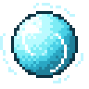</a></p><p></p></div><div style="flex:0 1 120px;border:1px solid #8a94a3;border-radius:16px;text-align:center"><p><a href="https://raw.githubusercontent.com/AllensCreations/MCPE-Curseforges/main/MCPEDL/Addons/ALNSpiritSphere/assets/items/aln_blaze_sphere.png">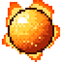</a></p><p></p></div><div style="flex:0 1 120px;border:1px solid #8a94a3;border-radius:16px;text-align:center"><p><a href="https://raw.githubusercontent.com/AllensCreations/MCPE-Curseforges/main/MCPEDL/Addons/ALNSpiritSphere/assets/items/aln_chrono_sphere.png">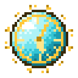</a></p><p></p></div><div style="flex:0 1 120px;border:1px solid #8a94a3;border-radius:16px;text-align:center"><p><a href="https://raw.githubusercontent.com/AllensCreations/MCPE-Curseforges/main/MCPEDL/Addons/ALNSpiritSphere/assets/items/aln_frost_sphere.png"></a></p><p></p></div><div style="flex:0 1 120px;border:1px solid #8a94a3;border-radius:16px;text-align:center"><p><a href="https://raw.githubusercontent.com/AllensCreations/MCPE-Curseforges/main/MCPEDL/Addons/ALNSpiritSphere/assets/items/aln_gravity_sphere.png">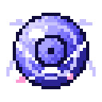</a></p><p></p></div><div style="flex:0 1 120px;border:1px solid #8a94a3;border-radius:16px;text-align:center"><p><a href="https://raw.githubusercontent.com/AllensCreations/MCPE-Curseforges/main/MCPEDL/Addons/ALNSpiritSphere/assets/items/aln_life_sphere.png">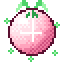</a></p><p></p></div><div style="flex:0 1 120px;border:1px solid #8a94a3;border-radius:16px;text-align:center"><p><a href="https://raw.githubusercontent.com/AllensCreations/MCPE-Curseforges/main/MCPEDL/Addons/ALNSpiritSphere/assets/items/aln_orb_core.png">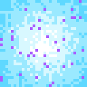</a></p><p></p></div><div style="flex:0 1 120px;border:1px solid #8a94a3;border-radius:16px;text-align:center"><p><a href="https://raw.githubusercontent.com/AllensCreations/MCPE-Curseforges/main/MCPEDL/Addons/ALNSpiritSphere/assets/items/aln_spirit_focus.png">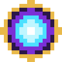</a></p><p></p></div><div style="flex:0 1 120px;border:1px solid #8a94a3;border-radius:16px;text-align:center"><p><a href="https://raw.githubusercontent.com/AllensCreations/MCPE-Curseforges/main/MCPEDL/Addons/ALNSpiritSphere/assets/items/aln_storm_sphere.png">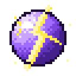</a></p><p></p></div><div style="flex:0 1 120px;border:1px solid #8a94a3;border-radius:16px;text-align:center"><p><a href="https://raw.githubusercontent.com/AllensCreations/MCPE-Curseforges/main/MCPEDL/Addons/ALNSpiritSphere/assets/items/aln_terra_sphere.png">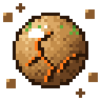</a></p><p></p></div><div style="flex:0 1 120px;border:1px solid #8a94a3;border-radius:16px;text-align:center"><p><a href="https://raw.githubusercontent.com/AllensCreations/MCPE-Curseforges/main/MCPEDL/Addons/ALNSpiritSphere/assets/items/aln_toxic_sphere.png">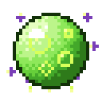</a></p><p></p></div><div style="flex:0 1 120px;border:1px solid #8a94a3;border-radius:16px;text-align:center"><p><a href="https://raw.githubusercontent.com/AllensCreations/MCPE-Curseforges/main/MCPEDL/Addons/ALNSpiritSphere/assets/items/aln_void_sphere.png">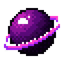</a></p><p></p></div></div>
<h2 style="font-size:17px;text-align:left"><span style="background-color:#15803d;color:#ffffff;border-radius:20px">&nbsp;&nbsp;Crafting Recipes&nbsp;&nbsp;</span></h2>
<div style="display:flex;flex-wrap:wrap;gap:10px"><div style="flex:0 1 400px;border:1px solid #8a94a3;border-radius:16px;text-align:center"><p><a href="https://raw.githubusercontent.com/AllensCreations/MCPE-Curseforges/main/MCPEDL/Addons/ALNSpiritSphere/assets/recipes/aero_sphere_aero_sphere_wind_charge_recipe.png">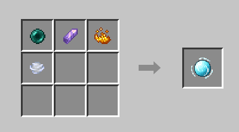</a></p><p></p></div><div style="flex:0 1 400px;border:1px solid #8a94a3;border-radius:16px;text-align:center"><p><a href="https://raw.githubusercontent.com/AllensCreations/MCPE-Curseforges/main/MCPEDL/Addons/ALNSpiritSphere/assets/recipes/aero_sphere_recipe.gif">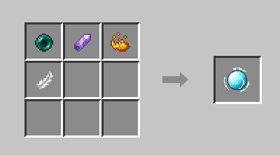</a></p><p></p></div><div style="flex:0 1 400px;border:1px solid #8a94a3;border-radius:16px;text-align:center"><p><a href="https://raw.githubusercontent.com/AllensCreations/MCPE-Curseforges/main/MCPEDL/Addons/ALNSpiritSphere/assets/recipes/aero_sphere_recipe.png"></a></p><p></p></div><div style="flex:0 1 400px;border:1px solid #8a94a3;border-radius:16px;text-align:center"><p><a href="https://raw.githubusercontent.com/AllensCreations/MCPE-Curseforges/main/MCPEDL/Addons/ALNSpiritSphere/assets/recipes/blaze_sphere_recipe.png">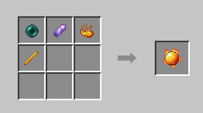</a></p><p></p></div><div style="flex:0 1 400px;border:1px solid #8a94a3;border-radius:16px;text-align:center"><p><a href="https://raw.githubusercontent.com/AllensCreations/MCPE-Curseforges/main/MCPEDL/Addons/ALNSpiritSphere/assets/recipes/chrono_sphere_recipe.png">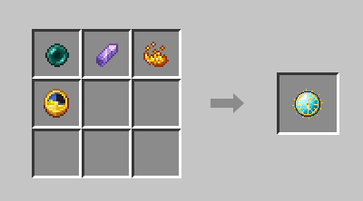</a></p><p></p></div><div style="flex:0 1 400px;border:1px solid #8a94a3;border-radius:16px;text-align:center"><p><a href="https://raw.githubusercontent.com/AllensCreations/MCPE-Curseforges/main/MCPEDL/Addons/ALNSpiritSphere/assets/recipes/frost_sphere_recipe.png">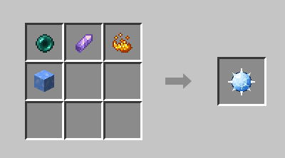</a></p><p></p></div><div style="flex:0 1 400px;border:1px solid #8a94a3;border-radius:16px;text-align:center"><p><a href="https://raw.githubusercontent.com/AllensCreations/MCPE-Curseforges/main/MCPEDL/Addons/ALNSpiritSphere/assets/recipes/gravity_sphere_recipe.png">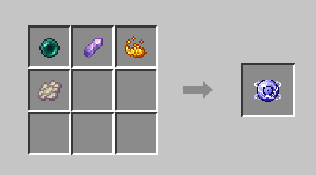</a></p><p></p></div><div style="flex:0 1 400px;border:1px solid #8a94a3;border-radius:16px;text-align:center"><p><a href="https://raw.githubusercontent.com/AllensCreations/MCPE-Curseforges/main/MCPEDL/Addons/ALNSpiritSphere/assets/recipes/life_sphere_recipe.png">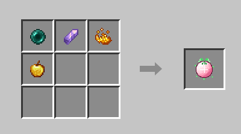</a></p><p></p></div><div style="flex:0 1 400px;border:1px solid #8a94a3;border-radius:16px;text-align:center"><p><a href="https://raw.githubusercontent.com/AllensCreations/MCPE-Curseforges/main/MCPEDL/Addons/ALNSpiritSphere/assets/recipes/spirit_focus_recipe.png">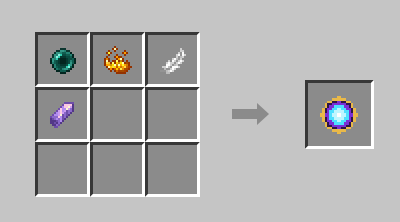</a></p><p></p></div><div style="flex:0 1 400px;border:1px solid #8a94a3;border-radius:16px;text-align:center"><p><a href="https://raw.githubusercontent.com/AllensCreations/MCPE-Curseforges/main/MCPEDL/Addons/ALNSpiritSphere/assets/recipes/spirit_focus_spirit_focus_wind_charge_recipe.png">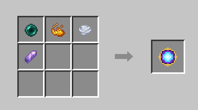</a></p><p></p></div><div style="flex:0 1 400px;border:1px solid #8a94a3;border-radius:16px;text-align:center"><p><a href="https://raw.githubusercontent.com/AllensCreations/MCPE-Curseforges/main/MCPEDL/Addons/ALNSpiritSphere/assets/recipes/storm_sphere_recipe.png">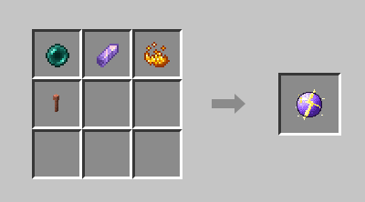</a></p><p></p></div><div style="flex:0 1 400px;border:1px solid #8a94a3;border-radius:16px;text-align:center"><p><a href="https://raw.githubusercontent.com/AllensCreations/MCPE-Curseforges/main/MCPEDL/Addons/ALNSpiritSphere/assets/recipes/terra_sphere_recipe.png">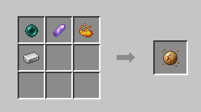</a></p><p></p></div><div style="flex:0 1 400px;border:1px solid #8a94a3;border-radius:16px;text-align:center"><p><a href="https://raw.githubusercontent.com/AllensCreations/MCPE-Curseforges/main/MCPEDL/Addons/ALNSpiritSphere/assets/recipes/toxic_sphere_recipe.png">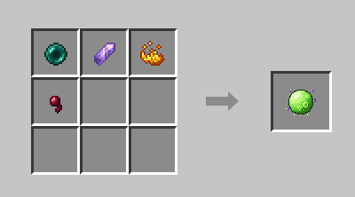</a></p><p></p></div><div style="flex:0 1 400px;border:1px solid #8a94a3;border-radius:16px;text-align:center"><p><a href="https://raw.githubusercontent.com/AllensCreations/MCPE-Curseforges/main/MCPEDL/Addons/ALNSpiritSphere/assets/recipes/void_sphere_recipe.png">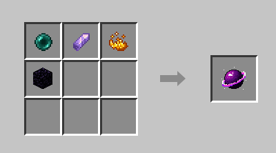</a></p><p></p></div></div>
<h2 style="font-size:17px;text-align:left"><span style="background-color:#15803d;color:#ffffff;border-radius:20px">&nbsp;&nbsp;Get Started&nbsp;&nbsp;</span></h2>
<table style="width:100%;border:1px solid #8a94a3;border-radius:16px"><tbody><tr><td style="width:44px;text-align:center"><div style="background-color:#15803d;color:#ffffff;font-weight:bold;font-size:15px;text-align:center;border-radius:10px;width:30px;aspect-ratio:1/1;line-height:30px">1</div></td><td style="text-align:left;">Craft a sphere from an Ender Pearl, an Amethyst Shard, Blaze Powder and its element item, such as a Wind Charge or Feather for Aero Vortex or a Clock for Chrono Stasis.</td></tr><tr><td style="width:44px;text-align:center"><div style="background-color:#15803d;color:#ffffff;font-weight:bold;font-size:15px;text-align:center;border-radius:10px;width:30px;aspect-ratio:1/1;line-height:30px">2</div></td><td style="text-align:left;">Hold use. The view zooms in, a tone rises and the three charge phases build in your hand.</td></tr><tr><td style="width:44px;text-align:center"><div style="background-color:#15803d;color:#ffffff;font-weight:bold;font-size:15px;text-align:center;border-radius:10px;width:30px;aspect-ratio:1/1;line-height:30px">3</div></td><td style="text-align:left;">Release to fire the orb along your aim. Release early for a slow lob, or release between 50 and 62 ticks for the strongest shot. Holding longer weakens it.</td></tr><tr><td style="width:44px;text-align:center"><div style="background-color:#15803d;color:#ffffff;font-weight:bold;font-size:15px;text-align:center;border-radius:10px;width:30px;aspect-ratio:1/1;line-height:30px">4</div></td><td style="text-align:left;">Pick another sphere from the hotbar to change the element. The action bar shows the element while you charge.</td></tr></tbody></table>
<h2 style="font-size:17px;text-align:left"><span style="background-color:#15803d;color:#ffffff;border-radius:20px">&nbsp;&nbsp;Install&nbsp;&nbsp;</span></h2>
<table style="width:100%;border:1px solid #8a94a3;border-radius:16px"><tbody><tr><td style="width:44px;text-align:center"><div style="background-color:#15803d;color:#ffffff;font-weight:bold;font-size:15px;text-align:center;border-radius:10px;width:30px;aspect-ratio:1/1;line-height:30px">1</div></td><td style="text-align:left;">Download the file from this page and open it with Minecraft.</td></tr><tr><td style="width:44px;text-align:center"><div style="background-color:#15803d;color:#ffffff;font-weight:bold;font-size:15px;text-align:center;border-radius:10px;width:30px;aspect-ratio:1/1;line-height:30px">2</div></td><td style="text-align:left;">Create or edit a world and turn on the new pack(s) in its settings.</td></tr><tr><td style="width:44px;text-align:center"><div style="background-color:#15803d;color:#ffffff;font-weight:bold;font-size:15px;text-align:center;border-radius:10px;width:30px;aspect-ratio:1/1;line-height:30px">3</div></td><td style="text-align:left;">Play. No Experimental toggles needed.</td></tr></tbody></table>
<div style="border:1px solid #8a94a3;border-radius:16px;text-align:center"><br><div style="background-color:#15803d;color:#ffffff;border-radius:20px;font-size:15px;line-height:2;display:inline-block">&nbsp;&nbsp;<strong>Found a Bug or Have a Suggestion?</strong>&nbsp;&nbsp;</div><p style="font-size:14px;">Please leave a comment on this project page! All bug reports, gameplay feedback, and pack suggestions are welcome and appreciated.</p></div>
<h2 style="font-size:17px;text-align:left"><span style="background-color:#15803d;color:#ffffff;border-radius:20px">&nbsp;&nbsp;Support&nbsp;&nbsp;</span></h2><div style="border:1px solid #8a94a3;border-radius:16px;text-align:center"><br><a href="https://ko-fi.com/alnstudios"></a><br><br></div><p style="text-align:center"><a href="https://www.curseforge.com/members/allenscreations/projects"><strong>CurseForge</strong></a> &nbsp;|&nbsp; <a href="https://mcpedl.com/user/alnstudios/"><strong>MCPEDL</strong></a> &nbsp;|&nbsp; <a href="https://ko-fi.com/alnstudios"><strong>Ko-fi</strong></a></p>
<hr>
<p style="text-align:center;color:#8a94a3;font-size:13px"><strong>By ALNStudios</strong></p>
<div class="spoiler"><p style="font-size:13px"><strong>Permissions and credits</strong></p><ul style="font-size:13px"><li>Rights: All rights reserved for ALNStudios.</li><li>Content creators: You may feature this creation in videos and streams with credit to ALNStudios.</li><li>Redistribution: Do not re-upload this pack or provide direct monetized download bypasses. Link to this page.</li><li>Visual: Promotional/cover imagery used on this page is AI-generated to illustrate the concept and purpose of the pack.</li><li>Unofficial community creation. Not an official Minecraft product and not approved by or associated with Mojang or Microsoft.</li></ul></div>
<p style="text-align:center;color:#8a94a3;font-size:12px">Minecraft Bedrock add-on, ALN:SpiritSphere Bedrock mod, Spirit Sphere, charge projectile, bow zoom, elemental orb, Ghast fireball, MCPEDL add-on, CurseForge Bedrock, ALNStudios.</p></div>
```

## AI Image Prompts

### Reference Images

- **Logo reference**: attach your own logo. The generator uses it only for brand colors and mood. The result must be a new design, not a copy.
- **Snapshot references**: attach 1 to 4 of your in-game snapshots of this pack. The generator copies their look, not their screen layout.

### Logo Prompt

```text
Use the attached logo only as a brand reference for its color palette and overall mood. Do not copy it. Create a new, original logo with a different composition and a different main symbol. Do not just recolor, resize, crop, mirror or tweak the attached logo.
Create a clean, square (1:1) logo image for the Minecraft Bedrock add-on "ALN:SpiritSphere". Craft 1 of 10 elemental Spirit Spheres, charge it with a zooming bow-style draw, and fire an orb that peaks at 2.5 seconds.
Base the main symbol on the pack idea above. Match the blocky look of the attached in-game snapshots. Center the logo, use a simple background, and keep it readable at small sizes.
Text: "ALN:SpiritSphere" and, in small letters, "ALNStudios". ALNStudios is the brand name, so always keep it and never remove or change it. Spell both exactly.
Do not add Minecraft, Mojang or Microsoft logos, watermarks, or characters from other games.
```

### Banner Prompt

```text
Create a wide (16:9) banner image for the Minecraft Bedrock add-on "ALN:SpiritSphere". Craft 1 of 10 elemental Spirit Spheres, charge it with a zooming bow-style draw, and fire an orb that peaks at 2.5 seconds.
Use the attached in-game snapshots as scene and style references: copy their blocky look, lighting, colors and the kind of scenery they show. Make a new composition inspired by them. Do not copy the on-screen HUD, chat or hotbar.
Use the attached logo only as a brand reference for its colors and mood. Do not copy it. Put a new, original logo design in the banner, large enough to read, on the left or center.
Hint at these pack features visually: Ten Spirit Spheres, Hold to Charge, Zoom and Charge Sound, Phase 1: Loose Ring, Phase 2: Compression.
Text: "ALN:SpiritSphere" and, in small letters, "by ALNStudios". ALNStudios is the brand name, so always keep it and never remove or change it. Spell both exactly.
Leave clear space around the logo. No Minecraft, Mojang or Microsoft logos, no watermarks.
```
