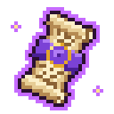
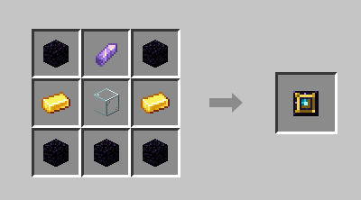
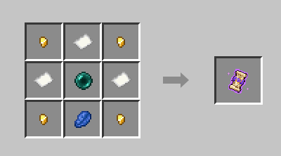

# Listing Kit: ALN:WarpScrolls

Tap the Copy button on a block, then paste it into the CurseForge listing. Generated from DESCRIPTION.md: edit that, not this file.

## Package Name

```text
ALN:WarpScrolls
```

## Summary (115/256)

```text
Craft a Warp Scroll, pick a named Beacon Gate, and teleport after a 3-second Nausea charge that uses the scroll up.
```

## Description (HTML)

Choose any of the 5 themes below. Tap the Copy button on your preferred theme and paste into the CurseForge description editor in source (HTML) mode.

### Theme 1: Vanilla Adaptive (Default)

Theme-neutral layout following the viewer's CurseForge light or dark mode.

```html
<div><div style="border:2px solid #15803d;border-radius:18px;line-height:1.5"><br><p style="text-align:center"></p><p style="color:#8a94a3;font-size:14px;text-align:center">by ALNStudios</p><p style="text-align:center"><span style="background-color:#15803d;color:#ffffff;border-radius:20px;font-size:16px">&nbsp;&nbsp;<strong>Craft a Warp Scroll, pick a named Beacon Gate, and teleport after a 3-second Nausea charge that uses the scroll up.</strong>&nbsp;&nbsp;</span></p><p style="text-align:center;margin-left:16px;margin-right:16px">This add-on adds the Beacon Gate block and the single-use Warp Scroll, both with 32x32 textures. Players name their own waypoints and jump between them across the Overworld, Nether and End.</p><div style="display:flex;flex-wrap:wrap;gap:8px;margin-left:14px;margin-right:14px"><div style="background-color:#dcfce7;color:#14532d;border-radius:20px;font-size:14px;line-height:2"><strong>&nbsp;&nbsp;Bedrock</strong>: 1.26+&nbsp;&nbsp;</div><div style="background-color:#dcfce7;color:#14532d;border-radius:20px;font-size:14px;line-height:2"><strong>&nbsp;&nbsp;Experimental</strong>: No&nbsp;&nbsp;</div><div style="background-color:#dcfce7;color:#14532d;border-radius:20px;font-size:14px;line-height:2"><strong>&nbsp;&nbsp;Achievements</strong>: Yes, achievement-friendly&nbsp;&nbsp;</div></div><br></div>
<p></p>
<p>Place a Beacon Gate wherever you want a destination and give it a name. Later, right-click a Warp Scroll, choose a gate from the colored list and wait out the 3-second charge. You arrive on top of the gate and the scroll is gone, so every trip costs one scroll.</p>
<p></p>
<div style="display:flex;flex-wrap:wrap;gap:10px"><div style="flex:1;min-width:200px;border:1px solid #8a94a3;border-radius:16px"><div style="background-color:#15803d;color:#ffffff;border-radius:16px;font-size:16px;line-height:2.2"><strong>&nbsp;&nbsp;Beacon Gate</strong></div><div style="margin-left:12px;margin-right:12px"><p><span>Place a Beacon Gate and a form asks for a waypoint name such as Home Base. The gate glows at light level 10 and is saved with its name and dimension.</span><br><span style="font-size:13px;color:#8a94a3"><strong>How It Works:</strong> Craft it with 5 Obsidian, 1 Amethyst Shard, 2 Gold Ingots and 1 Glass in a crafting table.</span><br><span style="font-size:13px;color:#8a94a3"><strong>Good To Know:</strong> Breaking a gate removes it from the destination list and drops the block. The world keeps up to 100 gates.</span></p></div></div><div style="flex:1;min-width:200px;border:1px solid #8a94a3;border-radius:16px"><div style="background-color:#15803d;color:#ffffff;border-radius:16px;font-size:16px;line-height:2.2"><strong>&nbsp;&nbsp;Warp Scroll</strong></div><div style="margin-left:12px;margin-right:12px"><p><span>Right-click a Warp Scroll to open a menu of every Beacon Gate. Names are green for the Overworld, red for the Nether and purple for The End, with no coordinates shown.</span><br><span style="font-size:13px;color:#8a94a3"><strong>How It Works:</strong> Craft it with 4 Gold Nuggets, 3 Paper, 1 Ender Pearl and 1 Lapis Lazuli in a crafting table.</span><br><span style="font-size:13px;color:#8a94a3"><strong>Good To Know:</strong> A Warp Scroll stacks to 1 and is used up when the teleport finishes.</span></p></div></div><div style="flex:1;min-width:200px;border:1px solid #8a94a3;border-radius:16px"><div style="background-color:#15803d;color:#ffffff;border-radius:16px;font-size:16px;line-height:2.2"><strong>&nbsp;&nbsp;3-Second Warp Sequence</strong></div><div style="margin-left:12px;margin-right:12px"><p><span>After you pick a gate, the scroll shows a 3-second cooldown sweep, you get 3 seconds of stronger Nausea, your eyelids slowly close over the screen, a hollow sphere of portal particles rises from your feet to above your head, and a pillar of light shoots up from you while a rising charge sound plays.</span><br><span style="font-size:13px;color:#8a94a3"><strong>How It Works:</strong> When the 3 seconds end, your eyes snap open, you land on the block directly above the Beacon Gate, a second sphere rises around you, a light beam shines over the gate for a couple of seconds, an arrival chime and particle burst play, and the scroll tears apart.</span><br><span style="font-size:13px;color:#8a94a3"><strong>Good To Know:</strong> Moving during the charge cancels the warp, and so does the scroll leaving your inventory. A cancelled warp keeps the scroll. The eyelid screen comes from the Resource Pack, so keep it enabled with the Behavior Pack.</span></p></div></div><div style="flex:1;min-width:200px;border:1px solid #8a94a3;border-radius:16px"><div style="background-color:#15803d;color:#ffffff;border-radius:16px;font-size:16px;line-height:2.2"><strong>&nbsp;&nbsp;Custom Sound Effects</strong></div><div style="margin-left:12px;margin-right:12px"><p><span>Four new sounds ship with the pack: the warp charge, the crystal arrival, the paper and glass scroll break, and the gate registration chime.</span><br><span style="font-size:13px;color:#8a94a3"><strong>Good To Know:</strong> Minecraft needs a full restart after installing a pack with new sound files.</span></p></div></div></div>
<p></p>
<div style="display:flex;flex-wrap:wrap;gap:10px;justify-content:center"><div style="flex:0 1 120px;border:1px solid #8a94a3;border-radius:16px;text-align:center"><p style="text-align:center"></p><p style="text-align:center"></p></div></div>
<p></p>
<div style="display:flex;flex-wrap:wrap;gap:10px;justify-content:center"><div style="flex:0 1 400px;border:1px solid #8a94a3;border-radius:16px;text-align:center"><p style="text-align:center"></p><p style="text-align:center"></p></div><div style="flex:0 1 400px;border:1px solid #8a94a3;border-radius:16px;text-align:center"><p style="text-align:center"></p><p style="text-align:center"></p></div></div>
<p></p>
<table style="width:100%;border:1px solid #8a94a3;border-radius:16px"><tbody><tr><td style="width:44px;text-align:center"><div style="background-color:#15803d;color:#ffffff;font-weight:bold;font-size:15px;text-align:center;border-radius:10px;width:30px;aspect-ratio:1/1;line-height:30px">1</div></td><td style="text-align:left;">Craft a Beacon Gate and place it, then type a waypoint name in the form.</td></tr><tr><td style="width:44px;text-align:center"><div style="background-color:#15803d;color:#ffffff;font-weight:bold;font-size:15px;text-align:center;border-radius:10px;width:30px;aspect-ratio:1/1;line-height:30px">2</div></td><td style="text-align:left;">Craft a Warp Scroll and right-click it to open the destination menu.</td></tr><tr><td style="width:44px;text-align:center"><div style="background-color:#15803d;color:#ffffff;font-weight:bold;font-size:15px;text-align:center;border-radius:10px;width:30px;aspect-ratio:1/1;line-height:30px">3</div></td><td style="text-align:left;">Pick a gate and stand still for 3 seconds until you land above it and the scroll breaks.</td></tr></tbody></table>
<p></p>
<div class="spoiler" title="Does a Warp Scroll stack?" data-title="Does a Warp Scroll stack?"><p><strong>Does a Warp Scroll stack?</strong><br>No. Each scroll stacks to 1 and is used up on arrival.</p></div><div class="spoiler" title="What happens when I break a Beacon Gate?" data-title="What happens when I break a Beacon Gate?"><p><strong>What happens when I break a Beacon Gate?</strong><br>It leaves the destination list and drops as a block you can place again.</p></div>
<p></p>
<table style="width:100%;border:1px solid #8a94a3;border-radius:16px"><tbody><tr><td style="width:44px;text-align:center"><div style="background-color:#15803d;color:#ffffff;font-weight:bold;font-size:15px;text-align:center;border-radius:10px;width:30px;aspect-ratio:1/1;line-height:30px">1</div></td><td style="text-align:left;">Download the file from this page and open it with Minecraft.</td></tr><tr><td style="width:44px;text-align:center"><div style="background-color:#15803d;color:#ffffff;font-weight:bold;font-size:15px;text-align:center;border-radius:10px;width:30px;aspect-ratio:1/1;line-height:30px">2</div></td><td style="text-align:left;">Create or edit a world and turn on the new pack(s) in its settings.</td></tr><tr><td style="width:44px;text-align:center"><div style="background-color:#15803d;color:#ffffff;font-weight:bold;font-size:15px;text-align:center;border-radius:10px;width:30px;aspect-ratio:1/1;line-height:30px">3</div></td><td style="text-align:left;">Play. No Experimental toggles needed.</td></tr></tbody></table>
<div style="border:1px solid #8a94a3;border-radius:16px;text-align:center"><br><div style="background-color:#15803d;color:#ffffff;border-radius:20px;font-size:15px;line-height:2;display:inline-block">&nbsp;&nbsp;<strong>Found a Bug or Have a Suggestion?</strong>&nbsp;&nbsp;</div><p style="font-size:14px;">Please leave a comment on this project page! All bug reports, gameplay feedback, and pack suggestions are welcome and appreciated.</p></div>
<p></p><div style="border:1px solid #8a94a3;border-radius:16px;text-align:center"><br><a href="https://ko-fi.com/alnstudios"></a><br><br></div><p style="text-align:center"><a href="https://www.curseforge.com/members/allenscreations/projects"><strong>CurseForge</strong></a> &nbsp;|&nbsp; <a href="https://mcpedl.com/user/alnstudios/"><strong>MCPEDL</strong></a> &nbsp;|&nbsp; <a href="https://ko-fi.com/alnstudios"><strong>Ko-fi</strong></a></p>
<hr>
<p style="text-align:center;color:#8a94a3;font-size:13px"><strong>By ALNStudios</strong></p>
<div class="spoiler"><p style="font-size:13px"><strong>Permissions and credits</strong></p><ul style="font-size:13px"><li>Rights: All rights reserved for ALNStudios.</li><li>Content creators: You may feature this creation in videos and streams with credit to ALNStudios.</li><li>Redistribution: Do not re-upload this pack or provide direct monetized download bypasses. Link to this page.</li><li>Visual: Promotional/cover imagery used on this page is AI-generated to illustrate the concept and purpose of the pack.</li><li>Unofficial community creation. Not an official Minecraft product and not approved by or associated with Mojang or Microsoft.</li></ul></div>
<p style="text-align:center;color:#8a94a3;font-size:12px">Minecraft Bedrock add-on, ALN:WarpScrolls Bedrock mod, teleport scroll, waypoint block, Beacon Gate, Warp Scroll, custom sound effects, Minecraft PE survival, MCPEDL add-on, CurseForge Bedrock, ALNStudios.</p></div>
```

### Theme 2: Netherite Stealth (Modern Dark)

High-tech dark obsidian & emerald storefront.

```html
<div style="background-color:#0d1117;color:#c9d1d9;border-radius:12px;padding-left:12px"><div style="margin-right:12px"><br><div style="background-color:#161b22;border:2px solid #10b981;border-radius:18px;line-height:1.5"><br><p style="text-align:center"></p><p style="color:#8b949e;font-size:14px;text-align:center">by ALNStudios</p><p style="text-align:center"><span style="background-color:#10b981;color:#ffffff;border-radius:20px;font-size:16px">&nbsp;&nbsp;<strong>Craft a Warp Scroll, pick a named Beacon Gate, and teleport after a 3-second Nausea charge that uses the scroll up.</strong>&nbsp;&nbsp;</span></p><p style="color:#8b949e;text-align:center;margin-left:16px;margin-right:16px">This add-on adds the Beacon Gate block and the single-use Warp Scroll, both with 32x32 textures. Players name their own waypoints and jump between them across the Overworld, Nether and End.</p><div style="display:flex;flex-wrap:wrap;gap:8px;margin-left:14px;margin-right:14px"><div style="background-color:#161b22;color:#10b981;border-radius:20px;font-size:14px;line-height:2"><strong>&nbsp;&nbsp;Bedrock</strong>: 1.26+&nbsp;&nbsp;</div><div style="background-color:#161b22;color:#10b981;border-radius:20px;font-size:14px;line-height:2"><strong>&nbsp;&nbsp;Experimental</strong>: No&nbsp;&nbsp;</div><div style="background-color:#161b22;color:#10b981;border-radius:20px;font-size:14px;line-height:2"><strong>&nbsp;&nbsp;Achievements</strong>: Yes, achievement-friendly&nbsp;&nbsp;</div></div><br></div>
<p></p>
<p style="color:#c9d1d9">Place a Beacon Gate wherever you want a destination and give it a name. Later, right-click a Warp Scroll, choose a gate from the colored list and wait out the 3-second charge. You arrive on top of the gate and the scroll is gone, so every trip costs one scroll.</p>
<p></p>
<div style="display:flex;flex-wrap:wrap;gap:10px"><div style="flex:1;min-width:200px;background-color:#161b22;border:1px solid #30363d;border-radius:16px"><div style="background-color:#10b981;color:#ffffff;border-radius:16px;font-size:16px;line-height:2.2"><strong>&nbsp;&nbsp;Beacon Gate</strong></div><div style="margin-left:12px;margin-right:12px"><p><span style="color:#c9d1d9">Place a Beacon Gate and a form asks for a waypoint name such as Home Base. The gate glows at light level 10 and is saved with its name and dimension.</span><br><span style="font-size:13px;color:#8b949e"><strong>How It Works:</strong> Craft it with 5 Obsidian, 1 Amethyst Shard, 2 Gold Ingots and 1 Glass in a crafting table.</span><br><span style="font-size:13px;color:#8b949e"><strong>Good To Know:</strong> Breaking a gate removes it from the destination list and drops the block. The world keeps up to 100 gates.</span></p></div></div><div style="flex:1;min-width:200px;background-color:#161b22;border:1px solid #30363d;border-radius:16px"><div style="background-color:#10b981;color:#ffffff;border-radius:16px;font-size:16px;line-height:2.2"><strong>&nbsp;&nbsp;Warp Scroll</strong></div><div style="margin-left:12px;margin-right:12px"><p><span style="color:#c9d1d9">Right-click a Warp Scroll to open a menu of every Beacon Gate. Names are green for the Overworld, red for the Nether and purple for The End, with no coordinates shown.</span><br><span style="font-size:13px;color:#8b949e"><strong>How It Works:</strong> Craft it with 4 Gold Nuggets, 3 Paper, 1 Ender Pearl and 1 Lapis Lazuli in a crafting table.</span><br><span style="font-size:13px;color:#8b949e"><strong>Good To Know:</strong> A Warp Scroll stacks to 1 and is used up when the teleport finishes.</span></p></div></div><div style="flex:1;min-width:200px;background-color:#161b22;border:1px solid #30363d;border-radius:16px"><div style="background-color:#10b981;color:#ffffff;border-radius:16px;font-size:16px;line-height:2.2"><strong>&nbsp;&nbsp;3-Second Warp Sequence</strong></div><div style="margin-left:12px;margin-right:12px"><p><span style="color:#c9d1d9">After you pick a gate, the scroll shows a 3-second cooldown sweep, you get 3 seconds of stronger Nausea, your eyelids slowly close over the screen, a hollow sphere of portal particles rises from your feet to above your head, and a pillar of light shoots up from you while a rising charge sound plays.</span><br><span style="font-size:13px;color:#8b949e"><strong>How It Works:</strong> When the 3 seconds end, your eyes snap open, you land on the block directly above the Beacon Gate, a second sphere rises around you, a light beam shines over the gate for a couple of seconds, an arrival chime and particle burst play, and the scroll tears apart.</span><br><span style="font-size:13px;color:#8b949e"><strong>Good To Know:</strong> Moving during the charge cancels the warp, and so does the scroll leaving your inventory. A cancelled warp keeps the scroll. The eyelid screen comes from the Resource Pack, so keep it enabled with the Behavior Pack.</span></p></div></div><div style="flex:1;min-width:200px;background-color:#161b22;border:1px solid #30363d;border-radius:16px"><div style="background-color:#10b981;color:#ffffff;border-radius:16px;font-size:16px;line-height:2.2"><strong>&nbsp;&nbsp;Custom Sound Effects</strong></div><div style="margin-left:12px;margin-right:12px"><p><span style="color:#c9d1d9">Four new sounds ship with the pack: the warp charge, the crystal arrival, the paper and glass scroll break, and the gate registration chime.</span><br><span style="font-size:13px;color:#8b949e"><strong>Good To Know:</strong> Minecraft needs a full restart after installing a pack with new sound files.</span></p></div></div></div>
<p></p>
<div style="display:flex;flex-wrap:wrap;gap:10px;justify-content:center"><div style="flex:0 1 120px;background-color:#161b22;border:1px solid #30363d;border-radius:16px;text-align:center"><p style="text-align:center"></p><p style="text-align:center"></p></div></div>
<p></p>
<div style="display:flex;flex-wrap:wrap;gap:10px;justify-content:center"><div style="flex:0 1 400px;background-color:#161b22;border:1px solid #30363d;border-radius:16px;text-align:center"><p style="text-align:center"></p><p style="text-align:center"></p></div><div style="flex:0 1 400px;background-color:#161b22;border:1px solid #30363d;border-radius:16px;text-align:center"><p style="text-align:center"></p><p style="text-align:center"></p></div></div>
<p></p>
<table style="width:100%;border:1px solid #30363d;border-radius:16px"><tbody><tr><td style="width:44px;text-align:center"><div style="background-color:#10b981;color:#ffffff;font-weight:bold;font-size:15px;text-align:center;border-radius:10px;width:30px;aspect-ratio:1/1;line-height:30px">1</div></td><td style="text-align:left;color:#c9d1d9">Craft a Beacon Gate and place it, then type a waypoint name in the form.</td></tr><tr><td style="width:44px;text-align:center"><div style="background-color:#10b981;color:#ffffff;font-weight:bold;font-size:15px;text-align:center;border-radius:10px;width:30px;aspect-ratio:1/1;line-height:30px">2</div></td><td style="text-align:left;color:#c9d1d9">Craft a Warp Scroll and right-click it to open the destination menu.</td></tr><tr><td style="width:44px;text-align:center"><div style="background-color:#10b981;color:#ffffff;font-weight:bold;font-size:15px;text-align:center;border-radius:10px;width:30px;aspect-ratio:1/1;line-height:30px">3</div></td><td style="text-align:left;color:#c9d1d9">Pick a gate and stand still for 3 seconds until you land above it and the scroll breaks.</td></tr></tbody></table>
<p></p>
<div class="spoiler" title="Does a Warp Scroll stack?" data-title="Does a Warp Scroll stack?"><p style="color:#c9d1d9"><strong>Does a Warp Scroll stack?</strong><br>No. Each scroll stacks to 1 and is used up on arrival.</p></div><div class="spoiler" title="What happens when I break a Beacon Gate?" data-title="What happens when I break a Beacon Gate?"><p style="color:#c9d1d9"><strong>What happens when I break a Beacon Gate?</strong><br>It leaves the destination list and drops as a block you can place again.</p></div>
<p></p>
<table style="width:100%;border:1px solid #30363d;border-radius:16px"><tbody><tr><td style="width:44px;text-align:center"><div style="background-color:#10b981;color:#ffffff;font-weight:bold;font-size:15px;text-align:center;border-radius:10px;width:30px;aspect-ratio:1/1;line-height:30px">1</div></td><td style="text-align:left;color:#c9d1d9">Download the file from this page and open it with Minecraft.</td></tr><tr><td style="width:44px;text-align:center"><div style="background-color:#10b981;color:#ffffff;font-weight:bold;font-size:15px;text-align:center;border-radius:10px;width:30px;aspect-ratio:1/1;line-height:30px">2</div></td><td style="text-align:left;color:#c9d1d9">Create or edit a world and turn on the new pack(s) in its settings.</td></tr><tr><td style="width:44px;text-align:center"><div style="background-color:#10b981;color:#ffffff;font-weight:bold;font-size:15px;text-align:center;border-radius:10px;width:30px;aspect-ratio:1/1;line-height:30px">3</div></td><td style="text-align:left;color:#c9d1d9">Play. No Experimental toggles needed.</td></tr></tbody></table>
<div style="background-color:#161b22;border:1px solid #30363d;border-radius:16px;text-align:center"><br><div style="background-color:#10b981;color:#ffffff;border-radius:20px;font-size:15px;line-height:2;display:inline-block">&nbsp;&nbsp;<strong>Found a Bug or Have a Suggestion?</strong>&nbsp;&nbsp;</div><p style="font-size:14px;color:#c9d1d9">Please leave a comment on this project page! All bug reports, gameplay feedback, and pack suggestions are welcome and appreciated.</p></div>
<p></p><div style="background-color:#161b22;border:1px solid #30363d;border-radius:16px;text-align:center"><br><a href="https://ko-fi.com/alnstudios"></a><br><br></div><p style="text-align:center"><a style="color:#58a6ff" href="https://www.curseforge.com/members/allenscreations/projects"><strong>CurseForge</strong></a> &nbsp;|&nbsp; <a style="color:#58a6ff" href="https://mcpedl.com/user/alnstudios/"><strong>MCPEDL</strong></a> &nbsp;|&nbsp; <a style="color:#58a6ff" href="https://ko-fi.com/alnstudios"><strong>Ko-fi</strong></a></p>
<hr>
<p style="text-align:center;color:#8b949e;font-size:13px"><strong>By ALNStudios</strong></p>
<div class="spoiler"><p style="font-size:13px"><strong>Permissions and credits</strong></p><ul style="font-size:13px"><li>Rights: All rights reserved for ALNStudios.</li><li>Content creators: You may feature this creation in videos and streams with credit to ALNStudios.</li><li>Redistribution: Do not re-upload this pack or provide direct monetized download bypasses. Link to this page.</li><li>Visual: Promotional/cover imagery used on this page is AI-generated to illustrate the concept and purpose of the pack.</li><li>Unofficial community creation. Not an official Minecraft product and not approved by or associated with Mojang or Microsoft.</li></ul></div>
<p style="text-align:center;color:#8b949e;font-size:12px">Minecraft Bedrock add-on, ALN:WarpScrolls Bedrock mod, teleport scroll, waypoint block, Beacon Gate, Warp Scroll, custom sound effects, Minecraft PE survival, MCPEDL add-on, CurseForge Bedrock, ALNStudios.</p><br></div></div>
```

### Theme 3: Bedrock GUI (In-Game Menu)

Authentic Minecraft stone dialog with 3D beveled borders and item slot insets.

```html
<div style="background-color:#313233;color:#e0e0e0;border-radius:12px;padding-left:12px"><div style="margin-right:12px"><br><div style="background-color:#202021;border:2px solid #4a4b4d;border-radius:18px;line-height:1.5"><br><p style="text-align:center"></p><p style="color:#a0a0a0;font-size:14px;text-align:center">by ALNStudios</p><p style="text-align:center"><span style="background-color:#4a4b4d;color:#ffffff;border-radius:20px;font-size:16px">&nbsp;&nbsp;<strong>Craft a Warp Scroll, pick a named Beacon Gate, and teleport after a 3-second Nausea charge that uses the scroll up.</strong>&nbsp;&nbsp;</span></p><p style="color:#d0d0d0;text-align:center;margin-left:16px;margin-right:16px">This add-on adds the Beacon Gate block and the single-use Warp Scroll, both with 32x32 textures. Players name their own waypoints and jump between them across the Overworld, Nether and End.</p><div style="display:flex;flex-wrap:wrap;gap:8px;margin-left:14px;margin-right:14px"><div style="background-color:#202021;color:#ffffff;border-radius:20px;font-size:14px;line-height:2"><strong>&nbsp;&nbsp;Bedrock</strong>: 1.26+&nbsp;&nbsp;</div><div style="background-color:#202021;color:#ffffff;border-radius:20px;font-size:14px;line-height:2"><strong>&nbsp;&nbsp;Experimental</strong>: No&nbsp;&nbsp;</div><div style="background-color:#202021;color:#ffffff;border-radius:20px;font-size:14px;line-height:2"><strong>&nbsp;&nbsp;Achievements</strong>: Yes, achievement-friendly&nbsp;&nbsp;</div></div><br></div>
<p></p>
<p style="color:#e0e0e0">Place a Beacon Gate wherever you want a destination and give it a name. Later, right-click a Warp Scroll, choose a gate from the colored list and wait out the 3-second charge. You arrive on top of the gate and the scroll is gone, so every trip costs one scroll.</p>
<p></p>
<div style="display:flex;flex-wrap:wrap;gap:10px"><div style="flex:1;min-width:200px;background-color:#202021;border:1px solid #4a4b4d;border-radius:16px"><div style="background-color:#4a4b4d;color:#ffffff;border-radius:16px;font-size:16px;line-height:2.2"><strong>&nbsp;&nbsp;Beacon Gate</strong></div><div style="margin-left:12px;margin-right:12px"><p><span style="color:#e0e0e0">Place a Beacon Gate and a form asks for a waypoint name such as Home Base. The gate glows at light level 10 and is saved with its name and dimension.</span><br><span style="font-size:13px;color:#a0a0a0"><strong>How It Works:</strong> Craft it with 5 Obsidian, 1 Amethyst Shard, 2 Gold Ingots and 1 Glass in a crafting table.</span><br><span style="font-size:13px;color:#a0a0a0"><strong>Good To Know:</strong> Breaking a gate removes it from the destination list and drops the block. The world keeps up to 100 gates.</span></p></div></div><div style="flex:1;min-width:200px;background-color:#202021;border:1px solid #4a4b4d;border-radius:16px"><div style="background-color:#4a4b4d;color:#ffffff;border-radius:16px;font-size:16px;line-height:2.2"><strong>&nbsp;&nbsp;Warp Scroll</strong></div><div style="margin-left:12px;margin-right:12px"><p><span style="color:#e0e0e0">Right-click a Warp Scroll to open a menu of every Beacon Gate. Names are green for the Overworld, red for the Nether and purple for The End, with no coordinates shown.</span><br><span style="font-size:13px;color:#a0a0a0"><strong>How It Works:</strong> Craft it with 4 Gold Nuggets, 3 Paper, 1 Ender Pearl and 1 Lapis Lazuli in a crafting table.</span><br><span style="font-size:13px;color:#a0a0a0"><strong>Good To Know:</strong> A Warp Scroll stacks to 1 and is used up when the teleport finishes.</span></p></div></div><div style="flex:1;min-width:200px;background-color:#202021;border:1px solid #4a4b4d;border-radius:16px"><div style="background-color:#4a4b4d;color:#ffffff;border-radius:16px;font-size:16px;line-height:2.2"><strong>&nbsp;&nbsp;3-Second Warp Sequence</strong></div><div style="margin-left:12px;margin-right:12px"><p><span style="color:#e0e0e0">After you pick a gate, the scroll shows a 3-second cooldown sweep, you get 3 seconds of stronger Nausea, your eyelids slowly close over the screen, a hollow sphere of portal particles rises from your feet to above your head, and a pillar of light shoots up from you while a rising charge sound plays.</span><br><span style="font-size:13px;color:#a0a0a0"><strong>How It Works:</strong> When the 3 seconds end, your eyes snap open, you land on the block directly above the Beacon Gate, a second sphere rises around you, a light beam shines over the gate for a couple of seconds, an arrival chime and particle burst play, and the scroll tears apart.</span><br><span style="font-size:13px;color:#a0a0a0"><strong>Good To Know:</strong> Moving during the charge cancels the warp, and so does the scroll leaving your inventory. A cancelled warp keeps the scroll. The eyelid screen comes from the Resource Pack, so keep it enabled with the Behavior Pack.</span></p></div></div><div style="flex:1;min-width:200px;background-color:#202021;border:1px solid #4a4b4d;border-radius:16px"><div style="background-color:#4a4b4d;color:#ffffff;border-radius:16px;font-size:16px;line-height:2.2"><strong>&nbsp;&nbsp;Custom Sound Effects</strong></div><div style="margin-left:12px;margin-right:12px"><p><span style="color:#e0e0e0">Four new sounds ship with the pack: the warp charge, the crystal arrival, the paper and glass scroll break, and the gate registration chime.</span><br><span style="font-size:13px;color:#a0a0a0"><strong>Good To Know:</strong> Minecraft needs a full restart after installing a pack with new sound files.</span></p></div></div></div>
<p></p>
<div style="display:flex;flex-wrap:wrap;gap:10px;justify-content:center"><div style="flex:0 1 120px;background-color:#202021;border:1px solid #4a4b4d;border-radius:16px;text-align:center"><p style="text-align:center"></p><p style="text-align:center"></p></div></div>
<p></p>
<div style="display:flex;flex-wrap:wrap;gap:10px;justify-content:center"><div style="flex:0 1 400px;background-color:#202021;border:1px solid #4a4b4d;border-radius:16px;text-align:center"><p style="text-align:center"></p><p style="text-align:center"></p></div><div style="flex:0 1 400px;background-color:#202021;border:1px solid #4a4b4d;border-radius:16px;text-align:center"><p style="text-align:center"></p><p style="text-align:center"></p></div></div>
<p></p>
<table style="width:100%;border:1px solid #4a4b4d;border-radius:16px"><tbody><tr><td style="width:44px;text-align:center"><div style="background-color:#4a4b4d;color:#ffffff;font-weight:bold;font-size:15px;text-align:center;border-radius:10px;width:30px;aspect-ratio:1/1;line-height:30px">1</div></td><td style="text-align:left;color:#e0e0e0">Craft a Beacon Gate and place it, then type a waypoint name in the form.</td></tr><tr><td style="width:44px;text-align:center"><div style="background-color:#4a4b4d;color:#ffffff;font-weight:bold;font-size:15px;text-align:center;border-radius:10px;width:30px;aspect-ratio:1/1;line-height:30px">2</div></td><td style="text-align:left;color:#e0e0e0">Craft a Warp Scroll and right-click it to open the destination menu.</td></tr><tr><td style="width:44px;text-align:center"><div style="background-color:#4a4b4d;color:#ffffff;font-weight:bold;font-size:15px;text-align:center;border-radius:10px;width:30px;aspect-ratio:1/1;line-height:30px">3</div></td><td style="text-align:left;color:#e0e0e0">Pick a gate and stand still for 3 seconds until you land above it and the scroll breaks.</td></tr></tbody></table>
<p></p>
<div class="spoiler" title="Does a Warp Scroll stack?" data-title="Does a Warp Scroll stack?"><p style="color:#e0e0e0"><strong>Does a Warp Scroll stack?</strong><br>No. Each scroll stacks to 1 and is used up on arrival.</p></div><div class="spoiler" title="What happens when I break a Beacon Gate?" data-title="What happens when I break a Beacon Gate?"><p style="color:#e0e0e0"><strong>What happens when I break a Beacon Gate?</strong><br>It leaves the destination list and drops as a block you can place again.</p></div>
<p></p>
<table style="width:100%;border:1px solid #4a4b4d;border-radius:16px"><tbody><tr><td style="width:44px;text-align:center"><div style="background-color:#4a4b4d;color:#ffffff;font-weight:bold;font-size:15px;text-align:center;border-radius:10px;width:30px;aspect-ratio:1/1;line-height:30px">1</div></td><td style="text-align:left;color:#e0e0e0">Download the file from this page and open it with Minecraft.</td></tr><tr><td style="width:44px;text-align:center"><div style="background-color:#4a4b4d;color:#ffffff;font-weight:bold;font-size:15px;text-align:center;border-radius:10px;width:30px;aspect-ratio:1/1;line-height:30px">2</div></td><td style="text-align:left;color:#e0e0e0">Create or edit a world and turn on the new pack(s) in its settings.</td></tr><tr><td style="width:44px;text-align:center"><div style="background-color:#4a4b4d;color:#ffffff;font-weight:bold;font-size:15px;text-align:center;border-radius:10px;width:30px;aspect-ratio:1/1;line-height:30px">3</div></td><td style="text-align:left;color:#e0e0e0">Play. No Experimental toggles needed.</td></tr></tbody></table>
<div style="background-color:#202021;border:1px solid #4a4b4d;border-radius:16px;text-align:center"><br><div style="background-color:#4a4b4d;color:#ffffff;border-radius:20px;font-size:15px;line-height:2;display:inline-block">&nbsp;&nbsp;<strong>Found a Bug or Have a Suggestion?</strong>&nbsp;&nbsp;</div><p style="font-size:14px;color:#e0e0e0">Please leave a comment on this project page! All bug reports, gameplay feedback, and pack suggestions are welcome and appreciated.</p></div>
<p></p><div style="background-color:#202021;border:1px solid #4a4b4d;border-radius:16px;text-align:center"><br><a href="https://ko-fi.com/alnstudios"></a><br><br></div><p style="text-align:center"><a style="color:#55ff55" href="https://www.curseforge.com/members/allenscreations/projects"><strong>CurseForge</strong></a> &nbsp;|&nbsp; <a style="color:#55ff55" href="https://mcpedl.com/user/alnstudios/"><strong>MCPEDL</strong></a> &nbsp;|&nbsp; <a style="color:#55ff55" href="https://ko-fi.com/alnstudios"><strong>Ko-fi</strong></a></p>
<hr>
<p style="text-align:center;color:#a0a0a0;font-size:13px"><strong>By ALNStudios</strong></p>
<div class="spoiler"><p style="font-size:13px"><strong>Permissions and credits</strong></p><ul style="font-size:13px"><li>Rights: All rights reserved for ALNStudios.</li><li>Content creators: You may feature this creation in videos and streams with credit to ALNStudios.</li><li>Redistribution: Do not re-upload this pack or provide direct monetized download bypasses. Link to this page.</li><li>Visual: Promotional/cover imagery used on this page is AI-generated to illustrate the concept and purpose of the pack.</li><li>Unofficial community creation. Not an official Minecraft product and not approved by or associated with Mojang or Microsoft.</li></ul></div>
<p style="text-align:center;color:#a0a0a0;font-size:12px">Minecraft Bedrock add-on, ALN:WarpScrolls Bedrock mod, teleport scroll, waypoint block, Beacon Gate, Warp Scroll, custom sound effects, Minecraft PE survival, MCPEDL add-on, CurseForge Bedrock, ALNStudios.</p><br></div></div>
```

### Theme 4: Emerald Marketplace

Official Minecraft Marketplace DLC showcase look with gold and emerald badges.

```html
<div style="background-color:#022c22;color:#ecfdf5;border-radius:12px;padding-left:12px"><div style="margin-right:12px"><br><div style="background-color:#064e3b;border:2px solid #059669;border-radius:18px;line-height:1.5"><br><p style="text-align:center"></p><p style="color:#6ee7b7;font-size:14px;text-align:center">by ALNStudios</p><p style="text-align:center"><span style="background-color:#059669;color:#ffffff;border-radius:20px;font-size:16px">&nbsp;&nbsp;<strong>Craft a Warp Scroll, pick a named Beacon Gate, and teleport after a 3-second Nausea charge that uses the scroll up.</strong>&nbsp;&nbsp;</span></p><p style="color:#a7f3d0;text-align:center;margin-left:16px;margin-right:16px">This add-on adds the Beacon Gate block and the single-use Warp Scroll, both with 32x32 textures. Players name their own waypoints and jump between them across the Overworld, Nether and End.</p><div style="display:flex;flex-wrap:wrap;gap:8px;margin-left:14px;margin-right:14px"><div style="background-color:#047857;color:#ffffff;border-radius:20px;font-size:14px;line-height:2"><strong>&nbsp;&nbsp;Bedrock</strong>: 1.26+&nbsp;&nbsp;</div><div style="background-color:#047857;color:#ffffff;border-radius:20px;font-size:14px;line-height:2"><strong>&nbsp;&nbsp;Experimental</strong>: No&nbsp;&nbsp;</div><div style="background-color:#047857;color:#ffffff;border-radius:20px;font-size:14px;line-height:2"><strong>&nbsp;&nbsp;Achievements</strong>: Yes, achievement-friendly&nbsp;&nbsp;</div></div><br></div>
<p></p>
<p style="color:#ecfdf5">Place a Beacon Gate wherever you want a destination and give it a name. Later, right-click a Warp Scroll, choose a gate from the colored list and wait out the 3-second charge. You arrive on top of the gate and the scroll is gone, so every trip costs one scroll.</p>
<p></p>
<div style="display:flex;flex-wrap:wrap;gap:10px"><div style="flex:1;min-width:200px;background-color:#064e3b;border:1px solid #059669;border-radius:16px"><div style="background-color:#059669;color:#ffffff;border-radius:16px;font-size:16px;line-height:2.2"><strong>&nbsp;&nbsp;Beacon Gate</strong></div><div style="margin-left:12px;margin-right:12px"><p><span style="color:#ecfdf5">Place a Beacon Gate and a form asks for a waypoint name such as Home Base. The gate glows at light level 10 and is saved with its name and dimension.</span><br><span style="font-size:13px;color:#6ee7b7"><strong>How It Works:</strong> Craft it with 5 Obsidian, 1 Amethyst Shard, 2 Gold Ingots and 1 Glass in a crafting table.</span><br><span style="font-size:13px;color:#6ee7b7"><strong>Good To Know:</strong> Breaking a gate removes it from the destination list and drops the block. The world keeps up to 100 gates.</span></p></div></div><div style="flex:1;min-width:200px;background-color:#064e3b;border:1px solid #059669;border-radius:16px"><div style="background-color:#059669;color:#ffffff;border-radius:16px;font-size:16px;line-height:2.2"><strong>&nbsp;&nbsp;Warp Scroll</strong></div><div style="margin-left:12px;margin-right:12px"><p><span style="color:#ecfdf5">Right-click a Warp Scroll to open a menu of every Beacon Gate. Names are green for the Overworld, red for the Nether and purple for The End, with no coordinates shown.</span><br><span style="font-size:13px;color:#6ee7b7"><strong>How It Works:</strong> Craft it with 4 Gold Nuggets, 3 Paper, 1 Ender Pearl and 1 Lapis Lazuli in a crafting table.</span><br><span style="font-size:13px;color:#6ee7b7"><strong>Good To Know:</strong> A Warp Scroll stacks to 1 and is used up when the teleport finishes.</span></p></div></div><div style="flex:1;min-width:200px;background-color:#064e3b;border:1px solid #059669;border-radius:16px"><div style="background-color:#059669;color:#ffffff;border-radius:16px;font-size:16px;line-height:2.2"><strong>&nbsp;&nbsp;3-Second Warp Sequence</strong></div><div style="margin-left:12px;margin-right:12px"><p><span style="color:#ecfdf5">After you pick a gate, the scroll shows a 3-second cooldown sweep, you get 3 seconds of stronger Nausea, your eyelids slowly close over the screen, a hollow sphere of portal particles rises from your feet to above your head, and a pillar of light shoots up from you while a rising charge sound plays.</span><br><span style="font-size:13px;color:#6ee7b7"><strong>How It Works:</strong> When the 3 seconds end, your eyes snap open, you land on the block directly above the Beacon Gate, a second sphere rises around you, a light beam shines over the gate for a couple of seconds, an arrival chime and particle burst play, and the scroll tears apart.</span><br><span style="font-size:13px;color:#6ee7b7"><strong>Good To Know:</strong> Moving during the charge cancels the warp, and so does the scroll leaving your inventory. A cancelled warp keeps the scroll. The eyelid screen comes from the Resource Pack, so keep it enabled with the Behavior Pack.</span></p></div></div><div style="flex:1;min-width:200px;background-color:#064e3b;border:1px solid #059669;border-radius:16px"><div style="background-color:#059669;color:#ffffff;border-radius:16px;font-size:16px;line-height:2.2"><strong>&nbsp;&nbsp;Custom Sound Effects</strong></div><div style="margin-left:12px;margin-right:12px"><p><span style="color:#ecfdf5">Four new sounds ship with the pack: the warp charge, the crystal arrival, the paper and glass scroll break, and the gate registration chime.</span><br><span style="font-size:13px;color:#6ee7b7"><strong>Good To Know:</strong> Minecraft needs a full restart after installing a pack with new sound files.</span></p></div></div></div>
<p></p>
<div style="display:flex;flex-wrap:wrap;gap:10px;justify-content:center"><div style="flex:0 1 120px;background-color:#064e3b;border:1px solid #059669;border-radius:16px;text-align:center"><p style="text-align:center"></p><p style="text-align:center"></p></div></div>
<p></p>
<div style="display:flex;flex-wrap:wrap;gap:10px;justify-content:center"><div style="flex:0 1 400px;background-color:#064e3b;border:1px solid #059669;border-radius:16px;text-align:center"><p style="text-align:center"></p><p style="text-align:center"></p></div><div style="flex:0 1 400px;background-color:#064e3b;border:1px solid #059669;border-radius:16px;text-align:center"><p style="text-align:center"></p><p style="text-align:center"></p></div></div>
<p></p>
<table style="width:100%;border:1px solid #059669;border-radius:16px"><tbody><tr><td style="width:44px;text-align:center"><div style="background-color:#059669;color:#ffffff;font-weight:bold;font-size:15px;text-align:center;border-radius:10px;width:30px;aspect-ratio:1/1;line-height:30px">1</div></td><td style="text-align:left;color:#ecfdf5">Craft a Beacon Gate and place it, then type a waypoint name in the form.</td></tr><tr><td style="width:44px;text-align:center"><div style="background-color:#059669;color:#ffffff;font-weight:bold;font-size:15px;text-align:center;border-radius:10px;width:30px;aspect-ratio:1/1;line-height:30px">2</div></td><td style="text-align:left;color:#ecfdf5">Craft a Warp Scroll and right-click it to open the destination menu.</td></tr><tr><td style="width:44px;text-align:center"><div style="background-color:#059669;color:#ffffff;font-weight:bold;font-size:15px;text-align:center;border-radius:10px;width:30px;aspect-ratio:1/1;line-height:30px">3</div></td><td style="text-align:left;color:#ecfdf5">Pick a gate and stand still for 3 seconds until you land above it and the scroll breaks.</td></tr></tbody></table>
<p></p>
<div class="spoiler" title="Does a Warp Scroll stack?" data-title="Does a Warp Scroll stack?"><p style="color:#ecfdf5"><strong>Does a Warp Scroll stack?</strong><br>No. Each scroll stacks to 1 and is used up on arrival.</p></div><div class="spoiler" title="What happens when I break a Beacon Gate?" data-title="What happens when I break a Beacon Gate?"><p style="color:#ecfdf5"><strong>What happens when I break a Beacon Gate?</strong><br>It leaves the destination list and drops as a block you can place again.</p></div>
<p></p>
<table style="width:100%;border:1px solid #059669;border-radius:16px"><tbody><tr><td style="width:44px;text-align:center"><div style="background-color:#059669;color:#ffffff;font-weight:bold;font-size:15px;text-align:center;border-radius:10px;width:30px;aspect-ratio:1/1;line-height:30px">1</div></td><td style="text-align:left;color:#ecfdf5">Download the file from this page and open it with Minecraft.</td></tr><tr><td style="width:44px;text-align:center"><div style="background-color:#059669;color:#ffffff;font-weight:bold;font-size:15px;text-align:center;border-radius:10px;width:30px;aspect-ratio:1/1;line-height:30px">2</div></td><td style="text-align:left;color:#ecfdf5">Create or edit a world and turn on the new pack(s) in its settings.</td></tr><tr><td style="width:44px;text-align:center"><div style="background-color:#059669;color:#ffffff;font-weight:bold;font-size:15px;text-align:center;border-radius:10px;width:30px;aspect-ratio:1/1;line-height:30px">3</div></td><td style="text-align:left;color:#ecfdf5">Play. No Experimental toggles needed.</td></tr></tbody></table>
<div style="background-color:#064e3b;border:1px solid #059669;border-radius:16px;text-align:center"><br><div style="background-color:#059669;color:#ffffff;border-radius:20px;font-size:15px;line-height:2;display:inline-block">&nbsp;&nbsp;<strong>Found a Bug or Have a Suggestion?</strong>&nbsp;&nbsp;</div><p style="font-size:14px;color:#ecfdf5">Please leave a comment on this project page! All bug reports, gameplay feedback, and pack suggestions are welcome and appreciated.</p></div>
<p></p><div style="background-color:#064e3b;border:1px solid #059669;border-radius:16px;text-align:center"><br><a href="https://ko-fi.com/alnstudios"></a><br><br></div><p style="text-align:center"><a style="color:#34d399" href="https://www.curseforge.com/members/allenscreations/projects"><strong>CurseForge</strong></a> &nbsp;|&nbsp; <a style="color:#34d399" href="https://mcpedl.com/user/alnstudios/"><strong>MCPEDL</strong></a> &nbsp;|&nbsp; <a style="color:#34d399" href="https://ko-fi.com/alnstudios"><strong>Ko-fi</strong></a></p>
<hr>
<p style="text-align:center;color:#6ee7b7;font-size:13px"><strong>By ALNStudios</strong></p>
<div class="spoiler"><p style="font-size:13px"><strong>Permissions and credits</strong></p><ul style="font-size:13px"><li>Rights: All rights reserved for ALNStudios.</li><li>Content creators: You may feature this creation in videos and streams with credit to ALNStudios.</li><li>Redistribution: Do not re-upload this pack or provide direct monetized download bypasses. Link to this page.</li><li>Visual: Promotional/cover imagery used on this page is AI-generated to illustrate the concept and purpose of the pack.</li><li>Unofficial community creation. Not an official Minecraft product and not approved by or associated with Mojang or Microsoft.</li></ul></div>
<p style="text-align:center;color:#6ee7b7;font-size:12px">Minecraft Bedrock add-on, ALN:WarpScrolls Bedrock mod, teleport scroll, waypoint block, Beacon Gate, Warp Scroll, custom sound effects, Minecraft PE survival, MCPEDL add-on, CurseForge Bedrock, ALNStudios.</p><br></div></div>
```

### Theme 5: Arcane Grimoire (Fantasy RPG)

Midnight obsidian purple theme with mystic amethyst and enchantment accents.

```html
<div style="background-color:#120c1f;color:#f3e8ff;border-radius:12px;padding-left:12px"><div style="margin-right:12px"><br><div style="background-color:#1c1033;border:2px solid #7e22ce;border-radius:18px;line-height:1.5"><br><p style="text-align:center"></p><p style="color:#c084fc;font-size:14px;text-align:center">by ALNStudios</p><p style="text-align:center"><span style="background-color:#7e22ce;color:#ffffff;border-radius:20px;font-size:16px">&nbsp;&nbsp;<strong>Craft a Warp Scroll, pick a named Beacon Gate, and teleport after a 3-second Nausea charge that uses the scroll up.</strong>&nbsp;&nbsp;</span></p><p style="color:#d8b4fe;text-align:center;margin-left:16px;margin-right:16px">This add-on adds the Beacon Gate block and the single-use Warp Scroll, both with 32x32 textures. Players name their own waypoints and jump between them across the Overworld, Nether and End.</p><div style="display:flex;flex-wrap:wrap;gap:8px;margin-left:14px;margin-right:14px"><div style="background-color:#3b0764;color:#f3e8ff;border-radius:20px;font-size:14px;line-height:2"><strong>&nbsp;&nbsp;Bedrock</strong>: 1.26+&nbsp;&nbsp;</div><div style="background-color:#3b0764;color:#f3e8ff;border-radius:20px;font-size:14px;line-height:2"><strong>&nbsp;&nbsp;Experimental</strong>: No&nbsp;&nbsp;</div><div style="background-color:#3b0764;color:#f3e8ff;border-radius:20px;font-size:14px;line-height:2"><strong>&nbsp;&nbsp;Achievements</strong>: Yes, achievement-friendly&nbsp;&nbsp;</div></div><br></div>
<p></p>
<p style="color:#f3e8ff">Place a Beacon Gate wherever you want a destination and give it a name. Later, right-click a Warp Scroll, choose a gate from the colored list and wait out the 3-second charge. You arrive on top of the gate and the scroll is gone, so every trip costs one scroll.</p>
<p></p>
<div style="display:flex;flex-wrap:wrap;gap:10px"><div style="flex:1;min-width:200px;background-color:#1c1033;border:1px solid #581c87;border-radius:16px"><div style="background-color:#7e22ce;color:#ffffff;border-radius:16px;font-size:16px;line-height:2.2"><strong>&nbsp;&nbsp;Beacon Gate</strong></div><div style="margin-left:12px;margin-right:12px"><p><span style="color:#f3e8ff">Place a Beacon Gate and a form asks for a waypoint name such as Home Base. The gate glows at light level 10 and is saved with its name and dimension.</span><br><span style="font-size:13px;color:#c084fc"><strong>How It Works:</strong> Craft it with 5 Obsidian, 1 Amethyst Shard, 2 Gold Ingots and 1 Glass in a crafting table.</span><br><span style="font-size:13px;color:#c084fc"><strong>Good To Know:</strong> Breaking a gate removes it from the destination list and drops the block. The world keeps up to 100 gates.</span></p></div></div><div style="flex:1;min-width:200px;background-color:#1c1033;border:1px solid #581c87;border-radius:16px"><div style="background-color:#7e22ce;color:#ffffff;border-radius:16px;font-size:16px;line-height:2.2"><strong>&nbsp;&nbsp;Warp Scroll</strong></div><div style="margin-left:12px;margin-right:12px"><p><span style="color:#f3e8ff">Right-click a Warp Scroll to open a menu of every Beacon Gate. Names are green for the Overworld, red for the Nether and purple for The End, with no coordinates shown.</span><br><span style="font-size:13px;color:#c084fc"><strong>How It Works:</strong> Craft it with 4 Gold Nuggets, 3 Paper, 1 Ender Pearl and 1 Lapis Lazuli in a crafting table.</span><br><span style="font-size:13px;color:#c084fc"><strong>Good To Know:</strong> A Warp Scroll stacks to 1 and is used up when the teleport finishes.</span></p></div></div><div style="flex:1;min-width:200px;background-color:#1c1033;border:1px solid #581c87;border-radius:16px"><div style="background-color:#7e22ce;color:#ffffff;border-radius:16px;font-size:16px;line-height:2.2"><strong>&nbsp;&nbsp;3-Second Warp Sequence</strong></div><div style="margin-left:12px;margin-right:12px"><p><span style="color:#f3e8ff">After you pick a gate, the scroll shows a 3-second cooldown sweep, you get 3 seconds of stronger Nausea, your eyelids slowly close over the screen, a hollow sphere of portal particles rises from your feet to above your head, and a pillar of light shoots up from you while a rising charge sound plays.</span><br><span style="font-size:13px;color:#c084fc"><strong>How It Works:</strong> When the 3 seconds end, your eyes snap open, you land on the block directly above the Beacon Gate, a second sphere rises around you, a light beam shines over the gate for a couple of seconds, an arrival chime and particle burst play, and the scroll tears apart.</span><br><span style="font-size:13px;color:#c084fc"><strong>Good To Know:</strong> Moving during the charge cancels the warp, and so does the scroll leaving your inventory. A cancelled warp keeps the scroll. The eyelid screen comes from the Resource Pack, so keep it enabled with the Behavior Pack.</span></p></div></div><div style="flex:1;min-width:200px;background-color:#1c1033;border:1px solid #581c87;border-radius:16px"><div style="background-color:#7e22ce;color:#ffffff;border-radius:16px;font-size:16px;line-height:2.2"><strong>&nbsp;&nbsp;Custom Sound Effects</strong></div><div style="margin-left:12px;margin-right:12px"><p><span style="color:#f3e8ff">Four new sounds ship with the pack: the warp charge, the crystal arrival, the paper and glass scroll break, and the gate registration chime.</span><br><span style="font-size:13px;color:#c084fc"><strong>Good To Know:</strong> Minecraft needs a full restart after installing a pack with new sound files.</span></p></div></div></div>
<p></p>
<div style="display:flex;flex-wrap:wrap;gap:10px;justify-content:center"><div style="flex:0 1 120px;background-color:#1c1033;border:1px solid #581c87;border-radius:16px;text-align:center"><p style="text-align:center"></p><p style="text-align:center"></p></div></div>
<p></p>
<div style="display:flex;flex-wrap:wrap;gap:10px;justify-content:center"><div style="flex:0 1 400px;background-color:#1c1033;border:1px solid #581c87;border-radius:16px;text-align:center"><p style="text-align:center"></p><p style="text-align:center"></p></div><div style="flex:0 1 400px;background-color:#1c1033;border:1px solid #581c87;border-radius:16px;text-align:center"><p style="text-align:center"></p><p style="text-align:center"></p></div></div>
<p></p>
<table style="width:100%;border:1px solid #581c87;border-radius:16px"><tbody><tr><td style="width:44px;text-align:center"><div style="background-color:#7e22ce;color:#ffffff;font-weight:bold;font-size:15px;text-align:center;border-radius:10px;width:30px;aspect-ratio:1/1;line-height:30px">1</div></td><td style="text-align:left;color:#f3e8ff">Craft a Beacon Gate and place it, then type a waypoint name in the form.</td></tr><tr><td style="width:44px;text-align:center"><div style="background-color:#7e22ce;color:#ffffff;font-weight:bold;font-size:15px;text-align:center;border-radius:10px;width:30px;aspect-ratio:1/1;line-height:30px">2</div></td><td style="text-align:left;color:#f3e8ff">Craft a Warp Scroll and right-click it to open the destination menu.</td></tr><tr><td style="width:44px;text-align:center"><div style="background-color:#7e22ce;color:#ffffff;font-weight:bold;font-size:15px;text-align:center;border-radius:10px;width:30px;aspect-ratio:1/1;line-height:30px">3</div></td><td style="text-align:left;color:#f3e8ff">Pick a gate and stand still for 3 seconds until you land above it and the scroll breaks.</td></tr></tbody></table>
<p></p>
<div class="spoiler" title="Does a Warp Scroll stack?" data-title="Does a Warp Scroll stack?"><p style="color:#f3e8ff"><strong>Does a Warp Scroll stack?</strong><br>No. Each scroll stacks to 1 and is used up on arrival.</p></div><div class="spoiler" title="What happens when I break a Beacon Gate?" data-title="What happens when I break a Beacon Gate?"><p style="color:#f3e8ff"><strong>What happens when I break a Beacon Gate?</strong><br>It leaves the destination list and drops as a block you can place again.</p></div>
<p></p>
<table style="width:100%;border:1px solid #581c87;border-radius:16px"><tbody><tr><td style="width:44px;text-align:center"><div style="background-color:#7e22ce;color:#ffffff;font-weight:bold;font-size:15px;text-align:center;border-radius:10px;width:30px;aspect-ratio:1/1;line-height:30px">1</div></td><td style="text-align:left;color:#f3e8ff">Download the file from this page and open it with Minecraft.</td></tr><tr><td style="width:44px;text-align:center"><div style="background-color:#7e22ce;color:#ffffff;font-weight:bold;font-size:15px;text-align:center;border-radius:10px;width:30px;aspect-ratio:1/1;line-height:30px">2</div></td><td style="text-align:left;color:#f3e8ff">Create or edit a world and turn on the new pack(s) in its settings.</td></tr><tr><td style="width:44px;text-align:center"><div style="background-color:#7e22ce;color:#ffffff;font-weight:bold;font-size:15px;text-align:center;border-radius:10px;width:30px;aspect-ratio:1/1;line-height:30px">3</div></td><td style="text-align:left;color:#f3e8ff">Play. No Experimental toggles needed.</td></tr></tbody></table>
<div style="background-color:#1c1033;border:1px solid #581c87;border-radius:16px;text-align:center"><br><div style="background-color:#7e22ce;color:#ffffff;border-radius:20px;font-size:15px;line-height:2;display:inline-block">&nbsp;&nbsp;<strong>Found a Bug or Have a Suggestion?</strong>&nbsp;&nbsp;</div><p style="font-size:14px;color:#f3e8ff">Please leave a comment on this project page! All bug reports, gameplay feedback, and pack suggestions are welcome and appreciated.</p></div>
<p></p><div style="background-color:#1c1033;border:1px solid #581c87;border-radius:16px;text-align:center"><br><a href="https://ko-fi.com/alnstudios"></a><br><br></div><p style="text-align:center"><a style="color:#c084fc" href="https://www.curseforge.com/members/allenscreations/projects"><strong>CurseForge</strong></a> &nbsp;|&nbsp; <a style="color:#c084fc" href="https://mcpedl.com/user/alnstudios/"><strong>MCPEDL</strong></a> &nbsp;|&nbsp; <a style="color:#c084fc" href="https://ko-fi.com/alnstudios"><strong>Ko-fi</strong></a></p>
<hr>
<p style="text-align:center;color:#c084fc;font-size:13px"><strong>By ALNStudios</strong></p>
<div class="spoiler"><p style="font-size:13px"><strong>Permissions and credits</strong></p><ul style="font-size:13px"><li>Rights: All rights reserved for ALNStudios.</li><li>Content creators: You may feature this creation in videos and streams with credit to ALNStudios.</li><li>Redistribution: Do not re-upload this pack or provide direct monetized download bypasses. Link to this page.</li><li>Visual: Promotional/cover imagery used on this page is AI-generated to illustrate the concept and purpose of the pack.</li><li>Unofficial community creation. Not an official Minecraft product and not approved by or associated with Mojang or Microsoft.</li></ul></div>
<p style="text-align:center;color:#c084fc;font-size:12px">Minecraft Bedrock add-on, ALN:WarpScrolls Bedrock mod, teleport scroll, waypoint block, Beacon Gate, Warp Scroll, custom sound effects, Minecraft PE survival, MCPEDL add-on, CurseForge Bedrock, ALNStudios.</p><br></div></div>
```

## AI Image Prompts

### Reference Images

- **Logo reference**: attach your own logo. The generator uses it only for brand colors and mood. The result must be a new design, not a copy.
- **Snapshot references**: attach 1 to 4 of your in-game snapshots of this pack. The generator copies their look, not their screen layout.

### Logo Prompt

```text
Use the attached logo only as a brand reference for its color palette and overall mood. Do not copy it. Create a new, original logo with a different composition and a different main symbol. Do not just recolor, resize, crop, mirror or tweak the attached logo.
Create a clean, square (1:1) logo image for the Minecraft Bedrock add-on "ALN:WarpScrolls". Craft a Warp Scroll, pick a named Beacon Gate, and teleport after a 3-second Nausea charge that uses the scroll up.
Base the main symbol on the pack idea above. Match the blocky look of the attached in-game snapshots. Center the logo, use a simple background, and keep it readable at small sizes.
Text: "ALN:WarpScrolls" and, in small letters, "ALNStudios". ALNStudios is the brand name, so always keep it and never remove or change it. Spell both exactly.
Do not add Minecraft, Mojang or Microsoft logos, watermarks, or characters from other games.
```

### Banner Prompt

```text
Create a wide (16:9) banner image for the Minecraft Bedrock add-on "ALN:WarpScrolls". Craft a Warp Scroll, pick a named Beacon Gate, and teleport after a 3-second Nausea charge that uses the scroll up.
Use the attached in-game snapshots as scene and style references: copy their blocky look, lighting, colors and the kind of scenery they show. Make a new composition inspired by them. Do not copy the on-screen HUD, chat or hotbar.
Use the attached logo only as a brand reference for its colors and mood. Do not copy it. Put a new, original logo design in the banner, large enough to read, on the left or center.
Hint at these pack features visually: Beacon Gate, Warp Scroll, 3-Second Warp Sequence, Custom Sound Effects.
Text: "ALN:WarpScrolls" and, in small letters, "by ALNStudios". ALNStudios is the brand name, so always keep it and never remove or change it. Spell both exactly.
Leave clear space around the logo. No Minecraft, Mojang or Microsoft logos, no watermarks.
```
