# Listing Kit: Grand Banquets

Tap the Copy button on a block, then paste it into the CurseForge listing. Generated from DESCRIPTION.md: edit that, not this file.

## Package Name

```text
Grand Banquets
```

## Summary (200/256)

```text
Grand Banquets adds 32 craftable custom foods to Minecraft Bedrock Edition. The collection is arranged into four tiers, from everyday survival meals to elaborate feasts with additional status effects.
```

## Description (HTML)

Paste into the CurseForge description editor in source (HTML) mode.

```html
<div><div style="border:2px solid #15803d;border-radius:18px;line-height:1.5"><br><h1 style="font-size:34px;text-align:center">Grand Banquets</h1><p style="color:#8a94a3;font-size:14px;text-align:center">by ALNStudios</p><div style="display:flex;flex-wrap:wrap;gap:8px;margin-left:14px;margin-right:14px"><div style="background-color:#dcfce7;color:#14532d;border-radius:20px;font-size:14px;line-height:2"><strong>&nbsp;&nbsp;Bedrock</strong>: 1.21+&nbsp;&nbsp;</div><div style="background-color:#dcfce7;color:#14532d;border-radius:20px;font-size:14px;line-height:2"><strong>&nbsp;&nbsp;Experimental</strong>: No&nbsp;&nbsp;</div></div><br></div>
<h2 style="font-size:17px;text-align:left"><span style="background-color:#15803d;color:#ffffff;border-radius:20px">&nbsp;&nbsp;About&nbsp;&nbsp;</span></h2>
<p>Cook a wider range of meals using familiar Minecraft ingredients. Each dish has its own food values, and selected meals also grant status effects after eating. Recipes are available without needing to unlock them first.</p>
<h2 style="font-size:17px;text-align:left"><span style="background-color:#15803d;color:#ffffff;border-radius:20px">&nbsp;&nbsp;Custom Food Items&nbsp;&nbsp;</span></h2>
<div class="spoiler" title="Custom Food Items" data-title="Custom Food Items">
<p>The collection includes dishes such as Shepherd's Pie, Hunter's Stew, Roast Turkey, Glazed Wings, Miner's Roast, Mariner's Pot, Dragonlord's Abyssal Galantine, Celestial Echo Roast, Sovereign Platter, and Imperial Hero's Crown Feast.</p></div>
<h2 style="font-size:17px;text-align:left"><span style="background-color:#15803d;color:#ffffff;border-radius:20px">&nbsp;&nbsp;Featured Food Effects&nbsp;&nbsp;</span></h2>
<div class="spoiler" title="Featured Food Effects" data-title="Featured Food Effects">
<p>Some dishes provide additional effects after eating:</p><ul><li><strong>Miner's Roast:</strong> Haste II and Night Vision for 3 minutes.</li><li><strong>Mariner's Pot:</strong> Dolphin's Grace for 2 minutes and Water Breathing for 4 minutes.</li><li><strong>Glazed Wings:</strong> Jump Boost II for 3 minutes and Slow Falling for 1 minute.</li><li><strong>Imperial Feast:</strong> Village Hero for 15 minutes, Saturation for 2 minutes, and Resistance for 5 minutes.</li></ul><p>Other dishes provide different food values or effects. These examples highlight selected meals from the full collection.</p></div>
<h2 style="font-size:17px;text-align:left"><span style="background-color:#15803d;color:#ffffff;border-radius:20px">&nbsp;&nbsp;Custom Items&nbsp;&nbsp;</span></h2>
<div style="display:flex;flex-wrap:wrap;gap:10px"><div style="flex:0 1 120px;border:1px solid #8a94a3;border-radius:16px;text-align:center"><p><a href="https://raw.githubusercontent.com/AllensCreations/MCPE-Curseforges/main/MCPEDL/Addons/Grand-Banquets/assets/items/bacon_and_eggs.png"></a></p><p style="color:#8a94a3;font-size:13px">Smoked Bacon &amp; Eggs</p></div><div style="flex:0 1 120px;border:1px solid #8a94a3;border-radius:16px;text-align:center"><p><a href="https://raw.githubusercontent.com/AllensCreations/MCPE-Curseforges/main/MCPEDL/Addons/Grand-Banquets/assets/items/braised_ribs.png"></a></p><p style="color:#8a94a3;font-size:13px">Braised Forest Ribs</p></div><div style="flex:0 1 120px;border:1px solid #8a94a3;border-radius:16px;text-align:center"><p><a href="https://raw.githubusercontent.com/AllensCreations/MCPE-Curseforges/main/MCPEDL/Addons/Grand-Banquets/assets/items/celestial_roast.png"></a></p><p style="color:#8a94a3;font-size:13px">Celestial Echo Roast</p></div><div style="flex:0 1 120px;border:1px solid #8a94a3;border-radius:16px;text-align:center"><p><a href="https://raw.githubusercontent.com/AllensCreations/MCPE-Curseforges/main/MCPEDL/Addons/Grand-Banquets/assets/items/cheese_bread_pot.png"></a></p><p style="color:#8a94a3;font-size:13px">Baked Cheese &amp; Bread Pot</p></div><div style="flex:0 1 120px;border:1px solid #8a94a3;border-radius:16px;text-align:center"><p><a href="https://raw.githubusercontent.com/AllensCreations/MCPE-Curseforges/main/MCPEDL/Addons/Grand-Banquets/assets/items/citadel_ham.png"></a></p><p style="color:#8a94a3;font-size:13px">Golden Citadel Glazed Ham</p></div><div style="flex:0 1 120px;border:1px solid #8a94a3;border-radius:16px;text-align:center"><p><a href="https://raw.githubusercontent.com/AllensCreations/MCPE-Curseforges/main/MCPEDL/Addons/Grand-Banquets/assets/items/dragonlords_galantine.png"></a></p><p style="color:#8a94a3;font-size:13px">Dragonlord's Abyssal Galantine</p></div><div style="flex:0 1 120px;border:1px solid #8a94a3;border-radius:16px;text-align:center"><p><a href="https://raw.githubusercontent.com/AllensCreations/MCPE-Curseforges/main/MCPEDL/Addons/Grand-Banquets/assets/items/fishermans_platter.png"></a></p><p style="color:#8a94a3;font-size:13px">Fisherman's Platter</p></div><div style="flex:0 1 120px;border:1px solid #8a94a3;border-radius:16px;text-align:center"><p><a href="https://raw.githubusercontent.com/AllensCreations/MCPE-Curseforges/main/MCPEDL/Addons/Grand-Banquets/assets/items/glazed_ham.png"></a></p><p style="color:#8a94a3;font-size:13px">Glazed Ham Tray</p></div><div style="flex:0 1 120px;border:1px solid #8a94a3;border-radius:16px;text-align:center"><p><a href="https://raw.githubusercontent.com/AllensCreations/MCPE-Curseforges/main/MCPEDL/Addons/Grand-Banquets/assets/items/glazed_wings.png"></a></p><p style="color:#8a94a3;font-size:13px">Glazed Amber Glider Wings</p></div><div style="flex:0 1 120px;border:1px solid #8a94a3;border-radius:16px;text-align:center"><p><a href="https://raw.githubusercontent.com/AllensCreations/MCPE-Curseforges/main/MCPEDL/Addons/Grand-Banquets/assets/items/harvest_loaf.png"></a></p><p style="color:#8a94a3;font-size:13px">Farmer's Harvest Loaf</p></div><div style="flex:0 1 120px;border:1px solid #8a94a3;border-radius:16px;text-align:center"><p><a href="https://raw.githubusercontent.com/AllensCreations/MCPE-Curseforges/main/MCPEDL/Addons/Grand-Banquets/assets/items/highland_venison.png"></a></p><p style="color:#8a94a3;font-size:13px">Highland Runner's Venison</p></div><div style="flex:0 1 120px;border:1px solid #8a94a3;border-radius:16px;text-align:center"><p><a href="https://raw.githubusercontent.com/AllensCreations/MCPE-Curseforges/main/MCPEDL/Addons/Grand-Banquets/assets/items/honey_berry_tart.png"></a></p><p style="color:#8a94a3;font-size:13px">Sunlit Honey Berry Tart</p></div><div style="flex:0 1 120px;border:1px solid #8a94a3;border-radius:16px;text-align:center"><p><a href="https://raw.githubusercontent.com/AllensCreations/MCPE-Curseforges/main/MCPEDL/Addons/Grand-Banquets/assets/items/hunters_stew.png"></a></p><p style="color:#8a94a3;font-size:13px">Campfire Hunter's Stew</p></div><div style="flex:0 1 120px;border:1px solid #8a94a3;border-radius:16px;text-align:center"><p><a href="https://raw.githubusercontent.com/AllensCreations/MCPE-Curseforges/main/MCPEDL/Addons/Grand-Banquets/assets/items/imperial_feast.png"></a></p><p style="color:#8a94a3;font-size:13px">Imperial Hero's Crown Feast</p></div><div style="flex:0 1 120px;border:1px solid #8a94a3;border-radius:16px;text-align:center"><p><a href="https://raw.githubusercontent.com/AllensCreations/MCPE-Curseforges/main/MCPEDL/Addons/Grand-Banquets/assets/items/kelp_fish_broth.png"></a></p><p style="color:#8a94a3;font-size:13px">Savory Kelp &amp; Fish Broth</p></div><div style="flex:0 1 120px;border:1px solid #8a94a3;border-radius:16px;text-align:center"><p><a href="https://raw.githubusercontent.com/AllensCreations/MCPE-Curseforges/main/MCPEDL/Addons/Grand-Banquets/assets/items/lumberjacks_ham.png"></a></p><p style="color:#8a94a3;font-size:13px">Lumberjack's Spiced Ham</p></div><div style="flex:0 1 120px;border:1px solid #8a94a3;border-radius:16px;text-align:center"><p><a href="https://raw.githubusercontent.com/AllensCreations/MCPE-Curseforges/main/MCPEDL/Addons/Grand-Banquets/assets/items/mariners_pot.png"></a></p><p style="color:#8a94a3;font-size:13px">Mariner's Deepwater Pot</p></div><div style="flex:0 1 120px;border:1px solid #8a94a3;border-radius:16px;text-align:center"><p><a href="https://raw.githubusercontent.com/AllensCreations/MCPE-Curseforges/main/MCPEDL/Addons/Grand-Banquets/assets/items/miners_roast.png"></a></p><p style="color:#8a94a3;font-size:13px">Deep Delver's Miners Roast</p></div><div style="flex:0 1 120px;border:1px solid #8a94a3;border-radius:16px;text-align:center"><p><a href="https://raw.githubusercontent.com/AllensCreations/MCPE-Curseforges/main/MCPEDL/Addons/Grand-Banquets/assets/items/mushroom_casserole.png"></a></p><p style="color:#8a94a3;font-size:13px">Creamy Mushroom Casserole</p></div><div style="flex:0 1 120px;border:1px solid #8a94a3;border-radius:16px;text-align:center"><p><a href="https://raw.githubusercontent.com/AllensCreations/MCPE-Curseforges/main/MCPEDL/Addons/Grand-Banquets/assets/items/phoenix_roast.png"></a></p><p style="color:#8a94a3;font-size:13px">Phoenix Spiced Roast</p></div><div style="flex:0 1 120px;border:1px solid #8a94a3;border-radius:16px;text-align:center"><p><a href="https://raw.githubusercontent.com/AllensCreations/MCPE-Curseforges/main/MCPEDL/Addons/Grand-Banquets/assets/items/potato_loaf.png"></a></p><p style="color:#8a94a3;font-size:13px">Rustic Potato Loaf</p></div><div style="flex:0 1 120px;border:1px solid #8a94a3;border-radius:16px;text-align:center"><p><a href="https://raw.githubusercontent.com/AllensCreations/MCPE-Curseforges/main/MCPEDL/Addons/Grand-Banquets/assets/items/pumpkin_casserole.png"></a></p><p style="color:#8a94a3;font-size:13px">Autumn Pumpkin Casserole</p></div><div style="flex:0 1 120px;border:1px solid #8a94a3;border-radius:16px;text-align:center"><p><a href="https://raw.githubusercontent.com/AllensCreations/MCPE-Curseforges/main/MCPEDL/Addons/Grand-Banquets/assets/items/roast_turkey.png"></a></p><p style="color:#8a94a3;font-size:13px">Stuffed Roast Turkey</p></div><div style="flex:0 1 120px;border:1px solid #8a94a3;border-radius:16px;text-align:center"><p><a href="https://raw.githubusercontent.com/AllensCreations/MCPE-Curseforges/main/MCPEDL/Addons/Grand-Banquets/assets/items/roasted_roots.png"></a></p><p style="color:#8a94a3;font-size:13px">Roasted Root Feast</p></div><div style="flex:0 1 120px;border:1px solid #8a94a3;border-radius:16px;text-align:center"><p><a href="https://raw.githubusercontent.com/AllensCreations/MCPE-Curseforges/main/MCPEDL/Addons/Grand-Banquets/assets/items/sausage_pan.png"></a></p><p style="color:#8a94a3;font-size:13px">Country Pork Sausage Pan</p></div><div style="flex:0 1 120px;border:1px solid #8a94a3;border-radius:16px;text-align:center"><p><a href="https://raw.githubusercontent.com/AllensCreations/MCPE-Curseforges/main/MCPEDL/Addons/Grand-Banquets/assets/items/scholars_dumplings.png"></a></p><p style="color:#8a94a3;font-size:13px">Lapis Scholar's Dumplings</p></div><div style="flex:0 1 120px;border:1px solid #8a94a3;border-radius:16px;text-align:center"><p><a href="https://raw.githubusercontent.com/AllensCreations/MCPE-Curseforges/main/MCPEDL/Addons/Grand-Banquets/assets/items/shepherds_pie.png"></a></p><p style="color:#8a94a3;font-size:13px">Hearty Shepherd's Pie</p></div><div style="flex:0 1 120px;border:1px solid #8a94a3;border-radius:16px;text-align:center"><p><a href="https://raw.githubusercontent.com/AllensCreations/MCPE-Curseforges/main/MCPEDL/Addons/Grand-Banquets/assets/items/sovereign_platter.png"></a></p><p style="color:#8a94a3;font-size:13px">Tide Sovereign's Seafood Platter</p></div><div style="flex:0 1 120px;border:1px solid #8a94a3;border-radius:16px;text-align:center"><p><a href="https://raw.githubusercontent.com/AllensCreations/MCPE-Curseforges/main/MCPEDL/Addons/Grand-Banquets/assets/items/strider_gumbo.png"></a></p><p style="color:#8a94a3;font-size:13px">Nether Strider's Gumbo</p></div><div style="flex:0 1 120px;border:1px solid #8a94a3;border-radius:16px;text-align:center"><p><a href="https://raw.githubusercontent.com/AllensCreations/MCPE-Curseforges/main/MCPEDL/Addons/Grand-Banquets/assets/items/veggie_skillet.png"></a></p><p style="color:#8a94a3;font-size:13px">Vegetable Medley Skillet</p></div><div style="flex:0 1 120px;border:1px solid #8a94a3;border-radius:16px;text-align:center"><p><a href="https://raw.githubusercontent.com/AllensCreations/MCPE-Curseforges/main/MCPEDL/Addons/Grand-Banquets/assets/items/verdant_ambrosia.png"></a></p><p style="color:#8a94a3;font-size:13px">Verdant Sovereign Ambrosia</p></div><div style="flex:0 1 120px;border:1px solid #8a94a3;border-radius:16px;text-align:center"><p><a href="https://raw.githubusercontent.com/AllensCreations/MCPE-Curseforges/main/MCPEDL/Addons/Grand-Banquets/assets/items/warlords_steak.png"></a></p><p style="color:#8a94a3;font-size:13px">Warlord's Crimson Steak Feast</p></div></div>
<h2 style="font-size:17px;text-align:left"><span style="background-color:#15803d;color:#ffffff;border-radius:20px">&nbsp;&nbsp;Crafting Recipes&nbsp;&nbsp;</span></h2>
<div style="display:flex;flex-wrap:wrap;gap:10px"><div style="flex:0 1 400px;border:1px solid #8a94a3;border-radius:16px;text-align:center"><p><a href="https://raw.githubusercontent.com/AllensCreations/MCPE-Curseforges/main/MCPEDL/Addons/Grand-Banquets/assets/recipes/bacon_and_eggs_recipe.png"></a></p><p style="color:#8a94a3;font-size:13px">bacon and eggs recipe</p></div><div style="flex:0 1 400px;border:1px solid #8a94a3;border-radius:16px;text-align:center"><p><a href="https://raw.githubusercontent.com/AllensCreations/MCPE-Curseforges/main/MCPEDL/Addons/Grand-Banquets/assets/recipes/braised_ribs_recipe.png"></a></p><p style="color:#8a94a3;font-size:13px">braised ribs recipe</p></div><div style="flex:0 1 400px;border:1px solid #8a94a3;border-radius:16px;text-align:center"><p><a href="https://raw.githubusercontent.com/AllensCreations/MCPE-Curseforges/main/MCPEDL/Addons/Grand-Banquets/assets/recipes/celestial_roast_recipe.png"></a></p><p style="color:#8a94a3;font-size:13px">celestial roast recipe</p></div><div style="flex:0 1 400px;border:1px solid #8a94a3;border-radius:16px;text-align:center"><p><a href="https://raw.githubusercontent.com/AllensCreations/MCPE-Curseforges/main/MCPEDL/Addons/Grand-Banquets/assets/recipes/cheese_bread_pot_recipe.png"></a></p><p style="color:#8a94a3;font-size:13px">cheese bread pot recipe</p></div><div style="flex:0 1 400px;border:1px solid #8a94a3;border-radius:16px;text-align:center"><p><a href="https://raw.githubusercontent.com/AllensCreations/MCPE-Curseforges/main/MCPEDL/Addons/Grand-Banquets/assets/recipes/citadel_ham_recipe.png"></a></p><p style="color:#8a94a3;font-size:13px">citadel ham recipe</p></div><div style="flex:0 1 400px;border:1px solid #8a94a3;border-radius:16px;text-align:center"><p><a href="https://raw.githubusercontent.com/AllensCreations/MCPE-Curseforges/main/MCPEDL/Addons/Grand-Banquets/assets/recipes/dragonlords_galantine_recipe.png">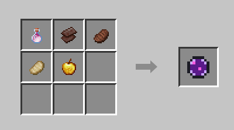</a></p><p style="color:#8a94a3;font-size:13px">dragonlords galantine recipe</p></div><div style="flex:0 1 400px;border:1px solid #8a94a3;border-radius:16px;text-align:center"><p><a href="https://raw.githubusercontent.com/AllensCreations/MCPE-Curseforges/main/MCPEDL/Addons/Grand-Banquets/assets/recipes/fishermans_platter_recipe.png"></a></p><p style="color:#8a94a3;font-size:13px">fishermans platter recipe</p></div><div style="flex:0 1 400px;border:1px solid #8a94a3;border-radius:16px;text-align:center"><p><a href="https://raw.githubusercontent.com/AllensCreations/MCPE-Curseforges/main/MCPEDL/Addons/Grand-Banquets/assets/recipes/glazed_ham_recipe.png"></a></p><p style="color:#8a94a3;font-size:13px">glazed ham recipe</p></div><div style="flex:0 1 400px;border:1px solid #8a94a3;border-radius:16px;text-align:center"><p><a href="https://raw.githubusercontent.com/AllensCreations/MCPE-Curseforges/main/MCPEDL/Addons/Grand-Banquets/assets/recipes/glazed_wings_recipe.png"></a></p><p style="color:#8a94a3;font-size:13px">glazed wings recipe</p></div><div style="flex:0 1 400px;border:1px solid #8a94a3;border-radius:16px;text-align:center"><p><a href="https://raw.githubusercontent.com/AllensCreations/MCPE-Curseforges/main/MCPEDL/Addons/Grand-Banquets/assets/recipes/harvest_loaf_recipe.png"></a></p><p style="color:#8a94a3;font-size:13px">harvest loaf recipe</p></div><div style="flex:0 1 400px;border:1px solid #8a94a3;border-radius:16px;text-align:center"><p><a href="https://raw.githubusercontent.com/AllensCreations/MCPE-Curseforges/main/MCPEDL/Addons/Grand-Banquets/assets/recipes/highland_venison_recipe.png">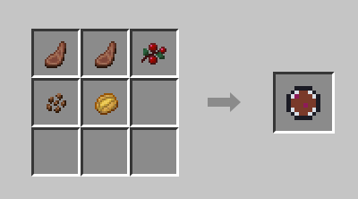</a></p><p style="color:#8a94a3;font-size:13px">highland venison recipe</p></div><div style="flex:0 1 400px;border:1px solid #8a94a3;border-radius:16px;text-align:center"><p><a href="https://raw.githubusercontent.com/AllensCreations/MCPE-Curseforges/main/MCPEDL/Addons/Grand-Banquets/assets/recipes/honey_berry_tart_recipe.png">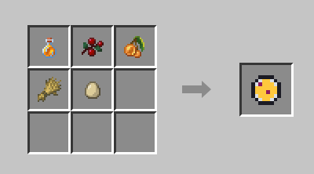</a></p><p style="color:#8a94a3;font-size:13px">honey berry tart recipe</p></div><div style="flex:0 1 400px;border:1px solid #8a94a3;border-radius:16px;text-align:center"><p><a href="https://raw.githubusercontent.com/AllensCreations/MCPE-Curseforges/main/MCPEDL/Addons/Grand-Banquets/assets/recipes/hunters_stew_recipe.png">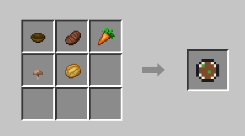</a></p><p style="color:#8a94a3;font-size:13px">hunters stew recipe</p></div><div style="flex:0 1 400px;border:1px solid #8a94a3;border-radius:16px;text-align:center"><p><a href="https://raw.githubusercontent.com/AllensCreations/MCPE-Curseforges/main/MCPEDL/Addons/Grand-Banquets/assets/recipes/imperial_feast_recipe.png"></a></p><p style="color:#8a94a3;font-size:13px">imperial feast recipe</p></div><div style="flex:0 1 400px;border:1px solid #8a94a3;border-radius:16px;text-align:center"><p><a href="https://raw.githubusercontent.com/AllensCreations/MCPE-Curseforges/main/MCPEDL/Addons/Grand-Banquets/assets/recipes/item_previews.png"></a></p><p style="color:#8a94a3;font-size:13px">item previews</p></div><div style="flex:0 1 400px;border:1px solid #8a94a3;border-radius:16px;text-align:center"><p><a href="https://raw.githubusercontent.com/AllensCreations/MCPE-Curseforges/main/MCPEDL/Addons/Grand-Banquets/assets/recipes/kelp_fish_broth_recipe.png">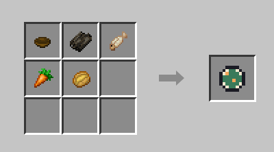</a></p><p style="color:#8a94a3;font-size:13px">kelp fish broth recipe</p></div><div style="flex:0 1 400px;border:1px solid #8a94a3;border-radius:16px;text-align:center"><p><a href="https://raw.githubusercontent.com/AllensCreations/MCPE-Curseforges/main/MCPEDL/Addons/Grand-Banquets/assets/recipes/lumberjacks_ham_recipe.png"></a></p><p style="color:#8a94a3;font-size:13px">lumberjacks ham recipe</p></div><div style="flex:0 1 400px;border:1px solid #8a94a3;border-radius:16px;text-align:center"><p><a href="https://raw.githubusercontent.com/AllensCreations/MCPE-Curseforges/main/MCPEDL/Addons/Grand-Banquets/assets/recipes/mariners_pot_recipe.png">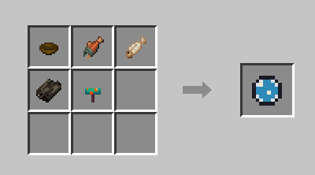</a></p><p style="color:#8a94a3;font-size:13px">mariners pot recipe</p></div><div style="flex:0 1 400px;border:1px solid #8a94a3;border-radius:16px;text-align:center"><p><a href="https://raw.githubusercontent.com/AllensCreations/MCPE-Curseforges/main/MCPEDL/Addons/Grand-Banquets/assets/recipes/miners_roast_recipe.png">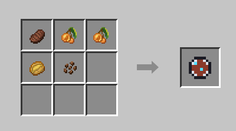</a></p><p style="color:#8a94a3;font-size:13px">miners roast recipe</p></div><div style="flex:0 1 400px;border:1px solid #8a94a3;border-radius:16px;text-align:center"><p><a href="https://raw.githubusercontent.com/AllensCreations/MCPE-Curseforges/main/MCPEDL/Addons/Grand-Banquets/assets/recipes/mushroom_casserole_recipe.png">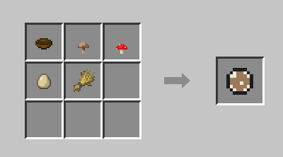</a></p><p style="color:#8a94a3;font-size:13px">mushroom casserole recipe</p></div><div style="flex:0 1 400px;border:1px solid #8a94a3;border-radius:16px;text-align:center"><p><a href="https://raw.githubusercontent.com/AllensCreations/MCPE-Curseforges/main/MCPEDL/Addons/Grand-Banquets/assets/recipes/phoenix_roast_recipe.png"></a></p><p style="color:#8a94a3;font-size:13px">phoenix roast recipe</p></div><div style="flex:0 1 400px;border:1px solid #8a94a3;border-radius:16px;text-align:center"><p><a href="https://raw.githubusercontent.com/AllensCreations/MCPE-Curseforges/main/MCPEDL/Addons/Grand-Banquets/assets/recipes/potato_loaf_recipe.png"></a></p><p style="color:#8a94a3;font-size:13px">potato loaf recipe</p></div><div style="flex:0 1 400px;border:1px solid #8a94a3;border-radius:16px;text-align:center"><p><a href="https://raw.githubusercontent.com/AllensCreations/MCPE-Curseforges/main/MCPEDL/Addons/Grand-Banquets/assets/recipes/pumpkin_casserole_recipe.png"></a></p><p style="color:#8a94a3;font-size:13px">pumpkin casserole recipe</p></div><div style="flex:0 1 400px;border:1px solid #8a94a3;border-radius:16px;text-align:center"><p><a href="https://raw.githubusercontent.com/AllensCreations/MCPE-Curseforges/main/MCPEDL/Addons/Grand-Banquets/assets/recipes/roast_turkey_recipe.png"></a></p><p style="color:#8a94a3;font-size:13px">roast turkey recipe</p></div><div style="flex:0 1 400px;border:1px solid #8a94a3;border-radius:16px;text-align:center"><p><a href="https://raw.githubusercontent.com/AllensCreations/MCPE-Curseforges/main/MCPEDL/Addons/Grand-Banquets/assets/recipes/roasted_roots_recipe.png">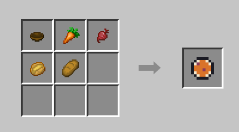</a></p><p style="color:#8a94a3;font-size:13px">roasted roots recipe</p></div><div style="flex:0 1 400px;border:1px solid #8a94a3;border-radius:16px;text-align:center"><p><a href="https://raw.githubusercontent.com/AllensCreations/MCPE-Curseforges/main/MCPEDL/Addons/Grand-Banquets/assets/recipes/sausage_pan_recipe.png">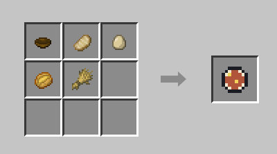</a></p><p style="color:#8a94a3;font-size:13px">sausage pan recipe</p></div><div style="flex:0 1 400px;border:1px solid #8a94a3;border-radius:16px;text-align:center"><p><a href="https://raw.githubusercontent.com/AllensCreations/MCPE-Curseforges/main/MCPEDL/Addons/Grand-Banquets/assets/recipes/scholars_dumplings_recipe.png">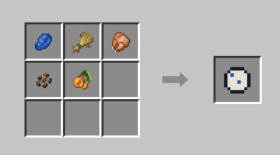</a></p><p style="color:#8a94a3;font-size:13px">scholars dumplings recipe</p></div><div style="flex:0 1 400px;border:1px solid #8a94a3;border-radius:16px;text-align:center"><p><a href="https://raw.githubusercontent.com/AllensCreations/MCPE-Curseforges/main/MCPEDL/Addons/Grand-Banquets/assets/recipes/shepherds_pie_recipe.png"></a></p><p style="color:#8a94a3;font-size:13px">shepherds pie recipe</p></div><div style="flex:0 1 400px;border:1px solid #8a94a3;border-radius:16px;text-align:center"><p><a href="https://raw.githubusercontent.com/AllensCreations/MCPE-Curseforges/main/MCPEDL/Addons/Grand-Banquets/assets/recipes/sovereign_platter_recipe.png">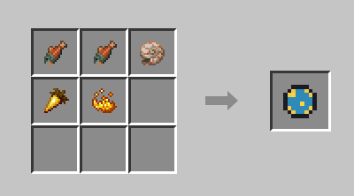</a></p><p style="color:#8a94a3;font-size:13px">sovereign platter recipe</p></div><div style="flex:0 1 400px;border:1px solid #8a94a3;border-radius:16px;text-align:center"><p><a href="https://raw.githubusercontent.com/AllensCreations/MCPE-Curseforges/main/MCPEDL/Addons/Grand-Banquets/assets/recipes/strider_gumbo_recipe.png">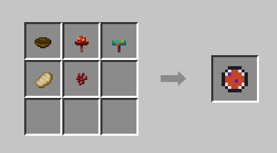</a></p><p style="color:#8a94a3;font-size:13px">strider gumbo recipe</p></div><div style="flex:0 1 400px;border:1px solid #8a94a3;border-radius:16px;text-align:center"><p><a href="https://raw.githubusercontent.com/AllensCreations/MCPE-Curseforges/main/MCPEDL/Addons/Grand-Banquets/assets/recipes/tier_1_recipes.png">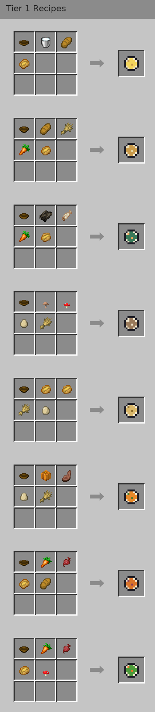</a></p><p style="color:#8a94a3;font-size:13px">tier 1 recipes</p></div><div style="flex:0 1 400px;border:1px solid #8a94a3;border-radius:16px;text-align:center"><p><a href="https://raw.githubusercontent.com/AllensCreations/MCPE-Curseforges/main/MCPEDL/Addons/Grand-Banquets/assets/recipes/tier_2_recipes.png">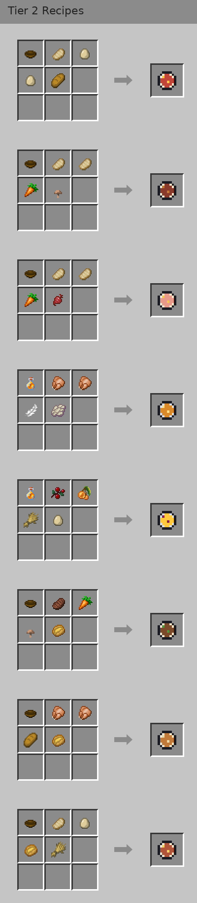</a></p><p style="color:#8a94a3;font-size:13px">tier 2 recipes</p></div><div style="flex:0 1 400px;border:1px solid #8a94a3;border-radius:16px;text-align:center"><p><a href="https://raw.githubusercontent.com/AllensCreations/MCPE-Curseforges/main/MCPEDL/Addons/Grand-Banquets/assets/recipes/tier_3_recipes.png">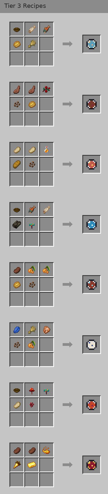</a></p><p style="color:#8a94a3;font-size:13px">tier 3 recipes</p></div><div style="flex:0 1 400px;border:1px solid #8a94a3;border-radius:16px;text-align:center"><p><a href="https://raw.githubusercontent.com/AllensCreations/MCPE-Curseforges/main/MCPEDL/Addons/Grand-Banquets/assets/recipes/tier_4_recipes.png"></a></p><p style="color:#8a94a3;font-size:13px">tier 4 recipes</p></div><div style="flex:0 1 400px;border:1px solid #8a94a3;border-radius:16px;text-align:center"><p><a href="https://raw.githubusercontent.com/AllensCreations/MCPE-Curseforges/main/MCPEDL/Addons/Grand-Banquets/assets/recipes/veggie_skillet_recipe.png">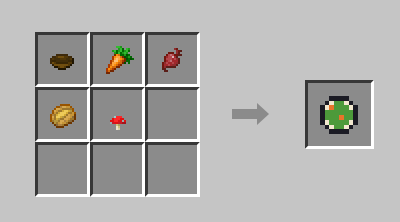</a></p><p style="color:#8a94a3;font-size:13px">veggie skillet recipe</p></div><div style="flex:0 1 400px;border:1px solid #8a94a3;border-radius:16px;text-align:center"><p><a href="https://raw.githubusercontent.com/AllensCreations/MCPE-Curseforges/main/MCPEDL/Addons/Grand-Banquets/assets/recipes/verdant_ambrosia_recipe.png">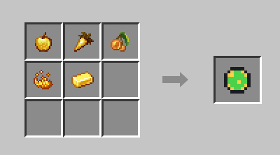</a></p><p style="color:#8a94a3;font-size:13px">verdant ambrosia recipe</p></div><div style="flex:0 1 400px;border:1px solid #8a94a3;border-radius:16px;text-align:center"><p><a href="https://raw.githubusercontent.com/AllensCreations/MCPE-Curseforges/main/MCPEDL/Addons/Grand-Banquets/assets/recipes/warlords_steak_recipe.png"></a></p><p style="color:#8a94a3;font-size:13px">warlords steak recipe</p></div></div>
<h2 style="font-size:17px;text-align:left"><span style="background-color:#15803d;color:#ffffff;border-radius:20px">&nbsp;&nbsp;Get Started&nbsp;&nbsp;</span></h2>
<table style="width:100%;border:1px solid #8a94a3;border-radius:16px"><tbody><tr><td style="width:44px;text-align:center"><div style="background-color:#15803d;color:#ffffff;font-weight:bold;font-size:15px;text-align:center;border-radius:10px;width:30px;aspect-ratio:1/1;line-height:30px">1</div></td><td style="text-align:left;">Download and import the <code>.mcaddon</code> package into Minecraft Bedrock Edition.</td></tr><tr><td style="width:44px;text-align:center"><div style="background-color:#15803d;color:#ffffff;font-weight:bold;font-size:15px;text-align:center;border-radius:10px;width:30px;aspect-ratio:1/1;line-height:30px">2</div></td><td style="text-align:left;">Activate the add-on's Behavior Pack and Resource Pack in your world settings if they are not enabled automatically.</td></tr><tr><td style="width:44px;text-align:center"><div style="background-color:#15803d;color:#ffffff;font-weight:bold;font-size:15px;text-align:center;border-radius:10px;width:30px;aspect-ratio:1/1;line-height:30px">3</div></td><td style="text-align:left;">Open a crafting table and use the ingredients shown in the recipe for the dish you want to prepare.</td></tr><tr><td style="width:44px;text-align:center"><div style="background-color:#15803d;color:#ffffff;font-weight:bold;font-size:15px;text-align:center;border-radius:10px;width:30px;aspect-ratio:1/1;line-height:30px">4</div></td><td style="text-align:left;">Eat a prepared dish to restore hunger and receive any status effects assigned to it.</td></tr></tbody></table>
<h2 style="font-size:17px;text-align:left"><span style="background-color:#15803d;color:#ffffff;border-radius:20px">&nbsp;&nbsp;Install&nbsp;&nbsp;</span></h2>
<table style="width:100%;border:1px solid #8a94a3;border-radius:16px"><tbody><tr><td style="width:44px;text-align:center"><div style="background-color:#15803d;color:#ffffff;font-weight:bold;font-size:15px;text-align:center;border-radius:10px;width:30px;aspect-ratio:1/1;line-height:30px">1</div></td><td style="text-align:left;">Download the file from this page and open it with Minecraft.</td></tr><tr><td style="width:44px;text-align:center"><div style="background-color:#15803d;color:#ffffff;font-weight:bold;font-size:15px;text-align:center;border-radius:10px;width:30px;aspect-ratio:1/1;line-height:30px">2</div></td><td style="text-align:left;">Create or edit a world and turn on the new pack(s) in its settings.</td></tr><tr><td style="width:44px;text-align:center"><div style="background-color:#15803d;color:#ffffff;font-weight:bold;font-size:15px;text-align:center;border-radius:10px;width:30px;aspect-ratio:1/1;line-height:30px">3</div></td><td style="text-align:left;">Play. No Experimental toggles needed.</td></tr></tbody></table>
<div style="border:1px solid #8a94a3;border-radius:16px;text-align:center"><br><div style="background-color:#15803d;color:#ffffff;border-radius:20px;font-size:15px;line-height:2;display:inline-block">&nbsp;&nbsp;<strong>Found a Bug or Have a Suggestion?</strong>&nbsp;&nbsp;</div><p style="font-size:14px;">Please leave a comment on this project page! All bug reports, gameplay feedback, and pack suggestions are welcome and appreciated.</p></div>
<h2 style="font-size:17px;text-align:left"><span style="background-color:#15803d;color:#ffffff;border-radius:20px">&nbsp;&nbsp;Support&nbsp;&nbsp;</span></h2><div style="border:1px solid #8a94a3;border-radius:16px;text-align:center"><br><a href="https://ko-fi.com/alnstudios"></a><br><br></div><p style="text-align:center"><a href="https://www.curseforge.com/members/allenscreations/projects"><strong>CurseForge</strong></a> &nbsp;|&nbsp; <a href="https://mcpedl.com/user/alnstudios/"><strong>MCPEDL</strong></a> &nbsp;|&nbsp; <a href="https://ko-fi.com/alnstudios"><strong>Ko-fi</strong></a></p>
<hr>
<p style="text-align:center;color:#8a94a3;font-size:13px"><strong>By ALNStudios</strong></p>
<div class="spoiler"><p style="font-size:13px"><strong>Permissions and credits</strong></p><ul style="font-size:13px"><li>Rights: All rights reserved for ALNStudios.</li><li>Content creators: You may feature this creation in videos and streams with credit to ALNStudios.</li><li>Redistribution: Do not re-upload this pack or provide direct monetized download bypasses. Link to this page.</li><li>Visual: Promotional/cover imagery used on this page is AI-generated to illustrate the concept and purpose of the pack.</li><li>Unofficial community creation. Not an official Minecraft product and not approved by or associated with Mojang or Microsoft.</li></ul></div>
<p style="text-align:center;color:#8a94a3;font-size:12px">Grand Banquets Bedrock add-on, craftable meals Minecraft, food recipes and feasts, Minecraft Bedrock cooking, survival food variety, Minecraft PE add-on, MCPEDL, CurseForge Bedrock, ALNStudios, Minecraft Bedrock add-on, MCPEDL add-on.</p></div>
```

## AI Image Prompts

### Reference Images

- **Logo reference**: attach your own logo. The generator uses it only for brand colors and mood. The result must be a new design, not a copy.
- **Snapshot references**: attach 1 to 4 of your in-game snapshots of this pack. The generator copies their look, not their screen layout.

### Logo Prompt

```text
Use the attached logo only as a brand reference for its color palette and overall mood. Do not copy it. Create a new, original logo with a different composition and a different main symbol. Do not just recolor, resize, crop, mirror or tweak the attached logo.
Create a clean, square (1:1) logo image for the Minecraft Bedrock add-on "Grand Banquets".
Base the main symbol on the pack idea above. Match the blocky look of the attached in-game snapshots. Center the logo, use a simple background, and keep it readable at small sizes.
Text: "Grand Banquets" and, in small letters, "ALNStudios". ALNStudios is the brand name, so always keep it and never remove or change it. Spell both exactly.
Do not add Minecraft, Mojang or Microsoft logos, watermarks, or characters from other games.
```

### Banner Prompt

```text
Create a wide (16:9) banner image for the Minecraft Bedrock add-on "Grand Banquets".
Use the attached in-game snapshots as scene and style references: copy their blocky look, lighting, colors and the kind of scenery they show. Make a new composition inspired by them. Do not copy the on-screen HUD, chat or hotbar.
Use the attached logo only as a brand reference for its colors and mood. Do not copy it. Put a new, original logo design in the banner, large enough to read, on the left or center.
Text: "Grand Banquets" and, in small letters, "by ALNStudios". ALNStudios is the brand name, so always keep it and never remove or change it. Spell both exactly.
Leave clear space around the logo. No Minecraft, Mojang or Microsoft logos, no watermarks.
```
