# Listing Kit: Grimoire Relics V2

Tap the Copy button on a block, then paste it into the CurseForge listing. Generated from DESCRIPTION.md: edit that, not this file.

## Package Name

```text
Grimoire Relics V2
```

## Summary (232/256)

```text
Equip one of 20 magical grimoires in your offhand to gain its distinct passive effects, combat abilities, environmental powers, or subtle particle aura. Fourteen tomes are craftable; six Ancient Relics are found through exploration.
```

## Description (HTML)

Choose any of the 5 themes below. Tap the Copy button on your preferred theme and paste into the CurseForge description editor in source (HTML) mode.

### Theme 1: Vanilla Adaptive (Default)

Theme-neutral layout following the viewer's CurseForge light or dark mode.

```html
<div><div style="border:2px solid #15803d;border-radius:18px;line-height:1.5"><br><p style="text-align:center"></p><p style="color:#8a94a3;font-size:14px;text-align:center">by ALNStudios</p><div style="display:flex;flex-wrap:wrap;gap:8px;margin-left:14px;margin-right:14px"><div style="background-color:#dcfce7;color:#14532d;border-radius:20px;font-size:14px;line-height:2"><strong>&nbsp;&nbsp;Bedrock</strong>: 1.21+&nbsp;&nbsp;</div><div style="background-color:#dcfce7;color:#14532d;border-radius:20px;font-size:14px;line-height:2"><strong>&nbsp;&nbsp;Experimental</strong>: No&nbsp;&nbsp;</div></div><br></div>
<h2 style="font-size:17px;text-align:left"><span style="background-color:#15803d;color:#ffffff;border-radius:20px">&nbsp;&nbsp;About&nbsp;&nbsp;</span></h2>
<p>Grimoire Relics V2 adds a collection of magical tomes to Minecraft Bedrock Edition. Each tome has its own effect and is active while equipped in the offhand. Switching away from a tome stops its relic-specific effects.</p>
<h2 style="font-size:17px;text-align:left"><span style="background-color:#15803d;color:#ffffff;border-radius:20px">&nbsp;&nbsp;The 20 Grimoire Relics&nbsp;&nbsp;</span></h2>
<div class="spoiler" title="The 20 Grimoire Relics" data-title="The 20 Grimoire Relics">
<h3><strong>Infernal Phoenix</strong></h3><ul><li><strong>Abilities &amp; Mechanics</strong>: Permanent Fire Resistance. Attackers that melee hit you are set on fire for 5s; targets you melee hit burn for 5s.</li><li><strong>Acquisition</strong>: <strong>Ancient Relic (Loot Only)</strong>: Bastion Treasure</li></ul><h3><strong>Abyssal Tide</strong></h3><ul><li><strong>Abilities &amp; Mechanics</strong>: Permanent Water Breathing. Night Vision while underwater. Dolphin's Grace while swimming.</li><li><strong>Acquisition</strong>: Craftable; also found in Shipwreck Treasure</li></ul><h3><strong>Zephyr Wind</strong></h3><ul><li><strong>Abilities &amp; Mechanics</strong>: Speed II + Jump Boost I. Auto Slow Falling when plunging (while falling quickly). Fall damage is healed back right after it lands; a fatal fall is not prevented.</li><li><strong>Acquisition</strong>: Craftable</li></ul><h3><strong>Necrotic Lich</strong></h3><ul><li><strong>Abilities &amp; Mechanics</strong>: Melee strikes inflict Wither II for 3s on victims.</li><li><strong>Acquisition</strong>: <strong>Ancient Relic (Loot Only)</strong>: Bastion Treasure</li></ul><h3><strong>Mountain Titan</strong></h3><ul><li><strong>Abilities &amp; Mechanics</strong>: Permanent Resistance II and Slowness I. Complete knockback immunity (cancels knockback velocity on damage).</li><li><strong>Acquisition</strong>: Craftable</li></ul><h3><strong>Blood Vampire</strong></h3><ul><li><strong>Abilities &amp; Mechanics</strong>: Life Leech: Every successful melee strike restores 1 full heart (2 HP).</li><li><strong>Acquisition</strong>: <strong>Ancient Relic (Loot Only)</strong>: Dungeon Monster Rooms</li></ul><h3><strong>Lunar Eclipse</strong></h3><ul><li><strong>Abilities &amp; Mechanics</strong>: Nocturnal Blessing: Invisibility and Strength I during nighttime in the Overworld.</li><li><strong>Acquisition</strong>: Craftable</li></ul><h3><strong>Solar Dawn</strong></h3><ul><li><strong>Abilities &amp; Mechanics</strong>: Solar Nourishment: Saturation and Regeneration I under open daylight skies in the Overworld.</li><li><strong>Acquisition</strong>: Craftable</li></ul><h3><strong>Verdant Druid</strong></h3><ul><li><strong>Abilities &amp; Mechanics</strong>: Poison immunity. Naturally fertilizes crops and advances saplings within a 3-block radius.</li><li><strong>Acquisition</strong>: Craftable</li></ul><h3><strong>Frost Weaver</strong></h3><ul><li><strong>Abilities &amp; Mechanics</strong>: Frost Walker II (freezes water underfoot into frosted ice, unless sneaking). Powder snow freezing damage is healed back right after it lands.</li><li><strong>Acquisition</strong>: Craftable</li></ul><h3><strong>Stormcaller</strong></h3><ul><li><strong>Abilities &amp; Mechanics</strong>: Speed III outdoors during rain or thunderstorms. 15% chance to strike melee attackers with real lightning.</li><li><strong>Acquisition</strong>: Craftable</li></ul><h3><strong>Deep Delver</strong></h3><ul><li><strong>Abilities &amp; Mechanics</strong>: Permanent Haste II. Places a light block at your feet while you are below Y=55 and not under open sky.</li><li><strong>Acquisition</strong>: Craftable; also found in Dungeon Monster Rooms</li></ul><h3><strong>Void Phantom</strong></h3><ul><li><strong>Abilities &amp; Mechanics</strong>: In The End, the first void rescue triggers a brief 2-second upward lift, followed by a 1-second Slow Falling cushion when safe ground is detected during descent. The rescue continues if you remove the tome from your offhand. After safe touchdown, the activated Void Phantom is consumed from your offhand or inventory if it can be found. Only one rescue can activate per player session.</li><li><strong>Acquisition</strong>: <strong>Ancient Relic (Loot Only)</strong>: Ancient Cities</li></ul><h3><strong>Iron Golem</strong></h3><ul><li><strong>Abilities &amp; Mechanics</strong>: Fortified Armor: Grants 4 Absorption hearts every 30s. Melee strikes launch enemies upward into the air.</li><li><strong>Acquisition</strong>: Craftable</li></ul><h3><strong>Venom Hydra</strong></h3><ul><li><strong>Abilities &amp; Mechanics</strong>: Full immunity to Poison and Wither. Melee attacks inflict Poison II (5s).</li><li><strong>Acquisition</strong>: Craftable</li></ul><h3><strong>Cursed Alchemist</strong></h3><ul><li><strong>Abilities &amp; Mechanics</strong>: Potion Mastery: Keeps active beneficial potion effects from expiring while the tome is equipped.</li><li><strong>Acquisition</strong>: Craftable; also found in Stronghold Libraries</li></ul><h3><strong>Radiant Seraph</strong></h3><ul><li><strong>Abilities &amp; Mechanics</strong>: Permanent Regeneration II. Complete immunity to Blindness and Nausea.</li><li><strong>Acquisition</strong>: Craftable</li></ul><h3><strong>Arcane Scholar</strong></h3><ul><li><strong>Abilities &amp; Mechanics</strong>: Arcane Intellect: Triples all experience gained from mob drops, mining, and orbs.</li><li><strong>Acquisition</strong>: Craftable; also found in Stronghold Libraries</li></ul><h3><strong>Mirror Trickster</strong></h3><ul><li><strong>Abilities &amp; Mechanics</strong>: Elusive Phase: 25% chance upon taking damage to heal that damage back and blink 3 blocks backward through smoke. A fatal hit is not prevented.</li><li><strong>Acquisition</strong>: <strong>Ancient Relic (Loot Only)</strong>: Ancient Cities</li></ul><h3><strong>Cataclysm Dragon</strong></h3><ul><li><strong>Abilities &amp; Mechanics</strong>: Strength II and Resistance I. Dragon breath and explosion damage is healed back right after it lands; a fatal hit is not prevented.</li><li><strong>Acquisition</strong>: <strong>Ancient Relic (Loot Only)</strong>: End Cities</li></ul></div>
<h2 style="font-size:17px;text-align:left"><span style="background-color:#15803d;color:#ffffff;border-radius:20px">&nbsp;&nbsp;Crafting Pattern&nbsp;&nbsp;</span></h2>
<div class="spoiler" title="Crafting Pattern" data-title="Crafting Pattern">
<p>There are <strong>14 craftable tomes</strong> made at a standard Crafting Table using shaped recipes arranged around a central Book. The recipes are available through the crafting table. The <strong>6 Ancient Relics</strong> (Void Phantom, Cataclysm Dragon, Necrotic Lich, Mirror Trickster, Blood Vampire, and Infernal Phoenix) cannot be crafted and are found through exploration loot:</p></div>
<h2 style="font-size:17px;text-align:left"><span style="background-color:#15803d;color:#ffffff;border-radius:20px">&nbsp;&nbsp;Durability, Enchanting &amp; World Generation&nbsp;&nbsp;</span></h2>
<div class="spoiler" title="Durability, Enchanting &amp; World Generation" data-title="Durability, Enchanting &amp; World Generation">
<h3>Durability, Enchanting, and Repairing</h3><ul><li><strong>100 durability points</strong>: Each Grimoire possesses a durability health bar.</li><li><strong>Event-Only Wear</strong>: Passive stat buffs (such as Water Breathing, Speed, or Haste) do <strong>not</strong> drain durability. Durability is consumed strictly upon active mechanical execution:</li><li><em>Combat triggers</em> (e.g. Phoenix burn on hit/hurt, Vampire life-steal, Iron Golem absorption &amp; launch, Hydra poison, Lich wither): 1 durability per event.</li><li><em>Environmental abilities</em> (e.g. Druid crop boost, Stormcaller lightning strike, Mirror Trickster blink): 1 to 2 durability per event. Frost Weaver costs 1 durability for every 4 times it freezes water underfoot.</li><li><em>Emergency Lifesavers</em> (Void Phantom): single use; the relic is consumed after a safe touchdown.</li><li><strong>Enchanting Table &amp; Anvil Compatible</strong>:</li><li>Can be enchanted via the Enchanting Table or Anvil with enchantments like <strong>Mending</strong>, <strong>Efficiency</strong>, and <strong>Unbreaking</strong>.</li><li><strong>Mending</strong> restores tome durability automatically as you collect experience orbs.</li><li><strong>Anvil Repairing</strong>:</li><li>Combine two of the same tomes on an Anvil to restore their remaining durability.</li><li>Can also be repaired on an Anvil using standard <strong>Books</strong> at a strict <strong>1:1 ratio</strong> (1 book restores 1 durability point).</li><li><strong>Shatter</strong>: If durability reaches 0 without being repaired or protected, the tome shatters with an item break sound and particles and is removed from your equipment.</li></ul><h3>World Chest Distribution</h3><p>The pack includes exploration loot entries for Ancient Relics. Their intended locations are:</p><ul><li><strong>Ancient Cities</strong>: Chance for <strong>Void Phantom</strong> and <strong>Mirror Trickster</strong>.</li><li><strong>Bastion Remnants (Treasure)</strong>: <strong>Infernal Phoenix</strong> and <strong>Necrotic Lich</strong>.</li><li><strong>End Cities</strong>: <strong>Cataclysm Dragon</strong>.</li><li><strong>Stronghold Libraries</strong>: <strong>Arcane Scholar</strong> and <strong>Cursed Alchemist</strong>.</li><li><strong>Shipwreck Treasuries</strong>: <strong>Abyssal Tide</strong>.</li><li><strong>Monster Rooms / Simple Dungeons</strong>: <strong>Blood Vampire</strong> and <strong>Deep Delver</strong>.</li><li><strong>Enchanted Golden Apples</strong>: No longer appear in Ancient City and Bastion Treasure chests; the tomes take their place.</li></ul></div>
<h2 style="font-size:17px;text-align:left"><span style="background-color:#15803d;color:#ffffff;border-radius:20px">&nbsp;&nbsp;In-Game Information&nbsp;&nbsp;</span></h2>
<div class="spoiler" title="In-Game Information" data-title="In-Game Information">
<ul><li><strong>Offhand use</strong>: Equip a tome in your offhand to activate its abilities.</li><li><strong>Item descriptions</strong>: Tome lore describes its main abilities and conditions.</li><li><strong>Recipe guide</strong>: The image above shows the crafting patterns for craftable tomes.</li><li><strong>Status icons</strong>: The Resource Pack hides the on-screen status effect icons.</li></ul></div>
<h2 style="font-size:17px;text-align:left"><span style="background-color:#15803d;color:#ffffff;border-radius:20px">&nbsp;&nbsp;Custom Items&nbsp;&nbsp;</span></h2>
<div style="display:flex;flex-wrap:wrap;gap:10px"><div style="flex:0 1 120px;border:1px solid #8a94a3;border-radius:16px;text-align:center"><p><a href="https://raw.githubusercontent.com/AllensCreations/MCPE-Curseforges/main/MCPEDL/Addons/Grimoire-Relics-V2/assets/items/tome_abyss.png">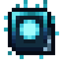</a></p><p></p></div><div style="flex:0 1 120px;border:1px solid #8a94a3;border-radius:16px;text-align:center"><p><a href="https://raw.githubusercontent.com/AllensCreations/MCPE-Curseforges/main/MCPEDL/Addons/Grimoire-Relics-V2/assets/items/tome_alchemist.png">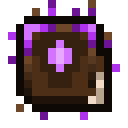</a></p><p></p></div><div style="flex:0 1 120px;border:1px solid #8a94a3;border-radius:16px;text-align:center"><p><a href="https://raw.githubusercontent.com/AllensCreations/MCPE-Curseforges/main/MCPEDL/Addons/Grimoire-Relics-V2/assets/items/tome_delver.png">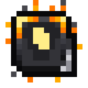</a></p><p></p></div><div style="flex:0 1 120px;border:1px solid #8a94a3;border-radius:16px;text-align:center"><p><a href="https://raw.githubusercontent.com/AllensCreations/MCPE-Curseforges/main/MCPEDL/Addons/Grimoire-Relics-V2/assets/items/tome_dragon.png">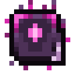</a></p><p></p></div><div style="flex:0 1 120px;border:1px solid #8a94a3;border-radius:16px;text-align:center"><p><a href="https://raw.githubusercontent.com/AllensCreations/MCPE-Curseforges/main/MCPEDL/Addons/Grimoire-Relics-V2/assets/items/tome_druid.png">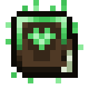</a></p><p></p></div><div style="flex:0 1 120px;border:1px solid #8a94a3;border-radius:16px;text-align:center"><p><a href="https://raw.githubusercontent.com/AllensCreations/MCPE-Curseforges/main/MCPEDL/Addons/Grimoire-Relics-V2/assets/items/tome_frost.png"></a></p><p></p></div><div style="flex:0 1 120px;border:1px solid #8a94a3;border-radius:16px;text-align:center"><p><a href="https://raw.githubusercontent.com/AllensCreations/MCPE-Curseforges/main/MCPEDL/Addons/Grimoire-Relics-V2/assets/items/tome_golem.png">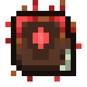</a></p><p></p></div><div style="flex:0 1 120px;border:1px solid #8a94a3;border-radius:16px;text-align:center"><p><a href="https://raw.githubusercontent.com/AllensCreations/MCPE-Curseforges/main/MCPEDL/Addons/Grimoire-Relics-V2/assets/items/tome_hydra.png">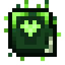</a></p><p></p></div><div style="flex:0 1 120px;border:1px solid #8a94a3;border-radius:16px;text-align:center"><p><a href="https://raw.githubusercontent.com/AllensCreations/MCPE-Curseforges/main/MCPEDL/Addons/Grimoire-Relics-V2/assets/items/tome_lich.png"></a></p><p></p></div><div style="flex:0 1 120px;border:1px solid #8a94a3;border-radius:16px;text-align:center"><p><a href="https://raw.githubusercontent.com/AllensCreations/MCPE-Curseforges/main/MCPEDL/Addons/Grimoire-Relics-V2/assets/items/tome_lunar.png">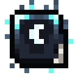</a></p><p></p></div><div style="flex:0 1 120px;border:1px solid #8a94a3;border-radius:16px;text-align:center"><p><a href="https://raw.githubusercontent.com/AllensCreations/MCPE-Curseforges/main/MCPEDL/Addons/Grimoire-Relics-V2/assets/items/tome_mirror.png">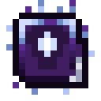</a></p><p></p></div><div style="flex:0 1 120px;border:1px solid #8a94a3;border-radius:16px;text-align:center"><p><a href="https://raw.githubusercontent.com/AllensCreations/MCPE-Curseforges/main/MCPEDL/Addons/Grimoire-Relics-V2/assets/items/tome_phoenix.png">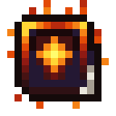</a></p><p></p></div><div style="flex:0 1 120px;border:1px solid #8a94a3;border-radius:16px;text-align:center"><p><a href="https://raw.githubusercontent.com/AllensCreations/MCPE-Curseforges/main/MCPEDL/Addons/Grimoire-Relics-V2/assets/items/tome_scholar.png">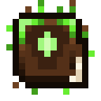</a></p><p></p></div><div style="flex:0 1 120px;border:1px solid #8a94a3;border-radius:16px;text-align:center"><p><a href="https://raw.githubusercontent.com/AllensCreations/MCPE-Curseforges/main/MCPEDL/Addons/Grimoire-Relics-V2/assets/items/tome_seraph.png">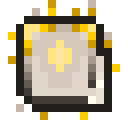</a></p><p></p></div><div style="flex:0 1 120px;border:1px solid #8a94a3;border-radius:16px;text-align:center"><p><a href="https://raw.githubusercontent.com/AllensCreations/MCPE-Curseforges/main/MCPEDL/Addons/Grimoire-Relics-V2/assets/items/tome_solar.png">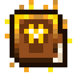</a></p><p></p></div><div style="flex:0 1 120px;border:1px solid #8a94a3;border-radius:16px;text-align:center"><p><a href="https://raw.githubusercontent.com/AllensCreations/MCPE-Curseforges/main/MCPEDL/Addons/Grimoire-Relics-V2/assets/items/tome_storm.png"></a></p><p></p></div><div style="flex:0 1 120px;border:1px solid #8a94a3;border-radius:16px;text-align:center"><p><a href="https://raw.githubusercontent.com/AllensCreations/MCPE-Curseforges/main/MCPEDL/Addons/Grimoire-Relics-V2/assets/items/tome_titan.png">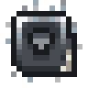</a></p><p></p></div><div style="flex:0 1 120px;border:1px solid #8a94a3;border-radius:16px;text-align:center"><p><a href="https://raw.githubusercontent.com/AllensCreations/MCPE-Curseforges/main/MCPEDL/Addons/Grimoire-Relics-V2/assets/items/tome_vampire.png">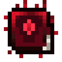</a></p><p></p></div><div style="flex:0 1 120px;border:1px solid #8a94a3;border-radius:16px;text-align:center"><p><a href="https://raw.githubusercontent.com/AllensCreations/MCPE-Curseforges/main/MCPEDL/Addons/Grimoire-Relics-V2/assets/items/tome_void.png">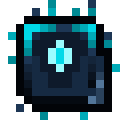</a></p><p></p></div><div style="flex:0 1 120px;border:1px solid #8a94a3;border-radius:16px;text-align:center"><p><a href="https://raw.githubusercontent.com/AllensCreations/MCPE-Curseforges/main/MCPEDL/Addons/Grimoire-Relics-V2/assets/items/tome_zephyr.png"></a></p><p></p></div></div>
<h2 style="font-size:17px;text-align:left"><span style="background-color:#15803d;color:#ffffff;border-radius:20px">&nbsp;&nbsp;Crafting Recipes&nbsp;&nbsp;</span></h2>
<div style="display:flex;flex-wrap:wrap;gap:10px"><div style="flex:0 1 400px;border:1px solid #8a94a3;border-radius:16px;text-align:center"><p><a href="https://raw.githubusercontent.com/AllensCreations/MCPE-Curseforges/main/MCPEDL/Addons/Grimoire-Relics-V2/assets/recipes/tome_abyss_recipe.png">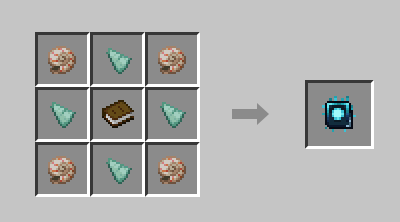</a></p><p></p></div><div style="flex:0 1 400px;border:1px solid #8a94a3;border-radius:16px;text-align:center"><p><a href="https://raw.githubusercontent.com/AllensCreations/MCPE-Curseforges/main/MCPEDL/Addons/Grimoire-Relics-V2/assets/recipes/tome_alchemist_recipe.png">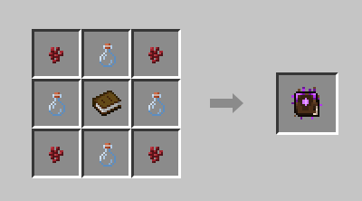</a></p><p></p></div><div style="flex:0 1 400px;border:1px solid #8a94a3;border-radius:16px;text-align:center"><p><a href="https://raw.githubusercontent.com/AllensCreations/MCPE-Curseforges/main/MCPEDL/Addons/Grimoire-Relics-V2/assets/recipes/tome_delver_recipe.png">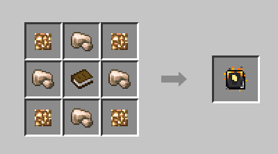</a></p><p></p></div><div style="flex:0 1 400px;border:1px solid #8a94a3;border-radius:16px;text-align:center"><p><a href="https://raw.githubusercontent.com/AllensCreations/MCPE-Curseforges/main/MCPEDL/Addons/Grimoire-Relics-V2/assets/recipes/tome_druid_recipe.png">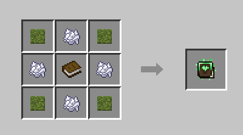</a></p><p></p></div><div style="flex:0 1 400px;border:1px solid #8a94a3;border-radius:16px;text-align:center"><p><a href="https://raw.githubusercontent.com/AllensCreations/MCPE-Curseforges/main/MCPEDL/Addons/Grimoire-Relics-V2/assets/recipes/tome_frost_recipe.png">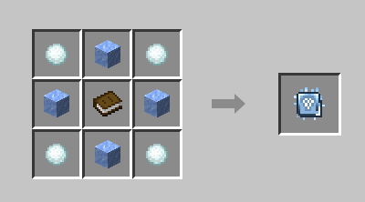</a></p><p></p></div><div style="flex:0 1 400px;border:1px solid #8a94a3;border-radius:16px;text-align:center"><p><a href="https://raw.githubusercontent.com/AllensCreations/MCPE-Curseforges/main/MCPEDL/Addons/Grimoire-Relics-V2/assets/recipes/tome_golem_recipe.png">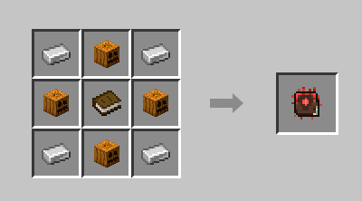</a></p><p></p></div><div style="flex:0 1 400px;border:1px solid #8a94a3;border-radius:16px;text-align:center"><p><a href="https://raw.githubusercontent.com/AllensCreations/MCPE-Curseforges/main/MCPEDL/Addons/Grimoire-Relics-V2/assets/recipes/tome_hydra_recipe.png">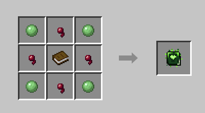</a></p><p></p></div><div style="flex:0 1 400px;border:1px solid #8a94a3;border-radius:16px;text-align:center"><p><a href="https://raw.githubusercontent.com/AllensCreations/MCPE-Curseforges/main/MCPEDL/Addons/Grimoire-Relics-V2/assets/recipes/tome_lunar_recipe.png">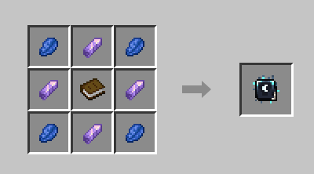</a></p><p></p></div><div style="flex:0 1 400px;border:1px solid #8a94a3;border-radius:16px;text-align:center"><p><a href="https://raw.githubusercontent.com/AllensCreations/MCPE-Curseforges/main/MCPEDL/Addons/Grimoire-Relics-V2/assets/recipes/tome_scholar_recipe.png">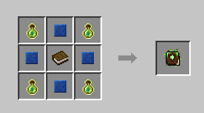</a></p><p></p></div><div style="flex:0 1 400px;border:1px solid #8a94a3;border-radius:16px;text-align:center"><p><a href="https://raw.githubusercontent.com/AllensCreations/MCPE-Curseforges/main/MCPEDL/Addons/Grimoire-Relics-V2/assets/recipes/tome_seraph_recipe.png">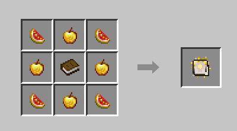</a></p><p></p></div><div style="flex:0 1 400px;border:1px solid #8a94a3;border-radius:16px;text-align:center"><p><a href="https://raw.githubusercontent.com/AllensCreations/MCPE-Curseforges/main/MCPEDL/Addons/Grimoire-Relics-V2/assets/recipes/tome_solar_recipe.png">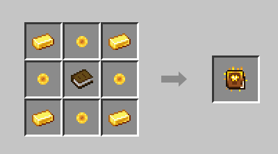</a></p><p></p></div><div style="flex:0 1 400px;border:1px solid #8a94a3;border-radius:16px;text-align:center"><p><a href="https://raw.githubusercontent.com/AllensCreations/MCPE-Curseforges/main/MCPEDL/Addons/Grimoire-Relics-V2/assets/recipes/tome_storm_recipe.png">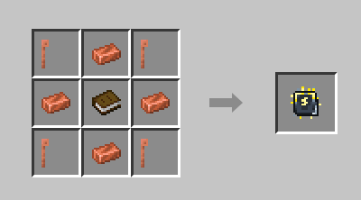</a></p><p></p></div><div style="flex:0 1 400px;border:1px solid #8a94a3;border-radius:16px;text-align:center"><p><a href="https://raw.githubusercontent.com/AllensCreations/MCPE-Curseforges/main/MCPEDL/Addons/Grimoire-Relics-V2/assets/recipes/tome_titan_recipe.png">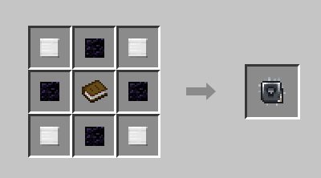</a></p><p></p></div><div style="flex:0 1 400px;border:1px solid #8a94a3;border-radius:16px;text-align:center"><p><a href="https://raw.githubusercontent.com/AllensCreations/MCPE-Curseforges/main/MCPEDL/Addons/Grimoire-Relics-V2/assets/recipes/tome_zephyr_recipe.png">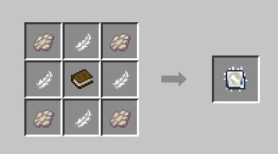</a></p><p></p></div></div>
<h2 style="font-size:17px;text-align:left"><span style="background-color:#15803d;color:#ffffff;border-radius:20px">&nbsp;&nbsp;Install&nbsp;&nbsp;</span></h2>
<table style="width:100%;border:1px solid #8a94a3;border-radius:16px"><tbody><tr><td style="width:44px;text-align:center"><div style="background-color:#15803d;color:#ffffff;font-weight:bold;font-size:15px;text-align:center;border-radius:10px;width:30px;aspect-ratio:1/1;line-height:30px">1</div></td><td style="text-align:left;">Download the file from this page and open it with Minecraft.</td></tr><tr><td style="width:44px;text-align:center"><div style="background-color:#15803d;color:#ffffff;font-weight:bold;font-size:15px;text-align:center;border-radius:10px;width:30px;aspect-ratio:1/1;line-height:30px">2</div></td><td style="text-align:left;">Create or edit a world and turn on the new pack(s) in its settings.</td></tr><tr><td style="width:44px;text-align:center"><div style="background-color:#15803d;color:#ffffff;font-weight:bold;font-size:15px;text-align:center;border-radius:10px;width:30px;aspect-ratio:1/1;line-height:30px">3</div></td><td style="text-align:left;">Play. No Experimental toggles needed.</td></tr></tbody></table>
<div style="border:1px solid #8a94a3;border-radius:16px;text-align:center"><br><div style="background-color:#15803d;color:#ffffff;border-radius:20px;font-size:15px;line-height:2;display:inline-block">&nbsp;&nbsp;<strong>Found a Bug or Have a Suggestion?</strong>&nbsp;&nbsp;</div><p style="font-size:14px;">Please leave a comment on this project page! All bug reports, gameplay feedback, and pack suggestions are welcome and appreciated.</p></div>
<h2 style="font-size:17px;text-align:left"><span style="background-color:#15803d;color:#ffffff;border-radius:20px">&nbsp;&nbsp;Support&nbsp;&nbsp;</span></h2><div style="border:1px solid #8a94a3;border-radius:16px;text-align:center"><br><a href="https://ko-fi.com/alnstudios"></a><br><br></div><p style="text-align:center"><a href="https://www.curseforge.com/members/allenscreations/projects"><strong>CurseForge</strong></a> &nbsp;|&nbsp; <a href="https://mcpedl.com/user/alnstudios/"><strong>MCPEDL</strong></a> &nbsp;|&nbsp; <a href="https://ko-fi.com/alnstudios"><strong>Ko-fi</strong></a></p>
<hr>
<p style="text-align:center;color:#8a94a3;font-size:13px"><strong>By ALNStudios</strong></p>
<div class="spoiler"><p style="font-size:13px"><strong>Permissions and credits</strong></p><ul style="font-size:13px"><li>Rights: All rights reserved for ALNStudios.</li><li>Content creators: You may feature this creation in videos and streams with credit to ALNStudios.</li><li>Redistribution: Do not re-upload this pack or provide direct monetized download bypasses. Link to this page.</li><li>Visual: Promotional/cover imagery used on this page is AI-generated to illustrate the concept and purpose of the pack.</li><li>Unofficial community creation. Not an official Minecraft product and not approved by or associated with Mojang or Microsoft.</li></ul></div>
<p style="text-align:center;color:#8a94a3;font-size:12px">Grimoire Relics V2 Bedrock add-on, magical offhand relics, craftable grimoires, Ancient Relics exploration, Void Phantom rescue relic, Minecraft Bedrock magic items, Minecraft PE RPG add-on, MCPEDL, CurseForge Bedrock, ALNStudios, Minecraft Bedrock add-on, MCPEDL add-on.</p></div>
```

### Theme 2: Netherite Stealth (Modern Dark)

High-tech dark obsidian & emerald storefront.

```html
<div style="background-color:#0d1117;color:#c9d1d9;border-radius:12px;padding-left:12px"><div style="margin-right:12px"><br><div style="background-color:#161b22;border:2px solid #10b981;border-radius:18px;line-height:1.5"><br><p style="text-align:center"></p><p style="color:#8b949e;font-size:14px;text-align:center">by ALNStudios</p><div style="display:flex;flex-wrap:wrap;gap:8px;margin-left:14px;margin-right:14px"><div style="background-color:#161b22;color:#10b981;border-radius:20px;font-size:14px;line-height:2"><strong>&nbsp;&nbsp;Bedrock</strong>: 1.21+&nbsp;&nbsp;</div><div style="background-color:#161b22;color:#10b981;border-radius:20px;font-size:14px;line-height:2"><strong>&nbsp;&nbsp;Experimental</strong>: No&nbsp;&nbsp;</div></div><br></div>
<h2 style="font-size:17px;text-align:left"><span style="background-color:#10b981;color:#ffffff;border-radius:20px">&nbsp;&nbsp;About&nbsp;&nbsp;</span></h2>
<p style="color:#c9d1d9">Grimoire Relics V2 adds a collection of magical tomes to Minecraft Bedrock Edition. Each tome has its own effect and is active while equipped in the offhand. Switching away from a tome stops its relic-specific effects.</p>
<h2 style="font-size:17px;text-align:left"><span style="background-color:#10b981;color:#ffffff;border-radius:20px">&nbsp;&nbsp;The 20 Grimoire Relics&nbsp;&nbsp;</span></h2>
<div class="spoiler" title="The 20 Grimoire Relics" data-title="The 20 Grimoire Relics">
<h3 style="color:#ffffff"><strong>Infernal Phoenix</strong></h3><ul style="color:#c9d1d9"><li><strong>Abilities &amp; Mechanics</strong>: Permanent Fire Resistance. Attackers that melee hit you are set on fire for 5s; targets you melee hit burn for 5s.</li><li><strong>Acquisition</strong>: <strong>Ancient Relic (Loot Only)</strong>: Bastion Treasure</li></ul><h3 style="color:#ffffff"><strong>Abyssal Tide</strong></h3><ul style="color:#c9d1d9"><li><strong>Abilities &amp; Mechanics</strong>: Permanent Water Breathing. Night Vision while underwater. Dolphin's Grace while swimming.</li><li><strong>Acquisition</strong>: Craftable; also found in Shipwreck Treasure</li></ul><h3 style="color:#ffffff"><strong>Zephyr Wind</strong></h3><ul style="color:#c9d1d9"><li><strong>Abilities &amp; Mechanics</strong>: Speed II + Jump Boost I. Auto Slow Falling when plunging (while falling quickly). Fall damage is healed back right after it lands; a fatal fall is not prevented.</li><li><strong>Acquisition</strong>: Craftable</li></ul><h3 style="color:#ffffff"><strong>Necrotic Lich</strong></h3><ul style="color:#c9d1d9"><li><strong>Abilities &amp; Mechanics</strong>: Melee strikes inflict Wither II for 3s on victims.</li><li><strong>Acquisition</strong>: <strong>Ancient Relic (Loot Only)</strong>: Bastion Treasure</li></ul><h3 style="color:#ffffff"><strong>Mountain Titan</strong></h3><ul style="color:#c9d1d9"><li><strong>Abilities &amp; Mechanics</strong>: Permanent Resistance II and Slowness I. Complete knockback immunity (cancels knockback velocity on damage).</li><li><strong>Acquisition</strong>: Craftable</li></ul><h3 style="color:#ffffff"><strong>Blood Vampire</strong></h3><ul style="color:#c9d1d9"><li><strong>Abilities &amp; Mechanics</strong>: Life Leech: Every successful melee strike restores 1 full heart (2 HP).</li><li><strong>Acquisition</strong>: <strong>Ancient Relic (Loot Only)</strong>: Dungeon Monster Rooms</li></ul><h3 style="color:#ffffff"><strong>Lunar Eclipse</strong></h3><ul style="color:#c9d1d9"><li><strong>Abilities &amp; Mechanics</strong>: Nocturnal Blessing: Invisibility and Strength I during nighttime in the Overworld.</li><li><strong>Acquisition</strong>: Craftable</li></ul><h3 style="color:#ffffff"><strong>Solar Dawn</strong></h3><ul style="color:#c9d1d9"><li><strong>Abilities &amp; Mechanics</strong>: Solar Nourishment: Saturation and Regeneration I under open daylight skies in the Overworld.</li><li><strong>Acquisition</strong>: Craftable</li></ul><h3 style="color:#ffffff"><strong>Verdant Druid</strong></h3><ul style="color:#c9d1d9"><li><strong>Abilities &amp; Mechanics</strong>: Poison immunity. Naturally fertilizes crops and advances saplings within a 3-block radius.</li><li><strong>Acquisition</strong>: Craftable</li></ul><h3 style="color:#ffffff"><strong>Frost Weaver</strong></h3><ul style="color:#c9d1d9"><li><strong>Abilities &amp; Mechanics</strong>: Frost Walker II (freezes water underfoot into frosted ice, unless sneaking). Powder snow freezing damage is healed back right after it lands.</li><li><strong>Acquisition</strong>: Craftable</li></ul><h3 style="color:#ffffff"><strong>Stormcaller</strong></h3><ul style="color:#c9d1d9"><li><strong>Abilities &amp; Mechanics</strong>: Speed III outdoors during rain or thunderstorms. 15% chance to strike melee attackers with real lightning.</li><li><strong>Acquisition</strong>: Craftable</li></ul><h3 style="color:#ffffff"><strong>Deep Delver</strong></h3><ul style="color:#c9d1d9"><li><strong>Abilities &amp; Mechanics</strong>: Permanent Haste II. Places a light block at your feet while you are below Y=55 and not under open sky.</li><li><strong>Acquisition</strong>: Craftable; also found in Dungeon Monster Rooms</li></ul><h3 style="color:#ffffff"><strong>Void Phantom</strong></h3><ul style="color:#c9d1d9"><li><strong>Abilities &amp; Mechanics</strong>: In The End, the first void rescue triggers a brief 2-second upward lift, followed by a 1-second Slow Falling cushion when safe ground is detected during descent. The rescue continues if you remove the tome from your offhand. After safe touchdown, the activated Void Phantom is consumed from your offhand or inventory if it can be found. Only one rescue can activate per player session.</li><li><strong>Acquisition</strong>: <strong>Ancient Relic (Loot Only)</strong>: Ancient Cities</li></ul><h3 style="color:#ffffff"><strong>Iron Golem</strong></h3><ul style="color:#c9d1d9"><li><strong>Abilities &amp; Mechanics</strong>: Fortified Armor: Grants 4 Absorption hearts every 30s. Melee strikes launch enemies upward into the air.</li><li><strong>Acquisition</strong>: Craftable</li></ul><h3 style="color:#ffffff"><strong>Venom Hydra</strong></h3><ul style="color:#c9d1d9"><li><strong>Abilities &amp; Mechanics</strong>: Full immunity to Poison and Wither. Melee attacks inflict Poison II (5s).</li><li><strong>Acquisition</strong>: Craftable</li></ul><h3 style="color:#ffffff"><strong>Cursed Alchemist</strong></h3><ul style="color:#c9d1d9"><li><strong>Abilities &amp; Mechanics</strong>: Potion Mastery: Keeps active beneficial potion effects from expiring while the tome is equipped.</li><li><strong>Acquisition</strong>: Craftable; also found in Stronghold Libraries</li></ul><h3 style="color:#ffffff"><strong>Radiant Seraph</strong></h3><ul style="color:#c9d1d9"><li><strong>Abilities &amp; Mechanics</strong>: Permanent Regeneration II. Complete immunity to Blindness and Nausea.</li><li><strong>Acquisition</strong>: Craftable</li></ul><h3 style="color:#ffffff"><strong>Arcane Scholar</strong></h3><ul style="color:#c9d1d9"><li><strong>Abilities &amp; Mechanics</strong>: Arcane Intellect: Triples all experience gained from mob drops, mining, and orbs.</li><li><strong>Acquisition</strong>: Craftable; also found in Stronghold Libraries</li></ul><h3 style="color:#ffffff"><strong>Mirror Trickster</strong></h3><ul style="color:#c9d1d9"><li><strong>Abilities &amp; Mechanics</strong>: Elusive Phase: 25% chance upon taking damage to heal that damage back and blink 3 blocks backward through smoke. A fatal hit is not prevented.</li><li><strong>Acquisition</strong>: <strong>Ancient Relic (Loot Only)</strong>: Ancient Cities</li></ul><h3 style="color:#ffffff"><strong>Cataclysm Dragon</strong></h3><ul style="color:#c9d1d9"><li><strong>Abilities &amp; Mechanics</strong>: Strength II and Resistance I. Dragon breath and explosion damage is healed back right after it lands; a fatal hit is not prevented.</li><li><strong>Acquisition</strong>: <strong>Ancient Relic (Loot Only)</strong>: End Cities</li></ul></div>
<h2 style="font-size:17px;text-align:left"><span style="background-color:#10b981;color:#ffffff;border-radius:20px">&nbsp;&nbsp;Crafting Pattern&nbsp;&nbsp;</span></h2>
<div class="spoiler" title="Crafting Pattern" data-title="Crafting Pattern">
<p style="color:#c9d1d9">There are <strong>14 craftable tomes</strong> made at a standard Crafting Table using shaped recipes arranged around a central Book. The recipes are available through the crafting table. The <strong>6 Ancient Relics</strong> (Void Phantom, Cataclysm Dragon, Necrotic Lich, Mirror Trickster, Blood Vampire, and Infernal Phoenix) cannot be crafted and are found through exploration loot:</p></div>
<h2 style="font-size:17px;text-align:left"><span style="background-color:#10b981;color:#ffffff;border-radius:20px">&nbsp;&nbsp;Durability, Enchanting &amp; World Generation&nbsp;&nbsp;</span></h2>
<div class="spoiler" title="Durability, Enchanting &amp; World Generation" data-title="Durability, Enchanting &amp; World Generation">
<h3 style="color:#ffffff">Durability, Enchanting, and Repairing</h3><ul style="color:#c9d1d9"><li><strong>100 durability points</strong>: Each Grimoire possesses a durability health bar.</li><li><strong>Event-Only Wear</strong>: Passive stat buffs (such as Water Breathing, Speed, or Haste) do <strong>not</strong> drain durability. Durability is consumed strictly upon active mechanical execution:</li><li><em>Combat triggers</em> (e.g. Phoenix burn on hit/hurt, Vampire life-steal, Iron Golem absorption &amp; launch, Hydra poison, Lich wither): 1 durability per event.</li><li><em>Environmental abilities</em> (e.g. Druid crop boost, Stormcaller lightning strike, Mirror Trickster blink): 1 to 2 durability per event. Frost Weaver costs 1 durability for every 4 times it freezes water underfoot.</li><li><em>Emergency Lifesavers</em> (Void Phantom): single use; the relic is consumed after a safe touchdown.</li><li><strong>Enchanting Table &amp; Anvil Compatible</strong>:</li><li>Can be enchanted via the Enchanting Table or Anvil with enchantments like <strong>Mending</strong>, <strong>Efficiency</strong>, and <strong>Unbreaking</strong>.</li><li><strong>Mending</strong> restores tome durability automatically as you collect experience orbs.</li><li><strong>Anvil Repairing</strong>:</li><li>Combine two of the same tomes on an Anvil to restore their remaining durability.</li><li>Can also be repaired on an Anvil using standard <strong>Books</strong> at a strict <strong>1:1 ratio</strong> (1 book restores 1 durability point).</li><li><strong>Shatter</strong>: If durability reaches 0 without being repaired or protected, the tome shatters with an item break sound and particles and is removed from your equipment.</li></ul><h3 style="color:#ffffff">World Chest Distribution</h3><p style="color:#c9d1d9">The pack includes exploration loot entries for Ancient Relics. Their intended locations are:</p><ul style="color:#c9d1d9"><li><strong>Ancient Cities</strong>: Chance for <strong>Void Phantom</strong> and <strong>Mirror Trickster</strong>.</li><li><strong>Bastion Remnants (Treasure)</strong>: <strong>Infernal Phoenix</strong> and <strong>Necrotic Lich</strong>.</li><li><strong>End Cities</strong>: <strong>Cataclysm Dragon</strong>.</li><li><strong>Stronghold Libraries</strong>: <strong>Arcane Scholar</strong> and <strong>Cursed Alchemist</strong>.</li><li><strong>Shipwreck Treasuries</strong>: <strong>Abyssal Tide</strong>.</li><li><strong>Monster Rooms / Simple Dungeons</strong>: <strong>Blood Vampire</strong> and <strong>Deep Delver</strong>.</li><li><strong>Enchanted Golden Apples</strong>: No longer appear in Ancient City and Bastion Treasure chests; the tomes take their place.</li></ul></div>
<h2 style="font-size:17px;text-align:left"><span style="background-color:#10b981;color:#ffffff;border-radius:20px">&nbsp;&nbsp;In-Game Information&nbsp;&nbsp;</span></h2>
<div class="spoiler" title="In-Game Information" data-title="In-Game Information">
<ul style="color:#c9d1d9"><li><strong>Offhand use</strong>: Equip a tome in your offhand to activate its abilities.</li><li><strong>Item descriptions</strong>: Tome lore describes its main abilities and conditions.</li><li><strong>Recipe guide</strong>: The image above shows the crafting patterns for craftable tomes.</li><li><strong>Status icons</strong>: The Resource Pack hides the on-screen status effect icons.</li></ul></div>
<h2 style="font-size:17px;text-align:left"><span style="background-color:#10b981;color:#ffffff;border-radius:20px">&nbsp;&nbsp;Custom Items&nbsp;&nbsp;</span></h2>
<div style="display:flex;flex-wrap:wrap;gap:10px"><div style="flex:0 1 120px;background-color:#161b22;border:1px solid #30363d;border-radius:16px;text-align:center"><p><a href="https://raw.githubusercontent.com/AllensCreations/MCPE-Curseforges/main/MCPEDL/Addons/Grimoire-Relics-V2/assets/items/tome_abyss.png"></a></p><p></p></div><div style="flex:0 1 120px;background-color:#161b22;border:1px solid #30363d;border-radius:16px;text-align:center"><p><a href="https://raw.githubusercontent.com/AllensCreations/MCPE-Curseforges/main/MCPEDL/Addons/Grimoire-Relics-V2/assets/items/tome_alchemist.png"></a></p><p></p></div><div style="flex:0 1 120px;background-color:#161b22;border:1px solid #30363d;border-radius:16px;text-align:center"><p><a href="https://raw.githubusercontent.com/AllensCreations/MCPE-Curseforges/main/MCPEDL/Addons/Grimoire-Relics-V2/assets/items/tome_delver.png"></a></p><p></p></div><div style="flex:0 1 120px;background-color:#161b22;border:1px solid #30363d;border-radius:16px;text-align:center"><p><a href="https://raw.githubusercontent.com/AllensCreations/MCPE-Curseforges/main/MCPEDL/Addons/Grimoire-Relics-V2/assets/items/tome_dragon.png"></a></p><p></p></div><div style="flex:0 1 120px;background-color:#161b22;border:1px solid #30363d;border-radius:16px;text-align:center"><p><a href="https://raw.githubusercontent.com/AllensCreations/MCPE-Curseforges/main/MCPEDL/Addons/Grimoire-Relics-V2/assets/items/tome_druid.png"></a></p><p></p></div><div style="flex:0 1 120px;background-color:#161b22;border:1px solid #30363d;border-radius:16px;text-align:center"><p><a href="https://raw.githubusercontent.com/AllensCreations/MCPE-Curseforges/main/MCPEDL/Addons/Grimoire-Relics-V2/assets/items/tome_frost.png"></a></p><p></p></div><div style="flex:0 1 120px;background-color:#161b22;border:1px solid #30363d;border-radius:16px;text-align:center"><p><a href="https://raw.githubusercontent.com/AllensCreations/MCPE-Curseforges/main/MCPEDL/Addons/Grimoire-Relics-V2/assets/items/tome_golem.png"></a></p><p></p></div><div style="flex:0 1 120px;background-color:#161b22;border:1px solid #30363d;border-radius:16px;text-align:center"><p><a href="https://raw.githubusercontent.com/AllensCreations/MCPE-Curseforges/main/MCPEDL/Addons/Grimoire-Relics-V2/assets/items/tome_hydra.png"></a></p><p></p></div><div style="flex:0 1 120px;background-color:#161b22;border:1px solid #30363d;border-radius:16px;text-align:center"><p><a href="https://raw.githubusercontent.com/AllensCreations/MCPE-Curseforges/main/MCPEDL/Addons/Grimoire-Relics-V2/assets/items/tome_lich.png"></a></p><p></p></div><div style="flex:0 1 120px;background-color:#161b22;border:1px solid #30363d;border-radius:16px;text-align:center"><p><a href="https://raw.githubusercontent.com/AllensCreations/MCPE-Curseforges/main/MCPEDL/Addons/Grimoire-Relics-V2/assets/items/tome_lunar.png"></a></p><p></p></div><div style="flex:0 1 120px;background-color:#161b22;border:1px solid #30363d;border-radius:16px;text-align:center"><p><a href="https://raw.githubusercontent.com/AllensCreations/MCPE-Curseforges/main/MCPEDL/Addons/Grimoire-Relics-V2/assets/items/tome_mirror.png"></a></p><p></p></div><div style="flex:0 1 120px;background-color:#161b22;border:1px solid #30363d;border-radius:16px;text-align:center"><p><a href="https://raw.githubusercontent.com/AllensCreations/MCPE-Curseforges/main/MCPEDL/Addons/Grimoire-Relics-V2/assets/items/tome_phoenix.png"></a></p><p></p></div><div style="flex:0 1 120px;background-color:#161b22;border:1px solid #30363d;border-radius:16px;text-align:center"><p><a href="https://raw.githubusercontent.com/AllensCreations/MCPE-Curseforges/main/MCPEDL/Addons/Grimoire-Relics-V2/assets/items/tome_scholar.png"></a></p><p></p></div><div style="flex:0 1 120px;background-color:#161b22;border:1px solid #30363d;border-radius:16px;text-align:center"><p><a href="https://raw.githubusercontent.com/AllensCreations/MCPE-Curseforges/main/MCPEDL/Addons/Grimoire-Relics-V2/assets/items/tome_seraph.png"></a></p><p></p></div><div style="flex:0 1 120px;background-color:#161b22;border:1px solid #30363d;border-radius:16px;text-align:center"><p><a href="https://raw.githubusercontent.com/AllensCreations/MCPE-Curseforges/main/MCPEDL/Addons/Grimoire-Relics-V2/assets/items/tome_solar.png"></a></p><p></p></div><div style="flex:0 1 120px;background-color:#161b22;border:1px solid #30363d;border-radius:16px;text-align:center"><p><a href="https://raw.githubusercontent.com/AllensCreations/MCPE-Curseforges/main/MCPEDL/Addons/Grimoire-Relics-V2/assets/items/tome_storm.png"></a></p><p></p></div><div style="flex:0 1 120px;background-color:#161b22;border:1px solid #30363d;border-radius:16px;text-align:center"><p><a href="https://raw.githubusercontent.com/AllensCreations/MCPE-Curseforges/main/MCPEDL/Addons/Grimoire-Relics-V2/assets/items/tome_titan.png"></a></p><p></p></div><div style="flex:0 1 120px;background-color:#161b22;border:1px solid #30363d;border-radius:16px;text-align:center"><p><a href="https://raw.githubusercontent.com/AllensCreations/MCPE-Curseforges/main/MCPEDL/Addons/Grimoire-Relics-V2/assets/items/tome_vampire.png"></a></p><p></p></div><div style="flex:0 1 120px;background-color:#161b22;border:1px solid #30363d;border-radius:16px;text-align:center"><p><a href="https://raw.githubusercontent.com/AllensCreations/MCPE-Curseforges/main/MCPEDL/Addons/Grimoire-Relics-V2/assets/items/tome_void.png"></a></p><p></p></div><div style="flex:0 1 120px;background-color:#161b22;border:1px solid #30363d;border-radius:16px;text-align:center"><p><a href="https://raw.githubusercontent.com/AllensCreations/MCPE-Curseforges/main/MCPEDL/Addons/Grimoire-Relics-V2/assets/items/tome_zephyr.png"></a></p><p></p></div></div>
<h2 style="font-size:17px;text-align:left"><span style="background-color:#10b981;color:#ffffff;border-radius:20px">&nbsp;&nbsp;Crafting Recipes&nbsp;&nbsp;</span></h2>
<div style="display:flex;flex-wrap:wrap;gap:10px"><div style="flex:0 1 400px;background-color:#161b22;border:1px solid #30363d;border-radius:16px;text-align:center"><p><a href="https://raw.githubusercontent.com/AllensCreations/MCPE-Curseforges/main/MCPEDL/Addons/Grimoire-Relics-V2/assets/recipes/tome_abyss_recipe.png"></a></p><p></p></div><div style="flex:0 1 400px;background-color:#161b22;border:1px solid #30363d;border-radius:16px;text-align:center"><p><a href="https://raw.githubusercontent.com/AllensCreations/MCPE-Curseforges/main/MCPEDL/Addons/Grimoire-Relics-V2/assets/recipes/tome_alchemist_recipe.png"></a></p><p></p></div><div style="flex:0 1 400px;background-color:#161b22;border:1px solid #30363d;border-radius:16px;text-align:center"><p><a href="https://raw.githubusercontent.com/AllensCreations/MCPE-Curseforges/main/MCPEDL/Addons/Grimoire-Relics-V2/assets/recipes/tome_delver_recipe.png"></a></p><p></p></div><div style="flex:0 1 400px;background-color:#161b22;border:1px solid #30363d;border-radius:16px;text-align:center"><p><a href="https://raw.githubusercontent.com/AllensCreations/MCPE-Curseforges/main/MCPEDL/Addons/Grimoire-Relics-V2/assets/recipes/tome_druid_recipe.png"></a></p><p></p></div><div style="flex:0 1 400px;background-color:#161b22;border:1px solid #30363d;border-radius:16px;text-align:center"><p><a href="https://raw.githubusercontent.com/AllensCreations/MCPE-Curseforges/main/MCPEDL/Addons/Grimoire-Relics-V2/assets/recipes/tome_frost_recipe.png"></a></p><p></p></div><div style="flex:0 1 400px;background-color:#161b22;border:1px solid #30363d;border-radius:16px;text-align:center"><p><a href="https://raw.githubusercontent.com/AllensCreations/MCPE-Curseforges/main/MCPEDL/Addons/Grimoire-Relics-V2/assets/recipes/tome_golem_recipe.png"></a></p><p></p></div><div style="flex:0 1 400px;background-color:#161b22;border:1px solid #30363d;border-radius:16px;text-align:center"><p><a href="https://raw.githubusercontent.com/AllensCreations/MCPE-Curseforges/main/MCPEDL/Addons/Grimoire-Relics-V2/assets/recipes/tome_hydra_recipe.png"></a></p><p></p></div><div style="flex:0 1 400px;background-color:#161b22;border:1px solid #30363d;border-radius:16px;text-align:center"><p><a href="https://raw.githubusercontent.com/AllensCreations/MCPE-Curseforges/main/MCPEDL/Addons/Grimoire-Relics-V2/assets/recipes/tome_lunar_recipe.png"></a></p><p></p></div><div style="flex:0 1 400px;background-color:#161b22;border:1px solid #30363d;border-radius:16px;text-align:center"><p><a href="https://raw.githubusercontent.com/AllensCreations/MCPE-Curseforges/main/MCPEDL/Addons/Grimoire-Relics-V2/assets/recipes/tome_scholar_recipe.png"></a></p><p></p></div><div style="flex:0 1 400px;background-color:#161b22;border:1px solid #30363d;border-radius:16px;text-align:center"><p><a href="https://raw.githubusercontent.com/AllensCreations/MCPE-Curseforges/main/MCPEDL/Addons/Grimoire-Relics-V2/assets/recipes/tome_seraph_recipe.png"></a></p><p></p></div><div style="flex:0 1 400px;background-color:#161b22;border:1px solid #30363d;border-radius:16px;text-align:center"><p><a href="https://raw.githubusercontent.com/AllensCreations/MCPE-Curseforges/main/MCPEDL/Addons/Grimoire-Relics-V2/assets/recipes/tome_solar_recipe.png"></a></p><p></p></div><div style="flex:0 1 400px;background-color:#161b22;border:1px solid #30363d;border-radius:16px;text-align:center"><p><a href="https://raw.githubusercontent.com/AllensCreations/MCPE-Curseforges/main/MCPEDL/Addons/Grimoire-Relics-V2/assets/recipes/tome_storm_recipe.png"></a></p><p></p></div><div style="flex:0 1 400px;background-color:#161b22;border:1px solid #30363d;border-radius:16px;text-align:center"><p><a href="https://raw.githubusercontent.com/AllensCreations/MCPE-Curseforges/main/MCPEDL/Addons/Grimoire-Relics-V2/assets/recipes/tome_titan_recipe.png"></a></p><p></p></div><div style="flex:0 1 400px;background-color:#161b22;border:1px solid #30363d;border-radius:16px;text-align:center"><p><a href="https://raw.githubusercontent.com/AllensCreations/MCPE-Curseforges/main/MCPEDL/Addons/Grimoire-Relics-V2/assets/recipes/tome_zephyr_recipe.png"></a></p><p></p></div></div>
<h2 style="font-size:17px;text-align:left"><span style="background-color:#10b981;color:#ffffff;border-radius:20px">&nbsp;&nbsp;Install&nbsp;&nbsp;</span></h2>
<table style="width:100%;border:1px solid #30363d;border-radius:16px"><tbody><tr><td style="width:44px;text-align:center"><div style="background-color:#10b981;color:#ffffff;font-weight:bold;font-size:15px;text-align:center;border-radius:10px;width:30px;aspect-ratio:1/1;line-height:30px">1</div></td><td style="text-align:left;color:#c9d1d9">Download the file from this page and open it with Minecraft.</td></tr><tr><td style="width:44px;text-align:center"><div style="background-color:#10b981;color:#ffffff;font-weight:bold;font-size:15px;text-align:center;border-radius:10px;width:30px;aspect-ratio:1/1;line-height:30px">2</div></td><td style="text-align:left;color:#c9d1d9">Create or edit a world and turn on the new pack(s) in its settings.</td></tr><tr><td style="width:44px;text-align:center"><div style="background-color:#10b981;color:#ffffff;font-weight:bold;font-size:15px;text-align:center;border-radius:10px;width:30px;aspect-ratio:1/1;line-height:30px">3</div></td><td style="text-align:left;color:#c9d1d9">Play. No Experimental toggles needed.</td></tr></tbody></table>
<div style="background-color:#161b22;border:1px solid #30363d;border-radius:16px;text-align:center"><br><div style="background-color:#10b981;color:#ffffff;border-radius:20px;font-size:15px;line-height:2;display:inline-block">&nbsp;&nbsp;<strong>Found a Bug or Have a Suggestion?</strong>&nbsp;&nbsp;</div><p style="font-size:14px;color:#c9d1d9">Please leave a comment on this project page! All bug reports, gameplay feedback, and pack suggestions are welcome and appreciated.</p></div>
<h2 style="font-size:17px;text-align:left"><span style="background-color:#10b981;color:#ffffff;border-radius:20px">&nbsp;&nbsp;Support&nbsp;&nbsp;</span></h2><div style="background-color:#161b22;border:1px solid #30363d;border-radius:16px;text-align:center"><br><a href="https://ko-fi.com/alnstudios"></a><br><br></div><p style="text-align:center"><a style="color:#58a6ff" href="https://www.curseforge.com/members/allenscreations/projects"><strong>CurseForge</strong></a> &nbsp;|&nbsp; <a style="color:#58a6ff" href="https://mcpedl.com/user/alnstudios/"><strong>MCPEDL</strong></a> &nbsp;|&nbsp; <a style="color:#58a6ff" href="https://ko-fi.com/alnstudios"><strong>Ko-fi</strong></a></p>
<hr>
<p style="text-align:center;color:#8b949e;font-size:13px"><strong>By ALNStudios</strong></p>
<div class="spoiler"><p style="font-size:13px"><strong>Permissions and credits</strong></p><ul style="font-size:13px"><li>Rights: All rights reserved for ALNStudios.</li><li>Content creators: You may feature this creation in videos and streams with credit to ALNStudios.</li><li>Redistribution: Do not re-upload this pack or provide direct monetized download bypasses. Link to this page.</li><li>Visual: Promotional/cover imagery used on this page is AI-generated to illustrate the concept and purpose of the pack.</li><li>Unofficial community creation. Not an official Minecraft product and not approved by or associated with Mojang or Microsoft.</li></ul></div>
<p style="text-align:center;color:#8b949e;font-size:12px">Grimoire Relics V2 Bedrock add-on, magical offhand relics, craftable grimoires, Ancient Relics exploration, Void Phantom rescue relic, Minecraft Bedrock magic items, Minecraft PE RPG add-on, MCPEDL, CurseForge Bedrock, ALNStudios, Minecraft Bedrock add-on, MCPEDL add-on.</p><br></div></div>
```

### Theme 3: Bedrock GUI (In-Game Menu)

Authentic Minecraft stone dialog with 3D beveled borders and item slot insets.

```html
<div style="background-color:#313233;color:#e0e0e0;border-radius:12px;padding-left:12px"><div style="margin-right:12px"><br><div style="background-color:#202021;border:2px solid #4a4b4d;border-radius:18px;line-height:1.5"><br><p style="text-align:center"></p><p style="color:#a0a0a0;font-size:14px;text-align:center">by ALNStudios</p><div style="display:flex;flex-wrap:wrap;gap:8px;margin-left:14px;margin-right:14px"><div style="background-color:#202021;color:#ffffff;border-radius:20px;font-size:14px;line-height:2"><strong>&nbsp;&nbsp;Bedrock</strong>: 1.21+&nbsp;&nbsp;</div><div style="background-color:#202021;color:#ffffff;border-radius:20px;font-size:14px;line-height:2"><strong>&nbsp;&nbsp;Experimental</strong>: No&nbsp;&nbsp;</div></div><br></div>
<h2 style="font-size:17px;text-align:left"><span style="background-color:#4a4b4d;color:#ffffff;border-radius:20px">&nbsp;&nbsp;About&nbsp;&nbsp;</span></h2>
<p style="color:#e0e0e0">Grimoire Relics V2 adds a collection of magical tomes to Minecraft Bedrock Edition. Each tome has its own effect and is active while equipped in the offhand. Switching away from a tome stops its relic-specific effects.</p>
<h2 style="font-size:17px;text-align:left"><span style="background-color:#4a4b4d;color:#ffffff;border-radius:20px">&nbsp;&nbsp;The 20 Grimoire Relics&nbsp;&nbsp;</span></h2>
<div class="spoiler" title="The 20 Grimoire Relics" data-title="The 20 Grimoire Relics">
<h3 style="color:#ffffff"><strong>Infernal Phoenix</strong></h3><ul style="color:#e0e0e0"><li><strong>Abilities &amp; Mechanics</strong>: Permanent Fire Resistance. Attackers that melee hit you are set on fire for 5s; targets you melee hit burn for 5s.</li><li><strong>Acquisition</strong>: <strong>Ancient Relic (Loot Only)</strong>: Bastion Treasure</li></ul><h3 style="color:#ffffff"><strong>Abyssal Tide</strong></h3><ul style="color:#e0e0e0"><li><strong>Abilities &amp; Mechanics</strong>: Permanent Water Breathing. Night Vision while underwater. Dolphin's Grace while swimming.</li><li><strong>Acquisition</strong>: Craftable; also found in Shipwreck Treasure</li></ul><h3 style="color:#ffffff"><strong>Zephyr Wind</strong></h3><ul style="color:#e0e0e0"><li><strong>Abilities &amp; Mechanics</strong>: Speed II + Jump Boost I. Auto Slow Falling when plunging (while falling quickly). Fall damage is healed back right after it lands; a fatal fall is not prevented.</li><li><strong>Acquisition</strong>: Craftable</li></ul><h3 style="color:#ffffff"><strong>Necrotic Lich</strong></h3><ul style="color:#e0e0e0"><li><strong>Abilities &amp; Mechanics</strong>: Melee strikes inflict Wither II for 3s on victims.</li><li><strong>Acquisition</strong>: <strong>Ancient Relic (Loot Only)</strong>: Bastion Treasure</li></ul><h3 style="color:#ffffff"><strong>Mountain Titan</strong></h3><ul style="color:#e0e0e0"><li><strong>Abilities &amp; Mechanics</strong>: Permanent Resistance II and Slowness I. Complete knockback immunity (cancels knockback velocity on damage).</li><li><strong>Acquisition</strong>: Craftable</li></ul><h3 style="color:#ffffff"><strong>Blood Vampire</strong></h3><ul style="color:#e0e0e0"><li><strong>Abilities &amp; Mechanics</strong>: Life Leech: Every successful melee strike restores 1 full heart (2 HP).</li><li><strong>Acquisition</strong>: <strong>Ancient Relic (Loot Only)</strong>: Dungeon Monster Rooms</li></ul><h3 style="color:#ffffff"><strong>Lunar Eclipse</strong></h3><ul style="color:#e0e0e0"><li><strong>Abilities &amp; Mechanics</strong>: Nocturnal Blessing: Invisibility and Strength I during nighttime in the Overworld.</li><li><strong>Acquisition</strong>: Craftable</li></ul><h3 style="color:#ffffff"><strong>Solar Dawn</strong></h3><ul style="color:#e0e0e0"><li><strong>Abilities &amp; Mechanics</strong>: Solar Nourishment: Saturation and Regeneration I under open daylight skies in the Overworld.</li><li><strong>Acquisition</strong>: Craftable</li></ul><h3 style="color:#ffffff"><strong>Verdant Druid</strong></h3><ul style="color:#e0e0e0"><li><strong>Abilities &amp; Mechanics</strong>: Poison immunity. Naturally fertilizes crops and advances saplings within a 3-block radius.</li><li><strong>Acquisition</strong>: Craftable</li></ul><h3 style="color:#ffffff"><strong>Frost Weaver</strong></h3><ul style="color:#e0e0e0"><li><strong>Abilities &amp; Mechanics</strong>: Frost Walker II (freezes water underfoot into frosted ice, unless sneaking). Powder snow freezing damage is healed back right after it lands.</li><li><strong>Acquisition</strong>: Craftable</li></ul><h3 style="color:#ffffff"><strong>Stormcaller</strong></h3><ul style="color:#e0e0e0"><li><strong>Abilities &amp; Mechanics</strong>: Speed III outdoors during rain or thunderstorms. 15% chance to strike melee attackers with real lightning.</li><li><strong>Acquisition</strong>: Craftable</li></ul><h3 style="color:#ffffff"><strong>Deep Delver</strong></h3><ul style="color:#e0e0e0"><li><strong>Abilities &amp; Mechanics</strong>: Permanent Haste II. Places a light block at your feet while you are below Y=55 and not under open sky.</li><li><strong>Acquisition</strong>: Craftable; also found in Dungeon Monster Rooms</li></ul><h3 style="color:#ffffff"><strong>Void Phantom</strong></h3><ul style="color:#e0e0e0"><li><strong>Abilities &amp; Mechanics</strong>: In The End, the first void rescue triggers a brief 2-second upward lift, followed by a 1-second Slow Falling cushion when safe ground is detected during descent. The rescue continues if you remove the tome from your offhand. After safe touchdown, the activated Void Phantom is consumed from your offhand or inventory if it can be found. Only one rescue can activate per player session.</li><li><strong>Acquisition</strong>: <strong>Ancient Relic (Loot Only)</strong>: Ancient Cities</li></ul><h3 style="color:#ffffff"><strong>Iron Golem</strong></h3><ul style="color:#e0e0e0"><li><strong>Abilities &amp; Mechanics</strong>: Fortified Armor: Grants 4 Absorption hearts every 30s. Melee strikes launch enemies upward into the air.</li><li><strong>Acquisition</strong>: Craftable</li></ul><h3 style="color:#ffffff"><strong>Venom Hydra</strong></h3><ul style="color:#e0e0e0"><li><strong>Abilities &amp; Mechanics</strong>: Full immunity to Poison and Wither. Melee attacks inflict Poison II (5s).</li><li><strong>Acquisition</strong>: Craftable</li></ul><h3 style="color:#ffffff"><strong>Cursed Alchemist</strong></h3><ul style="color:#e0e0e0"><li><strong>Abilities &amp; Mechanics</strong>: Potion Mastery: Keeps active beneficial potion effects from expiring while the tome is equipped.</li><li><strong>Acquisition</strong>: Craftable; also found in Stronghold Libraries</li></ul><h3 style="color:#ffffff"><strong>Radiant Seraph</strong></h3><ul style="color:#e0e0e0"><li><strong>Abilities &amp; Mechanics</strong>: Permanent Regeneration II. Complete immunity to Blindness and Nausea.</li><li><strong>Acquisition</strong>: Craftable</li></ul><h3 style="color:#ffffff"><strong>Arcane Scholar</strong></h3><ul style="color:#e0e0e0"><li><strong>Abilities &amp; Mechanics</strong>: Arcane Intellect: Triples all experience gained from mob drops, mining, and orbs.</li><li><strong>Acquisition</strong>: Craftable; also found in Stronghold Libraries</li></ul><h3 style="color:#ffffff"><strong>Mirror Trickster</strong></h3><ul style="color:#e0e0e0"><li><strong>Abilities &amp; Mechanics</strong>: Elusive Phase: 25% chance upon taking damage to heal that damage back and blink 3 blocks backward through smoke. A fatal hit is not prevented.</li><li><strong>Acquisition</strong>: <strong>Ancient Relic (Loot Only)</strong>: Ancient Cities</li></ul><h3 style="color:#ffffff"><strong>Cataclysm Dragon</strong></h3><ul style="color:#e0e0e0"><li><strong>Abilities &amp; Mechanics</strong>: Strength II and Resistance I. Dragon breath and explosion damage is healed back right after it lands; a fatal hit is not prevented.</li><li><strong>Acquisition</strong>: <strong>Ancient Relic (Loot Only)</strong>: End Cities</li></ul></div>
<h2 style="font-size:17px;text-align:left"><span style="background-color:#4a4b4d;color:#ffffff;border-radius:20px">&nbsp;&nbsp;Crafting Pattern&nbsp;&nbsp;</span></h2>
<div class="spoiler" title="Crafting Pattern" data-title="Crafting Pattern">
<p style="color:#e0e0e0">There are <strong>14 craftable tomes</strong> made at a standard Crafting Table using shaped recipes arranged around a central Book. The recipes are available through the crafting table. The <strong>6 Ancient Relics</strong> (Void Phantom, Cataclysm Dragon, Necrotic Lich, Mirror Trickster, Blood Vampire, and Infernal Phoenix) cannot be crafted and are found through exploration loot:</p></div>
<h2 style="font-size:17px;text-align:left"><span style="background-color:#4a4b4d;color:#ffffff;border-radius:20px">&nbsp;&nbsp;Durability, Enchanting &amp; World Generation&nbsp;&nbsp;</span></h2>
<div class="spoiler" title="Durability, Enchanting &amp; World Generation" data-title="Durability, Enchanting &amp; World Generation">
<h3 style="color:#ffffff">Durability, Enchanting, and Repairing</h3><ul style="color:#e0e0e0"><li><strong>100 durability points</strong>: Each Grimoire possesses a durability health bar.</li><li><strong>Event-Only Wear</strong>: Passive stat buffs (such as Water Breathing, Speed, or Haste) do <strong>not</strong> drain durability. Durability is consumed strictly upon active mechanical execution:</li><li><em>Combat triggers</em> (e.g. Phoenix burn on hit/hurt, Vampire life-steal, Iron Golem absorption &amp; launch, Hydra poison, Lich wither): 1 durability per event.</li><li><em>Environmental abilities</em> (e.g. Druid crop boost, Stormcaller lightning strike, Mirror Trickster blink): 1 to 2 durability per event. Frost Weaver costs 1 durability for every 4 times it freezes water underfoot.</li><li><em>Emergency Lifesavers</em> (Void Phantom): single use; the relic is consumed after a safe touchdown.</li><li><strong>Enchanting Table &amp; Anvil Compatible</strong>:</li><li>Can be enchanted via the Enchanting Table or Anvil with enchantments like <strong>Mending</strong>, <strong>Efficiency</strong>, and <strong>Unbreaking</strong>.</li><li><strong>Mending</strong> restores tome durability automatically as you collect experience orbs.</li><li><strong>Anvil Repairing</strong>:</li><li>Combine two of the same tomes on an Anvil to restore their remaining durability.</li><li>Can also be repaired on an Anvil using standard <strong>Books</strong> at a strict <strong>1:1 ratio</strong> (1 book restores 1 durability point).</li><li><strong>Shatter</strong>: If durability reaches 0 without being repaired or protected, the tome shatters with an item break sound and particles and is removed from your equipment.</li></ul><h3 style="color:#ffffff">World Chest Distribution</h3><p style="color:#e0e0e0">The pack includes exploration loot entries for Ancient Relics. Their intended locations are:</p><ul style="color:#e0e0e0"><li><strong>Ancient Cities</strong>: Chance for <strong>Void Phantom</strong> and <strong>Mirror Trickster</strong>.</li><li><strong>Bastion Remnants (Treasure)</strong>: <strong>Infernal Phoenix</strong> and <strong>Necrotic Lich</strong>.</li><li><strong>End Cities</strong>: <strong>Cataclysm Dragon</strong>.</li><li><strong>Stronghold Libraries</strong>: <strong>Arcane Scholar</strong> and <strong>Cursed Alchemist</strong>.</li><li><strong>Shipwreck Treasuries</strong>: <strong>Abyssal Tide</strong>.</li><li><strong>Monster Rooms / Simple Dungeons</strong>: <strong>Blood Vampire</strong> and <strong>Deep Delver</strong>.</li><li><strong>Enchanted Golden Apples</strong>: No longer appear in Ancient City and Bastion Treasure chests; the tomes take their place.</li></ul></div>
<h2 style="font-size:17px;text-align:left"><span style="background-color:#4a4b4d;color:#ffffff;border-radius:20px">&nbsp;&nbsp;In-Game Information&nbsp;&nbsp;</span></h2>
<div class="spoiler" title="In-Game Information" data-title="In-Game Information">
<ul style="color:#e0e0e0"><li><strong>Offhand use</strong>: Equip a tome in your offhand to activate its abilities.</li><li><strong>Item descriptions</strong>: Tome lore describes its main abilities and conditions.</li><li><strong>Recipe guide</strong>: The image above shows the crafting patterns for craftable tomes.</li><li><strong>Status icons</strong>: The Resource Pack hides the on-screen status effect icons.</li></ul></div>
<h2 style="font-size:17px;text-align:left"><span style="background-color:#4a4b4d;color:#ffffff;border-radius:20px">&nbsp;&nbsp;Custom Items&nbsp;&nbsp;</span></h2>
<div style="display:flex;flex-wrap:wrap;gap:10px"><div style="flex:0 1 120px;background-color:#202021;border:1px solid #4a4b4d;border-radius:16px;text-align:center"><p><a href="https://raw.githubusercontent.com/AllensCreations/MCPE-Curseforges/main/MCPEDL/Addons/Grimoire-Relics-V2/assets/items/tome_abyss.png"></a></p><p></p></div><div style="flex:0 1 120px;background-color:#202021;border:1px solid #4a4b4d;border-radius:16px;text-align:center"><p><a href="https://raw.githubusercontent.com/AllensCreations/MCPE-Curseforges/main/MCPEDL/Addons/Grimoire-Relics-V2/assets/items/tome_alchemist.png"></a></p><p></p></div><div style="flex:0 1 120px;background-color:#202021;border:1px solid #4a4b4d;border-radius:16px;text-align:center"><p><a href="https://raw.githubusercontent.com/AllensCreations/MCPE-Curseforges/main/MCPEDL/Addons/Grimoire-Relics-V2/assets/items/tome_delver.png"></a></p><p></p></div><div style="flex:0 1 120px;background-color:#202021;border:1px solid #4a4b4d;border-radius:16px;text-align:center"><p><a href="https://raw.githubusercontent.com/AllensCreations/MCPE-Curseforges/main/MCPEDL/Addons/Grimoire-Relics-V2/assets/items/tome_dragon.png"></a></p><p></p></div><div style="flex:0 1 120px;background-color:#202021;border:1px solid #4a4b4d;border-radius:16px;text-align:center"><p><a href="https://raw.githubusercontent.com/AllensCreations/MCPE-Curseforges/main/MCPEDL/Addons/Grimoire-Relics-V2/assets/items/tome_druid.png"></a></p><p></p></div><div style="flex:0 1 120px;background-color:#202021;border:1px solid #4a4b4d;border-radius:16px;text-align:center"><p><a href="https://raw.githubusercontent.com/AllensCreations/MCPE-Curseforges/main/MCPEDL/Addons/Grimoire-Relics-V2/assets/items/tome_frost.png"></a></p><p></p></div><div style="flex:0 1 120px;background-color:#202021;border:1px solid #4a4b4d;border-radius:16px;text-align:center"><p><a href="https://raw.githubusercontent.com/AllensCreations/MCPE-Curseforges/main/MCPEDL/Addons/Grimoire-Relics-V2/assets/items/tome_golem.png"></a></p><p></p></div><div style="flex:0 1 120px;background-color:#202021;border:1px solid #4a4b4d;border-radius:16px;text-align:center"><p><a href="https://raw.githubusercontent.com/AllensCreations/MCPE-Curseforges/main/MCPEDL/Addons/Grimoire-Relics-V2/assets/items/tome_hydra.png"></a></p><p></p></div><div style="flex:0 1 120px;background-color:#202021;border:1px solid #4a4b4d;border-radius:16px;text-align:center"><p><a href="https://raw.githubusercontent.com/AllensCreations/MCPE-Curseforges/main/MCPEDL/Addons/Grimoire-Relics-V2/assets/items/tome_lich.png"></a></p><p></p></div><div style="flex:0 1 120px;background-color:#202021;border:1px solid #4a4b4d;border-radius:16px;text-align:center"><p><a href="https://raw.githubusercontent.com/AllensCreations/MCPE-Curseforges/main/MCPEDL/Addons/Grimoire-Relics-V2/assets/items/tome_lunar.png"></a></p><p></p></div><div style="flex:0 1 120px;background-color:#202021;border:1px solid #4a4b4d;border-radius:16px;text-align:center"><p><a href="https://raw.githubusercontent.com/AllensCreations/MCPE-Curseforges/main/MCPEDL/Addons/Grimoire-Relics-V2/assets/items/tome_mirror.png"></a></p><p></p></div><div style="flex:0 1 120px;background-color:#202021;border:1px solid #4a4b4d;border-radius:16px;text-align:center"><p><a href="https://raw.githubusercontent.com/AllensCreations/MCPE-Curseforges/main/MCPEDL/Addons/Grimoire-Relics-V2/assets/items/tome_phoenix.png"></a></p><p></p></div><div style="flex:0 1 120px;background-color:#202021;border:1px solid #4a4b4d;border-radius:16px;text-align:center"><p><a href="https://raw.githubusercontent.com/AllensCreations/MCPE-Curseforges/main/MCPEDL/Addons/Grimoire-Relics-V2/assets/items/tome_scholar.png"></a></p><p></p></div><div style="flex:0 1 120px;background-color:#202021;border:1px solid #4a4b4d;border-radius:16px;text-align:center"><p><a href="https://raw.githubusercontent.com/AllensCreations/MCPE-Curseforges/main/MCPEDL/Addons/Grimoire-Relics-V2/assets/items/tome_seraph.png"></a></p><p></p></div><div style="flex:0 1 120px;background-color:#202021;border:1px solid #4a4b4d;border-radius:16px;text-align:center"><p><a href="https://raw.githubusercontent.com/AllensCreations/MCPE-Curseforges/main/MCPEDL/Addons/Grimoire-Relics-V2/assets/items/tome_solar.png"></a></p><p></p></div><div style="flex:0 1 120px;background-color:#202021;border:1px solid #4a4b4d;border-radius:16px;text-align:center"><p><a href="https://raw.githubusercontent.com/AllensCreations/MCPE-Curseforges/main/MCPEDL/Addons/Grimoire-Relics-V2/assets/items/tome_storm.png"></a></p><p></p></div><div style="flex:0 1 120px;background-color:#202021;border:1px solid #4a4b4d;border-radius:16px;text-align:center"><p><a href="https://raw.githubusercontent.com/AllensCreations/MCPE-Curseforges/main/MCPEDL/Addons/Grimoire-Relics-V2/assets/items/tome_titan.png"></a></p><p></p></div><div style="flex:0 1 120px;background-color:#202021;border:1px solid #4a4b4d;border-radius:16px;text-align:center"><p><a href="https://raw.githubusercontent.com/AllensCreations/MCPE-Curseforges/main/MCPEDL/Addons/Grimoire-Relics-V2/assets/items/tome_vampire.png"></a></p><p></p></div><div style="flex:0 1 120px;background-color:#202021;border:1px solid #4a4b4d;border-radius:16px;text-align:center"><p><a href="https://raw.githubusercontent.com/AllensCreations/MCPE-Curseforges/main/MCPEDL/Addons/Grimoire-Relics-V2/assets/items/tome_void.png"></a></p><p></p></div><div style="flex:0 1 120px;background-color:#202021;border:1px solid #4a4b4d;border-radius:16px;text-align:center"><p><a href="https://raw.githubusercontent.com/AllensCreations/MCPE-Curseforges/main/MCPEDL/Addons/Grimoire-Relics-V2/assets/items/tome_zephyr.png"></a></p><p></p></div></div>
<h2 style="font-size:17px;text-align:left"><span style="background-color:#4a4b4d;color:#ffffff;border-radius:20px">&nbsp;&nbsp;Crafting Recipes&nbsp;&nbsp;</span></h2>
<div style="display:flex;flex-wrap:wrap;gap:10px"><div style="flex:0 1 400px;background-color:#202021;border:1px solid #4a4b4d;border-radius:16px;text-align:center"><p><a href="https://raw.githubusercontent.com/AllensCreations/MCPE-Curseforges/main/MCPEDL/Addons/Grimoire-Relics-V2/assets/recipes/tome_abyss_recipe.png"></a></p><p></p></div><div style="flex:0 1 400px;background-color:#202021;border:1px solid #4a4b4d;border-radius:16px;text-align:center"><p><a href="https://raw.githubusercontent.com/AllensCreations/MCPE-Curseforges/main/MCPEDL/Addons/Grimoire-Relics-V2/assets/recipes/tome_alchemist_recipe.png"></a></p><p></p></div><div style="flex:0 1 400px;background-color:#202021;border:1px solid #4a4b4d;border-radius:16px;text-align:center"><p><a href="https://raw.githubusercontent.com/AllensCreations/MCPE-Curseforges/main/MCPEDL/Addons/Grimoire-Relics-V2/assets/recipes/tome_delver_recipe.png"></a></p><p></p></div><div style="flex:0 1 400px;background-color:#202021;border:1px solid #4a4b4d;border-radius:16px;text-align:center"><p><a href="https://raw.githubusercontent.com/AllensCreations/MCPE-Curseforges/main/MCPEDL/Addons/Grimoire-Relics-V2/assets/recipes/tome_druid_recipe.png"></a></p><p></p></div><div style="flex:0 1 400px;background-color:#202021;border:1px solid #4a4b4d;border-radius:16px;text-align:center"><p><a href="https://raw.githubusercontent.com/AllensCreations/MCPE-Curseforges/main/MCPEDL/Addons/Grimoire-Relics-V2/assets/recipes/tome_frost_recipe.png"></a></p><p></p></div><div style="flex:0 1 400px;background-color:#202021;border:1px solid #4a4b4d;border-radius:16px;text-align:center"><p><a href="https://raw.githubusercontent.com/AllensCreations/MCPE-Curseforges/main/MCPEDL/Addons/Grimoire-Relics-V2/assets/recipes/tome_golem_recipe.png"></a></p><p></p></div><div style="flex:0 1 400px;background-color:#202021;border:1px solid #4a4b4d;border-radius:16px;text-align:center"><p><a href="https://raw.githubusercontent.com/AllensCreations/MCPE-Curseforges/main/MCPEDL/Addons/Grimoire-Relics-V2/assets/recipes/tome_hydra_recipe.png"></a></p><p></p></div><div style="flex:0 1 400px;background-color:#202021;border:1px solid #4a4b4d;border-radius:16px;text-align:center"><p><a href="https://raw.githubusercontent.com/AllensCreations/MCPE-Curseforges/main/MCPEDL/Addons/Grimoire-Relics-V2/assets/recipes/tome_lunar_recipe.png"></a></p><p></p></div><div style="flex:0 1 400px;background-color:#202021;border:1px solid #4a4b4d;border-radius:16px;text-align:center"><p><a href="https://raw.githubusercontent.com/AllensCreations/MCPE-Curseforges/main/MCPEDL/Addons/Grimoire-Relics-V2/assets/recipes/tome_scholar_recipe.png"></a></p><p></p></div><div style="flex:0 1 400px;background-color:#202021;border:1px solid #4a4b4d;border-radius:16px;text-align:center"><p><a href="https://raw.githubusercontent.com/AllensCreations/MCPE-Curseforges/main/MCPEDL/Addons/Grimoire-Relics-V2/assets/recipes/tome_seraph_recipe.png"></a></p><p></p></div><div style="flex:0 1 400px;background-color:#202021;border:1px solid #4a4b4d;border-radius:16px;text-align:center"><p><a href="https://raw.githubusercontent.com/AllensCreations/MCPE-Curseforges/main/MCPEDL/Addons/Grimoire-Relics-V2/assets/recipes/tome_solar_recipe.png"></a></p><p></p></div><div style="flex:0 1 400px;background-color:#202021;border:1px solid #4a4b4d;border-radius:16px;text-align:center"><p><a href="https://raw.githubusercontent.com/AllensCreations/MCPE-Curseforges/main/MCPEDL/Addons/Grimoire-Relics-V2/assets/recipes/tome_storm_recipe.png"></a></p><p></p></div><div style="flex:0 1 400px;background-color:#202021;border:1px solid #4a4b4d;border-radius:16px;text-align:center"><p><a href="https://raw.githubusercontent.com/AllensCreations/MCPE-Curseforges/main/MCPEDL/Addons/Grimoire-Relics-V2/assets/recipes/tome_titan_recipe.png"></a></p><p></p></div><div style="flex:0 1 400px;background-color:#202021;border:1px solid #4a4b4d;border-radius:16px;text-align:center"><p><a href="https://raw.githubusercontent.com/AllensCreations/MCPE-Curseforges/main/MCPEDL/Addons/Grimoire-Relics-V2/assets/recipes/tome_zephyr_recipe.png"></a></p><p></p></div></div>
<h2 style="font-size:17px;text-align:left"><span style="background-color:#4a4b4d;color:#ffffff;border-radius:20px">&nbsp;&nbsp;Install&nbsp;&nbsp;</span></h2>
<table style="width:100%;border:1px solid #4a4b4d;border-radius:16px"><tbody><tr><td style="width:44px;text-align:center"><div style="background-color:#4a4b4d;color:#ffffff;font-weight:bold;font-size:15px;text-align:center;border-radius:10px;width:30px;aspect-ratio:1/1;line-height:30px">1</div></td><td style="text-align:left;color:#e0e0e0">Download the file from this page and open it with Minecraft.</td></tr><tr><td style="width:44px;text-align:center"><div style="background-color:#4a4b4d;color:#ffffff;font-weight:bold;font-size:15px;text-align:center;border-radius:10px;width:30px;aspect-ratio:1/1;line-height:30px">2</div></td><td style="text-align:left;color:#e0e0e0">Create or edit a world and turn on the new pack(s) in its settings.</td></tr><tr><td style="width:44px;text-align:center"><div style="background-color:#4a4b4d;color:#ffffff;font-weight:bold;font-size:15px;text-align:center;border-radius:10px;width:30px;aspect-ratio:1/1;line-height:30px">3</div></td><td style="text-align:left;color:#e0e0e0">Play. No Experimental toggles needed.</td></tr></tbody></table>
<div style="background-color:#202021;border:1px solid #4a4b4d;border-radius:16px;text-align:center"><br><div style="background-color:#4a4b4d;color:#ffffff;border-radius:20px;font-size:15px;line-height:2;display:inline-block">&nbsp;&nbsp;<strong>Found a Bug or Have a Suggestion?</strong>&nbsp;&nbsp;</div><p style="font-size:14px;color:#e0e0e0">Please leave a comment on this project page! All bug reports, gameplay feedback, and pack suggestions are welcome and appreciated.</p></div>
<h2 style="font-size:17px;text-align:left"><span style="background-color:#4a4b4d;color:#ffffff;border-radius:20px">&nbsp;&nbsp;Support&nbsp;&nbsp;</span></h2><div style="background-color:#202021;border:1px solid #4a4b4d;border-radius:16px;text-align:center"><br><a href="https://ko-fi.com/alnstudios"></a><br><br></div><p style="text-align:center"><a style="color:#55ff55" href="https://www.curseforge.com/members/allenscreations/projects"><strong>CurseForge</strong></a> &nbsp;|&nbsp; <a style="color:#55ff55" href="https://mcpedl.com/user/alnstudios/"><strong>MCPEDL</strong></a> &nbsp;|&nbsp; <a style="color:#55ff55" href="https://ko-fi.com/alnstudios"><strong>Ko-fi</strong></a></p>
<hr>
<p style="text-align:center;color:#a0a0a0;font-size:13px"><strong>By ALNStudios</strong></p>
<div class="spoiler"><p style="font-size:13px"><strong>Permissions and credits</strong></p><ul style="font-size:13px"><li>Rights: All rights reserved for ALNStudios.</li><li>Content creators: You may feature this creation in videos and streams with credit to ALNStudios.</li><li>Redistribution: Do not re-upload this pack or provide direct monetized download bypasses. Link to this page.</li><li>Visual: Promotional/cover imagery used on this page is AI-generated to illustrate the concept and purpose of the pack.</li><li>Unofficial community creation. Not an official Minecraft product and not approved by or associated with Mojang or Microsoft.</li></ul></div>
<p style="text-align:center;color:#a0a0a0;font-size:12px">Grimoire Relics V2 Bedrock add-on, magical offhand relics, craftable grimoires, Ancient Relics exploration, Void Phantom rescue relic, Minecraft Bedrock magic items, Minecraft PE RPG add-on, MCPEDL, CurseForge Bedrock, ALNStudios, Minecraft Bedrock add-on, MCPEDL add-on.</p><br></div></div>
```

### Theme 4: Emerald Marketplace

Official Minecraft Marketplace DLC showcase look with gold and emerald badges.

```html
<div style="background-color:#022c22;color:#ecfdf5;border-radius:12px;padding-left:12px"><div style="margin-right:12px"><br><div style="background-color:#064e3b;border:2px solid #059669;border-radius:18px;line-height:1.5"><br><p style="text-align:center"></p><p style="color:#6ee7b7;font-size:14px;text-align:center">by ALNStudios</p><div style="display:flex;flex-wrap:wrap;gap:8px;margin-left:14px;margin-right:14px"><div style="background-color:#047857;color:#ffffff;border-radius:20px;font-size:14px;line-height:2"><strong>&nbsp;&nbsp;Bedrock</strong>: 1.21+&nbsp;&nbsp;</div><div style="background-color:#047857;color:#ffffff;border-radius:20px;font-size:14px;line-height:2"><strong>&nbsp;&nbsp;Experimental</strong>: No&nbsp;&nbsp;</div></div><br></div>
<h2 style="font-size:17px;text-align:left"><span style="background-color:#059669;color:#ffffff;border-radius:20px">&nbsp;&nbsp;About&nbsp;&nbsp;</span></h2>
<p style="color:#ecfdf5">Grimoire Relics V2 adds a collection of magical tomes to Minecraft Bedrock Edition. Each tome has its own effect and is active while equipped in the offhand. Switching away from a tome stops its relic-specific effects.</p>
<h2 style="font-size:17px;text-align:left"><span style="background-color:#059669;color:#ffffff;border-radius:20px">&nbsp;&nbsp;The 20 Grimoire Relics&nbsp;&nbsp;</span></h2>
<div class="spoiler" title="The 20 Grimoire Relics" data-title="The 20 Grimoire Relics">
<h3 style="color:#ffffff"><strong>Infernal Phoenix</strong></h3><ul style="color:#ecfdf5"><li><strong>Abilities &amp; Mechanics</strong>: Permanent Fire Resistance. Attackers that melee hit you are set on fire for 5s; targets you melee hit burn for 5s.</li><li><strong>Acquisition</strong>: <strong>Ancient Relic (Loot Only)</strong>: Bastion Treasure</li></ul><h3 style="color:#ffffff"><strong>Abyssal Tide</strong></h3><ul style="color:#ecfdf5"><li><strong>Abilities &amp; Mechanics</strong>: Permanent Water Breathing. Night Vision while underwater. Dolphin's Grace while swimming.</li><li><strong>Acquisition</strong>: Craftable; also found in Shipwreck Treasure</li></ul><h3 style="color:#ffffff"><strong>Zephyr Wind</strong></h3><ul style="color:#ecfdf5"><li><strong>Abilities &amp; Mechanics</strong>: Speed II + Jump Boost I. Auto Slow Falling when plunging (while falling quickly). Fall damage is healed back right after it lands; a fatal fall is not prevented.</li><li><strong>Acquisition</strong>: Craftable</li></ul><h3 style="color:#ffffff"><strong>Necrotic Lich</strong></h3><ul style="color:#ecfdf5"><li><strong>Abilities &amp; Mechanics</strong>: Melee strikes inflict Wither II for 3s on victims.</li><li><strong>Acquisition</strong>: <strong>Ancient Relic (Loot Only)</strong>: Bastion Treasure</li></ul><h3 style="color:#ffffff"><strong>Mountain Titan</strong></h3><ul style="color:#ecfdf5"><li><strong>Abilities &amp; Mechanics</strong>: Permanent Resistance II and Slowness I. Complete knockback immunity (cancels knockback velocity on damage).</li><li><strong>Acquisition</strong>: Craftable</li></ul><h3 style="color:#ffffff"><strong>Blood Vampire</strong></h3><ul style="color:#ecfdf5"><li><strong>Abilities &amp; Mechanics</strong>: Life Leech: Every successful melee strike restores 1 full heart (2 HP).</li><li><strong>Acquisition</strong>: <strong>Ancient Relic (Loot Only)</strong>: Dungeon Monster Rooms</li></ul><h3 style="color:#ffffff"><strong>Lunar Eclipse</strong></h3><ul style="color:#ecfdf5"><li><strong>Abilities &amp; Mechanics</strong>: Nocturnal Blessing: Invisibility and Strength I during nighttime in the Overworld.</li><li><strong>Acquisition</strong>: Craftable</li></ul><h3 style="color:#ffffff"><strong>Solar Dawn</strong></h3><ul style="color:#ecfdf5"><li><strong>Abilities &amp; Mechanics</strong>: Solar Nourishment: Saturation and Regeneration I under open daylight skies in the Overworld.</li><li><strong>Acquisition</strong>: Craftable</li></ul><h3 style="color:#ffffff"><strong>Verdant Druid</strong></h3><ul style="color:#ecfdf5"><li><strong>Abilities &amp; Mechanics</strong>: Poison immunity. Naturally fertilizes crops and advances saplings within a 3-block radius.</li><li><strong>Acquisition</strong>: Craftable</li></ul><h3 style="color:#ffffff"><strong>Frost Weaver</strong></h3><ul style="color:#ecfdf5"><li><strong>Abilities &amp; Mechanics</strong>: Frost Walker II (freezes water underfoot into frosted ice, unless sneaking). Powder snow freezing damage is healed back right after it lands.</li><li><strong>Acquisition</strong>: Craftable</li></ul><h3 style="color:#ffffff"><strong>Stormcaller</strong></h3><ul style="color:#ecfdf5"><li><strong>Abilities &amp; Mechanics</strong>: Speed III outdoors during rain or thunderstorms. 15% chance to strike melee attackers with real lightning.</li><li><strong>Acquisition</strong>: Craftable</li></ul><h3 style="color:#ffffff"><strong>Deep Delver</strong></h3><ul style="color:#ecfdf5"><li><strong>Abilities &amp; Mechanics</strong>: Permanent Haste II. Places a light block at your feet while you are below Y=55 and not under open sky.</li><li><strong>Acquisition</strong>: Craftable; also found in Dungeon Monster Rooms</li></ul><h3 style="color:#ffffff"><strong>Void Phantom</strong></h3><ul style="color:#ecfdf5"><li><strong>Abilities &amp; Mechanics</strong>: In The End, the first void rescue triggers a brief 2-second upward lift, followed by a 1-second Slow Falling cushion when safe ground is detected during descent. The rescue continues if you remove the tome from your offhand. After safe touchdown, the activated Void Phantom is consumed from your offhand or inventory if it can be found. Only one rescue can activate per player session.</li><li><strong>Acquisition</strong>: <strong>Ancient Relic (Loot Only)</strong>: Ancient Cities</li></ul><h3 style="color:#ffffff"><strong>Iron Golem</strong></h3><ul style="color:#ecfdf5"><li><strong>Abilities &amp; Mechanics</strong>: Fortified Armor: Grants 4 Absorption hearts every 30s. Melee strikes launch enemies upward into the air.</li><li><strong>Acquisition</strong>: Craftable</li></ul><h3 style="color:#ffffff"><strong>Venom Hydra</strong></h3><ul style="color:#ecfdf5"><li><strong>Abilities &amp; Mechanics</strong>: Full immunity to Poison and Wither. Melee attacks inflict Poison II (5s).</li><li><strong>Acquisition</strong>: Craftable</li></ul><h3 style="color:#ffffff"><strong>Cursed Alchemist</strong></h3><ul style="color:#ecfdf5"><li><strong>Abilities &amp; Mechanics</strong>: Potion Mastery: Keeps active beneficial potion effects from expiring while the tome is equipped.</li><li><strong>Acquisition</strong>: Craftable; also found in Stronghold Libraries</li></ul><h3 style="color:#ffffff"><strong>Radiant Seraph</strong></h3><ul style="color:#ecfdf5"><li><strong>Abilities &amp; Mechanics</strong>: Permanent Regeneration II. Complete immunity to Blindness and Nausea.</li><li><strong>Acquisition</strong>: Craftable</li></ul><h3 style="color:#ffffff"><strong>Arcane Scholar</strong></h3><ul style="color:#ecfdf5"><li><strong>Abilities &amp; Mechanics</strong>: Arcane Intellect: Triples all experience gained from mob drops, mining, and orbs.</li><li><strong>Acquisition</strong>: Craftable; also found in Stronghold Libraries</li></ul><h3 style="color:#ffffff"><strong>Mirror Trickster</strong></h3><ul style="color:#ecfdf5"><li><strong>Abilities &amp; Mechanics</strong>: Elusive Phase: 25% chance upon taking damage to heal that damage back and blink 3 blocks backward through smoke. A fatal hit is not prevented.</li><li><strong>Acquisition</strong>: <strong>Ancient Relic (Loot Only)</strong>: Ancient Cities</li></ul><h3 style="color:#ffffff"><strong>Cataclysm Dragon</strong></h3><ul style="color:#ecfdf5"><li><strong>Abilities &amp; Mechanics</strong>: Strength II and Resistance I. Dragon breath and explosion damage is healed back right after it lands; a fatal hit is not prevented.</li><li><strong>Acquisition</strong>: <strong>Ancient Relic (Loot Only)</strong>: End Cities</li></ul></div>
<h2 style="font-size:17px;text-align:left"><span style="background-color:#059669;color:#ffffff;border-radius:20px">&nbsp;&nbsp;Crafting Pattern&nbsp;&nbsp;</span></h2>
<div class="spoiler" title="Crafting Pattern" data-title="Crafting Pattern">
<p style="color:#ecfdf5">There are <strong>14 craftable tomes</strong> made at a standard Crafting Table using shaped recipes arranged around a central Book. The recipes are available through the crafting table. The <strong>6 Ancient Relics</strong> (Void Phantom, Cataclysm Dragon, Necrotic Lich, Mirror Trickster, Blood Vampire, and Infernal Phoenix) cannot be crafted and are found through exploration loot:</p></div>
<h2 style="font-size:17px;text-align:left"><span style="background-color:#059669;color:#ffffff;border-radius:20px">&nbsp;&nbsp;Durability, Enchanting &amp; World Generation&nbsp;&nbsp;</span></h2>
<div class="spoiler" title="Durability, Enchanting &amp; World Generation" data-title="Durability, Enchanting &amp; World Generation">
<h3 style="color:#ffffff">Durability, Enchanting, and Repairing</h3><ul style="color:#ecfdf5"><li><strong>100 durability points</strong>: Each Grimoire possesses a durability health bar.</li><li><strong>Event-Only Wear</strong>: Passive stat buffs (such as Water Breathing, Speed, or Haste) do <strong>not</strong> drain durability. Durability is consumed strictly upon active mechanical execution:</li><li><em>Combat triggers</em> (e.g. Phoenix burn on hit/hurt, Vampire life-steal, Iron Golem absorption &amp; launch, Hydra poison, Lich wither): 1 durability per event.</li><li><em>Environmental abilities</em> (e.g. Druid crop boost, Stormcaller lightning strike, Mirror Trickster blink): 1 to 2 durability per event. Frost Weaver costs 1 durability for every 4 times it freezes water underfoot.</li><li><em>Emergency Lifesavers</em> (Void Phantom): single use; the relic is consumed after a safe touchdown.</li><li><strong>Enchanting Table &amp; Anvil Compatible</strong>:</li><li>Can be enchanted via the Enchanting Table or Anvil with enchantments like <strong>Mending</strong>, <strong>Efficiency</strong>, and <strong>Unbreaking</strong>.</li><li><strong>Mending</strong> restores tome durability automatically as you collect experience orbs.</li><li><strong>Anvil Repairing</strong>:</li><li>Combine two of the same tomes on an Anvil to restore their remaining durability.</li><li>Can also be repaired on an Anvil using standard <strong>Books</strong> at a strict <strong>1:1 ratio</strong> (1 book restores 1 durability point).</li><li><strong>Shatter</strong>: If durability reaches 0 without being repaired or protected, the tome shatters with an item break sound and particles and is removed from your equipment.</li></ul><h3 style="color:#ffffff">World Chest Distribution</h3><p style="color:#ecfdf5">The pack includes exploration loot entries for Ancient Relics. Their intended locations are:</p><ul style="color:#ecfdf5"><li><strong>Ancient Cities</strong>: Chance for <strong>Void Phantom</strong> and <strong>Mirror Trickster</strong>.</li><li><strong>Bastion Remnants (Treasure)</strong>: <strong>Infernal Phoenix</strong> and <strong>Necrotic Lich</strong>.</li><li><strong>End Cities</strong>: <strong>Cataclysm Dragon</strong>.</li><li><strong>Stronghold Libraries</strong>: <strong>Arcane Scholar</strong> and <strong>Cursed Alchemist</strong>.</li><li><strong>Shipwreck Treasuries</strong>: <strong>Abyssal Tide</strong>.</li><li><strong>Monster Rooms / Simple Dungeons</strong>: <strong>Blood Vampire</strong> and <strong>Deep Delver</strong>.</li><li><strong>Enchanted Golden Apples</strong>: No longer appear in Ancient City and Bastion Treasure chests; the tomes take their place.</li></ul></div>
<h2 style="font-size:17px;text-align:left"><span style="background-color:#059669;color:#ffffff;border-radius:20px">&nbsp;&nbsp;In-Game Information&nbsp;&nbsp;</span></h2>
<div class="spoiler" title="In-Game Information" data-title="In-Game Information">
<ul style="color:#ecfdf5"><li><strong>Offhand use</strong>: Equip a tome in your offhand to activate its abilities.</li><li><strong>Item descriptions</strong>: Tome lore describes its main abilities and conditions.</li><li><strong>Recipe guide</strong>: The image above shows the crafting patterns for craftable tomes.</li><li><strong>Status icons</strong>: The Resource Pack hides the on-screen status effect icons.</li></ul></div>
<h2 style="font-size:17px;text-align:left"><span style="background-color:#059669;color:#ffffff;border-radius:20px">&nbsp;&nbsp;Custom Items&nbsp;&nbsp;</span></h2>
<div style="display:flex;flex-wrap:wrap;gap:10px"><div style="flex:0 1 120px;background-color:#064e3b;border:1px solid #059669;border-radius:16px;text-align:center"><p><a href="https://raw.githubusercontent.com/AllensCreations/MCPE-Curseforges/main/MCPEDL/Addons/Grimoire-Relics-V2/assets/items/tome_abyss.png"></a></p><p></p></div><div style="flex:0 1 120px;background-color:#064e3b;border:1px solid #059669;border-radius:16px;text-align:center"><p><a href="https://raw.githubusercontent.com/AllensCreations/MCPE-Curseforges/main/MCPEDL/Addons/Grimoire-Relics-V2/assets/items/tome_alchemist.png"></a></p><p></p></div><div style="flex:0 1 120px;background-color:#064e3b;border:1px solid #059669;border-radius:16px;text-align:center"><p><a href="https://raw.githubusercontent.com/AllensCreations/MCPE-Curseforges/main/MCPEDL/Addons/Grimoire-Relics-V2/assets/items/tome_delver.png"></a></p><p></p></div><div style="flex:0 1 120px;background-color:#064e3b;border:1px solid #059669;border-radius:16px;text-align:center"><p><a href="https://raw.githubusercontent.com/AllensCreations/MCPE-Curseforges/main/MCPEDL/Addons/Grimoire-Relics-V2/assets/items/tome_dragon.png"></a></p><p></p></div><div style="flex:0 1 120px;background-color:#064e3b;border:1px solid #059669;border-radius:16px;text-align:center"><p><a href="https://raw.githubusercontent.com/AllensCreations/MCPE-Curseforges/main/MCPEDL/Addons/Grimoire-Relics-V2/assets/items/tome_druid.png"></a></p><p></p></div><div style="flex:0 1 120px;background-color:#064e3b;border:1px solid #059669;border-radius:16px;text-align:center"><p><a href="https://raw.githubusercontent.com/AllensCreations/MCPE-Curseforges/main/MCPEDL/Addons/Grimoire-Relics-V2/assets/items/tome_frost.png"></a></p><p></p></div><div style="flex:0 1 120px;background-color:#064e3b;border:1px solid #059669;border-radius:16px;text-align:center"><p><a href="https://raw.githubusercontent.com/AllensCreations/MCPE-Curseforges/main/MCPEDL/Addons/Grimoire-Relics-V2/assets/items/tome_golem.png"></a></p><p></p></div><div style="flex:0 1 120px;background-color:#064e3b;border:1px solid #059669;border-radius:16px;text-align:center"><p><a href="https://raw.githubusercontent.com/AllensCreations/MCPE-Curseforges/main/MCPEDL/Addons/Grimoire-Relics-V2/assets/items/tome_hydra.png"></a></p><p></p></div><div style="flex:0 1 120px;background-color:#064e3b;border:1px solid #059669;border-radius:16px;text-align:center"><p><a href="https://raw.githubusercontent.com/AllensCreations/MCPE-Curseforges/main/MCPEDL/Addons/Grimoire-Relics-V2/assets/items/tome_lich.png"></a></p><p></p></div><div style="flex:0 1 120px;background-color:#064e3b;border:1px solid #059669;border-radius:16px;text-align:center"><p><a href="https://raw.githubusercontent.com/AllensCreations/MCPE-Curseforges/main/MCPEDL/Addons/Grimoire-Relics-V2/assets/items/tome_lunar.png"></a></p><p></p></div><div style="flex:0 1 120px;background-color:#064e3b;border:1px solid #059669;border-radius:16px;text-align:center"><p><a href="https://raw.githubusercontent.com/AllensCreations/MCPE-Curseforges/main/MCPEDL/Addons/Grimoire-Relics-V2/assets/items/tome_mirror.png"></a></p><p></p></div><div style="flex:0 1 120px;background-color:#064e3b;border:1px solid #059669;border-radius:16px;text-align:center"><p><a href="https://raw.githubusercontent.com/AllensCreations/MCPE-Curseforges/main/MCPEDL/Addons/Grimoire-Relics-V2/assets/items/tome_phoenix.png"></a></p><p></p></div><div style="flex:0 1 120px;background-color:#064e3b;border:1px solid #059669;border-radius:16px;text-align:center"><p><a href="https://raw.githubusercontent.com/AllensCreations/MCPE-Curseforges/main/MCPEDL/Addons/Grimoire-Relics-V2/assets/items/tome_scholar.png"></a></p><p></p></div><div style="flex:0 1 120px;background-color:#064e3b;border:1px solid #059669;border-radius:16px;text-align:center"><p><a href="https://raw.githubusercontent.com/AllensCreations/MCPE-Curseforges/main/MCPEDL/Addons/Grimoire-Relics-V2/assets/items/tome_seraph.png"></a></p><p></p></div><div style="flex:0 1 120px;background-color:#064e3b;border:1px solid #059669;border-radius:16px;text-align:center"><p><a href="https://raw.githubusercontent.com/AllensCreations/MCPE-Curseforges/main/MCPEDL/Addons/Grimoire-Relics-V2/assets/items/tome_solar.png"></a></p><p></p></div><div style="flex:0 1 120px;background-color:#064e3b;border:1px solid #059669;border-radius:16px;text-align:center"><p><a href="https://raw.githubusercontent.com/AllensCreations/MCPE-Curseforges/main/MCPEDL/Addons/Grimoire-Relics-V2/assets/items/tome_storm.png"></a></p><p></p></div><div style="flex:0 1 120px;background-color:#064e3b;border:1px solid #059669;border-radius:16px;text-align:center"><p><a href="https://raw.githubusercontent.com/AllensCreations/MCPE-Curseforges/main/MCPEDL/Addons/Grimoire-Relics-V2/assets/items/tome_titan.png"></a></p><p></p></div><div style="flex:0 1 120px;background-color:#064e3b;border:1px solid #059669;border-radius:16px;text-align:center"><p><a href="https://raw.githubusercontent.com/AllensCreations/MCPE-Curseforges/main/MCPEDL/Addons/Grimoire-Relics-V2/assets/items/tome_vampire.png"></a></p><p></p></div><div style="flex:0 1 120px;background-color:#064e3b;border:1px solid #059669;border-radius:16px;text-align:center"><p><a href="https://raw.githubusercontent.com/AllensCreations/MCPE-Curseforges/main/MCPEDL/Addons/Grimoire-Relics-V2/assets/items/tome_void.png"></a></p><p></p></div><div style="flex:0 1 120px;background-color:#064e3b;border:1px solid #059669;border-radius:16px;text-align:center"><p><a href="https://raw.githubusercontent.com/AllensCreations/MCPE-Curseforges/main/MCPEDL/Addons/Grimoire-Relics-V2/assets/items/tome_zephyr.png"></a></p><p></p></div></div>
<h2 style="font-size:17px;text-align:left"><span style="background-color:#059669;color:#ffffff;border-radius:20px">&nbsp;&nbsp;Crafting Recipes&nbsp;&nbsp;</span></h2>
<div style="display:flex;flex-wrap:wrap;gap:10px"><div style="flex:0 1 400px;background-color:#064e3b;border:1px solid #059669;border-radius:16px;text-align:center"><p><a href="https://raw.githubusercontent.com/AllensCreations/MCPE-Curseforges/main/MCPEDL/Addons/Grimoire-Relics-V2/assets/recipes/tome_abyss_recipe.png"></a></p><p></p></div><div style="flex:0 1 400px;background-color:#064e3b;border:1px solid #059669;border-radius:16px;text-align:center"><p><a href="https://raw.githubusercontent.com/AllensCreations/MCPE-Curseforges/main/MCPEDL/Addons/Grimoire-Relics-V2/assets/recipes/tome_alchemist_recipe.png"></a></p><p></p></div><div style="flex:0 1 400px;background-color:#064e3b;border:1px solid #059669;border-radius:16px;text-align:center"><p><a href="https://raw.githubusercontent.com/AllensCreations/MCPE-Curseforges/main/MCPEDL/Addons/Grimoire-Relics-V2/assets/recipes/tome_delver_recipe.png"></a></p><p></p></div><div style="flex:0 1 400px;background-color:#064e3b;border:1px solid #059669;border-radius:16px;text-align:center"><p><a href="https://raw.githubusercontent.com/AllensCreations/MCPE-Curseforges/main/MCPEDL/Addons/Grimoire-Relics-V2/assets/recipes/tome_druid_recipe.png"></a></p><p></p></div><div style="flex:0 1 400px;background-color:#064e3b;border:1px solid #059669;border-radius:16px;text-align:center"><p><a href="https://raw.githubusercontent.com/AllensCreations/MCPE-Curseforges/main/MCPEDL/Addons/Grimoire-Relics-V2/assets/recipes/tome_frost_recipe.png"></a></p><p></p></div><div style="flex:0 1 400px;background-color:#064e3b;border:1px solid #059669;border-radius:16px;text-align:center"><p><a href="https://raw.githubusercontent.com/AllensCreations/MCPE-Curseforges/main/MCPEDL/Addons/Grimoire-Relics-V2/assets/recipes/tome_golem_recipe.png"></a></p><p></p></div><div style="flex:0 1 400px;background-color:#064e3b;border:1px solid #059669;border-radius:16px;text-align:center"><p><a href="https://raw.githubusercontent.com/AllensCreations/MCPE-Curseforges/main/MCPEDL/Addons/Grimoire-Relics-V2/assets/recipes/tome_hydra_recipe.png"></a></p><p></p></div><div style="flex:0 1 400px;background-color:#064e3b;border:1px solid #059669;border-radius:16px;text-align:center"><p><a href="https://raw.githubusercontent.com/AllensCreations/MCPE-Curseforges/main/MCPEDL/Addons/Grimoire-Relics-V2/assets/recipes/tome_lunar_recipe.png"></a></p><p></p></div><div style="flex:0 1 400px;background-color:#064e3b;border:1px solid #059669;border-radius:16px;text-align:center"><p><a href="https://raw.githubusercontent.com/AllensCreations/MCPE-Curseforges/main/MCPEDL/Addons/Grimoire-Relics-V2/assets/recipes/tome_scholar_recipe.png"></a></p><p></p></div><div style="flex:0 1 400px;background-color:#064e3b;border:1px solid #059669;border-radius:16px;text-align:center"><p><a href="https://raw.githubusercontent.com/AllensCreations/MCPE-Curseforges/main/MCPEDL/Addons/Grimoire-Relics-V2/assets/recipes/tome_seraph_recipe.png"></a></p><p></p></div><div style="flex:0 1 400px;background-color:#064e3b;border:1px solid #059669;border-radius:16px;text-align:center"><p><a href="https://raw.githubusercontent.com/AllensCreations/MCPE-Curseforges/main/MCPEDL/Addons/Grimoire-Relics-V2/assets/recipes/tome_solar_recipe.png"></a></p><p></p></div><div style="flex:0 1 400px;background-color:#064e3b;border:1px solid #059669;border-radius:16px;text-align:center"><p><a href="https://raw.githubusercontent.com/AllensCreations/MCPE-Curseforges/main/MCPEDL/Addons/Grimoire-Relics-V2/assets/recipes/tome_storm_recipe.png"></a></p><p></p></div><div style="flex:0 1 400px;background-color:#064e3b;border:1px solid #059669;border-radius:16px;text-align:center"><p><a href="https://raw.githubusercontent.com/AllensCreations/MCPE-Curseforges/main/MCPEDL/Addons/Grimoire-Relics-V2/assets/recipes/tome_titan_recipe.png"></a></p><p></p></div><div style="flex:0 1 400px;background-color:#064e3b;border:1px solid #059669;border-radius:16px;text-align:center"><p><a href="https://raw.githubusercontent.com/AllensCreations/MCPE-Curseforges/main/MCPEDL/Addons/Grimoire-Relics-V2/assets/recipes/tome_zephyr_recipe.png"></a></p><p></p></div></div>
<h2 style="font-size:17px;text-align:left"><span style="background-color:#059669;color:#ffffff;border-radius:20px">&nbsp;&nbsp;Install&nbsp;&nbsp;</span></h2>
<table style="width:100%;border:1px solid #059669;border-radius:16px"><tbody><tr><td style="width:44px;text-align:center"><div style="background-color:#059669;color:#ffffff;font-weight:bold;font-size:15px;text-align:center;border-radius:10px;width:30px;aspect-ratio:1/1;line-height:30px">1</div></td><td style="text-align:left;color:#ecfdf5">Download the file from this page and open it with Minecraft.</td></tr><tr><td style="width:44px;text-align:center"><div style="background-color:#059669;color:#ffffff;font-weight:bold;font-size:15px;text-align:center;border-radius:10px;width:30px;aspect-ratio:1/1;line-height:30px">2</div></td><td style="text-align:left;color:#ecfdf5">Create or edit a world and turn on the new pack(s) in its settings.</td></tr><tr><td style="width:44px;text-align:center"><div style="background-color:#059669;color:#ffffff;font-weight:bold;font-size:15px;text-align:center;border-radius:10px;width:30px;aspect-ratio:1/1;line-height:30px">3</div></td><td style="text-align:left;color:#ecfdf5">Play. No Experimental toggles needed.</td></tr></tbody></table>
<div style="background-color:#064e3b;border:1px solid #059669;border-radius:16px;text-align:center"><br><div style="background-color:#059669;color:#ffffff;border-radius:20px;font-size:15px;line-height:2;display:inline-block">&nbsp;&nbsp;<strong>Found a Bug or Have a Suggestion?</strong>&nbsp;&nbsp;</div><p style="font-size:14px;color:#ecfdf5">Please leave a comment on this project page! All bug reports, gameplay feedback, and pack suggestions are welcome and appreciated.</p></div>
<h2 style="font-size:17px;text-align:left"><span style="background-color:#059669;color:#ffffff;border-radius:20px">&nbsp;&nbsp;Support&nbsp;&nbsp;</span></h2><div style="background-color:#064e3b;border:1px solid #059669;border-radius:16px;text-align:center"><br><a href="https://ko-fi.com/alnstudios"></a><br><br></div><p style="text-align:center"><a style="color:#34d399" href="https://www.curseforge.com/members/allenscreations/projects"><strong>CurseForge</strong></a> &nbsp;|&nbsp; <a style="color:#34d399" href="https://mcpedl.com/user/alnstudios/"><strong>MCPEDL</strong></a> &nbsp;|&nbsp; <a style="color:#34d399" href="https://ko-fi.com/alnstudios"><strong>Ko-fi</strong></a></p>
<hr>
<p style="text-align:center;color:#6ee7b7;font-size:13px"><strong>By ALNStudios</strong></p>
<div class="spoiler"><p style="font-size:13px"><strong>Permissions and credits</strong></p><ul style="font-size:13px"><li>Rights: All rights reserved for ALNStudios.</li><li>Content creators: You may feature this creation in videos and streams with credit to ALNStudios.</li><li>Redistribution: Do not re-upload this pack or provide direct monetized download bypasses. Link to this page.</li><li>Visual: Promotional/cover imagery used on this page is AI-generated to illustrate the concept and purpose of the pack.</li><li>Unofficial community creation. Not an official Minecraft product and not approved by or associated with Mojang or Microsoft.</li></ul></div>
<p style="text-align:center;color:#6ee7b7;font-size:12px">Grimoire Relics V2 Bedrock add-on, magical offhand relics, craftable grimoires, Ancient Relics exploration, Void Phantom rescue relic, Minecraft Bedrock magic items, Minecraft PE RPG add-on, MCPEDL, CurseForge Bedrock, ALNStudios, Minecraft Bedrock add-on, MCPEDL add-on.</p><br></div></div>
```

### Theme 5: Arcane Grimoire (Fantasy RPG)

Midnight obsidian purple theme with mystic amethyst and enchantment accents.

```html
<div style="background-color:#120c1f;color:#f3e8ff;border-radius:12px;padding-left:12px"><div style="margin-right:12px"><br><div style="background-color:#1c1033;border:2px solid #7e22ce;border-radius:18px;line-height:1.5"><br><p style="text-align:center"></p><p style="color:#c084fc;font-size:14px;text-align:center">by ALNStudios</p><div style="display:flex;flex-wrap:wrap;gap:8px;margin-left:14px;margin-right:14px"><div style="background-color:#3b0764;color:#f3e8ff;border-radius:20px;font-size:14px;line-height:2"><strong>&nbsp;&nbsp;Bedrock</strong>: 1.21+&nbsp;&nbsp;</div><div style="background-color:#3b0764;color:#f3e8ff;border-radius:20px;font-size:14px;line-height:2"><strong>&nbsp;&nbsp;Experimental</strong>: No&nbsp;&nbsp;</div></div><br></div>
<h2 style="font-size:17px;text-align:left"><span style="background-color:#7e22ce;color:#ffffff;border-radius:20px">&nbsp;&nbsp;About&nbsp;&nbsp;</span></h2>
<p style="color:#f3e8ff">Grimoire Relics V2 adds a collection of magical tomes to Minecraft Bedrock Edition. Each tome has its own effect and is active while equipped in the offhand. Switching away from a tome stops its relic-specific effects.</p>
<h2 style="font-size:17px;text-align:left"><span style="background-color:#7e22ce;color:#ffffff;border-radius:20px">&nbsp;&nbsp;The 20 Grimoire Relics&nbsp;&nbsp;</span></h2>
<div class="spoiler" title="The 20 Grimoire Relics" data-title="The 20 Grimoire Relics">
<h3 style="color:#ffffff"><strong>Infernal Phoenix</strong></h3><ul style="color:#f3e8ff"><li><strong>Abilities &amp; Mechanics</strong>: Permanent Fire Resistance. Attackers that melee hit you are set on fire for 5s; targets you melee hit burn for 5s.</li><li><strong>Acquisition</strong>: <strong>Ancient Relic (Loot Only)</strong>: Bastion Treasure</li></ul><h3 style="color:#ffffff"><strong>Abyssal Tide</strong></h3><ul style="color:#f3e8ff"><li><strong>Abilities &amp; Mechanics</strong>: Permanent Water Breathing. Night Vision while underwater. Dolphin's Grace while swimming.</li><li><strong>Acquisition</strong>: Craftable; also found in Shipwreck Treasure</li></ul><h3 style="color:#ffffff"><strong>Zephyr Wind</strong></h3><ul style="color:#f3e8ff"><li><strong>Abilities &amp; Mechanics</strong>: Speed II + Jump Boost I. Auto Slow Falling when plunging (while falling quickly). Fall damage is healed back right after it lands; a fatal fall is not prevented.</li><li><strong>Acquisition</strong>: Craftable</li></ul><h3 style="color:#ffffff"><strong>Necrotic Lich</strong></h3><ul style="color:#f3e8ff"><li><strong>Abilities &amp; Mechanics</strong>: Melee strikes inflict Wither II for 3s on victims.</li><li><strong>Acquisition</strong>: <strong>Ancient Relic (Loot Only)</strong>: Bastion Treasure</li></ul><h3 style="color:#ffffff"><strong>Mountain Titan</strong></h3><ul style="color:#f3e8ff"><li><strong>Abilities &amp; Mechanics</strong>: Permanent Resistance II and Slowness I. Complete knockback immunity (cancels knockback velocity on damage).</li><li><strong>Acquisition</strong>: Craftable</li></ul><h3 style="color:#ffffff"><strong>Blood Vampire</strong></h3><ul style="color:#f3e8ff"><li><strong>Abilities &amp; Mechanics</strong>: Life Leech: Every successful melee strike restores 1 full heart (2 HP).</li><li><strong>Acquisition</strong>: <strong>Ancient Relic (Loot Only)</strong>: Dungeon Monster Rooms</li></ul><h3 style="color:#ffffff"><strong>Lunar Eclipse</strong></h3><ul style="color:#f3e8ff"><li><strong>Abilities &amp; Mechanics</strong>: Nocturnal Blessing: Invisibility and Strength I during nighttime in the Overworld.</li><li><strong>Acquisition</strong>: Craftable</li></ul><h3 style="color:#ffffff"><strong>Solar Dawn</strong></h3><ul style="color:#f3e8ff"><li><strong>Abilities &amp; Mechanics</strong>: Solar Nourishment: Saturation and Regeneration I under open daylight skies in the Overworld.</li><li><strong>Acquisition</strong>: Craftable</li></ul><h3 style="color:#ffffff"><strong>Verdant Druid</strong></h3><ul style="color:#f3e8ff"><li><strong>Abilities &amp; Mechanics</strong>: Poison immunity. Naturally fertilizes crops and advances saplings within a 3-block radius.</li><li><strong>Acquisition</strong>: Craftable</li></ul><h3 style="color:#ffffff"><strong>Frost Weaver</strong></h3><ul style="color:#f3e8ff"><li><strong>Abilities &amp; Mechanics</strong>: Frost Walker II (freezes water underfoot into frosted ice, unless sneaking). Powder snow freezing damage is healed back right after it lands.</li><li><strong>Acquisition</strong>: Craftable</li></ul><h3 style="color:#ffffff"><strong>Stormcaller</strong></h3><ul style="color:#f3e8ff"><li><strong>Abilities &amp; Mechanics</strong>: Speed III outdoors during rain or thunderstorms. 15% chance to strike melee attackers with real lightning.</li><li><strong>Acquisition</strong>: Craftable</li></ul><h3 style="color:#ffffff"><strong>Deep Delver</strong></h3><ul style="color:#f3e8ff"><li><strong>Abilities &amp; Mechanics</strong>: Permanent Haste II. Places a light block at your feet while you are below Y=55 and not under open sky.</li><li><strong>Acquisition</strong>: Craftable; also found in Dungeon Monster Rooms</li></ul><h3 style="color:#ffffff"><strong>Void Phantom</strong></h3><ul style="color:#f3e8ff"><li><strong>Abilities &amp; Mechanics</strong>: In The End, the first void rescue triggers a brief 2-second upward lift, followed by a 1-second Slow Falling cushion when safe ground is detected during descent. The rescue continues if you remove the tome from your offhand. After safe touchdown, the activated Void Phantom is consumed from your offhand or inventory if it can be found. Only one rescue can activate per player session.</li><li><strong>Acquisition</strong>: <strong>Ancient Relic (Loot Only)</strong>: Ancient Cities</li></ul><h3 style="color:#ffffff"><strong>Iron Golem</strong></h3><ul style="color:#f3e8ff"><li><strong>Abilities &amp; Mechanics</strong>: Fortified Armor: Grants 4 Absorption hearts every 30s. Melee strikes launch enemies upward into the air.</li><li><strong>Acquisition</strong>: Craftable</li></ul><h3 style="color:#ffffff"><strong>Venom Hydra</strong></h3><ul style="color:#f3e8ff"><li><strong>Abilities &amp; Mechanics</strong>: Full immunity to Poison and Wither. Melee attacks inflict Poison II (5s).</li><li><strong>Acquisition</strong>: Craftable</li></ul><h3 style="color:#ffffff"><strong>Cursed Alchemist</strong></h3><ul style="color:#f3e8ff"><li><strong>Abilities &amp; Mechanics</strong>: Potion Mastery: Keeps active beneficial potion effects from expiring while the tome is equipped.</li><li><strong>Acquisition</strong>: Craftable; also found in Stronghold Libraries</li></ul><h3 style="color:#ffffff"><strong>Radiant Seraph</strong></h3><ul style="color:#f3e8ff"><li><strong>Abilities &amp; Mechanics</strong>: Permanent Regeneration II. Complete immunity to Blindness and Nausea.</li><li><strong>Acquisition</strong>: Craftable</li></ul><h3 style="color:#ffffff"><strong>Arcane Scholar</strong></h3><ul style="color:#f3e8ff"><li><strong>Abilities &amp; Mechanics</strong>: Arcane Intellect: Triples all experience gained from mob drops, mining, and orbs.</li><li><strong>Acquisition</strong>: Craftable; also found in Stronghold Libraries</li></ul><h3 style="color:#ffffff"><strong>Mirror Trickster</strong></h3><ul style="color:#f3e8ff"><li><strong>Abilities &amp; Mechanics</strong>: Elusive Phase: 25% chance upon taking damage to heal that damage back and blink 3 blocks backward through smoke. A fatal hit is not prevented.</li><li><strong>Acquisition</strong>: <strong>Ancient Relic (Loot Only)</strong>: Ancient Cities</li></ul><h3 style="color:#ffffff"><strong>Cataclysm Dragon</strong></h3><ul style="color:#f3e8ff"><li><strong>Abilities &amp; Mechanics</strong>: Strength II and Resistance I. Dragon breath and explosion damage is healed back right after it lands; a fatal hit is not prevented.</li><li><strong>Acquisition</strong>: <strong>Ancient Relic (Loot Only)</strong>: End Cities</li></ul></div>
<h2 style="font-size:17px;text-align:left"><span style="background-color:#7e22ce;color:#ffffff;border-radius:20px">&nbsp;&nbsp;Crafting Pattern&nbsp;&nbsp;</span></h2>
<div class="spoiler" title="Crafting Pattern" data-title="Crafting Pattern">
<p style="color:#f3e8ff">There are <strong>14 craftable tomes</strong> made at a standard Crafting Table using shaped recipes arranged around a central Book. The recipes are available through the crafting table. The <strong>6 Ancient Relics</strong> (Void Phantom, Cataclysm Dragon, Necrotic Lich, Mirror Trickster, Blood Vampire, and Infernal Phoenix) cannot be crafted and are found through exploration loot:</p></div>
<h2 style="font-size:17px;text-align:left"><span style="background-color:#7e22ce;color:#ffffff;border-radius:20px">&nbsp;&nbsp;Durability, Enchanting &amp; World Generation&nbsp;&nbsp;</span></h2>
<div class="spoiler" title="Durability, Enchanting &amp; World Generation" data-title="Durability, Enchanting &amp; World Generation">
<h3 style="color:#ffffff">Durability, Enchanting, and Repairing</h3><ul style="color:#f3e8ff"><li><strong>100 durability points</strong>: Each Grimoire possesses a durability health bar.</li><li><strong>Event-Only Wear</strong>: Passive stat buffs (such as Water Breathing, Speed, or Haste) do <strong>not</strong> drain durability. Durability is consumed strictly upon active mechanical execution:</li><li><em>Combat triggers</em> (e.g. Phoenix burn on hit/hurt, Vampire life-steal, Iron Golem absorption &amp; launch, Hydra poison, Lich wither): 1 durability per event.</li><li><em>Environmental abilities</em> (e.g. Druid crop boost, Stormcaller lightning strike, Mirror Trickster blink): 1 to 2 durability per event. Frost Weaver costs 1 durability for every 4 times it freezes water underfoot.</li><li><em>Emergency Lifesavers</em> (Void Phantom): single use; the relic is consumed after a safe touchdown.</li><li><strong>Enchanting Table &amp; Anvil Compatible</strong>:</li><li>Can be enchanted via the Enchanting Table or Anvil with enchantments like <strong>Mending</strong>, <strong>Efficiency</strong>, and <strong>Unbreaking</strong>.</li><li><strong>Mending</strong> restores tome durability automatically as you collect experience orbs.</li><li><strong>Anvil Repairing</strong>:</li><li>Combine two of the same tomes on an Anvil to restore their remaining durability.</li><li>Can also be repaired on an Anvil using standard <strong>Books</strong> at a strict <strong>1:1 ratio</strong> (1 book restores 1 durability point).</li><li><strong>Shatter</strong>: If durability reaches 0 without being repaired or protected, the tome shatters with an item break sound and particles and is removed from your equipment.</li></ul><h3 style="color:#ffffff">World Chest Distribution</h3><p style="color:#f3e8ff">The pack includes exploration loot entries for Ancient Relics. Their intended locations are:</p><ul style="color:#f3e8ff"><li><strong>Ancient Cities</strong>: Chance for <strong>Void Phantom</strong> and <strong>Mirror Trickster</strong>.</li><li><strong>Bastion Remnants (Treasure)</strong>: <strong>Infernal Phoenix</strong> and <strong>Necrotic Lich</strong>.</li><li><strong>End Cities</strong>: <strong>Cataclysm Dragon</strong>.</li><li><strong>Stronghold Libraries</strong>: <strong>Arcane Scholar</strong> and <strong>Cursed Alchemist</strong>.</li><li><strong>Shipwreck Treasuries</strong>: <strong>Abyssal Tide</strong>.</li><li><strong>Monster Rooms / Simple Dungeons</strong>: <strong>Blood Vampire</strong> and <strong>Deep Delver</strong>.</li><li><strong>Enchanted Golden Apples</strong>: No longer appear in Ancient City and Bastion Treasure chests; the tomes take their place.</li></ul></div>
<h2 style="font-size:17px;text-align:left"><span style="background-color:#7e22ce;color:#ffffff;border-radius:20px">&nbsp;&nbsp;In-Game Information&nbsp;&nbsp;</span></h2>
<div class="spoiler" title="In-Game Information" data-title="In-Game Information">
<ul style="color:#f3e8ff"><li><strong>Offhand use</strong>: Equip a tome in your offhand to activate its abilities.</li><li><strong>Item descriptions</strong>: Tome lore describes its main abilities and conditions.</li><li><strong>Recipe guide</strong>: The image above shows the crafting patterns for craftable tomes.</li><li><strong>Status icons</strong>: The Resource Pack hides the on-screen status effect icons.</li></ul></div>
<h2 style="font-size:17px;text-align:left"><span style="background-color:#7e22ce;color:#ffffff;border-radius:20px">&nbsp;&nbsp;Custom Items&nbsp;&nbsp;</span></h2>
<div style="display:flex;flex-wrap:wrap;gap:10px"><div style="flex:0 1 120px;background-color:#1c1033;border:1px solid #581c87;border-radius:16px;text-align:center"><p><a href="https://raw.githubusercontent.com/AllensCreations/MCPE-Curseforges/main/MCPEDL/Addons/Grimoire-Relics-V2/assets/items/tome_abyss.png"></a></p><p></p></div><div style="flex:0 1 120px;background-color:#1c1033;border:1px solid #581c87;border-radius:16px;text-align:center"><p><a href="https://raw.githubusercontent.com/AllensCreations/MCPE-Curseforges/main/MCPEDL/Addons/Grimoire-Relics-V2/assets/items/tome_alchemist.png"></a></p><p></p></div><div style="flex:0 1 120px;background-color:#1c1033;border:1px solid #581c87;border-radius:16px;text-align:center"><p><a href="https://raw.githubusercontent.com/AllensCreations/MCPE-Curseforges/main/MCPEDL/Addons/Grimoire-Relics-V2/assets/items/tome_delver.png"></a></p><p></p></div><div style="flex:0 1 120px;background-color:#1c1033;border:1px solid #581c87;border-radius:16px;text-align:center"><p><a href="https://raw.githubusercontent.com/AllensCreations/MCPE-Curseforges/main/MCPEDL/Addons/Grimoire-Relics-V2/assets/items/tome_dragon.png"></a></p><p></p></div><div style="flex:0 1 120px;background-color:#1c1033;border:1px solid #581c87;border-radius:16px;text-align:center"><p><a href="https://raw.githubusercontent.com/AllensCreations/MCPE-Curseforges/main/MCPEDL/Addons/Grimoire-Relics-V2/assets/items/tome_druid.png"></a></p><p></p></div><div style="flex:0 1 120px;background-color:#1c1033;border:1px solid #581c87;border-radius:16px;text-align:center"><p><a href="https://raw.githubusercontent.com/AllensCreations/MCPE-Curseforges/main/MCPEDL/Addons/Grimoire-Relics-V2/assets/items/tome_frost.png"></a></p><p></p></div><div style="flex:0 1 120px;background-color:#1c1033;border:1px solid #581c87;border-radius:16px;text-align:center"><p><a href="https://raw.githubusercontent.com/AllensCreations/MCPE-Curseforges/main/MCPEDL/Addons/Grimoire-Relics-V2/assets/items/tome_golem.png"></a></p><p></p></div><div style="flex:0 1 120px;background-color:#1c1033;border:1px solid #581c87;border-radius:16px;text-align:center"><p><a href="https://raw.githubusercontent.com/AllensCreations/MCPE-Curseforges/main/MCPEDL/Addons/Grimoire-Relics-V2/assets/items/tome_hydra.png"></a></p><p></p></div><div style="flex:0 1 120px;background-color:#1c1033;border:1px solid #581c87;border-radius:16px;text-align:center"><p><a href="https://raw.githubusercontent.com/AllensCreations/MCPE-Curseforges/main/MCPEDL/Addons/Grimoire-Relics-V2/assets/items/tome_lich.png"></a></p><p></p></div><div style="flex:0 1 120px;background-color:#1c1033;border:1px solid #581c87;border-radius:16px;text-align:center"><p><a href="https://raw.githubusercontent.com/AllensCreations/MCPE-Curseforges/main/MCPEDL/Addons/Grimoire-Relics-V2/assets/items/tome_lunar.png"></a></p><p></p></div><div style="flex:0 1 120px;background-color:#1c1033;border:1px solid #581c87;border-radius:16px;text-align:center"><p><a href="https://raw.githubusercontent.com/AllensCreations/MCPE-Curseforges/main/MCPEDL/Addons/Grimoire-Relics-V2/assets/items/tome_mirror.png"></a></p><p></p></div><div style="flex:0 1 120px;background-color:#1c1033;border:1px solid #581c87;border-radius:16px;text-align:center"><p><a href="https://raw.githubusercontent.com/AllensCreations/MCPE-Curseforges/main/MCPEDL/Addons/Grimoire-Relics-V2/assets/items/tome_phoenix.png"></a></p><p></p></div><div style="flex:0 1 120px;background-color:#1c1033;border:1px solid #581c87;border-radius:16px;text-align:center"><p><a href="https://raw.githubusercontent.com/AllensCreations/MCPE-Curseforges/main/MCPEDL/Addons/Grimoire-Relics-V2/assets/items/tome_scholar.png"></a></p><p></p></div><div style="flex:0 1 120px;background-color:#1c1033;border:1px solid #581c87;border-radius:16px;text-align:center"><p><a href="https://raw.githubusercontent.com/AllensCreations/MCPE-Curseforges/main/MCPEDL/Addons/Grimoire-Relics-V2/assets/items/tome_seraph.png"></a></p><p></p></div><div style="flex:0 1 120px;background-color:#1c1033;border:1px solid #581c87;border-radius:16px;text-align:center"><p><a href="https://raw.githubusercontent.com/AllensCreations/MCPE-Curseforges/main/MCPEDL/Addons/Grimoire-Relics-V2/assets/items/tome_solar.png"></a></p><p></p></div><div style="flex:0 1 120px;background-color:#1c1033;border:1px solid #581c87;border-radius:16px;text-align:center"><p><a href="https://raw.githubusercontent.com/AllensCreations/MCPE-Curseforges/main/MCPEDL/Addons/Grimoire-Relics-V2/assets/items/tome_storm.png"></a></p><p></p></div><div style="flex:0 1 120px;background-color:#1c1033;border:1px solid #581c87;border-radius:16px;text-align:center"><p><a href="https://raw.githubusercontent.com/AllensCreations/MCPE-Curseforges/main/MCPEDL/Addons/Grimoire-Relics-V2/assets/items/tome_titan.png"></a></p><p></p></div><div style="flex:0 1 120px;background-color:#1c1033;border:1px solid #581c87;border-radius:16px;text-align:center"><p><a href="https://raw.githubusercontent.com/AllensCreations/MCPE-Curseforges/main/MCPEDL/Addons/Grimoire-Relics-V2/assets/items/tome_vampire.png"></a></p><p></p></div><div style="flex:0 1 120px;background-color:#1c1033;border:1px solid #581c87;border-radius:16px;text-align:center"><p><a href="https://raw.githubusercontent.com/AllensCreations/MCPE-Curseforges/main/MCPEDL/Addons/Grimoire-Relics-V2/assets/items/tome_void.png"></a></p><p></p></div><div style="flex:0 1 120px;background-color:#1c1033;border:1px solid #581c87;border-radius:16px;text-align:center"><p><a href="https://raw.githubusercontent.com/AllensCreations/MCPE-Curseforges/main/MCPEDL/Addons/Grimoire-Relics-V2/assets/items/tome_zephyr.png"></a></p><p></p></div></div>
<h2 style="font-size:17px;text-align:left"><span style="background-color:#7e22ce;color:#ffffff;border-radius:20px">&nbsp;&nbsp;Crafting Recipes&nbsp;&nbsp;</span></h2>
<div style="display:flex;flex-wrap:wrap;gap:10px"><div style="flex:0 1 400px;background-color:#1c1033;border:1px solid #581c87;border-radius:16px;text-align:center"><p><a href="https://raw.githubusercontent.com/AllensCreations/MCPE-Curseforges/main/MCPEDL/Addons/Grimoire-Relics-V2/assets/recipes/tome_abyss_recipe.png"></a></p><p></p></div><div style="flex:0 1 400px;background-color:#1c1033;border:1px solid #581c87;border-radius:16px;text-align:center"><p><a href="https://raw.githubusercontent.com/AllensCreations/MCPE-Curseforges/main/MCPEDL/Addons/Grimoire-Relics-V2/assets/recipes/tome_alchemist_recipe.png"></a></p><p></p></div><div style="flex:0 1 400px;background-color:#1c1033;border:1px solid #581c87;border-radius:16px;text-align:center"><p><a href="https://raw.githubusercontent.com/AllensCreations/MCPE-Curseforges/main/MCPEDL/Addons/Grimoire-Relics-V2/assets/recipes/tome_delver_recipe.png"></a></p><p></p></div><div style="flex:0 1 400px;background-color:#1c1033;border:1px solid #581c87;border-radius:16px;text-align:center"><p><a href="https://raw.githubusercontent.com/AllensCreations/MCPE-Curseforges/main/MCPEDL/Addons/Grimoire-Relics-V2/assets/recipes/tome_druid_recipe.png"></a></p><p></p></div><div style="flex:0 1 400px;background-color:#1c1033;border:1px solid #581c87;border-radius:16px;text-align:center"><p><a href="https://raw.githubusercontent.com/AllensCreations/MCPE-Curseforges/main/MCPEDL/Addons/Grimoire-Relics-V2/assets/recipes/tome_frost_recipe.png"></a></p><p></p></div><div style="flex:0 1 400px;background-color:#1c1033;border:1px solid #581c87;border-radius:16px;text-align:center"><p><a href="https://raw.githubusercontent.com/AllensCreations/MCPE-Curseforges/main/MCPEDL/Addons/Grimoire-Relics-V2/assets/recipes/tome_golem_recipe.png"></a></p><p></p></div><div style="flex:0 1 400px;background-color:#1c1033;border:1px solid #581c87;border-radius:16px;text-align:center"><p><a href="https://raw.githubusercontent.com/AllensCreations/MCPE-Curseforges/main/MCPEDL/Addons/Grimoire-Relics-V2/assets/recipes/tome_hydra_recipe.png"></a></p><p></p></div><div style="flex:0 1 400px;background-color:#1c1033;border:1px solid #581c87;border-radius:16px;text-align:center"><p><a href="https://raw.githubusercontent.com/AllensCreations/MCPE-Curseforges/main/MCPEDL/Addons/Grimoire-Relics-V2/assets/recipes/tome_lunar_recipe.png"></a></p><p></p></div><div style="flex:0 1 400px;background-color:#1c1033;border:1px solid #581c87;border-radius:16px;text-align:center"><p><a href="https://raw.githubusercontent.com/AllensCreations/MCPE-Curseforges/main/MCPEDL/Addons/Grimoire-Relics-V2/assets/recipes/tome_scholar_recipe.png"></a></p><p></p></div><div style="flex:0 1 400px;background-color:#1c1033;border:1px solid #581c87;border-radius:16px;text-align:center"><p><a href="https://raw.githubusercontent.com/AllensCreations/MCPE-Curseforges/main/MCPEDL/Addons/Grimoire-Relics-V2/assets/recipes/tome_seraph_recipe.png"></a></p><p></p></div><div style="flex:0 1 400px;background-color:#1c1033;border:1px solid #581c87;border-radius:16px;text-align:center"><p><a href="https://raw.githubusercontent.com/AllensCreations/MCPE-Curseforges/main/MCPEDL/Addons/Grimoire-Relics-V2/assets/recipes/tome_solar_recipe.png"></a></p><p></p></div><div style="flex:0 1 400px;background-color:#1c1033;border:1px solid #581c87;border-radius:16px;text-align:center"><p><a href="https://raw.githubusercontent.com/AllensCreations/MCPE-Curseforges/main/MCPEDL/Addons/Grimoire-Relics-V2/assets/recipes/tome_storm_recipe.png"></a></p><p></p></div><div style="flex:0 1 400px;background-color:#1c1033;border:1px solid #581c87;border-radius:16px;text-align:center"><p><a href="https://raw.githubusercontent.com/AllensCreations/MCPE-Curseforges/main/MCPEDL/Addons/Grimoire-Relics-V2/assets/recipes/tome_titan_recipe.png"></a></p><p></p></div><div style="flex:0 1 400px;background-color:#1c1033;border:1px solid #581c87;border-radius:16px;text-align:center"><p><a href="https://raw.githubusercontent.com/AllensCreations/MCPE-Curseforges/main/MCPEDL/Addons/Grimoire-Relics-V2/assets/recipes/tome_zephyr_recipe.png"></a></p><p></p></div></div>
<h2 style="font-size:17px;text-align:left"><span style="background-color:#7e22ce;color:#ffffff;border-radius:20px">&nbsp;&nbsp;Install&nbsp;&nbsp;</span></h2>
<table style="width:100%;border:1px solid #581c87;border-radius:16px"><tbody><tr><td style="width:44px;text-align:center"><div style="background-color:#7e22ce;color:#ffffff;font-weight:bold;font-size:15px;text-align:center;border-radius:10px;width:30px;aspect-ratio:1/1;line-height:30px">1</div></td><td style="text-align:left;color:#f3e8ff">Download the file from this page and open it with Minecraft.</td></tr><tr><td style="width:44px;text-align:center"><div style="background-color:#7e22ce;color:#ffffff;font-weight:bold;font-size:15px;text-align:center;border-radius:10px;width:30px;aspect-ratio:1/1;line-height:30px">2</div></td><td style="text-align:left;color:#f3e8ff">Create or edit a world and turn on the new pack(s) in its settings.</td></tr><tr><td style="width:44px;text-align:center"><div style="background-color:#7e22ce;color:#ffffff;font-weight:bold;font-size:15px;text-align:center;border-radius:10px;width:30px;aspect-ratio:1/1;line-height:30px">3</div></td><td style="text-align:left;color:#f3e8ff">Play. No Experimental toggles needed.</td></tr></tbody></table>
<div style="background-color:#1c1033;border:1px solid #581c87;border-radius:16px;text-align:center"><br><div style="background-color:#7e22ce;color:#ffffff;border-radius:20px;font-size:15px;line-height:2;display:inline-block">&nbsp;&nbsp;<strong>Found a Bug or Have a Suggestion?</strong>&nbsp;&nbsp;</div><p style="font-size:14px;color:#f3e8ff">Please leave a comment on this project page! All bug reports, gameplay feedback, and pack suggestions are welcome and appreciated.</p></div>
<h2 style="font-size:17px;text-align:left"><span style="background-color:#7e22ce;color:#ffffff;border-radius:20px">&nbsp;&nbsp;Support&nbsp;&nbsp;</span></h2><div style="background-color:#1c1033;border:1px solid #581c87;border-radius:16px;text-align:center"><br><a href="https://ko-fi.com/alnstudios"></a><br><br></div><p style="text-align:center"><a style="color:#c084fc" href="https://www.curseforge.com/members/allenscreations/projects"><strong>CurseForge</strong></a> &nbsp;|&nbsp; <a style="color:#c084fc" href="https://mcpedl.com/user/alnstudios/"><strong>MCPEDL</strong></a> &nbsp;|&nbsp; <a style="color:#c084fc" href="https://ko-fi.com/alnstudios"><strong>Ko-fi</strong></a></p>
<hr>
<p style="text-align:center;color:#c084fc;font-size:13px"><strong>By ALNStudios</strong></p>
<div class="spoiler"><p style="font-size:13px"><strong>Permissions and credits</strong></p><ul style="font-size:13px"><li>Rights: All rights reserved for ALNStudios.</li><li>Content creators: You may feature this creation in videos and streams with credit to ALNStudios.</li><li>Redistribution: Do not re-upload this pack or provide direct monetized download bypasses. Link to this page.</li><li>Visual: Promotional/cover imagery used on this page is AI-generated to illustrate the concept and purpose of the pack.</li><li>Unofficial community creation. Not an official Minecraft product and not approved by or associated with Mojang or Microsoft.</li></ul></div>
<p style="text-align:center;color:#c084fc;font-size:12px">Grimoire Relics V2 Bedrock add-on, magical offhand relics, craftable grimoires, Ancient Relics exploration, Void Phantom rescue relic, Minecraft Bedrock magic items, Minecraft PE RPG add-on, MCPEDL, CurseForge Bedrock, ALNStudios, Minecraft Bedrock add-on, MCPEDL add-on.</p><br></div></div>
```

## AI Image Prompts

### Reference Images

- **Logo reference**: attach your own logo. The generator uses it only for brand colors and mood. The result must be a new design, not a copy.
- **Snapshot references**: attach 1 to 4 of your in-game snapshots of this pack. The generator copies their look, not their screen layout.

### Logo Prompt

```text
Use the attached logo only as a brand reference for its color palette and overall mood. Do not copy it. Create a new, original logo with a different composition and a different main symbol. Do not just recolor, resize, crop, mirror or tweak the attached logo.
Create a clean, square (1:1) logo image for the Minecraft Bedrock add-on "Grimoire Relics V2".
Base the main symbol on the pack idea above. Match the blocky look of the attached in-game snapshots. Center the logo, use a simple background, and keep it readable at small sizes.
Text: "Grimoire Relics V2" and, in small letters, "ALNStudios". ALNStudios is the brand name, so always keep it and never remove or change it. Spell both exactly.
Do not add Minecraft, Mojang or Microsoft logos, watermarks, or characters from other games.
```

### Banner Prompt

```text
Create a wide (16:9) banner image for the Minecraft Bedrock add-on "Grimoire Relics V2".
Use the attached in-game snapshots as scene and style references: copy their blocky look, lighting, colors and the kind of scenery they show. Make a new composition inspired by them. Do not copy the on-screen HUD, chat or hotbar.
Use the attached logo only as a brand reference for its colors and mood. Do not copy it. Put a new, original logo design in the banner, large enough to read, on the left or center.
Text: "Grimoire Relics V2" and, in small letters, "by ALNStudios". ALNStudios is the brand name, so always keep it and never remove or change it. Spell both exactly.
Leave clear space around the logo. No Minecraft, Mojang or Microsoft logos, no watermarks.
```
