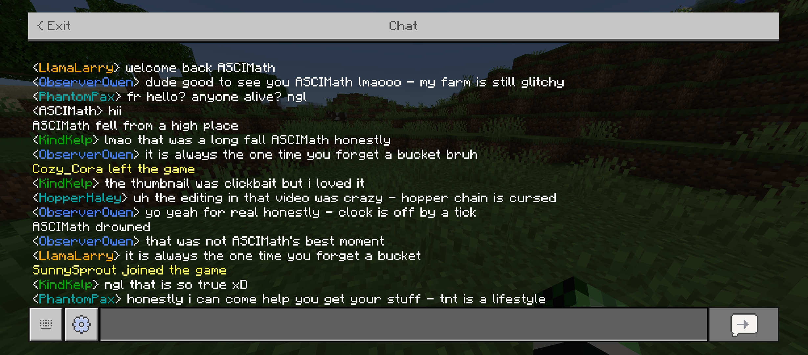
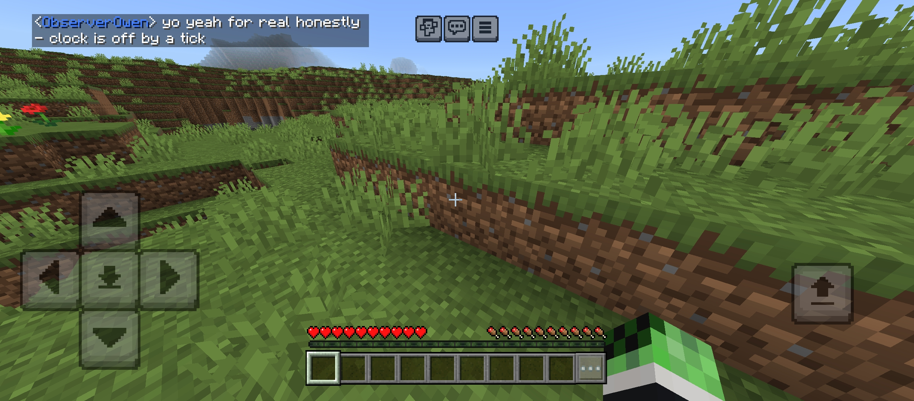
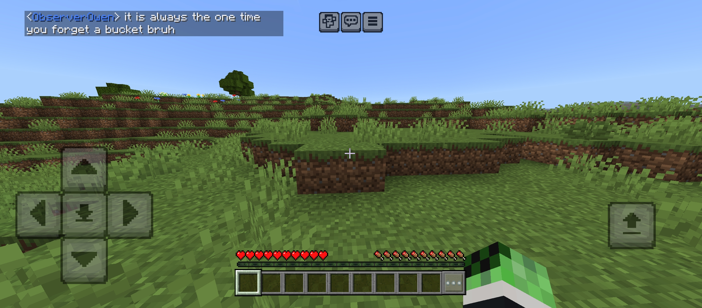
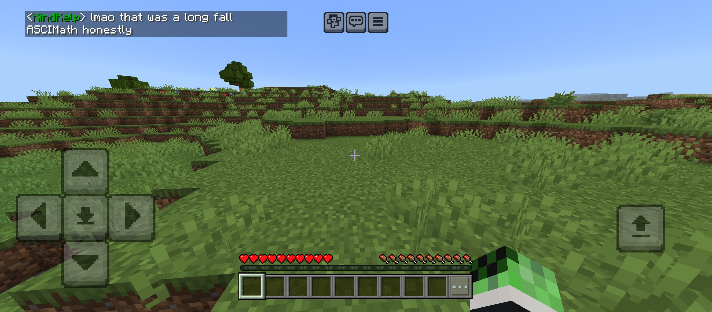
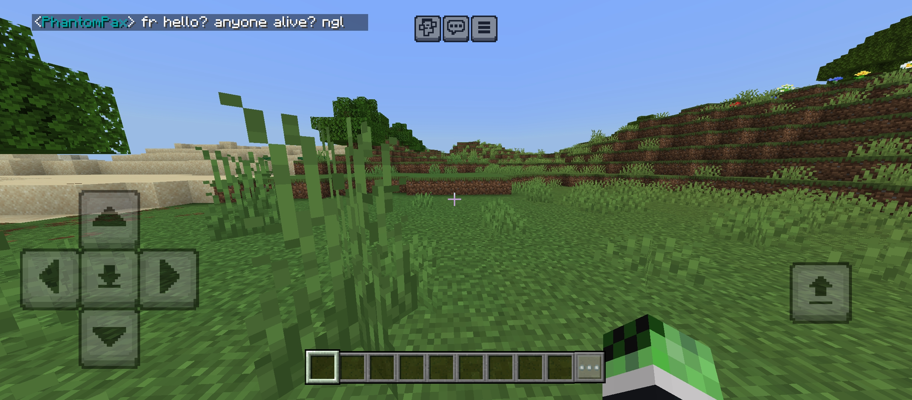

# Listing Kit: Living SMP Chat

Tap the Copy button on a block, then paste it into the CurseForge listing. Generated from DESCRIPTION.md: edit that, not this file.

## Package Name

```text
Living SMP Chat
```

## Summary (107/256)

```text
40 virtual SMP members chat, join and leave, and react when you die or mine Diamond Ore and Ancient Debris.
```

## Description (HTML)

Paste into the CurseForge description editor in source (HTML) mode.

```html
<div><div style="border:2px solid #15803d;border-radius:18px;line-height:1.5"><br><p style="text-align:center"></p><p style="color:#8a94a3;font-size:14px;text-align:center">by ALNStudios</p><p style="text-align:center"><span style="background-color:#15803d;color:#ffffff;border-radius:20px;font-size:16px">&nbsp;&nbsp;<strong>40 virtual SMP members chat, join and leave, and react when you die or mine Diamond Ore and Ancient Debris.</strong>&nbsp;&nbsp;</span></p><p style="text-align:center;margin-left:16px;margin-right:16px">Living SMP Chat fills the chat with a friendly roster of 40 virtual players who talk to each other and to you. It suits solo worlds that feel too quiet.</p><div style="display:flex;flex-wrap:wrap;gap:8px;margin-left:14px;margin-right:14px"><div style="background-color:#dcfce7;color:#14532d;border-radius:20px;font-size:14px;line-height:2"><strong>&nbsp;&nbsp;Bedrock</strong>: 1.26+&nbsp;&nbsp;</div><div style="background-color:#dcfce7;color:#14532d;border-radius:20px;font-size:14px;line-height:2"><strong>&nbsp;&nbsp;Experimental</strong>: No&nbsp;&nbsp;</div><div style="background-color:#dcfce7;color:#14532d;border-radius:20px;font-size:14px;line-height:2"><strong>&nbsp;&nbsp;Achievements</strong>: Yes, achievement-friendly&nbsp;&nbsp;</div></div><br></div>
<h2 style="font-size:17px;text-align:left"><span style="background-color:#15803d;color:#ffffff;border-radius:20px">&nbsp;&nbsp;About&nbsp;&nbsp;</span></h2>
<p>You play your world as usual. Between 6 and 14 virtual players are online at any time and they join and leave with the normal yellow messages. They greet you when you join, react to your deaths and ore finds, and hold short conversations on their own. Nothing is added to the world: only chat messages appear.</p>
<h2 style="font-size:17px;text-align:left"><span style="background-color:#15803d;color:#ffffff;border-radius:20px">&nbsp;&nbsp;Screenshots&nbsp;&nbsp;</span></h2>
<div style="display:flex;flex-wrap:wrap;gap:10px"><div style="flex:1 1 300px;border:1px solid #8a94a3;border-radius:16px;text-align:center"><p><a href="https://raw.githubusercontent.com/AllensCreations/MCPE-Curseforges/main/MCPEDL/Script/Living-SMP-Chat/assets/snapshots/CHATLOGS.jpg"></a></p></div><div style="flex:1 1 300px;border:1px solid #8a94a3;border-radius:16px;text-align:center"><p><a href="https://raw.githubusercontent.com/AllensCreations/MCPE-Curseforges/main/MCPEDL/Script/Living-SMP-Chat/assets/snapshots/SAMPLE%201.jpg"></a></p></div><div style="flex:1 1 300px;border:1px solid #8a94a3;border-radius:16px;text-align:center"><p><a href="https://raw.githubusercontent.com/AllensCreations/MCPE-Curseforges/main/MCPEDL/Script/Living-SMP-Chat/assets/snapshots/SAMPLE%202.jpg"></a></p></div><div style="flex:1 1 300px;border:1px solid #8a94a3;border-radius:16px;text-align:center"><p><a href="https://raw.githubusercontent.com/AllensCreations/MCPE-Curseforges/main/MCPEDL/Script/Living-SMP-Chat/assets/snapshots/SAMPLE%203.jpg"></a></p></div><div style="flex:1 1 300px;border:1px solid #8a94a3;border-radius:16px;text-align:center"><p><a href="https://raw.githubusercontent.com/AllensCreations/MCPE-Curseforges/main/MCPEDL/Script/Living-SMP-Chat/assets/snapshots/SAMPLE%204.jpg"></a></p></div></div>
<h2 style="font-size:17px;text-align:left"><span style="background-color:#15803d;color:#ffffff;border-radius:20px">&nbsp;&nbsp;What You Get&nbsp;&nbsp;</span></h2>
<div style="display:flex;flex-wrap:wrap;gap:10px"><div style="flex:1;min-width:200px;border:1px solid #8a94a3;border-radius:16px"><div style="background-color:#15803d;color:#ffffff;border-radius:16px;font-size:16px;line-height:2.2"><strong>&nbsp;&nbsp;Virtual SMP Roster</strong></div><div style="margin-left:12px;margin-right:12px"><p><span>40 virtual players with Builder, Redstoner, PvPer, Wholesome and Chaotic personalities take turns online. Only the players who are online speak.</span><br><span style="font-size:13px;color:#8a94a3"><strong>Good To Know:</strong> The online group is kept between sessions.</span></p></div></div><div style="flex:1;min-width:200px;border:1px solid #8a94a3;border-radius:16px"><div style="background-color:#15803d;color:#ffffff;border-radius:16px;font-size:16px;line-height:2.2"><strong>&nbsp;&nbsp;Death Reactions</strong></div><div style="margin-left:12px;margin-right:12px"><p><span>When you die to a creeper, lava, a fall, the void, a mob or anything else, two to four virtual players react in turn and offer to help.</span><br><span style="font-size:13px;color:#8a94a3"><strong>How It Works:</strong> Fall from a high place and one player jokes about the missing water bucket while another offers to meet you at spawn.</span></p></div></div><div style="flex:1;min-width:200px;border:1px solid #8a94a3;border-radius:16px"><div style="background-color:#15803d;color:#ffffff;border-radius:16px;font-size:16px;line-height:2.2"><strong>&nbsp;&nbsp;Ore Celebrations</strong></div><div style="margin-left:12px;margin-right:12px"><p><span>Mining Diamond Ore, Deepslate Diamond Ore or Ancient Debris makes virtual players congratulate you.</span><br><span style="font-size:13px;color:#8a94a3"><strong>Good To Know:</strong> A whole vein starts one conversation, not one per block. The same ore type will not start another for 1 minute.</span></p></div></div><div style="flex:1;min-width:200px;border:1px solid #8a94a3;border-radius:16px"><div style="background-color:#15803d;color:#ffffff;border-radius:16px;font-size:16px;line-height:2.2"><strong>&nbsp;&nbsp;Welcome Back, Sleep and Travel Chat</strong></div><div style="margin-left:12px;margin-right:12px"><p><span>Virtual players greet you when you join, comment when you go to bed, and react when you enter the Nether or the End.</span><br><span style="font-size:13px;color:#8a94a3"><strong>Good To Know:</strong> Sleep and travel comments are limited to one every 3 minutes for each kind.</span></p></div></div><div style="flex:1;min-width:200px;border:1px solid #8a94a3;border-radius:16px"><div style="background-color:#15803d;color:#ffffff;border-radius:16px;font-size:16px;line-height:2.2"><strong>&nbsp;&nbsp;Ambient Banter</strong></div><div style="margin-left:12px;margin-right:12px"><p><span>Every 1.5 to 3 minutes the virtual players start a 2 to 5 message conversation about weather, farms, trading, raids, bosses, pets, music and more, from short scripted chats to small PvP dramas between three of them.</span><br><span style="font-size:13px;color:#8a94a3"><strong>Good To Know:</strong> Conversations are spaced out so replies appear one after another. Overlapping events wait in a short queue instead of flooding the chat.</span></p></div></div><div style="flex:1;min-width:200px;border:1px solid #8a94a3;border-radius:16px"><div style="background-color:#15803d;color:#ffffff;border-radius:16px;font-size:16px;line-height:2.2"><strong>&nbsp;&nbsp;Bedtime and Mishaps</strong></div><div style="margin-left:12px;margin-right:12px"><p><span>On about one night in twenty, a virtual player says they are off to bed, others wish them goodnight, and, with the World Changes option, the night then skips to morning. From time to time a virtual player also dies, with the usual death message in chat, and the others react.</span><br><span style="font-size:13px;color:#8a94a3"><strong>Good To Know:</strong> Virtual deaths are only chat messages. With World Changes, the night skip does change the time of day for everyone and clears the weather. It never touches your items or position.</span></p></div></div><div style="flex:1;min-width:200px;border:1px solid #8a94a3;border-radius:16px"><div style="background-color:#15803d;color:#ffffff;border-radius:16px;font-size:16px;line-height:2.2"><strong>&nbsp;&nbsp;Pack Options</strong></div><div style="margin-left:12px;margin-right:12px"><p><span>The pack offers four options: Just Chat SMP and World Changes, each with a Quiet version. Just Chat SMP keeps everything in chat, World Changes lets the bedtime night skip really change the world, and Quiet makes the virtual players chat about half as often.</span><br><span style="font-size:13px;color:#8a94a3"><strong>Good To Know:</strong> Just Chat SMP is the default. Switch options from the pack's settings in your world.</span></p></div></div><div style="flex:1;min-width:200px;border:1px solid #8a94a3;border-radius:16px"><div style="background-color:#15803d;color:#ffffff;border-radius:16px;font-size:16px;line-height:2.2"><strong>&nbsp;&nbsp;Replies to Your Chat</strong></div><div style="margin-left:12px;margin-right:12px"><p><span>Virtual players answer when you say hello, thank them, ask a question, laugh, say goodnight, or type one of their names.</span><br><span style="font-size:13px;color:#8a94a3"><strong>Good To Know:</strong> They do not answer every message and they wait a few seconds before replying. If your version of Minecraft does not let add-ons read chat, this part simply stays quiet.</span></p></div></div><div style="flex:1;min-width:200px;border:1px solid #8a94a3;border-radius:16px"><div style="background-color:#15803d;color:#ffffff;border-radius:16px;font-size:16px;line-height:2.2"><strong>&nbsp;&nbsp;Personalities</strong></div><div style="margin-left:12px;margin-right:12px"><p><span>Each virtual player has a catchphrase, and now and then one of them slips and uses a first name, like a real person typing in the wrong account.</span><br><span style="font-size:13px;color:#8a94a3"><strong>Good To Know:</strong> The first names are made up and do not belong to anyone in particular.</span></p></div></div><div style="flex:1;min-width:200px;border:1px solid #8a94a3;border-radius:16px"><div style="background-color:#15803d;color:#ffffff;border-radius:16px;font-size:16px;line-height:2.2"><strong>&nbsp;&nbsp;Shoutouts</strong></div><div style="margin-left:12px;margin-right:12px"><p><span>Once in a while a virtual player asks if you know ALNStudios and suggests following him. Some shoutouts are short chats where two or three players talk about who made the add-on.</span><br><span style="font-size:13px;color:#8a94a3"><strong>Good To Know:</strong> It happens at most once every 20 minutes.</span></p></div></div></div>
<h2 style="font-size:17px;text-align:left"><span style="background-color:#15803d;color:#ffffff;border-radius:20px">&nbsp;&nbsp;Get Started&nbsp;&nbsp;</span></h2>
<table style="width:100%;border:1px solid #8a94a3;border-radius:16px"><tbody><tr><td style="width:44px;text-align:center"><div style="background-color:#15803d;color:#ffffff;font-weight:bold;font-size:15px;text-align:center;border-radius:10px;width:30px;aspect-ratio:1/1;line-height:30px">1</div></td><td style="text-align:left;">Import the pack and add the Behavior Pack to your world.</td></tr><tr><td style="width:44px;text-align:center"><div style="background-color:#15803d;color:#ffffff;font-weight:bold;font-size:15px;text-align:center;border-radius:10px;width:30px;aspect-ratio:1/1;line-height:30px">2</div></td><td style="text-align:left;">Join the world and wait a few seconds for a welcome message.</td></tr><tr><td style="width:44px;text-align:center"><div style="background-color:#15803d;color:#ffffff;font-weight:bold;font-size:15px;text-align:center;border-radius:10px;width:30px;aspect-ratio:1/1;line-height:30px">3</div></td><td style="text-align:left;">Mine Diamond Ore or sleep in a bed and watch the chat react.</td></tr></tbody></table>
<h2 style="font-size:17px;text-align:left"><span style="background-color:#15803d;color:#ffffff;border-radius:20px">&nbsp;&nbsp;Common Questions&nbsp;&nbsp;</span></h2>
<div class="spoiler" title="Are the other players real?" data-title="Are the other players real?"><p><strong>Are the other players real?</strong><br>No. Every virtual player is simulated and only sends chat messages.</p></div><div class="spoiler" title="Do they speak when nobody is in the world?" data-title="Do they speak when nobody is in the world?"><p><strong>Do they speak when nobody is in the world?</strong><br>No. Conversations only start while at least one real player is in the world.</p></div>
<h2 style="font-size:17px;text-align:left"><span style="background-color:#15803d;color:#ffffff;border-radius:20px">&nbsp;&nbsp;Install&nbsp;&nbsp;</span></h2>
<table style="width:100%;border:1px solid #8a94a3;border-radius:16px"><tbody><tr><td style="width:44px;text-align:center"><div style="background-color:#15803d;color:#ffffff;font-weight:bold;font-size:15px;text-align:center;border-radius:10px;width:30px;aspect-ratio:1/1;line-height:30px">1</div></td><td style="text-align:left;">Download the file from this page and open it with Minecraft.</td></tr><tr><td style="width:44px;text-align:center"><div style="background-color:#15803d;color:#ffffff;font-weight:bold;font-size:15px;text-align:center;border-radius:10px;width:30px;aspect-ratio:1/1;line-height:30px">2</div></td><td style="text-align:left;">Create or edit a world and turn on the new pack(s) in its settings.</td></tr><tr><td style="width:44px;text-align:center"><div style="background-color:#15803d;color:#ffffff;font-weight:bold;font-size:15px;text-align:center;border-radius:10px;width:30px;aspect-ratio:1/1;line-height:30px">3</div></td><td style="text-align:left;">Play. No Experimental toggles needed.</td></tr></tbody></table>
<div style="border:1px solid #8a94a3;border-radius:16px;text-align:center"><br><div style="background-color:#15803d;color:#ffffff;border-radius:20px;font-size:15px;line-height:2;display:inline-block">&nbsp;&nbsp;<strong>Found a Bug or Have a Suggestion?</strong>&nbsp;&nbsp;</div><p style="font-size:14px;">Please leave a comment on this project page! All bug reports, gameplay feedback, and pack suggestions are welcome and appreciated.</p></div>
<h2 style="font-size:17px;text-align:left"><span style="background-color:#15803d;color:#ffffff;border-radius:20px">&nbsp;&nbsp;Support&nbsp;&nbsp;</span></h2><div style="border:1px solid #8a94a3;border-radius:16px;text-align:center"><br><a href="https://ko-fi.com/alnstudios"></a><br><br></div><p style="text-align:center"><a href="https://www.curseforge.com/members/allenscreations/projects"><strong>CurseForge</strong></a> &nbsp;|&nbsp; <a href="https://mcpedl.com/user/alnstudios/"><strong>MCPEDL</strong></a> &nbsp;|&nbsp; <a href="https://ko-fi.com/alnstudios"><strong>Ko-fi</strong></a></p>
<hr>
<p style="text-align:center;color:#8a94a3;font-size:13px"><strong>By ALNStudios</strong></p>
<div class="spoiler"><p style="font-size:13px"><strong>Permissions and credits</strong></p><ul style="font-size:13px"><li>Rights: All rights reserved for ALNStudios.</li><li>Content creators: You may feature this creation in videos and streams with credit to ALNStudios.</li><li>Redistribution: Do not re-upload this pack or provide direct monetized download bypasses. Link to this page.</li><li>Visual: Promotional/cover imagery used on this page is AI-generated to illustrate the concept and purpose of the pack.</li><li>Unofficial community creation. Not an official Minecraft product and not approved by or associated with Mojang or Microsoft.</li></ul></div>
<p style="text-align:center;color:#8a94a3;font-size:12px">Minecraft Bedrock add-on, Living SMP Chat Bedrock mod, virtual SMP players, fake server chat, Diamond Ore reactions, Ancient Debris, Minecraft PE survival, MCPEDL add-on, CurseForge Bedrock, ALNStudios.</p></div>
```

## AI Image Prompts

### Reference Images

- **Logo reference**: attach your own logo. The generator uses it only for brand colors and mood. The result must be a new design, not a copy.
- **Snapshot references**: attach 1 to 4 of your in-game snapshots of this pack. The generator copies their look, not their screen layout.

### Logo Prompt

```text
Use the attached logo only as a brand reference for its color palette and overall mood. Do not copy it. Create a new, original logo with a different composition and a different main symbol. Do not just recolor, resize, crop, mirror or tweak the attached logo.
Create a clean, square (1:1) logo image for the Minecraft Bedrock add-on "Living SMP Chat". 40 virtual SMP members chat, join and leave, and react when you die or mine Diamond Ore and Ancient Debris.
Base the main symbol on the pack idea above. Match the blocky look of the attached in-game snapshots. Center the logo, use a simple background, and keep it readable at small sizes.
Text: "Living SMP Chat" and, in small letters, "ALNStudios". ALNStudios is the brand name, so always keep it and never remove or change it. Spell both exactly.
Do not add Minecraft, Mojang or Microsoft logos, watermarks, or characters from other games.
```

### Banner Prompt

```text
Create a wide (16:9) banner image for the Minecraft Bedrock add-on "Living SMP Chat". 40 virtual SMP members chat, join and leave, and react when you die or mine Diamond Ore and Ancient Debris.
Use the attached in-game snapshots as scene and style references: copy their blocky look, lighting, colors and the kind of scenery they show. Make a new composition inspired by them. Do not copy the on-screen HUD, chat or hotbar.
Use the attached logo only as a brand reference for its colors and mood. Do not copy it. Put a new, original logo design in the banner, large enough to read, on the left or center.
Hint at these pack features visually: Virtual SMP Roster, Death Reactions, Ore Celebrations, Welcome Back, Sleep and Travel Chat, Ambient Banter.
Text: "Living SMP Chat" and, in small letters, "by ALNStudios". ALNStudios is the brand name, so always keep it and never remove or change it. Spell both exactly.
Leave clear space around the logo. No Minecraft, Mojang or Microsoft logos, no watermarks.
```
