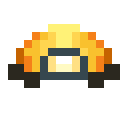
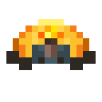
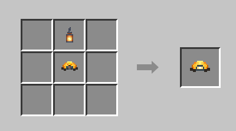
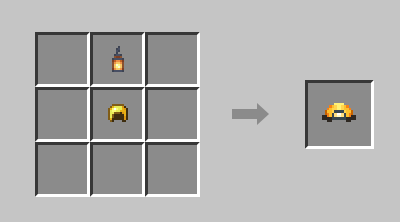
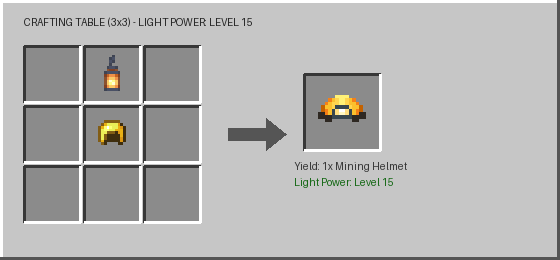
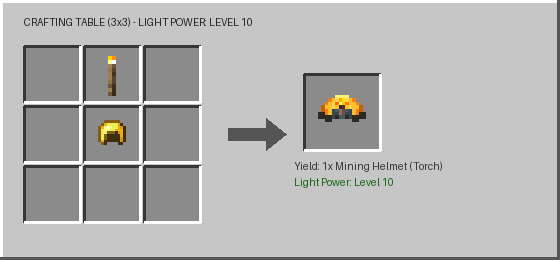
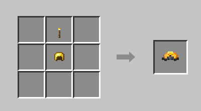

# Listing Kit: Mining Helmet

Tap the Copy button on a block, then paste it into the CurseForge listing. Generated from DESCRIPTION.md: edit that, not this file.

## Package Name

```text
Mining Helmet
```

## Summary (53/256)

```text
Wearable light for cave mining and night exploration.
```

## Description (HTML)

Paste into the CurseForge description editor in source (HTML) mode.

```html
<div><div style="border:2px solid #15803d;border-radius:18px;line-height:1.5"><br><h1 style="font-size:34px;text-align:center">Mining Helmet</h1><p style="color:#8a94a3;font-size:14px;text-align:center">by ALNStudios</p><div style="display:flex;flex-wrap:wrap;gap:8px;margin-left:14px;margin-right:14px"><div style="background-color:#dcfce7;color:#14532d;border-radius:20px;font-size:14px;line-height:2"><strong>&nbsp;&nbsp;Bedrock</strong>: 1.21+&nbsp;&nbsp;</div><div style="background-color:#dcfce7;color:#14532d;border-radius:20px;font-size:14px;line-height:2"><strong>&nbsp;&nbsp;Experimental</strong>: No&nbsp;&nbsp;</div><div style="background-color:#dcfce7;color:#14532d;border-radius:20px;font-size:14px;line-height:2"><strong>&nbsp;&nbsp;Achievements</strong>: Yes, achievement-friendly&nbsp;&nbsp;</div></div><br></div>
<h2 style="font-size:17px;text-align:left"><span style="background-color:#15803d;color:#ffffff;border-radius:20px">&nbsp;&nbsp;About&nbsp;&nbsp;</span></h2>
<p><strong>Mining Helmet</strong> adds wearable headgear with moving light to Minecraft Bedrock Edition. Equipped in your head armor slot, it continuously lights up your surroundings as you walk, run, and dig, leaving both hands free for your pickaxe, weapon, or shield. By default the light follows the spot you are looking at, and a Head Light subpack keeps it above your head instead.</p><p>The helmet provides moving light while worn, and holding a Lantern or Torch can also provide handheld light.</p>
<h2 style="font-size:17px;text-align:left"><span style="background-color:#15803d;color:#ffffff;border-radius:20px">&nbsp;&nbsp;Features and Light Power Ratings&nbsp;&nbsp;</span></h2>
<div class="spoiler" title="Features and Light Power Ratings" data-title="Features and Light Power Ratings">
<h3>Mining Helmet (Lantern)</h3><ul><li><strong>Light Power Level</strong>: <strong>15</strong></li><li><strong>Illumination Type</strong>: High-Intensity Beam</li><li><strong>Description</strong>: Bright illumination while worn.</li></ul><h3>Mining Helmet (Torch)</h3><ul><li><strong>Light Power Level</strong>: <strong>10</strong></li><li><strong>Illumination Type</strong>: Medium Warm Glow</li><li><strong>Description</strong>: A lower-light option for early-game cave exploration.</li></ul><h3>Handheld / Offhand Lantern</h3><ul><li><strong>Light Power Level</strong>: <strong>15</strong></li><li><strong>Illumination Type</strong>: Portable Floodlight</li><li><strong>Description</strong>: Provides moving light while a standard Lantern is held in either hand.</li></ul><h3>Handheld / Offhand Torch</h3><ul><li><strong>Light Power Level</strong>: <strong>10</strong></li><li><strong>Illumination Type</strong>: Portable Torch Light</li><li><strong>Description</strong>: Provides moving light while a standard Torch is held in either hand.</li></ul></div>
<h2 style="font-size:17px;text-align:left"><span style="background-color:#15803d;color:#ffffff;border-radius:20px">&nbsp;&nbsp;Equipment Specifications&nbsp;&nbsp;</span></h2>
<div class="spoiler" title="Equipment Specifications" data-title="Equipment Specifications">
<h3>Light Power</h3><ul><li><strong>Lantern Version</strong>: Level 15 (Daylight Maximum)</li><li><strong>Torch Version</strong>: Level 10 (Warm Glow)</li></ul><h3>Equipment Slot</h3><ul><li><strong>Lantern Version</strong>: Head Armor</li><li><strong>Torch Version</strong>: Head Armor</li></ul><h3>Armor Defense</h3><ul><li><strong>Lantern Version</strong>: 2 Armor Points</li><li><strong>Torch Version</strong>: 2 Armor Points</li></ul><h3>Durability</h3><ul><li><strong>Lantern Version</strong>: 165 Uses</li><li><strong>Torch Version</strong>: 165 Uses</li></ul><h3>Repair Item</h3><ul><li><strong>Lantern Version</strong>: Gold Ingot</li><li><strong>Torch Version</strong>: Gold Ingot</li></ul><h3>Enchantability</h3><ul><li><strong>Lantern Version</strong>: Protection, Unbreaking, Mending, Aqua Affinity, Respiration</li><li><strong>Torch Version</strong>: Protection, Unbreaking, Mending, Aqua Affinity, Respiration</li></ul></div>
<h2 style="font-size:17px;text-align:left"><span style="background-color:#15803d;color:#ffffff;border-radius:20px">&nbsp;&nbsp;Custom Items&nbsp;&nbsp;</span></h2>
<div style="display:flex;flex-wrap:wrap;gap:10px"><div style="flex:0 1 120px;border:1px solid #8a94a3;border-radius:16px;text-align:center"><p><a href="https://raw.githubusercontent.com/AllensCreations/MCPE-Curseforges/main/MCPEDL/Addons/Mining-Helmet/assets/items/mining_helmet.png"></a></p><p style="color:#8a94a3;font-size:13px">mining helmet</p></div><div style="flex:0 1 120px;border:1px solid #8a94a3;border-radius:16px;text-align:center"><p><a href="https://raw.githubusercontent.com/AllensCreations/MCPE-Curseforges/main/MCPEDL/Addons/Mining-Helmet/assets/items/torch_mining_helmet.png"></a></p><p style="color:#8a94a3;font-size:13px">torch mining helmet</p></div></div>
<h2 style="font-size:17px;text-align:left"><span style="background-color:#15803d;color:#ffffff;border-radius:20px">&nbsp;&nbsp;Crafting Recipes&nbsp;&nbsp;</span></h2>
<div style="display:flex;flex-wrap:wrap;gap:10px"><div style="flex:0 1 400px;border:1px solid #8a94a3;border-radius:16px;text-align:center"><p><a href="https://raw.githubusercontent.com/AllensCreations/MCPE-Curseforges/main/MCPEDL/Addons/Mining-Helmet/assets/recipes/mining_helmet_mining_helmet_upgrade_recipe.png"></a></p><p style="color:#8a94a3;font-size:13px">mining helmet mining helmet upgrade recipe</p></div><div style="flex:0 1 400px;border:1px solid #8a94a3;border-radius:16px;text-align:center"><p><a href="https://raw.githubusercontent.com/AllensCreations/MCPE-Curseforges/main/MCPEDL/Addons/Mining-Helmet/assets/recipes/mining_helmet_recipe.png"></a></p><p style="color:#8a94a3;font-size:13px">mining helmet recipe</p></div><div style="flex:0 1 400px;border:1px solid #8a94a3;border-radius:16px;text-align:center"><p><a href="https://raw.githubusercontent.com/AllensCreations/MCPE-Curseforges/main/MCPEDL/Addons/Mining-Helmet/assets/recipes/recipe_lantern.png"></a></p><p style="color:#8a94a3;font-size:13px">recipe lantern</p></div><div style="flex:0 1 400px;border:1px solid #8a94a3;border-radius:16px;text-align:center"><p><a href="https://raw.githubusercontent.com/AllensCreations/MCPE-Curseforges/main/MCPEDL/Addons/Mining-Helmet/assets/recipes/recipe_torch.png"></a></p><p style="color:#8a94a3;font-size:13px">recipe torch</p></div><div style="flex:0 1 400px;border:1px solid #8a94a3;border-radius:16px;text-align:center"><p><a href="https://raw.githubusercontent.com/AllensCreations/MCPE-Curseforges/main/MCPEDL/Addons/Mining-Helmet/assets/recipes/torch_mining_helmet_recipe.png"></a></p><p style="color:#8a94a3;font-size:13px">torch mining helmet recipe</p></div></div>
<h2 style="font-size:17px;text-align:left"><span style="background-color:#15803d;color:#ffffff;border-radius:20px">&nbsp;&nbsp;Get Started&nbsp;&nbsp;</span></h2>
<table style="width:100%;border:1px solid #8a94a3;border-radius:16px"><tbody><tr><td style="width:44px;text-align:center"><div style="background-color:#15803d;color:#ffffff;font-weight:bold;font-size:15px;text-align:center;border-radius:10px;width:30px;aspect-ratio:1/1;line-height:30px">1</div></td><td style="text-align:left;">Import the complete add-on and enable its included packs in your world settings.</td></tr><tr><td style="width:44px;text-align:center"><div style="background-color:#15803d;color:#ffffff;font-weight:bold;font-size:15px;text-align:center;border-radius:10px;width:30px;aspect-ratio:1/1;line-height:30px">2</div></td><td style="text-align:left;">Craft the Lantern or Torch Mining Helmet using the listed ingredients.</td></tr><tr><td style="width:44px;text-align:center"><div style="background-color:#15803d;color:#ffffff;font-weight:bold;font-size:15px;text-align:center;border-radius:10px;width:30px;aspect-ratio:1/1;line-height:30px">3</div></td><td style="text-align:left;">Equip the helmet in your head armor slot to carry its light with you. Holding a Lantern or Torch can also provide light.</td></tr><tr><td style="width:44px;text-align:center"><div style="background-color:#15803d;color:#ffffff;font-weight:bold;font-size:15px;text-align:center;border-radius:10px;width:30px;aspect-ratio:1/1;line-height:30px">4</div></td><td style="text-align:left;">The light follows your cursor by default. To keep it above your head, choose the Head Light subpack in the Behavior Pack settings.</td></tr></tbody></table>
<h2 style="font-size:17px;text-align:left"><span style="background-color:#15803d;color:#ffffff;border-radius:20px">&nbsp;&nbsp;Install&nbsp;&nbsp;</span></h2>
<table style="width:100%;border:1px solid #8a94a3;border-radius:16px"><tbody><tr><td style="width:44px;text-align:center"><div style="background-color:#15803d;color:#ffffff;font-weight:bold;font-size:15px;text-align:center;border-radius:10px;width:30px;aspect-ratio:1/1;line-height:30px">1</div></td><td style="text-align:left;">Download the file from this page and open it with Minecraft.</td></tr><tr><td style="width:44px;text-align:center"><div style="background-color:#15803d;color:#ffffff;font-weight:bold;font-size:15px;text-align:center;border-radius:10px;width:30px;aspect-ratio:1/1;line-height:30px">2</div></td><td style="text-align:left;">Create or edit a world and turn on the new pack(s) in its settings.</td></tr><tr><td style="width:44px;text-align:center"><div style="background-color:#15803d;color:#ffffff;font-weight:bold;font-size:15px;text-align:center;border-radius:10px;width:30px;aspect-ratio:1/1;line-height:30px">3</div></td><td style="text-align:left;">Play. No Experimental toggles needed.</td></tr></tbody></table>
<div style="border:1px solid #8a94a3;border-radius:16px;text-align:center"><br><div style="background-color:#15803d;color:#ffffff;border-radius:20px;font-size:15px;line-height:2;display:inline-block">&nbsp;&nbsp;<strong>Found a Bug or Have a Suggestion?</strong>&nbsp;&nbsp;</div><p style="font-size:14px;">Please leave a comment on this project page! All bug reports, gameplay feedback, and pack suggestions are welcome and appreciated.</p></div>
<h2 style="font-size:17px;text-align:left"><span style="background-color:#15803d;color:#ffffff;border-radius:20px">&nbsp;&nbsp;Support&nbsp;&nbsp;</span></h2><div style="border:1px solid #8a94a3;border-radius:16px;text-align:center"><br><a href="https://ko-fi.com/alnstudios"></a><br><br></div><p style="text-align:center"><a href="https://www.curseforge.com/members/allenscreations/projects"><strong>CurseForge</strong></a> &nbsp;|&nbsp; <a href="https://mcpedl.com/user/alnstudios/"><strong>MCPEDL</strong></a> &nbsp;|&nbsp; <a href="https://ko-fi.com/alnstudios"><strong>Ko-fi</strong></a></p>
<hr>
<p style="text-align:center;color:#8a94a3;font-size:13px"><strong>By ALNStudios</strong></p>
<div class="spoiler"><p style="font-size:13px"><strong>Permissions and credits</strong></p><ul style="font-size:13px"><li>Rights: All rights reserved for ALNStudios.</li><li>Content creators: You may feature this creation in videos and streams with credit to ALNStudios.</li><li>Redistribution: Do not re-upload this pack or provide direct monetized download bypasses. Link to this page.</li><li>Unofficial community creation. Not an official Minecraft product and not approved by or associated with Mojang or Microsoft.</li></ul></div>
<p style="text-align:center;color:#8a94a3;font-size:12px">Mining Helmet Bedrock add-on, Mining Helmet (Lantern) Minecraft Bedrock, Mining Helmet (Torch) Minecraft Bedrock, Handheld / Offhand Lantern Minecraft Bedrock, Handheld / Offhand Torch Minecraft Bedrock, Minecraft PE mod, MCPEDL add-on, CurseForge Bedrock, ALNStudios, Minecraft Bedrock add-on.</p></div>
```

## AI Image Prompts

### Reference Images

- **Logo reference**: attach your own logo. The generator uses it only for brand colors and mood. The result must be a new design, not a copy.
- **Snapshot references**: attach 1 to 4 of your in-game snapshots of this pack. The generator copies their look, not their screen layout.

### Logo Prompt

```text
Use the attached logo only as a brand reference for its color palette and overall mood. Do not copy it. Create a new, original logo with a different composition and a different main symbol. Do not just recolor, resize, crop, mirror or tweak the attached logo.
Create a clean, square (1:1) logo image for the Minecraft Bedrock add-on "Mining Helmet".
Base the main symbol on the pack idea above. Match the blocky look of the attached in-game snapshots. Center the logo, use a simple background, and keep it readable at small sizes.
Text: "Mining Helmet" and, in small letters, "ALNStudios". ALNStudios is the brand name, so always keep it and never remove or change it. Spell both exactly.
Do not add Minecraft, Mojang or Microsoft logos, watermarks, or characters from other games.
```

### Banner Prompt

```text
Create a wide (16:9) banner image for the Minecraft Bedrock add-on "Mining Helmet".
Use the attached in-game snapshots as scene and style references: copy their blocky look, lighting, colors and the kind of scenery they show. Make a new composition inspired by them. Do not copy the on-screen HUD, chat or hotbar.
Use the attached logo only as a brand reference for its colors and mood. Do not copy it. Put a new, original logo design in the banner, large enough to read, on the left or center.
Text: "Mining Helmet" and, in small letters, "by ALNStudios". ALNStudios is the brand name, so always keep it and never remove or change it. Spell both exactly.
Leave clear space around the logo. No Minecraft, Mojang or Microsoft logos, no watermarks.
```
