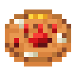
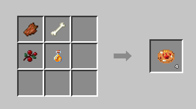
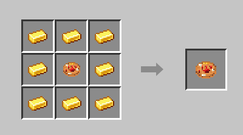

# Listing Kit: Monster Companions

Tap the Copy button on a block, then paste it into the CurseForge listing. Generated from DESCRIPTION.md: edit that, not this file.

## Package Name

```text
Monster Companions
```

## Summary (46/256)

```text
Tameable Hostile Mobs and Mounts by ALNStudios
```

## Description (HTML)

Paste into the CurseForge description editor in source (HTML) mode.

```html
<div><div style="border:2px solid #15803d;border-radius:18px;line-height:1.5"><br><p style="text-align:center"></p><p style="color:#8a94a3;font-size:14px;text-align:center">by ALNStudios</p><div style="display:flex;flex-wrap:wrap;gap:8px;margin-left:14px;margin-right:14px"><div style="background-color:#dcfce7;color:#14532d;border-radius:20px;font-size:14px;line-height:2"><strong>&nbsp;&nbsp;Bedrock</strong>: 1.26+&nbsp;&nbsp;</div><div style="background-color:#dcfce7;color:#14532d;border-radius:20px;font-size:14px;line-height:2"><strong>&nbsp;&nbsp;Experimental</strong>: No&nbsp;&nbsp;</div></div><br></div>
<h2 style="font-size:17px;text-align:left"><span style="background-color:#15803d;color:#ffffff;border-radius:20px">&nbsp;&nbsp;About&nbsp;&nbsp;</span></h2>
<p>Monster Companions is a Minecraft Bedrock add-on that enables players to pacify and tame 31 hostile mob types into defensive bodyguards and controllable mounts.</p><p>The add-on lets players tame selected hostile mobs and use supported creatures as mounts.</p>
<h2 style="font-size:17px;text-align:left"><span style="background-color:#15803d;color:#ffffff;border-radius:20px">&nbsp;&nbsp;Screenshots&nbsp;&nbsp;</span></h2>
<div style="display:flex;flex-wrap:wrap;gap:10px"><div style="flex:1 1 300px;border:1px solid #8a94a3;border-radius:16px;text-align:center"><p><a href="https://raw.githubusercontent.com/AllensCreations/MCPE-Curseforges/main/MCPEDL/Addons/Monster-Companions/assets/snapshots/beast_biscuit_preview.png"></a></p></div></div>
<h2 style="font-size:17px;text-align:left"><span style="background-color:#15803d;color:#ffffff;border-radius:20px">&nbsp;&nbsp;Features and Mechanics&nbsp;&nbsp;</span></h2>
<div class="spoiler" title="Features and Mechanics" data-title="Features and Mechanics">
<h3>Taming Chances</h3><p>Taming is no longer guaranteed. Each Primal Beast Biscuit you feed a wild hostile mob has a 50% chance to make it your companion, the same for every mob, and a biscuit is used up on every attempt. Mobs do not need to be wounded first, so you can try at full health.</p><h3>Automatic Bodyguard</h3><p>Companions now protect you on their own. When a hostile mob that is already angry at something comes within range of you, nearby companions step in and attack it without waiting for you to be hit first. They also keep defending you when you are hurt and join any fight you start. Companions never attack you, other players, or one another.</p><h3>Sit and Stay</h3><p>Tap a companion with an empty hand to make it sit and hold its position, and tap again to have it follow you. This works for ground companions that cannot be ridden. Flying companions and rideable mounts always follow you.</p><h3>Companion Squad Mechanics</h3><ul><li>Perimeter buffer: Companions follow the player while keeping a buffer distance to prevent obstructing the player camera or mining path. If the player sprints ahead, companions teleport behind the player safely.</li><li>Friendly-fire immunity: Companions avoid friendly-fire damage and do not target teammates.</li><li>Peaceful difficulty: Minecraft removes hostile mobs on Peaceful, including tamed companions. Use Easy or higher.</li><li>Player safe: Tamed companions never turn hostile toward players.</li><li>Auto-protect: Companions defend you from nearby aggressive hostile mobs even before you are attacked.</li><li>Visual status indicators: Tamed companions display an always-visible floating nameplate above their head. Custom name tags can be applied directly without an anvil.</li><li>Pink eyes: Tamed Zombies and Skeletons have pink eyes.</li><li>Taming feedback: Hearts confirm when a Primal Beast Biscuit tames a mob.</li><li>In-combat healing: Feeding a wounded companion a Primal Beast Biscuit restores 10 HP (5 hearts).</li><li>Witch healing: A tamed Witch throws a Regeneration splash potion at you every 25 to 40 seconds, which also heals companions standing next to you.</li><li>Sunlight protection: Tamed Zombies, Skeletons, and Phantoms can wear helmets to prevent burning in direct sunlight.</li><li>Kamikaze Creepers: Tamed Creepers will rush enemy threats that damage the player and detonate on the target as a single-use explosive bodyguard.</li><li>Spirit Vexes: Tamed Evokers summon Spirit Vexes that attack hostiles and despawn naturally when their lifespan ends without turning on players.</li></ul><h3>Boss Subpack</h3><p>Open the Behavior Pack settings and choose a subpack. Default keeps the Warden and the Wither as vanilla bosses, and With Bosses lets you tame them.</p><ul><li><strong>What Happens</strong>: On the With Bosses subpack, each Primal Beast Biscuit has a 50% chance to tame a wild Warden or Wither, like every other mob.</li><li><strong>Tamed Warden</strong>: Follows and defends you, can be ridden and steered on the ground, no longer applies Darkness, and deals 15 melee damage instead of 30.</li><li><strong>Tamed Wither</strong>: Follows and defends you, can be ridden and steered through the air, and no longer shows a boss bar.</li></ul><h3>Riding Companions</h3><p>Equipping a Saddle onto supported large companions enables manual mounting and direct steering:</p><ul><li>Mount prompt: Uses Minecraft's normal mount prompt on touch controls, controllers, and keyboard/mouse.</li><li>Sneak-to-interact: Crouching allows players to feed, heal, lead, or rename mounts without accidentally mounting.</li><li>Manual steering: Autonomous wandering and head-turning are disabled while mounted.</li><li>Wall climbing: Tamed Spiders and Cave Spiders can scale vertical surfaces and cliffs while mounted.</li><li>Supported mounts: Spider, Cave Spider, Ravager, Iron Golem, Hoglin, Zoglin, Breeze, Ghast, and Phantom. The With Bosses subpack adds Warden and Wither.</li><li>Flying mounts: Tamed Ghasts and Phantoms can be steered through the air while mounted. A tamed Wither can too on the With Bosses subpack.</li></ul></div>
<h2 style="font-size:17px;text-align:left"><span style="background-color:#15803d;color:#ffffff;border-radius:20px">&nbsp;&nbsp;Tameable Mob Roster (31 Mobs)&nbsp;&nbsp;</span></h2>
<div class="spoiler" title="Tameable Mob Roster (31 Mobs)" data-title="Tameable Mob Roster (31 Mobs)">
<h3>Undead</h3><ul><li><strong>Supported Mobs</strong>: Zombie, Drowned, Husk, Zombie Villager, Zombified Pigman</li><li><strong>Special Abilities</strong>: Helmet sunlight protection, melee defense</li></ul><h3>Skeletons</h3><ul><li><strong>Supported Mobs</strong>: Skeleton, Stray, Bogged, Parched, Wither Skeleton</li><li><strong>Special Abilities</strong>: Ranged arrow support, Wither effect, Weakness arrows</li></ul><h3>Tricky Trials</h3><ul><li><strong>Supported Mobs</strong>: Breeze</li><li><strong>Special Abilities</strong>: Wind Charge projectile launcher, rideable mount</li></ul><h3>Nether Beasts</h3><ul><li><strong>Supported Mobs</strong>: Hoglin, Zoglin</li><li><strong>Special Abilities</strong>: High knockback, rideable war beast</li></ul><h3>Explosives</h3><ul><li><strong>Supported Mobs</strong>: Creeper</li><li><strong>Special Abilities</strong>: Targeted single-use defensive explosion</li></ul><h3>Arachnids</h3><ul><li><strong>Supported Mobs</strong>: Spider, Cave Spider</li><li><strong>Special Abilities</strong>: Vertical wall climbing, rideable mount</li></ul><h3>Dimensionals</h3><ul><li><strong>Supported Mobs</strong>: Enderman</li><li><strong>Special Abilities</strong>: Teleport interception, heavy melee damage</li></ul><h3>Piglins</h3><ul><li><strong>Supported Mobs</strong>: Piglin, Piglin Brute</li><li><strong>Special Abilities</strong>: High attack speed, battle axe sweeps</li></ul><h3>Occult and Slimes</h3><ul><li><strong>Supported Mobs</strong>: Witch, Slime, Magma Cube</li><li><strong>Special Abilities</strong>: Lingering potion effects, crowd control</li></ul><h3>Nether and Sky</h3><ul><li><strong>Supported Mobs</strong>: Blaze, Ghast, Phantom</li><li><strong>Special Abilities</strong>: Fireball artillery, aerial escort, flying mounts</li></ul><h3>Illagers</h3><ul><li><strong>Supported Mobs</strong>: Ravager, Vindicator, Pillager, Evoker</li><li><strong>Special Abilities</strong>: Heavy mount, fangs, spirit vex minions</li></ul><h3>Golems</h3><ul><li><strong>Supported Mobs</strong>: Iron Golem, Snow Golem</li><li><strong>Special Abilities</strong>: Frontline defense, rideable mount</li></ul><h3>Bosses (With Bosses Subpack)</h3><ul><li><strong>Supported Mobs</strong>: Warden, Wither</li><li><strong>Special Abilities</strong>: Boss-level health, rideable ground mount (Warden), rideable flying mount (Wither)</li></ul></div>
<h2 style="font-size:17px;text-align:left"><span style="background-color:#15803d;color:#ffffff;border-radius:20px">&nbsp;&nbsp;Item Specifications&nbsp;&nbsp;</span></h2>
<div class="spoiler" title="Item Specifications" data-title="Item Specifications">
<h3>Primal Beast Biscuit</h3><h3>Use</h3><ul><li><strong>Effect</strong>: Gives a wild hostile mob a chance to become your companion and restores health to an injured companion.</li></ul><h3>Healing Value</h3><ul><li><strong>Specification</strong>: 10 HP (5 Hearts)</li></ul><h3>Stack Size</h3><ul><li><strong>Specification</strong>: 64</li></ul><h3>Golden Beast Biscuit</h3><ul><li><strong>Effect</strong>: Fully heals an injured companion (40 HP, 20 hearts). It does not tame wild mobs.</li><li><strong>Bonus</strong>: The companion also gains Regeneration III for 30 seconds.</li><li><strong>Crafting</strong>: Put 1 Primal Beast Biscuit in the middle of a crafting table and surround it with 8 Gold Ingots.</li><li><strong>How to Use</strong>: Feed it to an injured companion. It cannot be used to tame wild mobs.</li><li><strong>Appearance</strong>: Uses the Primal Beast Biscuit icon with an enchanted glint.</li><li><strong>Stack Size</strong>: 64</li></ul></div>
<h2 style="font-size:17px;text-align:left"><span style="background-color:#15803d;color:#ffffff;border-radius:20px">&nbsp;&nbsp;Custom Items&nbsp;&nbsp;</span></h2>
<div style="display:flex;flex-wrap:wrap;gap:10px"><div style="flex:0 1 120px;border:1px solid #8a94a3;border-radius:16px;text-align:center"><p><a href="https://raw.githubusercontent.com/AllensCreations/MCPE-Curseforges/main/MCPEDL/Addons/Monster-Companions/assets/items/allenscreations_beast_biscuit.png"></a></p><p></p></div></div>
<h2 style="font-size:17px;text-align:left"><span style="background-color:#15803d;color:#ffffff;border-radius:20px">&nbsp;&nbsp;Crafting Recipes&nbsp;&nbsp;</span></h2>
<div style="display:flex;flex-wrap:wrap;gap:10px"><div style="flex:0 1 400px;border:1px solid #8a94a3;border-radius:16px;text-align:center"><p><a href="https://raw.githubusercontent.com/AllensCreations/MCPE-Curseforges/main/MCPEDL/Addons/Monster-Companions/assets/recipes/beast_biscuit_recipe.png"></a></p><p></p></div><div style="flex:0 1 400px;border:1px solid #8a94a3;border-radius:16px;text-align:center"><p><a href="https://raw.githubusercontent.com/AllensCreations/MCPE-Curseforges/main/MCPEDL/Addons/Monster-Companions/assets/recipes/golden_beast_biscuit_recipe.png"></a></p><p></p></div></div>
<h2 style="font-size:17px;text-align:left"><span style="background-color:#15803d;color:#ffffff;border-radius:20px">&nbsp;&nbsp;Install&nbsp;&nbsp;</span></h2>
<table style="width:100%;border:1px solid #8a94a3;border-radius:16px"><tbody><tr><td style="width:44px;text-align:center"><div style="background-color:#15803d;color:#ffffff;font-weight:bold;font-size:15px;text-align:center;border-radius:10px;width:30px;aspect-ratio:1/1;line-height:30px">1</div></td><td style="text-align:left;">Download the file from this page and open it with Minecraft.</td></tr><tr><td style="width:44px;text-align:center"><div style="background-color:#15803d;color:#ffffff;font-weight:bold;font-size:15px;text-align:center;border-radius:10px;width:30px;aspect-ratio:1/1;line-height:30px">2</div></td><td style="text-align:left;">Create or edit a world and turn on the new pack(s) in its settings.</td></tr><tr><td style="width:44px;text-align:center"><div style="background-color:#15803d;color:#ffffff;font-weight:bold;font-size:15px;text-align:center;border-radius:10px;width:30px;aspect-ratio:1/1;line-height:30px">3</div></td><td style="text-align:left;">Play. No Experimental toggles needed.</td></tr></tbody></table>
<div style="border:1px solid #8a94a3;border-radius:16px;text-align:center"><br><div style="background-color:#15803d;color:#ffffff;border-radius:20px;font-size:15px;line-height:2;display:inline-block">&nbsp;&nbsp;<strong>Found a Bug or Have a Suggestion?</strong>&nbsp;&nbsp;</div><p style="font-size:14px;">Please leave a comment on this project page! All bug reports, gameplay feedback, and pack suggestions are welcome and appreciated.</p></div>
<h2 style="font-size:17px;text-align:left"><span style="background-color:#15803d;color:#ffffff;border-radius:20px">&nbsp;&nbsp;Support&nbsp;&nbsp;</span></h2><div style="border:1px solid #8a94a3;border-radius:16px;text-align:center"><br><a href="https://ko-fi.com/alnstudios"></a><br><br></div><p style="text-align:center"><a href="https://www.curseforge.com/members/allenscreations/projects"><strong>CurseForge</strong></a> &nbsp;|&nbsp; <a href="https://mcpedl.com/user/alnstudios/"><strong>MCPEDL</strong></a> &nbsp;|&nbsp; <a href="https://ko-fi.com/alnstudios"><strong>Ko-fi</strong></a></p>
<hr>
<p style="text-align:center;color:#8a94a3;font-size:13px"><strong>By ALNStudios</strong></p>
<div class="spoiler"><p style="font-size:13px"><strong>Permissions and credits</strong></p><ul style="font-size:13px"><li>Rights: All rights reserved for ALNStudios.</li><li>Content creators: You may feature this creation in videos and streams with credit to ALNStudios.</li><li>Redistribution: Do not re-upload this pack or provide direct monetized download bypasses. Link to this page.</li><li>Visual: Promotional/cover imagery used on this page is AI-generated to illustrate the concept and purpose of the pack.</li><li>Unofficial community creation. Not an official Minecraft product and not approved by or associated with Mojang or Microsoft.</li></ul></div>
<p style="text-align:center;color:#8a94a3;font-size:12px">Monster Companions Bedrock add-on, Taming chances Minecraft Bedrock, auto-protect bodyguard mobs Minecraft Bedrock, Companion Squad Mechanics Minecraft Bedrock, Mount Mechanics and Bedrock Ride UI Minecraft Bedrock, Undead Minecraft Bedrock, tame Warden and Wither Minecraft Bedrock, Minecraft PE mod, MCPEDL add-on, CurseForge Bedrock, ALNStudios, Minecraft Bedrock add-on.</p></div>
```

## AI Image Prompts

### Reference Images

- **Logo reference**: attach your own logo. The generator uses it only for brand colors and mood. The result must be a new design, not a copy.
- **Snapshot references**: attach 1 to 4 of your in-game snapshots of this pack. The generator copies their look, not their screen layout.

### Logo Prompt

```text
Use the attached logo only as a brand reference for its color palette and overall mood. Do not copy it. Create a new, original logo with a different composition and a different main symbol. Do not just recolor, resize, crop, mirror or tweak the attached logo.
Create a clean, square (1:1) logo image for the Minecraft Bedrock add-on "Monster Companions".
Base the main symbol on the pack idea above. Match the blocky look of the attached in-game snapshots. Center the logo, use a simple background, and keep it readable at small sizes.
Text: "Monster Companions" and, in small letters, "ALNStudios". ALNStudios is the brand name, so always keep it and never remove or change it. Spell both exactly.
Do not add Minecraft, Mojang or Microsoft logos, watermarks, or characters from other games.
```

### Banner Prompt

```text
Create a wide (16:9) banner image for the Minecraft Bedrock add-on "Monster Companions".
Use the attached in-game snapshots as scene and style references: copy their blocky look, lighting, colors and the kind of scenery they show. Make a new composition inspired by them. Do not copy the on-screen HUD, chat or hotbar.
Use the attached logo only as a brand reference for its colors and mood. Do not copy it. Put a new, original logo design in the banner, large enough to read, on the left or center.
Text: "Monster Companions" and, in small letters, "by ALNStudios". ALNStudios is the brand name, so always keep it and never remove or change it. Spell both exactly.
Leave clear space around the logo. No Minecraft, Mojang or Microsoft logos, no watermarks.
```
