# Listing Kit: OneBlock Void Survival

Tap the Copy button on a block, then paste it into the CurseForge listing. Generated from DESCRIPTION.md: edit that, not this file.

## Package Name

```text
OneBlock Void Survival
```

## Summary (222/256)

```text
Mine a regenerating block in the void, unlock new phases, gather supplies, and discover floating islands across Minecraft's dimensions. OneBlock Void Survival combines gradual resource progression with exploration rewards.
```

## Description (HTML)

Paste into the CurseForge description editor in source (HTML) mode.

```html
<div><div style="border:2px solid #15803d;border-radius:18px;line-height:1.5"><br><p style="text-align:center"></p><p style="color:#8a94a3;font-size:14px;text-align:center">by ALNStudios</p><div style="display:flex;flex-wrap:wrap;gap:8px;margin-left:14px;margin-right:14px"><div style="background-color:#dcfce7;color:#14532d;border-radius:20px;font-size:14px;line-height:2"><strong>&nbsp;&nbsp;Bedrock</strong>: 1.26+&nbsp;&nbsp;</div><div style="background-color:#dcfce7;color:#14532d;border-radius:20px;font-size:14px;line-height:2"><strong>&nbsp;&nbsp;Experimental</strong>: No&nbsp;&nbsp;</div></div><br></div>
<h2 style="font-size:17px;text-align:left"><span style="background-color:#15803d;color:#ffffff;border-radius:20px">&nbsp;&nbsp;About&nbsp;&nbsp;</span></h2>
<p>The central block provides resources as you progress through increasingly advanced phases. Milestones unlock additional survival support and reveal 43 mystery islands across the Overworld, Nether, and The End.</p>
<h2 style="font-size:17px;text-align:left"><span style="background-color:#15803d;color:#ffffff;border-radius:20px">&nbsp;&nbsp;What You Get&nbsp;&nbsp;</span></h2>
<div style="display:flex;flex-wrap:wrap;gap:10px"><div style="flex:1;min-width:200px;border:1px solid #8a94a3;border-radius:16px"><div style="background-color:#15803d;color:#ffffff;border-radius:16px;font-size:16px;line-height:2.2"><strong>&nbsp;&nbsp;Progressive OneBlock Phases</strong></div><div style="margin-left:12px;margin-right:12px"><p></p></div></div><div style="flex:1;min-width:200px;border:1px solid #8a94a3;border-radius:16px"><div style="background-color:#15803d;color:#ffffff;border-radius:16px;font-size:16px;line-height:2.2"><strong>&nbsp;&nbsp;43 Mystery Islands</strong></div><div style="margin-left:12px;margin-right:12px"><p></p></div></div><div style="flex:1;min-width:200px;border:1px solid #8a94a3;border-radius:16px"><div style="background-color:#15803d;color:#ffffff;border-radius:16px;font-size:16px;line-height:2.2"><strong>&nbsp;&nbsp;Starter Platform and Supply Chest</strong></div><div style="margin-left:12px;margin-right:12px"><p></p></div></div><div style="flex:1;min-width:200px;border:1px solid #8a94a3;border-radius:16px"><div style="background-color:#15803d;color:#ffffff;border-radius:16px;font-size:16px;line-height:2.2"><strong>&nbsp;&nbsp;Bonus Supplies</strong></div><div style="margin-left:12px;margin-right:12px"><p></p></div></div><div style="flex:1;min-width:200px;border:1px solid #8a94a3;border-radius:16px"><div style="background-color:#15803d;color:#ffffff;border-radius:16px;font-size:16px;line-height:2.2"><strong>&nbsp;&nbsp;Dimension Shifter Merchant</strong></div><div style="margin-left:12px;margin-right:12px"><p></p></div></div><div style="flex:1;min-width:200px;border:1px solid #8a94a3;border-radius:16px"><div style="background-color:#15803d;color:#ffffff;border-radius:16px;font-size:16px;line-height:2.2"><strong>&nbsp;&nbsp;Two Worlds</strong></div><div style="margin-left:12px;margin-right:12px"><p></p></div></div></div>
<h2 style="font-size:17px;text-align:left"><span style="background-color:#15803d;color:#ffffff;border-radius:20px">&nbsp;&nbsp;How to Play&nbsp;&nbsp;</span></h2>
<div class="spoiler" title="How to Play" data-title="How to Play">
<ol><li>Import the world you want (Creative or Survival) into Minecraft Bedrock Edition.</li><li>Mine the central block and collect each new drop.</li><li>Use the resources and supply milestones to prepare for later phases.</li><li>Explore newly unlocked islands when they become available.</li></ol></div>
<h2 style="font-size:17px;text-align:left"><span style="background-color:#15803d;color:#ffffff;border-radius:20px">&nbsp;&nbsp;Crafting Recipes&nbsp;&nbsp;</span></h2>
<div style="display:flex;flex-wrap:wrap;gap:10px"><div style="flex:0 1 400px;border:1px solid #8a94a3;border-radius:16px;text-align:center"><p><a href="https://raw.githubusercontent.com/AllensCreations/MCPE-Curseforges/main/MCPEDL/Maps/OneBlock-Void-Survival/assets/recipes/bell_recipe.png">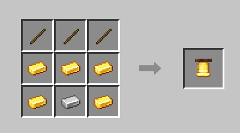</a></p><p><span style="display:inline-block;background-color:#14101e;border:2px solid #3c2068;border-radius:6px;color:#ffffff;font-family:'Minecraft', 'Minecraftia', 'Mojangles', 'Press Start 2P', monospace;font-size:13px;line-height:24px">&nbsp;&nbsp;bell recipe&nbsp;&nbsp;</span></p></div><div style="flex:0 1 400px;border:1px solid #8a94a3;border-radius:16px;text-align:center"><p><a href="https://raw.githubusercontent.com/AllensCreations/MCPE-Curseforges/main/MCPEDL/Maps/OneBlock-Void-Survival/assets/recipes/calcite_recipe.png">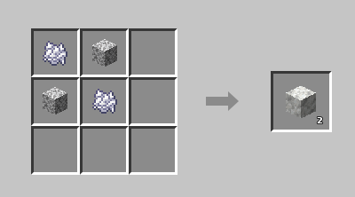</a></p><p><span style="display:inline-block;background-color:#14101e;border:2px solid #3c2068;border-radius:6px;color:#ffffff;font-family:'Minecraft', 'Minecraftia', 'Mojangles', 'Press Start 2P', monospace;font-size:13px;line-height:24px">&nbsp;&nbsp;calcite recipe&nbsp;&nbsp;</span></p></div><div style="flex:0 1 400px;border:1px solid #8a94a3;border-radius:16px;text-align:center"><p><a href="https://raw.githubusercontent.com/AllensCreations/MCPE-Curseforges/main/MCPEDL/Maps/OneBlock-Void-Survival/assets/recipes/deepslate_recipe.gif">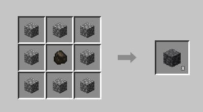</a></p><p><span style="display:inline-block;background-color:#14101e;border:2px solid #3c2068;border-radius:6px;color:#ffffff;font-family:'Minecraft', 'Minecraftia', 'Mojangles', 'Press Start 2P', monospace;font-size:13px;line-height:24px">&nbsp;&nbsp;deepslate recipe&nbsp;&nbsp;</span></p></div><div style="flex:0 1 400px;border:1px solid #8a94a3;border-radius:16px;text-align:center"><p><a href="https://raw.githubusercontent.com/AllensCreations/MCPE-Curseforges/main/MCPEDL/Maps/OneBlock-Void-Survival/assets/recipes/grass_block_melon_seed_dirt_to_grass_recipe.png">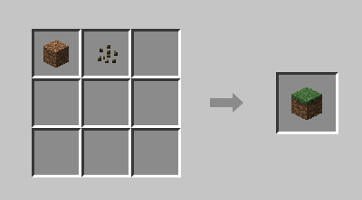</a></p><p><span style="display:inline-block;background-color:#14101e;border:2px solid #3c2068;border-radius:6px;color:#ffffff;font-family:'Minecraft', 'Minecraftia', 'Mojangles', 'Press Start 2P', monospace;font-size:13px;line-height:24px">&nbsp;&nbsp;grass block melon seed dirt to grass recipe&nbsp;&nbsp;</span></p></div><div style="flex:0 1 400px;border:1px solid #8a94a3;border-radius:16px;text-align:center"><p><a href="https://raw.githubusercontent.com/AllensCreations/MCPE-Curseforges/main/MCPEDL/Maps/OneBlock-Void-Survival/assets/recipes/grass_block_pumpkin_seed_dirt_to_grass_recipe.png">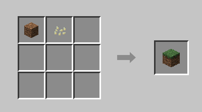</a></p><p><span style="display:inline-block;background-color:#14101e;border:2px solid #3c2068;border-radius:6px;color:#ffffff;font-family:'Minecraft', 'Minecraftia', 'Mojangles', 'Press Start 2P', monospace;font-size:13px;line-height:24px">&nbsp;&nbsp;grass block pumpkin seed dirt to grass recipe&nbsp;&nbsp;</span></p></div><div style="flex:0 1 400px;border:1px solid #8a94a3;border-radius:16px;text-align:center"><p><a href="https://raw.githubusercontent.com/AllensCreations/MCPE-Curseforges/main/MCPEDL/Maps/OneBlock-Void-Survival/assets/recipes/grass_block_recipe.gif">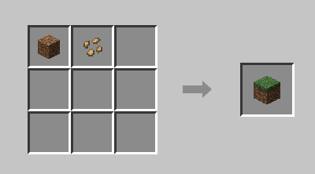</a></p><p><span style="display:inline-block;background-color:#14101e;border:2px solid #3c2068;border-radius:6px;color:#ffffff;font-family:'Minecraft', 'Minecraftia', 'Mojangles', 'Press Start 2P', monospace;font-size:13px;line-height:24px">&nbsp;&nbsp;grass block recipe&nbsp;&nbsp;</span></p></div><div style="flex:0 1 400px;border:1px solid #8a94a3;border-radius:16px;text-align:center"><p><a href="https://raw.githubusercontent.com/AllensCreations/MCPE-Curseforges/main/MCPEDL/Maps/OneBlock-Void-Survival/assets/recipes/grass_block_recipe.png"></a></p><p><span style="display:inline-block;background-color:#14101e;border:2px solid #3c2068;border-radius:6px;color:#ffffff;font-family:'Minecraft', 'Minecraftia', 'Mojangles', 'Press Start 2P', monospace;font-size:13px;line-height:24px">&nbsp;&nbsp;grass block recipe&nbsp;&nbsp;</span></p></div><div style="flex:0 1 400px;border:1px solid #8a94a3;border-radius:16px;text-align:center"><p><a href="https://raw.githubusercontent.com/AllensCreations/MCPE-Curseforges/main/MCPEDL/Maps/OneBlock-Void-Survival/assets/recipes/grass_block_seed_dirt_to_grass_recipe.png">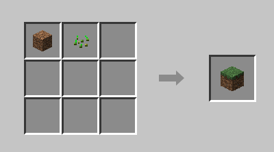</a></p><p><span style="display:inline-block;background-color:#14101e;border:2px solid #3c2068;border-radius:6px;color:#ffffff;font-family:'Minecraft', 'Minecraftia', 'Mojangles', 'Press Start 2P', monospace;font-size:13px;line-height:24px">&nbsp;&nbsp;grass block seed dirt to grass recipe&nbsp;&nbsp;</span></p></div><div style="flex:0 1 400px;border:1px solid #8a94a3;border-radius:16px;text-align:center"><p><a href="https://raw.githubusercontent.com/AllensCreations/MCPE-Curseforges/main/MCPEDL/Maps/OneBlock-Void-Survival/assets/recipes/grass_block_torchflower_seed_dirt_to_grass_recipe.png"></a></p><p><span style="display:inline-block;background-color:#14101e;border:2px solid #3c2068;border-radius:6px;color:#ffffff;font-family:'Minecraft', 'Minecraftia', 'Mojangles', 'Press Start 2P', monospace;font-size:13px;line-height:24px">&nbsp;&nbsp;grass block torchflower seed dirt to grass recipe&nbsp;&nbsp;</span></p></div><div style="flex:0 1 400px;border:1px solid #8a94a3;border-radius:16px;text-align:center"><p><a href="https://raw.githubusercontent.com/AllensCreations/MCPE-Curseforges/main/MCPEDL/Maps/OneBlock-Void-Survival/assets/recipes/gravel_recipe.png">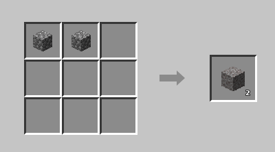</a></p><p><span style="display:inline-block;background-color:#14101e;border:2px solid #3c2068;border-radius:6px;color:#ffffff;font-family:'Minecraft', 'Minecraftia', 'Mojangles', 'Press Start 2P', monospace;font-size:13px;line-height:24px">&nbsp;&nbsp;gravel recipe&nbsp;&nbsp;</span></p></div><div style="flex:0 1 400px;border:1px solid #8a94a3;border-radius:16px;text-align:center"><p><a href="https://raw.githubusercontent.com/AllensCreations/MCPE-Curseforges/main/MCPEDL/Maps/OneBlock-Void-Survival/assets/recipes/name_tag_recipe.png">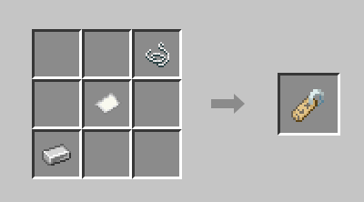</a></p><p><span style="display:inline-block;background-color:#14101e;border:2px solid #3c2068;border-radius:6px;color:#ffffff;font-family:'Minecraft', 'Minecraftia', 'Mojangles', 'Press Start 2P', monospace;font-size:13px;line-height:24px">&nbsp;&nbsp;name tag recipe&nbsp;&nbsp;</span></p></div><div style="flex:0 1 400px;border:1px solid #8a94a3;border-radius:16px;text-align:center"><p><a href="https://raw.githubusercontent.com/AllensCreations/MCPE-Curseforges/main/MCPEDL/Maps/OneBlock-Void-Survival/assets/recipes/saddle_recipe.png">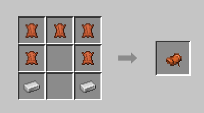</a></p><p><span style="display:inline-block;background-color:#14101e;border:2px solid #3c2068;border-radius:6px;color:#ffffff;font-family:'Minecraft', 'Minecraftia', 'Mojangles', 'Press Start 2P', monospace;font-size:13px;line-height:24px">&nbsp;&nbsp;saddle recipe&nbsp;&nbsp;</span></p></div><div style="flex:0 1 400px;border:1px solid #8a94a3;border-radius:16px;text-align:center"><p><a href="https://raw.githubusercontent.com/AllensCreations/MCPE-Curseforges/main/MCPEDL/Maps/OneBlock-Void-Survival/assets/recipes/sand_recipe.png">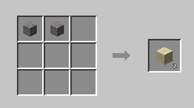</a></p><p><span style="display:inline-block;background-color:#14101e;border:2px solid #3c2068;border-radius:6px;color:#ffffff;font-family:'Minecraft', 'Minecraftia', 'Mojangles', 'Press Start 2P', monospace;font-size:13px;line-height:24px">&nbsp;&nbsp;sand recipe&nbsp;&nbsp;</span></p></div><div style="flex:0 1 400px;border:1px solid #8a94a3;border-radius:16px;text-align:center"><p><a href="https://raw.githubusercontent.com/AllensCreations/MCPE-Curseforges/main/MCPEDL/Maps/OneBlock-Void-Survival/assets/recipes/sponge_recipe.png">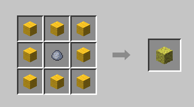</a></p><p><span style="display:inline-block;background-color:#14101e;border:2px solid #3c2068;border-radius:6px;color:#ffffff;font-family:'Minecraft', 'Minecraftia', 'Mojangles', 'Press Start 2P', monospace;font-size:13px;line-height:24px">&nbsp;&nbsp;sponge recipe&nbsp;&nbsp;</span></p></div><div style="flex:0 1 400px;border:1px solid #8a94a3;border-radius:16px;text-align:center"><p><a href="https://raw.githubusercontent.com/AllensCreations/MCPE-Curseforges/main/MCPEDL/Maps/OneBlock-Void-Survival/assets/recipes/tuff_recipe.png">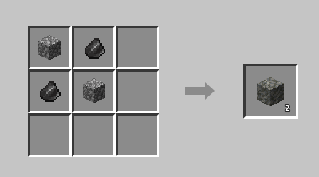</a></p><p><span style="display:inline-block;background-color:#14101e;border:2px solid #3c2068;border-radius:6px;color:#ffffff;font-family:'Minecraft', 'Minecraftia', 'Mojangles', 'Press Start 2P', monospace;font-size:13px;line-height:24px">&nbsp;&nbsp;tuff recipe&nbsp;&nbsp;</span></p></div></div>
<h2 style="font-size:17px;text-align:left"><span style="background-color:#15803d;color:#ffffff;border-radius:20px">&nbsp;&nbsp;Install&nbsp;&nbsp;</span></h2>
<table style="width:100%;border:1px solid #8a94a3;border-radius:16px"><tbody><tr><td style="width:44px;text-align:center"><div style="background-color:#15803d;color:#ffffff;font-weight:bold;font-size:15px;text-align:center;border-radius:10px;width:30px;aspect-ratio:1/1;line-height:30px">1</div></td><td style="text-align:left;">Download the file from this page and open it with Minecraft.</td></tr><tr><td style="width:44px;text-align:center"><div style="background-color:#15803d;color:#ffffff;font-weight:bold;font-size:15px;text-align:center;border-radius:10px;width:30px;aspect-ratio:1/1;line-height:30px">2</div></td><td style="text-align:left;">Create or edit a world and turn on the new pack(s) in its settings.</td></tr><tr><td style="width:44px;text-align:center"><div style="background-color:#15803d;color:#ffffff;font-weight:bold;font-size:15px;text-align:center;border-radius:10px;width:30px;aspect-ratio:1/1;line-height:30px">3</div></td><td style="text-align:left;">Play. No Experimental toggles needed.</td></tr></tbody></table>
<div style="border:1px solid #8a94a3;border-radius:16px;text-align:center"><br><div style="background-color:#15803d;color:#ffffff;border-radius:20px;font-size:15px;line-height:2;display:inline-block">&nbsp;&nbsp;<strong>Found a Bug or Have a Suggestion?</strong>&nbsp;&nbsp;</div><p style="font-size:14px;">Please leave a comment on this project page! All bug reports, gameplay feedback, and pack suggestions are welcome and appreciated.</p></div>
<h2 style="font-size:17px;text-align:left"><span style="background-color:#15803d;color:#ffffff;border-radius:20px">&nbsp;&nbsp;Support&nbsp;&nbsp;</span></h2><div style="border:1px solid #8a94a3;border-radius:16px;text-align:center"><br><a href="https://ko-fi.com/alnstudios"></a><br><br></div><p style="text-align:center"><a href="https://www.curseforge.com/members/allenscreations/projects"><strong>CurseForge</strong></a> &nbsp;|&nbsp; <a href="https://mcpedl.com/user/alnstudios/"><strong>MCPEDL</strong></a> &nbsp;|&nbsp; <a href="https://ko-fi.com/alnstudios"><strong>Ko-fi</strong></a></p>
<hr>
<p style="text-align:center;color:#8a94a3;font-size:13px"><strong>By ALNStudios</strong></p>
<div class="spoiler"><p style="font-size:13px"><strong>Permissions and credits</strong></p><ul style="font-size:13px"><li>Rights: All rights reserved for ALNStudios.</li><li>Content creators: You may feature this creation in videos and streams with credit to ALNStudios.</li><li>Redistribution: Do not re-upload this pack or provide direct monetized download bypasses. Link to this page.</li><li>Visual: Promotional/cover imagery used on this page is AI-generated to illustrate the concept and purpose of the pack.</li><li>Unofficial community creation. Not an official Minecraft product and not approved by or associated with Mojang or Microsoft.</li></ul></div>
<p style="text-align:center;color:#8a94a3;font-size:12px">Minecraft Bedrock OneBlock map, OneBlock Void Survival, 43 mystery islands, progressive void survival, OneBlock phases, Overworld Nether End islands, Minecraft PE map, MCPEDL map, CurseForge Bedrock, ALNStudios, Minecraft Bedrock add-on, MCPEDL add-on.</p></div>
```

## AI Image Prompts

### Reference Images

- **Logo reference**: attach your own logo. The generator uses it only for brand colors and mood. The result must be a new design, not a copy.
- **Snapshot references**: attach 1 to 4 of your in-game snapshots of this pack. The generator copies their look, not their screen layout.

### Logo Prompt

```text
Use the attached logo only as a brand reference for its color palette and overall mood. Do not copy it. Create a new, original logo with a different composition and a different main symbol. Do not just recolor, resize, crop, mirror or tweak the attached logo.
Create a clean, square (1:1) logo image for the Minecraft Bedrock add-on "OneBlock Void Survival".
Base the main symbol on the pack idea above. Match the blocky look of the attached in-game snapshots. Center the logo, use a simple background, and keep it readable at small sizes.
Text: "OneBlock Void Survival" and, in small letters, "ALNStudios". ALNStudios is the brand name, so always keep it and never remove or change it. Spell both exactly.
Do not add Minecraft, Mojang or Microsoft logos, watermarks, or characters from other games.
```

### Banner Prompt

```text
Create a wide (16:9) banner image for the Minecraft Bedrock add-on "OneBlock Void Survival".
Use the attached in-game snapshots as scene and style references: copy their blocky look, lighting, colors and the kind of scenery they show. Make a new composition inspired by them. Do not copy the on-screen HUD, chat or hotbar.
Use the attached logo only as a brand reference for its colors and mood. Do not copy it. Put a new, original logo design in the banner, large enough to read, on the left or center.
Hint at these pack features visually: Progressive OneBlock Phases, 43 Mystery Islands, Starter Platform and Supply Chest, Bonus Supplies, Dimension Shifter Merchant.
Text: "OneBlock Void Survival" and, in small letters, "by ALNStudios". ALNStudios is the brand name, so always keep it and never remove or change it. Spell both exactly.
Leave clear space around the logo. No Minecraft, Mojang or Microsoft logos, no watermarks.
```
