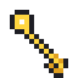
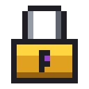
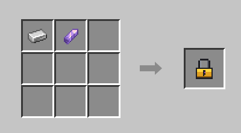

# Listing Kit: Padlock & Key

Tap the Copy button on a block, then paste it into the CurseForge listing. Generated from DESCRIPTION.md: edit that, not this file.

## Package Name

```text
Padlock & Key
```

## Summary (104/256)

```text
Craft a Padlock from 1 Iron Ingot and 1 Amethyst Shard, name it on an anvil, and lock any chest or door.
```

## Description (HTML)

Choose any of the 5 themes below. Tap the Copy button on your preferred theme and paste into the CurseForge description editor in source (HTML) mode.

### Theme 1: Vanilla Adaptive (Default)

Theme-neutral layout following the viewer's CurseForge light or dark mode.

```html
<div><div style="border:2px solid #15803d;border-radius:18px;line-height:1.5"><br><p style="text-align:center"></p><p style="color:#8a94a3;font-size:14px;text-align:center">by ALNStudios</p><p style="text-align:center"><span style="background-color:#15803d;color:#ffffff;border-radius:20px;font-size:16px">&nbsp;&nbsp;<strong>Craft a Padlock from 1 Iron Ingot and 1 Amethyst Shard, name it on an anvil, and lock any chest or door.</strong>&nbsp;&nbsp;</span></p><p style="text-align:center;margin-left:16px;margin-right:16px">Padlock &amp; Key adds a Padlock crafted from 1 Iron Ingot and 1 Amethyst Shard, plus a Key that is handed to you when you lock something.</p><div style="display:flex;flex-wrap:wrap;gap:8px;margin-left:14px;margin-right:14px"><div style="background-color:#dcfce7;color:#14532d;border-radius:20px;font-size:14px;line-height:2"><strong>&nbsp;&nbsp;Bedrock</strong>: 1.21+&nbsp;&nbsp;</div><div style="background-color:#dcfce7;color:#14532d;border-radius:20px;font-size:14px;line-height:2"><strong>&nbsp;&nbsp;Experimental</strong>: No&nbsp;&nbsp;</div><div style="background-color:#dcfce7;color:#14532d;border-radius:20px;font-size:14px;line-height:2"><strong>&nbsp;&nbsp;Achievements</strong>: Yes, achievement-friendly&nbsp;&nbsp;</div></div><br></div>
<p></p>
<p>Craft a Padlock, rename it on an anvil, and use it on a supported block. The block locks, the Padlock is used up, and you receive a Key carrying the same name.</p>
<p></p>
<div style="display:flex;flex-wrap:wrap;gap:10px"><div style="flex:1;min-width:200px;border:1px solid #8a94a3;border-radius:16px"><div style="background-color:#15803d;color:#ffffff;border-radius:16px;font-size:16px;line-height:2.2"><strong>&nbsp;&nbsp;Padlock</strong></div><div style="margin-left:12px;margin-right:12px"><p><span>The Padlock is crafted with 1 Iron Ingot and 1 Amethyst Shard.</span><br><span style="font-size:13px;color:#8a94a3"><strong>Good To Know:</strong> An unnamed Padlock does not lock anything.</span></p></div></div><div style="flex:1;min-width:200px;border:1px solid #8a94a3;border-radius:16px"><div style="background-color:#15803d;color:#ffffff;border-radius:16px;font-size:16px;line-height:2.2"><strong>&nbsp;&nbsp;Key</strong></div><div style="margin-left:12px;margin-right:12px"><p><span>The Key opens a locked container while it is held in your main hand or your offhand and its name matches the password exactly.</span><br><span style="font-size:13px;color:#8a94a3"><strong>How It Works:</strong> Locked doors, trapdoors and fence gates cannot be opened by hand, even with the Key, just like an Iron Door. If one still opens, it snaps shut again.</span><br><span style="font-size:13px;color:#8a94a3"><strong>Good To Know:</strong> Without a matching Key, the block stays shut, and you see text above your hotbar with angry villager particles.</span></p></div></div><div style="flex:1;min-width:200px;border:1px solid #8a94a3;border-radius:16px"><div style="background-color:#15803d;color:#ffffff;border-radius:16px;font-size:16px;line-height:2.2"><strong>&nbsp;&nbsp;Permanent Unlock</strong></div><div style="margin-left:12px;margin-right:12px"><p><span>Sneak and right-click a locked block while holding the matching Key to remove the lock completely.</span><br><span style="font-size:13px;color:#8a94a3"><strong>Good To Know:</strong> A normal right-click with the Key only opens a locked container and never removes the lock.</span></p></div></div><div style="flex:1;min-width:200px;border:1px solid #8a94a3;border-radius:16px"><div style="background-color:#15803d;color:#ffffff;border-radius:16px;font-size:16px;line-height:2.2"><strong>&nbsp;&nbsp;Break Protection</strong></div><div style="margin-left:12px;margin-right:12px"><p><span>A locked block cannot be broken unless you hold the matching Key in either hand.</span><br><span style="font-size:13px;color:#8a94a3"><strong>Good To Know:</strong> Hoppers cannot be placed directly under a locked block, and a block cannot be locked while a Hopper sits under it. Explosions do not destroy locked blocks, and the block under a locked container or door is protected from breaking and explosions. Redstone can still open a locked door, trapdoor or fence gate, like an Iron Door. Mobs that break doors, such as Zombies, are not stopped.</span></p></div></div><div style="flex:1;min-width:200px;border:1px solid #8a94a3;border-radius:16px"><div style="background-color:#15803d;color:#ffffff;border-radius:16px;font-size:16px;line-height:2.2"><strong>&nbsp;&nbsp;Key Copies</strong></div><div style="margin-left:12px;margin-right:12px"><p><span>Hold a Key in your main hand and an Iron Nugget in your offhand, then use the Key to get one extra Key with the same name.</span><br><span style="font-size:13px;color:#8a94a3"><strong>Good To Know:</strong> Crafting cannot carry a custom name, so copies are made by using the Key instead of in a crafting grid.</span></p></div></div><div style="flex:1;min-width:200px;border:1px solid #8a94a3;border-radius:16px"><div style="background-color:#15803d;color:#ffffff;border-radius:16px;font-size:16px;line-height:2.2"><strong>&nbsp;&nbsp;Lockable Blocks</strong></div><div style="margin-left:12px;margin-right:12px"><p><span>Chest, Trapped Chest, every Copper Chest, Ender Chest, Barrel, every Shulker Box, Furnace, Blast Furnace, Smoker, Hopper, Brewing Stand, Dispenser, Dropper, Crafter, Decorated Pot, every door, every Fence Gate, every Trapdoor, and Chiseled Bookshelf can be locked.</span><br><span style="font-size:13px;color:#8a94a3"><strong>Good To Know:</strong> Lock data is saved with the world, and each dimension keeps its own locks. A Piston cannot be placed aimed at a locked block, and a block cannot be locked while a Piston is aimed at it. If a Piston still moves a locked block, for example in a Slime Block machine, the lock moves with it and the block stays locked. Locks left behind by a block that no longer exists are removed automatically.</span></p></div></div></div>
<p></p>
<div style="display:flex;flex-wrap:wrap;gap:10px"><div style="flex:0 1 120px;border:1px solid #8a94a3;border-radius:16px;text-align:center"><p></p><p></p></div><div style="flex:0 1 120px;border:1px solid #8a94a3;border-radius:16px;text-align:center"><p></p><p></p></div></div>
<p></p>
<div style="display:flex;flex-wrap:wrap;gap:10px"><div style="flex:0 1 400px;border:1px solid #8a94a3;border-radius:16px;text-align:center"><p></p><p></p></div></div>
<p></p>
<table style="width:100%;border:1px solid #8a94a3;border-radius:16px"><tbody><tr><td style="width:44px;text-align:center"><div style="background-color:#15803d;color:#ffffff;font-weight:bold;font-size:15px;text-align:center;border-radius:10px;width:30px;aspect-ratio:1/1;line-height:30px">1</div></td><td style="text-align:left;">Craft a Padlock with 1 Iron Ingot and 1 Amethyst Shard, then rename it on an anvil to your password.</td></tr><tr><td style="width:44px;text-align:center"><div style="background-color:#15803d;color:#ffffff;font-weight:bold;font-size:15px;text-align:center;border-radius:10px;width:30px;aspect-ratio:1/1;line-height:30px">2</div></td><td style="text-align:left;">Right-click a Chest, door, or other supported block with the Padlock to lock it and receive a Key.</td></tr><tr><td style="width:44px;text-align:center"><div style="background-color:#15803d;color:#ffffff;font-weight:bold;font-size:15px;text-align:center;border-radius:10px;width:30px;aspect-ratio:1/1;line-height:30px">3</div></td><td style="text-align:left;">Hold the Key in either hand and right-click a container to open it, or sneak and right-click any locked block to unlock it for good.</td></tr></tbody></table>
<p></p>
<div class="spoiler" title="Can I break a locked Chest?" data-title="Can I break a locked Chest?"><p><strong>Can I break a locked Chest?</strong><br>Only while you hold its matching Key in either hand. Breaking it removes the lock, disperses the Key, and returns the Padlock.</p></div><div class="spoiler" title="Does the Padlock work when it has no custom name?" data-title="Does the Padlock work when it has no custom name?"><p><strong>Does the Padlock work when it has no custom name?</strong><br>No. Rename it on an anvil first.</p></div>
<p></p>
<table style="width:100%;border:1px solid #8a94a3;border-radius:16px"><tbody><tr><td style="width:44px;text-align:center"><div style="background-color:#15803d;color:#ffffff;font-weight:bold;font-size:15px;text-align:center;border-radius:10px;width:30px;aspect-ratio:1/1;line-height:30px">1</div></td><td style="text-align:left;">Download the file from this page and open it with Minecraft.</td></tr><tr><td style="width:44px;text-align:center"><div style="background-color:#15803d;color:#ffffff;font-weight:bold;font-size:15px;text-align:center;border-radius:10px;width:30px;aspect-ratio:1/1;line-height:30px">2</div></td><td style="text-align:left;">Create or edit a world and turn on the new pack(s) in its settings.</td></tr><tr><td style="width:44px;text-align:center"><div style="background-color:#15803d;color:#ffffff;font-weight:bold;font-size:15px;text-align:center;border-radius:10px;width:30px;aspect-ratio:1/1;line-height:30px">3</div></td><td style="text-align:left;">Play. No Experimental toggles needed.</td></tr></tbody></table>
<div style="border:1px solid #8a94a3;border-radius:16px;text-align:center"><br><div style="background-color:#15803d;color:#ffffff;border-radius:20px;font-size:15px;line-height:2;display:inline-block">&nbsp;&nbsp;<strong>Found a Bug or Have a Suggestion?</strong>&nbsp;&nbsp;</div><p style="font-size:14px;">Please leave a comment on this project page! All bug reports, gameplay feedback, and pack suggestions are welcome and appreciated.</p></div>
<p></p><div style="border:1px solid #8a94a3;border-radius:16px;text-align:center"><br><a href="https://ko-fi.com/alnstudios"></a><br><br></div><p style="text-align:center"><a href="https://www.curseforge.com/members/allenscreations/projects"><strong>CurseForge</strong></a> &nbsp;|&nbsp; <a href="https://mcpedl.com/user/alnstudios/"><strong>MCPEDL</strong></a> &nbsp;|&nbsp; <a href="https://ko-fi.com/alnstudios"><strong>Ko-fi</strong></a></p>
<hr>
<p style="text-align:center;color:#8a94a3;font-size:13px"><strong>By ALNStudios</strong></p>
<div class="spoiler"><p style="font-size:13px"><strong>Permissions and credits</strong></p><ul style="font-size:13px"><li>Rights: All rights reserved for ALNStudios.</li><li>Content creators: You may feature this creation in videos and streams with credit to ALNStudios.</li><li>Redistribution: Do not re-upload this pack or provide direct monetized download bypasses. Link to this page.</li><li>Visual: Promotional/cover imagery used on this page is AI-generated to illustrate the concept and purpose of the pack.</li><li>Unofficial community creation. Not an official Minecraft product and not approved by or associated with Mojang or Microsoft.</li></ul></div>
<p style="text-align:center;color:#8a94a3;font-size:12px">Minecraft Bedrock add-on, Padlock &amp; Key Bedrock mod, chest lock, door lock, password lock, Padlock, Key, anvil rename, Minecraft PE survival, MCPEDL add-on, CurseForge Bedrock, ALNStudios.</p></div>
```

### Theme 2: Netherite Stealth (Modern Dark)

High-tech dark obsidian & emerald storefront.

```html
<div style="background-color:#0d1117;color:#c9d1d9;border-radius:12px;padding-left:12px"><div style="margin-right:12px"><br><div style="background-color:#161b22;border:2px solid #10b981;border-radius:18px;line-height:1.5"><br><p style="text-align:center"></p><p style="color:#8b949e;font-size:14px;text-align:center">by ALNStudios</p><p style="text-align:center"><span style="background-color:#10b981;color:#ffffff;border-radius:20px;font-size:16px">&nbsp;&nbsp;<strong>Craft a Padlock from 1 Iron Ingot and 1 Amethyst Shard, name it on an anvil, and lock any chest or door.</strong>&nbsp;&nbsp;</span></p><p style="color:#8b949e;text-align:center;margin-left:16px;margin-right:16px">Padlock &amp; Key adds a Padlock crafted from 1 Iron Ingot and 1 Amethyst Shard, plus a Key that is handed to you when you lock something.</p><div style="display:flex;flex-wrap:wrap;gap:8px;margin-left:14px;margin-right:14px"><div style="background-color:#161b22;color:#10b981;border-radius:20px;font-size:14px;line-height:2"><strong>&nbsp;&nbsp;Bedrock</strong>: 1.21+&nbsp;&nbsp;</div><div style="background-color:#161b22;color:#10b981;border-radius:20px;font-size:14px;line-height:2"><strong>&nbsp;&nbsp;Experimental</strong>: No&nbsp;&nbsp;</div><div style="background-color:#161b22;color:#10b981;border-radius:20px;font-size:14px;line-height:2"><strong>&nbsp;&nbsp;Achievements</strong>: Yes, achievement-friendly&nbsp;&nbsp;</div></div><br></div>
<p></p>
<p style="color:#c9d1d9">Craft a Padlock, rename it on an anvil, and use it on a supported block. The block locks, the Padlock is used up, and you receive a Key carrying the same name.</p>
<p></p>
<div style="display:flex;flex-wrap:wrap;gap:10px"><div style="flex:1;min-width:200px;background-color:#161b22;border:1px solid #30363d;border-radius:16px"><div style="background-color:#10b981;color:#ffffff;border-radius:16px;font-size:16px;line-height:2.2"><strong>&nbsp;&nbsp;Padlock</strong></div><div style="margin-left:12px;margin-right:12px"><p><span style="color:#c9d1d9">The Padlock is crafted with 1 Iron Ingot and 1 Amethyst Shard.</span><br><span style="font-size:13px;color:#8b949e"><strong>Good To Know:</strong> An unnamed Padlock does not lock anything.</span></p></div></div><div style="flex:1;min-width:200px;background-color:#161b22;border:1px solid #30363d;border-radius:16px"><div style="background-color:#10b981;color:#ffffff;border-radius:16px;font-size:16px;line-height:2.2"><strong>&nbsp;&nbsp;Key</strong></div><div style="margin-left:12px;margin-right:12px"><p><span style="color:#c9d1d9">The Key opens a locked container while it is held in your main hand or your offhand and its name matches the password exactly.</span><br><span style="font-size:13px;color:#8b949e"><strong>How It Works:</strong> Locked doors, trapdoors and fence gates cannot be opened by hand, even with the Key, just like an Iron Door. If one still opens, it snaps shut again.</span><br><span style="font-size:13px;color:#8b949e"><strong>Good To Know:</strong> Without a matching Key, the block stays shut, and you see text above your hotbar with angry villager particles.</span></p></div></div><div style="flex:1;min-width:200px;background-color:#161b22;border:1px solid #30363d;border-radius:16px"><div style="background-color:#10b981;color:#ffffff;border-radius:16px;font-size:16px;line-height:2.2"><strong>&nbsp;&nbsp;Permanent Unlock</strong></div><div style="margin-left:12px;margin-right:12px"><p><span style="color:#c9d1d9">Sneak and right-click a locked block while holding the matching Key to remove the lock completely.</span><br><span style="font-size:13px;color:#8b949e"><strong>Good To Know:</strong> A normal right-click with the Key only opens a locked container and never removes the lock.</span></p></div></div><div style="flex:1;min-width:200px;background-color:#161b22;border:1px solid #30363d;border-radius:16px"><div style="background-color:#10b981;color:#ffffff;border-radius:16px;font-size:16px;line-height:2.2"><strong>&nbsp;&nbsp;Break Protection</strong></div><div style="margin-left:12px;margin-right:12px"><p><span style="color:#c9d1d9">A locked block cannot be broken unless you hold the matching Key in either hand.</span><br><span style="font-size:13px;color:#8b949e"><strong>Good To Know:</strong> Hoppers cannot be placed directly under a locked block, and a block cannot be locked while a Hopper sits under it. Explosions do not destroy locked blocks, and the block under a locked container or door is protected from breaking and explosions. Redstone can still open a locked door, trapdoor or fence gate, like an Iron Door. Mobs that break doors, such as Zombies, are not stopped.</span></p></div></div><div style="flex:1;min-width:200px;background-color:#161b22;border:1px solid #30363d;border-radius:16px"><div style="background-color:#10b981;color:#ffffff;border-radius:16px;font-size:16px;line-height:2.2"><strong>&nbsp;&nbsp;Key Copies</strong></div><div style="margin-left:12px;margin-right:12px"><p><span style="color:#c9d1d9">Hold a Key in your main hand and an Iron Nugget in your offhand, then use the Key to get one extra Key with the same name.</span><br><span style="font-size:13px;color:#8b949e"><strong>Good To Know:</strong> Crafting cannot carry a custom name, so copies are made by using the Key instead of in a crafting grid.</span></p></div></div><div style="flex:1;min-width:200px;background-color:#161b22;border:1px solid #30363d;border-radius:16px"><div style="background-color:#10b981;color:#ffffff;border-radius:16px;font-size:16px;line-height:2.2"><strong>&nbsp;&nbsp;Lockable Blocks</strong></div><div style="margin-left:12px;margin-right:12px"><p><span style="color:#c9d1d9">Chest, Trapped Chest, every Copper Chest, Ender Chest, Barrel, every Shulker Box, Furnace, Blast Furnace, Smoker, Hopper, Brewing Stand, Dispenser, Dropper, Crafter, Decorated Pot, every door, every Fence Gate, every Trapdoor, and Chiseled Bookshelf can be locked.</span><br><span style="font-size:13px;color:#8b949e"><strong>Good To Know:</strong> Lock data is saved with the world, and each dimension keeps its own locks. A Piston cannot be placed aimed at a locked block, and a block cannot be locked while a Piston is aimed at it. If a Piston still moves a locked block, for example in a Slime Block machine, the lock moves with it and the block stays locked. Locks left behind by a block that no longer exists are removed automatically.</span></p></div></div></div>
<p></p>
<div style="display:flex;flex-wrap:wrap;gap:10px"><div style="flex:0 1 120px;background-color:#161b22;border:1px solid #30363d;border-radius:16px;text-align:center"><p></p><p></p></div><div style="flex:0 1 120px;background-color:#161b22;border:1px solid #30363d;border-radius:16px;text-align:center"><p></p><p></p></div></div>
<p></p>
<div style="display:flex;flex-wrap:wrap;gap:10px"><div style="flex:0 1 400px;background-color:#161b22;border:1px solid #30363d;border-radius:16px;text-align:center"><p></p><p></p></div></div>
<p></p>
<table style="width:100%;border:1px solid #30363d;border-radius:16px"><tbody><tr><td style="width:44px;text-align:center"><div style="background-color:#10b981;color:#ffffff;font-weight:bold;font-size:15px;text-align:center;border-radius:10px;width:30px;aspect-ratio:1/1;line-height:30px">1</div></td><td style="text-align:left;color:#c9d1d9">Craft a Padlock with 1 Iron Ingot and 1 Amethyst Shard, then rename it on an anvil to your password.</td></tr><tr><td style="width:44px;text-align:center"><div style="background-color:#10b981;color:#ffffff;font-weight:bold;font-size:15px;text-align:center;border-radius:10px;width:30px;aspect-ratio:1/1;line-height:30px">2</div></td><td style="text-align:left;color:#c9d1d9">Right-click a Chest, door, or other supported block with the Padlock to lock it and receive a Key.</td></tr><tr><td style="width:44px;text-align:center"><div style="background-color:#10b981;color:#ffffff;font-weight:bold;font-size:15px;text-align:center;border-radius:10px;width:30px;aspect-ratio:1/1;line-height:30px">3</div></td><td style="text-align:left;color:#c9d1d9">Hold the Key in either hand and right-click a container to open it, or sneak and right-click any locked block to unlock it for good.</td></tr></tbody></table>
<p></p>
<div class="spoiler" title="Can I break a locked Chest?" data-title="Can I break a locked Chest?"><p style="color:#c9d1d9"><strong>Can I break a locked Chest?</strong><br>Only while you hold its matching Key in either hand. Breaking it removes the lock, disperses the Key, and returns the Padlock.</p></div><div class="spoiler" title="Does the Padlock work when it has no custom name?" data-title="Does the Padlock work when it has no custom name?"><p style="color:#c9d1d9"><strong>Does the Padlock work when it has no custom name?</strong><br>No. Rename it on an anvil first.</p></div>
<p></p>
<table style="width:100%;border:1px solid #30363d;border-radius:16px"><tbody><tr><td style="width:44px;text-align:center"><div style="background-color:#10b981;color:#ffffff;font-weight:bold;font-size:15px;text-align:center;border-radius:10px;width:30px;aspect-ratio:1/1;line-height:30px">1</div></td><td style="text-align:left;color:#c9d1d9">Download the file from this page and open it with Minecraft.</td></tr><tr><td style="width:44px;text-align:center"><div style="background-color:#10b981;color:#ffffff;font-weight:bold;font-size:15px;text-align:center;border-radius:10px;width:30px;aspect-ratio:1/1;line-height:30px">2</div></td><td style="text-align:left;color:#c9d1d9">Create or edit a world and turn on the new pack(s) in its settings.</td></tr><tr><td style="width:44px;text-align:center"><div style="background-color:#10b981;color:#ffffff;font-weight:bold;font-size:15px;text-align:center;border-radius:10px;width:30px;aspect-ratio:1/1;line-height:30px">3</div></td><td style="text-align:left;color:#c9d1d9">Play. No Experimental toggles needed.</td></tr></tbody></table>
<div style="background-color:#161b22;border:1px solid #30363d;border-radius:16px;text-align:center"><br><div style="background-color:#10b981;color:#ffffff;border-radius:20px;font-size:15px;line-height:2;display:inline-block">&nbsp;&nbsp;<strong>Found a Bug or Have a Suggestion?</strong>&nbsp;&nbsp;</div><p style="font-size:14px;color:#c9d1d9">Please leave a comment on this project page! All bug reports, gameplay feedback, and pack suggestions are welcome and appreciated.</p></div>
<p></p><div style="background-color:#161b22;border:1px solid #30363d;border-radius:16px;text-align:center"><br><a href="https://ko-fi.com/alnstudios"></a><br><br></div><p style="text-align:center"><a style="color:#58a6ff" href="https://www.curseforge.com/members/allenscreations/projects"><strong>CurseForge</strong></a> &nbsp;|&nbsp; <a style="color:#58a6ff" href="https://mcpedl.com/user/alnstudios/"><strong>MCPEDL</strong></a> &nbsp;|&nbsp; <a style="color:#58a6ff" href="https://ko-fi.com/alnstudios"><strong>Ko-fi</strong></a></p>
<hr>
<p style="text-align:center;color:#8b949e;font-size:13px"><strong>By ALNStudios</strong></p>
<div class="spoiler"><p style="font-size:13px"><strong>Permissions and credits</strong></p><ul style="font-size:13px"><li>Rights: All rights reserved for ALNStudios.</li><li>Content creators: You may feature this creation in videos and streams with credit to ALNStudios.</li><li>Redistribution: Do not re-upload this pack or provide direct monetized download bypasses. Link to this page.</li><li>Visual: Promotional/cover imagery used on this page is AI-generated to illustrate the concept and purpose of the pack.</li><li>Unofficial community creation. Not an official Minecraft product and not approved by or associated with Mojang or Microsoft.</li></ul></div>
<p style="text-align:center;color:#8b949e;font-size:12px">Minecraft Bedrock add-on, Padlock &amp; Key Bedrock mod, chest lock, door lock, password lock, Padlock, Key, anvil rename, Minecraft PE survival, MCPEDL add-on, CurseForge Bedrock, ALNStudios.</p><br></div></div>
```

### Theme 3: Bedrock GUI (In-Game Menu)

Authentic Minecraft stone dialog with 3D beveled borders and item slot insets.

```html
<div style="background-color:#313233;color:#e0e0e0;border-radius:12px;padding-left:12px"><div style="margin-right:12px"><br><div style="background-color:#202021;border:2px solid #4a4b4d;border-radius:18px;line-height:1.5"><br><p style="text-align:center"></p><p style="color:#a0a0a0;font-size:14px;text-align:center">by ALNStudios</p><p style="text-align:center"><span style="background-color:#4a4b4d;color:#ffffff;border-radius:20px;font-size:16px">&nbsp;&nbsp;<strong>Craft a Padlock from 1 Iron Ingot and 1 Amethyst Shard, name it on an anvil, and lock any chest or door.</strong>&nbsp;&nbsp;</span></p><p style="color:#d0d0d0;text-align:center;margin-left:16px;margin-right:16px">Padlock &amp; Key adds a Padlock crafted from 1 Iron Ingot and 1 Amethyst Shard, plus a Key that is handed to you when you lock something.</p><div style="display:flex;flex-wrap:wrap;gap:8px;margin-left:14px;margin-right:14px"><div style="background-color:#202021;color:#ffffff;border-radius:20px;font-size:14px;line-height:2"><strong>&nbsp;&nbsp;Bedrock</strong>: 1.21+&nbsp;&nbsp;</div><div style="background-color:#202021;color:#ffffff;border-radius:20px;font-size:14px;line-height:2"><strong>&nbsp;&nbsp;Experimental</strong>: No&nbsp;&nbsp;</div><div style="background-color:#202021;color:#ffffff;border-radius:20px;font-size:14px;line-height:2"><strong>&nbsp;&nbsp;Achievements</strong>: Yes, achievement-friendly&nbsp;&nbsp;</div></div><br></div>
<p></p>
<p style="color:#e0e0e0">Craft a Padlock, rename it on an anvil, and use it on a supported block. The block locks, the Padlock is used up, and you receive a Key carrying the same name.</p>
<p></p>
<div style="display:flex;flex-wrap:wrap;gap:10px"><div style="flex:1;min-width:200px;background-color:#202021;border:1px solid #4a4b4d;border-radius:16px"><div style="background-color:#4a4b4d;color:#ffffff;border-radius:16px;font-size:16px;line-height:2.2"><strong>&nbsp;&nbsp;Padlock</strong></div><div style="margin-left:12px;margin-right:12px"><p><span style="color:#e0e0e0">The Padlock is crafted with 1 Iron Ingot and 1 Amethyst Shard.</span><br><span style="font-size:13px;color:#a0a0a0"><strong>Good To Know:</strong> An unnamed Padlock does not lock anything.</span></p></div></div><div style="flex:1;min-width:200px;background-color:#202021;border:1px solid #4a4b4d;border-radius:16px"><div style="background-color:#4a4b4d;color:#ffffff;border-radius:16px;font-size:16px;line-height:2.2"><strong>&nbsp;&nbsp;Key</strong></div><div style="margin-left:12px;margin-right:12px"><p><span style="color:#e0e0e0">The Key opens a locked container while it is held in your main hand or your offhand and its name matches the password exactly.</span><br><span style="font-size:13px;color:#a0a0a0"><strong>How It Works:</strong> Locked doors, trapdoors and fence gates cannot be opened by hand, even with the Key, just like an Iron Door. If one still opens, it snaps shut again.</span><br><span style="font-size:13px;color:#a0a0a0"><strong>Good To Know:</strong> Without a matching Key, the block stays shut, and you see text above your hotbar with angry villager particles.</span></p></div></div><div style="flex:1;min-width:200px;background-color:#202021;border:1px solid #4a4b4d;border-radius:16px"><div style="background-color:#4a4b4d;color:#ffffff;border-radius:16px;font-size:16px;line-height:2.2"><strong>&nbsp;&nbsp;Permanent Unlock</strong></div><div style="margin-left:12px;margin-right:12px"><p><span style="color:#e0e0e0">Sneak and right-click a locked block while holding the matching Key to remove the lock completely.</span><br><span style="font-size:13px;color:#a0a0a0"><strong>Good To Know:</strong> A normal right-click with the Key only opens a locked container and never removes the lock.</span></p></div></div><div style="flex:1;min-width:200px;background-color:#202021;border:1px solid #4a4b4d;border-radius:16px"><div style="background-color:#4a4b4d;color:#ffffff;border-radius:16px;font-size:16px;line-height:2.2"><strong>&nbsp;&nbsp;Break Protection</strong></div><div style="margin-left:12px;margin-right:12px"><p><span style="color:#e0e0e0">A locked block cannot be broken unless you hold the matching Key in either hand.</span><br><span style="font-size:13px;color:#a0a0a0"><strong>Good To Know:</strong> Hoppers cannot be placed directly under a locked block, and a block cannot be locked while a Hopper sits under it. Explosions do not destroy locked blocks, and the block under a locked container or door is protected from breaking and explosions. Redstone can still open a locked door, trapdoor or fence gate, like an Iron Door. Mobs that break doors, such as Zombies, are not stopped.</span></p></div></div><div style="flex:1;min-width:200px;background-color:#202021;border:1px solid #4a4b4d;border-radius:16px"><div style="background-color:#4a4b4d;color:#ffffff;border-radius:16px;font-size:16px;line-height:2.2"><strong>&nbsp;&nbsp;Key Copies</strong></div><div style="margin-left:12px;margin-right:12px"><p><span style="color:#e0e0e0">Hold a Key in your main hand and an Iron Nugget in your offhand, then use the Key to get one extra Key with the same name.</span><br><span style="font-size:13px;color:#a0a0a0"><strong>Good To Know:</strong> Crafting cannot carry a custom name, so copies are made by using the Key instead of in a crafting grid.</span></p></div></div><div style="flex:1;min-width:200px;background-color:#202021;border:1px solid #4a4b4d;border-radius:16px"><div style="background-color:#4a4b4d;color:#ffffff;border-radius:16px;font-size:16px;line-height:2.2"><strong>&nbsp;&nbsp;Lockable Blocks</strong></div><div style="margin-left:12px;margin-right:12px"><p><span style="color:#e0e0e0">Chest, Trapped Chest, every Copper Chest, Ender Chest, Barrel, every Shulker Box, Furnace, Blast Furnace, Smoker, Hopper, Brewing Stand, Dispenser, Dropper, Crafter, Decorated Pot, every door, every Fence Gate, every Trapdoor, and Chiseled Bookshelf can be locked.</span><br><span style="font-size:13px;color:#a0a0a0"><strong>Good To Know:</strong> Lock data is saved with the world, and each dimension keeps its own locks. A Piston cannot be placed aimed at a locked block, and a block cannot be locked while a Piston is aimed at it. If a Piston still moves a locked block, for example in a Slime Block machine, the lock moves with it and the block stays locked. Locks left behind by a block that no longer exists are removed automatically.</span></p></div></div></div>
<p></p>
<div style="display:flex;flex-wrap:wrap;gap:10px"><div style="flex:0 1 120px;background-color:#202021;border:1px solid #4a4b4d;border-radius:16px;text-align:center"><p></p><p></p></div><div style="flex:0 1 120px;background-color:#202021;border:1px solid #4a4b4d;border-radius:16px;text-align:center"><p></p><p></p></div></div>
<p></p>
<div style="display:flex;flex-wrap:wrap;gap:10px"><div style="flex:0 1 400px;background-color:#202021;border:1px solid #4a4b4d;border-radius:16px;text-align:center"><p></p><p></p></div></div>
<p></p>
<table style="width:100%;border:1px solid #4a4b4d;border-radius:16px"><tbody><tr><td style="width:44px;text-align:center"><div style="background-color:#4a4b4d;color:#ffffff;font-weight:bold;font-size:15px;text-align:center;border-radius:10px;width:30px;aspect-ratio:1/1;line-height:30px">1</div></td><td style="text-align:left;color:#e0e0e0">Craft a Padlock with 1 Iron Ingot and 1 Amethyst Shard, then rename it on an anvil to your password.</td></tr><tr><td style="width:44px;text-align:center"><div style="background-color:#4a4b4d;color:#ffffff;font-weight:bold;font-size:15px;text-align:center;border-radius:10px;width:30px;aspect-ratio:1/1;line-height:30px">2</div></td><td style="text-align:left;color:#e0e0e0">Right-click a Chest, door, or other supported block with the Padlock to lock it and receive a Key.</td></tr><tr><td style="width:44px;text-align:center"><div style="background-color:#4a4b4d;color:#ffffff;font-weight:bold;font-size:15px;text-align:center;border-radius:10px;width:30px;aspect-ratio:1/1;line-height:30px">3</div></td><td style="text-align:left;color:#e0e0e0">Hold the Key in either hand and right-click a container to open it, or sneak and right-click any locked block to unlock it for good.</td></tr></tbody></table>
<p></p>
<div class="spoiler" title="Can I break a locked Chest?" data-title="Can I break a locked Chest?"><p style="color:#e0e0e0"><strong>Can I break a locked Chest?</strong><br>Only while you hold its matching Key in either hand. Breaking it removes the lock, disperses the Key, and returns the Padlock.</p></div><div class="spoiler" title="Does the Padlock work when it has no custom name?" data-title="Does the Padlock work when it has no custom name?"><p style="color:#e0e0e0"><strong>Does the Padlock work when it has no custom name?</strong><br>No. Rename it on an anvil first.</p></div>
<p></p>
<table style="width:100%;border:1px solid #4a4b4d;border-radius:16px"><tbody><tr><td style="width:44px;text-align:center"><div style="background-color:#4a4b4d;color:#ffffff;font-weight:bold;font-size:15px;text-align:center;border-radius:10px;width:30px;aspect-ratio:1/1;line-height:30px">1</div></td><td style="text-align:left;color:#e0e0e0">Download the file from this page and open it with Minecraft.</td></tr><tr><td style="width:44px;text-align:center"><div style="background-color:#4a4b4d;color:#ffffff;font-weight:bold;font-size:15px;text-align:center;border-radius:10px;width:30px;aspect-ratio:1/1;line-height:30px">2</div></td><td style="text-align:left;color:#e0e0e0">Create or edit a world and turn on the new pack(s) in its settings.</td></tr><tr><td style="width:44px;text-align:center"><div style="background-color:#4a4b4d;color:#ffffff;font-weight:bold;font-size:15px;text-align:center;border-radius:10px;width:30px;aspect-ratio:1/1;line-height:30px">3</div></td><td style="text-align:left;color:#e0e0e0">Play. No Experimental toggles needed.</td></tr></tbody></table>
<div style="background-color:#202021;border:1px solid #4a4b4d;border-radius:16px;text-align:center"><br><div style="background-color:#4a4b4d;color:#ffffff;border-radius:20px;font-size:15px;line-height:2;display:inline-block">&nbsp;&nbsp;<strong>Found a Bug or Have a Suggestion?</strong>&nbsp;&nbsp;</div><p style="font-size:14px;color:#e0e0e0">Please leave a comment on this project page! All bug reports, gameplay feedback, and pack suggestions are welcome and appreciated.</p></div>
<p></p><div style="background-color:#202021;border:1px solid #4a4b4d;border-radius:16px;text-align:center"><br><a href="https://ko-fi.com/alnstudios"></a><br><br></div><p style="text-align:center"><a style="color:#55ff55" href="https://www.curseforge.com/members/allenscreations/projects"><strong>CurseForge</strong></a> &nbsp;|&nbsp; <a style="color:#55ff55" href="https://mcpedl.com/user/alnstudios/"><strong>MCPEDL</strong></a> &nbsp;|&nbsp; <a style="color:#55ff55" href="https://ko-fi.com/alnstudios"><strong>Ko-fi</strong></a></p>
<hr>
<p style="text-align:center;color:#a0a0a0;font-size:13px"><strong>By ALNStudios</strong></p>
<div class="spoiler"><p style="font-size:13px"><strong>Permissions and credits</strong></p><ul style="font-size:13px"><li>Rights: All rights reserved for ALNStudios.</li><li>Content creators: You may feature this creation in videos and streams with credit to ALNStudios.</li><li>Redistribution: Do not re-upload this pack or provide direct monetized download bypasses. Link to this page.</li><li>Visual: Promotional/cover imagery used on this page is AI-generated to illustrate the concept and purpose of the pack.</li><li>Unofficial community creation. Not an official Minecraft product and not approved by or associated with Mojang or Microsoft.</li></ul></div>
<p style="text-align:center;color:#a0a0a0;font-size:12px">Minecraft Bedrock add-on, Padlock &amp; Key Bedrock mod, chest lock, door lock, password lock, Padlock, Key, anvil rename, Minecraft PE survival, MCPEDL add-on, CurseForge Bedrock, ALNStudios.</p><br></div></div>
```

### Theme 4: Emerald Marketplace

Official Minecraft Marketplace DLC showcase look with gold and emerald badges.

```html
<div style="background-color:#022c22;color:#ecfdf5;border-radius:12px;padding-left:12px"><div style="margin-right:12px"><br><div style="background-color:#064e3b;border:2px solid #059669;border-radius:18px;line-height:1.5"><br><p style="text-align:center"></p><p style="color:#6ee7b7;font-size:14px;text-align:center">by ALNStudios</p><p style="text-align:center"><span style="background-color:#059669;color:#ffffff;border-radius:20px;font-size:16px">&nbsp;&nbsp;<strong>Craft a Padlock from 1 Iron Ingot and 1 Amethyst Shard, name it on an anvil, and lock any chest or door.</strong>&nbsp;&nbsp;</span></p><p style="color:#a7f3d0;text-align:center;margin-left:16px;margin-right:16px">Padlock &amp; Key adds a Padlock crafted from 1 Iron Ingot and 1 Amethyst Shard, plus a Key that is handed to you when you lock something.</p><div style="display:flex;flex-wrap:wrap;gap:8px;margin-left:14px;margin-right:14px"><div style="background-color:#047857;color:#ffffff;border-radius:20px;font-size:14px;line-height:2"><strong>&nbsp;&nbsp;Bedrock</strong>: 1.21+&nbsp;&nbsp;</div><div style="background-color:#047857;color:#ffffff;border-radius:20px;font-size:14px;line-height:2"><strong>&nbsp;&nbsp;Experimental</strong>: No&nbsp;&nbsp;</div><div style="background-color:#047857;color:#ffffff;border-radius:20px;font-size:14px;line-height:2"><strong>&nbsp;&nbsp;Achievements</strong>: Yes, achievement-friendly&nbsp;&nbsp;</div></div><br></div>
<p></p>
<p style="color:#ecfdf5">Craft a Padlock, rename it on an anvil, and use it on a supported block. The block locks, the Padlock is used up, and you receive a Key carrying the same name.</p>
<p></p>
<div style="display:flex;flex-wrap:wrap;gap:10px"><div style="flex:1;min-width:200px;background-color:#064e3b;border:1px solid #059669;border-radius:16px"><div style="background-color:#059669;color:#ffffff;border-radius:16px;font-size:16px;line-height:2.2"><strong>&nbsp;&nbsp;Padlock</strong></div><div style="margin-left:12px;margin-right:12px"><p><span style="color:#ecfdf5">The Padlock is crafted with 1 Iron Ingot and 1 Amethyst Shard.</span><br><span style="font-size:13px;color:#6ee7b7"><strong>Good To Know:</strong> An unnamed Padlock does not lock anything.</span></p></div></div><div style="flex:1;min-width:200px;background-color:#064e3b;border:1px solid #059669;border-radius:16px"><div style="background-color:#059669;color:#ffffff;border-radius:16px;font-size:16px;line-height:2.2"><strong>&nbsp;&nbsp;Key</strong></div><div style="margin-left:12px;margin-right:12px"><p><span style="color:#ecfdf5">The Key opens a locked container while it is held in your main hand or your offhand and its name matches the password exactly.</span><br><span style="font-size:13px;color:#6ee7b7"><strong>How It Works:</strong> Locked doors, trapdoors and fence gates cannot be opened by hand, even with the Key, just like an Iron Door. If one still opens, it snaps shut again.</span><br><span style="font-size:13px;color:#6ee7b7"><strong>Good To Know:</strong> Without a matching Key, the block stays shut, and you see text above your hotbar with angry villager particles.</span></p></div></div><div style="flex:1;min-width:200px;background-color:#064e3b;border:1px solid #059669;border-radius:16px"><div style="background-color:#059669;color:#ffffff;border-radius:16px;font-size:16px;line-height:2.2"><strong>&nbsp;&nbsp;Permanent Unlock</strong></div><div style="margin-left:12px;margin-right:12px"><p><span style="color:#ecfdf5">Sneak and right-click a locked block while holding the matching Key to remove the lock completely.</span><br><span style="font-size:13px;color:#6ee7b7"><strong>Good To Know:</strong> A normal right-click with the Key only opens a locked container and never removes the lock.</span></p></div></div><div style="flex:1;min-width:200px;background-color:#064e3b;border:1px solid #059669;border-radius:16px"><div style="background-color:#059669;color:#ffffff;border-radius:16px;font-size:16px;line-height:2.2"><strong>&nbsp;&nbsp;Break Protection</strong></div><div style="margin-left:12px;margin-right:12px"><p><span style="color:#ecfdf5">A locked block cannot be broken unless you hold the matching Key in either hand.</span><br><span style="font-size:13px;color:#6ee7b7"><strong>Good To Know:</strong> Hoppers cannot be placed directly under a locked block, and a block cannot be locked while a Hopper sits under it. Explosions do not destroy locked blocks, and the block under a locked container or door is protected from breaking and explosions. Redstone can still open a locked door, trapdoor or fence gate, like an Iron Door. Mobs that break doors, such as Zombies, are not stopped.</span></p></div></div><div style="flex:1;min-width:200px;background-color:#064e3b;border:1px solid #059669;border-radius:16px"><div style="background-color:#059669;color:#ffffff;border-radius:16px;font-size:16px;line-height:2.2"><strong>&nbsp;&nbsp;Key Copies</strong></div><div style="margin-left:12px;margin-right:12px"><p><span style="color:#ecfdf5">Hold a Key in your main hand and an Iron Nugget in your offhand, then use the Key to get one extra Key with the same name.</span><br><span style="font-size:13px;color:#6ee7b7"><strong>Good To Know:</strong> Crafting cannot carry a custom name, so copies are made by using the Key instead of in a crafting grid.</span></p></div></div><div style="flex:1;min-width:200px;background-color:#064e3b;border:1px solid #059669;border-radius:16px"><div style="background-color:#059669;color:#ffffff;border-radius:16px;font-size:16px;line-height:2.2"><strong>&nbsp;&nbsp;Lockable Blocks</strong></div><div style="margin-left:12px;margin-right:12px"><p><span style="color:#ecfdf5">Chest, Trapped Chest, every Copper Chest, Ender Chest, Barrel, every Shulker Box, Furnace, Blast Furnace, Smoker, Hopper, Brewing Stand, Dispenser, Dropper, Crafter, Decorated Pot, every door, every Fence Gate, every Trapdoor, and Chiseled Bookshelf can be locked.</span><br><span style="font-size:13px;color:#6ee7b7"><strong>Good To Know:</strong> Lock data is saved with the world, and each dimension keeps its own locks. A Piston cannot be placed aimed at a locked block, and a block cannot be locked while a Piston is aimed at it. If a Piston still moves a locked block, for example in a Slime Block machine, the lock moves with it and the block stays locked. Locks left behind by a block that no longer exists are removed automatically.</span></p></div></div></div>
<p></p>
<div style="display:flex;flex-wrap:wrap;gap:10px"><div style="flex:0 1 120px;background-color:#064e3b;border:1px solid #059669;border-radius:16px;text-align:center"><p></p><p></p></div><div style="flex:0 1 120px;background-color:#064e3b;border:1px solid #059669;border-radius:16px;text-align:center"><p></p><p></p></div></div>
<p></p>
<div style="display:flex;flex-wrap:wrap;gap:10px"><div style="flex:0 1 400px;background-color:#064e3b;border:1px solid #059669;border-radius:16px;text-align:center"><p></p><p></p></div></div>
<p></p>
<table style="width:100%;border:1px solid #059669;border-radius:16px"><tbody><tr><td style="width:44px;text-align:center"><div style="background-color:#059669;color:#ffffff;font-weight:bold;font-size:15px;text-align:center;border-radius:10px;width:30px;aspect-ratio:1/1;line-height:30px">1</div></td><td style="text-align:left;color:#ecfdf5">Craft a Padlock with 1 Iron Ingot and 1 Amethyst Shard, then rename it on an anvil to your password.</td></tr><tr><td style="width:44px;text-align:center"><div style="background-color:#059669;color:#ffffff;font-weight:bold;font-size:15px;text-align:center;border-radius:10px;width:30px;aspect-ratio:1/1;line-height:30px">2</div></td><td style="text-align:left;color:#ecfdf5">Right-click a Chest, door, or other supported block with the Padlock to lock it and receive a Key.</td></tr><tr><td style="width:44px;text-align:center"><div style="background-color:#059669;color:#ffffff;font-weight:bold;font-size:15px;text-align:center;border-radius:10px;width:30px;aspect-ratio:1/1;line-height:30px">3</div></td><td style="text-align:left;color:#ecfdf5">Hold the Key in either hand and right-click a container to open it, or sneak and right-click any locked block to unlock it for good.</td></tr></tbody></table>
<p></p>
<div class="spoiler" title="Can I break a locked Chest?" data-title="Can I break a locked Chest?"><p style="color:#ecfdf5"><strong>Can I break a locked Chest?</strong><br>Only while you hold its matching Key in either hand. Breaking it removes the lock, disperses the Key, and returns the Padlock.</p></div><div class="spoiler" title="Does the Padlock work when it has no custom name?" data-title="Does the Padlock work when it has no custom name?"><p style="color:#ecfdf5"><strong>Does the Padlock work when it has no custom name?</strong><br>No. Rename it on an anvil first.</p></div>
<p></p>
<table style="width:100%;border:1px solid #059669;border-radius:16px"><tbody><tr><td style="width:44px;text-align:center"><div style="background-color:#059669;color:#ffffff;font-weight:bold;font-size:15px;text-align:center;border-radius:10px;width:30px;aspect-ratio:1/1;line-height:30px">1</div></td><td style="text-align:left;color:#ecfdf5">Download the file from this page and open it with Minecraft.</td></tr><tr><td style="width:44px;text-align:center"><div style="background-color:#059669;color:#ffffff;font-weight:bold;font-size:15px;text-align:center;border-radius:10px;width:30px;aspect-ratio:1/1;line-height:30px">2</div></td><td style="text-align:left;color:#ecfdf5">Create or edit a world and turn on the new pack(s) in its settings.</td></tr><tr><td style="width:44px;text-align:center"><div style="background-color:#059669;color:#ffffff;font-weight:bold;font-size:15px;text-align:center;border-radius:10px;width:30px;aspect-ratio:1/1;line-height:30px">3</div></td><td style="text-align:left;color:#ecfdf5">Play. No Experimental toggles needed.</td></tr></tbody></table>
<div style="background-color:#064e3b;border:1px solid #059669;border-radius:16px;text-align:center"><br><div style="background-color:#059669;color:#ffffff;border-radius:20px;font-size:15px;line-height:2;display:inline-block">&nbsp;&nbsp;<strong>Found a Bug or Have a Suggestion?</strong>&nbsp;&nbsp;</div><p style="font-size:14px;color:#ecfdf5">Please leave a comment on this project page! All bug reports, gameplay feedback, and pack suggestions are welcome and appreciated.</p></div>
<p></p><div style="background-color:#064e3b;border:1px solid #059669;border-radius:16px;text-align:center"><br><a href="https://ko-fi.com/alnstudios"></a><br><br></div><p style="text-align:center"><a style="color:#34d399" href="https://www.curseforge.com/members/allenscreations/projects"><strong>CurseForge</strong></a> &nbsp;|&nbsp; <a style="color:#34d399" href="https://mcpedl.com/user/alnstudios/"><strong>MCPEDL</strong></a> &nbsp;|&nbsp; <a style="color:#34d399" href="https://ko-fi.com/alnstudios"><strong>Ko-fi</strong></a></p>
<hr>
<p style="text-align:center;color:#6ee7b7;font-size:13px"><strong>By ALNStudios</strong></p>
<div class="spoiler"><p style="font-size:13px"><strong>Permissions and credits</strong></p><ul style="font-size:13px"><li>Rights: All rights reserved for ALNStudios.</li><li>Content creators: You may feature this creation in videos and streams with credit to ALNStudios.</li><li>Redistribution: Do not re-upload this pack or provide direct monetized download bypasses. Link to this page.</li><li>Visual: Promotional/cover imagery used on this page is AI-generated to illustrate the concept and purpose of the pack.</li><li>Unofficial community creation. Not an official Minecraft product and not approved by or associated with Mojang or Microsoft.</li></ul></div>
<p style="text-align:center;color:#6ee7b7;font-size:12px">Minecraft Bedrock add-on, Padlock &amp; Key Bedrock mod, chest lock, door lock, password lock, Padlock, Key, anvil rename, Minecraft PE survival, MCPEDL add-on, CurseForge Bedrock, ALNStudios.</p><br></div></div>
```

### Theme 5: Arcane Grimoire (Fantasy RPG)

Midnight obsidian purple theme with mystic amethyst and enchantment accents.

```html
<div style="background-color:#120c1f;color:#f3e8ff;border-radius:12px;padding-left:12px"><div style="margin-right:12px"><br><div style="background-color:#1c1033;border:2px solid #7e22ce;border-radius:18px;line-height:1.5"><br><p style="text-align:center"></p><p style="color:#c084fc;font-size:14px;text-align:center">by ALNStudios</p><p style="text-align:center"><span style="background-color:#7e22ce;color:#ffffff;border-radius:20px;font-size:16px">&nbsp;&nbsp;<strong>Craft a Padlock from 1 Iron Ingot and 1 Amethyst Shard, name it on an anvil, and lock any chest or door.</strong>&nbsp;&nbsp;</span></p><p style="color:#d8b4fe;text-align:center;margin-left:16px;margin-right:16px">Padlock &amp; Key adds a Padlock crafted from 1 Iron Ingot and 1 Amethyst Shard, plus a Key that is handed to you when you lock something.</p><div style="display:flex;flex-wrap:wrap;gap:8px;margin-left:14px;margin-right:14px"><div style="background-color:#3b0764;color:#f3e8ff;border-radius:20px;font-size:14px;line-height:2"><strong>&nbsp;&nbsp;Bedrock</strong>: 1.21+&nbsp;&nbsp;</div><div style="background-color:#3b0764;color:#f3e8ff;border-radius:20px;font-size:14px;line-height:2"><strong>&nbsp;&nbsp;Experimental</strong>: No&nbsp;&nbsp;</div><div style="background-color:#3b0764;color:#f3e8ff;border-radius:20px;font-size:14px;line-height:2"><strong>&nbsp;&nbsp;Achievements</strong>: Yes, achievement-friendly&nbsp;&nbsp;</div></div><br></div>
<p></p>
<p style="color:#f3e8ff">Craft a Padlock, rename it on an anvil, and use it on a supported block. The block locks, the Padlock is used up, and you receive a Key carrying the same name.</p>
<p></p>
<div style="display:flex;flex-wrap:wrap;gap:10px"><div style="flex:1;min-width:200px;background-color:#1c1033;border:1px solid #581c87;border-radius:16px"><div style="background-color:#7e22ce;color:#ffffff;border-radius:16px;font-size:16px;line-height:2.2"><strong>&nbsp;&nbsp;Padlock</strong></div><div style="margin-left:12px;margin-right:12px"><p><span style="color:#f3e8ff">The Padlock is crafted with 1 Iron Ingot and 1 Amethyst Shard.</span><br><span style="font-size:13px;color:#c084fc"><strong>Good To Know:</strong> An unnamed Padlock does not lock anything.</span></p></div></div><div style="flex:1;min-width:200px;background-color:#1c1033;border:1px solid #581c87;border-radius:16px"><div style="background-color:#7e22ce;color:#ffffff;border-radius:16px;font-size:16px;line-height:2.2"><strong>&nbsp;&nbsp;Key</strong></div><div style="margin-left:12px;margin-right:12px"><p><span style="color:#f3e8ff">The Key opens a locked container while it is held in your main hand or your offhand and its name matches the password exactly.</span><br><span style="font-size:13px;color:#c084fc"><strong>How It Works:</strong> Locked doors, trapdoors and fence gates cannot be opened by hand, even with the Key, just like an Iron Door. If one still opens, it snaps shut again.</span><br><span style="font-size:13px;color:#c084fc"><strong>Good To Know:</strong> Without a matching Key, the block stays shut, and you see text above your hotbar with angry villager particles.</span></p></div></div><div style="flex:1;min-width:200px;background-color:#1c1033;border:1px solid #581c87;border-radius:16px"><div style="background-color:#7e22ce;color:#ffffff;border-radius:16px;font-size:16px;line-height:2.2"><strong>&nbsp;&nbsp;Permanent Unlock</strong></div><div style="margin-left:12px;margin-right:12px"><p><span style="color:#f3e8ff">Sneak and right-click a locked block while holding the matching Key to remove the lock completely.</span><br><span style="font-size:13px;color:#c084fc"><strong>Good To Know:</strong> A normal right-click with the Key only opens a locked container and never removes the lock.</span></p></div></div><div style="flex:1;min-width:200px;background-color:#1c1033;border:1px solid #581c87;border-radius:16px"><div style="background-color:#7e22ce;color:#ffffff;border-radius:16px;font-size:16px;line-height:2.2"><strong>&nbsp;&nbsp;Break Protection</strong></div><div style="margin-left:12px;margin-right:12px"><p><span style="color:#f3e8ff">A locked block cannot be broken unless you hold the matching Key in either hand.</span><br><span style="font-size:13px;color:#c084fc"><strong>Good To Know:</strong> Hoppers cannot be placed directly under a locked block, and a block cannot be locked while a Hopper sits under it. Explosions do not destroy locked blocks, and the block under a locked container or door is protected from breaking and explosions. Redstone can still open a locked door, trapdoor or fence gate, like an Iron Door. Mobs that break doors, such as Zombies, are not stopped.</span></p></div></div><div style="flex:1;min-width:200px;background-color:#1c1033;border:1px solid #581c87;border-radius:16px"><div style="background-color:#7e22ce;color:#ffffff;border-radius:16px;font-size:16px;line-height:2.2"><strong>&nbsp;&nbsp;Key Copies</strong></div><div style="margin-left:12px;margin-right:12px"><p><span style="color:#f3e8ff">Hold a Key in your main hand and an Iron Nugget in your offhand, then use the Key to get one extra Key with the same name.</span><br><span style="font-size:13px;color:#c084fc"><strong>Good To Know:</strong> Crafting cannot carry a custom name, so copies are made by using the Key instead of in a crafting grid.</span></p></div></div><div style="flex:1;min-width:200px;background-color:#1c1033;border:1px solid #581c87;border-radius:16px"><div style="background-color:#7e22ce;color:#ffffff;border-radius:16px;font-size:16px;line-height:2.2"><strong>&nbsp;&nbsp;Lockable Blocks</strong></div><div style="margin-left:12px;margin-right:12px"><p><span style="color:#f3e8ff">Chest, Trapped Chest, every Copper Chest, Ender Chest, Barrel, every Shulker Box, Furnace, Blast Furnace, Smoker, Hopper, Brewing Stand, Dispenser, Dropper, Crafter, Decorated Pot, every door, every Fence Gate, every Trapdoor, and Chiseled Bookshelf can be locked.</span><br><span style="font-size:13px;color:#c084fc"><strong>Good To Know:</strong> Lock data is saved with the world, and each dimension keeps its own locks. A Piston cannot be placed aimed at a locked block, and a block cannot be locked while a Piston is aimed at it. If a Piston still moves a locked block, for example in a Slime Block machine, the lock moves with it and the block stays locked. Locks left behind by a block that no longer exists are removed automatically.</span></p></div></div></div>
<p></p>
<div style="display:flex;flex-wrap:wrap;gap:10px"><div style="flex:0 1 120px;background-color:#1c1033;border:1px solid #581c87;border-radius:16px;text-align:center"><p></p><p></p></div><div style="flex:0 1 120px;background-color:#1c1033;border:1px solid #581c87;border-radius:16px;text-align:center"><p></p><p></p></div></div>
<p></p>
<div style="display:flex;flex-wrap:wrap;gap:10px"><div style="flex:0 1 400px;background-color:#1c1033;border:1px solid #581c87;border-radius:16px;text-align:center"><p></p><p></p></div></div>
<p></p>
<table style="width:100%;border:1px solid #581c87;border-radius:16px"><tbody><tr><td style="width:44px;text-align:center"><div style="background-color:#7e22ce;color:#ffffff;font-weight:bold;font-size:15px;text-align:center;border-radius:10px;width:30px;aspect-ratio:1/1;line-height:30px">1</div></td><td style="text-align:left;color:#f3e8ff">Craft a Padlock with 1 Iron Ingot and 1 Amethyst Shard, then rename it on an anvil to your password.</td></tr><tr><td style="width:44px;text-align:center"><div style="background-color:#7e22ce;color:#ffffff;font-weight:bold;font-size:15px;text-align:center;border-radius:10px;width:30px;aspect-ratio:1/1;line-height:30px">2</div></td><td style="text-align:left;color:#f3e8ff">Right-click a Chest, door, or other supported block with the Padlock to lock it and receive a Key.</td></tr><tr><td style="width:44px;text-align:center"><div style="background-color:#7e22ce;color:#ffffff;font-weight:bold;font-size:15px;text-align:center;border-radius:10px;width:30px;aspect-ratio:1/1;line-height:30px">3</div></td><td style="text-align:left;color:#f3e8ff">Hold the Key in either hand and right-click a container to open it, or sneak and right-click any locked block to unlock it for good.</td></tr></tbody></table>
<p></p>
<div class="spoiler" title="Can I break a locked Chest?" data-title="Can I break a locked Chest?"><p style="color:#f3e8ff"><strong>Can I break a locked Chest?</strong><br>Only while you hold its matching Key in either hand. Breaking it removes the lock, disperses the Key, and returns the Padlock.</p></div><div class="spoiler" title="Does the Padlock work when it has no custom name?" data-title="Does the Padlock work when it has no custom name?"><p style="color:#f3e8ff"><strong>Does the Padlock work when it has no custom name?</strong><br>No. Rename it on an anvil first.</p></div>
<p></p>
<table style="width:100%;border:1px solid #581c87;border-radius:16px"><tbody><tr><td style="width:44px;text-align:center"><div style="background-color:#7e22ce;color:#ffffff;font-weight:bold;font-size:15px;text-align:center;border-radius:10px;width:30px;aspect-ratio:1/1;line-height:30px">1</div></td><td style="text-align:left;color:#f3e8ff">Download the file from this page and open it with Minecraft.</td></tr><tr><td style="width:44px;text-align:center"><div style="background-color:#7e22ce;color:#ffffff;font-weight:bold;font-size:15px;text-align:center;border-radius:10px;width:30px;aspect-ratio:1/1;line-height:30px">2</div></td><td style="text-align:left;color:#f3e8ff">Create or edit a world and turn on the new pack(s) in its settings.</td></tr><tr><td style="width:44px;text-align:center"><div style="background-color:#7e22ce;color:#ffffff;font-weight:bold;font-size:15px;text-align:center;border-radius:10px;width:30px;aspect-ratio:1/1;line-height:30px">3</div></td><td style="text-align:left;color:#f3e8ff">Play. No Experimental toggles needed.</td></tr></tbody></table>
<div style="background-color:#1c1033;border:1px solid #581c87;border-radius:16px;text-align:center"><br><div style="background-color:#7e22ce;color:#ffffff;border-radius:20px;font-size:15px;line-height:2;display:inline-block">&nbsp;&nbsp;<strong>Found a Bug or Have a Suggestion?</strong>&nbsp;&nbsp;</div><p style="font-size:14px;color:#f3e8ff">Please leave a comment on this project page! All bug reports, gameplay feedback, and pack suggestions are welcome and appreciated.</p></div>
<p></p><div style="background-color:#1c1033;border:1px solid #581c87;border-radius:16px;text-align:center"><br><a href="https://ko-fi.com/alnstudios"></a><br><br></div><p style="text-align:center"><a style="color:#c084fc" href="https://www.curseforge.com/members/allenscreations/projects"><strong>CurseForge</strong></a> &nbsp;|&nbsp; <a style="color:#c084fc" href="https://mcpedl.com/user/alnstudios/"><strong>MCPEDL</strong></a> &nbsp;|&nbsp; <a style="color:#c084fc" href="https://ko-fi.com/alnstudios"><strong>Ko-fi</strong></a></p>
<hr>
<p style="text-align:center;color:#c084fc;font-size:13px"><strong>By ALNStudios</strong></p>
<div class="spoiler"><p style="font-size:13px"><strong>Permissions and credits</strong></p><ul style="font-size:13px"><li>Rights: All rights reserved for ALNStudios.</li><li>Content creators: You may feature this creation in videos and streams with credit to ALNStudios.</li><li>Redistribution: Do not re-upload this pack or provide direct monetized download bypasses. Link to this page.</li><li>Visual: Promotional/cover imagery used on this page is AI-generated to illustrate the concept and purpose of the pack.</li><li>Unofficial community creation. Not an official Minecraft product and not approved by or associated with Mojang or Microsoft.</li></ul></div>
<p style="text-align:center;color:#c084fc;font-size:12px">Minecraft Bedrock add-on, Padlock &amp; Key Bedrock mod, chest lock, door lock, password lock, Padlock, Key, anvil rename, Minecraft PE survival, MCPEDL add-on, CurseForge Bedrock, ALNStudios.</p><br></div></div>
```

## AI Image Prompts

### Reference Images

- **Logo reference**: attach your own logo. The generator uses it only for brand colors and mood. The result must be a new design, not a copy.
- **Snapshot references**: attach 1 to 4 of your in-game snapshots of this pack. The generator copies their look, not their screen layout.

### Logo Prompt

```text
Use the attached logo only as a brand reference for its color palette and overall mood. Do not copy it. Create a new, original logo with a different composition and a different main symbol. Do not just recolor, resize, crop, mirror or tweak the attached logo.
Create a clean, square (1:1) logo image for the Minecraft Bedrock add-on "Padlock & Key". Craft a Padlock from 1 Iron Ingot and 1 Amethyst Shard, name it on an anvil, and lock any chest or door.
Base the main symbol on the pack idea above. Match the blocky look of the attached in-game snapshots. Center the logo, use a simple background, and keep it readable at small sizes.
Text: "Padlock & Key" and, in small letters, "ALNStudios". ALNStudios is the brand name, so always keep it and never remove or change it. Spell both exactly.
Do not add Minecraft, Mojang or Microsoft logos, watermarks, or characters from other games.
```

### Banner Prompt

```text
Create a wide (16:9) banner image for the Minecraft Bedrock add-on "Padlock & Key". Craft a Padlock from 1 Iron Ingot and 1 Amethyst Shard, name it on an anvil, and lock any chest or door.
Use the attached in-game snapshots as scene and style references: copy their blocky look, lighting, colors and the kind of scenery they show. Make a new composition inspired by them. Do not copy the on-screen HUD, chat or hotbar.
Use the attached logo only as a brand reference for its colors and mood. Do not copy it. Put a new, original logo design in the banner, large enough to read, on the left or center.
Hint at these pack features visually: Padlock, Key, Permanent Unlock, Break Protection, Key Copies.
Text: "Padlock & Key" and, in small letters, "by ALNStudios". ALNStudios is the brand name, so always keep it and never remove or change it. Spell both exactly.
Leave clear space around the logo. No Minecraft, Mojang or Microsoft logos, no watermarks.
```
