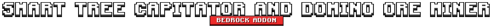

# Listing Kit: Smart Tree Capitator and Domino Ore Miner

Tap the Copy button on a block, then paste it into the CurseForge listing. Generated from DESCRIPTION.md: edit that, not this file.

## Package Name

```text
Smart Tree Capitator and Domino Ore Miner
```

## Summary (54/256)

```text
SNEAK-ACTIVATED VEIN MINING & BUILT-IN TOOL PROTECTION
```

## Description (HTML)

Paste into the CurseForge description editor in source (HTML) mode.

```html
<div><div style="border:2px solid #15803d;border-radius:18px;line-height:1.5"><br><p style="text-align:center"></p><p style="color:#8a94a3;font-size:14px;text-align:center">by ALNStudios</p><p style="text-align:center"><span style="background-color:#15803d;color:#ffffff;border-radius:20px;font-size:16px">&nbsp;&nbsp;<strong>SNEAK-ACTIVATED VEIN MINING &amp; BUILT-IN TOOL PROTECTION</strong>&nbsp;&nbsp;</span></p><div style="display:flex;flex-wrap:wrap;gap:8px;margin-left:14px;margin-right:14px"><div style="background-color:#dcfce7;color:#14532d;border-radius:20px;font-size:14px;line-height:2"><strong>&nbsp;&nbsp;Bedrock</strong>: 1.21+&nbsp;&nbsp;</div><div style="background-color:#dcfce7;color:#14532d;border-radius:20px;font-size:14px;line-height:2"><strong>&nbsp;&nbsp;Experimental</strong>: No&nbsp;&nbsp;</div><div style="background-color:#dcfce7;color:#14532d;border-radius:20px;font-size:14px;line-height:2"><strong>&nbsp;&nbsp;Achievements</strong>: Yes, achievement-friendly&nbsp;&nbsp;</div></div><br></div>
<h2 style="font-size:17px;text-align:left"><span style="background-color:#15803d;color:#ffffff;border-radius:20px">&nbsp;&nbsp;About&nbsp;&nbsp;</span></h2>
<p>Mining large underground ore clusters and chopping tall trees one block at a time can take time. <strong>Smart Tree Capitator &amp; Domino Ore Miner</strong> adds sneak-activated chain mining to Minecraft Bedrock Edition . Sneak while breaking a log or ore to fell the entire tree or harvest the connected ore vein in one action.</p>
<h2 style="font-size:17px;text-align:left"><span style="background-color:#15803d;color:#ffffff;border-radius:20px">&nbsp;&nbsp;What You Get&nbsp;&nbsp;</span></h2>
<div style="display:flex;flex-wrap:wrap;gap:10px"><div style="flex:1;min-width:200px;border:1px solid #8a94a3;border-radius:16px"><div style="background-color:#15803d;color:#ffffff;border-radius:16px;font-size:16px;line-height:2.2"><strong>&nbsp;&nbsp;Sneak-Activated Mining</strong></div><div style="margin-left:12px;margin-right:12px"><p></p></div></div><div style="flex:1;min-width:200px;border:1px solid #8a94a3;border-radius:16px"><div style="background-color:#15803d;color:#ffffff;border-radius:16px;font-size:16px;line-height:2.2"><strong>&nbsp;&nbsp;Connected Tree Felling</strong></div><div style="margin-left:12px;margin-right:12px"><p></p></div></div><div style="flex:1;min-width:200px;border:1px solid #8a94a3;border-radius:16px"><div style="background-color:#15803d;color:#ffffff;border-radius:16px;font-size:16px;line-height:2.2"><strong>&nbsp;&nbsp;Connected Ore Mining</strong></div><div style="margin-left:12px;margin-right:12px"><p></p></div></div><div style="flex:1;min-width:200px;border:1px solid #8a94a3;border-radius:16px"><div style="background-color:#15803d;color:#ffffff;border-radius:16px;font-size:16px;line-height:2.2"><strong>&nbsp;&nbsp;Mineral Category Normalization</strong></div><div style="margin-left:12px;margin-right:12px"><p></p></div></div><div style="flex:1;min-width:200px;border:1px solid #8a94a3;border-radius:16px"><div style="background-color:#15803d;color:#ffffff;border-radius:16px;font-size:16px;line-height:2.2"><strong>&nbsp;&nbsp;Durability Safety Guard</strong></div><div style="margin-left:12px;margin-right:12px"><p></p></div></div><div style="flex:1;min-width:200px;border:1px solid #8a94a3;border-radius:16px"><div style="background-color:#15803d;color:#ffffff;border-radius:16px;font-size:16px;line-height:2.2"><strong>&nbsp;&nbsp;Unbreaking Respect</strong></div><div style="margin-left:12px;margin-right:12px"><p></p></div></div><div style="flex:1;min-width:200px;border:1px solid #8a94a3;border-radius:16px"><div style="background-color:#15803d;color:#ffffff;border-radius:16px;font-size:16px;line-height:2.2"><strong>&nbsp;&nbsp;Fortune &amp; Silk Touch Support</strong></div><div style="margin-left:12px;margin-right:12px"><p></p></div></div><div style="flex:1;min-width:200px;border:1px solid #8a94a3;border-radius:16px"><div style="background-color:#15803d;color:#ffffff;border-radius:16px;font-size:16px;line-height:2.2"><strong>&nbsp;&nbsp;Zero Hunger Penalties</strong></div><div style="margin-left:12px;margin-right:12px"><p></p></div></div></div>
<h2 style="font-size:17px;text-align:left"><span style="background-color:#15803d;color:#ffffff;border-radius:20px">&nbsp;&nbsp;How It Works&nbsp;&nbsp;</span></h2>
<div class="spoiler" title="How It Works" data-title="How It Works">
<h3>Standard Mining</h3><ul><li><strong>Requirement</strong>: Standing or walking</li><li><strong>What Happens</strong>: Breaks single block with standard vanilla drops.</li></ul><h3>Tree Capitation</h3><ul><li><strong>Requirement</strong>: Sneak with an Axe</li><li><strong>What Happens</strong>: Fells connected trunk logs and branches upward up to 128 blocks during the same mining action.</li></ul><h3>Domino Ore Mining</h3><ul><li><strong>Requirement</strong>: Sneak with a Pickaxe</li><li><strong>What Happens</strong>: Sweeps contiguous ore veins across 26 spatial neighbors up to 64 blocks.</li></ul><h3>Durability Protection</h3><ul><li><strong>Requirement</strong>: Tool has 5 durability points remaining</li><li><strong>What Happens</strong>: Halts chain break immediately, preserves tool, and plays alert sound.</li></ul><h3>Tool Switch Safety</h3><ul><li><strong>Requirement</strong>: Switch or unequip tool</li><li><strong>What Happens</strong>: Terminates chain process instantly before processing the next block.</li></ul></div>
<h2 style="font-size:17px;text-align:left"><span style="background-color:#15803d;color:#ffffff;border-radius:20px">&nbsp;&nbsp;How Tree Felling Works&nbsp;&nbsp;</span></h2>
<div class="spoiler" title="How Tree Felling Works" data-title="How Tree Felling Works">
<p>When you break an eligible log while sneaking with an axe, the add-on scans through the tree:</p><ol><li><strong>Connected Branches</strong>: Follows connected logs and branches, including diagonal connections.</li><li><strong>Matching Wood Types</strong>: Only the same wood type is felled, helping protect nearby trees.</li><li><strong>The Leaf Scan (Player-Placed Leaves Ignored)</strong>: Ignores player-placed leaves (sheared decorative leaves), ensuring custom hedges, bushes, and decorative roof foliage are never falsely detected as natural tree canopies.</li><li><strong>Build Protection</strong>: Uses nearby natural canopy clues to reduce accidental damage to wooden builds.</li><li><strong>Safety Limits</strong>: Capped at 128 logs per tree and bounded by the world height range to prevent runaway chain reactions.</li></ol><h3>Supported Trees</h3><ul><li><strong>Overworld</strong>: Oak, Spruce, Birch, Jungle, Acacia, Dark Oak, Mangrove (including roots), Cherry, and Pale Oak.</li><li><strong>Nether</strong>: Crimson Stem, Warped Stem, Crimson Hyphae, Warped Hyphae.</li><li><strong>Wood Variants</strong>: All stripped logs and all 6-sided bark wood blocks.</li><li><strong>Canopy Leaves</strong>: Left intact for natural leaf decay so saplings, sticks, and apples drop normally over time.</li></ul></div>
<h2 style="font-size:17px;text-align:left"><span style="background-color:#15803d;color:#ffffff;border-radius:20px">&nbsp;&nbsp;How Ore Mining Works&nbsp;&nbsp;</span></h2>
<div class="spoiler" title="How Ore Mining Works" data-title="How Ore Mining Works">
<p>Domino Ore Miner follows connected matching ores, including diagonal connections, up to the 64-block cluster limit. Regular and deepslate versions of the same ore can be mined together:</p><h3>Coal</h3><ul><li><strong>Minimum Pickaxe</strong>: Wooden+</li><li><strong>Drops</strong>: Coal</li></ul><h3>Iron</h3><ul><li><strong>Minimum Pickaxe</strong>: Stone+</li><li><strong>Drops</strong>: Raw Iron</li></ul><h3>Copper</h3><ul><li><strong>Minimum Pickaxe</strong>: Stone+</li><li><strong>Drops</strong>: Raw Copper (2–5)</li></ul><h3>Gold</h3><ul><li><strong>Minimum Pickaxe</strong>: Iron+</li><li><strong>Drops</strong>: Raw Gold</li></ul><h3>Nether Gold</h3><ul><li><strong>Minimum Pickaxe</strong>: Wooden+</li><li><strong>Drops</strong>: Gold Nuggets (2–6)</li></ul><h3>Lapis Lazuli</h3><ul><li><strong>Minimum Pickaxe</strong>: Stone+</li><li><strong>Drops</strong>: Lapis Lazuli (4–9)</li></ul><h3>Redstone</h3><ul><li><strong>Minimum Pickaxe</strong>: Iron+</li><li><strong>Drops</strong>: Redstone Dust (4–5)</li></ul><h3>Diamond</h3><ul><li><strong>Minimum Pickaxe</strong>: Iron+</li><li><strong>Drops</strong>: Diamond</li></ul><h3>Emerald</h3><ul><li><strong>Minimum Pickaxe</strong>: Iron+</li><li><strong>Drops</strong>: Emerald</li></ul><h3>Nether Quartz</h3><ul><li><strong>Minimum Pickaxe</strong>: Wooden+</li><li><strong>Drops</strong>: Nether Quartz</li></ul><h3>Ancient Debris</h3><ul><li><strong>Minimum Pickaxe</strong>: Diamond+</li><li><strong>Drops</strong>: Ancient Debris Block</li></ul><p><em>Only blocks of the same mineral category are traversed. Pickaxe tier validation ensures lower-tier tools will not trigger higher-tier ore chains.</em></p></div>
<h2 style="font-size:17px;text-align:left"><span style="background-color:#15803d;color:#ffffff;border-radius:20px">&nbsp;&nbsp;Durability Protection System&nbsp;&nbsp;</span></h2>
<div class="spoiler" title="Durability Protection System" data-title="Durability Protection System">
<ul><li>Checks the tool's remaining durability before breaking each additional block.</li><li>Halts immediately when remaining durability  reaches 5 or less.</li><li>Plays an audible warning sound (warning sound) and displays an action bar alert:</li></ul><p>&gt; <strong>[Tool Protection]</strong> Stopped mining to save tool! (5 durability left)</p><ul><li>Revalidates the equipped tool before each block break. If the tool is switched or removed, chain mining stops instantly.</li><li>Respects the normal durability-saving effect of the Unbreaking enchantment.</li></ul></div>
<h2 style="font-size:17px;text-align:left"><span style="background-color:#15803d;color:#ffffff;border-radius:20px">&nbsp;&nbsp;Default Settings&nbsp;&nbsp;</span></h2>
<div class="spoiler" title="Default Settings" data-title="Default Settings">
<h3>Tree Capitator</h3><ul><li><strong>Default Value</strong>: Enabled</li><li><strong>Description</strong>: Fells connected trunks and branches up to 128 logs</li></ul><h3>Domino Ore Miner</h3><ul><li><strong>Default Value</strong>: Enabled</li><li><strong>Description</strong>: Mines connected ore clusters up to 64 blocks</li></ul><h3>Mining Speed</h3><ul><li><strong>Default Value</strong>: Instant Burst</li><li><strong>Description</strong>: Mines the full vein or tree in a single stroke</li></ul><h3>Durability Safety Stop</h3><ul><li><strong>Default Value</strong>: 5 Durability</li><li><strong>Description</strong>: Halts automatically to protect rare tools from breaking</li></ul><h3>Alert Audio</h3><ul><li><strong>Default Value</strong>: Bass Note</li><li><strong>Description</strong>: Plays an alert sound when safety stop activates</li></ul></div>
<h2 style="font-size:17px;text-align:left"><span style="background-color:#15803d;color:#ffffff;border-radius:20px">&nbsp;&nbsp;Install&nbsp;&nbsp;</span></h2>
<table style="width:100%;border:1px solid #8a94a3;border-radius:16px"><tbody><tr><td style="width:44px;text-align:center"><div style="background-color:#15803d;color:#ffffff;font-weight:bold;font-size:15px;text-align:center;border-radius:10px;width:30px;aspect-ratio:1/1;line-height:30px">1</div></td><td style="text-align:left;">Download the file from this page and open it with Minecraft.</td></tr><tr><td style="width:44px;text-align:center"><div style="background-color:#15803d;color:#ffffff;font-weight:bold;font-size:15px;text-align:center;border-radius:10px;width:30px;aspect-ratio:1/1;line-height:30px">2</div></td><td style="text-align:left;">Create or edit a world and turn on the new pack(s) in its settings.</td></tr><tr><td style="width:44px;text-align:center"><div style="background-color:#15803d;color:#ffffff;font-weight:bold;font-size:15px;text-align:center;border-radius:10px;width:30px;aspect-ratio:1/1;line-height:30px">3</div></td><td style="text-align:left;">Play. No Experimental toggles needed.</td></tr></tbody></table>
<div style="border:1px solid #8a94a3;border-radius:16px;text-align:center"><br><div style="background-color:#15803d;color:#ffffff;border-radius:20px;font-size:15px;line-height:2;display:inline-block">&nbsp;&nbsp;<strong>Found a Bug or Have a Suggestion?</strong>&nbsp;&nbsp;</div><p style="font-size:14px;">Please leave a comment on this project page! All bug reports, gameplay feedback, and pack suggestions are welcome and appreciated.</p></div>
<h2 style="font-size:17px;text-align:left"><span style="background-color:#15803d;color:#ffffff;border-radius:20px">&nbsp;&nbsp;Support&nbsp;&nbsp;</span></h2><div style="border:1px solid #8a94a3;border-radius:16px;text-align:center"><br><a href="https://ko-fi.com/alnstudios"></a><br><br></div><p style="text-align:center"><a href="https://www.curseforge.com/members/allenscreations/projects"><strong>CurseForge</strong></a> &nbsp;|&nbsp; <a href="https://mcpedl.com/user/alnstudios/"><strong>MCPEDL</strong></a> &nbsp;|&nbsp; <a href="https://ko-fi.com/alnstudios"><strong>Ko-fi</strong></a></p>
<hr>
<p style="text-align:center;color:#8a94a3;font-size:13px"><strong>By ALNStudios</strong></p>
<div class="spoiler"><p style="font-size:13px"><strong>Permissions and credits</strong></p><ul style="font-size:13px"><li>Rights: All rights reserved for ALNStudios.</li><li>Content creators: You may feature this creation in videos and streams with credit to ALNStudios.</li><li>Redistribution: Do not re-upload this pack or provide direct monetized download bypasses. Link to this page.</li><li>Visual: Promotional/cover imagery used on this page is AI-generated to illustrate the concept and purpose of the pack.</li><li>Unofficial community creation. Not an official Minecraft product and not approved by or associated with Mojang or Microsoft.</li></ul></div>
<p style="text-align:center;color:#8a94a3;font-size:12px">Smart Tree Capitator and Domino Ore Miner Bedrock add-on, Sneak Minecraft Bedrock, Mineral Category Normalization Minecraft Bedrock, Durability Safety Guard Minecraft Bedrock, Unbreaking Respect Minecraft Bedrock, Minecraft PE mod, MCPEDL add-on, CurseForge Bedrock, ALNStudios, Minecraft Bedrock add-on.</p></div>
```

## AI Image Prompts

### Reference Images

- **Logo reference**: attach your own logo. The generator uses it only for brand colors and mood. The result must be a new design, not a copy.
- **Snapshot references**: attach 1 to 4 of your in-game snapshots of this pack. The generator copies their look, not their screen layout.

### Logo Prompt

```text
Use the attached logo only as a brand reference for its color palette and overall mood. Do not copy it. Create a new, original logo with a different composition and a different main symbol. Do not just recolor, resize, crop, mirror or tweak the attached logo.
Create a clean, square (1:1) logo image for the Minecraft Bedrock add-on "Smart Tree Capitator and Domino Ore Miner". SNEAK-ACTIVATED VEIN MINING & BUILT-IN TOOL PROTECTION
Base the main symbol on the pack idea above. Match the blocky look of the attached in-game snapshots. Center the logo, use a simple background, and keep it readable at small sizes.
Text: "Smart Tree Capitator and Domino Ore Miner" and, in small letters, "ALNStudios". ALNStudios is the brand name, so always keep it and never remove or change it. Spell both exactly.
Do not add Minecraft, Mojang or Microsoft logos, watermarks, or characters from other games.
```

### Banner Prompt

```text
Create a wide (16:9) banner image for the Minecraft Bedrock add-on "Smart Tree Capitator and Domino Ore Miner". SNEAK-ACTIVATED VEIN MINING & BUILT-IN TOOL PROTECTION
Use the attached in-game snapshots as scene and style references: copy their blocky look, lighting, colors and the kind of scenery they show. Make a new composition inspired by them. Do not copy the on-screen HUD, chat or hotbar.
Use the attached logo only as a brand reference for its colors and mood. Do not copy it. Put a new, original logo design in the banner, large enough to read, on the left or center.
Hint at these pack features visually: Sneak-Activated Mining, Connected Tree Felling, Connected Ore Mining, Mineral Category Normalization, Durability Safety Guard.
Text: "Smart Tree Capitator and Domino Ore Miner" and, in small letters, "by ALNStudios". ALNStudios is the brand name, so always keep it and never remove or change it. Spell both exactly.
Leave clear space around the logo. No Minecraft, Mojang or Microsoft logos, no watermarks.
```
