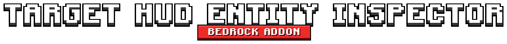

# Listing Kit: Target HUD Entity Inspector

Tap the Copy button on a block, then paste it into the CurseForge listing. Generated from DESCRIPTION.md: edit that, not this file.

## Package Name

```text
Target HUD Entity Inspector
```

## Summary (199/256)

```text
Look at any mob or player within 16 blocks to see its name, a smooth 20-segment health bar, its health numbers, its armor, the item it holds, its main status effects, its type and how far away it is.
```

## Description (HTML)

Choose any of the 5 themes below. Tap the Copy button on your preferred theme and paste into the CurseForge description editor in source (HTML) mode.

### Theme 1: Vanilla Adaptive (Default)

Theme-neutral layout following the viewer's CurseForge light or dark mode.

```html
<div><div style="border:2px solid #15803d;border-radius:18px;line-height:1.5"><br><p style="text-align:center"></p><p style="color:#8a94a3;font-size:14px;text-align:center">by ALNStudios</p><p style="text-align:center"><span style="background-color:#15803d;color:#ffffff;border-radius:20px;font-size:16px">&nbsp;&nbsp;<strong>Look at any mob or player within 16 blocks to see its name, a smooth 20-segment health bar, its health numbers, its armor, the item it holds, its main status effects, its type and how far away it is.</strong>&nbsp;&nbsp;</span></p><p style="text-align:center;margin-left:16px;margin-right:16px">Shows the entity under your crosshair on the Action Bar with a smooth color-changing bar beside the numbers.</p><div style="display:flex;flex-wrap:wrap;gap:8px;margin-left:14px;margin-right:14px"><div style="background-color:#dcfce7;color:#14532d;border-radius:20px;font-size:14px;line-height:2"><strong>&nbsp;&nbsp;Bedrock</strong>: 1.26+&nbsp;&nbsp;</div><div style="background-color:#dcfce7;color:#14532d;border-radius:20px;font-size:14px;line-height:2"><strong>&nbsp;&nbsp;Experimental</strong>: No&nbsp;&nbsp;</div><div style="background-color:#dcfce7;color:#14532d;border-radius:20px;font-size:14px;line-height:2"><strong>&nbsp;&nbsp;Achievements</strong>: Yes, achievement-friendly. This pack runs no commands&nbsp;&nbsp;</div></div><br></div>
<h2 style="font-size:17px;text-align:left"><span style="background-color:#15803d;color:#ffffff;border-radius:20px">&nbsp;&nbsp;About&nbsp;&nbsp;</span></h2>
<p>Aim at a mob or another player and a single line appears on the Action Bar. It disappears as soon as you look away or a block is in the way.</p>
<h2 style="font-size:17px;text-align:left"><span style="background-color:#15803d;color:#ffffff;border-radius:20px">&nbsp;&nbsp;What You Get&nbsp;&nbsp;</span></h2>
<div style="display:flex;flex-wrap:wrap;gap:10px"><div style="flex:1;min-width:200px;border:1px solid #8a94a3;border-radius:16px"><div style="background-color:#15803d;color:#ffffff;border-radius:16px;font-size:16px;line-height:2.2"><strong>&nbsp;&nbsp;Health Bar</strong></div><div style="margin-left:12px;margin-right:12px"><p><span>A smooth bar of 20 segments shows how much health the target has left, next to the exact numbers, for example 14/20.</span><br><span style="font-size:13px;color:#8a94a3"><strong>Good To Know:</strong> A gold plus sign beside the numbers means the target has Absorption.</span></p></div></div><div style="flex:1;min-width:200px;border:1px solid #8a94a3;border-radius:16px"><div style="background-color:#15803d;color:#ffffff;border-radius:16px;font-size:16px;line-height:2.2"><strong>&nbsp;&nbsp;Mob Type</strong></div><div style="margin-left:12px;margin-right:12px"><p><span>The line names the type as Player, Hostile, Passive, Neutral or Aggressive, each in its own color.</span><br><span style="font-size:13px;color:#8a94a3"><strong>Good To Know:</strong> Aggressive lasts one minute after your last hit on that mob, then returns to Neutral.</span></p></div></div><div style="flex:1;min-width:200px;border:1px solid #8a94a3;border-radius:16px"><div style="background-color:#15803d;color:#ffffff;border-radius:16px;font-size:16px;line-height:2.2"><strong>&nbsp;&nbsp;Distance Readout</strong></div><div style="margin-left:12px;margin-right:12px"><p><span>The line ends with the distance to the target in blocks, for example 5m.</span></p></div></div><div style="flex:1;min-width:200px;border:1px solid #8a94a3;border-radius:16px"><div style="background-color:#15803d;color:#ffffff;border-radius:16px;font-size:16px;line-height:2.2"><strong>&nbsp;&nbsp;Armor Points</strong></div><div style="margin-left:12px;margin-right:12px"><p><span>When you look at a player, or at a mob wearing armor, the armor points appear beside the health.</span><br><span style="font-size:13px;color:#8a94a3"><strong>Good To Know:</strong> Points are counted from the Leather, Copper, Golden, Chainmail, Iron, Diamond and Netherite armor they wear, plus a Turtle Shell helmet.</span></p></div></div><div style="flex:1;min-width:200px;border:1px solid #8a94a3;border-radius:16px"><div style="background-color:#15803d;color:#ffffff;border-radius:16px;font-size:16px;line-height:2.2"><strong>&nbsp;&nbsp;Tamed Pets</strong></div><div style="margin-left:12px;margin-right:12px"><p><span>Tamed animals show as Tamed, in their own color, instead of Neutral or Passive. Pets tamed by other players also show their owner, such as Tamed of Steve.</span><br><span style="font-size:13px;color:#8a94a3"><strong>Good To Know:</strong> The owner's name is shown only while that player is online.</span></p></div></div><div style="flex:1;min-width:200px;border:1px solid #8a94a3;border-radius:16px"><div style="background-color:#15803d;color:#ffffff;border-radius:16px;font-size:16px;line-height:2.2"><strong>&nbsp;&nbsp;Held Item</strong></div><div style="margin-left:12px;margin-right:12px"><p><span>The item in the target's main hand appears after its armor, with a count when it is a stack, for example Iron Sword.</span></p></div></div><div style="flex:1;min-width:200px;border:1px solid #8a94a3;border-radius:16px"><div style="background-color:#15803d;color:#ffffff;border-radius:16px;font-size:16px;line-height:2.2"><strong>&nbsp;&nbsp;Status Effects</strong></div><div style="margin-left:12px;margin-right:12px"><p><span>Key effects on the target appear with their level and time left, for example Poison II 13s. Burning shows while the target is on fire.</span><br><span style="font-size:13px;color:#8a94a3"><strong>Good To Know:</strong> Wither, Poison, Slowness, Weakness, Regeneration, Strength, Speed, Resistance and Fire Resistance are shown, up to three at a time and fewer when the line is long. Effects that last an hour or more show no time left.</span></p></div></div><div style="flex:1;min-width:200px;border:1px solid #8a94a3;border-radius:16px"><div style="background-color:#15803d;color:#ffffff;border-radius:16px;font-size:16px;line-height:2.2"><strong>&nbsp;&nbsp;Defeated Flash</strong></div><div style="margin-left:12px;margin-right:12px"><p><span>When you finish off a mob or player, Defeated and its name flash on the Action Bar for about a second and a half.</span></p></div></div><div style="flex:1;min-width:200px;border:1px solid #8a94a3;border-radius:16px"><div style="background-color:#15803d;color:#ffffff;border-radius:16px;font-size:16px;line-height:2.2"><strong>&nbsp;&nbsp;Compact Layout</strong></div><div style="margin-left:12px;margin-right:12px"><p><span>When the line would be too long for the screen, it switches to a shorter version with a 10-segment bar, shorter names and fewer effects.</span><br><span style="font-size:13px;color:#8a94a3"><strong>Good To Know:</strong> If there is still not enough room, the effects and then the held item are dropped.</span></p></div></div><div style="flex:1;min-width:200px;border:1px solid #8a94a3;border-radius:16px"><div style="background-color:#15803d;color:#ffffff;border-radius:16px;font-size:16px;line-height:2.2"><strong>&nbsp;&nbsp;Adaptive Refresh</strong></div><div style="margin-left:12px;margin-right:12px"><p><span>The display updates every tick while you are fighting, every 2 ticks while you look at a target and every 5 ticks while nothing is in view.</span><br><span style="font-size:13px;color:#8a94a3"><strong>Good To Know:</strong> An unchanged line is sent again only about once a second, so the display stays steady.</span></p></div></div><div style="flex:1;min-width:200px;border:1px solid #8a94a3;border-radius:16px"><div style="background-color:#15803d;color:#ffffff;border-radius:16px;font-size:16px;line-height:2.2"><strong>&nbsp;&nbsp;Hidden Targets</strong></div><div style="margin-left:12px;margin-right:12px"><p><span>Invisible mobs, invisible players and players in Spectator mode are not shown. Targets with no health left are not shown either.</span></p></div></div></div>
<h2 style="font-size:17px;text-align:left"><span style="background-color:#15803d;color:#ffffff;border-radius:20px">&nbsp;&nbsp;Get Started&nbsp;&nbsp;</span></h2>
<table style="width:100%;border:1px solid #8a94a3;border-radius:16px"><tbody><tr><td style="width:44px;text-align:center"><div style="background-color:#15803d;color:#ffffff;font-weight:bold;font-size:15px;text-align:center;border-radius:10px;width:30px;aspect-ratio:1/1;line-height:30px">1</div></td><td style="text-align:left;">Enable the Behavior Pack in your world's settings.</td></tr><tr><td style="width:44px;text-align:center"><div style="background-color:#15803d;color:#ffffff;font-weight:bold;font-size:15px;text-align:center;border-radius:10px;width:30px;aspect-ratio:1/1;line-height:30px">2</div></td><td style="text-align:left;">Look at a mob or player within 16 blocks.</td></tr><tr><td style="width:44px;text-align:center"><div style="background-color:#15803d;color:#ffffff;font-weight:bold;font-size:15px;text-align:center;border-radius:10px;width:30px;aspect-ratio:1/1;line-height:30px">3</div></td><td style="text-align:left;">Read the name, health bar, health numbers, type and distance on the Action Bar.</td></tr></tbody></table>
<h2 style="font-size:17px;text-align:left"><span style="background-color:#15803d;color:#ffffff;border-radius:20px">&nbsp;&nbsp;Install&nbsp;&nbsp;</span></h2>
<table style="width:100%;border:1px solid #8a94a3;border-radius:16px"><tbody><tr><td style="width:44px;text-align:center"><div style="background-color:#15803d;color:#ffffff;font-weight:bold;font-size:15px;text-align:center;border-radius:10px;width:30px;aspect-ratio:1/1;line-height:30px">1</div></td><td style="text-align:left;">Download the file from this page and open it with Minecraft.</td></tr><tr><td style="width:44px;text-align:center"><div style="background-color:#15803d;color:#ffffff;font-weight:bold;font-size:15px;text-align:center;border-radius:10px;width:30px;aspect-ratio:1/1;line-height:30px">2</div></td><td style="text-align:left;">Create or edit a world and turn on the new pack(s) in its settings.</td></tr><tr><td style="width:44px;text-align:center"><div style="background-color:#15803d;color:#ffffff;font-weight:bold;font-size:15px;text-align:center;border-radius:10px;width:30px;aspect-ratio:1/1;line-height:30px">3</div></td><td style="text-align:left;">Play. No Experimental toggles needed.</td></tr></tbody></table>
<div style="border:1px solid #8a94a3;border-radius:16px;text-align:center"><br><div style="background-color:#15803d;color:#ffffff;border-radius:20px;font-size:15px;line-height:2;display:inline-block">&nbsp;&nbsp;<strong>Found a Bug or Have a Suggestion?</strong>&nbsp;&nbsp;</div><p style="font-size:14px;">Please leave a comment on this project page! All bug reports, gameplay feedback, and pack suggestions are welcome and appreciated.</p></div>
<h2 style="font-size:17px;text-align:left"><span style="background-color:#15803d;color:#ffffff;border-radius:20px">&nbsp;&nbsp;Support&nbsp;&nbsp;</span></h2><div style="border:1px solid #8a94a3;border-radius:16px;text-align:center"><br><a href="https://ko-fi.com/alnstudios"></a><br><br></div><p style="text-align:center"><a href="https://www.curseforge.com/members/allenscreations/projects"><strong>CurseForge</strong></a> &nbsp;|&nbsp; <a href="https://mcpedl.com/user/alnstudios/"><strong>MCPEDL</strong></a> &nbsp;|&nbsp; <a href="https://ko-fi.com/alnstudios"><strong>Ko-fi</strong></a></p>
<hr>
<p style="text-align:center;color:#8a94a3;font-size:13px"><strong>By ALNStudios</strong></p>
<div class="spoiler"><p style="font-size:13px"><strong>Permissions and credits</strong></p><ul style="font-size:13px"><li>Rights: All rights reserved for ALNStudios.</li><li>Content creators: You may feature this creation in videos and streams with credit to ALNStudios.</li><li>Redistribution: Do not re-upload this pack or provide direct monetized download bypasses. Link to this page.</li><li>Visual: Promotional/cover imagery used on this page is AI-generated to illustrate the concept and purpose of the pack.</li><li>Unofficial community creation. Not an official Minecraft product and not approved by or associated with Mojang or Microsoft.</li></ul></div>
<p style="text-align:center;color:#8a94a3;font-size:12px">Minecraft Bedrock add-on, Target HUD Entity Inspector Bedrock mod, mob health bar, target health display, Aggressive neutral mobs, Minecraft PE survival, MCPEDL add-on, CurseForge Bedrock, ALNStudios.</p></div>
```

### Theme 2: Netherite Stealth (Modern Dark)

High-tech dark obsidian & emerald storefront.

```html
<div style="background-color:#0d1117;color:#c9d1d9;border-radius:12px;padding-left:12px"><div style="margin-right:12px"><br><div style="background-color:#161b22;border:2px solid #10b981;border-radius:18px;line-height:1.5"><br><p style="text-align:center"></p><p style="color:#8b949e;font-size:14px;text-align:center">by ALNStudios</p><p style="text-align:center"><span style="background-color:#10b981;color:#ffffff;border-radius:20px;font-size:16px">&nbsp;&nbsp;<strong>Look at any mob or player within 16 blocks to see its name, a smooth 20-segment health bar, its health numbers, its armor, the item it holds, its main status effects, its type and how far away it is.</strong>&nbsp;&nbsp;</span></p><p style="color:#8b949e;text-align:center;margin-left:16px;margin-right:16px">Shows the entity under your crosshair on the Action Bar with a smooth color-changing bar beside the numbers.</p><div style="display:flex;flex-wrap:wrap;gap:8px;margin-left:14px;margin-right:14px"><div style="background-color:#161b22;color:#10b981;border-radius:20px;font-size:14px;line-height:2"><strong>&nbsp;&nbsp;Bedrock</strong>: 1.26+&nbsp;&nbsp;</div><div style="background-color:#161b22;color:#10b981;border-radius:20px;font-size:14px;line-height:2"><strong>&nbsp;&nbsp;Experimental</strong>: No&nbsp;&nbsp;</div><div style="background-color:#161b22;color:#10b981;border-radius:20px;font-size:14px;line-height:2"><strong>&nbsp;&nbsp;Achievements</strong>: Yes, achievement-friendly. This pack runs no commands&nbsp;&nbsp;</div></div><br></div>
<h2 style="font-size:17px;text-align:left"><span style="background-color:#10b981;color:#ffffff;border-radius:20px">&nbsp;&nbsp;About&nbsp;&nbsp;</span></h2>
<p style="color:#c9d1d9">Aim at a mob or another player and a single line appears on the Action Bar. It disappears as soon as you look away or a block is in the way.</p>
<h2 style="font-size:17px;text-align:left"><span style="background-color:#10b981;color:#ffffff;border-radius:20px">&nbsp;&nbsp;What You Get&nbsp;&nbsp;</span></h2>
<div style="display:flex;flex-wrap:wrap;gap:10px"><div style="flex:1;min-width:200px;background-color:#161b22;border:1px solid #30363d;border-radius:16px"><div style="background-color:#10b981;color:#ffffff;border-radius:16px;font-size:16px;line-height:2.2"><strong>&nbsp;&nbsp;Health Bar</strong></div><div style="margin-left:12px;margin-right:12px"><p><span style="color:#c9d1d9">A smooth bar of 20 segments shows how much health the target has left, next to the exact numbers, for example 14/20.</span><br><span style="font-size:13px;color:#8b949e"><strong>Good To Know:</strong> A gold plus sign beside the numbers means the target has Absorption.</span></p></div></div><div style="flex:1;min-width:200px;background-color:#161b22;border:1px solid #30363d;border-radius:16px"><div style="background-color:#10b981;color:#ffffff;border-radius:16px;font-size:16px;line-height:2.2"><strong>&nbsp;&nbsp;Mob Type</strong></div><div style="margin-left:12px;margin-right:12px"><p><span style="color:#c9d1d9">The line names the type as Player, Hostile, Passive, Neutral or Aggressive, each in its own color.</span><br><span style="font-size:13px;color:#8b949e"><strong>Good To Know:</strong> Aggressive lasts one minute after your last hit on that mob, then returns to Neutral.</span></p></div></div><div style="flex:1;min-width:200px;background-color:#161b22;border:1px solid #30363d;border-radius:16px"><div style="background-color:#10b981;color:#ffffff;border-radius:16px;font-size:16px;line-height:2.2"><strong>&nbsp;&nbsp;Distance Readout</strong></div><div style="margin-left:12px;margin-right:12px"><p><span style="color:#c9d1d9">The line ends with the distance to the target in blocks, for example 5m.</span></p></div></div><div style="flex:1;min-width:200px;background-color:#161b22;border:1px solid #30363d;border-radius:16px"><div style="background-color:#10b981;color:#ffffff;border-radius:16px;font-size:16px;line-height:2.2"><strong>&nbsp;&nbsp;Armor Points</strong></div><div style="margin-left:12px;margin-right:12px"><p><span style="color:#c9d1d9">When you look at a player, or at a mob wearing armor, the armor points appear beside the health.</span><br><span style="font-size:13px;color:#8b949e"><strong>Good To Know:</strong> Points are counted from the Leather, Copper, Golden, Chainmail, Iron, Diamond and Netherite armor they wear, plus a Turtle Shell helmet.</span></p></div></div><div style="flex:1;min-width:200px;background-color:#161b22;border:1px solid #30363d;border-radius:16px"><div style="background-color:#10b981;color:#ffffff;border-radius:16px;font-size:16px;line-height:2.2"><strong>&nbsp;&nbsp;Tamed Pets</strong></div><div style="margin-left:12px;margin-right:12px"><p><span style="color:#c9d1d9">Tamed animals show as Tamed, in their own color, instead of Neutral or Passive. Pets tamed by other players also show their owner, such as Tamed of Steve.</span><br><span style="font-size:13px;color:#8b949e"><strong>Good To Know:</strong> The owner's name is shown only while that player is online.</span></p></div></div><div style="flex:1;min-width:200px;background-color:#161b22;border:1px solid #30363d;border-radius:16px"><div style="background-color:#10b981;color:#ffffff;border-radius:16px;font-size:16px;line-height:2.2"><strong>&nbsp;&nbsp;Held Item</strong></div><div style="margin-left:12px;margin-right:12px"><p><span style="color:#c9d1d9">The item in the target's main hand appears after its armor, with a count when it is a stack, for example Iron Sword.</span></p></div></div><div style="flex:1;min-width:200px;background-color:#161b22;border:1px solid #30363d;border-radius:16px"><div style="background-color:#10b981;color:#ffffff;border-radius:16px;font-size:16px;line-height:2.2"><strong>&nbsp;&nbsp;Status Effects</strong></div><div style="margin-left:12px;margin-right:12px"><p><span style="color:#c9d1d9">Key effects on the target appear with their level and time left, for example Poison II 13s. Burning shows while the target is on fire.</span><br><span style="font-size:13px;color:#8b949e"><strong>Good To Know:</strong> Wither, Poison, Slowness, Weakness, Regeneration, Strength, Speed, Resistance and Fire Resistance are shown, up to three at a time and fewer when the line is long. Effects that last an hour or more show no time left.</span></p></div></div><div style="flex:1;min-width:200px;background-color:#161b22;border:1px solid #30363d;border-radius:16px"><div style="background-color:#10b981;color:#ffffff;border-radius:16px;font-size:16px;line-height:2.2"><strong>&nbsp;&nbsp;Defeated Flash</strong></div><div style="margin-left:12px;margin-right:12px"><p><span style="color:#c9d1d9">When you finish off a mob or player, Defeated and its name flash on the Action Bar for about a second and a half.</span></p></div></div><div style="flex:1;min-width:200px;background-color:#161b22;border:1px solid #30363d;border-radius:16px"><div style="background-color:#10b981;color:#ffffff;border-radius:16px;font-size:16px;line-height:2.2"><strong>&nbsp;&nbsp;Compact Layout</strong></div><div style="margin-left:12px;margin-right:12px"><p><span style="color:#c9d1d9">When the line would be too long for the screen, it switches to a shorter version with a 10-segment bar, shorter names and fewer effects.</span><br><span style="font-size:13px;color:#8b949e"><strong>Good To Know:</strong> If there is still not enough room, the effects and then the held item are dropped.</span></p></div></div><div style="flex:1;min-width:200px;background-color:#161b22;border:1px solid #30363d;border-radius:16px"><div style="background-color:#10b981;color:#ffffff;border-radius:16px;font-size:16px;line-height:2.2"><strong>&nbsp;&nbsp;Adaptive Refresh</strong></div><div style="margin-left:12px;margin-right:12px"><p><span style="color:#c9d1d9">The display updates every tick while you are fighting, every 2 ticks while you look at a target and every 5 ticks while nothing is in view.</span><br><span style="font-size:13px;color:#8b949e"><strong>Good To Know:</strong> An unchanged line is sent again only about once a second, so the display stays steady.</span></p></div></div><div style="flex:1;min-width:200px;background-color:#161b22;border:1px solid #30363d;border-radius:16px"><div style="background-color:#10b981;color:#ffffff;border-radius:16px;font-size:16px;line-height:2.2"><strong>&nbsp;&nbsp;Hidden Targets</strong></div><div style="margin-left:12px;margin-right:12px"><p><span style="color:#c9d1d9">Invisible mobs, invisible players and players in Spectator mode are not shown. Targets with no health left are not shown either.</span></p></div></div></div>
<h2 style="font-size:17px;text-align:left"><span style="background-color:#10b981;color:#ffffff;border-radius:20px">&nbsp;&nbsp;Get Started&nbsp;&nbsp;</span></h2>
<table style="width:100%;border:1px solid #30363d;border-radius:16px"><tbody><tr><td style="width:44px;text-align:center"><div style="background-color:#10b981;color:#ffffff;font-weight:bold;font-size:15px;text-align:center;border-radius:10px;width:30px;aspect-ratio:1/1;line-height:30px">1</div></td><td style="text-align:left;color:#c9d1d9">Enable the Behavior Pack in your world's settings.</td></tr><tr><td style="width:44px;text-align:center"><div style="background-color:#10b981;color:#ffffff;font-weight:bold;font-size:15px;text-align:center;border-radius:10px;width:30px;aspect-ratio:1/1;line-height:30px">2</div></td><td style="text-align:left;color:#c9d1d9">Look at a mob or player within 16 blocks.</td></tr><tr><td style="width:44px;text-align:center"><div style="background-color:#10b981;color:#ffffff;font-weight:bold;font-size:15px;text-align:center;border-radius:10px;width:30px;aspect-ratio:1/1;line-height:30px">3</div></td><td style="text-align:left;color:#c9d1d9">Read the name, health bar, health numbers, type and distance on the Action Bar.</td></tr></tbody></table>
<h2 style="font-size:17px;text-align:left"><span style="background-color:#10b981;color:#ffffff;border-radius:20px">&nbsp;&nbsp;Install&nbsp;&nbsp;</span></h2>
<table style="width:100%;border:1px solid #30363d;border-radius:16px"><tbody><tr><td style="width:44px;text-align:center"><div style="background-color:#10b981;color:#ffffff;font-weight:bold;font-size:15px;text-align:center;border-radius:10px;width:30px;aspect-ratio:1/1;line-height:30px">1</div></td><td style="text-align:left;color:#c9d1d9">Download the file from this page and open it with Minecraft.</td></tr><tr><td style="width:44px;text-align:center"><div style="background-color:#10b981;color:#ffffff;font-weight:bold;font-size:15px;text-align:center;border-radius:10px;width:30px;aspect-ratio:1/1;line-height:30px">2</div></td><td style="text-align:left;color:#c9d1d9">Create or edit a world and turn on the new pack(s) in its settings.</td></tr><tr><td style="width:44px;text-align:center"><div style="background-color:#10b981;color:#ffffff;font-weight:bold;font-size:15px;text-align:center;border-radius:10px;width:30px;aspect-ratio:1/1;line-height:30px">3</div></td><td style="text-align:left;color:#c9d1d9">Play. No Experimental toggles needed.</td></tr></tbody></table>
<div style="background-color:#161b22;border:1px solid #30363d;border-radius:16px;text-align:center"><br><div style="background-color:#10b981;color:#ffffff;border-radius:20px;font-size:15px;line-height:2;display:inline-block">&nbsp;&nbsp;<strong>Found a Bug or Have a Suggestion?</strong>&nbsp;&nbsp;</div><p style="font-size:14px;color:#c9d1d9">Please leave a comment on this project page! All bug reports, gameplay feedback, and pack suggestions are welcome and appreciated.</p></div>
<h2 style="font-size:17px;text-align:left"><span style="background-color:#10b981;color:#ffffff;border-radius:20px">&nbsp;&nbsp;Support&nbsp;&nbsp;</span></h2><div style="background-color:#161b22;border:1px solid #30363d;border-radius:16px;text-align:center"><br><a href="https://ko-fi.com/alnstudios"></a><br><br></div><p style="text-align:center"><a style="color:#58a6ff" href="https://www.curseforge.com/members/allenscreations/projects"><strong>CurseForge</strong></a> &nbsp;|&nbsp; <a style="color:#58a6ff" href="https://mcpedl.com/user/alnstudios/"><strong>MCPEDL</strong></a> &nbsp;|&nbsp; <a style="color:#58a6ff" href="https://ko-fi.com/alnstudios"><strong>Ko-fi</strong></a></p>
<hr>
<p style="text-align:center;color:#8b949e;font-size:13px"><strong>By ALNStudios</strong></p>
<div class="spoiler"><p style="font-size:13px"><strong>Permissions and credits</strong></p><ul style="font-size:13px"><li>Rights: All rights reserved for ALNStudios.</li><li>Content creators: You may feature this creation in videos and streams with credit to ALNStudios.</li><li>Redistribution: Do not re-upload this pack or provide direct monetized download bypasses. Link to this page.</li><li>Visual: Promotional/cover imagery used on this page is AI-generated to illustrate the concept and purpose of the pack.</li><li>Unofficial community creation. Not an official Minecraft product and not approved by or associated with Mojang or Microsoft.</li></ul></div>
<p style="text-align:center;color:#8b949e;font-size:12px">Minecraft Bedrock add-on, Target HUD Entity Inspector Bedrock mod, mob health bar, target health display, Aggressive neutral mobs, Minecraft PE survival, MCPEDL add-on, CurseForge Bedrock, ALNStudios.</p><br></div></div>
```

### Theme 3: Bedrock GUI (In-Game Menu)

Authentic Minecraft stone dialog with 3D beveled borders and item slot insets.

```html
<div style="background-color:#313233;color:#e0e0e0;border-radius:12px;padding-left:12px"><div style="margin-right:12px"><br><div style="background-color:#202021;border:2px solid #4a4b4d;border-radius:18px;line-height:1.5"><br><p style="text-align:center"></p><p style="color:#a0a0a0;font-size:14px;text-align:center">by ALNStudios</p><p style="text-align:center"><span style="background-color:#4a4b4d;color:#ffffff;border-radius:20px;font-size:16px">&nbsp;&nbsp;<strong>Look at any mob or player within 16 blocks to see its name, a smooth 20-segment health bar, its health numbers, its armor, the item it holds, its main status effects, its type and how far away it is.</strong>&nbsp;&nbsp;</span></p><p style="color:#d0d0d0;text-align:center;margin-left:16px;margin-right:16px">Shows the entity under your crosshair on the Action Bar with a smooth color-changing bar beside the numbers.</p><div style="display:flex;flex-wrap:wrap;gap:8px;margin-left:14px;margin-right:14px"><div style="background-color:#202021;color:#ffffff;border-radius:20px;font-size:14px;line-height:2"><strong>&nbsp;&nbsp;Bedrock</strong>: 1.26+&nbsp;&nbsp;</div><div style="background-color:#202021;color:#ffffff;border-radius:20px;font-size:14px;line-height:2"><strong>&nbsp;&nbsp;Experimental</strong>: No&nbsp;&nbsp;</div><div style="background-color:#202021;color:#ffffff;border-radius:20px;font-size:14px;line-height:2"><strong>&nbsp;&nbsp;Achievements</strong>: Yes, achievement-friendly. This pack runs no commands&nbsp;&nbsp;</div></div><br></div>
<h2 style="font-size:17px;text-align:left"><span style="background-color:#4a4b4d;color:#ffffff;border-radius:20px">&nbsp;&nbsp;About&nbsp;&nbsp;</span></h2>
<p style="color:#e0e0e0">Aim at a mob or another player and a single line appears on the Action Bar. It disappears as soon as you look away or a block is in the way.</p>
<h2 style="font-size:17px;text-align:left"><span style="background-color:#4a4b4d;color:#ffffff;border-radius:20px">&nbsp;&nbsp;What You Get&nbsp;&nbsp;</span></h2>
<div style="display:flex;flex-wrap:wrap;gap:10px"><div style="flex:1;min-width:200px;background-color:#202021;border:1px solid #4a4b4d;border-radius:16px"><div style="background-color:#4a4b4d;color:#ffffff;border-radius:16px;font-size:16px;line-height:2.2"><strong>&nbsp;&nbsp;Health Bar</strong></div><div style="margin-left:12px;margin-right:12px"><p><span style="color:#e0e0e0">A smooth bar of 20 segments shows how much health the target has left, next to the exact numbers, for example 14/20.</span><br><span style="font-size:13px;color:#a0a0a0"><strong>Good To Know:</strong> A gold plus sign beside the numbers means the target has Absorption.</span></p></div></div><div style="flex:1;min-width:200px;background-color:#202021;border:1px solid #4a4b4d;border-radius:16px"><div style="background-color:#4a4b4d;color:#ffffff;border-radius:16px;font-size:16px;line-height:2.2"><strong>&nbsp;&nbsp;Mob Type</strong></div><div style="margin-left:12px;margin-right:12px"><p><span style="color:#e0e0e0">The line names the type as Player, Hostile, Passive, Neutral or Aggressive, each in its own color.</span><br><span style="font-size:13px;color:#a0a0a0"><strong>Good To Know:</strong> Aggressive lasts one minute after your last hit on that mob, then returns to Neutral.</span></p></div></div><div style="flex:1;min-width:200px;background-color:#202021;border:1px solid #4a4b4d;border-radius:16px"><div style="background-color:#4a4b4d;color:#ffffff;border-radius:16px;font-size:16px;line-height:2.2"><strong>&nbsp;&nbsp;Distance Readout</strong></div><div style="margin-left:12px;margin-right:12px"><p><span style="color:#e0e0e0">The line ends with the distance to the target in blocks, for example 5m.</span></p></div></div><div style="flex:1;min-width:200px;background-color:#202021;border:1px solid #4a4b4d;border-radius:16px"><div style="background-color:#4a4b4d;color:#ffffff;border-radius:16px;font-size:16px;line-height:2.2"><strong>&nbsp;&nbsp;Armor Points</strong></div><div style="margin-left:12px;margin-right:12px"><p><span style="color:#e0e0e0">When you look at a player, or at a mob wearing armor, the armor points appear beside the health.</span><br><span style="font-size:13px;color:#a0a0a0"><strong>Good To Know:</strong> Points are counted from the Leather, Copper, Golden, Chainmail, Iron, Diamond and Netherite armor they wear, plus a Turtle Shell helmet.</span></p></div></div><div style="flex:1;min-width:200px;background-color:#202021;border:1px solid #4a4b4d;border-radius:16px"><div style="background-color:#4a4b4d;color:#ffffff;border-radius:16px;font-size:16px;line-height:2.2"><strong>&nbsp;&nbsp;Tamed Pets</strong></div><div style="margin-left:12px;margin-right:12px"><p><span style="color:#e0e0e0">Tamed animals show as Tamed, in their own color, instead of Neutral or Passive. Pets tamed by other players also show their owner, such as Tamed of Steve.</span><br><span style="font-size:13px;color:#a0a0a0"><strong>Good To Know:</strong> The owner's name is shown only while that player is online.</span></p></div></div><div style="flex:1;min-width:200px;background-color:#202021;border:1px solid #4a4b4d;border-radius:16px"><div style="background-color:#4a4b4d;color:#ffffff;border-radius:16px;font-size:16px;line-height:2.2"><strong>&nbsp;&nbsp;Held Item</strong></div><div style="margin-left:12px;margin-right:12px"><p><span style="color:#e0e0e0">The item in the target's main hand appears after its armor, with a count when it is a stack, for example Iron Sword.</span></p></div></div><div style="flex:1;min-width:200px;background-color:#202021;border:1px solid #4a4b4d;border-radius:16px"><div style="background-color:#4a4b4d;color:#ffffff;border-radius:16px;font-size:16px;line-height:2.2"><strong>&nbsp;&nbsp;Status Effects</strong></div><div style="margin-left:12px;margin-right:12px"><p><span style="color:#e0e0e0">Key effects on the target appear with their level and time left, for example Poison II 13s. Burning shows while the target is on fire.</span><br><span style="font-size:13px;color:#a0a0a0"><strong>Good To Know:</strong> Wither, Poison, Slowness, Weakness, Regeneration, Strength, Speed, Resistance and Fire Resistance are shown, up to three at a time and fewer when the line is long. Effects that last an hour or more show no time left.</span></p></div></div><div style="flex:1;min-width:200px;background-color:#202021;border:1px solid #4a4b4d;border-radius:16px"><div style="background-color:#4a4b4d;color:#ffffff;border-radius:16px;font-size:16px;line-height:2.2"><strong>&nbsp;&nbsp;Defeated Flash</strong></div><div style="margin-left:12px;margin-right:12px"><p><span style="color:#e0e0e0">When you finish off a mob or player, Defeated and its name flash on the Action Bar for about a second and a half.</span></p></div></div><div style="flex:1;min-width:200px;background-color:#202021;border:1px solid #4a4b4d;border-radius:16px"><div style="background-color:#4a4b4d;color:#ffffff;border-radius:16px;font-size:16px;line-height:2.2"><strong>&nbsp;&nbsp;Compact Layout</strong></div><div style="margin-left:12px;margin-right:12px"><p><span style="color:#e0e0e0">When the line would be too long for the screen, it switches to a shorter version with a 10-segment bar, shorter names and fewer effects.</span><br><span style="font-size:13px;color:#a0a0a0"><strong>Good To Know:</strong> If there is still not enough room, the effects and then the held item are dropped.</span></p></div></div><div style="flex:1;min-width:200px;background-color:#202021;border:1px solid #4a4b4d;border-radius:16px"><div style="background-color:#4a4b4d;color:#ffffff;border-radius:16px;font-size:16px;line-height:2.2"><strong>&nbsp;&nbsp;Adaptive Refresh</strong></div><div style="margin-left:12px;margin-right:12px"><p><span style="color:#e0e0e0">The display updates every tick while you are fighting, every 2 ticks while you look at a target and every 5 ticks while nothing is in view.</span><br><span style="font-size:13px;color:#a0a0a0"><strong>Good To Know:</strong> An unchanged line is sent again only about once a second, so the display stays steady.</span></p></div></div><div style="flex:1;min-width:200px;background-color:#202021;border:1px solid #4a4b4d;border-radius:16px"><div style="background-color:#4a4b4d;color:#ffffff;border-radius:16px;font-size:16px;line-height:2.2"><strong>&nbsp;&nbsp;Hidden Targets</strong></div><div style="margin-left:12px;margin-right:12px"><p><span style="color:#e0e0e0">Invisible mobs, invisible players and players in Spectator mode are not shown. Targets with no health left are not shown either.</span></p></div></div></div>
<h2 style="font-size:17px;text-align:left"><span style="background-color:#4a4b4d;color:#ffffff;border-radius:20px">&nbsp;&nbsp;Get Started&nbsp;&nbsp;</span></h2>
<table style="width:100%;border:1px solid #4a4b4d;border-radius:16px"><tbody><tr><td style="width:44px;text-align:center"><div style="background-color:#4a4b4d;color:#ffffff;font-weight:bold;font-size:15px;text-align:center;border-radius:10px;width:30px;aspect-ratio:1/1;line-height:30px">1</div></td><td style="text-align:left;color:#e0e0e0">Enable the Behavior Pack in your world's settings.</td></tr><tr><td style="width:44px;text-align:center"><div style="background-color:#4a4b4d;color:#ffffff;font-weight:bold;font-size:15px;text-align:center;border-radius:10px;width:30px;aspect-ratio:1/1;line-height:30px">2</div></td><td style="text-align:left;color:#e0e0e0">Look at a mob or player within 16 blocks.</td></tr><tr><td style="width:44px;text-align:center"><div style="background-color:#4a4b4d;color:#ffffff;font-weight:bold;font-size:15px;text-align:center;border-radius:10px;width:30px;aspect-ratio:1/1;line-height:30px">3</div></td><td style="text-align:left;color:#e0e0e0">Read the name, health bar, health numbers, type and distance on the Action Bar.</td></tr></tbody></table>
<h2 style="font-size:17px;text-align:left"><span style="background-color:#4a4b4d;color:#ffffff;border-radius:20px">&nbsp;&nbsp;Install&nbsp;&nbsp;</span></h2>
<table style="width:100%;border:1px solid #4a4b4d;border-radius:16px"><tbody><tr><td style="width:44px;text-align:center"><div style="background-color:#4a4b4d;color:#ffffff;font-weight:bold;font-size:15px;text-align:center;border-radius:10px;width:30px;aspect-ratio:1/1;line-height:30px">1</div></td><td style="text-align:left;color:#e0e0e0">Download the file from this page and open it with Minecraft.</td></tr><tr><td style="width:44px;text-align:center"><div style="background-color:#4a4b4d;color:#ffffff;font-weight:bold;font-size:15px;text-align:center;border-radius:10px;width:30px;aspect-ratio:1/1;line-height:30px">2</div></td><td style="text-align:left;color:#e0e0e0">Create or edit a world and turn on the new pack(s) in its settings.</td></tr><tr><td style="width:44px;text-align:center"><div style="background-color:#4a4b4d;color:#ffffff;font-weight:bold;font-size:15px;text-align:center;border-radius:10px;width:30px;aspect-ratio:1/1;line-height:30px">3</div></td><td style="text-align:left;color:#e0e0e0">Play. No Experimental toggles needed.</td></tr></tbody></table>
<div style="background-color:#202021;border:1px solid #4a4b4d;border-radius:16px;text-align:center"><br><div style="background-color:#4a4b4d;color:#ffffff;border-radius:20px;font-size:15px;line-height:2;display:inline-block">&nbsp;&nbsp;<strong>Found a Bug or Have a Suggestion?</strong>&nbsp;&nbsp;</div><p style="font-size:14px;color:#e0e0e0">Please leave a comment on this project page! All bug reports, gameplay feedback, and pack suggestions are welcome and appreciated.</p></div>
<h2 style="font-size:17px;text-align:left"><span style="background-color:#4a4b4d;color:#ffffff;border-radius:20px">&nbsp;&nbsp;Support&nbsp;&nbsp;</span></h2><div style="background-color:#202021;border:1px solid #4a4b4d;border-radius:16px;text-align:center"><br><a href="https://ko-fi.com/alnstudios"></a><br><br></div><p style="text-align:center"><a style="color:#55ff55" href="https://www.curseforge.com/members/allenscreations/projects"><strong>CurseForge</strong></a> &nbsp;|&nbsp; <a style="color:#55ff55" href="https://mcpedl.com/user/alnstudios/"><strong>MCPEDL</strong></a> &nbsp;|&nbsp; <a style="color:#55ff55" href="https://ko-fi.com/alnstudios"><strong>Ko-fi</strong></a></p>
<hr>
<p style="text-align:center;color:#a0a0a0;font-size:13px"><strong>By ALNStudios</strong></p>
<div class="spoiler"><p style="font-size:13px"><strong>Permissions and credits</strong></p><ul style="font-size:13px"><li>Rights: All rights reserved for ALNStudios.</li><li>Content creators: You may feature this creation in videos and streams with credit to ALNStudios.</li><li>Redistribution: Do not re-upload this pack or provide direct monetized download bypasses. Link to this page.</li><li>Visual: Promotional/cover imagery used on this page is AI-generated to illustrate the concept and purpose of the pack.</li><li>Unofficial community creation. Not an official Minecraft product and not approved by or associated with Mojang or Microsoft.</li></ul></div>
<p style="text-align:center;color:#a0a0a0;font-size:12px">Minecraft Bedrock add-on, Target HUD Entity Inspector Bedrock mod, mob health bar, target health display, Aggressive neutral mobs, Minecraft PE survival, MCPEDL add-on, CurseForge Bedrock, ALNStudios.</p><br></div></div>
```

### Theme 4: Emerald Marketplace

Official Minecraft Marketplace DLC showcase look with gold and emerald badges.

```html
<div style="background-color:#022c22;color:#ecfdf5;border-radius:12px;padding-left:12px"><div style="margin-right:12px"><br><div style="background-color:#064e3b;border:2px solid #059669;border-radius:18px;line-height:1.5"><br><p style="text-align:center"></p><p style="color:#6ee7b7;font-size:14px;text-align:center">by ALNStudios</p><p style="text-align:center"><span style="background-color:#059669;color:#ffffff;border-radius:20px;font-size:16px">&nbsp;&nbsp;<strong>Look at any mob or player within 16 blocks to see its name, a smooth 20-segment health bar, its health numbers, its armor, the item it holds, its main status effects, its type and how far away it is.</strong>&nbsp;&nbsp;</span></p><p style="color:#a7f3d0;text-align:center;margin-left:16px;margin-right:16px">Shows the entity under your crosshair on the Action Bar with a smooth color-changing bar beside the numbers.</p><div style="display:flex;flex-wrap:wrap;gap:8px;margin-left:14px;margin-right:14px"><div style="background-color:#047857;color:#ffffff;border-radius:20px;font-size:14px;line-height:2"><strong>&nbsp;&nbsp;Bedrock</strong>: 1.26+&nbsp;&nbsp;</div><div style="background-color:#047857;color:#ffffff;border-radius:20px;font-size:14px;line-height:2"><strong>&nbsp;&nbsp;Experimental</strong>: No&nbsp;&nbsp;</div><div style="background-color:#047857;color:#ffffff;border-radius:20px;font-size:14px;line-height:2"><strong>&nbsp;&nbsp;Achievements</strong>: Yes, achievement-friendly. This pack runs no commands&nbsp;&nbsp;</div></div><br></div>
<h2 style="font-size:17px;text-align:left"><span style="background-color:#059669;color:#ffffff;border-radius:20px">&nbsp;&nbsp;About&nbsp;&nbsp;</span></h2>
<p style="color:#ecfdf5">Aim at a mob or another player and a single line appears on the Action Bar. It disappears as soon as you look away or a block is in the way.</p>
<h2 style="font-size:17px;text-align:left"><span style="background-color:#059669;color:#ffffff;border-radius:20px">&nbsp;&nbsp;What You Get&nbsp;&nbsp;</span></h2>
<div style="display:flex;flex-wrap:wrap;gap:10px"><div style="flex:1;min-width:200px;background-color:#064e3b;border:1px solid #059669;border-radius:16px"><div style="background-color:#059669;color:#ffffff;border-radius:16px;font-size:16px;line-height:2.2"><strong>&nbsp;&nbsp;Health Bar</strong></div><div style="margin-left:12px;margin-right:12px"><p><span style="color:#ecfdf5">A smooth bar of 20 segments shows how much health the target has left, next to the exact numbers, for example 14/20.</span><br><span style="font-size:13px;color:#6ee7b7"><strong>Good To Know:</strong> A gold plus sign beside the numbers means the target has Absorption.</span></p></div></div><div style="flex:1;min-width:200px;background-color:#064e3b;border:1px solid #059669;border-radius:16px"><div style="background-color:#059669;color:#ffffff;border-radius:16px;font-size:16px;line-height:2.2"><strong>&nbsp;&nbsp;Mob Type</strong></div><div style="margin-left:12px;margin-right:12px"><p><span style="color:#ecfdf5">The line names the type as Player, Hostile, Passive, Neutral or Aggressive, each in its own color.</span><br><span style="font-size:13px;color:#6ee7b7"><strong>Good To Know:</strong> Aggressive lasts one minute after your last hit on that mob, then returns to Neutral.</span></p></div></div><div style="flex:1;min-width:200px;background-color:#064e3b;border:1px solid #059669;border-radius:16px"><div style="background-color:#059669;color:#ffffff;border-radius:16px;font-size:16px;line-height:2.2"><strong>&nbsp;&nbsp;Distance Readout</strong></div><div style="margin-left:12px;margin-right:12px"><p><span style="color:#ecfdf5">The line ends with the distance to the target in blocks, for example 5m.</span></p></div></div><div style="flex:1;min-width:200px;background-color:#064e3b;border:1px solid #059669;border-radius:16px"><div style="background-color:#059669;color:#ffffff;border-radius:16px;font-size:16px;line-height:2.2"><strong>&nbsp;&nbsp;Armor Points</strong></div><div style="margin-left:12px;margin-right:12px"><p><span style="color:#ecfdf5">When you look at a player, or at a mob wearing armor, the armor points appear beside the health.</span><br><span style="font-size:13px;color:#6ee7b7"><strong>Good To Know:</strong> Points are counted from the Leather, Copper, Golden, Chainmail, Iron, Diamond and Netherite armor they wear, plus a Turtle Shell helmet.</span></p></div></div><div style="flex:1;min-width:200px;background-color:#064e3b;border:1px solid #059669;border-radius:16px"><div style="background-color:#059669;color:#ffffff;border-radius:16px;font-size:16px;line-height:2.2"><strong>&nbsp;&nbsp;Tamed Pets</strong></div><div style="margin-left:12px;margin-right:12px"><p><span style="color:#ecfdf5">Tamed animals show as Tamed, in their own color, instead of Neutral or Passive. Pets tamed by other players also show their owner, such as Tamed of Steve.</span><br><span style="font-size:13px;color:#6ee7b7"><strong>Good To Know:</strong> The owner's name is shown only while that player is online.</span></p></div></div><div style="flex:1;min-width:200px;background-color:#064e3b;border:1px solid #059669;border-radius:16px"><div style="background-color:#059669;color:#ffffff;border-radius:16px;font-size:16px;line-height:2.2"><strong>&nbsp;&nbsp;Held Item</strong></div><div style="margin-left:12px;margin-right:12px"><p><span style="color:#ecfdf5">The item in the target's main hand appears after its armor, with a count when it is a stack, for example Iron Sword.</span></p></div></div><div style="flex:1;min-width:200px;background-color:#064e3b;border:1px solid #059669;border-radius:16px"><div style="background-color:#059669;color:#ffffff;border-radius:16px;font-size:16px;line-height:2.2"><strong>&nbsp;&nbsp;Status Effects</strong></div><div style="margin-left:12px;margin-right:12px"><p><span style="color:#ecfdf5">Key effects on the target appear with their level and time left, for example Poison II 13s. Burning shows while the target is on fire.</span><br><span style="font-size:13px;color:#6ee7b7"><strong>Good To Know:</strong> Wither, Poison, Slowness, Weakness, Regeneration, Strength, Speed, Resistance and Fire Resistance are shown, up to three at a time and fewer when the line is long. Effects that last an hour or more show no time left.</span></p></div></div><div style="flex:1;min-width:200px;background-color:#064e3b;border:1px solid #059669;border-radius:16px"><div style="background-color:#059669;color:#ffffff;border-radius:16px;font-size:16px;line-height:2.2"><strong>&nbsp;&nbsp;Defeated Flash</strong></div><div style="margin-left:12px;margin-right:12px"><p><span style="color:#ecfdf5">When you finish off a mob or player, Defeated and its name flash on the Action Bar for about a second and a half.</span></p></div></div><div style="flex:1;min-width:200px;background-color:#064e3b;border:1px solid #059669;border-radius:16px"><div style="background-color:#059669;color:#ffffff;border-radius:16px;font-size:16px;line-height:2.2"><strong>&nbsp;&nbsp;Compact Layout</strong></div><div style="margin-left:12px;margin-right:12px"><p><span style="color:#ecfdf5">When the line would be too long for the screen, it switches to a shorter version with a 10-segment bar, shorter names and fewer effects.</span><br><span style="font-size:13px;color:#6ee7b7"><strong>Good To Know:</strong> If there is still not enough room, the effects and then the held item are dropped.</span></p></div></div><div style="flex:1;min-width:200px;background-color:#064e3b;border:1px solid #059669;border-radius:16px"><div style="background-color:#059669;color:#ffffff;border-radius:16px;font-size:16px;line-height:2.2"><strong>&nbsp;&nbsp;Adaptive Refresh</strong></div><div style="margin-left:12px;margin-right:12px"><p><span style="color:#ecfdf5">The display updates every tick while you are fighting, every 2 ticks while you look at a target and every 5 ticks while nothing is in view.</span><br><span style="font-size:13px;color:#6ee7b7"><strong>Good To Know:</strong> An unchanged line is sent again only about once a second, so the display stays steady.</span></p></div></div><div style="flex:1;min-width:200px;background-color:#064e3b;border:1px solid #059669;border-radius:16px"><div style="background-color:#059669;color:#ffffff;border-radius:16px;font-size:16px;line-height:2.2"><strong>&nbsp;&nbsp;Hidden Targets</strong></div><div style="margin-left:12px;margin-right:12px"><p><span style="color:#ecfdf5">Invisible mobs, invisible players and players in Spectator mode are not shown. Targets with no health left are not shown either.</span></p></div></div></div>
<h2 style="font-size:17px;text-align:left"><span style="background-color:#059669;color:#ffffff;border-radius:20px">&nbsp;&nbsp;Get Started&nbsp;&nbsp;</span></h2>
<table style="width:100%;border:1px solid #059669;border-radius:16px"><tbody><tr><td style="width:44px;text-align:center"><div style="background-color:#059669;color:#ffffff;font-weight:bold;font-size:15px;text-align:center;border-radius:10px;width:30px;aspect-ratio:1/1;line-height:30px">1</div></td><td style="text-align:left;color:#ecfdf5">Enable the Behavior Pack in your world's settings.</td></tr><tr><td style="width:44px;text-align:center"><div style="background-color:#059669;color:#ffffff;font-weight:bold;font-size:15px;text-align:center;border-radius:10px;width:30px;aspect-ratio:1/1;line-height:30px">2</div></td><td style="text-align:left;color:#ecfdf5">Look at a mob or player within 16 blocks.</td></tr><tr><td style="width:44px;text-align:center"><div style="background-color:#059669;color:#ffffff;font-weight:bold;font-size:15px;text-align:center;border-radius:10px;width:30px;aspect-ratio:1/1;line-height:30px">3</div></td><td style="text-align:left;color:#ecfdf5">Read the name, health bar, health numbers, type and distance on the Action Bar.</td></tr></tbody></table>
<h2 style="font-size:17px;text-align:left"><span style="background-color:#059669;color:#ffffff;border-radius:20px">&nbsp;&nbsp;Install&nbsp;&nbsp;</span></h2>
<table style="width:100%;border:1px solid #059669;border-radius:16px"><tbody><tr><td style="width:44px;text-align:center"><div style="background-color:#059669;color:#ffffff;font-weight:bold;font-size:15px;text-align:center;border-radius:10px;width:30px;aspect-ratio:1/1;line-height:30px">1</div></td><td style="text-align:left;color:#ecfdf5">Download the file from this page and open it with Minecraft.</td></tr><tr><td style="width:44px;text-align:center"><div style="background-color:#059669;color:#ffffff;font-weight:bold;font-size:15px;text-align:center;border-radius:10px;width:30px;aspect-ratio:1/1;line-height:30px">2</div></td><td style="text-align:left;color:#ecfdf5">Create or edit a world and turn on the new pack(s) in its settings.</td></tr><tr><td style="width:44px;text-align:center"><div style="background-color:#059669;color:#ffffff;font-weight:bold;font-size:15px;text-align:center;border-radius:10px;width:30px;aspect-ratio:1/1;line-height:30px">3</div></td><td style="text-align:left;color:#ecfdf5">Play. No Experimental toggles needed.</td></tr></tbody></table>
<div style="background-color:#064e3b;border:1px solid #059669;border-radius:16px;text-align:center"><br><div style="background-color:#059669;color:#ffffff;border-radius:20px;font-size:15px;line-height:2;display:inline-block">&nbsp;&nbsp;<strong>Found a Bug or Have a Suggestion?</strong>&nbsp;&nbsp;</div><p style="font-size:14px;color:#ecfdf5">Please leave a comment on this project page! All bug reports, gameplay feedback, and pack suggestions are welcome and appreciated.</p></div>
<h2 style="font-size:17px;text-align:left"><span style="background-color:#059669;color:#ffffff;border-radius:20px">&nbsp;&nbsp;Support&nbsp;&nbsp;</span></h2><div style="background-color:#064e3b;border:1px solid #059669;border-radius:16px;text-align:center"><br><a href="https://ko-fi.com/alnstudios"></a><br><br></div><p style="text-align:center"><a style="color:#34d399" href="https://www.curseforge.com/members/allenscreations/projects"><strong>CurseForge</strong></a> &nbsp;|&nbsp; <a style="color:#34d399" href="https://mcpedl.com/user/alnstudios/"><strong>MCPEDL</strong></a> &nbsp;|&nbsp; <a style="color:#34d399" href="https://ko-fi.com/alnstudios"><strong>Ko-fi</strong></a></p>
<hr>
<p style="text-align:center;color:#6ee7b7;font-size:13px"><strong>By ALNStudios</strong></p>
<div class="spoiler"><p style="font-size:13px"><strong>Permissions and credits</strong></p><ul style="font-size:13px"><li>Rights: All rights reserved for ALNStudios.</li><li>Content creators: You may feature this creation in videos and streams with credit to ALNStudios.</li><li>Redistribution: Do not re-upload this pack or provide direct monetized download bypasses. Link to this page.</li><li>Visual: Promotional/cover imagery used on this page is AI-generated to illustrate the concept and purpose of the pack.</li><li>Unofficial community creation. Not an official Minecraft product and not approved by or associated with Mojang or Microsoft.</li></ul></div>
<p style="text-align:center;color:#6ee7b7;font-size:12px">Minecraft Bedrock add-on, Target HUD Entity Inspector Bedrock mod, mob health bar, target health display, Aggressive neutral mobs, Minecraft PE survival, MCPEDL add-on, CurseForge Bedrock, ALNStudios.</p><br></div></div>
```

### Theme 5: Arcane Grimoire (Fantasy RPG)

Midnight obsidian purple theme with mystic amethyst and enchantment accents.

```html
<div style="background-color:#120c1f;color:#f3e8ff;border-radius:12px;padding-left:12px"><div style="margin-right:12px"><br><div style="background-color:#1c1033;border:2px solid #7e22ce;border-radius:18px;line-height:1.5"><br><p style="text-align:center"></p><p style="color:#c084fc;font-size:14px;text-align:center">by ALNStudios</p><p style="text-align:center"><span style="background-color:#7e22ce;color:#ffffff;border-radius:20px;font-size:16px">&nbsp;&nbsp;<strong>Look at any mob or player within 16 blocks to see its name, a smooth 20-segment health bar, its health numbers, its armor, the item it holds, its main status effects, its type and how far away it is.</strong>&nbsp;&nbsp;</span></p><p style="color:#d8b4fe;text-align:center;margin-left:16px;margin-right:16px">Shows the entity under your crosshair on the Action Bar with a smooth color-changing bar beside the numbers.</p><div style="display:flex;flex-wrap:wrap;gap:8px;margin-left:14px;margin-right:14px"><div style="background-color:#3b0764;color:#f3e8ff;border-radius:20px;font-size:14px;line-height:2"><strong>&nbsp;&nbsp;Bedrock</strong>: 1.26+&nbsp;&nbsp;</div><div style="background-color:#3b0764;color:#f3e8ff;border-radius:20px;font-size:14px;line-height:2"><strong>&nbsp;&nbsp;Experimental</strong>: No&nbsp;&nbsp;</div><div style="background-color:#3b0764;color:#f3e8ff;border-radius:20px;font-size:14px;line-height:2"><strong>&nbsp;&nbsp;Achievements</strong>: Yes, achievement-friendly. This pack runs no commands&nbsp;&nbsp;</div></div><br></div>
<h2 style="font-size:17px;text-align:left"><span style="background-color:#7e22ce;color:#ffffff;border-radius:20px">&nbsp;&nbsp;About&nbsp;&nbsp;</span></h2>
<p style="color:#f3e8ff">Aim at a mob or another player and a single line appears on the Action Bar. It disappears as soon as you look away or a block is in the way.</p>
<h2 style="font-size:17px;text-align:left"><span style="background-color:#7e22ce;color:#ffffff;border-radius:20px">&nbsp;&nbsp;What You Get&nbsp;&nbsp;</span></h2>
<div style="display:flex;flex-wrap:wrap;gap:10px"><div style="flex:1;min-width:200px;background-color:#1c1033;border:1px solid #581c87;border-radius:16px"><div style="background-color:#7e22ce;color:#ffffff;border-radius:16px;font-size:16px;line-height:2.2"><strong>&nbsp;&nbsp;Health Bar</strong></div><div style="margin-left:12px;margin-right:12px"><p><span style="color:#f3e8ff">A smooth bar of 20 segments shows how much health the target has left, next to the exact numbers, for example 14/20.</span><br><span style="font-size:13px;color:#c084fc"><strong>Good To Know:</strong> A gold plus sign beside the numbers means the target has Absorption.</span></p></div></div><div style="flex:1;min-width:200px;background-color:#1c1033;border:1px solid #581c87;border-radius:16px"><div style="background-color:#7e22ce;color:#ffffff;border-radius:16px;font-size:16px;line-height:2.2"><strong>&nbsp;&nbsp;Mob Type</strong></div><div style="margin-left:12px;margin-right:12px"><p><span style="color:#f3e8ff">The line names the type as Player, Hostile, Passive, Neutral or Aggressive, each in its own color.</span><br><span style="font-size:13px;color:#c084fc"><strong>Good To Know:</strong> Aggressive lasts one minute after your last hit on that mob, then returns to Neutral.</span></p></div></div><div style="flex:1;min-width:200px;background-color:#1c1033;border:1px solid #581c87;border-radius:16px"><div style="background-color:#7e22ce;color:#ffffff;border-radius:16px;font-size:16px;line-height:2.2"><strong>&nbsp;&nbsp;Distance Readout</strong></div><div style="margin-left:12px;margin-right:12px"><p><span style="color:#f3e8ff">The line ends with the distance to the target in blocks, for example 5m.</span></p></div></div><div style="flex:1;min-width:200px;background-color:#1c1033;border:1px solid #581c87;border-radius:16px"><div style="background-color:#7e22ce;color:#ffffff;border-radius:16px;font-size:16px;line-height:2.2"><strong>&nbsp;&nbsp;Armor Points</strong></div><div style="margin-left:12px;margin-right:12px"><p><span style="color:#f3e8ff">When you look at a player, or at a mob wearing armor, the armor points appear beside the health.</span><br><span style="font-size:13px;color:#c084fc"><strong>Good To Know:</strong> Points are counted from the Leather, Copper, Golden, Chainmail, Iron, Diamond and Netherite armor they wear, plus a Turtle Shell helmet.</span></p></div></div><div style="flex:1;min-width:200px;background-color:#1c1033;border:1px solid #581c87;border-radius:16px"><div style="background-color:#7e22ce;color:#ffffff;border-radius:16px;font-size:16px;line-height:2.2"><strong>&nbsp;&nbsp;Tamed Pets</strong></div><div style="margin-left:12px;margin-right:12px"><p><span style="color:#f3e8ff">Tamed animals show as Tamed, in their own color, instead of Neutral or Passive. Pets tamed by other players also show their owner, such as Tamed of Steve.</span><br><span style="font-size:13px;color:#c084fc"><strong>Good To Know:</strong> The owner's name is shown only while that player is online.</span></p></div></div><div style="flex:1;min-width:200px;background-color:#1c1033;border:1px solid #581c87;border-radius:16px"><div style="background-color:#7e22ce;color:#ffffff;border-radius:16px;font-size:16px;line-height:2.2"><strong>&nbsp;&nbsp;Held Item</strong></div><div style="margin-left:12px;margin-right:12px"><p><span style="color:#f3e8ff">The item in the target's main hand appears after its armor, with a count when it is a stack, for example Iron Sword.</span></p></div></div><div style="flex:1;min-width:200px;background-color:#1c1033;border:1px solid #581c87;border-radius:16px"><div style="background-color:#7e22ce;color:#ffffff;border-radius:16px;font-size:16px;line-height:2.2"><strong>&nbsp;&nbsp;Status Effects</strong></div><div style="margin-left:12px;margin-right:12px"><p><span style="color:#f3e8ff">Key effects on the target appear with their level and time left, for example Poison II 13s. Burning shows while the target is on fire.</span><br><span style="font-size:13px;color:#c084fc"><strong>Good To Know:</strong> Wither, Poison, Slowness, Weakness, Regeneration, Strength, Speed, Resistance and Fire Resistance are shown, up to three at a time and fewer when the line is long. Effects that last an hour or more show no time left.</span></p></div></div><div style="flex:1;min-width:200px;background-color:#1c1033;border:1px solid #581c87;border-radius:16px"><div style="background-color:#7e22ce;color:#ffffff;border-radius:16px;font-size:16px;line-height:2.2"><strong>&nbsp;&nbsp;Defeated Flash</strong></div><div style="margin-left:12px;margin-right:12px"><p><span style="color:#f3e8ff">When you finish off a mob or player, Defeated and its name flash on the Action Bar for about a second and a half.</span></p></div></div><div style="flex:1;min-width:200px;background-color:#1c1033;border:1px solid #581c87;border-radius:16px"><div style="background-color:#7e22ce;color:#ffffff;border-radius:16px;font-size:16px;line-height:2.2"><strong>&nbsp;&nbsp;Compact Layout</strong></div><div style="margin-left:12px;margin-right:12px"><p><span style="color:#f3e8ff">When the line would be too long for the screen, it switches to a shorter version with a 10-segment bar, shorter names and fewer effects.</span><br><span style="font-size:13px;color:#c084fc"><strong>Good To Know:</strong> If there is still not enough room, the effects and then the held item are dropped.</span></p></div></div><div style="flex:1;min-width:200px;background-color:#1c1033;border:1px solid #581c87;border-radius:16px"><div style="background-color:#7e22ce;color:#ffffff;border-radius:16px;font-size:16px;line-height:2.2"><strong>&nbsp;&nbsp;Adaptive Refresh</strong></div><div style="margin-left:12px;margin-right:12px"><p><span style="color:#f3e8ff">The display updates every tick while you are fighting, every 2 ticks while you look at a target and every 5 ticks while nothing is in view.</span><br><span style="font-size:13px;color:#c084fc"><strong>Good To Know:</strong> An unchanged line is sent again only about once a second, so the display stays steady.</span></p></div></div><div style="flex:1;min-width:200px;background-color:#1c1033;border:1px solid #581c87;border-radius:16px"><div style="background-color:#7e22ce;color:#ffffff;border-radius:16px;font-size:16px;line-height:2.2"><strong>&nbsp;&nbsp;Hidden Targets</strong></div><div style="margin-left:12px;margin-right:12px"><p><span style="color:#f3e8ff">Invisible mobs, invisible players and players in Spectator mode are not shown. Targets with no health left are not shown either.</span></p></div></div></div>
<h2 style="font-size:17px;text-align:left"><span style="background-color:#7e22ce;color:#ffffff;border-radius:20px">&nbsp;&nbsp;Get Started&nbsp;&nbsp;</span></h2>
<table style="width:100%;border:1px solid #581c87;border-radius:16px"><tbody><tr><td style="width:44px;text-align:center"><div style="background-color:#7e22ce;color:#ffffff;font-weight:bold;font-size:15px;text-align:center;border-radius:10px;width:30px;aspect-ratio:1/1;line-height:30px">1</div></td><td style="text-align:left;color:#f3e8ff">Enable the Behavior Pack in your world's settings.</td></tr><tr><td style="width:44px;text-align:center"><div style="background-color:#7e22ce;color:#ffffff;font-weight:bold;font-size:15px;text-align:center;border-radius:10px;width:30px;aspect-ratio:1/1;line-height:30px">2</div></td><td style="text-align:left;color:#f3e8ff">Look at a mob or player within 16 blocks.</td></tr><tr><td style="width:44px;text-align:center"><div style="background-color:#7e22ce;color:#ffffff;font-weight:bold;font-size:15px;text-align:center;border-radius:10px;width:30px;aspect-ratio:1/1;line-height:30px">3</div></td><td style="text-align:left;color:#f3e8ff">Read the name, health bar, health numbers, type and distance on the Action Bar.</td></tr></tbody></table>
<h2 style="font-size:17px;text-align:left"><span style="background-color:#7e22ce;color:#ffffff;border-radius:20px">&nbsp;&nbsp;Install&nbsp;&nbsp;</span></h2>
<table style="width:100%;border:1px solid #581c87;border-radius:16px"><tbody><tr><td style="width:44px;text-align:center"><div style="background-color:#7e22ce;color:#ffffff;font-weight:bold;font-size:15px;text-align:center;border-radius:10px;width:30px;aspect-ratio:1/1;line-height:30px">1</div></td><td style="text-align:left;color:#f3e8ff">Download the file from this page and open it with Minecraft.</td></tr><tr><td style="width:44px;text-align:center"><div style="background-color:#7e22ce;color:#ffffff;font-weight:bold;font-size:15px;text-align:center;border-radius:10px;width:30px;aspect-ratio:1/1;line-height:30px">2</div></td><td style="text-align:left;color:#f3e8ff">Create or edit a world and turn on the new pack(s) in its settings.</td></tr><tr><td style="width:44px;text-align:center"><div style="background-color:#7e22ce;color:#ffffff;font-weight:bold;font-size:15px;text-align:center;border-radius:10px;width:30px;aspect-ratio:1/1;line-height:30px">3</div></td><td style="text-align:left;color:#f3e8ff">Play. No Experimental toggles needed.</td></tr></tbody></table>
<div style="background-color:#1c1033;border:1px solid #581c87;border-radius:16px;text-align:center"><br><div style="background-color:#7e22ce;color:#ffffff;border-radius:20px;font-size:15px;line-height:2;display:inline-block">&nbsp;&nbsp;<strong>Found a Bug or Have a Suggestion?</strong>&nbsp;&nbsp;</div><p style="font-size:14px;color:#f3e8ff">Please leave a comment on this project page! All bug reports, gameplay feedback, and pack suggestions are welcome and appreciated.</p></div>
<h2 style="font-size:17px;text-align:left"><span style="background-color:#7e22ce;color:#ffffff;border-radius:20px">&nbsp;&nbsp;Support&nbsp;&nbsp;</span></h2><div style="background-color:#1c1033;border:1px solid #581c87;border-radius:16px;text-align:center"><br><a href="https://ko-fi.com/alnstudios"></a><br><br></div><p style="text-align:center"><a style="color:#c084fc" href="https://www.curseforge.com/members/allenscreations/projects"><strong>CurseForge</strong></a> &nbsp;|&nbsp; <a style="color:#c084fc" href="https://mcpedl.com/user/alnstudios/"><strong>MCPEDL</strong></a> &nbsp;|&nbsp; <a style="color:#c084fc" href="https://ko-fi.com/alnstudios"><strong>Ko-fi</strong></a></p>
<hr>
<p style="text-align:center;color:#c084fc;font-size:13px"><strong>By ALNStudios</strong></p>
<div class="spoiler"><p style="font-size:13px"><strong>Permissions and credits</strong></p><ul style="font-size:13px"><li>Rights: All rights reserved for ALNStudios.</li><li>Content creators: You may feature this creation in videos and streams with credit to ALNStudios.</li><li>Redistribution: Do not re-upload this pack or provide direct monetized download bypasses. Link to this page.</li><li>Visual: Promotional/cover imagery used on this page is AI-generated to illustrate the concept and purpose of the pack.</li><li>Unofficial community creation. Not an official Minecraft product and not approved by or associated with Mojang or Microsoft.</li></ul></div>
<p style="text-align:center;color:#c084fc;font-size:12px">Minecraft Bedrock add-on, Target HUD Entity Inspector Bedrock mod, mob health bar, target health display, Aggressive neutral mobs, Minecraft PE survival, MCPEDL add-on, CurseForge Bedrock, ALNStudios.</p><br></div></div>
```

## AI Image Prompts

### Reference Images

- **Logo reference**: attach your own logo. The generator uses it only for brand colors and mood. The result must be a new design, not a copy.
- **Snapshot references**: attach 1 to 4 of your in-game snapshots of this pack. The generator copies their look, not their screen layout.

### Logo Prompt

```text
Use the attached logo only as a brand reference for its color palette and overall mood. Do not copy it. Create a new, original logo with a different composition and a different main symbol. Do not just recolor, resize, crop, mirror or tweak the attached logo.
Create a clean, square (1:1) logo image for the Minecraft Bedrock add-on "Target HUD Entity Inspector". Look at any mob or player within 16 blocks to see its name, a smooth 20-segment health bar, its health numbers, its armor, the item it holds, its main status effects, its type and how far away it is.
Base the main symbol on the pack idea above. Match the blocky look of the attached in-game snapshots. Center the logo, use a simple background, and keep it readable at small sizes.
Text: "Target HUD Entity Inspector" and, in small letters, "ALNStudios". ALNStudios is the brand name, so always keep it and never remove or change it. Spell both exactly.
Do not add Minecraft, Mojang or Microsoft logos, watermarks, or characters from other games.
```

### Banner Prompt

```text
Create a wide (16:9) banner image for the Minecraft Bedrock add-on "Target HUD Entity Inspector". Look at any mob or player within 16 blocks to see its name, a smooth 20-segment health bar, its health numbers, its armor, the item it holds, its main status effects, its type and how far away it is.
Use the attached in-game snapshots as scene and style references: copy their blocky look, lighting, colors and the kind of scenery they show. Make a new composition inspired by them. Do not copy the on-screen HUD, chat or hotbar.
Use the attached logo only as a brand reference for its colors and mood. Do not copy it. Put a new, original logo design in the banner, large enough to read, on the left or center.
Hint at these pack features visually: Health Bar, Mob Type, Distance Readout, Armor Points, Tamed Pets.
Text: "Target HUD Entity Inspector" and, in small letters, "by ALNStudios". ALNStudios is the brand name, so always keep it and never remove or change it. Spell both exactly.
Leave clear space around the logo. No Minecraft, Mojang or Microsoft logos, no watermarks.
```
