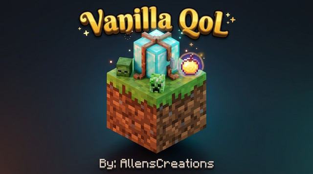

# 🎮 MCPE Curseforges — Addon Collections
### *By AllensCreations*

 

**[ 📥 DOWNLOAD LATEST .MCPACK (v1.2.0) ](https://github.com/AllensCreations/MCPE-Curseforges/raw/main/builds/Vanilla-Quality-of-Life/Vanilla_QoL_AllensCreations.mcpack)** &nbsp;•&nbsp; **[ 📂 BROWSE PACKS ](#-featured-packs-catalog)** &nbsp;•&nbsp; **[ 📖 INSTALLATION GUIDE ](#-installation-guide)**

---

## 🌟 Featured Pack: Vanilla Quality of Life (v1.2.0)

> *"The definitive Vanilla+ upgrade for Bedrock. No clunky scripts, no bloated custom items—just pure, polished Minecraft the way it was meant to be played."*

Tired of accidentally slicing your favorite pet dog during a mob fight? Frustrated by dragging Villagers through miles of clumsy minecart tracks? Sick of waiting 20 minutes for giant oak tree leaves to decay?

**Vanilla Quality of Life** is a lightweight, pure data-driven overhaul that fixes Minecraft Bedrock’s biggest survival headaches while preserving 100% of the vanilla gameplay spirit!

---

## ⚡ Key Features at a Glance

| Feature | Vanilla Bedrock | With Vanilla QoL |
| :--- | :---: | :---: |
| **Leashing Villagers & Hostiles** | ❌ Impossible | ✅ **Leash any of the 101 mobs!** |
| **Hostiles on Leads** | ❌ They hit you | ✅ **Pacified while leashed!** |
| **Pet Friendly-Fire** | ❌ Pets die to your sword | ✅ **Zero player damage & explosion immune!** |
| **Leaf Decay Speed** | ⏳ 10–30 slow seconds | ⚡ **1–2 fast, satisfying seconds!** |
| **Cutting Wood in Stonecutter** | ❌ Stone blocks only | ✅ **Cut all 11 wood types at 1:1 ratios!** |
| **Potions & Milk Stacking** | ❌ 1 per slot (clutters bag) | ✅ **Stacks up to 16!** |
| **Offhand Torches & Compasses** | ❌ Shield & Totem only | ✅ **Torches, Lanterns & Compasses supported!** |
| **Shulker Shell RNG** | 🎲 0–1 shells (painful RNG) | 📦 **100% Guaranteed 2 Shells per kill!** |
| **Multiplayer Sleep** | ❌ Everyone must sleep | 🛏️ **1 Player skips the night automatically!** |
| **Mob Head Trophies** | ⚡ Needs Charged Creeper | 💀 **2.5% player kill drops + Dragon & PvP heads!** |

---

## 📜 Complete Feature Breakdown

### 🪢 1. Universal Leashing & Pacified Mobs
- **Leash literally EVERY mob**: Attach leads to Villagers, Wandering Traders, Iron Golems, Turtles, Zombies, Skeletons, Creepers, Endermen, Wardens, Withers, and Ghasts!
- **Pacified on a Lead**: Hostile mobs are completely pacified while attached to your leash (`is_leashed == true`), meaning you can lead hostile creatures into zoos, traps, or museums without taking a single hit!
- **Villager Smart Interaction**:
  - **Normal Right-Click**: Opens the Trade screen.
  - **Sneak + Right-Click with Lead**: Attaches the leash cleanly without opening trades!

### 🛡️ 2. Pet & Mount Guardian Protection
- **No More Friendly Fire**: Your tamed Wolves, Cats, Parrots, Horses, Donkeys, Mules, and Llamas are completely immune to damage from player sword sweeps, axe swings, and stray arrows.
- **Explosion Shield**: Tamed pets take **0 damage** from Creeper surprises and accidental TNT blasts.

### 🍃 3. Fast Leaf Decay
- Say goodbye to floating leaf ruins! Chopping down a tree trunk triggers a rapid decay cascade clearing floating leaves within **1 to 2 seconds**, raining apples and saplings smoothly.

### 🪚 4. The Real Woodcutter (Stonecutter Support)
- Why can stone be cut 1:1 but wood wastes 33% of your materials?
- The Stonecutter now cuts all **11 Wood Types** (Oak, Spruce, Birch, Jungle, Acacia, Dark Oak, Mangrove, Cherry, Bamboo, Crimson, Warped):
  - **Logs $\rightarrow$ 4 Planks, 8 Slabs, 4 Stairs**
  - **Planks $\rightarrow$ Slabs (2x), Stairs (1x), Trapdoors (1x), Fences (1x), Fence Gates (1x)**

### 🧪 5. Stackable Potions, Splash Potions & Milk Buckets
- Drinkable Potions, Splash Potions, Lingering Potions, and Milk Buckets now stack up to **16**, freeing up your hotbar and backpack on long mining trips!

### 🗡️ 6. Offhand Utility Items
- Free up your main hand! You can now equip:
  - **Torches & Soul Torches**
  - **Lanterns & Soul Lanterns**
  - **Clocks, Compasses & Recovery Compasses**

### 💀 7. Mob Head Trophy System & PvP Heads
- Slain mobs have a **2.5% base drop chance** (+1% per Looting level) to drop their respective heads when defeated by a player:
  - 🧟 **Zombie, Husk, Drowned** $\rightarrow$ Zombie Head
  - 🏹 **Skeleton, Stray, Bogged** $\rightarrow$ Skeleton Skull
  - 🧨 **Creeper** $\rightarrow$ Creeper Head
  - 🐷 **Piglin, Zombified Piglin** $\rightarrow$ Piglin Head
  - 💀 **Wither Skeleton** $\rightarrow$ Fair 10% base drop rate!
  - 🐉 **Ender Dragon** $\rightarrow$ Drops **1 Dragon Head** + **1 Elytra** + **Dragon's Breath**!
  - ⚔️ **PvP Player Head** $\rightarrow$ Slaying another player in combat drops their Player Head!

### 💎 8. Wandering Trader Collector Shop
- The Wandering Trader isn't just a free lead delivery anymore! Trade **1 Block of Diamonds** for any rare mob head:
  - 1 Diamond Block $\rightarrow$ Zombie, Skeleton, Creeper, Wither Skeleton, Piglin, Player, or Dragon Head!
  - Also trades rare biome flora: Spore Blossoms, Wither Roses, Nautilus Shells, Bundles, and Heart of the Sea.

### 📦 9. 100% Guaranteed Shulker Shells
- Shulkers in End Cities always drop **2 Shulker Shells**, guaranteeing 1 complete Shulker Box per mob. No more 0-shell frustration!

### 🛏️ 10. Automatic One-Player Sleep
- No cheat commands needed! Automatically keeps `playersSleepingPercentage 0` enabled on world tick. A single player hopping into bed skips the night for the entire Realm or server.

### 🛠️ 11. Fair Crafting & Synthesis Recipes
- **Dirt + Seed $\rightarrow$ Grass Block**: Turn Dirt into Grass using any Seed (Wheat, Pumpkin, Melon, Beetroot, Torchflower, Pitcher Pod).
- **3 Gravel $\rightarrow$ 3 Flint**: 100% guaranteed flint crafting without shovel digging.
- **Fair 8-Stair Crafting**: 6 blocks crafts **8 stairs** across all 95 stair types.
- **Fair 4-Chain Crafting**: 1 Ingot + 2 Nuggets crafts **4 Chains** (instead of 1).
- **3 Sugar Cane $\rightarrow$ 6 Paper**.
- **6 Glass Panes $\rightarrow$ 2 Glass Blocks**.
- **8 Concrete Powder + 1 Water Bottle $\rightarrow$ 8 solid Concrete + 1 Glass Bottle**.
- **Smelt Rotten Flesh**: Smelt or smoke zombie flesh into **Leather**.
- **Recycle Slabs & Stairs**: 2 Slabs $\rightarrow$ 1 Block; 4 Stairs $\rightarrow$ 3 Blocks.
- **Craftable Saddles, Name Tags & Horse Armors**.
- **Uncraftable Blocks**: Amethyst, Quartz, Clay, Glowstone, Magma, Honeycomb, Melons, and Nether Wart Blocks uncraft cleanly back into raw materials.

---

## 📱 Compatibility & Platforms

- ✅ **Minecraft Bedrock 1.21.x** (Stable Releases)
- ✅ **Minecraft Bedrock 1.26.x** (Preview / Beta Releases)
- ✅ **Platforms**: Windows 10/11, Android, iOS, iPadOS, Xbox, PlayStation, Nintendo Switch
- ✅ **Multiplayer**: 100% compatible with Realms, BDS (Bedrock Dedicated Server), and LAN worlds.
- ✅ **Script-Free**: Uses 100% native JSON components. No Experimental Beta APIs or Script API required!

---

## 📥 Installation Guide

### 📱 Android / iOS / iPadOS
1. Tap the [Download Link](https://github.com/AllensCreations/MCPE-Curseforges/raw/main/builds/Vanilla-Quality-of-Life/Vanilla_QoL_AllensCreations.mcpack) to download `Vanilla_QoL_AllensCreations.mcpack`.
2. Tap the downloaded file in your browser or Files app.
3. Select **"Open with Minecraft"**.
4. Minecraft will launch and show: *"Import Started... Successfully Imported!"*
5. Go to your World Settings $\rightarrow$ **Behavior Packs** $\rightarrow$ Activate **Vanilla Quality of Life by AllensCreations**.

### 💻 Windows 10 / 11
1. Download `Vanilla_QoL_AllensCreations.mcpack`.
2. Double-click the file to automatically launch Minecraft Bedrock and install.
3. Enable the pack in your world's Behavior Packs menu.

### 🌐 Realms & Dedicated Servers
1. Activate the behavior pack on your local single-player world.
2. Upload the world to your Realm under **Realm Settings $\rightarrow$ Edit World $\rightarrow$ Replace World**.

---

## 📜 Terms of Use & Credits

- **Creator**: **AllensCreations**
- ✅ **Content Creators**: You are 100% free to showcase this add-on in YouTube, TikTok, or Twitch videos! Please provide credit and link to this GitHub repository or official release page.
- ❌ **Re-uploading**: Do not re-upload this pack to other websites or app stores behind paywalls or link shorteners (AdFly, Linkvertise, etc.).

---

### ⭐ Enjoying the pack? Give this repository a Star on GitHub!
**[ 📥 Download Vanilla_QoL_AllensCreations.mcpack Now ](https://github.com/AllensCreations/MCPE-Curseforges/raw/main/builds/Vanilla-Quality-of-Life/Vanilla_QoL_AllensCreations.mcpack)**

