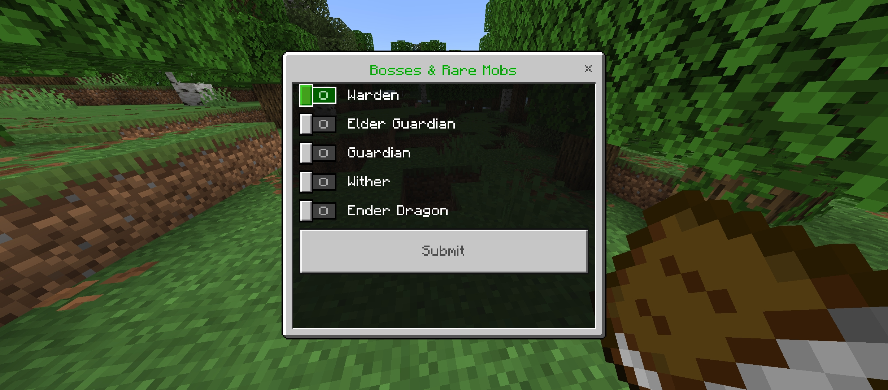
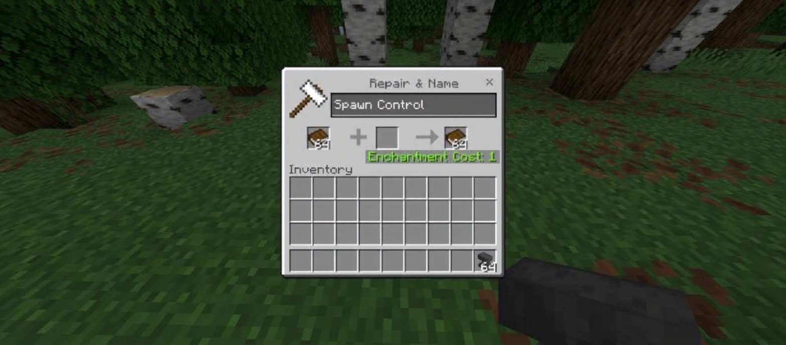
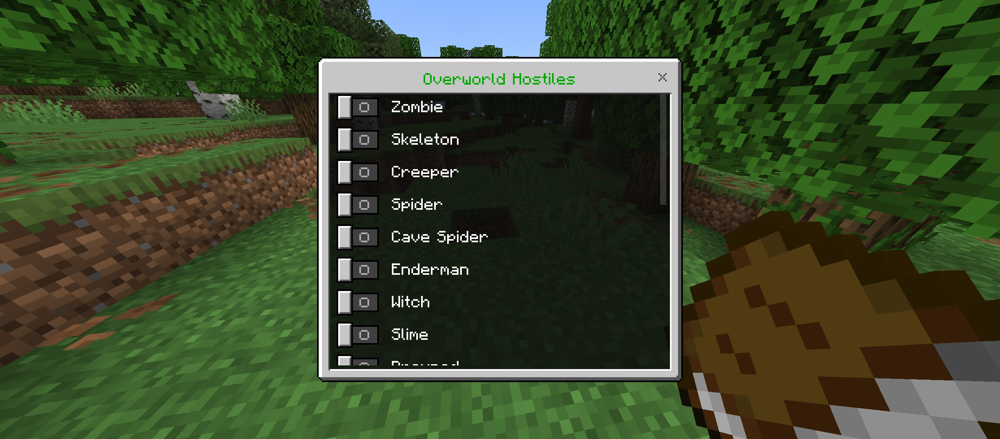
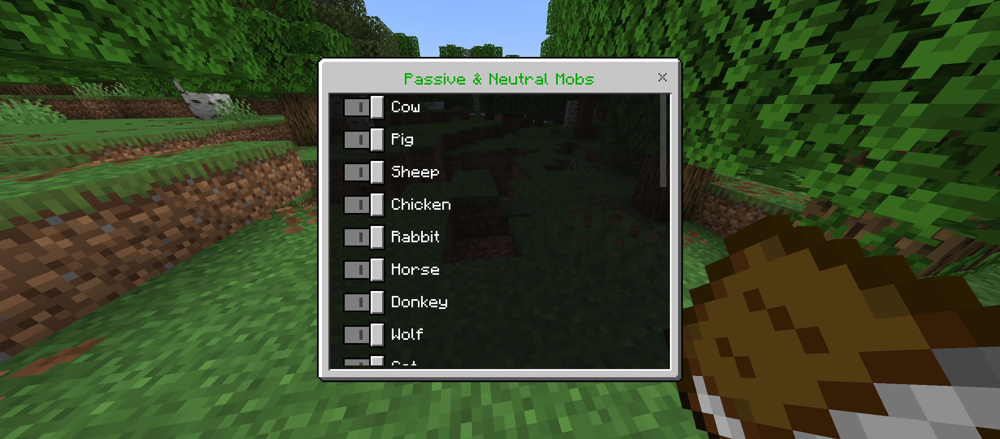

# Listing Kit: ALN:SpawnControl

Tap the Copy button on a block, then paste it into the CurseForge listing. Generated from DESCRIPTION.md: edit that, not this file.

## Package Name

```text
ALN:SpawnControl
```

## Summary (127/256)

```text
Control world mob spawns with individual switches for 58 creatures, presets, and filter rules opened from a Spawn Manager book.
```

## Description (HTML)

Paste into the CurseForge description editor in source (HTML) mode.

```html
<div><div style="border:2px solid #15803d;border-radius:18px;line-height:1.5"><br><h1 style="font-size:34px;text-align:center">ALN:SpawnControl</h1><p style="color:#8a94a3;font-size:14px;text-align:center">by ALNStudios</p><p style="text-align:center"><span style="background-color:#15803d;color:#ffffff;border-radius:20px;font-size:16px">&nbsp;&nbsp;<strong>Control world mob spawns with individual switches for 58 creatures, presets, and filter rules opened from a Spawn Manager book.</strong>&nbsp;&nbsp;</span></p><p style="text-align:center;margin-left:16px;margin-right:16px">ALN:SpawnControl adds an interactive in-game control panel to configure individual mob spawning rules across 4 categorized rosters. It suits world builders, realm administrators, and survival players wanting a fine-tuned environment without custom entities.</p><div style="display:flex;flex-wrap:wrap;gap:8px;margin-left:14px;margin-right:14px"><div style="background-color:#dcfce7;color:#14532d;border-radius:20px;font-size:14px;line-height:2"><strong>&nbsp;&nbsp;Bedrock</strong>: 1.26+&nbsp;&nbsp;</div><div style="background-color:#dcfce7;color:#14532d;border-radius:20px;font-size:14px;line-height:2"><strong>&nbsp;&nbsp;Experimental</strong>: No&nbsp;&nbsp;</div><div style="background-color:#dcfce7;color:#14532d;border-radius:20px;font-size:14px;line-height:2"><strong>&nbsp;&nbsp;Achievements</strong>: Unknown / needs confirmation&nbsp;&nbsp;</div></div><br></div>
<h2 style="font-size:17px;text-align:left"><span style="background-color:#15803d;color:#ffffff;border-radius:20px">&nbsp;&nbsp;About&nbsp;&nbsp;</span></h2>
<p>Rename a vanilla Book to "Spawn Manager" on an Anvil and use it to open the control panel. From the dashboard, players can inspect active mob counts, configure 4 categorized mob rosters with individual toggles, apply one-tap presets, configure global filter modes, or purge existing disabled mobs. All preferences are saved persistently to world storage.</p>
<h2 style="font-size:17px;text-align:left"><span style="background-color:#15803d;color:#ffffff;border-radius:20px">&nbsp;&nbsp;Screenshots&nbsp;&nbsp;</span></h2>
<div style="display:flex;flex-wrap:wrap;gap:10px"><div style="flex:1 1 300px;border:1px solid #8a94a3;border-radius:16px;text-align:center"><p><a href="https://raw.githubusercontent.com/AllensCreations/MCPE-Curseforges/main/MCPEDL/Script/ALNSpawnControl/assets/snapshots/BOSSES%20%26%20RARE%20MOBS.jpg"></a></p><p style="color:#8a94a3;font-size:13px">BOSSES &amp; RARE MOBS</p></div><div style="flex:1 1 300px;border:1px solid #8a94a3;border-radius:16px;text-align:center"><p><a href="https://raw.githubusercontent.com/AllensCreations/MCPE-Curseforges/main/MCPEDL/Script/ALNSpawnControl/assets/snapshots/HOW%20TO%20GET%20THE%20BOOK.jpg"></a></p><p style="color:#8a94a3;font-size:13px">HOW TO GET THE BOOK</p></div><div style="flex:1 1 300px;border:1px solid #8a94a3;border-radius:16px;text-align:center"><p><a href="https://raw.githubusercontent.com/AllensCreations/MCPE-Curseforges/main/MCPEDL/Script/ALNSpawnControl/assets/snapshots/OVER%20WORLD%20HOSTILE%20MENU.jpg"></a></p><p style="color:#8a94a3;font-size:13px">OVER WORLD HOSTILE MENU</p></div><div style="flex:1 1 300px;border:1px solid #8a94a3;border-radius:16px;text-align:center"><p><a href="https://raw.githubusercontent.com/AllensCreations/MCPE-Curseforges/main/MCPEDL/Script/ALNSpawnControl/assets/snapshots/PASSIVE%20AND%20NEUTRAL%20MOBS.jpg"></a></p><p style="color:#8a94a3;font-size:13px">PASSIVE AND NEUTRAL MOBS</p></div></div>
<h2 style="font-size:17px;text-align:left"><span style="background-color:#15803d;color:#ffffff;border-radius:20px">&nbsp;&nbsp;What You Get&nbsp;&nbsp;</span></h2>
<div style="display:flex;flex-wrap:wrap;gap:10px"><div style="flex:1;min-width:200px;border:1px solid #8a94a3;border-radius:16px"><div style="background-color:#15803d;color:#ffffff;border-radius:16px;font-size:16px;line-height:2.2"><strong>&nbsp;&nbsp;Categorized Mob Rosters</strong></div><div style="margin-left:12px;margin-right:12px"><p><span>Individual toggle switches govern 58 standard mobs organized across 4 distinct groups: Overworld Hostiles, Passive &amp; Neutral Mobs, Nether &amp; End Mobs, and Bosses &amp; Rare Mobs.</span><br><span style="font-size:13px;color:#8a94a3"><strong>How It Works:</strong> Open any category to adjust individual toggles, such as turning off Creeper or Phantom while keeping Zombie and Skeleton active.</span><br><span style="font-size:13px;color:#8a94a3"><strong>Good To Know:</strong> All mobs are enabled by default. Mobs that are toggled off are removed immediately when spawning occurs.</span></p></div></div><div style="flex:1;min-width:200px;border:1px solid #8a94a3;border-radius:16px"><div style="background-color:#15803d;color:#ffffff;border-radius:16px;font-size:16px;line-height:2.2"><strong>&nbsp;&nbsp;Quick Presets</strong></div><div style="margin-left:12px;margin-right:12px"><p><span>One-tap buttons allow bulk configuration: Enable All Mobs, Disable All Hostiles, Disable All Passive Mobs, or Disable Everything for an empty mob world.</span><br><span style="font-size:13px;color:#8a94a3"><strong>How It Works:</strong> Selecting "Disable All Hostiles" immediately switches off all Overworld monsters, Nether threats, and bosses simultaneously.</span></p></div></div><div style="flex:1;min-width:200px;border:1px solid #8a94a3;border-radius:16px"><div style="background-color:#15803d;color:#ffffff;border-radius:16px;font-size:16px;line-height:2.2"><strong>&nbsp;&nbsp;Global Filter Rules</strong></div><div style="margin-left:12px;margin-right:12px"><p><span>Global settings let you choose whether spawn restrictions apply only to natural world-gen spawns or also block Spawn Eggs and summon commands.</span><br><span style="font-size:13px;color:#8a94a3"><strong>How It Works:</strong> Leaving natural spawn mode active allows administrators to test mobs using Spawn Eggs while preventing wild spawns.</span></p></div></div><div style="flex:1;min-width:200px;border:1px solid #8a94a3;border-radius:16px"><div style="background-color:#15803d;color:#ffffff;border-radius:16px;font-size:16px;line-height:2.2"><strong>&nbsp;&nbsp;Entity Purge</strong></div><div style="margin-left:12px;margin-right:12px"><p><span>An optional purge action scans loaded chunks in all three dimensions and removes mobs whose toggles are currently disabled.</span><br><span style="font-size:13px;color:#8a94a3"><strong>Good To Know:</strong> Toggling this option inside Global Filter Settings runs a single-pass removal and reports the number of purged entities.</span></p></div></div><div style="flex:1;min-width:200px;border:1px solid #8a94a3;border-radius:16px"><div style="background-color:#15803d;color:#ffffff;border-radius:16px;font-size:16px;line-height:2.2"><strong>&nbsp;&nbsp;Admin Tag Lock</strong></div><div style="margin-left:12px;margin-right:12px"><p><span>An optional permission lock restricts opening the control panel to players carrying the administrator tag.</span><br><span style="font-size:13px;color:#8a94a3"><strong>How It Works:</strong> When Admin Tag Lock is turned on, a player must carry the tag to open the book; the first player to open the book automatically receives the tag if none exists.</span></p></div></div></div>
<h2 style="font-size:17px;text-align:left"><span style="background-color:#15803d;color:#ffffff;border-radius:20px">&nbsp;&nbsp;Get Started&nbsp;&nbsp;</span></h2>
<table style="width:100%;border:1px solid #8a94a3;border-radius:16px"><tbody><tr><td style="width:44px;text-align:center"><div style="background-color:#15803d;color:#ffffff;font-weight:bold;font-size:15px;text-align:center;border-radius:10px;width:30px;aspect-ratio:1/1;line-height:30px">1</div></td><td style="text-align:left;">Import the .mcpack file and activate ALN:SpawnControl in your world's Behavior Packs.</td></tr><tr><td style="width:44px;text-align:center"><div style="background-color:#15803d;color:#ffffff;font-weight:bold;font-size:15px;text-align:center;border-radius:10px;width:30px;aspect-ratio:1/1;line-height:30px">2</div></td><td style="text-align:left;">Place a Book or Writable Book in an Anvil and rename it to "Spawn Manager".</td></tr><tr><td style="width:44px;text-align:center"><div style="background-color:#15803d;color:#ffffff;font-weight:bold;font-size:15px;text-align:center;border-radius:10px;width:30px;aspect-ratio:1/1;line-height:30px">3</div></td><td style="text-align:left;">Hold the renamed book and use it to open the ALN:SpawnControl control panel.</td></tr></tbody></table>
<h2 style="font-size:17px;text-align:left"><span style="background-color:#15803d;color:#ffffff;border-radius:20px">&nbsp;&nbsp;Common Questions&nbsp;&nbsp;</span></h2>
<div class="spoiler" title="Do I need experimental toggles?" data-title="Do I need experimental toggles?"><p><strong>Do I need experimental toggles?</strong><br>No experimental toggles or cheats are required for normal menu usage.</p></div><div class="spoiler" title="Does it stop mob spawners?" data-title="Does it stop mob spawners?"><p><strong>Does it stop mob spawners?</strong><br>When set to block natural spawns or all sources, spawner-generated entities of disabled mob types are intercepted upon spawning.</p></div><div class="spoiler" title="Will turning off a mob remove existing ones?" data-title="Will turning off a mob remove existing ones?"><p><strong>Will turning off a mob remove existing ones?</strong><br>New spawns are blocked immediately; use the Purge Loaded Disabled Mobs option in Global Filter Settings to clear existing mobs.</p></div>
<h2 style="font-size:17px;text-align:left"><span style="background-color:#15803d;color:#ffffff;border-radius:20px">&nbsp;&nbsp;Install&nbsp;&nbsp;</span></h2>
<table style="width:100%;border:1px solid #8a94a3;border-radius:16px"><tbody><tr><td style="width:44px;text-align:center"><div style="background-color:#15803d;color:#ffffff;font-weight:bold;font-size:15px;text-align:center;border-radius:10px;width:30px;aspect-ratio:1/1;line-height:30px">1</div></td><td style="text-align:left;">Download the file from this page and open it with Minecraft.</td></tr><tr><td style="width:44px;text-align:center"><div style="background-color:#15803d;color:#ffffff;font-weight:bold;font-size:15px;text-align:center;border-radius:10px;width:30px;aspect-ratio:1/1;line-height:30px">2</div></td><td style="text-align:left;">Create or edit a world and turn on the new pack(s) in its settings.</td></tr><tr><td style="width:44px;text-align:center"><div style="background-color:#15803d;color:#ffffff;font-weight:bold;font-size:15px;text-align:center;border-radius:10px;width:30px;aspect-ratio:1/1;line-height:30px">3</div></td><td style="text-align:left;">Play. No Experimental toggles needed.</td></tr></tbody></table>
<h2 style="font-size:17px;text-align:left"><span style="background-color:#15803d;color:#ffffff;border-radius:20px">&nbsp;&nbsp;Support&nbsp;&nbsp;</span></h2><div style="border:1px solid #8a94a3;border-radius:16px;text-align:center"><br><a href="https://ko-fi.com/alnstudios"></a><br><br></div><p style="text-align:center"><a href="https://www.curseforge.com/members/allenscreations/projects"><strong>CurseForge</strong></a> &nbsp;|&nbsp; <a href="https://mcpedl.com/user/alnstudios/"><strong>MCPEDL</strong></a> &nbsp;|&nbsp; <a href="https://ko-fi.com/alnstudios"><strong>Ko-fi</strong></a></p>
<hr>
<p style="text-align:center;color:#8a94a3;font-size:13px"><strong>By ALNStudios</strong></p>
<div class="spoiler"><p style="font-size:13px"><strong>Permissions and credits</strong></p><ul style="font-size:13px"><li>Rights: All rights reserved for ALNStudios.</li><li>Content creators: You may feature this creation in videos and streams with credit to ALNStudios.</li><li>Redistribution: Do not re-upload this pack or provide direct monetized download bypasses. Link to this page.</li><li>Unofficial community creation. Not an official Minecraft product and not approved by or associated with Mojang or Microsoft.</li></ul></div>
<p style="text-align:center;color:#8a94a3;font-size:12px">Minecraft Bedrock add-on, ALN:SpawnControl Bedrock mod, mob spawn whitelist, custom mob toggle, spawn manager book, Minecraft PE survival, MCPEDL add-on, CurseForge Bedrock, ALNStudios.</p></div>
```

## AI Image Prompts

### Reference Images

- **Logo reference**: attach your own logo. The generator uses it only for brand colors and mood. The result must be a new design, not a copy.
- **Snapshot references**: attach 1 to 4 of your in-game snapshots of this pack. The generator copies their look, not their screen layout.

### Logo Prompt

```text
Use the attached logo only as a brand reference for its color palette and overall mood. Do not copy it. Create a new, original logo with a different composition and a different main symbol. Do not just recolor, resize, crop, mirror or tweak the attached logo.
Create a clean, square (1:1) logo image for the Minecraft Bedrock add-on "ALN:SpawnControl". Control world mob spawns with individual switches for 58 creatures, presets, and filter rules opened from a Spawn Manager book.
Base the main symbol on the pack idea above. Match the blocky look of the attached in-game snapshots. Center the logo, use a simple background, and keep it readable at small sizes.
Text: "ALN:SpawnControl" and, in small letters, "ALNStudios". ALNStudios is the brand name, so always keep it and never remove or change it. Spell both exactly.
Do not add Minecraft, Mojang or Microsoft logos, watermarks, or characters from other games.
```

### Banner Prompt

```text
Create a wide (16:9) banner image for the Minecraft Bedrock add-on "ALN:SpawnControl". Control world mob spawns with individual switches for 58 creatures, presets, and filter rules opened from a Spawn Manager book.
Use the attached in-game snapshots as scene and style references: copy their blocky look, lighting, colors and the kind of scenery they show. Make a new composition inspired by them. Do not copy the on-screen HUD, chat or hotbar.
Use the attached logo only as a brand reference for its colors and mood. Do not copy it. Put a new, original logo design in the banner, large enough to read, on the left or center.
Hint at these pack features visually: Categorized Mob Rosters, Quick Presets, Global Filter Rules, Entity Purge, Admin Tag Lock.
Text: "ALN:SpawnControl" and, in small letters, "by ALNStudios". ALNStudios is the brand name, so always keep it and never remove or change it. Spell both exactly.
Leave clear space around the logo. No Minecraft, Mojang or Microsoft logos, no watermarks.
```
