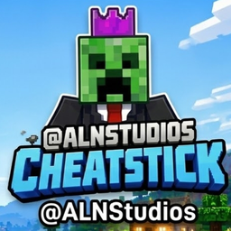

# Listing Kit: Cheat Stick

Tap the Copy button on a block, then paste it into the CurseForge listing. Generated from DESCRIPTION.md: edit that, not this file.

## Package Name

```text
Cheat Stick
```

## Summary (137/256)

```text
Sneak and use a normal Stick to open the @ALNStudios Cheatstick menu with Gamemode, Time, Weather, Survival, Effects, and Travel choices.
```

## Description (HTML)

Paste into the CurseForge description editor in source (HTML) mode.

```html
<div><div style="border:1px solid #15803d;border-radius:12px;line-height:1.5"><br><table style="width:100%;border-width:0"><tbody><tr><td style="width:90px;text-align:center"></td><td style="text-align:left"><h1 style="font-size:28px;text-align:left">Cheat Stick</h1><p style="color:#8a94a3;font-size:14px;text-align:left">by ALNStudios</p><p style="font-size:16px;text-align:left"><strong>Sneak and use a normal Stick to open the @ALNStudios Cheatstick menu with Gamemode, Time, Weather, Survival, Effects, and Travel choices.</strong></p></td></tr></tbody></table><p style="text-align:center;margin-left:14px;margin-right:14px">Any normal Stick becomes a cheat menu, with 3 game modes, 6 times of day, 3 weather types, 4 survival helpers, 4 difficulty levels, 7 effects, and 5 save and load slots.</p><br><div style="display:flex;flex-wrap:wrap;gap:8px;margin-left:14px;margin-right:14px"><div style="background-color:#15803d;color:#ffffff;border-radius:6px;font-weight:bold;font-size:14px;line-height:2">&nbsp;&nbsp;Bedrock: 1.26+&nbsp;&nbsp;</div><div style="background-color:#15803d;color:#ffffff;border-radius:6px;font-weight:bold;font-size:14px;line-height:2">&nbsp;&nbsp;Experimental: No&nbsp;&nbsp;</div><div style="background-color:#15803d;color:#ffffff;border-radius:6px;font-weight:bold;font-size:14px;line-height:2">&nbsp;&nbsp;Achievements: Likely achievement-friendly&nbsp;&nbsp;</div></div><br></div>
<h2 style="text-align:left;font-size:22px">About</h2>
<p>Hold a normal Stick, sneak, and use it. A menu titled @ALNStudios Cheatstick, followed by the add-on version, opens with six choices: Gamemode, Time, Weather, Survival, Effects, and Travel.</p>
<h2 style="text-align:left;font-size:22px">What You Get</h2>
<div style="display:flex;flex-wrap:wrap;gap:10px"><div style="flex:1;min-width:180px;border:1px solid #8a94a3;border-radius:10px"><div style="background-color:#15803d;font-size:4px;line-height:4px;border-radius:10px">&nbsp;</div><div style="padding-left:12px;margin-right:12px"><p><strong style="font-size:16px">Cheat Stick</strong><br><span>The normal Stick is the Cheat Stick.</span><br><span style="font-size:13px;color:#8a94a3"><strong>Good To Know:</strong> Every player who sneaks and uses a Stick opens the menu.</span></p></div></div><div style="flex:1;min-width:180px;border:1px solid #8a94a3;border-radius:10px"><div style="background-color:#15803d;font-size:4px;line-height:4px;border-radius:10px">&nbsp;</div><div style="padding-left:12px;margin-right:12px"><p><strong style="font-size:16px">Gamemode</strong><br><span>Choose Survival, Creative, Hardcore, or Difficulty.</span><br><span style="font-size:13px;color:#8a94a3"><strong>Good To Know:</strong> Hardcore here is a harder Survival setup.</span></p></div></div><div style="flex:1;min-width:180px;border:1px solid #8a94a3;border-radius:10px"><div style="background-color:#15803d;font-size:4px;line-height:4px;border-radius:10px">&nbsp;</div><div style="padding-left:12px;margin-right:12px"><p><strong style="font-size:16px">Time</strong><br><span>Choose Day, Noon, Sunset, Night, Midnight, or Sunrise.</span></p></div></div><div style="flex:1;min-width:180px;border:1px solid #8a94a3;border-radius:10px"><div style="background-color:#15803d;font-size:4px;line-height:4px;border-radius:10px">&nbsp;</div><div style="padding-left:12px;margin-right:12px"><p><strong style="font-size:16px">Weather</strong><br><span>Choose Clear, Rain, or Thunder in your current dimension.</span></p></div></div><div style="flex:1;min-width:180px;border:1px solid #8a94a3;border-radius:10px"><div style="background-color:#15803d;font-size:4px;line-height:4px;border-radius:10px">&nbsp;</div><div style="padding-left:12px;margin-right:12px"><p><strong style="font-size:16px">Survival</strong><br><span>Choose Heal &amp; Feed, Toggle Keep Inventory, Clear Nearby Hostile Mobs, or Clear Dropped Items.</span><br><span style="font-size:13px;color:#8a94a3"><strong>Good To Know:</strong> Keep Inventory is a world setting, so it affects every player in the world.</span></p></div></div><div style="flex:1;min-width:180px;border:1px solid #8a94a3;border-radius:10px"><div style="background-color:#15803d;font-size:4px;line-height:4px;border-radius:10px">&nbsp;</div><div style="padding-left:12px;margin-right:12px"><p><strong style="font-size:16px">Effects</strong><br><span>Choose Haste, Speed, Night Vision, Jump Boost, Water Breathing, Fire Resistance, Regeneration, or Clear Effects.</span><br><span style="font-size:13px;color:#8a94a3"><strong>Good To Know:</strong> Effects only affect the player who picked them.</span></p></div></div><div style="flex:1;min-width:180px;border:1px solid #8a94a3;border-radius:10px"><div style="background-color:#15803d;font-size:4px;line-height:4px;border-radius:10px">&nbsp;</div><div style="padding-left:12px;margin-right:12px"><p><strong style="font-size:16px">Travel</strong><br><span>Choose Back to Death Point, Set Spawn Here, Save, Load, or Rename Slot.</span><br><span style="font-size:13px;color:#8a94a3"><strong>Good To Know:</strong> Each player has 5 slots and one saved death point.</span></p></div></div></div>
<h2 style="text-align:left;font-size:22px">Get Started</h2>
<table style="width:100%;border-width:0"><tbody><tr><td style="width:44px;text-align:center"><div style="background-color:#15803d;color:#ffffff;font-weight:bold;font-size:15px;text-align:center;border-radius:50%;width:30px;aspect-ratio:1/1;line-height:30px">1</div></td><td style="text-align:left;">Take a normal Stick in your hand.</td></tr><tr><td style="width:44px;text-align:center"><div style="background-color:#15803d;color:#ffffff;font-weight:bold;font-size:15px;text-align:center;border-radius:50%;width:30px;aspect-ratio:1/1;line-height:30px">2</div></td><td style="text-align:left;">Sneak and use the Stick to open the @ALNStudios Cheatstick menu.</td></tr><tr><td style="width:44px;text-align:center"><div style="background-color:#15803d;color:#ffffff;font-weight:bold;font-size:15px;text-align:center;border-radius:50%;width:30px;aspect-ratio:1/1;line-height:30px">3</div></td><td style="text-align:left;">Pick Gamemode, Time, Weather, Survival, Effects, or Travel, then pick an option.</td></tr></tbody></table>
<h2 style="text-align:left;font-size:22px">Common Questions</h2>
<div class="spoiler" title="Do I need to craft anything?" data-title="Do I need to craft anything?"><p><strong>Do I need to craft anything?</strong><br>No. Any normal Stick opens the menu when you sneak and use it.</p></div><div class="spoiler" title="Is there a Hardcore switch for the world?" data-title="Is there a Hardcore switch for the world?"><p><strong>Is there a Hardcore switch for the world?</strong><br>No. The Hardcore choice sets Survival and Hard difficulty only.</p></div>
<h2 style="text-align:left;font-size:22px">Install</h2>
<table style="width:100%;border-width:0"><tbody><tr><td style="width:44px;text-align:center"><div style="background-color:#15803d;color:#ffffff;font-weight:bold;font-size:15px;text-align:center;border-radius:50%;width:30px;aspect-ratio:1/1;line-height:30px">1</div></td><td style="text-align:left;">Download the file from this page and open it with Minecraft.</td></tr><tr><td style="width:44px;text-align:center"><div style="background-color:#15803d;color:#ffffff;font-weight:bold;font-size:15px;text-align:center;border-radius:50%;width:30px;aspect-ratio:1/1;line-height:30px">2</div></td><td style="text-align:left;">Create or edit a world and turn on the new pack(s) in its settings.</td></tr><tr><td style="width:44px;text-align:center"><div style="background-color:#15803d;color:#ffffff;font-weight:bold;font-size:15px;text-align:center;border-radius:50%;width:30px;aspect-ratio:1/1;line-height:30px">3</div></td><td style="text-align:left;">Play. No Experimental toggles needed.</td></tr></tbody></table>
<h2 style="text-align:left;font-size:22px">Support</h2><div style="border:1px solid #8a94a3;border-radius:12px;text-align:center"><br><a href="https://ko-fi.com/alnstudios"></a><br><br></div><p style="text-align:center"><a href="https://www.curseforge.com/members/allenscreations/projects"><strong>CurseForge</strong></a> &nbsp;|&nbsp; <a href="https://mcpedl.com/user/alnstudios/"><strong>MCPEDL</strong></a> &nbsp;|&nbsp; <a href="https://ko-fi.com/alnstudios"><strong>Ko-fi</strong></a></p>
<hr>
<p style="text-align:center;color:#8a94a3;font-size:13px"><strong>By ALNStudios</strong></p>
<div class="spoiler"><p style="font-size:13px"><strong>Permissions and credits</strong></p><ul style="font-size:13px"><li>Rights: All rights reserved for ALNStudios.</li><li>Content creators: You may feature this creation in videos and streams with credit to ALNStudios.</li><li>Redistribution: Do not re-upload this pack or provide direct monetized download bypasses. Link to this page.</li><li>Unofficial community creation. Not an official Minecraft product and not approved by or associated with Mojang or Microsoft.</li></ul></div>
<p style="text-align:center;color:#8a94a3;font-size:12px">Minecraft Bedrock add-on, Cheat Stick Bedrock mod, cheat menu, game mode switcher, time and weather changer, survival helper menu, keep inventory toggle, normal stick menu, Minecraft PE survival, MCPEDL add-on, CurseForge Bedrock, ALNStudio, ALNStudios, effects menu, haste and speed, death point teleport, save and load teleport slots, difficulty selector, rename slots, clear dropped items.</p></div>
```

## AI Image Prompts

### Reference Images

- **Logo reference**: attach your own logo. The generator uses it only for brand colors and mood. The result must be a new design, not a copy.
- **Snapshot references**: attach 1 to 4 of your in-game snapshots of this pack. The generator copies their look, not their screen layout.

### Logo Prompt

```text
Use the attached logo only as a brand reference for its color palette and overall mood. Do not copy it. Create a new, original logo with a different composition and a different main symbol. Do not just recolor, resize, crop, mirror or tweak the attached logo.
Create a clean, square (1:1) logo image for the Minecraft Bedrock add-on "Cheat Stick". Sneak and use a normal Stick to open the @ALNStudios Cheatstick menu with Gamemode, Time, Weather, Survival, Effects, and Travel choices.
Base the main symbol on the pack idea above. Match the blocky look of the attached in-game snapshots. Center the logo, use a simple background, and keep it readable at small sizes.
Text: "Cheat Stick" and, in small letters, "ALNStudios". ALNStudios is the brand name, so always keep it and never remove or change it. Spell both exactly.
Do not add Minecraft, Mojang or Microsoft logos, watermarks, or characters from other games.
```

### Banner Prompt

```text
Create a wide (16:9) banner image for the Minecraft Bedrock add-on "Cheat Stick". Sneak and use a normal Stick to open the @ALNStudios Cheatstick menu with Gamemode, Time, Weather, Survival, Effects, and Travel choices.
Use the attached in-game snapshots as scene and style references: copy their blocky look, lighting, colors and the kind of scenery they show. Make a new composition inspired by them. Do not copy the on-screen HUD, chat or hotbar.
Use the attached logo only as a brand reference for its colors and mood. Do not copy it. Put a new, original logo design in the banner, large enough to read, on the left or center.
Hint at these pack features visually: Cheat Stick, Gamemode, Time, Weather, Survival.
Text: "Cheat Stick" and, in small letters, "by ALNStudios". ALNStudios is the brand name, so always keep it and never remove or change it. Spell both exactly.
Leave clear space around the logo. No Minecraft, Mojang or Microsoft logos, no watermarks.
```
