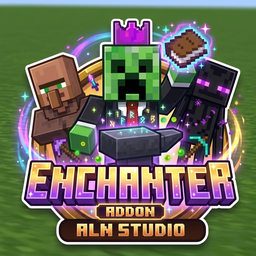

# Listing Kit: Enchanter

Tap the Copy button on a block, then paste it into the CurseForge listing. Generated from DESCRIPTION.md: edit that, not this file.

## Package Name

```text
Enchanter
```

## Summary (127/256)

```text
Rename a Book to Enchanter, then set Sharpness, Mending and every other fitting enchantment on any inventory item with sliders.
```

## Description (HTML)

Paste into the CurseForge description editor in source (HTML) mode.

```html
<div><div style="border:1px solid #15803d;border-radius:12px;line-height:1.5"><br><table style="width:100%;border-width:0"><tbody><tr><td style="width:90px;text-align:center"></td><td style="text-align:left"><h1 style="font-size:28px;text-align:left">Enchanter</h1><p style="color:#8a94a3;font-size:14px;text-align:left">by ALNStudios</p><p style="font-size:16px;text-align:left"><strong>Rename a Book to Enchanter, then set Sharpness, Mending and every other fitting enchantment on any inventory item with sliders.</strong></p></td></tr></tbody></table><p style="text-align:center;margin-left:14px;margin-right:14px">Enchanter turns a renamed Book into a menu with one slider for each enchantment that fits your item.</p><br><div style="display:flex;flex-wrap:wrap;gap:8px;margin-left:14px;margin-right:14px"><div style="background-color:#15803d;color:#ffffff;border-radius:6px;font-weight:bold;font-size:14px;line-height:2">&nbsp;&nbsp;Bedrock: 1.26+&nbsp;&nbsp;</div><div style="background-color:#15803d;color:#ffffff;border-radius:6px;font-weight:bold;font-size:14px;line-height:2">&nbsp;&nbsp;Experimental: No&nbsp;&nbsp;</div><div style="background-color:#15803d;color:#ffffff;border-radius:6px;font-weight:bold;font-size:14px;line-height:2">&nbsp;&nbsp;Achievements: Likely achievement-friendly&nbsp;&nbsp;</div></div><br></div>
<h2 style="text-align:left;font-size:22px">About</h2>
<p>Rename a Book to Enchanter at an Anvil and use it to open a menu with Enchanter, About and Exit. Pick an item, choose a starting preset, and set each enchantment with its slider.</p>
<h2 style="text-align:left;font-size:22px">What You Get</h2>
<div style="display:flex;flex-wrap:wrap;gap:10px"><div style="flex:1;min-width:180px;border:1px solid #8a94a3;border-radius:10px"><div style="background-color:#15803d;font-size:4px;line-height:4px;border-radius:10px">&nbsp;</div><div style="padding-left:12px;margin-right:12px"><p><strong style="font-size:16px">Main Menu</strong><br><span>Using the renamed Book opens a menu with Enchanter, About and Exit.</span><br><span style="font-size:13px;color:#8a94a3"><strong>Good To Know:</strong> About shows who made the add-on and where to find more.</span></p></div></div><div style="flex:1;min-width:180px;border:1px solid #8a94a3;border-radius:10px"><div style="background-color:#15803d;font-size:4px;line-height:4px;border-radius:10px">&nbsp;</div><div style="padding-left:12px;margin-right:12px"><p><strong style="font-size:16px">Enchanter Book</strong><br><span>A Book renamed to Enchanter at an Anvil becomes a portable enchanting menu.</span><br><span style="font-size:13px;color:#8a94a3"><strong>Good To Know:</strong> The name must read exactly Enchanter, with a capital E.</span></p></div></div><div style="flex:1;min-width:180px;border:1px solid #8a94a3;border-radius:10px"><div style="background-color:#15803d;font-size:4px;line-height:4px;border-radius:10px">&nbsp;</div><div style="padding-left:12px;margin-right:12px"><p><strong style="font-size:16px">Item Picker</strong><br><span>The menu lists every enchantable item in your inventory and hotbar, each with its icon, slot number and enchantment count.</span><br><span style="font-size:13px;color:#8a94a3"><strong>Good To Know:</strong> Armor you are wearing and items in the off hand are not listed.</span></p></div></div><div style="flex:1;min-width:180px;border:1px solid #8a94a3;border-radius:10px"><div style="background-color:#15803d;font-size:4px;line-height:4px;border-radius:10px">&nbsp;</div><div style="padding-left:12px;margin-right:12px"><p><strong style="font-size:16px">Level Sliders</strong><br><span>Every enchantment that fits the chosen item gets its own slider with a divider, from 0 up to that enchantment's level cap.</span><br><span style="font-size:13px;color:#8a94a3"><strong>Good To Know:</strong> Enchantments that do not fit the item, such as Sharpness on boots, are hidden.</span></p></div></div><div style="flex:1;min-width:180px;border:1px solid #8a94a3;border-radius:10px"><div style="background-color:#15803d;font-size:4px;line-height:4px;border-radius:10px">&nbsp;</div><div style="padding-left:12px;margin-right:12px"><p><strong style="font-size:16px">Starting Presets</strong><br><span>Before the sliders appear you choose Keep current levels, Maximum levels, or Clear all.</span></p></div></div><div style="flex:1;min-width:180px;border:1px solid #8a94a3;border-radius:10px"><div style="background-color:#15803d;font-size:4px;line-height:4px;border-radius:10px">&nbsp;</div><div style="padding-left:12px;margin-right:12px"><p><strong style="font-size:16px">Apply And Combine</strong><br><span>A summary lists every added and removed enchantment before anything changes.</span><br><span style="font-size:13px;color:#8a94a3"><strong>Good To Know:</strong> Combinations the game refuses are skipped and named above your hotbar.</span></p></div></div></div>
<h2 style="text-align:left;font-size:22px">Get Started</h2>
<table style="width:100%;border-width:0"><tbody><tr><td style="width:44px;text-align:center"><div style="background-color:#15803d;color:#ffffff;font-weight:bold;font-size:15px;text-align:center;border-radius:50%;width:30px;aspect-ratio:1/1;line-height:30px">1</div></td><td style="text-align:left;">Rename a Book to Enchanter at an Anvil.</td></tr><tr><td style="width:44px;text-align:center"><div style="background-color:#15803d;color:#ffffff;font-weight:bold;font-size:15px;text-align:center;border-radius:50%;width:30px;aspect-ratio:1/1;line-height:30px">2</div></td><td style="text-align:left;">Hold the Enchanter Book and use it, choose Enchanter, then pick an item and a starting preset.</td></tr><tr><td style="width:44px;text-align:center"><div style="background-color:#15803d;color:#ffffff;font-weight:bold;font-size:15px;text-align:center;border-radius:50%;width:30px;aspect-ratio:1/1;line-height:30px">3</div></td><td style="text-align:left;">Set the sliders, choose Apply on the summary, and the item shows its new enchantments.</td></tr></tbody></table>
<h2 style="text-align:left;font-size:22px">Install</h2>
<table style="width:100%;border-width:0"><tbody><tr><td style="width:44px;text-align:center"><div style="background-color:#15803d;color:#ffffff;font-weight:bold;font-size:15px;text-align:center;border-radius:50%;width:30px;aspect-ratio:1/1;line-height:30px">1</div></td><td style="text-align:left;">Download the file from this page and open it with Minecraft.</td></tr><tr><td style="width:44px;text-align:center"><div style="background-color:#15803d;color:#ffffff;font-weight:bold;font-size:15px;text-align:center;border-radius:50%;width:30px;aspect-ratio:1/1;line-height:30px">2</div></td><td style="text-align:left;">Create or edit a world and turn on the new pack(s) in its settings.</td></tr><tr><td style="width:44px;text-align:center"><div style="background-color:#15803d;color:#ffffff;font-weight:bold;font-size:15px;text-align:center;border-radius:50%;width:30px;aspect-ratio:1/1;line-height:30px">3</div></td><td style="text-align:left;">Play. No Experimental toggles needed.</td></tr></tbody></table>
<h2 style="text-align:left;font-size:22px">Support</h2><div style="border:1px solid #8a94a3;border-radius:12px;text-align:center"><br><a href="https://ko-fi.com/alnstudios"></a><br><br></div><p style="text-align:center"><a href="https://www.curseforge.com/members/allenscreations/projects"><strong>CurseForge</strong></a> &nbsp;|&nbsp; <a href="https://mcpedl.com/user/alnstudios/"><strong>MCPEDL</strong></a> &nbsp;|&nbsp; <a href="https://ko-fi.com/alnstudios"><strong>Ko-fi</strong></a></p>
<hr>
<p style="text-align:center;color:#8a94a3;font-size:13px"><strong>By ALNStudios</strong></p>
<div class="spoiler"><p style="font-size:13px"><strong>Permissions and credits</strong></p><ul style="font-size:13px"><li>Rights: All rights reserved for ALNStudios.</li><li>Content creators: You may feature this creation in videos and streams with credit to ALNStudios.</li><li>Redistribution: Do not re-upload this pack or provide direct monetized download bypasses. Link to this page.</li><li>Unofficial community creation. Not an official Minecraft product and not approved by or associated with Mojang or Microsoft.</li></ul></div>
<p style="text-align:center;color:#8a94a3;font-size:12px">Minecraft Bedrock add-on, Enchanter Bedrock mod, enchantment sliders, renamed Book, custom enchanting menu, Minecraft PE enchant, MCPEDL add-on, CurseForge Bedrock, ALNStudios.</p></div>
```

## AI Image Prompts

### Reference Images

- **Logo reference**: attach your own logo. The generator uses it only for brand colors and mood. The result must be a new design, not a copy.
- **Snapshot references**: attach 1 to 4 of your in-game snapshots of this pack. The generator copies their look, not their screen layout.

### Logo Prompt

```text
Use the attached logo only as a brand reference for its color palette and overall mood. Do not copy it. Create a new, original logo with a different composition and a different main symbol. Do not just recolor, resize, crop, mirror or tweak the attached logo.
Create a clean, square (1:1) logo image for the Minecraft Bedrock add-on "Enchanter". Rename a Book to Enchanter, then set Sharpness, Mending and every other fitting enchantment on any inventory item with sliders.
Base the main symbol on the pack idea above. Match the blocky look of the attached in-game snapshots. Center the logo, use a simple background, and keep it readable at small sizes.
Text: "Enchanter" and, in small letters, "ALNStudios". ALNStudios is the brand name, so always keep it and never remove or change it. Spell both exactly.
Do not add Minecraft, Mojang or Microsoft logos, watermarks, or characters from other games.
```

### Banner Prompt

```text
Create a wide (16:9) banner image for the Minecraft Bedrock add-on "Enchanter". Rename a Book to Enchanter, then set Sharpness, Mending and every other fitting enchantment on any inventory item with sliders.
Use the attached in-game snapshots as scene and style references: copy their blocky look, lighting, colors and the kind of scenery they show. Make a new composition inspired by them. Do not copy the on-screen HUD, chat or hotbar.
Use the attached logo only as a brand reference for its colors and mood. Do not copy it. Put a new, original logo design in the banner, large enough to read, on the left or center.
Hint at these pack features visually: Main Menu, Enchanter Book, Item Picker, Level Sliders, Starting Presets.
Text: "Enchanter" and, in small letters, "by ALNStudios". ALNStudios is the brand name, so always keep it and never remove or change it. Spell both exactly.
Leave clear space around the logo. No Minecraft, Mojang or Microsoft logos, no watermarks.
```
