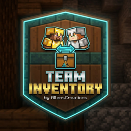

# Listing Kit: Team Inventory

Tap the Copy button on a block, then paste it into the CurseForge listing. Generated from DESCRIPTION.md: edit that, not this file.

## Package Name

```text
Team Inventory
```

## Summary (188/256)

```text
One inventory for the whole team. Team Inventory combines every player's main inventory, armor, offhand and Ender Chest items and keeps them identical for everyone until the game is ended.
```

## Description (HTML)

Paste into the CurseForge description editor in source (HTML) mode.

```html
<div><div style="border:1px solid #15803d;border-radius:12px;line-height:1.5"><br><table style="width:100%;border-width:0"><tbody><tr><td style="width:90px;text-align:center"></td><td style="text-align:left"><h1 style="font-size:28px;text-align:left">Team Inventory</h1><p style="color:#8a94a3;font-size:14px;text-align:left">by ALNStudios</p></td></tr></tbody></table><br><div style="display:flex;flex-wrap:wrap;gap:8px;margin-left:14px;margin-right:14px"><div style="background-color:#15803d;color:#ffffff;border-radius:6px;font-weight:bold;font-size:14px;line-height:2">&nbsp;&nbsp;Bedrock: 1.26+&nbsp;&nbsp;</div><div style="background-color:#15803d;color:#ffffff;border-radius:6px;font-weight:bold;font-size:14px;line-height:2">&nbsp;&nbsp;Experimental: No&nbsp;&nbsp;</div><div style="background-color:#15803d;color:#ffffff;border-radius:6px;font-weight:bold;font-size:14px;line-height:2">&nbsp;&nbsp;Achievements: Likely achievement-friendly; world settings or cheats can disable achievements&nbsp;&nbsp;</div></div><br></div>
<h2 style="text-align:left;font-size:22px">About</h2>
<p>The host or an operator starts the shared inventory with the ALNStudios Controller. From that moment, anything one player picks up, uses or drops changes it for the whole team.</p>
<h2 style="text-align:left;font-size:22px">What You Get</h2>
<div style="display:flex;flex-wrap:wrap;gap:10px"><div style="flex:1;min-width:180px;border:1px solid #8a94a3;border-radius:10px"><div style="background-color:#15803d;font-size:4px;line-height:4px;border-radius:10px">&nbsp;</div><div style="padding-left:12px;margin-right:12px"><p><strong style="font-size:16px">Shared Inventory</strong><br><span>Main inventory, armor and offhand items are shared by every player who takes part.</span></p></div></div><div style="flex:1;min-width:180px;border:1px solid #8a94a3;border-radius:10px"><div style="background-color:#15803d;font-size:4px;line-height:4px;border-radius:10px">&nbsp;</div><div style="padding-left:12px;margin-right:12px"><p><strong style="font-size:16px">ALNStudios Controller</strong><br><span>Only the host or an operator can hold and use the Controller.</span></p></div></div><div style="flex:1;min-width:180px;border:1px solid #8a94a3;border-radius:10px"><div style="background-color:#15803d;font-size:4px;line-height:4px;border-radius:10px">&nbsp;</div><div style="padding-left:12px;margin-right:12px"><p><strong style="font-size:16px">Shared Ender Chest</strong><br><span>Every player's Ender Chest holds the same items, so something stored by one player can be taken out by another.</span></p></div></div><div style="flex:1;min-width:180px;border:1px solid #8a94a3;border-radius:10px"><div style="background-color:#15803d;font-size:4px;line-height:4px;border-radius:10px">&nbsp;</div><div style="padding-left:12px;margin-right:12px"><p><strong style="font-size:16px">Hard Mode</strong><br><span>The host or an operator can switch the Mode to Hard before choosing Start.</span></p></div></div><div style="flex:1;min-width:180px;border:1px solid #8a94a3;border-radius:10px"><div style="background-color:#15803d;font-size:4px;line-height:4px;border-radius:10px">&nbsp;</div><div style="padding-left:12px;margin-right:12px"><p><strong style="font-size:16px">Team Deaths</strong><br><span>The shared inventory drops once when a player dies and is then emptied for the team.</span></p></div></div><div style="flex:1;min-width:180px;border:1px solid #8a94a3;border-radius:10px"><div style="background-color:#15803d;font-size:4px;line-height:4px;border-radius:10px">&nbsp;</div><div style="padding-left:12px;margin-right:12px"><p><strong style="font-size:16px">Ending the Game</strong><br><span>The host or an operator chooses End Game in the Controller menu or uses the function end_game.</span></p></div></div><div style="flex:1;min-width:180px;border:1px solid #8a94a3;border-radius:10px"><div style="background-color:#15803d;font-size:4px;line-height:4px;border-radius:10px">&nbsp;</div><div style="padding-left:12px;margin-right:12px"><p><strong style="font-size:16px">Joining Players</strong><br><span>Players who join while sharing is running add their own items to the team and receive the team inventory.</span></p></div></div></div>
<h2 style="text-align:left;font-size:22px">Get Started</h2>
<table style="width:100%;border-width:0"><tbody><tr><td style="width:44px;text-align:center"><div style="background-color:#15803d;color:#ffffff;font-weight:bold;font-size:15px;text-align:center;border-radius:50%;width:30px;aspect-ratio:1/1;line-height:30px">1</div></td><td style="text-align:left;">Import the pack and enable both the Behavior Pack and the Resource Pack in the settings of any world you want to play.</td></tr><tr><td style="width:44px;text-align:center"><div style="background-color:#15803d;color:#ffffff;font-weight:bold;font-size:15px;text-align:center;border-radius:50%;width:30px;aspect-ratio:1/1;line-height:30px">2</div></td><td style="text-align:left;">The host or an operator uses the Controller to pick the Mode, then chooses Start.</td></tr><tr><td style="width:44px;text-align:center"><div style="background-color:#15803d;color:#ffffff;font-weight:bold;font-size:15px;text-align:center;border-radius:50%;width:30px;aspect-ratio:1/1;line-height:30px">3</div></td><td style="text-align:left;">Play together and coordinate item use with teammates.</td></tr><tr><td style="width:44px;text-align:center"><div style="background-color:#15803d;color:#ffffff;font-weight:bold;font-size:15px;text-align:center;border-radius:50%;width:30px;aspect-ratio:1/1;line-height:30px">4</div></td><td style="text-align:left;">The host or an operator chooses End Game in the Controller menu, or runs the function end_game, to finish.</td></tr></tbody></table>
<h2 style="text-align:left;font-size:22px">Install</h2>
<table style="width:100%;border-width:0"><tbody><tr><td style="width:44px;text-align:center"><div style="background-color:#15803d;color:#ffffff;font-weight:bold;font-size:15px;text-align:center;border-radius:50%;width:30px;aspect-ratio:1/1;line-height:30px">1</div></td><td style="text-align:left;">Download the file from this page and open it with Minecraft.</td></tr><tr><td style="width:44px;text-align:center"><div style="background-color:#15803d;color:#ffffff;font-weight:bold;font-size:15px;text-align:center;border-radius:50%;width:30px;aspect-ratio:1/1;line-height:30px">2</div></td><td style="text-align:left;">Create or edit a world and turn on the new pack(s) in its settings.</td></tr><tr><td style="width:44px;text-align:center"><div style="background-color:#15803d;color:#ffffff;font-weight:bold;font-size:15px;text-align:center;border-radius:50%;width:30px;aspect-ratio:1/1;line-height:30px">3</div></td><td style="text-align:left;">Play. No Experimental toggles needed.</td></tr></tbody></table>
<h2 style="text-align:left;font-size:22px">Support</h2><div style="border:1px solid #8a94a3;border-radius:12px;text-align:center"><br><a href="https://ko-fi.com/alnstudios"></a><br><br></div><p style="text-align:center"><a href="https://www.curseforge.com/members/allenscreations/projects"><strong>CurseForge</strong></a> &nbsp;|&nbsp; <a href="https://mcpedl.com/user/alnstudios/"><strong>MCPEDL</strong></a> &nbsp;|&nbsp; <a href="https://ko-fi.com/alnstudios"><strong>Ko-fi</strong></a></p>
<hr>
<p style="text-align:center;color:#8a94a3;font-size:13px"><strong>By ALNStudios</strong></p>
<div class="spoiler"><p style="font-size:13px"><strong>Permissions and credits</strong></p><ul style="font-size:13px"><li>Rights: All rights reserved for ALNStudios.</li><li>Content creators: You may feature this creation in videos and streams with credit to ALNStudios.</li><li>Redistribution: Do not re-upload this pack or provide direct monetized download bypasses. Link to this page.</li><li>Unofficial community creation. Not an official Minecraft product and not approved by or associated with Mojang or Microsoft.</li></ul></div>
<p style="text-align:center;color:#8a94a3;font-size:12px">Minecraft Bedrock add-on, Team Inventory Bedrock mod, shared inventory, multiplayer shared items, shared armor and offhand, shared ender chest, shared health and hunger, hard mode, works in any world, team survival inventory, Minecraft PE multiplayer, MCPEDL add-on, CurseForge Bedrock, ALNStudios.</p></div>
```

## AI Image Prompts

### Reference Images

- **Logo reference**: attach your own logo. The generator uses it only for brand colors and mood. The result must be a new design, not a copy.
- **Snapshot references**: attach 1 to 4 of your in-game snapshots of this pack. The generator copies their look, not their screen layout.

### Logo Prompt

```text
Use the attached logo only as a brand reference for its color palette and overall mood. Do not copy it. Create a new, original logo with a different composition and a different main symbol. Do not just recolor, resize, crop, mirror or tweak the attached logo.
Create a clean, square (1:1) logo image for the Minecraft Bedrock add-on "Team Inventory".
Base the main symbol on the pack idea above. Match the blocky look of the attached in-game snapshots. Center the logo, use a simple background, and keep it readable at small sizes.
Text: "Team Inventory" and, in small letters, "ALNStudios". ALNStudios is the brand name, so always keep it and never remove or change it. Spell both exactly.
Do not add Minecraft, Mojang or Microsoft logos, watermarks, or characters from other games.
```

### Banner Prompt

```text
Create a wide (16:9) banner image for the Minecraft Bedrock add-on "Team Inventory".
Use the attached in-game snapshots as scene and style references: copy their blocky look, lighting, colors and the kind of scenery they show. Make a new composition inspired by them. Do not copy the on-screen HUD, chat or hotbar.
Use the attached logo only as a brand reference for its colors and mood. Do not copy it. Put a new, original logo design in the banner, large enough to read, on the left or center.
Hint at these pack features visually: Shared Inventory, ALNStudios Controller, Shared Ender Chest, Hard Mode, Team Deaths.
Text: "Team Inventory" and, in small letters, "by ALNStudios". ALNStudios is the brand name, so always keep it and never remove or change it. Spell both exactly.
Leave clear space around the logo. No Minecraft, Mojang or Microsoft logos, no watermarks.
```
