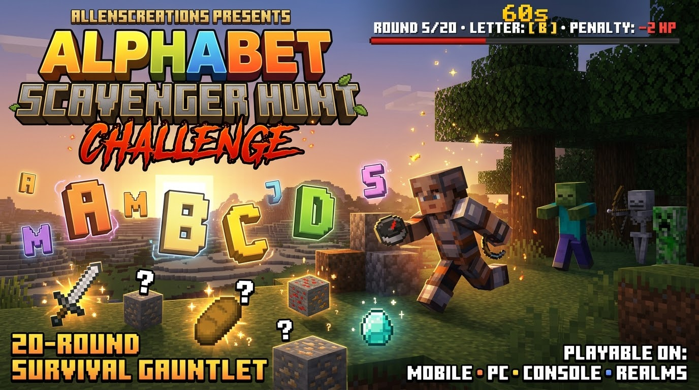

# Minigames Directory -- MCPE Curseforges

This directory stores the source code, game logic, and documentation for custom **Minecraft Bedrock Minigames and Challenges** in the **MCPE Curseforges** collection by AllensCreations.

---

## Available Minigames Catalog

| Minigame | Version | Category | Source Directory | Compiled Build (.mcaddon / .mcpack) | Highlights |
| :--- | :--- | :--- | :--- | :--- | :--- |
| **Alphabet Scavenger Hunt** | `v1.0.0` | Survival Challenge | [`Alphabet-Scavenger-Hunt/`](Alphabet-Scavenger-Hunt/) | [Download (.mcaddon)](https://github.com/AllensCreations/MCPE-Curseforges/raw/main/builds/Alphabet-Scavenger-Hunt/Alphabet_Scavenger_Hunt_AllensCreations.mcaddon) | 20-Round survival challenge. Scavenge items matching the target letter within 60s or suffer permanent max health loss! PrismarineJS item verification engine. |
| **Shared Hivemind Inventory** | `v1.0.0` | Multiplayer Challenge | [`Shared-Hivemind-Inventory/`](Shared-Hivemind-Inventory/) | [Download (.mcaddon)](https://github.com/AllensCreations/MCPE-Curseforges/raw/main/builds/Shared-Hivemind-Inventory/Shared_Hivemind_Inventory_AllensCreations.mcaddon) | All online players share the exact same 36 inventory slots and offhand in real-time. Single death spot drops and anti-duplication engine. |
| **Tethered: Breaker & Builder** | `v1.0.0` | Asymmetric Co-op | [`Tethered-Breaker-And-Builder/`](Tethered-Breaker-And-Builder/) | [Download (.mcaddon)](https://github.com/AllensCreations/MCPE-Curseforges/raw/main/builds/Tethered-Breaker-And-Builder/Tethered_Breaker_And_Builder_AllensCreations.mcaddon) | 2-Player asymmetric co-op challenge. 15m dynamic elastic energy leash, anchor physics, strict mining/building separation, and live tension HUD. |

---

## Minigame Pack Structure

Each minigame inside `minigames/` is structured as a standard Minecraft Bedrock script/behavior pack:
- `behavior_pack/` or root: Game loops, event listeners, scripts, and entities.
- `pack_icon.png`: Official 512x512 1:1 square icon.
- `README.md`: Documentation following repository guidelines.

---

## Terms of Use and Guidelines

- **Creator Attribution:** Created by **AllensCreations**.
- **Rights & Reservation:** All rights reserved for AllensCreations.
- **Content Creators (YouTube, TikTok, Twitch):** You are 100% welcome to showcase these challenges in videos, live streams, and reviews! Please include credit to **AllensCreations** and link to the official download page or this GitHub repository.
- **No Direct Re-uploading:** Do not re-upload these packs, their individual files, or modified copies to any website, app store, or file-sharing service.

---

© All rights reserved for AllensCreations.

