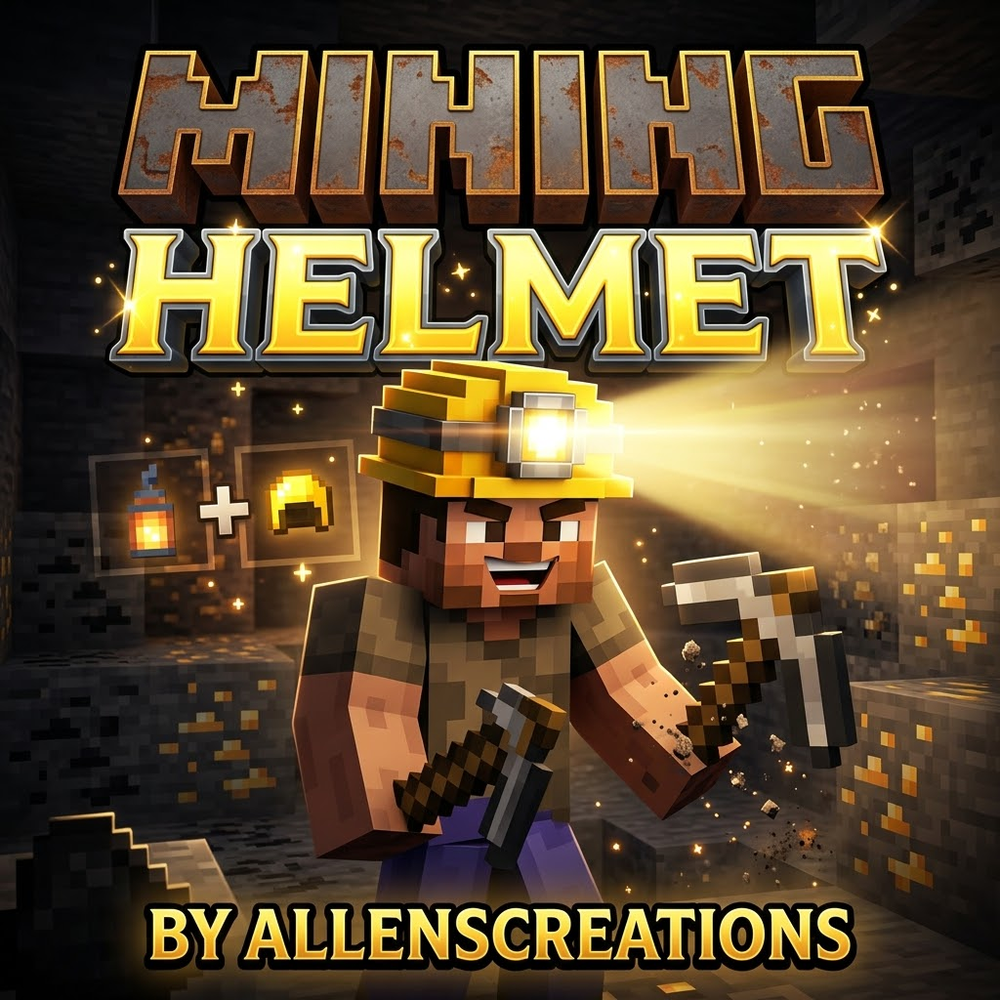

# Mining Helmet - Texture Modification and UV Mapping Guide



This technical guide details the exact pixel mapping, palette structure, and UV offsets used to transform the vanilla Golden Helmet texture into the custom Mining Helmet (`custom:mining_helmet`).

---

## Overview of Assets

| Asset Type | File Path | Resolution | Format | Role |
| :--- | :--- | :--- | :--- | :--- |
| **Armor Model Texture** | `textures/models/armor/mining_helmet_1.png` | 64 x 32 | PNG (RGBA) | Renders on the player/armor stand humanoid head model |
| **Inventory Item Icon** | `textures/items/mining_helmet.png` | 16 x 16 | PNG (RGBA) | Displayed in inventory, hotbar, and crafting results |
| **Attachable Hook** | `attachables/mining_helmet.json` | JSON | Bedrock 1.10+ | Binds model texture to `geometry.humanoid.armor.helmet` |
| **Item Texture Hook** | `textures/item_texture.json` | JSON | Bedrock Atlas | Maps `mining_helmet` icon to `textures/items/mining_helmet` |

---

## Color Palette and Hex Reference

```
┌─────────────────┬───────────┬────────────────────────────────────────┐
│ Region          │ Hex Color │ Role / Description                     │
├─────────────────┼───────────┼────────────────────────────────────────┤
│ Gold Crown      │ #FFEB73   │ Hard hat top specular highlights       │
│ Gold Base Body  │ #FECD2D   │ Standard industrial gold hard hat body │
│ Gold Shadow     │ #C39114   │ Side temples, bevels, and under-brim   │
│ Rubber Lip/Rim  │ #202226   │ Heavy-duty bottom protective gasket    │
│ Metallic Mount  │ #3C4048   │ Dark gray forehead lantern bracket     │
│ Lamp Core Light │ #FFFFF0   │ Center bulb maximum emission cluster   │
│ Lamp Amber Glow │ #FFDC46   │ Warm halogen ambient lens fringe       │
└─────────────────┴───────────┴────────────────────────────────────────┘
```

---

## Detailed Pixel Mapping

### 1. Armor Model (`textures/models/armor/mining_helmet_1.png` - 64 x 32)
The standard Bedrock humanoid armor model uses a 64x32 canvas with the helmet mapped to the head cube:

#### A. Crown and Skullcap Coverage (Hair Area Only)
Unlike full bucket helmets that enclose the jaw and cheeks, the Mining Helmet adopts an open-face miner skullcap profile:
- Top Face (`8, 0` to `16, 8` and `40, 0` to `48, 8`): Full 8x8 gold hardhat dome with raised center ridge (`X: 11..12` / `X: 43..44`) in specular `#FFF176`.
- Upper Hair and Brow (`Y: 8..9`): Continuous gold hard hat cap body with protective dark rubber gasket/rim (`#2E2822`).
- Nape / Back Hair (`Y: 10..11`, `X: 24..31` and `X: 56..63`): Shaded gold cap rim cupping the upper back of the hair.

#### B. Forehead Center Mounted Light
- Mount and Bracket (`Y: 9..11`, `X: 10..13` and `X: 42..45`): Dark metallic alloy mounting plate (`#37474F`).
- Centered Headlamp Lens (`Y: 10`, `X: 11..12` and `X: 43..44`):
  - Core bulb: Pure high-intensity electric white (`#FFFFFF`).
  - Warm lens surround: Halogen emission tint (`#FFF9C4` / `#FFE082`).

#### C. Open Face Transparency (`Y: 12..15`)
- Rows 12 through 15 across all facial and side quadrants are 100% transparent (alpha = 0).
- Rows 10..11 along the eyes and cheeks are transparent outside the center lamp bracket (`X: 10..13`).
- This leaves the player's eyes, nose, cheeks, mouth, chin, and lower ears completely open and visible without visor clipping.

---

### 2. Item Icon (`textures/items/mining_helmet.png` - 16 x 16)


- Hard Hat Silhouette: Modeled with an open hard hat dome, raised central crown ridge, and dark lower brim.
- Center Headlamp:
  - Dark mounting bracket (`#37474F`) at rows `Y: 6..9`.
  - Glowing white center bulb (`#FFFFFF`) with amber lens fringe (`#FFE082` / `#FFF9C4`).
- Open Profile: Distinct miner hard hat silhouette with open lower facial clearance.

---

## Blockbench and Image Editor Instructions

1. Open Blockbench -> Minecraft Skin / Entity Model or any pixel art editor (Aseprite, Photoshop, GIMP).
2. Load `textures/models/armor/mining_helmet_1.png` on the humanoid helmet mesh (`geometry.humanoid.armor.helmet`).
3. Notice that the top crown (`Y: 0..7`) and upper hair rows (`Y: 8..11`) wrap the skull and hair, while `Y: 12..15` remain transparent for the open face.
4. Export as a 32-bit PNG with RGBA alpha channel intact.
