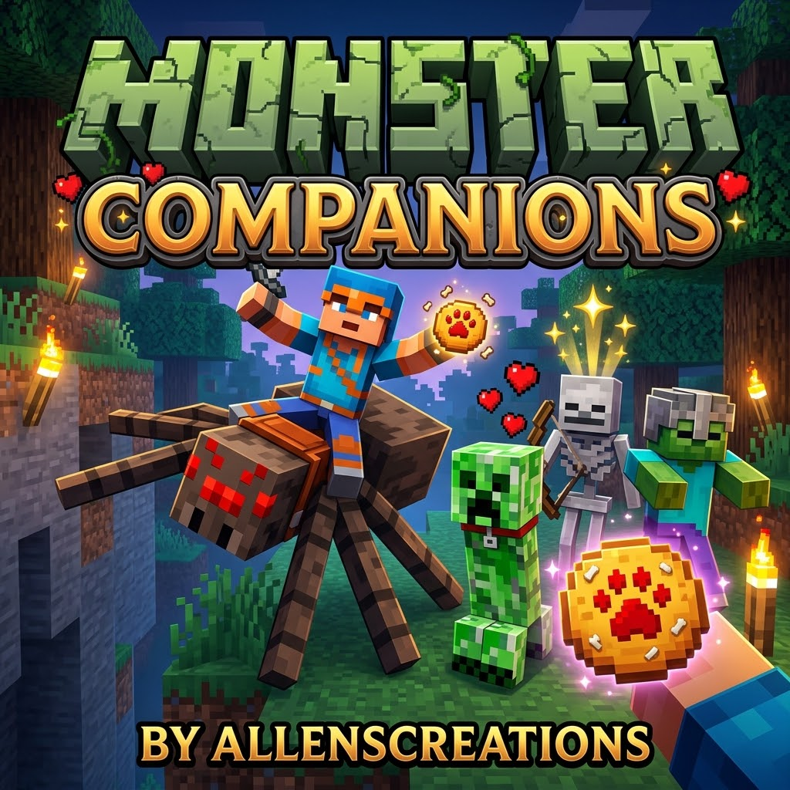
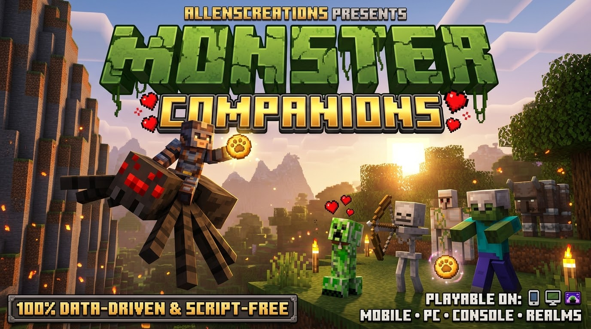
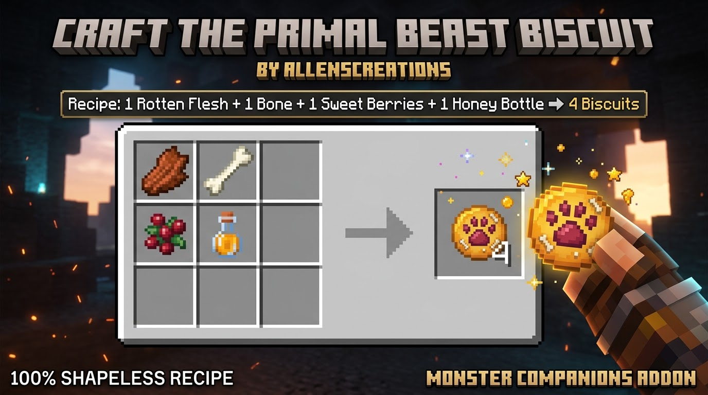

# 🧟 Monster Companions by AllensCreations

> **Created by AllensCreations**  
> *Turn hostile monsters into loyal bodyguards and rideable wall-climbing mounts!*

---

## 📖 About The Pack

Ever wanted a pet Creeper to guard your house? An army of Skeleton archers defending your base? Or riding a giant Spider straight up a sheer mountain cliff?

**Monster Companions** allows you to pacify and tame 32 hostile monsters into loyal, battle-hardened bodyguards and mountable steeds.

**100% Data-Driven & Script-Free.** No experimental toggles needed!

---

## ⚡ How It Works

### 🍖 1. Craft the Primal Beast Biscuit

> **Custom Item:** Baked into a golden honey-glazed cookie with a sweet-berry beast paw print in the center and crunchy bone shards embedded throughout!

Craft the universal treat required to tame and heal any monster:
- **Recipe (Shapeless):** 1 Rotten Flesh + 1 Bone + 1 Sweet Berries + 1 Honey Bottle → **4 Primal Beast Biscuits**

---

### ⚔️ 2. Combat Pacification
You cannot simply bribe a wild monster with candy! You must first **fight and weaken the monster below 50% health** in combat. Once wounded, feed it a **Primal Beast Biscuit** to pacify and tame it into a loyal ally!

---

### 🛡️ 3. Loyal Bodyguard Squad
- **Vision-Friendly Perimeter Guard:** Companions escort you while maintaining a respectful buffer zone. If you sprint ahead or get separated, they catch up and safely teleport behind you, ensuring they never crowd your screen, bump into you, or obstruct your line of sight.
- **Zero Squad Friendly Fire:** Companions are completely immune to player sword sweeps, teammate arrows, splash potions, and explosions. Squad targeting strictly excludes allies, ensuring chaotic crossfire will never trigger infighting among your monsters.
- **Distinct Visual Differentiation:** Tamed companions display an always-visible floating nameplate above their head so you can easily spot your allies in the dark, celebrated with a burst of golden sparkles when tamed. Name tags can be applied directly without needing an anvil.
- **🔮 Loyal Spirit Vexes (Evoker Minions):** When a tamed Evoker summons Vexes, they spawn 100% loyal to you, swarm your enemies, and naturally vanish when their timer expires without ever turning on you. Evoker fangs pass through you and your companions harmlessly.
- **Healing in Combat:** Feed your wounded companion a Beast Biscuit at any time to restore **10 HP (5 hearts)**.
- **Sunlight Protection:** Tamed Zombies, Skeletons, and Phantoms can wear a helmet or hat to survive daytime sunlight without burning!
- **Loyal Kamikaze Creepers:** Tamed Creepers rush enemies that threaten you and detonate on the target (single-use loyal explosive bodyguard!).
- **Clean Defeat:** Fallen companions drop no clutter upon dying in battle.

---

### 🕷️ 4. Rideable Mounts & Native Ride UI (Direct Steering)
Equip a **Saddle** to mount and command large monsters with full **Bedrock Ride UI** integration:
- **On-Screen Mount Button:** Approaching a tamed mount displays the native on-screen **"Mount"** prompt on Mobile touch controls, Controller, and PC.
- **Sneak-To-Interact:** Crouching bypasses the Ride UI, so you can feed Beast Biscuits to heal, attach leads, or apply Name Tags without accidentally climbing on.
- **100% Manual Steering:** When mounted, random wandering and autonomous head-turning are completely disabled. Mounts stand completely still unless you press movement controls!
- **Follow on Dismount:** When you dismount (by pressing Sneak), your mount automatically resumes escorting you on foot as a bodyguard.
- **Spider & Cave Spider:** Climb straight up walls and vertical cliffs!
- **Ravager:** Heavy shock-tank war beast with immense knockback resistance!
- **Iron Golem:** Indestructible frontline war machine!
- **Hoglin & Zoglin:** High-damage Nether battering ram!

---

## 📋 Tamable Mob Roster (32 Monsters)

- 🧟 **Undead:** Zombie, Drowned, Husk, Zombie Villager, Zombified Pigman
- 🏹 **Skeletons:** Skeleton, Stray, Bogged, Wither Skeleton (Wither Blade)
- 🌪️ **1.21 Tricky Trials:** Breeze (Wind Charge Leaper & Launcher)
- 🐗 **Nether Beasts:** Hoglin (War Boar), Zoglin (Undead War Boar)
- 🧨 **Explosives:** Creeper (Loyal Kamikaze)
- 🕷️ **Arachnids (Mountable):** Spider, Cave Spider
- 👁️ **Dimensionals:** Enderman
- 🐷 **Piglins:** Piglin, Piglin Brute
- 🧪 **Occult & Slimes:** Witch, Slime, Magma Cube
- 🔥 **Nether & Sky:** Blaze, Ghast, Phantom
- 🪓 **Illagers & Spirits:** Ravager (Mountable), Vindicator, Pillager, Evoker, Vex (Loyal Spirit Minion)
- 🛡️ **Golems:** Iron Golem (Mountable), Snow Golem

---

## 📥 Direct Downloads

| Package | Format | Description | Download Link |
| :--- | :--- | :--- | :--- |
| **All-In-One (Recommended)** | `.mcaddon` | Installs both Behavior Pack and Resource Pack (custom textures & Ride UI) in one click! | [⬇️ **Download .mcaddon**](https://github.com/AllensCreations/MCPE-Curseforges/raw/main/builds/Monster-Companions/Monster_Companions_AllensCreations.mcaddon) |
| **Behavior Pack Only** | `.mcpack` | Game behaviors, taming logic, mounts, and recipes. | [⬇️ **Download BP (.mcpack)**](https://github.com/AllensCreations/MCPE-Curseforges/raw/main/builds/Monster-Companions/Monster_Companions_BP.mcpack) |
| **Resource Pack Only** | `.mcpack` | Beast Biscuit custom texture, icons, and language names. | [⬇️ **Download RP (.mcpack)**](https://github.com/AllensCreations/MCPE-Curseforges/raw/main/builds/Monster-Companions/Monster_Companions_RP.mcpack) |

---

## 📜 Terms of Use & Guidelines

- **Creator Attribution:** Created by **AllensCreations**.
- **Rights & Reservation:** All rights reserved for AllensCreations.
- **Content Creators (YouTube, TikTok, Twitch):** You are 100% welcome to showcase this pack in videos, live streams, and reviews! Please include credit to **AllensCreations** and link to the official download page or this GitHub repository.
- **No Direct Re-uploading:** Do not re-upload this pack, its individual files, or modified copies to any website, app store, or file-sharing service.
- **No Paywalls or Link Shorteners:** It is strictly prohibited to distribute this pack behind paywalls, ad-gate links (e.g., AdFly, Linkvertise, Boost.ink), or paid monetization walls.
- **Server & Realm Use:** You are free to use this pack on your personal worlds, private servers, and Bedrock Realms.

---

© All rights reserved for AllensCreations.

